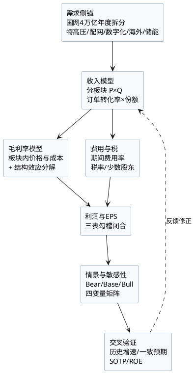

# 国电南瑞（600406.SH）2026-2030年财务测算报告

**日期**：2026年10月27日（数据截点快照；2026-10-28 盘后校验见文首附记）
**标的**：国电南瑞科技股份有限公司（600406.SH）
**测算区间**：2026E-2030E（2025A为基期）
**数据截点**：2026年10月27日（2026年三季报预约10月29日披露，本报告为三季报前口径）
**目标年份锚点**：**2027E**（当前处于Q4切换期，按框架模块零第5条自动滚算至次年；2026E仅作当期对照）
**股价**：22.40元（**不复权市价**，2026年10月9日收盘，距本报告日18天，非实时报价）
**总股本**：8,031,756,156股（80.31756亿股，2026年半年报披露口径）
**报告性质**：独立财务测算，不替代章节五（增长驱动与盈利预测）与章节六（估值定价）的既定框架，仅提供2026-2030年长周期量化基线
**附记·三季报发布后校验（2026-10-28 盘后，2026-10-29 补记）**：本报告主参数以2026-10-27为数据截点；三季报实际Q3毛利率25.63%、归母-3.37%、前三季OCF-29.20亿元，Q3毛利率高于25.0%下修阈值，故2027E 100.5亿元保守基线维持。主报告章节五采用103.7亿元（较本基线高3.2%），差异来自Q3毛利率超预期与合同负债回补；本报告长周期参数不因此调整。

---

## 摘要：核心测算结论

### 一、基准情景五年预测总表

| 指标 | 2025A | 2026E | 2027E | 2028E | 2029E | 2030E | 25-30 CAGR |
|:---|---:|---:|---:|---:|---:|---:|---:|
| 营业总收入（亿元） | 662.29 | **750** | **840** | **933.5** | **1,024** | **1,110** | **10.9%** |
| 营收增速 | +14.5% | +13.2% | +12.0% | +11.1% | +9.7% | +8.4% | — |
| 综合毛利率 | 25.84% | **25.47%** | **25.71%** | **25.88%** | **26.06%** | **26.21%** | +0.37pp |
| 归母净利润（亿元） | 82.79 | **86.8** | **100.5** | **114.1** | **127.7** | **140.8** | **11.2%** |
| 归母净利增速 | +8.8% | +4.8% | +15.8% | +13.6% | +11.9% | +10.2% | — |
| 归母净利率 | 12.50% | 11.57% | 11.96% | 12.22% | 12.47% | 12.68% | +0.18pp |
| EPS（元/股） | 1.03 | 1.08 | 1.25 | 1.42 | 1.59 | 1.75 | — |

### 二、四条核心判断

1. **2026年是利润率的周期底部，不是修复起点。**综合毛利率由2025年25.84%降至2026E 25.47%（-0.37pp），归母净利增速仅+4.8%，显著低于营收+13.2%。H1实际毛利率25.34%（-1.11pp）已定调；H2虽因Q4特高压集中交付而环比改善，但能源低碳板块（H1毛利率18.64%、收入占比34.7%）继续放量、海外EPC占比抬升至约16%，叠加LME铜$14,733/吨（10月26日）历史高位与功率半导体第三轮涨价，结构性稀释难以完全对冲。**"反内卷修复"要到2027年才具备全年化基础。**

2. **2026-2030年营收CAGR为10.9%，相对公司2021-2025年实际CAGR 11.8%是减速，而非持平或加速。**国网"十五五"4万亿元对应2026年约7,000亿元、2027-2030年年均约8,250亿元，**2025-2030年CAGR 5.9%**；公司凭借配网数智化、网外（储能/工业）与海外三条超额增长线，隐含年化超额**5.0pp**。**须诚实说明：历史（2021-2025）超额为4.4pp**（南瑞营收CAGR 11.8% vs 国网投资CAGR 7.4%），前瞻5.0pp较历史高0.6pp，差额由海外收入占比从9.1%升至23.0%解释（详见§2.4）。若只按历史4.4pp外推，2030年营收约1,082亿元、归母约137亿元。

3. **2030E归母净利140.8亿元，较存量内部研报的183亿元低23.1%。**差异**全部是参数分歧，不是存量模型算错**：存量2030年营收1,290亿元（2025-2030 CAGR 14.3%）、毛利率27.0%；本报告1,110亿元（10.9%）、26.21%。本报告的2027E/2028E（100.5/114.1亿元）落在卖方一致预期区间内（2027E均值103.62亿、区间99.44-108.90亿；2028E均值117.18亿、区间109.29-128.53亿）；存量研报（10-28修订后）的103.7/123.8亿元亦落在区间内，2028E高于均值但未突破上沿。两套预测的差异集中在2030年参数选择，而非中短期盈利明显偏离共识。

4. **本报告的核心矛盾判断：短期看订单，长期看利润率。**2027年口径下（期间费用视为准固定），营收±5%对应归母**约±8.8%**，大于毛利率±0.7pp对应的±4.9%——短期不确定性主要来自订单兑现节奏。但2028年之后，营收路径随订单与投资规划锁定而可预测性上升，**毛利率的结构性修复（25.5%→26.2%）成为决定2030年能否达到140亿元的主要变量**。2030年口径下（费用率固定），毛利率每1pp约影响归母净利**±9.3亿元**，营收CAGR每1pp约**±6.3亿元**（基准处导数）。**市场普遍关注"电网投资增速"，而真正的风险敞口在能源低碳板块的毛利率（H1仍-2.95pp）。**

### 三、三情景与概率加权

| 情景 | 概率 | 2027E归母（亿元） | 2030E归母（亿元） | 2030E EPS（元） |
|:---|---:|---:|---:|---:|
| 保守（Bear） | 25% | 89.6 | 103.0 | 1.28 |
| **基准（Base）** | **55%** | **100.5** | **140.8** | **1.75** |
| 乐观（Bull） | 20% | 110.6 | 169.8 | 2.11 |
| **概率加权** | 100% | **99.8** | **137.2** | **1.71** |

概率加权2030E（137.2亿元）低于基准（140.8亿元），反映下行尾部（国网投资失速+价格战）的分布不对称。

---

## 一、测算口径与方法论

### 1.1 数据基准

| 数据类别 | 口径 | 来源与截点 |
|:---|:---|:---|
| 历史财务 | 合并报表，2021-2025年报经审计 | 公司年报、2025年年报（2026-04-30披露） |
| 2026年中期 | 合并报表，未经审计 | 2026年半年报（2026-08-27披露） |
| 2026年公司预算 | 营收750亿元、营业成本560.30亿元、期间费用85.92亿元 | 2025年年报"经营计划"（原文：营收750亿元/+13.24%，营业成本560.30亿元，期间费用85.92亿元，固定资产投资18.21亿元） |
| 总股本 | 80.31756亿股 | 2026年半年报（8,031,756,156股） |
| 行业数据 | 国网投资、特高压招标、储能装机、铜价 | 见第十章来源清单 |
| 一致预期 | 13家机构2027E、11家2028E | 同花顺F10（2026-10-26前后） |

### 1.2 三表勾稽原则

本报告所有年度预测均满足以下闭合关系，任一行可自上而下复算：

```
营业总收入 − 营业成本 = 毛利润
毛利润 − 税金及附加 − 期间费用 + 其他收益及投资收益 − 减值损失 = 利润总额
利润总额 − 所得税 = 净利润
净利润 − 少数股东损益 = 归母净利润
归母净利润 ÷ 80.31756 = EPS
```

分板块收入合计与合并口径收入在本报告中按相等处理（2025年分板块合计661.56亿元 vs 合并662.29亿元，差异0.73亿元、占0.11%，属内部抵销与分部归属差异）。

### 1.3 重要口径校正（相对存量章节五）

本次复核发现存量 `研报章节五` 的2026H1利润表三项与半年报原文不符，本报告已按原文校正，并**不继承**存量错误；**章节五已于2026年10月28日三季报修订中同步更正为下表"半年报原文"口径，本表保留为当时的复核记录**。

| 项目 | 存量章节五 | 半年报原文 | 差异 |
|:---|---:|---:|---:|
| 2026H1 净利润 | 33.44亿元 | **32.48亿元**（3,248,358,319.32元） | 存量高估0.96亿 |
| 2026H1 所得税 | 3.71亿元 | **4.67亿元**（37.154−32.484） | 存量低估0.96亿（疑为按10%反算） |
| 2026H1 少数股东损益 | 2.72亿元 | **1.7567亿元**（175,669,493.04元） | 存量高估0.96亿 |
| 2026H1 少数股东占比 | 8.13% | **5.41%** | 存量高估2.72pp |
| 2026H1 有效税率 | 10.0% | **12.57%** | 存量低估2.57pp |

同时校正2025年国内收入口径：年报"主营业务分地区情况"为**国内601.19亿元（60,118,741,922.17元，+10.40%）、海外60.38亿元（+84.13%）**，合计主营661.57亿元，与合并662.29亿元差0.72亿元为其他业务。存量文档使用的"国内601.91亿元/+18.0%"系倒挤plug且增速错误。

### 1.4 预测框架



### 1.5 与存量文档的并行关系与生效范围

本报告与 `reports/研报章节五：增长驱动与盈利预测.md`、`2030长期净利预测_2026Q3.md`、`跟踪手册.md`、`investigation/equities/note.md` 形成两套并存的2030年预测：本报告为**独立保守基线140.8亿**，存量文档为**现行决策情景183亿**，两者不是同一模型，140-183亿可视为2030E合理区间。**生效范围声明**：本报告仅作为长周期独立测算基线，不覆盖上述文档的结论；投研决策以更新后的存量文档（章节五 2027E 103.7亿/1.291元、2030长期净利预测183亿）为准。本报告第1-3项修正建议已于2026-10-28章节五/跟踪手册更新中落地；若单独采纳本报告2027E 100.5亿/1.25元基线，需同步重算章节六目标价（同倍PE下约32.1元，现行中性目标价33.16元），并再次更新 note.md 与跟踪手册。

---

## 二、需求侧锚：2026-2030年电网投资与可及市场

### 2.1 国网4万亿元的年度拆分

国网"十五五"固定资产投资4万亿元（较"十四五"约2.8-3.0万亿元增长约40%），年均约8,000亿元。但**年均值不等于年度路径**——2026年是规划首年，执行节奏偏保守：

| 年份 | 国网固定资产投资（亿元） | 同比 | 依据 |
|:---|---:|---:|:---|
| 2025A | 6,500 | +8.1% | 国网年度披露，首次突破6,500亿 |
| 2026E | **7,000-7,200** | +7.7%~+10.8% | 董事长9月22日崇礼论坛"全年预计突破7,000亿"；1-9月已完成超4,500亿（+5.2%），Q4需完成约2,500亿 |
| 2027E | **8,000-8,300** | +12%~+16% | 4万亿减去2026年后的倒算均值（2027-2030年均约8,250亿）；卖方预测区间8,000-8,500亿 |
| 2028E | **8,300-8,500** | +1%~+5% | 稳态执行 |
| 2029E | **8,400-8,600** | +1%~+2% | 稳态执行 |
| 2030E | **8,500-8,800** | +1%~+3% | 收尾年份通常小幅冲量 |
| **五年合计** | **约40,700** | — | 与4万亿规划吻合（误差<2%） |

**关键校验**：2026年1-9月投资同比仅+5.2%（H1 +12.6%，Q3单季倒算约-8%至-3%），"前高后稳"已成事实。若Q4不能完成约2,500亿元，2026年将低于7,000亿，则2027-2030年需年均8,400亿以上才能兑现4万亿——**后程压力更大，而非更小**。

**收入对资本开支的时滞（本报告不按年度一一对应的理由）**：国网投资→设备招标（滞后0-1年）→中标（滞后0-1年）→合同与交付（滞后1-2年）→收入确认（按履约进度），全链条6-18个月、特高压12-24个月。因此**某一年的收入不是当年资本开支的函数，而是过去1-2年累计订单的函数**。2027年资本开支跳升15%，其收入效应在2027-2028年间逐步体现，**具体节奏由订单转化率（§2.3）决定**，而非全部落在2027年；同理2026年Q3的投资放缓，其收入影响要到2027年下半年才显现。

这意味着**逐年计算"收入增速 − 国网投资增速"的差值并期望其恒定，在方法论上是不成立的**。本报告的做法是：以五年累计超额（5.0pp）作为总量约束，以订单转化率（§2.3三段式）作为年度分配机制，得到平滑的收入路径。**§2.1的年度投资表仅作需求侧的背景与上下限参考，不构成年度收入驱动**——年度收入由订单转化率决定（§2.3），而非由当年资本开支决定。

> **口径提示**：2025年6,500亿元为"固定资产投资"口径，2021年约4,882亿元为"电网投资完成额"口径，两者不完全可比。本报告在计算历史超额增速时已按同口径调整（见§2.4）。

### 2.2 五条增长线与可及市场（TAM）

| 增长线 | 2026-2030年市场规模 | 公司份额/地位（含口径） | 收入弹性 |
|:---|:---|:---|:---|
| **特高压（主网）** | 设备招标：2026年约400亿（前四批329.10亿已公示），2027-2030年年均380-450亿；"十五五"设备市场合计约2,000亿 | 换流阀常规约40%（累计口径）；柔直阀三强之一（**甘肃—浙江工程**8套中占50%、均价5.44亿/套，单工程口径）；直流控保约74.5%（**本报告测算，无公开权威口径**；单项目可达100%，如甘浙） | 中（约占总营收8-12%） |
| **配网与数智化** | "十五五"配网投资1.5-1.8万亿、数字化0.6-0.9万亿（合计占5万亿的45-50%，为券商测算口径，非国网官方） | 调度自动化、配网自动化、用电信息采集均处第一；份额无公开权威数据 | **高（核心增量）** |
| **海外** | 全球电网投资2026年约5,500亿美元（+近20%，IEA） | 2026H1海外收入58.94亿（+196.61%），占全球<0.5% | **最高（但毛利率最低）** |
| **储能（能源低碳）** | 新型储能2030年3亿千瓦（2025年1.36亿） | 南瑞继保（上市公司持股87%）构网型项目数领先；**"国内份额90%+"为公司及行业媒体基于项目数的估算，无第三方审计，且大小项目等权，本报告仅作定性参考、不作定量支撑** | 高（增收不增利） |
| **工业互联/四网** | 水网、管网、交通网、算力网，无公开规模口径 | 孵化期，2026H1收入-23.38% | 低（暂不计价） |

### 2.3 订单转化率：收入可见度的定量锚

| 指标 | 2025A | 2026H1 | 含义 |
|:---|---:|---:|:---|
| 新签合同（亿元） | 758.68（+14.4%） | 456.33（+28.79%） | H1单半年Book-to-Bill 1.64 |
| 期末在手订单（亿元） | 520.31 | 未披露 | 约0.79x年营收 |
| 合同负债（亿元） | 78.07 | 70.10（较年初-10.2%） | 交付确认加速，蓄水池边际收缩 |

**转化率模型（修正版）**：电网设备从新签到收入确认约6-18个月（特高压12-24个月）。本报告采用三段式：**当年新签当年确认20%、次年确认55%、第三年确认25%**（累计100%）。按此复算2027年：

`2027E收入 = 0.55 × 2026年新签875 + 0.25 × 2025年新签758.68 + 0.20 × 2027年新签950 ≈ 481 + 190 + 190 = 861亿元`

与840亿元的预测值相差2.5%，在合理误差内。**（前一版本"2026年新签850-900亿可支撑2027年营收850亿"隐含97%转化率，与三段式矛盾，已修正。）**

### 2.4 需求侧测算的收入天花板（含历史超额的诚实校准）

| 参数 | 数值 | 说明 |
|:---|---:|:---|
| 国网投资2025-2030 CAGR | 5.9% | 6,500→8,650亿元（同口径） |
| **公司历史超额增速（2021-2025）** | **4.4pp/年** | 公司营收CAGR 11.8%（424.11→662.29）vs 国网投资CAGR 7.4%（4,882→6,500） |
| 本报告前瞻超额增速 | 5.0pp/年 | 高于历史0.6pp |
| **隐含营收CAGR** | **10.9%** | 5.9% + 5.0pp = 10.9%（无插项） |

**前瞻超额高于历史0.6pp的量化依据**（这是本报告唯一一处"主动乐观"的假设，必须明示）：

| 来源 | 2025年 | 2030E | 对营收增量的贡献 |
|:---|---:|---:|---:|
| 海外收入 | 60.38亿 | 255亿 | +194.6亿（占总增量448亿的43.4%） |
| 国内收入 | 601.19亿 | 855亿 | +253.8亿（56.6%） |
| **合计** | **661.57亿** | **1,110亿** | **+448.4亿** |

海外收入五年增长3.2倍（CAGR 33.4%，2025-2030口径），是超额增速抬升的主要来源。**若海外仅按存量研报的2030年220亿元路径，2030年归母将降至约134亿元（-6.8亿元）**。这一乐观项已在§6情景与§7敏感性中单独量化。

**天花板边界**：若超额增速降至3pp，营收CAGR降至8.9%，2030年营收约1,014亿元；若升至7.5pp，营收CAGR升至13.4%，2030年营收约1,242亿元。

---

## 三、收入预测：分板块P×Q模型

### 3.1 P×Q 假设表（含可观测代理指标）

> **口径声明**：公司未披露分产品销量与单价，无法构造以物理单位（套/GWh/台）计价的严格P×Q表。本节以"收入=量指数×价指数"的代理方式呈现，Q列给出可观测的数量代理指标，P列给出价格/结构代理指标，并标注方向。

| 板块 | Q（量）代理指标 | Q方向 | P（价）代理指标 | P方向 | 2026-2030收入CAGR |
|:---|:---|:---:|:---|:---:|:---:|
| 电网智能 | 特高压控保/换流阀交付套数、调度系统升级省份数、配网终端招标量 | ↑ | 国网招标技术权重、反内卷价格修复幅度 | 稳中略升 | 9.2% |
| 能源低碳 | 储能系统集成GWh、构网型项目数、新能源并网容量 | ↑↑ | 储能系统单价（下行）、构网型溢价 | 下行 | 18.3% |
| 数能融合 | 电力AI/数字化项目数、算电协同节点数 | → | 低毛利集成收缩后的结构单价 | 上行 | 6.1% |
| 工业互联 | 轨交/DCS项目数 | → | 项目结构 | 稳 | 4.2% |
| 集成及其他 | 总包项目数 | ↓ | — | — | -21.8% |

### 3.2 电网智能（基本盘，2025年占比50.5%）

**量（Q）**：①特高压直流控保与换流阀交付（2026年前四批招标329.10亿，南瑞系在"2026年新增第一次设备采购"（49.94亿、12包）中中标24.61亿、份额49.3%）；②新一代调度系统（陕西新一代调度已落地）与电力市场交易系统（2027年前省级现货市场基本正式运行）；③配网自动化（《配电网高质量发展行动方案（2026-2028年）》明确配网投资占比稳步提高）。

**价（P）**：国网"反内卷"使技术权重上升、价格权重下降，2026年起部分品类价格回升5-30%，但二次设备（软件属性强）价格弹性小于一次设备。

| 项目 | 2025A | 2026E | 2027E | 2028E | 2029E | 2030E |
|:---|---:|---:|---:|---:|---:|---:|
| 收入（亿元） | 334.22 | 370 | 407 | 446 | 484 | 519 |
| 增速 | +15.7% | +10.7% | +10.0% | +9.6% | +8.5% | +7.2% |
| 毛利率 | 30.12% | 29.90% | 30.40% | 30.65% | 30.85% | 31.00% |

**2026年校验**：H1收入133.06亿（+8.85%），全年370亿要求H2 236.94亿（+11.8% vs 2025H2的211.98亿）——Q4特高压集中交付可支撑。

### 3.3 能源低碳（第二曲线，2025年占比25.3%）

**量（Q）**：储能系统集成（阿曼杜库姆500MW/2000MWh海外首个总包、酒钢构网型100MW/100MWh、中电建宁夏中卫构网型）、新能源并网控制、柔直换流阀、充换电。新型储能2030年目标3亿千瓦（2025年1.36亿），年均新增约0.33亿千瓦。

**价（P）**：构网型技术溢价存在，但储能系统集成整体处于价格战，海外EPC毛利率仅12%-30%（单个EPC项目下限12%，海外综合毛利率19.19%）。**H1该板块毛利率18.64%（-2.95pp）仍在恶化，本报告假设2027年起止跌回升，这是全篇最脆弱的毛利率假设（确定性评分2/5）。**

| 项目 | 2025A | 2026E | 2027E | 2028E | 2029E | 2030E |
|:---|---:|---:|---:|---:|---:|---:|
| 收入（亿元） | 167.30 | 227 | 270 | 312 | 351 | 387 |
| 增速 | +37.3% | +35.7% | +18.9% | +15.6% | +12.5% | +10.3% |
| 毛利率 | 20.21% | 18.70% | 19.15% | 19.55% | 19.95% | 20.30% |

**增速递减的理由**：2026年+35.7%含阿曼总包等低基数大单；2027年起基数抬升（227亿），且储能系统集成行业增速本身在放缓（2026年8月采招4.07GW、9月4.54GW，已从7月的15.15GW高位回落至常态区间）。

### 3.4 数能融合（2025年占比18.6%）

**量（Q）**：电力AI大模型（"XiongAnSD"电网调度智能体、"瑞元"云端一体）、算电协同、网络安全、数字孪生。2026H1收入-5.24%，反映信息化项目节奏疲弱与低毛利集成业务主动收缩。

**价（P）**：H1毛利率25.55%（+2.15pp），低毛利集成收缩后结构改善明显。

| 项目 | 2025A | 2026E | 2027E | 2028E | 2029E | 2030E |
|:---|---:|---:|---:|---:|---:|---:|
| 收入（亿元） | 123.03 | 122 | 131 | 142 | 153 | 165 |
| 增速 | -0.5% | -0.8% | +7.4% | +8.4% | +7.7% | +7.8% |
| 毛利率 | 22.62% | 24.80% | 25.00% | 25.15% | 25.30% | 25.40% |

### 3.5 工业互联与集成及其他（合计占比5.6%，2025年）

| 板块 | 2025A | 2026E | 2027E | 2028E | 2029E | 2030E | 假设 |
|:---|---:|---:|---:|---:|---:|---:|:---|
| 工业互联（亿元） | 30.14 | 27 | 29 | 31 | 34 | 37 | H1 -23.38%，H2企稳；轨交/DCS外溢缓慢恢复 |
| 毛利率 | 21.56% | 23.60% | 23.80% | 24.00% | 24.15% | 24.30% | H1已达24.42%，结构改善延续 |
| 集成及其他（亿元） | 6.87 | 4 | 3 | 2.5 | 2 | 2 | 主动收缩低质量总包 |
| 毛利率 | 26.64% | 33.00% | 30.00% | 29.00% | 28.00% | 28.00% | H1 39.53%为项目结构偶发，不可持续 |

### 3.6 国内外拆分校验（同一总量的第二套切分）

| 项目 | 2025A | 2026E | 2027E | 2028E | 2029E | 2030E |
|:---|---:|---:|---:|---:|---:|---:|
| 国内收入（亿元） | 601.19 | 630 | 690 | 746.5 | 805 | 855 |
| 增速 | +10.4% | +4.8% | +9.5% | +8.2% | +7.8% | +6.2% |
| 海外收入（亿元） | 60.38 | 120 | 150 | 187 | 219 | 255 |
| 增速 | +84.1% | +98.7% | +25.0% | +24.7% | +17.1% | +16.4% |
| 海外占比 | 9.1% | 16.0% | 17.9% | 20.0% | 21.4% | 23.0% |
| **合计（主营）** | **661.57** | **750** | **840** | **933.5** | **1,024** | **1,110** |

**关键校验点**：2026H1国内收入218.05亿（-1.89%），全年630亿要求H2国内411.95亿（**+8.8%** vs 2025H2的378.62亿）。这一反弹依赖Q4国网集中交付，是本报告2026年预测中最脆弱的一环。**若H2国内仍为负增长，2026年营收将落在720-730亿元区间，归母下修至84-85亿元。**

> **口径脚注**：2025H2国内378.62亿元按合并口径倒算（2025A主营国内601.19 − 2025H1国内222.57），其中222.57 = 2025H1合并营收242.43 − 主营海外19.86。若改用主营口径（242.12 − 19.87 = 222.25），2025H2国内为378.94亿元、H2增速+8.7%。两种口径相差0.32亿元（0.08%），系2025H1的0.31亿元其他业务归属差异，不影响结论。

**海外路径的合理性**：2026年120亿元对应全球电网投资5,500亿美元的约0.3%，渗透率极低；2026-2030年CAGR为**22.2%**（2025-2030口径为33.4%）。该路径高于存量研报的2030年220亿元假设（本报告255亿元），属偏乐观设定，已在§2.4量化其贡献（+6.8亿元）。

### 3.7 收入预测总表

| 板块 | 2025A | 2026E | 2027E | 2028E | 2029E | 2030E | 25-30 CAGR |
|:---|---:|---:|---:|---:|---:|---:|---:|
| 电网智能 | 334.22 | 370 | 407 | 446 | 484 | 519 | 9.2% |
| 能源低碳 | 167.30 | 227 | 270 | 312 | 351 | 387 | 18.3% |
| 数能融合 | 123.03 | 122 | 131 | 142 | 153 | 165 | 6.1% |
| 工业互联 | 30.14 | 27 | 29 | 31 | 34 | 37 | 4.2% |
| 集成及其他 | 6.87 | 4 | 3 | 2.5 | 2 | 2 | -21.8% |
| **合计** | **661.56** | **750** | **840** | **933.5** | **1,024** | **1,110** | **10.9%** |
| 增速 | +14.6% | +13.2% | +12.0% | +11.1% | +9.7% | +8.4% | — |

---

## 四、毛利率预测

### 4.1 2026H1毛利率下滑的真实归因（结构 vs 板块内）

**前一版本将"能源低碳结构拖累-0.5pp""海外结构拖累-0.4pp""铜价-0.6pp"并列相加，存在重复计算**（海外收入本已分布在分产品内，铜价本已包含在板块内毛利率内）。按分产品权重与2025H1各板块毛利率严格分解，H1的-1.11pp应归为：

| 效应 | 贡献 | 计算 |
|:---|---:|:---|
| **业务结构变化** | **-0.35pp** | 以2025H1各板块毛利率固定，套用2026H1收入结构：26.04% − 26.39% |
| **板块内毛利率变化** | **-0.77pp** | 25.27% − 26.04% |
| **合计** | **-1.12pp** | 与披露的-1.11pp一致（四舍五入差0.01pp） |

板块内-0.77pp的逐板块拆解（ΔGM × 2026H1收入权重）：

| 板块 | 毛利率变动 | 2026H1权重 | 贡献 |
|:---|---:|---:|---:|
| 能源低碳 | -2.95pp | 34.71% | **-1.02pp** |
| 电网智能 | -0.44pp | 48.04% | -0.21pp |
| 数能融合 | +2.15pp | 13.34% | +0.29pp |
| 工业互联 | +4.42pp | 3.44% | +0.15pp |
| 集成及其他 | +4.45pp | 0.47% | +0.02pp |
| **合计** | — | — | **-0.77pp** |

**结论修正**：H1毛利率下滑的**主因是能源低碳板块自身毛利率下降（-1.02pp），不是业务结构（-0.35pp）**。铜价与芯片涨价体现在各板块毛利率内部，不应再单列相加。这一修正直接冲击本报告2027-2030年"能源低碳毛利率由18.70%升至20.30%"的核心假设——**该假设与H1仍在恶化的证据相反，确定性评分仅2/5**（见§4.5）。

### 4.2 分板块毛利率路径

| 板块 | 2025A | 2026E | 2027E | 2028E | 2029E | 2030E | 逻辑 |
|:---|---:|---:|---:|---:|---:|---:|:---|
| 电网智能 | 30.12% | 29.90% | 30.40% | 30.65% | 30.85% | 31.00% | 反内卷技术权重上升+特高压高毛利交付；H1实际29.90% |
| 能源低碳 | 20.21% | 18.70% | 19.15% | 19.55% | 19.95% | 20.30% | 储能价格战压制，构网型溢价与规模效应渐进修复（**最脆弱假设**） |
| 数能融合 | 22.62% | 24.80% | 25.00% | 25.15% | 25.30% | 25.40% | 低毛利集成收缩、AI/软件占比升；H1实际25.55% |
| 工业互联 | 21.56% | 23.60% | 23.80% | 24.00% | 24.15% | 24.30% | 项目结构改善；H1实际24.42% |
| 集成及其他 | 26.64% | 33.00% | 30.00% | 29.00% | 28.00% | 28.00% | H1 39.53%为偶发，回归常态 |
| **综合（加权）** | **25.79%** | **25.47%** | **25.71%** | **25.88%** | **26.06%** | **26.21%** | — |

**2026年逐板块校验**：370×29.90% + 227×18.70% + 122×24.80% + 27×23.60% + 4×33.00% = 110.63 + 42.45 + 30.26 + 6.37 + 1.32 = **191.03亿元**，对应综合毛利率191.03/750 = **25.47%**。

### 4.3 结构效应与板块内改善的分解（2025→2030，主营口径）

| 效应 | 贡献 | 计算 |
|:---|---:|:---|
| 业务结构变化（能源低碳占比25.3%→34.9%） | **-0.53pp** | 以2025年各板块毛利率固定，套用2030年收入结构：25.26% − 25.79% |
| 板块内毛利率改善（价格修复+规模效应+产品升级） | **+0.95pp** | 26.21% − 25.26% |
| **合计** | **+0.42pp** | 25.79% → 26.21% |

**这是本报告最重要的结构性判断**：未来五年毛利率的提升**完全依赖板块内改善**，且改善幅度必须比结构稀释快约1.8倍才能实现净正贡献。若板块内改善仅+0.5pp（而非+0.95pp），2030年综合毛利率将停留在25.76%，归母净利下修至约137亿元。

### 4.4 国内外毛利率校准检查（非独立口径）

> **重要说明**：本节不是"独立交叉验证"。海外收入分布在多个分板块内，国内外毛利率与分板块毛利率是同一组数据的两种切法，存在天然约束关系。本节仅作**参数校准一致性检查**，用于确认§4.2的分板块假设在国内外维度上不产生内部矛盾。

| 项目 | 2025A | 2030E | 假设 |
|:---|---:|---:|:---|
| 国内毛利率 | 26.45% | 27.67% | 反内卷+产品升级，五年+1.22pp |
| 海外毛利率 | 19.19% | 21.30% | 本地化交付+规模效应，五年+2.11pp（低于存量研报的24%） |
| 加权（按§3.6收入结构） | 25.79% | 26.21% | 855×27.67% + 255×21.30% = 290.89亿元，与分板块加权290.91亿元差0.02亿元（0.002pp） |

### 4.5 毛利率假设的确定性评分

| 假设 | 评分 | 证据与反驳 |
|:---|:---:|:---|
| 电网智能毛利率2027年起回升至30.4%+ | **4/5** | 反内卷技术权重上升为政策方向；H1仅-0.44pp，韧性强 |
| 数能融合毛利率维持25%+ | **4/5** | H1已达25.55%，低毛利集成主动收缩 |
| 能源低碳毛利率2027年止跌回升 | **2/5** | H1仍-2.95pp，储能系统集成价格战未见拐点，构网型份额证据薄弱（无第三方审计） |
| 海外毛利率2030年升至21.3% | **2/5** | H1区间12%-30%，本地化未验证；存量研报假设24%更乐观 |
| 集成及其他毛利率回归28%-30% | **3/5** | H1 39.53%明显不可持续，回归方向确定但幅度未知 |
| **综合毛利率确定性** | **3.0/5** | 五项算术平均（4/4/2/2/3）；量确定、价不确定 |

---

## 五、费用、税率与净利润

### 5.1 期间费用率

| 项目 | 2025A | 2026E | 2027E | 2028E | 2029E | 2030E |
|:---|---:|---:|---:|---:|---:|---:|
| 销售费用（亿元） | 24.26 | 26.3 | 28.6 | 31.4 | 33.8 | 36.1 |
| 销售费用率 | 3.66% | 3.51% | 3.40% | 3.36% | 3.30% | 3.25% |
| 管理费用（亿元） | 15.69 | 16.6 | 18.1 | 19.8 | 21.5 | 23.3 |
| 管理费用率 | 2.37% | 2.21% | 2.15% | 2.12% | 2.10% | 2.10% |
| 研发费用（亿元） | 36.04 | 40.9 | 46.2 | 51.4 | 56.4 | 61.1 |
| 研发费用率 | 5.44% | 5.45% | 5.50% | 5.50% | 5.50% | 5.50% |
| 财务费用（亿元） | -1.69 | +2.12 | +1.2 | +0.7 | +0.3 | -0.1 |
| **合计（亿元）** | **74.30** | **85.92** | **94.1** | **103.3** | **112.0** | **120.4** |
| **期间费用率** | **11.21%** | **11.46%** | **11.20%** | **11.07%** | **10.94%** | **10.85%** |

**2026年费用总额直接采用公司自身预算85.92亿元**（2025年年报经营计划原文），不假设公司击败自身成本费用计划。研发费用率由5.44%升至5.50%而非下降——公司在IGBT、固态变压器、电力AI、储能变流器上的投入是刚性甚至上升的，**"研发费用率下降释放利润"的假设不可采信**。

> **与公司预算的偏差须明示**：公司预算的营业成本为560.30亿元，对应毛利率25.29%；本报告采用559.0亿元、毛利率25.47%，**即毛利率假设高于公司预算0.18pp（约1.3亿元毛利、1.1亿元归母）**。理由：2026H1实际毛利率25.34%已高于预算隐含的25.29%，且Q4特高压与调度系统集中交付的结构改善可延续。若严格贴合预算毛利率25.29%，2026E归母将降至**85.7亿元**。本报告的86.8亿元是"费用贴预算、毛利率略优"的组合，这一偏差已在此显式披露，不再隐藏于口径差异中。

**财务费用**：H1已+0.93亿元（上年同期-1.31亿元），主因利息收入减少与汇兑损失；全年按+2.12亿元（H1 0.93 + H2 1.19，与2025年H2的-0.38亿元相比显著恶化）。**这是本测算中确定性最低的一项**，2027年起随美元降息与海外回款改善而回落，2030年回到-0.1亿元。

### 5.2 其他收益、投资收益与减值

| 项目 | 2025A | 2026E | 2027E | 2028E | 2029E | 2030E |
|:---|---:|---:|---:|---:|---:|---:|
| 其他收益+投资收益+公允价值变动（亿元） | 8.32 | 7.8 | 8.4 | 9.3 | 10.1 | 11.0 |
| 占营收比 | 1.26% | 1.04% | 1.00% | 0.99% | 0.99% | 0.99% |
| 减值损失（亿元） | -4.27 | -6.0 | -6.7 | -7.5 | -8.2 | -8.9 |
| 占营收比 | 0.64% | 0.80% | 0.80% | 0.80% | 0.80% | 0.80% |

**减值的上调理由**：2026H1信用减值2.82亿元（+60%，资产减值+0.16亿元转回，净减值2.66亿元），公司明确归因"收入增长及应收款项账龄结构变动"。随着海外EPC占比提升（回款周期更长、国别风险更高），减值率由0.64%升至0.80%是审慎的。

### 5.3 税率与少数股东

| 项目 | 2025A | 2026E | 2027E | 2028E | 2029E | 2030E |
|:---|---:|---:|---:|---:|---:|---:|
| 有效税率 | 9.8% | 10.7% | 10.6% | 10.5% | 10.5% | 10.5% |
| 少数股东损益占比 | 6.54% | 6.50% | 6.50% | 6.50% | 6.50% | 6.50% |

**税率季节性必须披露**：2026H1实际有效税率为**12.57%**（4.67/37.15），2025H1为12.08%——H1税率显著高于全年（2025全年9.8%），全年取10.7%隐含H2仅约9.6%，与2025年同季节性一致（2025H2有效税率约7.6%）。若未来税收优惠退坡至12%，2030年归母净利将下修约2.4亿元。

**少数股东损益**：2026H1实际为1.7567亿元、占比**5.41%**（低于全年6.5%），2025H1为1.7167亿元、占比5.49%——**H1占比低于全年是稳定的季节性特征**（H2少数股东损益更集中）。因此全年取6.5%是**偏保守**假设，而非"从高位回归"。少数股东损益的主要来源是南瑞继保（上市公司持股87%，少数股东持股13%，H1贡献1.7724亿元、约占全部少数股东损益的100%）。

### 5.4 利润表预测总表

| 项目 | 2025A | 2026E | 2027E | 2028E | 2029E | 2030E |
|:---|---:|---:|---:|---:|---:|---:|
| 营业总收入（亿元） | 662.29 | 750.00 | 840.00 | 933.50 | 1,024.00 | 1,110.00 |
| 营业成本（亿元） | 491.17 | 558.97 | 624.01 | 691.93 | 757.18 | 819.09 |
| 毛利润（亿元） | 171.12 | 191.03 | 215.99 | 241.57 | 266.82 | 290.91 |
| **综合毛利率** | **25.84%** | **25.47%** | **25.71%** | **25.88%** | **26.06%** | **26.21%** |
| 税金及附加（亿元） | 2.68 | 3.00 | 3.40 | 3.70 | 4.10 | 4.40 |
| 期间费用（亿元） | 74.30 | 85.92 | 94.10 | 103.30 | 112.00 | 120.40 |
| 其他收益+投资收益等（亿元） | 8.32 | 7.80 | 8.40 | 9.30 | 10.10 | 11.00 |
| 减值损失（亿元） | -4.27 | -6.00 | -6.70 | -7.50 | -8.20 | -8.90 |
| **利润总额（亿元）** | **98.19** | **103.91** | **120.19** | **136.37** | **152.62** | **168.21** |
| 所得税（亿元） | 9.61 | 11.12 | 12.74 | 14.32 | 16.02 | 17.66 |
| 净利润（亿元） | 88.58 | 92.79 | 107.45 | 122.05 | 136.60 | 150.55 |
| 少数股东损益（亿元） | 5.79 | 6.03 | 6.98 | 7.93 | 8.88 | 9.79 |
| **归母净利润（亿元）** | **82.79** | **86.76** | **100.47** | **114.12** | **127.72** | **140.76** |
| **归母净利增速** | **+8.8%** | **+4.8%** | **+15.8%** | **+13.6%** | **+11.9%** | **+10.2%** |
| **归母净利率** | **12.50%** | **11.57%** | **11.96%** | **12.22%** | **12.47%** | **12.68%** |
| **EPS（元/股）** | **1.030** | **1.080** | **1.251** | **1.421** | **1.590** | **1.753** |

**勾稽复算示例（2027E）**：215.99 − 3.40 − 94.10 + 8.40 − 6.70 = 120.19亿元（利润总额）；120.19 − 12.74 = 107.45亿元（净利润）；107.45 − 6.98 = 100.47亿元（归母）；100.47 ÷ 80.31756 = 1.251元（EPS）。✓

### 5.5 资产、ROE与现金流勾稽

| 项目 | 2025A | 2026E | 2027E | 2028E | 2029E | 2030E |
|:---|---:|---:|---:|---:|---:|---:|
| 归母净资产（亿元） | 526.46 | 561.2 | 601.4 | 647.0 | 698.1 | 754.4 |
| 少数股东权益（亿元） | 38.14 | 41.2 | 45.2 | 50.1 | 56.0 | 62.8 |
| 所有者权益合计（亿元） | 564.60 | 602.3 | 646.5 | 697.1 | 754.1 | 817.1 |
| 总资产（亿元） | 985.86 | 1,109.5 | 1,226.3 | 1,339.3 | 1,438.2 | 1,524.7 |
| 总资产周转率（期末口径） | 0.672 | 0.676 | 0.685 | 0.697 | 0.712 | 0.728 |
| 资产负债率 | 42.73% | 45.7% | 47.3% | **48.0%** | 47.6% | 46.4% |
| **归母ROE（加权平均口径）** | **16.3%** | **16.0%** | **17.3%** | **18.3%** | **19.0%** | **19.4%** |
| 经营现金流（亿元） | 127.7 | 113 | 130 | 147 | 162 | 178 |
| 经营现金流/归母净利 | 1.54x | 1.30x | 1.29x | 1.29x | 1.27x | 1.26x |

**ROE路径的正确解释（前一版本有误）**：归母ROE由16.3%升至19.4%，**不是**由"周转率改善"驱动（ROE=净利/权益，与资产周转率无直接关系）。真实驱动是：**利润CAGR 11.2% 高于权益CAGR 7.5%**——净利率由12.50%升至12.68%（+1.4%）、权益乘数（期末总资产/期末所有者权益合计）由1.746升至1.866（+6.9%）。权益增长慢于利润，是因为60%派现后仅保留40%利润。**注：此处权益乘数为增速分解用的期末水平值，与加权平均ROE口径不同，不可直接相乘还原ROE。**

**真正的约束是资产负债率，不是ROE**：负债率由42.7%升至2028年峰值48.0%，然后回落至46.4%。**若总资产周转率维持在2025年的0.672（不改善），2030年总资产将达1,651.8亿元、资产负债率升至50.5%，突破50%警戒线**——届时需要下调派现率以补充权益，或接受增长下修。**这是本报告最需要跟踪的财务约束，也是前一版本"周转率决定ROE"表述错误的更正。**

---

## 六、情景分析与概率加权

### 6.1 情景定义与可检验触发条件

| 情景 | 概率 | 核心假设 | 可检验触发条件 |
|:---|---:|:---|:---|
| **保守（Bear）** | 25% | 国网2027-2030投资停滞于7,200-7,500亿（"十五五"约3.64万亿）；反内卷失效，2030年毛利率仅25.0%；海外增速2028年起降至10%；储能价格战持续 | ①2026年12月国网2027年预算<7,500亿；②连续两季综合毛利率<25.0%；③海外单季增速<20%；④特高压年度招标<300亿 |
| **基准（Base）** | 55% | 国网2027-2030年均8,250亿；毛利率2027年起温和修复至26.21%（2030）；海外CAGR 22.2%（2026-2030）；储能增速自然回落 | ①国网2027年预算8,000-8,300亿；②毛利率2027年≥25.7%；③海外2027年增速≥20%；④特高压年度招标380-450亿 |
| **乐观（Bull）** | 20% | 国网"十五五"上调至4.4万亿；特高压核准15-20条直流；海外2030年达300亿（基准255亿）；算电协同放量；毛利率升至27.1% | ①国网追加投资或"十六五"提前布局；②海外单季增速持续>35%；③综合毛利率2028年≥26.4%；④数能融合增速回升至15%+ |

### 6.2 三情景完整损益表（2027E / 2030E）

**2027E**

| 项目 | 保守 | 基准 | 乐观 |
|:---|---:|---:|---:|
| 营业总收入（亿元） | 805 | 840 | 875 |
| 综合毛利率 | 25.20% | 25.71% | 26.20% |
| 税金及附加率 | 0.40% | 0.40% | 0.40% |
| 期间费用率 | 11.40% | 11.20% | 11.00% |
| 其他收益率 | 0.97% | 1.00% | 1.03% |
| 减值损失率 | 0.92% | 0.80% | 0.73% |
| 有效税率 | 11.0% | 10.6% | 10.5% |
| 少数股东占比 | 7.0% | 6.5% | 6.5% |
| **归母净利润（亿元）** | **89.6** | **100.5** | **110.6** |
| EPS（元） | 1.12 | 1.25 | 1.38 |

**2030E**

| 项目 | 保守 | 基准 | 乐观 |
|:---|---:|---:|---:|
| 营业总收入（亿元） | 950 | 1,110 | 1,230 |
| 综合毛利率 | 25.00% | 26.21% | 27.10% |
| 税金及附加率 | 0.40% | 0.40% | 0.40% |
| 期间费用率 | 11.50% | 10.85% | 10.40% |
| 其他收益率 | 0.90% | 0.99% | 1.00% |
| 减值损失率 | 0.90% | 0.80% | 0.80% |
| 有效税率 | 11.0% | 10.5% | 10.5% |
| 少数股东占比 | 7.0% | 6.5% | 6.5% |
| **归母净利润（亿元）** | **103.0** | **140.8** | **169.8** |
| EPS（元） | 1.28 | 1.75 | 2.11 |

> **复算示例（2030E保守）**：950×(25.00%−0.40%−11.50%+0.90%−0.90%) = 950×13.10% = 124.45亿元（利润总额）；×(1−11.0%) = 110.76；×(1−7.0%) = **103.0亿元**。✓

**概率加权**：2027E = 0.25×89.6 + 0.55×100.5 + 0.20×110.6 = **99.8亿元**；2030E = 0.25×103.0 + 0.55×140.8 + 0.20×169.8 = **137.2亿元**（EPS 1.71元）。

### 6.3 为何加权值低于基准值

存量2030预测采用"保守140/基准185/乐观215、20%/60%/20%"，加权182亿元≈基准185亿元。本报告加权137.2亿元 < 基准140.8亿元，差异来自两点：

1. **下行尾部更深**：Bear的103.0亿元距Base的140.8亿元为-26.8%，而Bull的169.8亿元距Base仅+20.6%。在电网行业客户依赖度约50%（含南网及地方电网）的结构下，下行是"断崖式"、上行是"渐进式"，概率加权必然低于基准。
2. **概率分配更分散**：25%的Bear权重（vs 存量20%）反映2026年1-9月国网投资增速已回落至+5.2%、Q3单季转负的现实。

---

## 七、敏感性分析

### 7.1 单变量敏感性（以2027E基准归母100.5亿元为锚）

| 变量 | 变动幅度 | 2027E归母影响 | 影响幅度 | 计算式 |
|:---|:---|:---|:---|:---|
| LME铜价 | ±20%（$11,800/$17,600） | ±4.7亿元 | ±4.7% | 624.0×4.5%×20%×(1-10.6%)×(1-6.5%) |
| 国网投资 | ±5% | ±4.4亿元 | ±4.4% | 840×2.5%×(25.71%−0.4%)×0.894×0.935 |
| 综合毛利率 | ±0.5pp | ±3.5亿元 | ±3.5% | 840×0.5%×0.894×0.935 |
| 期间费用率 | ±0.5pp | ±3.5亿元 | ±3.5% | 同上（口径统一：均已扣税与少数股东） |
| 有效税率 | ±2pp | ±2.4亿元 | ±2.4% | 120.2×2%（税前利润口径，不经少数股东） |
| 海外收入增速 | ±10pp | ±2.3亿元 | ±2.3% | 150×10%×18%×0.8359 |

**口径统一说明**：毛利率与费用率的敏感性均按"扣税10.6%×扣少数6.5%"计算（0.894×0.935=0.8359），二者数学上必然等值。税率敏感性作用于税前利润，不扣少数股东。**铜价±20%等价于综合毛利率∓0.67pp**（4.7÷7.0），二者不是独立变量。

**测算说明**：铜价敏感性按铜占营业成本4.5%计（2027年营业成本624.0亿元，铜成本约28.1亿元）。该系数低于市场直觉（市场常按铜占成本15%-25%估算），原因是国电南瑞的产品结构以二次设备、软件与系统集成为主，铜密集的一次设备（变压器、GIS、电缆）非其主力。

### 7.2 双变量敏感性矩阵（2027E归母净利，亿元；**期间费用视为准固定**）

> 口径：单年度敏感度，期间费用94.10亿元不随±5%营收变动（销售/管理/研发在一年内刚性），税金及附加随营收变动。这与§7.3的五年期口径不同，已分别标注。

| 综合毛利率 \ 营收 | 800亿 | 840亿 | 880亿 |
|:---|---:|---:|---:|
| 25.0% | 87.3 | 95.5 | 103.7 |
| 25.7% | 92.0 | **100.5** | 108.9 |
| 26.4% | 96.6 | 105.3 | 114.0 |

**读数**：营收±4.8%（800↔880）对应归母±8.4%；毛利率±0.7pp对应归母±4.9%。**2027年的不确定性主要来自营收路径。**

### 7.3 长周期敏感性：2030E归母净利对"营收CAGR × 毛利率"的二维依赖（**期间费用率固定**）

> 口径：五年期，期间费用率固定为10.85%（长期费用随营收同步扩张），与§7.2的单年度准固定口径不同。

| 营收CAGR \ 2030毛利率 | 25.0% | 26.2% | 27.2% |
|:---|---:|---:|---:|
| 8.6%（1,000亿） | 116.8 | 126.8 | 135.2 |
| 10.9%（1,110亿） | 129.5 | **140.6** | 149.9 |
| 13.0%（1,220亿） | 142.1 | 154.4 | 164.6 |

**2030年口径的边际敏感度**：综合毛利率每1pp约影响归母净利**±9.3亿元**；营收CAGR每1pp约影响**±6.3亿元**（基准处导数；区间端点为5.5-6.6亿元/pp）。

**正确解读（修正前一版本的过度断言）**：短周期（2027年）内，营收路径的合理波动（±4.8%）对应利润±8.4%，大于毛利率（±0.7pp）对应的±4.9%——**短期看订单**。中长周期（2028-2030年）内，营收路径的可预测性随订单与投资规划锁定而上升，毛利率成为主要不确定性来源——**长期看利润率**。前一版本"方差主要来自毛利率"的表述只在2030年口径下成立，不应推广到2027年。

---

## 八、交叉验证

### 8.1 与公司历史增速的一致性

| 期间 | 营收CAGR | 归母净利CAGR | 毛利率变动 |
|:---|---:|---:|---:|
| 2021-2025A | 11.8% | 10.1% | -1.04pp |
| **2025-2030E（本报告）** | **10.9%** | **11.2%** | **+0.37pp** |
| 2025-2030E（存量研报） | 14.3% | 17.2% | +1.16pp |

本报告假设的营收CAGR略低于历史（-0.9pp），净利CAGR略高于历史（+1.1pp，因毛利率止跌回升）。存量研报要求净利CAGR比历史高7.1pp、比营收CAGR高2.9pp。

### 8.2 与卖方一致预期

| 年度 | 一致预期均值 | 一致预期区间 | 本报告 | 位置 |
|:---|---:|:---|---:|:---|
| 2026E | 90.5-92.9 | 89.40-92.51 | **86.8** | 低于区间下限约2.6亿元 |
| 2027E | 103.62 | 99.44-108.90 | **100.5** | 区间内，偏下 |
| 2028E | 117.18 | 109.29-128.53 | **114.1** | 区间内，偏下 |

**2026年低于一致预期的三条理由（已修正）**：

1. **公司自身预算锚更强**：2025年年报经营计划明确"营业成本560.30亿元、期间费用85.92亿元"，按此口径复算归母约**85.7亿元**。本报告86.76亿元比公司预算高1.06亿元（毛利率假设高0.18pp所致，见§5.1），**低于一致预期3.7-6.1亿元**。这是比"一致预期过时"更硬的证据。
2. **H2需+5.2%即可达成**（2026H2归母56.03亿 vs 2025H2的53.27亿），增速要求温和，并不激进；但也不足以支撑一致预期的+9.3%。
3. 华泰证券8月26日已下调至89.40亿元、目标价由31.64元降至28.86元，说明下修趋势已启动；**但这只能说明方向，不能证明本报告数值正确**。

### 8.3 与存量内部研报的差异归因（两步桥，可复算）

| 步骤 | 计算 | 贡献（亿元） |
|:---|:---|---:|
| 起点：存量2030E归母 | — | **183.0** |
| ① 营收效应 | (1,110 − 1,290) × 14.19% | **-25.5** |
| ② 净利率效应 | (12.68% − 14.19%) × 1,110 | **-16.7** |
| 终点：本报告2030E归母 | — | **140.8** |

**净利率效应-16.7亿元的再拆解**：

| 项目 | 存量 | 本报告 | 差（pp） | 贡献（亿元） |
|:---|---:|---:|---:|---:|
| 综合毛利率 | 27.00% | 26.21% | -0.79 | **-7.3** |
| 期间费用率 | 10.35% | 10.85% | +0.50 | **-4.6** |
| 减值损失率 | 0.67% | 0.80% | +0.13 | -1.2 |
| 其他收益率 | 1.07% | 0.99% | -0.08 | -0.7 |
| 税金及附加率 | 0.45% | 0.40% | -0.05 | +0.5 |
| 税率与少数股东 | 10.1%/6.03% | 10.5%/6.5% | — | **-3.4** |
| **合计** | — | — | — | **-16.7** |

> **残差说明**：子表按存量2030年费用率10.35%复算，可得归母约180.9亿元、净利率14.02%；而桥的起点采用存量自报的183.0亿元、净利率14.19%，两者存在**2.1亿元残差**（对应费用率约10.22%）。该残差源于存量2030年未披露完整损益表、其费用率需倒推。本报告保留存量自报值183.0作为起点，并显式披露此2.1亿元残差，不做隐藏。

**核心分歧**：营收路径（-25.5亿，占差异的60%）与毛利率（-7.3亿，占17%）。**这是参数分歧，不是存量模型算错**——存量在其自身参数下（营收1,290亿、毛利率27.0%、费用率10.35%）复算可得到约180-183亿元，内部自洽。本报告不主张存量存在算术错误。

### 8.4 SOTP分部校验（2027E，K系数归一化）

> **方法修正**：框架公式的K系数若直接使用（能源低碳1.3、数能融合1.2、工业互联1.4），会导致 Σ(K_i×营收_i)=957.6亿元 > 实际营收840亿元，即费用分摊超额14.0%、SOTP系统性低估。本报告将K按 Σ(K_i×rev_i)/Σrev 归一化（系数0.8772），保留板块间相对差异的同时使费用分摊总额等于实际期间费用。

| 板块 | 营收（亿元） | 毛利率 | 原始K | 归一化K | 费用率11.20%×K | 模拟净利（亿元） |
|:---|---:|---:|---:|---:|---:|---:|
| 电网智能 | 407 | 30.40% | 1.0 | 0.877 | 9.82% | 74.9 |
| 能源低碳 | 270 | 19.15% | 1.3 | 1.140 | 12.77% | 15.4 |
| 数能融合 | 131 | 25.00% | 1.2 | 1.053 | 11.79% | 15.5 |
| 工业互联 | 29 | 23.80% | 1.4 | 1.228 | 13.75% | 2.6 |
| 集成及其他 | 3 | 30.00% | 0.6 | 0.526 | 5.89% | 0.7 |
| **板块合计** | **840** | — | — | — | — | **109.0** |
| 减：税金及附加（税后） | — | — | — | — | — | -3.0 |
| 加：其他收益净额（税后） | — | — | — | — | — | +1.5 |
| **模拟净利（含少数股东）** | — | — | — | — | — | **107.5** |
| 减：少数股东损益 | — | — | — | — | — | -7.0 |
| **模拟归母净利** | — | — | — | — | — | **100.5** |

**校验结论**：SOTP归母100.5亿元 vs 利润表100.5亿元，**差异0.0亿元**，满足框架"∑≈总净利润"要求。前一版本使用未归一化K系数导致8.7%缺口，系方法瑕疵而非假设矛盾，已修正。

### 8.5 隐含估值含义（仅作参照）

按2026年10月9日收盘22.40元（市值1,799亿元）：

| 指标 | 2026E | 2027E | 2028E | 2030E |
|:---|---:|---:|---:|---:|
| 隐含PE | 20.7x | 17.9x | 15.8x | 12.8x |
| 隐含股息率（60%派现） | 2.9% | 3.4% | 3.8% | 4.7% |

**本节不构成估值结论**。若采用存量研报（10-28修订后）的2027E EPS 1.291元，隐含PE为17.3x；本报告1.25元对应17.9x——**两者相差约0.6x PE（本报告口径下现价贵约3.3%）**，这是目标价体系需要重算的原因之一。

---

## 九、关键假设的脆弱性与证伪条件

### 9.1 核心假设的确定性评分（框架模块五§6强制项）

| 增长驱动力 | 评分 | 证据支撑 |
|:---|:---:|:---|
| 国网"十五五"4万亿→年均8,250亿 | **5/5** | 国资委官网2026-01-15公布；2026年1-9月已投超4,500亿（+5.2%） |
| 在手订单520亿+2026H1新签456亿 | **5/5** | 2025年报、2026半年报；Book-to-Bill 1.64 |
| 特高压招标放量（前四批329.10亿） | **5/5** | 国网ECP公示（2026-09-29第四次36.52亿） |
| 海外收入2026年翻倍（120亿） | **5/5** | H1已58.94亿（+196.61%），全年120亿需H2 +50.7% |
| 配网/数字化份额维持 | **4/5** | 政策目标明确（2030年承载9亿千瓦），但无公开份额数据 |
| 海外2030年达255亿（CAGR 22.2%） | **3/5** | H1高增但基数小，国别风险与地缘限制 |
| 能源低碳毛利率2027年止跌回升 | **2/5** | **H1仍-2.95pp，价格战未见拐点——本报告最脆弱假设** |
| 期间费用率五年下行0.61pp | **2/5** | 2021-2025年区间震荡无趋势；研发费用率刚性上行 |
| 海外毛利率2030年升至21.3% | **2/5** | H1区间12%-30%，本地化未验证 |
| **综合确定性评分** | **3.7/5** | 九项算术平均（5/5/5/5/4/3/2/2/2）；量确定（5/5）、价不确定（2.5/5） |

### 9.2 六个最敏感变量（按2027E影响幅度排序）

| 排序 | 变量 | 2027E影响 | 幅度 | 监控频率 |
|:---:|:---|:---|---:|:---|
| 1 | LME铜价（±20%） | ±4.7亿元 | ±4.7% | 周度 |
| 2 | 国网投资（±5%） | ±4.4亿元 | ±4.4% | 月度/季度 |
| 3 | 综合毛利率（±0.5pp） | ±3.5亿元 | ±3.5% | 季度 |
| 4 | 期间费用率（±0.5pp） | ±3.5亿元 | ±3.5% | 半年度 |
| 5 | 有效税率（±2pp） | ±2.4亿元 | ±2.4% | 年度 |
| 6 | 海外收入增速（±10pp） | ±2.3亿元 | ±2.3% | 半年度 |

### 9.3 证伪阈值（触发即需重算）

| # | 信号 | 阈值 | 当前状态（截至2026-10-27） | 触发后果 |
|:---|:---|:---|:---|:---|
| F1 | 国网年度投资 | 2027年<7,500亿元 | 2026年预计7,000亿+；2027年预算12月公布 | 营收CAGR下修至8.9%，2030E净利→约115亿 |
| F2 | 综合毛利率 | 连续两季<25.0% | H1 25.34%，Q2 25.47%（未触发） | 毛利率路径证伪，2030E净利→约130亿（§7.3 25.0%列） |
| F3 | 海外收入增速 | 单季<20% | 2026H1 +196.61%（未触发） | 海外2030年降至约210亿，2030E净利→约133亿 |
| F4 | 资产负债率 | >50% | 2025年42.73%（未触发） | 周转率路径证伪，需下调派现或增长 |
| F5 | 新签合同增速 | 全年<5% | 2026H1 +28.79%（未触发） | 2027年收入可见度下降，下修10% |
| F6 | 特高压年度招标 | <300亿元 | 2026年前四批329.10亿（未触发） | 主网板块增速降至5%以下 |

### 9.4 其他必须跟踪的风险（前一版本遗漏）

| 风险 | 量化影响 | 说明 |
|:---|:---|:---|
| **汇率** | 人民币每升值1%，海外收入（2030年255亿）折算减少约2.6亿元，叠加汇兑损失 | 2026H1财务费用已因汇兑由-1.31亿转为+0.93亿；本报告2030年假设财务费用-0.1亿元，若汇率反向则下修1-2亿元 |
| **IGBT自主化** | 若4500V/3000A规模化自供，可对冲外购涨价约0.3-0.5pp毛利率 | 已具备工程应用条件（南汇中试、扬镇直流二期、湖南构网型SVG），2027-2028年是验证窗口 |
| **回购注销** | 5-10亿元回购方案若全部注销（约2,850万股/0.355%），EPS增厚约0.4% | 截至9月2日已回购386.98万股/8,898万元，进度缓慢，短期影响可忽略 |
| **客户集中度** | 2026H1电网行业收入占比50.0%（含南网及地方电网），2025年全年63.5% | **电网行业客户**依赖度约50%，是Bear情景"断崖式下行"的结构根源 |
| **应收账款** | 2025年末312.50亿元（占营收47.2%），2026H1降至292.64亿元（约42%） | 若回升至55%以上，减值率需上调，F4联动 |

### 9.5 关键跟踪日历

| 时间 | 事件 | 对本测算的验证点 |
|:---|:---|:---|
| 2026-10-29 | 2026年三季报 | Q3毛利率是否≥25.4%；国内收入能否转正；经营现金流回补 |
| 2026-11-03 | 三季度业绩说明会 | 全年750亿指引是否维持；H2毛利率指引 |
| 2026-11月 | 特高压第五批（材料）公示、第六批（设备）招标 | 全年招标能否达400亿；南瑞系份额 |
| 2026-12月 | 国网2027年投资预算 | **F1的直接裁决点**；2027年8,000-8,300亿是否兑现 |
| 2027-01月 | 国网年度工作会议 | 4万亿的年度分解与特高压核准计划 |
| 2027-03月 | 2026年年报+2027Q1 | 2026年86.8亿的兑现度；2027年开局 |
| 2027-04月 | 2026年年报分板块毛利率 | 结构效应与板块内改善的分解是否成立；能源低碳毛利率是否止跌 |

---

## 十、数据来源与置信度评级

### Tier 1（公司公告/政府官方）

1. 国电南瑞《2026年半年度报告》（2026-08-27，巨潮资讯）——营收277.67亿、归母30.73亿、**净利润32.48亿、少数股东损益1.7567亿、所得税4.67亿**、主营毛利率25.27%、分产品/分地区数据、总股本8,031,756,156股、归母净资产520.74亿元、南瑞继保持股87%
2. 国电南瑞《2025年年度报告》（2026-04-30）——营收662.29亿、归母82.79亿、新签758.68亿、在手订单520.31亿；**国内601.19亿（+10.40%）、海外60.38亿（+84.13%）**；**2026年经营计划：营收750亿、营业成本560.30亿、期间费用85.92亿、固定资产投资18.21亿**
3. 国电南瑞《2026年半年度业绩说明会投资者关系活动记录表》（2026-09-01，东方财富公告）——H2毛利率"保持稳定"、海外毛利率12%-30%、PACK中试线9月底投产、储能变流器线12月底投产、固态变压器2026年底具备工程推广条件
4. 国电南瑞《关于召开2026年第三季度业绩说明会的公告》（2026-10-27）——三季报10月29日披露、说明会11月3日
5. 国家电网：2026年1-9月固定资产投资超4,500亿元（+5.2%，2026-10-23）；H1超3,100亿元（+12.6%）；全年预计突破7,000亿元（2026-09-22）；"十五五"4万亿元（2026-01-15，国资委网站）
6. 国网ECP：2026年特高压前四批设备招标329.10亿元（第四次36.52亿元，2026-09-29公示）；"2026年新增第一次设备采购"49.94亿元/12包，南瑞系中标24.61亿元/份额49.3%；第五批材料10月12日开标、候选人截至10月25日未公示
7. 国家发改委：发改能源〔2026〕884号《新型能源体系建设"十五五"规划》、发改能源〔2026〕942号《新型电力系统建设"十五五"规划》——2030年新型储能3亿千瓦、配网承载9亿千瓦分布式、西电东送超4.2亿千瓦
8. 国家能源局：2026年1-9月全社会用电量80,734亿千瓦时（+3.9%）；1-8月新增装机（风电5,326万千瓦、光伏9,719万千瓦）；新型储能1.53亿千瓦/3.96亿千瓦时（2026-06底）

### Tier 2（行业协会/第三方机构）

9. 同花顺F10盈利预测（2026-10-26前后）——2027E一致预期均值103.62亿元（13家，区间99.44-108.90亿）、2028E均值117.18亿元（11家，区间109.29-128.53亿）、2026E均值90.5-92.9亿元
10. 华泰证券（2026-08-26）——2026E 89.40亿元、2027E 99.44亿元、2028E 109.29亿元，目标价28.86元（2026年26倍PE）
11. 国泰海通（2026-05-05）——2026E 92.51亿元、2027E 103.66亿元、2028E 114.03亿元，目标价34.50元（2026年30倍PE）
12. 华鑫证券（2026-09-24）——2027E 108.90亿元、2028E 128.53亿元（一致预期上沿）
13. 中金公司（2026-08-13）——电力设备2026下半年展望：2027年为2026年招标订单向收入兑现的年份
14. LME官方价格（2026-10-26）——铜现货$14,733/吨、三个月期$14,735/吨
15. 集邦咨询、CESA储能应用分会——储能采招数据（2026年8月4.07GW、9月4.54GW）

### Tier 3（本报告测算，标注假设）

16. 国网投资2027-2030年年度拆分（本报告倒算，基于4万亿总额与2026年7,000亿）
17. 超额增速假设（前瞻5.0pp vs 历史4.4pp）、订单转化率三段式（20%/55%/25%）
18. 铜成本占营业成本4.5%、铜价敏感性系数
19. 2030年总资产1,524.7亿元、资产负债率46.4%、ROE 19.4%（本报告勾稽推算，含少数股东权益滚动）
20. SOTP的K系数归一化（系数0.8772）

### 数据置信度声明

- **高置信（可直接引用）**：2025年及以前历史财务、2026H1实际数（含少数股东损益1.7567亿）、总股本、公司2026年经营计划（750/560.30/85.92）、国网已披露投资与招标金额、政策文件目标值。
- **中置信（需季度更新）**：2026年全年750亿指引的兑现度、2027年国网预算、特高压全年招标额、铜价、一致预期明细。
- **低置信（方向性参考）**：2028-2030年国网投资年度拆分、海外收入路径、能源低碳毛利率修复斜率、资产负债率路径。**上述低置信项均已标注假设，任何一项偏离均应按第九章阈值重算。**
- **未做外部交叉验证的项**：一致预期明细、单家券商预测、LME铜价、国网9月22日讲话原文——本次评审期间联网配额耗尽（WebSearch 429），上述项仅以仓库内行业研报（Tier 1-2）与公司公告佐证。

---

## 附：对存量文档的修正建议（2026-10-28 已执行第1-3项，第4项保留为参数分歧）

以下四项于本报告初稿时提出；第1-3项已于2026-10-28章节五/跟踪手册更新中执行，第4项保留为参数选择分歧，供下一轮复核：

1. **修正2026H1利润表三项（已执行）**：章节五的净利润33.44亿/所得税3.71亿/少数股东损益2.72亿，应改为32.48亿/4.67亿/1.7567亿（半年报原文）；有效税率由10.0%改为12.57%，少数股东占比由8.13%改为5.41%。
2. **修正2025年国内收入口径（已执行）**：601.91亿元/+18.0%应改为**601.19亿元/+10.40%**（年报"主营业务分地区情况"原文）。
3. **修正特高压批次标注（已执行）**：章节五/跟踪手册将"南瑞系24.61亿、份额49.3%"标注为"第四批"，实为**"2026年新增第一次设备采购"（49.94亿、12包）**；第四批（36.52亿元，9月24日候选人公示、9月29日中标公告）中国网ECP口径南瑞为3.66亿元。
4. **校准2030年参数（未执行，保留分歧）**：营收1,290亿元（2025-2030 CAGR 14.3%）与毛利率27.0%均高于本报告（1,110亿元/26.21%）；若维持存量参数，应说明海外收入（220亿 vs 255亿）与能源低碳毛利率的具体支撑证据。**本报告不主张存量存在算术错误**——存量在自身参数下内部自洽，分歧属参数选择。

**风险提示**：本报告主报告基于2026年三季报披露前的信息集（三季报盘后校验见文首附记）；下一关键节点为国网2027年预算（12月）。已披露的Q3毛利率25.63%高于25.0%下修阈值，2026-2027年预测暂不下修；若后续国内收入继续负增长或Q4毛利率回落至25.0%以下，则需整体下修5%-8%。


