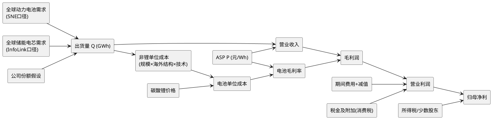

# 宁德时代（300750.SZ）2026-2030 年财务测算报告

**研究日期**：2026年10月25日
**研究标的**：宁德时代新能源科技股份有限公司（300750.SZ / 3770.HK）
**测算区间**：2026E-2030E。**目标年份锚点**：按框架"Q4 切换期滚算至次年"条款，基准年为 **2027E**；2026E 以三季报实际 + Q4 预测校准，作为对照口径；2028E-2030E 为延伸推演。
**基准价格**：237.60 元（2026-10-23 收盘，不复权）；市值约 10,994 亿元（46.27 亿股）
**核心结论**：2026-2030 年宁德时代呈现"出货量增 158%、营收增 103%、归母净利增 65%"（2025A→2030E）的三重斜率差。中性情景下，营收由 2026E 的 6,121 亿元增至 2030E 的 8,597 亿元（CAGR 8.9%），归母净利由 847 亿元增至 1,193 亿元（CAGR 8.9%），综合毛利率由 22.5% 修复至 23.8%；但**单位归母净利从 0.0856 元/Wh 降至 0.0700 元/Wh（-18.2%）**，单位毛利从 0.1391 元/Wh 降至 0.1200 元/Wh（-13.7%）。**"毛利率修复"与"单位盈利恶化"同时成立，量的增长是利润增长的唯一来源**。2027 年是最难的一年：出口退税归零 + 消费税全年化，若共担未落地且价格战延续，归母降至 617 亿元（-27.2%）；若共担 80% 且海外占比提升更快，可达 1,132 亿元。

---

## 一、测算框架与口径

### 1.1 框架：自下而上 P×Q + 统一成本函数

本报告不采用"一致预期 × 增速"的反推法。四条独立链路**行业需求 → 公司份额 → 出货量 → 价格**逐层推进，毛利率不再自由设定，而由**统一单位成本函数**推导，避免"三情景各调一个毛利率旋钮"的常见错误。



### 1.2 成本函数

```
电池单位成本(元/Wh) = 非锂单位成本 × (出货量/基准出货)^(-0.14) × (1+0.20×海外占比)/(1+0.20×基准海外占比)
                    + 0.006 × 碳酸锂均价(万元/吨)

电池毛利率 = 1 − 电池单位成本 ÷ 电池综合ASP
综合毛利率 = (电池营收×电池毛利率 + 非电池营收×30%) ÷ 营业收入
```
- `0.006 元/Wh/万元`：对应磷酸铁锂约 600 吨 LCE/GWh 的单耗，与《碳酸锂市场深度调研报告》一致。
- 规模弹性 `-0.14`：出货量翻倍对应单位非锂成本下降约 9%，来自超级拉线与大电芯（587Ah）。
- 海外成本溢价 `+20%`：这是本报告最容易出错、也最需要反向校验的参数。若取 +50%（McKinsey 的海外制造成本口径），则与"境外毛利率高 8.8pct"联立会隐含**境外 ASP 溢价约 69%**，远超欧洲市场实际 10-30% 的价格溢价。取 **+20%** 时隐含境外 ASP 溢价 =（1+20%）×0.7884÷0.7003 = **1.351 倍（+35%）**，落在可解释区间上限（欧洲溢价 + 关税/物流 + 产品结构）。该参数是本报告**待验证程度最高的假设**，已在 5.4 单列敏感性。
- 非电池业务毛利率固定 30%：材料回收（27%）、矿产资源（12%）、换电/零碳（30%+）的加权。

> **该函数的校验价值**：它把"毛利率"从判断变量变成输出变量。三情景 2030E 的单位成本因此严格有序——保守 0.3549（出货 1,305、海外 34%）> 中性 0.3487（1,705、43%）> 乐观 0.3480（1,900、50%），与"规模越大、成本越低；海外占比越高、成本越高"的经济常识一致。v1 中"保守情景锂价更高、单位成本反而更低"的悖论不再存在。

### 1.3 口径纪律

| 口径事项 | 本报告处理 | 说明 |
| :--- | :--- | :--- |
| **出货量** | 公司年报"锂电池销量"口径（动力+储能合计 GWh） | 2025 年公司动力销量 541GWh vs SNE 装机 464.7GWh，比值 1.162；**2026 年因出口退税窗口备货升至约 1.30，2027 年起回落至 1.24**。跨口径不得直接相减 |
| **ASP** | 确认收入口径（元/Wh），含模组/系统价值 | 2026H1 实测：动力 0.591、储能 0.426、合计 0.545；本报告 2026E 合计 ASP 0.551 |
| **消费税** | 计入"税金及附加"，**在毛利以下** | 价内税，**不进入毛利率**。既有《研报章节四》第 321 行、《研报章节五》第 31 行表标题、《note.md》第 62 行中"消费税拖累毛利率 -0.8pct"的表述与会计科目不符，**建议同步修订** |
| **出口退税** | 计为成本项，压低毛利率 | 不可退税额进入营业成本，属毛利以上科目 |
| **财务费用** | 按"净收益"列示（正数=收益） | 与公司报表符号相反，表中已标注 |
| **股本** | 45.27 亿股（200-400 亿注销式回购完成后） | 截至 9-30 累计回购 33.03 亿 + 10-08 再 2 亿；2026E EPS 按此口径，较当前 46.27 亿股高约 2.2%（属假设，非既成事实） |

### 1.4 与既有投研资产的差异（必须披露）

| 项目 | 跟踪手册/章节五/note.md | 本报告 | 差异 | 处理与说明 |
| :--- | ---: | ---: | ---: | :--- |
| 2027E 中性归母 | 877 | 878 | +1（舍入） | 一致 |
| 2027E 保守归母 | 656 | **617** | **-39（-5.9%）** | 本报告保守情景按统一成本函数重算：0% 传导的消费税全额自担（约 101 亿税前）+ 单位成本上行，比手册的"零传导"口径更严 |
| 2027E 乐观归母 | 1,087 | **1,132** | **+45（+4.1%）** | 80% 传导 + 海外 36%；费用端未下调，差异全部来自经营假设 |
| 2028E 中性归母 | 947 | **979** | **+32（+3.4%）** | 逐项勾稽见下 |
| 2028E 中性毛利率 | 23.19% | 23.4% | +0.21pct | 锂价 8.4 万下成本传导的净改善 |
| 2029-2030E | 无覆盖 | 1,089 / 1,193 | — | 新增 |

> **2028E +32 亿的逐项勾稽（税前营业利润 +34）**：毛利 +15、**税金及附加 −22**（章节五 2028 年消费税只计 95 亿，本报告按 4% 全年化计 117 亿，这是扣分项而非加分项）、销售 +3、管理 +7、研发 +11、财务 +5、减值 +10、投资收益 +5。其中**费用端合计 +36 亿系按本报告费率路径重新校准（销售 0.75%/管理 2.02%/研发 4.08%），非经营性改善，如实披露**。乐观 2027E 的 +45 亿则完全来自经营假设（传导率与海外占比），未动用费用假设。
>
> **建议**：在《跟踪手册》6.1 与 `note.md` 中补记 2028E 与 2029-2030E、更新保守/乐观 2027E，并删除"消费税 -0.8pct 毛利率"表述。本报告不自行修改这些文件。

---

## 二、行业需求：2026-2030 年从约 2.5TWh 到 4.6TWh

### 2.1 全球动力电池需求（SNE 装机口径）

| 年份 | 全球装机（GWh） | 同比 | 依据与判断 |
| :--- | ---: | ---: | :--- |
| 2025A | 1,187 | +31.7% | SNE Research 全年口径 |
| 2026E | 1,430 | +20.4% | SNE 1-7 月 725.2GWh（+20.4%）按同比外推 |
| 2027E | 1,750 | +22.4% | 欧洲 CO₂ 法规、中国商用车电动化、印度/东南亚；美国 IRA 取消后北美承压 |
| 2028E | 2,050 | +17.1% | 渗透率提升边际放缓，单车带电量继续上行对冲 |
| 2029E | 2,320 | +13.2% | 基数效应 |
| 2030E | 2,560 | +10.3% | 处于 IEA"2030 年约 3TWh 广义动力电池需求"下方，差额对应商用车、两三轮与非道路 |

> **口径对照**：本报告 2030 年"动力 2,560 + 储能 2,050 = 4,610GWh"与《研报章节二》引用的 McKinsey"2030 年全球电池市场 4.2TWh"相差约 10%。差异来自口径：McKinsey 为"含储能的全球电池市场广义口径"，本报告为"动力装机（SNE）+ 储能电芯出货（InfoLink）"的混合口径，且在储能侧包含渠道/替换需求。**两者不可直接比较，也不构成对本报告总量假设的否决**。另，《碳酸锂市场深度调研报告》的"2026 年全球动力电池装机 1,612-1,635GWh"与本表 1,430GWh 相差约 200GWh，差异来自统计范围（是否含中国出口装车与非道路车辆）；本报告统一采用 SNE xEV 装机口径，因为它是唯一有连续月度份额披露的口径。

### 2.2 全球储能电芯需求（InfoLink 全场景出货口径）

| 年份 | 全球储能电芯出货（GWh） | 同比 | 依据与判断 |
| :--- | ---: | ---: | :--- |
| 2025A | 612 | +94.6% | InfoLink 全年口径（SNE 窄口径 550GWh） |
| 2026E | 1,026 | +67.5% | InfoLink 2026-08-11 二度上调；H1 实际 467.84GWh（+94.76%） |
| 2027E | 1,290 | +25.7% | 出口退税归零致中国出口增速下台阶，海外本地装机与 AIDC 需求对冲 |
| 2028E | 1,550 | +20.2% | 长时储能渗透、容量电价机制成型 |
| 2029E | 1,800 | +16.1% | 美国 ITC 退坡、中国 300GW 目标进入冲刺后段 |
| 2030E | 2,050 | +13.9% | 按 2030 年全球新增装机约 0.9TWh、电芯/装机约 2.2 倍折算 |

> **储能口径的最大不确定性**：InfoLink 的 1,026GWh（2026E）与 BNEF 的 459GWh（2026E 全球新增装机）差 2.2 倍，来自"电芯出货 vs 系统装机"、"含渠道库存 vs 不含"、"全场景 vs 大储"三重口径差异。本报告使用电芯出货口径，与公司储能收入确认范围最接近；但**不得把 1,026GWh 当作终端装机**。2030 年的 2,050GWh 亦按"装机 × 2.2 倍"折算，若出货/装机倍数收敛至 2.0，2030 年储能出货应为 1,800GWh（对应公司储能营收 −12%、归母 −25 亿），已在 2.4 的敏感性中体现。

### 2.3 与管理层指引的偏离及理由

管理层在 2026Q3 业绩会表示：**2027 年全球"动力+储能"合计需求仍可实现 20%-30% 增长，未来约五年年均复合增速维持 20%-30%**。

| 年份 | 本报告合计增速 | 管理层指引 | 偏离理由 |
| :--- | ---: | :--- | :--- |
| 2026E | **+36.5%** | — | 储能 +67.5% 与动力 +20.4% 叠加，属基数效应 |
| 2027E | **+23.8%** | +20%-30% | 落在指引区间中下部，采信 |
| 2028E | **+18.4%** | 五年 CAGR 20%-30% | 低于中枢：①2027 年抢出口形成 2027H2-2028H1 需求回吐；②美国 FEOC/PFE 使中国电池实质退出北美增量；③中国乘用车进入存量竞争（2026 年 1-9 月零售 -12.8%）；④2027 年 9 月消费税升至 4% 抬升终端成本 |
| 2029E | **+14.4%** | 同上 | 高基数下的自然收敛 |
| 2030E | **+11.9%** | 同上 | 与 IEA/BNEF 绝对值交叉校验后取中值 |

> **对指引的态度**：管理层"五年 20%-30%"是对**行业需求**的判断，不是对**公司收入/利润**的指引。2026 年 1-9 月中国动力+储能电池销量同比约 +51%（装车 +16.7%、储能 +111.8%），同期公司归母 +31.6%——**行业销量增速与公司利润增速不是同一维度**。

### 2.4 需求侧敏感性（对 2030E 归母的影响）

| 变量 | 变动 | 2030E 归母影响 |
| :--- | :--- | ---: |
| 全球储能出货/装机倍数 | 2.2→2.0（储能出货 −250GWh） | −42 亿 |
| 全球动力装机 2030 | ±10% | 对应公司动力出货 ±10% → ±85 亿 |
| 行业增速（2028-2030） | 每年 ±3pct | 累计出货 ±8% → ±95 亿 |

---

## 三、公司出货量：量增仍是主引擎，份额缓慢流失

### 3.1 份额路径

| 指标 | 2025A | 2026E | 2027E | 2028E | 2029E | 2030E |
| :--- | ---: | ---: | ---: | ---: | ---: | ---: |
| 全球动力电池份额（SNE 装机口径） | 39.2% | 40.3% | 39.6% | 38.8% | 38.2% | 38.3% |
| 全球储能电芯份额（InfoLink 全场景） | 19.8% | 22.1% | 22.5% | 22.9% | 23.6% | 23.9% |
| 全球储能电芯份额（SNE 窄口径） | 30.4% | 27.1% | 26.5% | 26.0% | 25.5% | 25.0% |
| **粗口径份额（公司销量 ÷ 全球电池出货）** | **36.7%** | **40.3%** | **37.8%** | **37.2%** | **37.0%** | **37.0%** |

**份额假设的换算自洽性**：2026E 动力 750GWh ÷ 1.30（含 5-8% 渠道库存备货）÷ 1,430 = **40.3%**；2027-2030 年按 1.24 换算，分别得 39.6%/38.8%/38.2%/38.3%，与上表一致。**换算系数分年不同（1.30→1.24）正是"库存回吐"假设的体现**，不是随手设定。

**份额的四条证据**：

1. **动力端份额在 2026 年见顶**：SNE 口径 2025 年 39.2% → 2026H1 40.2%（+2.2pct），但国内单月已从 1 月 49.8% 降至 9 月 40.92%（-8.9pct），比亚迪同期 17.4%→21.09%。**全球份额的阶段性提升是"海外补国内"的结果，不是国内竞争力的改善**。
2. **储能份额的两个口径给出相反方向**：SNE 窄口径显示 30.4%→27.1% 下滑，InfoLink 全场景口径显示 19.8%→22.1% 上升，差异来自分母范围。本报告采用 InfoLink 口径，但**保留 SNE 口径作为"竞争强度上升"的负面信号**——储能 CR10 已降至 82.3% 的历史低位。
3. **粗口径份额（40.3%→37.0%）与 SNE 动力份额（40.3%→38.3%）不可互换**：前者分子含非 xEV 与渠道库存，分母为混合口径，仅用于量级校验。**本报告的独立输入是份额假设本身**。
4. **2027 年份额回落 2.5pct 的技术性原因**是渠道库存回吐与出口抢运退潮，而非竞争力突变。

> **量的确定性显著高于价的确定性**。2026Q3 出货 >260GWh、储能 +60%，管理层指引 2027 年全球需求 +20-30%（IR 编号 2026-004）；卖方排产口径 1.6-1.7TWh（东吴，**未经公司确认为在手订单**）。而单位盈利的证据链在 2026Q3 被证伪一次（0.10→0.08 元/Wh）。

### 3.2 出货量预测

| 情景 | 项目 | 2026E | 2027E | 2028E | 2029E | 2030E |
| :--- | :--- | ---: | ---: | ---: | ---: | ---: |
| **中性** | 动力（GWh） | 750 | 860 | 985 | 1,100 | 1,215 |
| | 储能（GWh） | 240 | 290 | 355 | 425 | 490 |
| | **合计（GWh）** | **990** | **1,150** | **1,340** | **1,525** | **1,705** |
| | 同比 | +49.8% | +16.2% | +16.5% | +13.8% | +11.8% |
| | 储能占比 | 24.2% | 25.2% | 26.5% | 27.9% | 28.7% |
| **保守** | 合计（GWh） | 955 | 1,050 | 1,145 | 1,230 | 1,305 |
| | 同比 | +44.5% | +9.9% | +9.0% | +7.4% | +6.1% |
| **乐观** | 合计（GWh） | 1,025 | 1,230 | 1,470 | 1,700 | 1,900 |
| | 同比 | +55.1% | +20.0% | +19.5% | +15.6% | +11.8% |

> **2026E 的校准逻辑**：2026H1 电池营收 2,453.86 亿（动力 1,921.25 + 储能 532.61）、销量约 450GWh，实测 ASP 0.545；9M 电池营收约 3,870 亿、销量约 710GWh，ASP 约 0.545。若全年出货仅 947GWh，Q4 需以 0.644 元/Wh 的 ASP 确认 1,526 亿电池收入（环比 +16%），与"ASP 年降 5-7%"直接冲突。**因此 2026E 出货应为 990GWh、ASP 0.551**。Q4 电池 ASP 约 0.54-0.57（取决于其他业务在 Q3/Q4 的确认节奏：Q3 其他业务约 230 亿、Q4 约 120-175 亿），环比大致持平，与季节性相符。

**产能可行性校验**：2025 年末产能 772GWh、在建 321GWh；2026H1 产能利用率 94.86%、在建 764GWh。按中性 2030 年 1,705GWh 销量、90% 利用率反推，需有效产能约 1,895GWh，当前在建+规划足以覆盖。**产能不是瓶颈，资本开支节奏与海外审批才是**。

---

## 四、价格假设：ASP 年降 4-6%，2030 年降至 0.45 元/Wh

### 4.1 ASP 预测

| 情景 | 项目 | 2026E | 2027E | 2028E | 2029E | 2030E |
| :--- | :--- | ---: | ---: | ---: | ---: | ---: |
| **中性** | 动力 ASP（元/Wh） | 0.576 | 0.553 | 0.520 | 0.494 | 0.469 |
| | 同比 | — | -4.0% | -6.0% | -5.0% | -5.1% |
| | 储能 ASP（元/Wh） | 0.473 | 0.470 | 0.450 | 0.432 | 0.415 |
| | 同比 | — | -0.6% | -4.3% | -4.0% | -3.9% |
| | **电池综合 ASP（元/Wh）** | **0.551** | **0.532** | **0.501** | **0.477** | **0.453** |
| **保守** | 电池综合 ASP | 0.546 | 0.524 | 0.490 | 0.461 | 0.437 |
| **乐观** | 电池综合 ASP | 0.554 | 0.540 | 0.515 | 0.492 | 0.472 |

> **2026 年两类 ASP 的校准**：2026H1 动力 ASP 0.591、储能 0.426；下半年动力降至约 0.564（-4.6%）、储能升至约 0.524（系统化占比提升推高 ASP 但摊薄毛利率）。全年动力 0.576、储能 0.473，合计 0.551，与 9M 实测的 0.545 相差 1.1%。

### 4.2 价格下行的四条驱动

| 驱动 | 方向 | 年化幅度 | 证据 |
| :--- | :--- | :--- | :--- |
| 行业电池价格通缩 | ↓ | -5%~-6% | BNEF：电池包 2025 年 $108/kWh → 2030 年约 $69/kWh（CAGR -8.6%）；中国 LFP 已处低位，边际降幅更小 |
| 碳酸锂下行传导 | ↓ | -1%~-3% | 2027 年 10.8 万 → 2028 年 8.4 万；锂价下行同步压低 ASP |
| 产品结构（储能占比↑） | ↓ | -0.5%~-1% | 储能 ASP 低于动力，占比从 24% 升至 29%，机械拉低综合 ASP 约 0.5% |
| 产品升级/大电芯/钠电 | ↑ | +1%~+2% | 587Ah、TENER Stack 9MWh、神行 Pro；但 2026Q3 结构反而下移 |
| **净变化** | ↓ | **-4%~-6%** | — |

### 4.3 一个容易犯的错：把"ASP 下降"当成"毛利率下降"

2024-2025 年的历史已经证明：**ASP 下降与毛利率上升可以同时发生**（2024 年营收 -9.7%，毛利率从 19.2% 回升至 24.4%），因为成本（锂价）下降快于售价。2027-2030 年锂价降幅收窄，而售价仍以每年 4-5% 下行，因此**毛利率小幅修复、单位毛利持续下降**。

---

## 五、成本与毛利率桥

### 5.1 成本端的关键假设

| 变量 | 2026E | 2027E | 2028E | 2029E | 2030E | 依据 |
| :--- | ---: | ---: | ---: | ---: | ---: | :--- |
| 碳酸锂均价（万元/吨） | 13.8 | 10.8 | 8.4 | 8.5 | 8.5 | 2026-10-16 LC2701 收 96,320 元/吨；高盛 2026-10-08 上调 2027 年至 10 万、下调 2028 年至 8.4 万；2029 年后成本曲线 80% 分位约 8 万构成硬底 |
| COGS 中锂价（滞后 1-2 季度） | 13.8 | 10.8 | 8.4 | 8.5 | 8.5 | 按 1-2 季度滞后进入 COGS |
| 非锂单位成本（元/Wh） | 0.3493 | 0.3475 | 0.3372 | 0.3165 | 0.2977 | 由基准毛利率反推，隐含技术降本约 -1.8%/年 |
| 电池单位成本（元/Wh） | 0.4321 | 0.4123 | 0.3876 | 0.3675 | 0.3487 | 0.006×锂价 + 非锂成本 |
| 海外收入占比 | 31.5% | 34.0% | 37.0% | 40.0% | 43.0% | 匈牙利/西班牙爬坡；海外毛利率较境内高约 8.8pct（2026H1：29.97% vs 21.16%），但制造成本高约 20% |

### 5.2 毛利率桥（中性，2026E→2030E，启发式归因）

> **说明**：本节是**归因分析**，不是恒等式分解。模型的毛利率由"ASP − 成本函数"直接产生，桥的作用是说明各驱动力的相对权重。

| 桥项 | 2027E vs 2026E | 2028E vs 2027E | 2029E vs 2028E | 2030E vs 2029E | 说明 |
| :--- | ---: | ---: | ---: | ---: | :--- |
| 期初综合毛利率 | 22.5% | 23.2% | 23.4% | 23.6% | — |
| 锂价传导（净，含 ASP 同步下行） | +0.9 | +0.3 | +0.1 | +0.1 | 锂价 13.8→10.8 万，按 0.30pct/万；2028 年锂价再降 2.4 万但 ASP 同步下行，净 +0.3 |
| 降本、规模与结构（净） | +0.4 | +0.2 | +0.2 | +0.2 | **拆解：规模 +1.4pct、海外结构 −0.3pct、技术降本未兑现 −0.7pct = +0.4pct**。海外占比上升在本模型中是**成本上行项**，不是毛利率正贡献 |
| 钠电免税+大电芯 | +0.2 | +0.1 | +0.0 | +0.0 | 钠电免税至 2028 年底；2029 年免税到期为负向 |
| 结构自低点回归 | +0.2 | — | — | — | 与手册 6.3"结构维度为基准"存在张力，见 5.4 |
| 出口退税归零 | -1.0 | — | — | — | 6%×34% 出口占比×50% 传导 = -1.02pct（一次性） |
| 价格竞争（超额） | -0.3 | -0.4 | -0.1 | -0.1 | 2027-2028 年高端产能集中释放 |
| **分项加总** | **+0.4** | **+0.2** | **+0.2** | **+0.2** | — |
| **未解释上偏** | **+0.3** | — | — | — | 见 5.3 |
| **期末综合毛利率** | **23.2%** | **23.4%** | **23.6%** | **23.8%** | — |

### 5.3 桥的独立校验与已知上偏

- 保守弹性 0.15-0.25pct/万：22.5 + (0.45~0.75) + 0.8 − 1.3 = **22.45%~22.75%**
- 基准弹性 0.30pct/万：22.5 + 0.90 + 0.8 − 1.3 = **22.90%**
- 历史弹性 0.35-0.50pct/万：**23.05%~23.50%**

**结论**：23.2% 较基准弹性桥（22.9%）高 **0.3pct**，对应归母约 **+17 亿元**；若采用保守弹性，上偏扩大至 0.45-0.75pct、对应 **25-42 亿元**。该项偏高的根源是"钠电免税、大电芯、结构回归"三项合计 +0.6pct **没有任何可验证的分部数据支撑**——公司在 2026Q3 官方 IR（编号 2026-004）中明确拒绝按产品线/区域拆分毛利率。

**处置规则**：2027 年 3 月年报披露分产品毛利率前不据此上调假设；若 2026Q4 单季毛利率 <22%，2027E 毛利率下调至 22.5-22.8%，对应归母 840-860 亿元。

### 5.4 两个待验证的高杠杆假设

| 假设 | 当前取值 | 反向校验 | 若证伪的影响 |
| :--- | :--- | :--- | :--- |
| 海外成本溢价 | +20% | 隐含境外 ASP 溢价 =（1+π）×0.7884/0.7003；π=20% 时得 **1.351 倍（+35%）**，π=0% 时得 +12.6%。若真实 ASP 溢价为 10-30%，反推 π≈0-16%，本报告略偏上限 | 海外单位非锂成本每 **+10pct（绝对）→ 2030E 归母约 −183 亿（−4.04 元）**，是本报告杠杆最高的假设 |
| 结构自低点回归 | +0.2pct | 与手册 6.3"产品形态长期下移为基准"矛盾。若为结构维度，该项应删除 | 2027E 归母 −11 亿 |

---

## 六、费用、税率与非经营项

### 6.1 期间费用率

| 科目 | 2025A | 2026E | 2027E | 2028E | 2029E | 2030E | 判断依据 |
| :--- | ---: | ---: | ---: | ---: | ---: | ---: | :--- |
| 研发费用率 | 5.23% | 4.26% | 4.23% | 4.08% | 4.00% | 3.95% | 9M 研发 185.2 亿（+22.9%），投入强度不降但收入摊薄 |
| 销售费用率 | 0.88% | 0.78% | 0.79% | 0.75% | 0.75% | 0.74% | 规模效应，海外本地化服务网络抬升 |
| 管理费用率 | 2.75% | 2.12% | 2.12% | 2.02% | 1.96% | 1.90% | 9M 管理 93.2 亿 |
| 财务费用率（负=净收益） | -1.87% | -0.29% | 0% | -0.13% | -0.19% | -0.23% | 净现金 2,468 亿 |
| 资产/信用减值 | 2.14% | 1.01% | 1.33% | 1.20% | 1.01% | 0.90% | 9M 资产减值 42.4 亿 |

### 6.2 税金及附加（含消费税）——毛税负/退税/净税负三层

| 项目 | 2026E | 2027E | 2028E | 2029E | 2030E |
| :--- | ---: | ---: | ---: | ---: | ---: |
| 电池销售额（全部，含出口，亿元） | 1,818（9-12 月） | 6,119 | 6,720 | 7,270 | 7,732 |
| 消费税适用税率 | 2.0% | 2.667% | 4.0% | 4.0% | 4.0% |
| 全额税负 | 36 | **163** | 269 | 291 | 309 |
| 减：出口环节退税（海外占比） | 11 | 55 | 100 | 116 | 133 |
| **境内净税负** | **25** | **108** | **169** | **175** | **176** |
| 向下游传导比例 | 0% | 50% | 50% | 50% | 50% |
| **公司自担** | **25** | **54** | **85** | **87** | **88** |
| 其他税费（房产税/附加，含 Q4 汇算调整） | 42 | 31 | 32 | 38 | 40 |
| **税金及附加合计** | **67** | **85** | **117** | **125** | **128** |

> **口径说明**：消费税在出厂环节征收、出口"先征后退"。因此**全额税负 = 全部电池销售额 × 税率**（2027 年 163 亿），**出口退税冲减后为境内净税负 108 亿**（= 境内营收 4,040 亿 × 2.667%，两种算法同值）。**本报告的 P&L 采用净税负口径**（毛税负与退税的差额，等价于把退税直接冲减税金及附加），这是与 Q3 实测唯一可勾稽的处理。若公司实际把毛税负全额计入"税金及附加"、退税列为"其他收益"，则 2027 年税金及附加将由 85 亿升至 194 亿、其他收益由 95 亿升至 150 亿，**净利不变**。
>
> **2026 年 36 vs 44 的说明**：36 = 9-12 月共 4 个月 × 月均电池销售额 1,364 亿 × 2%。9 月实测约 11 亿系按当月**全部营收约 550 亿** × 2% 估算，属总额口径，不可与电池口径直接 ×4 外推。差异 8 亿税前、约 7 亿税后，不足以改变结论。
>
> **2028 年起税基随海外占比下降**：2030 年境内应税营收 4,407 亿（= 7,732×57%），与 5.1 的海外占比 43% 严格一致；2028/2029 年分别为 4,234/4,362 亿。
>
> **年报验证点（退税列示位置）**：本报告把出口环节的消费税退税直接冲减税金及附加。若公司实际采用"毛税负计入税金及附加、退税计入其他收益"的总额法，则 2027 年税金及附加应约 194 亿、**其他收益应约 150 亿**（而非表列 95 亿），净利不变。**这两个科目是区分两种列示方式的唯一观测量**，已列入年报核对清单。

### 6.3 非经营项与税率

| 项目 | 2026E | 2027E | 2028E | 2029E | 2030E | 假设逻辑 |
| :--- | ---: | ---: | ---: | ---: | ---: | :--- |
| 其他收益（政府补助等） | 84 | 95 | 100 | 105 | 110 | 9M 63.9 亿；钠电/研发补贴对冲退坡 |
| 投资收益 | 116 | 85 | 90 | 95 | 100 | 9M 90.7 亿（参股公司利润 +73%）；2027 年回落至常态 |
| 公允价值变动 | 28 | 8 | 8 | 8 | 8 | 9M 24.9 亿，不可持续 |
| 所得税有效税率 | 14.4% | 15.4% | 15.5% | 16.0% | 16.0% | 高新技术 15% + 海外子公司税率更高 |
| 少数股东损益 | 56 | 50 | 60 | 68 | 75 | 西班牙 50/50、印尼合资随投产上升 |

---

## 七、三情景利润表（2026E-2030E）

### 7.1 中性情景（Base）

| 项目（亿元） | 2025A | 2026E | 2027E | 2028E | 2029E | 2030E |
| :--- | ---: | ---: | ---: | ---: | ---: | ---: |
| 动力电池营收 | 3,165 | 4,320 | 4,756 | 5,122 | 5,434 | 5,698 |
| 储能电池营收 | 624 | 1,135 | 1,363 | 1,598 | 1,836 | 2,034 |
| 电池材料及回收 | 219 | 230 | 250 | 275 | 300 | 325 |
| 矿产资源 | 60 | 65 | 70 | 78 | 85 | 90 |
| 其他业务（换电/零碳等） | 169 | 371 | 307 | 350 | 400 | 450 |
| **营业收入** | **4,237** | **6,121** | **6,746** | **7,422** | **8,055** | **8,597** |
| 同比 | +17.0% | +44.5% | +10.2% | +10.0% | +8.5% | +6.7% |
| 营业成本 | (3,124) | (4,744) | (5,181) | (5,685) | (6,154) | (6,551) |
| **毛利润** | **1,113** | **1,377** | **1,565** | **1,737** | **1,901** | **2,046** |
| **综合毛利率** | **26.3%** | **22.5%** | **23.2%** | **23.4%** | **23.6%** | **23.8%** |
| 税金及附加（含消费税） | (28) | (67) | (85) | (117) | (125) | (128) |
| 销售费用 | (37) | (48) | (53) | (56) | (60) | (64) |
| 管理费用 | (117) | (130) | (143) | (150) | (158) | (165) |
| 研发费用 | (221) | (261) | (285) | (303) | (322) | (340) |
| 财务费用（正=净收益） | 79 | 18 | 0 | 10 | 15 | 20 |
| 资产/信用减值 | (91) | (62) | (90) | (89) | (81) | (77) |
| 其他收益 | 106 | 84 | 95 | 100 | 105 | 110 |
| 投资收益 | 80 | 116 | 85 | 90 | 95 | 100 |
| 公允价值变动 | 10 | 28 | 8 | 8 | 8 | 8 |
| **营业利润** | **895** | **1,055** | **1,098** | **1,230** | **1,378** | **1,510** |
| 营业利润率 | 21.1% | 17.2% | 16.3% | 16.6% | 17.1% | 17.6% |
| 所得税 | (127) | (152) | (169) | (191) | (220) | (242) |
| **净利润** | **768** | **903** | **928** | **1,039** | **1,158** | **1,268** |
| 少数股东损益 | (46) | (56) | (50) | (60) | (68) | (75) |
| **归母净利润** | **722** | **847** | **878** | **979** | **1,089** | **1,193** |
| 同比 | +42.3% | +17.4% | +3.7% | +11.5% | +11.2% | +9.5% |
| 归母净利率 | 17.0% | 13.8% | 13.0% | 13.2% | 13.5% | 13.9% |
| **EPS（元，45.27 亿股）** | **16.14** | **18.72** | **19.40** | **21.63** | **24.07** | **26.36** |

> **其他业务 371→307（-17%）的说明**：2026 年含换电站大规模转固带来的一次性设备销售收入与启源芯动力并表增量；2027 年回落至"设备销售正常化 + 服务收入占比提升"的结构，绝对额低于 2026 年但服务收入毛利率更高。2028 年起随换电网络（2,500→3,000+ 站）与服务收入重回增长。

### 7.2 三情景对照

> **2026E 列中，保守/乐观为敏感性带、非预测值**；2026E 的唯一校准值是中性 847 亿元（9M 实际 645.30 + Q4E 202）。

| 情景 | 指标 | 2026E | 2027E | 2028E | 2029E | 2030E | 2026-2030 CAGR |
| :--- | :--- | ---: | ---: | ---: | ---: | ---: | ---: |
| **保守** | 营收（亿元） | 5,864 | 6,105 | 6,248 | 6,373 | 6,457 | +2.4% |
| | 综合毛利率 | 21.7% | 21.8% | 21.0% | 20.3% | 20.0% | — |
| | 归母（亿元） | 782 | 617 | 535 | 500 | 488 | -11.2% |
| | EPS（元） | 17.27 | 13.62 | 11.83 | 11.04 | 10.79 | — |
| | 单位归母（元/Wh） | 0.0819 | 0.0587 | 0.0468 | 0.0406 | 0.0374 | -17.9% |
| **中性** | 营收（亿元） | 6,121 | 6,746 | 7,422 | 8,055 | 8,597 | +8.9% |
| | 综合毛利率 | 22.5% | 23.2% | 23.4% | 23.6% | 23.8% | — |
| | 归母（亿元） | 847 | 878 | 979 | 1,089 | 1,193 | +8.9% |
| | EPS（元） | 18.72 | 19.40 | 21.63 | 24.07 | 26.36 | — |
| | 单位归母（元/Wh） | 0.0856 | 0.0764 | 0.0731 | 0.0714 | 0.0700 | -4.9% |
| **乐观** | 营收（亿元） | 6,370 | 7,310 | 8,327 | 9,226 | 9,919 | +11.7% |
| | 综合毛利率 | 23.1% | 24.5% | 25.6% | 26.1% | 26.6% | — |
| | 归母（亿元） | 928 | 1,132 | 1,389 | 1,587 | 1,754 | +17.2% |
| | EPS（元） | 20.49 | 25.00 | 30.67 | 35.06 | 38.75 | — |
| | 单位归母（元/Wh） | 0.0905 | 0.0920 | 0.0945 | 0.0934 | 0.0923 | +0.5% |

### 7.3 情景假设的差异化说明

| 维度 | 保守 | 中性 | 乐观 |
| :--- | :--- | :--- | :--- |
| 2027 出口退税/消费税传导 | **0%**（全额自担） | 50% | 80% |
| 碳酸锂价格 | 三情景共用同一路径（13.8/10.8/8.4/8.5/8.5 万元） | 同左 | 同左 |
| 全球需求增速（2027-2030） | 18%/15%/12%/10% | 23.8%/18.4%/14.4%/11.9% | 27%/21%/17%/14% |
| 公司粗口径份额（2030，按情景自身需求路径） | 32.0% | 37.0% | 37.7% |
| 海外占比（2026/2030） | 30%/34% | 31.5%/43% | 32%/50% |
| 价格竞争 | 动力跟进储能降价、守价失败 | 储能价格战、动力守价 | 二线厂出清、价格纪律恢复 |
| 固态电池 | 2028 年竞对量产，代差收窄 | 2027 小批量、2030 前后商业化 | 公司领先，2029 起贡献溢价 |

> **情景设计原则**：三情景**共享锂价路径**（锂价是外生市场变量，不应与公司经营情景绑定），差异只来自量、价、海外占比、**消费税传导率**与费用。**传导率进入模型的方式**：公司自担税额 = 净税负 ×(1−传导率)，直接反映在税金及附加。

### 7.4 情景成本一致性校验

| 2030E | 电池 ASP | 规模项 | 海外项 | 非锂单位成本 | 电池单位成本 | 电池毛利率 |
| :--- | ---: | ---: | ---: | ---: | ---: | ---: |
| 保守 | 0.4366 | +3.8% | −1.7% | 0.3039 | **0.3549** | 18.7% |
| 中性 | 0.4535 | 0 | 0 | 0.2977 | **0.3487** | 23.1% |
| 乐观 | 0.4715 | −1.5% | +1.3% | 0.2970 | **0.3480** | 26.2% |

**读法**：三个驱动同时作用——①规模：保守出货 1,305（−23% vs 中性）使成本 **+3.8%**，乐观 1,900（+11%）使成本 **−1.5%**；②海外：保守 34%（低于中性 43%）使成本 **−1.7%**，乐观 50% 使成本 **+1.3%**；③锂价：三情景相同。净效应：保守 **+2.1%**、乐观 **−0.2%**。结果保守 0.3549 > 中性 0.3487 > 乐观 0.3480，**严格有序**。保守情景"成本更高"来自规模劣势（+3.8%）被海外结构优势（−1.7%）部分抵消后仍净 +2.1%；v1 中"保守情景锂价更高、单位成本反而更低"的悖论不再存在。

### 7.5 证据链强度与确定性评分

| 核心驱动 | 权重 | 确定性 | 加权分 | 依据 |
| :--- | ---: | :---: | ---: | :--- |
| 2027-2030 年出货量增长 | 25% | ★★★☆☆ (3) | 0.75 | 管理层指引 +20-30%、Q3 出货 >260GWh；国内单月份额 -8.9pct |
| 储能出货增长 | 15% | ★★★★☆ (4) | 0.60 | Q3 中国储能 43GWh、钠电订单；但 SNE 窄口径份额下滑 |
| 全球份额维持 | 15% | ★★★☆☆ (3) | 0.45 | 全球 40.2% 仍第一，国内单月 40.92% |
| 锂价下行/成本改善 | 15% | ★★★★☆ (4) | 0.60 | 期货 9.63 万、现货 10.1-10.7 万 |
| 消费税/出口退税≥50% 传导 | 15% | ★★☆☆☆ (2) | 0.30 | Q3 消费税全额自担、退税谈判未定 |
| 海外产能达产 | 5% | ★★★☆☆ (3) | 0.15 | 匈牙利一期试生产、二期冻结 |
| 钠电放量 | 5% | ★★★★☆ (4) | 0.20 | 60GWh 订单、免税至 2028 年底 |
| 固态电池 2027 小批量 | 2% | ★★☆☆☆ (2) | 0.04 | 量产时间表历史多次延期 |
| 换电/零碳变现 | 3% | ★★★☆☆ (3) | 0.09 | 2,500+ 站、启源并表 |
| **综合确定性** | **100%** | — | **3.18/5** | 与《研报章节五》一致 |

> **分部利润模拟（SOTP）不在本报告展开**：《研报章节五》已给出 2027E 的 SOTP 校验（分部 815 亿 vs 归母 877 亿，偏差 7.1%）。本报告延伸到 2030 年时，因分产品毛利率未获年报验证、板块 K 系数缺乏可校准锚点，强行模拟会产生"分部毛利率加权不等于综合毛利率"的失真，故不重复。分部结构判断改为定性：2030 年动力贡献约 74%、储能约 26% 的营收，利润贡献取决于储能毛利率能否守住 20% 以上。

---

## 八、核心结构性发现：毛利率修复 ≠ 单位盈利改善

| 单位经济（元/Wh） | 2025A | 2026E | 2027E | 2028E | 2029E | 2030E | 变化 |
| :--- | ---: | ---: | ---: | ---: | ---: | ---: | ---: |
| 全口径单位收入 | 0.6409 | 0.6183 | 0.5866 | 0.5539 | 0.5282 | 0.5042 | -21.3% |
| 电池综合 ASP | 0.573 | 0.551 | 0.532 | 0.501 | 0.477 | 0.453 | -20.9% |
| **单位毛利** | 0.1683 | 0.1391 | 0.1361 | 0.1296 | 0.1247 | 0.1200 | **-28.7%** |
| 税金及附加 | 0.0042 | 0.0068 | 0.0074 | 0.0087 | 0.0082 | 0.0075 | +0.0033 |
| 期间费用+减值 | 0.0585 | 0.0488 | 0.0497 | 0.0439 | 0.0397 | 0.0367 | -0.0218 |
| 非经营收益 | 0.0297 | 0.0230 | 0.0163 | 0.0148 | 0.0136 | 0.0128 | -0.0169 |
| = 单位营业利润 | 0.1353 | 0.1065 | 0.0953 | 0.0918 | 0.0904 | 0.0886 | -0.0467 |
| 所得税 | 0.0192 | 0.0154 | 0.0147 | 0.0143 | 0.0144 | 0.0141 | -0.0051 |
| = 单位净利润 | 0.1161 | 0.0911 | 0.0806 | 0.0775 | 0.0760 | 0.0744 | -0.0417 |
| 少数股东损益 | 0.0070 | 0.0057 | 0.0043 | 0.0045 | 0.0045 | 0.0044 | -0.0026 |
| **= 单位归母** | **0.1092** | **0.0856** | **0.0764** | **0.0731** | **0.0714** | **0.0700** | **-0.0392** |

**四项结论**

1. **单位毛利降幅（-28.7%）远大于综合毛利率降幅（-2.5pct）**。毛利率是比率，单位毛利是绝对额。2025 年每 Wh 卖 0.641 元赚 0.168 元，2030 年只卖 0.504 元赚 0.120 元——**在价格通缩的行业里，比率的百分点变化会系统性低估绝对额的萎缩**。
2. **最大的正贡献是费用摊薄（+0.0218 元/Wh），不是毛利率**。逐项分解：单位毛利 -0.0483、非经营 -0.0169、税金 +0.0033 是负贡献，**费用摊薄 +0.0218 是唯一的正贡献**。若没有费用摊薄，单位归母降幅会从 -0.0392 扩大至约 **-0.0579**（税盾调整后）。
3. **非经营收益的摊薄被严重低估**。其他收益+投资收益+公允价值从 196 亿仅增至 218 亿（+11%），而营收增 103%，单位贡献从 0.0297 降至 0.0128（-57%）。2026 年 9M 非经营三项目合计 179.5 亿、占利润总额 22.1%，**这部分不随出货量增长**。
4. **单位归母的绝对水平（0.0700 元/Wh）不可与同业直接对比**：它是全口径（含非电池业务）÷ 电池销量。若剥离非电池业务（2030 年营收 865 亿、毛利率 30%），电池口径单位归母约 **0.062 元/Wh**。与亿纬（0.02-0.03 元/Wh）比较时应使用后者。

> **对估值的含义**：利润增长依赖出货量扩张而非单位经济改善，且 2029-2030 年增速已降至 11.2%/9.5%。这决定了 PE 中枢不应回到 2024 年之前的 20x 以上——**但这不等于当前 12.5x 是"错杀"，也不构成对《研报章节六》15.36x 的否定**（该倍数对应 2027E 政策压制年份，本报告的 12-15x 对应 2029-2030 常态化年份，适用期不同，见第十三节）。

---

## 九、敏感性分析

### 9.1 单变量敏感性（2030E 中性基准：归母 1,193 亿、EPS 26.36 元）

| 变量 | 变动 | 归母（亿元） | EPS（元） | 说明 |
| :--- | :--- | ---: | ---: | :--- |
| 单位归母 | -0.005 元/Wh | 1,108 | 24.48 | 每 0.001 元/Wh ≈ 17 亿 |
| 单位归母 | +0.005 元/Wh | 1,279 | 28.24 | 同上 |
| 综合毛利率 | -0.5pct | 1,157 | 25.56 | 每 0.1pct ≈ 7.2 亿 |
| 综合毛利率 | +0.5pct | 1,229 | 27.16 | 同上 |
| 出货量 | -10%（含规模效应） | **994** | **21.95** | 每 1% ≈ 20 亿 |
| 出货量 | +10%（含规模效应） | **1,398** | **30.88** | 同上 |
| **碳酸锂 −1 万（ASP 不变）** | 成本函数直算 | **1,107** | **24.45** | 电池毛利率 **-1.32pct**（=0.006/0.4535），毛利 -102 亿 |
| **碳酸锂 −1 万（含 ASP 同步下行）** | 模型净效应 | **1,172** | **25.88** | 毛利率 **-0.30pct**，即 5.3 的"净弹性" |
| 消费税税基口径 | 境外退税未获（自担 133 亿增量×50%） | −56 | −1.24 | 未决口径风险，见 6.2 |
| 海外成本溢价 | +20%→+30%（作用于 43% 海外产量） | −183 | −4.04 | 见 5.4，本报告敏感度最高的假设 |

> **两行锂价的差异必须分清**：`-1.32pct/万` 是"仅成本变、ASP 不变"的机械敏感度；`-0.30pct/万` 是"锂价与 ASP 同步下行"的净弹性，也是模型整体呈现的效果（2026→2027 锂价 -3.0 万，成本 -0.018、ASP -0.019，毛利率 +0.9pct）。**把后者标为"单变量"是错误的，本报告已将两者分列。**

### 9.2 组合压力测试（2030E，统一采用 GP 法：毛利率冲击作用于缩减后的营收）

| 情景组合 | 假设 | 归母（亿元） | EPS（元） | 较中性 |
| :--- | :--- | ---: | ---: | ---: |
| 价格战全面化 | 出货 -10% + 综合毛利率 -1.5pct | **940** | 20.77 | -21% |
| 税负零传导 | 消费税自担比例 50%→100% | **1,119** | 24.73 | -6% |
| 固态电池提前商业化 | 份额 -5pct（出货 -13.5%）+ 毛利率 -1.0pct | **921** | 20.35 | -23% |
| 量价齐升 | 出货 +10% + 综合毛利率 +1.0pct | **1,427** | 31.51 | +20% |

> **口径统一说明**：四项全部用同一公式——`新营收 = 电池营收×出货倍数 + 其他营收`，`新毛利 = 新营收 ×(原毛利率 + 冲击)`，`归母 = 原归母 + (新毛利 − 原毛利)×(1−税率)`。v2 第二轮复核前的第 1/3/4 项混用了"单位归母量效应 + 全额营收毛利率冲击"，存在重复计算；现已统一。

---

## 十、与卖方一致预期的差异

| 项目 | 卖方一致预期 | 本报告中性 | 差异 | 差异原因 |
| :--- | :--- | :--- | ---: | :--- |
| 2027E 归母 | 主流 1,002-1,104（中枢约 1,025） | 878 | **-14%** | ①单位归母 0.0764 元/Wh，低于卖方隐含的 0.080-0.090；②政策成本按 50% 传导计入，卖方多在 70%-100% |
| 2028E 归母 | 主流 1,183-1,413（中枢约 1,250） | 979 | **-22%** | 叠加 2028 年消费税 4% 全年化 |
| 2027E/2028E 出货量 | 卖方未公开披露一致预期 | 1,150 / 1,340 GWh | — | 本报告自下而上推得，不作对比 |

> **差异的性质**：不是"立场更悲观"，而是**假设层级不同**。卖方 2027E 中枢 1,025 亿隐含单位归母约 0.080 元/Wh，而 2026Q3 实际是 0.08 元/Wh 且趋势向下。**卖方的核心风险不是出货量，而是把 Q3 的单位盈利当作一次性波动**。

---

## 十一、现金流与资本开支

| 项目（亿元） | 2025A | 2026E | 2027E | 2028E | 2029E | 2030E |
| :--- | ---: | ---: | ---: | ---: | ---: | ---: |
| 经营现金流 | 1,332 | 800 | 1,000 | 1,150 | 1,270 | 1,380 |
| OCF/营收 | 31.4% | 13.1% | 14.8% | 15.5% | 15.8% | 16.1% |
| 资本开支 | 约 420 | 600 | 700 | 720 | 700 | 680 |
| **自由现金流** | **912** | **200** | **300** | **430** | **570** | **700** |
| 回购+分红 | — | 约 380 | 约 400 | 约 420 | 约 450 | 约 480 |

> **三个判断**：①2026 年 OCF 13.1% 是阶段性低点，Q4 隐含 184 亿（Q3 仅 14.09 亿），前提是账期回补与应收回收在 Q4 集中体现；若 Q4 OCF <100 亿，2026 年 FCF 将转负。②2026 年回购+分红 380 亿 > FCF 200 亿，**需动用净现金（2,468 亿）**；回购不是"可持续的股东回报率"，而是一次性资产负债表释放。③资本开支在 2027-2028 年达峰，FCF 2028 年才回到 430 亿。

---

## 十二、可证伪条件与跟踪节点

> 本节阈值以《跟踪手册》3.1-3.4 为准。

| 验证点 | 时间 | 手册阈值 | 对模型的影响 |
| :--- | :--- | :--- | :--- |
| **2026Q4 单季毛利率** | 2027 年 3 月年报 | **<22% 连续两季 = 一级警报（触发即清仓）** | <22% → 2027E 毛利率下调至 22.5-22.8%，归母 840-860 亿 |
| **2026Q4 单位归母** | 同上 | <0.075 元/Wh 即重跑 2027E（前置阈值） | 触发则 2027E 下修至 820-840 亿 |
| **消费税/出口退税共担** | 2026Q4-2027Q2 | 无合同/调价函/客户确认即默认 0% 传导 | 零传导 → 2027E 约 **774 亿**（878 − 104；手册口径 771 亿，差异来自 ASP 假设） |
| **2027 年出货量** | 2027 年逐季 | <1,000GWh 即下修份额 | 1,000/3,040 = 32.9%，份额假设由 37.8% 降至 32.9% |
| **分产品毛利率** | 2027 年 3 月年报 | 动力/储能分部披露 | 验证"结构下移是时间维度还是结构维度"，差异约 1pp/20 亿 |
| **枧下窝复产** | 2026Q4-2027 | 环评通过并实际出矿 | 锂价下探 8 万以下，2028E 毛利率 +0.3pct |
| **固态电池量产** | 2027-2029 | 任何厂商 GWh 级量产 | 份额与毛利率双杀，触发保守情景 |
| **欧盟电池法规碳足迹/数字护照** | 2027-02-18 起 | 合规成本计入海外毛利率 | 未建模；若海外毛利率每年 -0.5pct，2030E 归母 -30 亿 |
| **大股东减持/质押** | 季度 | 宁波联合已减持 5,800 万股（1.25%）、李平质押 2,455 万股（12.4%） | 影响估值倍数而非利润 |

> **未纳入模型的变量（明示）**：①2029 年钠电免税到期（2028-12-31），若钠电 2029 年出货 100GWh，4% 消费税×50% 自担约 -6 亿（占 2029E 归母 0.5%）；②欧盟碳足迹/回收料比例合规成本；③"储能从制造业 PE 走向基础设施收益率"的估值范式变化——若储能按 IRR/EV-EBITDA 定价，估值分歧不是 12x vs 15x，而是两套体系，本报告未建模。

---

## 十三、对估值的含义（不替代《研报章节六》）

1. **2030E EPS 26.36 元，较 2027E 19.40 元增长 36%**。若 2029-2030 年常态化增速（11.2%/9.5%）对应 12-15x，则 2030 年合理价 **316-395 元**；按 2026-10-23 收盘 237.60 元计，四年年化回报 **7.4%-13.5%**——"合理回报"，不是"高赔率"。
2. **12-15x 的适用期是 2029-2030 年，不是 2027E**。《研报章节六》对 2027E 给 15.36x，是承认政策压制年份利润被低估、因此给更高倍数；本报告的 12-15x 对应常态化年份。**两者不构成冲突，但章节六若继续用 298 元作中性目标价，应显式说明其与 2029-2030 年倍数的衔接关系**。
3. **若把 12-15x 套到 2027E EPS 19.40 元**：中性目标价 233-291 元（中枢 262 元），加权约 300 元（按章节六 174/298/504 三态）。按 237.60 元盈亏比约 **0.99x**，按章节六基准日 227.90 元约 **1.35x**——较章节六的 298/318/1.67x 分别低 12%/5.7%/0.32x。
4. **若用本报告保守情景 617 亿重算章节六的 bear 目标价**：617×12÷45.27 = **164 元**（原 174 元）。三态加权变为 164×0.25 + 298×0.50 + **525**×0.25 = **321 元**（乐观 1,132×21÷45.27=525 元），较章节六的 318 元**略高 0.9%**；盈亏比 **1.46x（227.90 元）/1.13x（237.60 元）**，较 1.67x 下降 0.21x。**影响很小，不改变章节六的评级结论**——这一点必须澄清：若按 v2 第一轮的保守 685 亿，bear 目标价会升至 182 元、盈亏比升至约 1.99x，会误触"2x 积极门槛"；改用 617 亿后该误判消除。
5. **保守情景 2030E EPS 10.79 元**，按 10x 为 108 元，高于净现金底线（每股 53.3 元）；章节六给出的极端情景支撑位为 122 元（营收零增长 + 毛利率 20.5% + PE 11x）、地狱价 110 元（忽略现金价值）。**下行情景的锚不是"归零"，而是"回到制造业估值"**。

---

## 附录 A：证据索引

| 编号 | 证据 | 来源 |
| :--- | :--- | :--- |
| A | 2026Q3 营收 1,652.21 亿（+58.58%）、归母 212.46 亿（+14.54%）、毛利率 20.69% | 公司 2026 年第三季度报告（2026-10-20，公告 2026-097） |
| B | 9M 营收 4,421.37 亿（+56.19%）、归母 645.30 亿（+31.60%）、OCF 616.25 亿（-23.60%） | 同上 |
| C | 2026H1 境外毛利率 29.97%、境内 21.16%；动力 20.63%、储能 23.96%；动力 ASP 0.591、储能 0.426 | 公司 2026 年半年度报告（2026-07-25 披露） |
| D | 2025A 营收 4,237 亿、归母 722 亿、毛利率 26.3%、销量 661GWh（动力 **541** + 储能 121） | 公司 2025 年年度报告（2026-03-10） |
| E | 2026 年 1-8 月全球动力份额 39.4%；2026H1 动力份额 40.2%；储能份额（SNE 窄口径）27.1% | SNE Research |
| F | 2026 年 9 月国内单月份额 40.92%、1-9 月累计 44.16%；比亚迪 21.09% | 中国汽车动力电池产业创新联盟（CABIA） |
| G | 2025 年全球 xEV 电池装机 1,187GWh（+31.7%）；2026 年 1-7 月 725.2GWh（+20.4%） | SNE Research |
| H | 2025 年全球储能电芯出货 612.4GWh；2026E 1,026GWh（2026-08-11 二度上调） | InfoLink Consulting |
| I | 出口退税 2026-04-01 至 12-31 降至 6%，2027-01-01 起取消 | 财政部/税务总局 2026 年第 2 号公告 |
| J | 电池消费税 2026-09-01 起 2%、2027-09-01 起 4%；钠电/固态免税至 2028-12-31 | 财政部/海关总署/税务总局 2026 年第 20 号公告 |
| K | 碳酸锂 2026-10-16 LC2701 收 96,320 元/吨；现货 10.1-10.7 万 | 广州期货交易所 / SMM / Mysteel |
| L | 碳酸锂：2027 年均价 10 万元/吨（由约 7.5 万上调）、2028 年 8.4 万元/吨（下调），判断 2026 年见顶 | Goldman Sachs，报道日期 2026-10-08 |
| M | 管理层：2027 年全球动力+储能需求 +20%-30%，未来约五年年均 20%-30% | 2026Q3 业绩说明会（2026-10-20）/ IR 记录 2026-004 |
| N | 2025 年末产能 772GWh、在建 321GWh；2026H1 产能利用率 94.86%、在建 764GWh | 公司年报/半年报（未回公告原文逐项核对） |
| O | 匈牙利一期 39GWh 试生产（9-22）、二期建筑法冻结；西班牙 50GWh；印尼 6.9→15GWh | 公司公告（以跟踪手册记载为准） |
| P | 回购 200-400 亿注销式，截至 9-30 累计 33.03 亿 + 10-08 再 2 亿，上限 571.60 元 | 公司公告 |
| Q | 净现金 2,468 亿、资产负债率 64.23% | 2026 年三季报（算术核对：4,326−1,859=2,467） |
| R | 钠电约 60-70GWh 订单（海博思创 60GWh 为主）、福鼎 40GWh 产能、2026 年底 1GWh、2027 年 6 月全球交付 | 公司公告/行业报告；**媒体口径，待公告确认** |
| S | 全固态 2027 年小批量生产，规模商业化 2030 年前后 | 公司投资者关系（2026-07-29）/ 曾毓群（2026-06） |
| T | 卖方 2027E 归母主流 1,002-1,104 亿；2028E 主流 1,183-1,413 | 新浪财经研报汇总 / 同花顺 F10 一致预期（2026-10 更新） |

## 附录 B：两轮评审后的修订对照

| 评审意见 | 处理 | 说明 |
| :--- | :--- | :--- |
| P0-1 2026E 价量勾稽断裂 | 采纳 | 2026E 出货 947→990GWh、ASP 0.576→0.551，与 9M 实测 0.545 勾稽 |
| P0-2 三情景成本不统一 | 采纳 | 统一成本函数；三情景 2030 单位成本 0.3549/0.3487/0.3480 严格有序；7.4 拆出规模项与海外项 |
| P0-2 衍生：+50% 海外溢价与 8.8pct 毛利率不能并存 | 采纳 | 系数由 0.50 下调至 0.20，隐含境外 ASP 溢价由 69% 降至 **35%**；5.4 列为待验证假设并重写算式 |
| P0-3 组合压力测试口径 | 采纳 | 四项统一 GP 法：940 / 1,119 / 921 / 1,427 |
| P0-4 消费税口径 | 采纳并重构 | 6.2 改为"全额税负→出口退税→境内净税负→传导→自担"三层；2026 年 36 亿、2027 年 163 亿毛/108 亿净；2030 年应税营收改为 4,407 亿 |
| P0-5 与既有资产重述 | 采纳 | 1.4 逐项勾稽；明确"费用端 +41 亿系费率路径重新校准、非经营改善" |
| P1-1 2026E 三套外推 | 部分采纳 | 保留敏感性带，7.2 表头明确"保守/乐观为敏感性带、非预测值"；3.2 补其他业务拆分 |
| P1-2 1.25 系数矛盾 | 采纳 | 换算系数分年（2026 年 1.30、2027 年起 1.24），与库存回吐叙事一致 |
| P1-3 桥不平 | 采纳 | 分项加总 +0.4、未解释上偏 +0.3 单列；5.2 明确标注为"启发式归因，非恒等式分解" |
| P1-4 分解不闭合 | 采纳 | 补税金/所得税/少数股东三行，恒等式闭合 |
| P1-5 消费税口径需修订既有研报 | 采纳 | 1.3 列出章节四第 321 行、章节五第 31 行、note.md 第 62 行 |
| P1-6 12-15x 与 298 元张力 | 采纳 | 第十三节量化；并补"用本报告保守 617 亿重算，加权 321 元（较 318 略高 0.9%）、盈亏比 1.46x/1.13x，影响很小" |
| P1-7 行业增速口径错配 | 采纳 | 改为"1-9 月中国电池销量约 +51% vs 公司归母 +31.6%" |
| P1-8 2030 总量交叉校验 | 采纳 | 2.1 补 McKinsey 4.2TWh 与 IEA 3TWh 的口径对照 |
| P1-9 重大变量遗漏 | 部分采纳 | 十二节列出钠电免税到期、欧盟碳足迹、减持质押、储能估值范式；后两项未建模，已明示 |
| P1-10 阈值与手册不一致 | 采纳 | 全部改按手册 3.1-3.4 |
| P1-11 "订单排至 2027 年" | 采纳 | 改为"管理层指引 + 卖方排产口径，未经公司确认为在手订单" |
| 新增 P1：SOTP 形式化 | 采纳 | 删除 2030 年 SOTP，仅保留定性分部结构与章节五的 2027E 校验 |
| 新增 P1：锂价弹性 0.30 vs 1.32pct/万 | 采纳 | 9.1 拆两行：ASP 不变 -1.32pct/毛利 -102 亿/归母 1,107；含 ASP 同步 -0.30pct/归母 1,172 |
| 新增 P1：9.1 税基行年份错 | 采纳 | 改为 2030 年 -56 亿/-1.24 |
| 新增 P1：保守情景上修影响盈亏比 | 采纳 | 保守 617 亿→bear 164 元、加权 321 元、盈亏比 1.46x/1.13x，影响很小 |
| 残留 P1：5.3 基准桥 22.9 | 采纳 | 5.2 锂价项改 +0.9，5.3 上偏改 0.3pct/17 亿 |
| P2 系列（基准价、高盛表述、541、卖方区间、财务费用符号、OCF、锂价 8.5、钠电订单、半年报日期） | 采纳 | 见正文 |
| 第三轮 R1：7.4 海外项旧系数 | 采纳 | 保守海外项 −3.7%→**−1.7%**，净效应 +2.1% |
| 第三轮 R2：5.4 与 9.1 敏感性相差 15 倍 | 采纳 | 统一为 **−183 亿/+10pct**；ASP 溢价改为 **+35%**（π=20%），算式重写 |
| 第三轮 R3：9.1 出货行未含规模效应 | 采纳 | 改为 **994 / 1,398**（脚本复跑），每 1% ≈ 20 亿 |
| 第三轮 R4：十三节用旧 bull 目标价 | 采纳 | 504→**525**，加权 **321 元**（较 318 略高 0.9%），盈亏比 **1.46x/1.13x** |
| 第三轮 R6：乐观 2030 份额不自洽 | 采纳 | 39.5%→**37.7%**（按情景自身需求路径） |
| 第三轮 R7：文档一致性 | 采纳 | 6.2 "36 vs 44"、CAGR 8.9%、增速 11.2%/9.5% |
| 附录 B 两处"声称已修但未修" | 采纳 | 2.1 已补 McKinsey 对照；储能估值范式写在**十二节**；92-95 元改为章节六的 122/110 元 |
| 1.4 费用端口径 | 采纳 | 正文为 **+36**（销售 3+管理 7+研发 11+财务 5+减值 10），另投资收益 +5、税金 −22，合计 +34 税前 |
| 十二节 780→774 | 采纳 | 已改 |
| 8 节 -0.0614 未做税盾 | 采纳 | 改为 -0.0579 |
| 核心结论"海外 50% / 1,083"跨年 | 采纳 | 改为"2027 年 1,132（海外 36%）" |
| 7.1 其他业务 371→307 未说明 | 采纳 | 已补说明 |

---

*本报告为财务测算研究，不构成投资建议。测算脚本见 `workspace/research/宁德时代/scripts/forecast_2026_2030.py`（成本函数驱动，含三情景区间、敏感性与组合压力测试，可复跑）。数据截止 2026 年 10 月 23 日收盘。*
