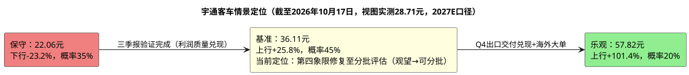

# 研报章节八：投资摘要与风险因素

**研究日期：2026年10月17日**
**目标年份：2027年（Q4 切换期自动滚算）**

---

## 一、投资摘要

### 1.1 核心投资逻辑

宇通客车是全球销量规模最大的客车制造商（2025年销量4.95万辆），正处于从"中国龙头"向"全球龙头"跃迁的关键阶段。公司2025年海外营收首次超越国内（211亿 vs 154亿），且海外毛利率29.6%远超国内19.1%。2026年三季报（10-15披露）验证了"利润质量改善、量端承压"的双轨格局：前三季营收258.16亿元（-2.09%）、归母31.84亿元（-3.31%）、扣非30.99亿元（+18.45%）、经营现金流80.04亿元（+345.64%）；Q3单季扣非13.03亿元（+22.25%）、毛利率26.73%（同比+2.75pp）、扣非单车净利约12.03万元（+38.1%），但销量30,929辆（-7.83%）、Q3出口3,928辆（-16.8%）。当前核心变量为：Q4出口集中交付能否兑现（管理层维持全年出口目标1.9万辆）、碳酸锂跌破10万的成本红利兑现度、欧盟IAA法案（欧洲议会一读排期2026-12-14）与新能源出口退税下调（2027-04起13%→9%）对欧洲敞口的压制程度、国内以旧换新政策（2027年待12月底确认）的延续性。

### 1.2 当前价格与目标价（2027E口径）

| 价格类型 | 数值 | 备注 |
|:---|:---|:---|
| 当前股价（不复权） | **28.71元** | 2026年10月16日视图实测收盘价（10-12为28.08元/PE 11.33x；09-30为26.72元/PE 10.78x） |
| 当前PE(TTM) | **11.67x** | 仍处2021年以来P5（12.27x）下方，极端低估 |
| 保守目标价 | **22.06元** | 下行风险-23.2%（6.65元，10-16 28.71元口径） |
| 综合基准目标价 | **36.11元** | 上行空间+25.8%（7.40元，10-16口径） |
| 乐观目标价 | **57.82元** | 上行空间+101.4%（29.11元，10-16口径） |
| 概率加权审计目标价 | **35.53元** | 35%/45%/20%加权，中性档使用审计后36.11元（上行6.82元） |
| 盈亏比 | **1.03 : 1** | 按框架（6.82/6.65），较10-12的1.47回落（现价上涨+目标价体系校准双重侵蚀） |

### 1.3 投资逻辑的三层架构

**第一层：价值底——极致便宜但量端未验证**
当前10-16收盘28.71元PE 11.67x，仍处2021年以来P5 12.27x下方（近5年1399日样本min 10.19/P25 14.85），处于极端低估（PE较08-10的13.37x降1.7x）；2027E基准EPS 2.89元对应PE仅9.93x。若仅将TTM扣非盈利（50.63亿）作为稳定性参考，当前估值已极便宜，但量端未验证（1-9月销量-7.83%、Q3出口-16.8%），Q4出口集中交付（10-23业绩说明会、11-12月出口数据）为关键验证点，不能直接据PE低位重仓。

**第二层：成长驱动——出口结构升级+碳酸锂红利**
全球客车电动化仍是长期方向（欧洲H1电动大巴注册8,141辆、+49%，宇通1,636辆居欧洲第一），宇通的海外服务生态（400+网点、40+配件库、120km服务半径、LINK+网联系统）构成竞品短期难以复制的壁垒。2027E估值输入为EPS 2.10/2.89/3.61元，PE场景目标22.06/39.03/57.82元，综合基准目标价36.11元（隐含PE约12.49x）；核心增量来自：①碳酸锂跌破10万（10-16期货96,320元/吨）的成本红利，Q3毛利率26.73%已验证传导；②出口占比提升（Q3约37%）；③卡塔尔KD工厂爬坡（300-1000辆）。但三季报仍未披露出口分部利润和区域收入，全球化定价仍需订单与毛利率验证，Q3出口-16.8%提示量端节奏风险。

**第三层：估值重估空间——IAA折价与修复**
当前10-16视图实测PE 11.67x仍处P5下方；欧盟IAA法案进入欧洲议会关键阶段（委员会投票12-01、一读12-14），宇通无欧洲工厂、欧洲为最大区域市场之一，构成预期折价（PE矩阵-3%）；若IAA落地影响小于预期（法德妥协倾向宽口径）或Q4出口交付兑现，全球客车龙头的估值重估空间才成立。

### 1.4 关键催化剂

1. **Q4出口集中交付（10-23业绩说明会起持续验证）**：管理层维持2026年出口目标1.9万辆（1-9月10,778辆，Q4需约8,200辆）；11-12月月度出口数据与交付公告为右侧信号。
2. **碳酸锂降价传导**：10-16期货96,320元/吨（跌破10万、较5月高点近腰斩），若成本红利持续兑现，2027E毛利率有上行空间（基准假设25.6%客车口径）。
3. **以旧换新政策确认（预计12月底）**：2027年补贴是否延续为国内公交需求关键变量。
4. **海外大单落地**：卡塔尔KD工厂投产爬坡、欧洲/拉美新能源订单；Q4出口数据兑现（若Q4出口同环比高增，量端证伪警报解除）。
5. **PE修复**：当前10-16 PE 11.67x仍处P5下方，若基本面兑现13.5x PE，2027E基准目标39.03元（PE法，较现价上行+36.0%）。

---

## 二、风险因素

按对股价影响的烈度由高到低排序：

### 风险1：欧盟IAA法案与贸易壁垒 ★★★★★

**本质**：欧盟《工业加速器法案》（IAA）进入欧洲议会关键阶段：委员会联合投票指示性排期2026-12-01、议会一读指示性排期2026-12-14；博弈焦点为"Made in Europe"地理范围（法国EU27窄口径 vs 德国等14国"Made with Europe"宽口径，中国均不在列）。**宇通无欧洲工厂**（仅法国4,600㎡配件库），而欧洲为最大区域市场之一（H1欧洲电动大巴注册1,636辆居首、+92%，2025年以15.5%份额居欧洲电动巴士市场第一），若公共采购排除条款落地将直接冲击欧洲敞口。此外，新能源出口退税2027-04-01起由13%降至9%。

**量化影响**：若欧洲出口量暴跌50%+，出口总销量减少~3,000辆，净利润减少约5-8亿；出口退税下调静态年化影响1.3-2.1亿（部分可传导）。

**监控指标**：IAA欧洲议会投票（12-01/12-14）、欧盟贸易政策公告、月度行业出口数据。

### 风险2：人民币持续大幅升值 ★★★★★

**本质**：宇通2025年海外营收约211亿元（约58%），2026H1披露外币金融资产约42.21亿元、外币金融负债约0.52亿元及多币种远期合约。人民币升值通过未套保外币资产、应收账款和结算环节侵蚀利润；2026年前三季财务费用0.91亿元（去年同期0.08亿）。

**量化影响**：10-16中间价6.7220（本周累计调升110bp）、在岸即期6.6868，仍处2023-02以来偏强区间；半年报敏感性口径，人民币升值10%约减少净利润4.17亿元，5%压力约2.08亿元。央行三季度例会强调"防范羊群效应"，中金公司预计2027年温和走强、斜率放缓。

**监控指标**：美元/人民币汇率、公司财务费用科目（汇兑损益）

**对冲**：KD本地化合作若按计划投产可自然对冲部分风险；公司已披露远期外汇合约，仍需观察未套保敞口和套保有效性。

### 风险3：量端下滑与出口交付节奏 ★★★★

**本质**：2026年1-9月销量30,929辆（-7.83%）、Q3单季-11.5%，其中出口3,928辆（-16.8%）、新能源出口960辆（-24.4%）；行业大中型出口1-9月+8.17%而宇通全口径+0.34%，相对份额承压。管理层将国内销量目标从3.4万辆下调至3万辆，全年出口目标1.9万辆需Q4交付约8,200辆（同比+28%）方能兑现。

**量化影响**：2027E结构模拟中，国内业务利润约13.6亿元、占基准归母利润约21%（64.0亿元口径）。若Q4出口交付不及预期，2026E现实落点或降至52亿以下，2027E基准64.0亿面临下修压力（下修方向见模块五保守情景46.5亿）。

**边界**：海外业务利润约41.4亿元（结构模拟），但该结果假设固定费用、总部成本、营运资本和海外毛利率不变，且未由分部披露验证；不能把国内营收归零时的41.4亿元称为真实安全垫。

### 风险4：行业竞争加剧 ★★★

**本质**：2026年1-9月行业6米以上客车销量87,076辆-2.18%，宇通累计24,987辆（份额28.70%）仍居第一，但中通出口6,446辆+28.56%、海格5,414辆+29.27%、金龙全口径11,739辆+28.27%追赶显著；新能源领域宇通国内份额21.16%（该份额为国内口径，与2025年新能源出口份额22.73%不可直接对比；9月单月份额20.43%低于累计值，边际回落）。

**差异化的风险程度**：宇通的核心护城河在海外高端市场（T/U系列+新能源+LINK+服务），Q3毛利率26.73%与竞品（中通H1毛利率17.2%、金龙13.1%）的差距仍在扩大；但竞品出口增速持续跑赢，相对份额压力需Q4交付数据再审计。

### 风险5：原材料价格波动 ★★★

**本质**：原材料占成本71.78%（电池、钢材等），电池价格波动直接影响毛利率。

**2026-2027趋势**：碳酸锂从2026年5月超20万/吨跌至10-16的96,320元/吨（近腰斩、跌破10万），SMM电碳现货均价104,400元/吨（周-14.7%）；市场提前交易2027年供给宽松预期（枧下窝复产、澳矿复产、津巴布韦发运恢复），短期100,000-110,000元/吨区间震荡但已跌破下沿。电池成本压力减轻（Q3毛利率26.73%验证），但产业链利润向资源端集中（整车厂面临"上游让利多、下游压价更狠"双向挤压）。钢材价格在低位震荡。整体原材料环境对毛利率偏正面。

### 风险6：新能源补贴与退税退坡 ★★★

**本质**：公交"以旧换新"补贴维持8万/辆（2026年政策已落地、地方细则陆续实施），但2027年政策延续性待12月底确认；新能源出口退税2027-04起13%→9%（新增变量）；新能源国补/地补的应收账款存在减值风险。

### 风险7：产品质量保证、回购责任与未决仲裁 ★★★★★

**本质**：Q3末产品质量保证预计负债55.43亿元（较年初45.43亿+10.0亿、较H1+3.36亿），购车融资回购责任54.91亿元（H1口径），其中郑州安驰按揭42.09亿元；香港宇通还面临2.69亿欧元仲裁请求，案件已受理但尚未开庭。另有对外第三方担保0.49亿元、员工住房担保0.20亿元（H1口径）。公司披露郑州宇通集团对部分实际损失承担承诺，但上述事项仍应纳入现金流和安全边际监控。

**监控指标**：预计负债变动、实际质量赔付、回购损失、仲裁进展、应收账款账龄及坏账核销。

### 风险8：股东结构变化与筹码分散 ★★★

**本质**：Q3末股东户数70,529户（较H1末+40.09%，散户化显著）；全国社保基金一零一组合降至0.86%（H1为1.57%，连续两季减持）；郑州宇通集团持股37.70%稳定；前十名股东的质押、标记或冻结状态列示为"未知"。Q3末出现1.28亿元短期借款（2023年以来首次，规模极小）。

**监控指标**：控股股东及5%以上股东增减持、质押/冻结公告、股东户数变化、短期借款变动。

---

## 三、研究结论象限图

基于"确定性"与"预期收益空间"的双维度评价：

### 最终定位：第四象限修复至分批评估 — Observe/Wait → Gradual Accumulate（观望修复，可分批评估）

**理由**：
1. **确定性中等（3.5/5）**：全球客车电动化与服务壁垒仍明确；三季报验证"利润质量兑现、量端承压"（Q3扣非+22.25%、毛利率26.73% vs 营收-11.13%、出口-16.8%）；Q4出口集中交付为下一验证，IAA与出口退税下调为新增压制项
2. **赔率回落至临界（盈亏比1.47→1.03）**：10-16收盘28.71元（PE 11.67x仍处P5下方）至综合基准+25.8%（7.40元）、至概率加权+23.8%（6.82元），下行至保守价-23.2%（6.65元），**盈亏比1.03（6.82/6.65）**较10-12的1.47（8.85/6.02）回落，主因现价上涨2.2%叠加目标价体系校准（加权36.93→35.53，含DCF复算修正），赔率仍高于1:1纪律线
3. **安全边际仍受约束**：预计负债55.43亿/回购54.91亿/2.69亿欧元仲裁、IAA一读12-14、汇率6.72、出口分部毛利率仍未披露、筹码分散化（股东户数+40.09%），仍需Q4交付与年报分部数据验证

**前提与风险提示**：上述观望/分批判断以两大前提成立为基础——①2027E基准归母净利润达到约64.0亿元（EPS 2.89元）、Q4出口交付兑现且费用率不恶化；②人民币汇率和IAA不出现压力情景（升值突破6.6或IAA严格落地）。若Q4出口交付低于目标、财务费用继续上升、预计负债/回购责任恶化、股东风险升级或行业增长持续与公司份额背离，本评级应进一步下调，届时按跟踪手册T1-T10证伪警报执行。

**仓位建议**：已持有者以26.82元（MA20）为第一防线、26.04元（6月恐慌低点）为最后防线、29.27-30.09元均线簇（MA60/年线）为减仓阻力；新资金不在29.3元以上追高，可在27.0-28.5元区间回踩缩量时评估，放量收复MA60 29.27元为右侧多级确认信号。

---

*此研究基于公开信息、2026年三季报及系统数据，截至2026年10月17日；部分竞品数据和出口分部盈利尚未取得权威原始来源（竞对三季报10月下旬披露）。投资有风险，入市需谨慎。*
