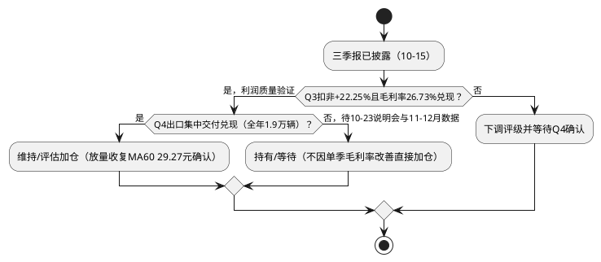

# 宇通客车 跟踪手册

**建立日期：2026年06月30日**
**最近更新：2026年10月17日**
**更新频率**：每季度财务报告披露后更新，重大事项即时更新

---

## 一、核心逻辑验证点 (Thesis Validators)

每季度需验证的关键定量指标：

| 序号 | 验证指标 | 基准预期 | 警戒阈值 | 当前状态（2026-10-17 三季报后） | 监控频率 |
|:---|:---|:---|:---|:---|:---|
| V1 | 季度营收增速 | Q2起恢复正增长(+5~15%) | 连续两季同比下滑>10% | Q3单季营收90.97亿-11.13%（单季触发，但Q2为+11.30%、非连续两季）；1-9月258.16亿-2.09%；量端压力延续（Q3销量-11.5%、出口-16.8%） | 月报/季报 |
| V2 | 出口营收占比 | 维持55-62% | 跌破50%（意味国内被动萎缩或出口失速） | 三季报未披露出口分部收入；量端参考：Q3出口占比约37%（环比+3.36pp）、1-9月大中型出口10,435辆份额23.61%居首；全年出口目标1.9万辆待Q4集中交付兑现 | 半年报/年报 |
| V3 | 出口毛利率 | 维持28-30% | 连续两季下滑>2pp（汇率或竞争侵蚀利润） | 未披露出口分部毛利率；综合毛利率Q3 26.73%（同比+2.75pp）、1-9月25.27%（+2.91pp）为正向代理指标 | 半年报/年报 |
| V4 | 综合净利率 | 2026全年14%+ | Q2-Q3持续低于12% | 1-9月归母净利率12.33%；Q3单季14.46%（>12%未触发）；全年落点约13.2-13.5% | 季报 |
| V5 | 经营现金流/净利润 | 2026全年>80% | 连续两季<50%（应收恶化信号） | 1-9月经营现金流/归母净利约2.51倍（80.04/31.84）；Q3单季20.56亿为销售回款驱动 | 季报 |
| V6 | 合同负债(预收款) | 维持15-25亿 | 连续两季<10亿（在手订单枯竭预警） | Q3末26.70亿元（较H1+5.73亿、较年末+8.12亿），超区间上沿，指向订单队列增厚（正向） | 季报 |
| V7 | 应收账款/营收(TTM)及质量 | <15%，坏账率稳定 | 超过20%或账龄/核销恶化 | Q3末净应收24.76亿元/TTM营收408.76亿元约6.1%（持续改善）；H1账龄5年以上13.48亿元（三季报未更新）；核销情况待年报 | 季报 |
| V8 | ROE(TTM) | 维持30%+ | 跌破20% | 1-9月加权ROE 20.96%（年化约28%）、Q3单季9.66%；未触发 | 季报 |
| V9 | 每股分红 | 2025年度10派20元 | 分红骤降（管理层信心恶化信号） | 方案已实施（前三季分配股利44.65亿）；管理层表示延续高分红（来源：Dragonomi引述，未经中文权威来源交叉验证，待年报核验） | 年报 |
| V10 | 研发费用率 | 维持4-5% | 跌破3%（可能削减长期投入换短期利润） | 1-9月研发费用率5.06%（同比+10.7%投入），略高于区间上沿，投入强度维持 | 年报 |
| V11 | 产品质量保证预计负债/回购责任 | 预计负债和实际赔付与收入规模匹配 | 预计负债连续增加且实际赔付显著超预算，或回购责任转化为现金损失 | Q3末预计负债55.43亿元（较年初45.43亿+10.0亿、较H1+3.36亿，连续增加）；回购责任54.91亿元（H1口径）；实际赔付情况待年报附注；暂未触发（无赔付超预算或现金损失证据），列为最高优先级观察 | 季报/半年报 |

---

## 二、关键外部变量 (Exogenous Watchlist)

| 序号 | 外部变量 | 当前状态 | 需要关注的变化 | 监控来源 |
|:---|:---|:---|:---|:---|
| X1 | 美元/人民币汇率 | 10-16中间价6.7220（本周累计调升110bp），在岸即期6.6868、离岸6.6866；前三季财务费用0.91亿（Q3单季0.28亿边际收敛）；央行三季度例会强调"防范羊群效应" | 若升值突破6.6并持续→利润侵蚀加剧；中金预计2027年温和走强、斜率放缓 | 央行中间价/路透 |
| X2 | 中国客车月度出口量 | 1-9月大中型出口44,194辆+8.17%（9月4,411辆-21.26%）；全口径62,054辆+11.61%；宇通大中型10,435辆份额23.61%居首、全口径10,778辆+0.34% | 若行业增长持续而宇通份额继续下降→相对竞争力预警；Q4集中交付为关键验证（全年目标1.9万辆） | 公司公告/中客网 |
| X3 | 中东地缘局势 | 2026年4月大型客车出口-28.93%后逐步修复；宇通沙特新能源市占率83.2%、TGA长途客运65%+；中通6月交付沙特248辆（竞对深耕） | 若冲突扩大至沙特/阿联酋→大型客车出口再受冲击 | 国际新闻 |
| X4 | 欧盟IAA法案/贸易政策 | 委员会联合投票指示性排期2026-12-01、议会一读2026-12-14、理事会拟11月底形成总体方案；EPP出现否决动议（3+20议员）、法德10-16妥协支持"Made with Europe"宽口径；宇通无欧洲工厂（仅法国配件库） | 若采购排除条款落地→欧洲公共采购敞口受冲击（实质影响预计2028-2030）；新能源出口退税2027-04-01起13%→9%（公告2026年第29号） | 欧盟官方公报/财政部 |
| X5 | 国内旅游人次增速 | 2025年+16.2% | 若增速低于5%→旅游客车需求将显著萎缩 | 文旅部 |
| X6 | 碳酸锂价格 | 10-16期货主力收96,320元/吨（跌破10万、较5月高点209,900近腰斩）；SMM电碳现货均价104,400元/吨（周-14.7%）；市场提前交易2027供给宽松预期 | 若反弹（>15万）→电池成本压力；当前方向为成本端红利（Q3毛利率26.73%验证） | 上海有色/广期所 |
| X7 | 宇通主要竞品出口量 | 1-9月宇通大中型10,435辆份额23.61%居首；中通6,446辆+28.56%、海格5,414辆+29.27%、金龙全口径11,739辆+28.27%追赶；比亚迪9月585辆+60.71% | 若竞品同口径出口持续跑赢宇通→份额流失预警；竞对三季报10-28起披露 | 公司公告/中客网 |
| X8 | 中国无风险利率(10Y) | ~2.5% | 若快速上行→高分红股相对吸引力下降 | 中国债券信息网 |
| X9 | 股东减持/质押/限售 | 宇通集团持股37.70%；社保基金101组合降至0.86%（H1为1.57%，连续两季减持）；股东户数70,529户（较H1+40.09%）；质押状态披露为未知 | 若控股股东或核心机构持续减持，或出现重大质押/冻结→增加估值折价；筹码分散化（散户化）为新观察项 | 三季报/交易所公告 |
| X10 | 以旧换新政策延续 | 2026年8万/辆政策已落地（国家+北京/上海/济南等地方细则），2027年政策待确认（参照2026年政策2025-12-29发布节奏，预计12月底前） | 若2027年退坡→国内公交需求承压 | 交通运输部/地方政府 |

---

### 2.1 竞品联动监控

| 竞品 | 预计披露日状态 | 必须取得的原始信源 | 核验指标与双向解读 |
|:---|:---|:---|:---|
| 中通客车 | H1正式报告已取得（2026-08-27/30双源）；**三季报预约10-28，截至10-17未披露** | 中通2026H1正式报告已归档，10-28三季报为下一核验节点 | 大中客销量、出口量/收入、毛利率、OCF、应收、合同负债；H1：营收40.14亿+1.85%/归母2.83亿+48.5%/扣非2.03亿+15.88%/毛利率17.2%/OCF 15.48亿+1800%/出口4390辆+23.4%；1-9月出口6,446辆+28.56%追赶显著（竞争侧压力）；双向解读：行业出口景气延续（需求侧利好）+增速跑赢宇通（竞争侧利空） |
| 金龙汽车/海格 | 金龙H1正式报告已取得（2026-08-24/25双源）；**三季报预计10月下旬（同期），截至10-17未披露** | 金龙正式半年报已归档；9月产销快报已核验（9月销量4,137辆-15.16%、1-9月35,679辆+2.34%） | 金龙海外收入73.4亿占比66.2%（H1）、净利率2.9%远低于宇通13.41%；1-9月全口径出口11,739辆+28.27%超宇通居首；海格大中型出口5,414辆+29.27%；维持"差距显著但追赶加速"判断 |
| 比亚迪商用车 | 9月大中型出口585辆+60.71%跃居第三；商用车分部毛利未单列，无法判定盈利威胁 | 比亚迪定期报告、公司公告 | 比亚迪9月出口585辆+60.71%（新能源为主），爆发力强；仅当分部盈利持续高于宇通才升级为直接威胁 |
| 宇通重工（同集团） | **10-14盘后披露三季报**：Q3营收6.13亿-16.05%、归母0.41亿-40.59%；1-9月剔除处置子公司后净利+30.03% | 上证报/21经济网双源已核验 | 环卫/矿用/工程机械业务，与客车主业口径不可比，仅作集团背景参考（Q3同样承压，与宏观环境一致） |

---

## 三、逻辑证伪警报 (Invalidation Triggers)

**当以下任一信号出现时，必须承认当前投资逻辑已死或严重受损，应触发止损或下调评级：**

| 触发编号 | 证伪信号 | 严重程度 | 行动建议 |
|:---|:---|:---|:---|
| **T1** | **宇通出口销量连续两季度同比下滑>15%** | ★★★★★ | 立即卖出——"出口驱动"的核心逻辑被证伪；**当前状态：Q3出口3,928辆-16.8%（单季触发、Q2为增长，未构成连续两季），列为最高优先级观察；若Q4出口再下滑>15%则触发** |
| **T2** | **出口毛利率跌破22%（2025年29.6%，三季报未披露）** | ★★★★★ | 立即卖出——高端化和品牌溢价假设崩溃；综合毛利率Q3 26.73%为正向代理，未触发 |
| **T3** | **欧盟对宇通发起实质性反补贴调查** | ★★★★☆ | 减半仓——欧洲市场前景不明，等待调查结果；IAA立法进行中（一读排期12-14），尚未触发 |
| **T4** | **公司ROE跌破15%（2025年38%，1-9月加权20.96%）** | ★★★★☆ | 需用全年ROE确认后再判定；半年度/三季度指标不直接触发 |
| **T5** | **核心管理层（李盼盼）非正常离职** | ★★★★☆ | 减仓观察——国企高管变动可能预示内部问题；三季报由李盼盼签发，未触发 |
| **T6** | **应收账款质量恶化（新增坏账损失/实际核销显著上升，或5年以上账龄继续增加）** | ★★★☆☆ | 减仓20%——海外客户信用风险暴露；Q3末应收净额降至24.76亿（改善），核销待年报，未触发 |
| **T7** | **分红骤降（每股<0.5元）** | ★★★☆☆ | 重新评估——管理层对未来现金流的信心骤降；未触发 |
| **T8** | **产品质量保证预计负债连续增加且实际赔付明显超预算** | ★★★★★ | 下调评级并重做现金流与估值压力测试；预计负债连续增加（Q3末55.43亿）但赔付数据待年报，**警戒升级观察** |
| **T9** | **2.69亿欧元仲裁出现重大不利裁决，或回购责任形成重大现金损失** | ★★★★☆ | 减仓观察，按实际损失金额重算净资产与现金流；无新进展，未触发 |
| **T10** | **控股股东/5%以上股东持续减持，或出现重大质押、冻结** | ★★★☆☆ | 增加估值折价并重新评估资本市场风险；社保101组合连续减持（非5%以上股东）为观察项，"未知"状态不直接触发 |

---

## 四、关键时间节点 (Calendar)

### 待验证节点（前台）

| 时间 | 事件 | 关注重点 |
|:---|:---|:---|
| 2026-10-23 | 三季报业绩说明会（临2026-049，9:00-10:00上证路演中心） | Q4出口交付节奏、全年出口目标1.9万辆兑现度、财务费用与汇兑、2027年展望 |
| 2026-10-28起 | 竞对三季报（中通预约10-28，金龙预计同期） | 双向解读：行业出口景气 vs 竞争强度；毛利率、OCF、应收对比 |
| 2026-11~12月 | Q4出口集中交付窗口 | 月度出口数据（中客网）；全年出口目标1.9万辆（Q4需约8,200辆）兑现验证 |
| 2026-11~12月 | 2027年"以旧换新"政策是否延续 | 政策连续性对2027年内需至关重要（参照2026年政策2025-12-29发布节奏，预计12月底前） |
| 2026-12-01/12-14 | 欧盟IAA委员会投票（12-01）与议会一读（12-14） | "Made in Europe"范围与采购排除条款；宇通无欧洲工厂敞口 |
| 2026-12月 | 年度客车出口数据汇总 | 全年出口是否达标；2027年出口增速中枢 |
| 2027-03 | **宇通2026年年报** | 全年EPS验证、分红方案、出口分部毛利率与区域收入首次完整披露、预计负债/回购责任/仲裁进展 |
| 2027-03-04 | 卡塔尔KD工厂产能爬坡情况 | 海外本地化战略落地进展（300→1000辆） |

### 归档记录（已完成/已核验）

- **2026-08-10/11**：H1中报核验（营收167.19亿+3.65%、Q2倒算营收+11.30%、扣非净利+15.83%、经营现金流+246.96%）。
- **2026-08中旬**：7月出口数据（大中型4,573辆-6.48%、宇通1,166辆+33.87%份额25.50%）。
- **2026-09中旬**：8月出口数据（大中型5,129辆+3.22%、宇通1,160辆份额22.62%、1-8月宇通8,968辆+7.06%份额22.54%）。
- **2026-09下旬**：9月产销快报（临2026-047，10-08公告）：9月销量4,158辆-12.57%（大型-26.69%、中型+0.85%、轻型+15.26%）、1-9月累计30,929辆-7.83%；9月新能源1,331辆份额20.43%。
- **2026-09下旬~10上旬**：9月行业数据（6米以上11,178辆-13.41%；1-9月87,076辆-2.18%、宇通24,987辆份额28.70%）。
- **2026-10-08**：9月投资者关系活动记录表（公司口径：上半年行业大中型出口+18.45%、新能源+29.77%，下半年预计延续）。
- **2026-10-12**：目标年份切换至2027E（Q4切换期条款）。
- **2026-10-15**：**2026年三季报已核验**（双源：上交所公告+主流财经媒体）：前三季营收258.16亿-2.09%/归母31.84亿-3.31%/扣非30.99亿+18.45%/毛利率25.27%+2.91pp/OCF 80.04亿+345.64%；Q3单季营收90.97亿-11.13%/归母13.16亿-3.00%/扣非13.03亿+22.25%/毛利率26.73%；Q3末合同负债26.70亿、预计负债55.43亿、货币+交易性金融资产128.27亿、股东户数70,529户+40.09%。
- **2026-10-15/16**：三季报市场反应：10-15放量45.36万手收+4.50%、10-16收28.71元（PE 11.67x）。
- **2026-10-16**：9月出口数据（大中型4,411辆-21.26%、宇通1,467辆份额33.26%第一；1-9月大中型44,194辆+8.17%、宇通10,435辆份额23.61%）。
- **估值区间口径演进（归档）**：10-12口径（2027E初版）：>61.07元减仓/37.76-61.07元持有/28-37.76元观望/22.06-28元分批/<22.06元重新评估；2026E口径：>50元减仓/35.07-50元持有/32-35.07元观望/22.55-32元分批/<22.55元重新评估；2026-10-17三季报后校准：>57.82/36.11-57.82/28.71-36.11/22.06-28.71/<22.06元。

---

## 五、持仓决策流程图

---

## 六、估值区间与调仓参考（2027E口径，截至2026-10-16）

| 股价区间(不复权) | 2027E基准隐含PE* | 操作建议 |
|:---|:---|:---|
| >57.82元 | >20.0x | 乐观情景基本兑现，分批减仓 |
| 36.11-57.82元 | 12.5-20.0x | 持有不追高，等待盈利继续兑现 |
| 28.71-36.11元 | 9.9-12.5x | 观望/等待，当前区间不追高（现价28.71元位于下沿） |
| 22.06-28.71元 | 7.6-9.9x | 分批评估；须同时确认Q4出口交付和证伪条件未触发 |
| <22.06元 | <7.6x | 仅在基本面未触发T1/T2且现金流正常时重新评估 |

*按2027E基准EPS 2.89元折算；现价28.71元对应隐含PE 9.9x（PE-TTM 11.67x）。*

---

## 七、2026年10月17日动态审计结论（三季报验证）

1. **三季报核验（10-15披露，双源）**：前三季营收258.16亿（-2.09%）、归母31.84亿（-3.31%）、扣非30.99亿（+18.45%）、毛利率25.27%（+2.91pp）、OCF 80.04亿（+345.64%）；Q3单季营收90.97亿（-11.13%）、归母13.16亿（-3.00%）、扣非13.03亿（+22.25%）、毛利率26.73%（+2.75pp）、扣非单车净利约12.03万元（+38.1%）。**验证结论：利润质量与毛利率路径超预期兑现；量端与营收端弱于假设（Q3出口-16.8%）**。
2. **2026E对照下修**：原基准60亿未兑现（Q4需28.17亿/+24.5%），现实落点约54-56亿（中枢约55亿，EPS约2.48）；Q4出口集中交付为唯一上修变量。
3. **2027E三态校准**：保守46.5亿（EPS 2.10）维持；基准65.5→64.0亿（EPS 2.89，出口22,000→20,000辆、毛利率上修与费用率上调净效应）；乐观84.5→80.0亿（EPS 3.61）。目标价22.06/36.11/57.82元（旧22.06/37.76/61.07元）、概率加权35.53元（旧36.93元）；盈亏比1.03（6.82/6.65，10-16口径28.71元；含DCF保守锚按表列参数复算修正；旧口径1.47）。
4. **视图实测**：10-16收盘28.71元（PE 11.67x、PB 4.45x、市值635.6亿）；三季报后连续两日放量上行（10-15 +4.50%/45.36万手、10-16 +1.27%/24.52万手），站上MA5/10/20，逼近MA60 29.27元；中性收益率+25.8%、下行至保守-23.2%。
5. **关键变量**：①新能源出口退税2027-04-01起13%→9%（财政部10-12公告，静态年化影响1.3-2.1亿）；②欧盟IAA进入欧洲议会关键阶段（委员会投票12-01、一读12-14，法德10-16妥协支持宽口径；宇通无欧洲工厂）；③碳酸锂跌破10万（10-16收96,320元/吨），成本红利加速；④股东户数70,529户（+40.09%）、社保101组合降至0.86%，筹码分散化；⑤短期借款1.28亿（2023年以来首次，规模极小）；⑥管理层维持2026年出口目标1.9万辆（新能源约5,000辆）、国内目标下调至3万辆。
6. **竞对三季报事后核对**：中通客车预约10-28、金龙汽车预计同期（截至10-17均未披露）；宇通重工（同集团）10-14盘后披露（Q3归母-40.59%，口径不可比）。下次核验节点10月下旬。
7. **非公告渠道扫描**：10月新增中标：石家庄9米级纯电公交41辆3,603.9万元（10-09定标）、麻城以旧换新公交474万元（10-14定标）、武汉双层旅游公交（9-14）、佛山顺德105辆标包一、宜昌153辆二/四标段第一候选人（5,712.34万+3,615.72万，待定标）；均未达重大合同披露阈值（营收10%）。
8. **技术面**：10-15三季报放量上攻，第一右侧信号维持；阻力MA60 29.27元→MA120/250 30.02-30.09元；支撑MA20 26.82元→26.04元（S3最后防线）；RSI14 58.32。

*跟踪手册将随每季度财报更新。重大事项发生时，将即时评估是否触发证伪警报。*
