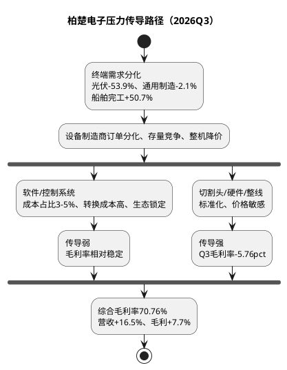

# 研报章节二：产业周期与终端穿透

**研究日期**：2026年10月26日

---

## 一、产业生命周期定位：成长中后期的"黄金赛道"正在变轨

### 1.1 激光切割控制系统市场的成长曲线

根据《2024中国激光产业发展报告》及多家券商数据，中国激光切割控制系统市场规模从2019年的7.6亿元增长至2023年的29.2亿元，**4年CAGR约40%**，呈现出典型的成长赛道早期爆发特征。然而，2024年成为分水岭：

- **激光切割成套设备市场**：2024年销售收入304.3亿元，**同比首次下滑5.1%**，预计2025年进一步调整至296亿元（同比-2.7%）。工程机械、钢结构等领域受房地产下行影响，设备采购量下降15%-20%。
- **与此同时，控制系统市场继续保持正增长**：柏楚电子2024年营收+23.33%，2025年+26.52%，增长韧性显著优于下游设备端。这反映了控制系统在产业链中处于更优的博弈位置。

产业生命周期判断：**成长中后期**。激光切割控制系统行业已从早期的"渗透率驱动"（2019-2023 CAGR 40%），过渡到"结构性增长驱动"（高功率国产替代+智能硬件+新品类拓展）。**中长期增速中枢从40%下移至10-15%**（2026年激光设备整体约+7%、切割设备中低个位数增长、控制系统略高于设备端）。

**2026年行业数据实证**：行业"总量弱增长、结构剧烈分化"的特征进一步确认——①《2026中国激光产业发展报告》（2026年3月发布）预计2026年中国激光设备整体市场约1,025亿元、同比约+7%，全球激光设备约232.5亿美元、同比+3.4%；其中**激光切割增速低于激光焊接**，切割市场仍处调整、结构升级阶段（传统钣金、工程机械、钢结构需求偏弱，通用机型价格承压）；②2025年中国激光切割成套设备市场规模约315.2亿元（+3.6%，另一口径296亿元/-2.7%，口径存疑），2026年推算约315-330亿元、中低个位数增长；③2025年中国激光焊接设备212.5亿元、同比+29.3%，增速远超切割，未来三年焊接可能超过切割成为最大细分赛道；④**价格战已从整机蔓延至零部件**：奔腾激光港交所披露资料称2022年以来行业产品平均价格下降超40%，价格战传导至光纤激光器、切割头、数控系统、伺服等环节，国产化降本反而加剧同质化；⑤出口仍是亮点：2025年激光切割设备出口超166亿元、同比约+18%，2026年海外业务保持两位数增长（锐科激光2026H1海外出货约+30%）。**对柏楚的含义**：行业总量增速（约+7%）继续低于公司营收增速（+16.5%），公司增长仍靠份额提升+第二曲线；但"切割低速、焊接高增"的结构意味着公司收入结构必然向低毛利的焊接/整线倾斜，**这是Q3毛利率降至70.76%的产业背景，而非单纯的短期波动**。

### 1.2 库存动力学：渠道叠加还是真实需求？

柏楚电子的控制系统销售模式为**直供下游设备制造商**，几乎不存在经销商库存层级，因此"牛鞭效应"相对较弱。判断订单波动是否反映真实终端需求，可以从以下信号交叉验证：

| 信号 | 现状 | 解读 |
| :--- | :--- | :--- |
| 设备端销售增速 | 2024年-5.1% | 设备端在去库存周期中 |
| 控制系统增速 | 2024年+23.33%，2025年+26.52% | 控制系统增速远高于设备端 |
| 柏楚合同负债 | 1.32亿（+30.7%） | 在手订单在增加 |
| 设备端CR10市占率 | 超过50% | 集中度提升，头部设备商仍在扩产 |
| 激光企业新增数量 | 2024年同比-47.24% | 行业洗牌加速，中小企业出清 |

**核心辨析**：控制系统增速"倒挂"于设备端，主要有三重原因：(1) **结构升级效应**——高功率设备占比提升，高功率控制系统单价是中低功率的3-5倍，导致控制系统市场价值增速远超设备台数增速；(2) **配套率提升**——智能硬件（切割头等）的配套率从2024年的约35%提升至2025年的更高水平；(3) **市场份额集中**——行业洗牌中，柏楚电子作为龙头从出清的中小竞争对手手中获取份额。

**2026Q3需求侧实证**：公司Q3单季营收6.01亿、同比+16.51%，较Q2的+20.3%降速但仍高于+15%预警线；**竞对维宏股份Q3单季营收1.51亿、同比+8.92%（前三季度+9.66%），增速较Q2的+19.06%明显回落**——两个独立样本均显示"Q2环比回暖未能延续到Q3"，下游激光/机床需求在Q3重新走弱。维宏Q3归母净利537万元、同比-88.18%，前三季度存货+89.87%、应收账款+48.58%，说明设备商/控制系统环节普遍面临"需求弱+备货多+回款慢"的三重压力。**这一信号与公司Q3毛利率70.76%破位相互印证：下游需求不强→设备商压价→控制系统/硬件让利→毛利率下滑。此前"控制系统几乎不受设备端价格战传导"的判断在Q3被证伪。** 8月PMI 49.8%、9月PMI 50.1%的边际改善尚未传导至公司订单端，Q4旺季成色是关键。

**结论**：当前的订单波动并非渠道库存累积导致的虚假繁荣，但也不能简单定性为"健康增长"——**行业处于结构性出清中，公司份额仍在提升，价格战却已从整机传导至控制系统硬件/整线环节，Q3毛利率70.76%是"量增价减"的直接证据**。增长是真实的，利润质量是下降的，两者需分开判断。

---

## 二、终端需求穿透：最终产品画像与景气度审计

### 2.1 最终产品画像

柏楚电子的控制系统**不直接面向终端消费者**，而是作为"设备的操作系统"嵌入到激光切割设备中，最终服务于以下终端制造场景：

| 终端行业 | 功率需求 | 当前景气度 | 未来1-3年趋势 | 对柏楚的拉动强度 |
| :--- | :--- | :---: | :---: | :---: |
| 钣金加工（五金/门业/厨具/广告装饰） | 中低功率 | ★★★ 温和 | 稳定低速增长 | ★★ 基本盘 |
| 钢结构建筑（桥梁/高层/装配式） | 中高功率 | ★★ 分化 | 房地产下行压制，装配式/基建支撑；对厚板高功率切割需求提升 | ★★★★ 高功率核心增量 |
| 船舶制造 | 超高功率(≥30kW) | ★★★★★ 强力 | 中国造船完工量持续增长（2024年4818万载重吨），精度造船推动激光替代等离子 | ★★★★ 高功率重要增量 |
| 工程机械 | 高功率 | ★★★ 温和复苏 | 受益设备更新政策与基建投资 | ★★★ 重要支撑 |
| 新能源汽车（车身/电池结构件） | 高功率+精密 | ★★★★ 高速 | 轻量化车身+电池结构件加工需求爆发 | ★★★★ 精密微加工 |
| 光伏/储能（支架/柜体） | 高功率管材 | ★★★ 高位放缓 | 光伏装机增速放缓但绝对规模仍大 | ★★★ 管材切割催化剂 |
| 航空航天 | 三维/精密 | ★★★★ 高速 | 三维五轴切割+超快精密加工高端需求爆发 | ★★★ 方向布局中 |
| 健身器材 | 中低功率管材 | ★★★ 稳定 | 全球健身消费升级 | ★★ 稳定贡献 |

### 2.2 终端景气度深度审计

#### (1) 钢结构：短期承压与长期替代的双螺旋

2024年钢结构是激光切割设备需求下滑的主要拖累因素（房地产新开工面积持续下降，导致建筑钢结构需求收缩）。但结构性机会在**厚板高功率切割对等离子的替代**：
- 中国传统CNC/等离子切割仍占切割设备年新增量的约96%（约290万台），激光切割渗透率仅3.5%。在20mm以下碳钢加工中，激光切割成本较等离子低约40%。
- 60kW超高功率激光切割设备大幅普及，已能高质量切割50-100mm碳钢，对等离子形成"降维打击"。
- 鸿路钢构2025年2月一次性采购50台3万瓦坡口激光切割机，标志着钢结构行业大规模导入激光切割进入拐点。

**对柏楚的影响**：钢结构高功率控制系统对应FSCUT8000等产品，单价高、毛利率高（推测80%+），是公司收入与利润升级的核心方向。

#### (2) 船舶制造：精度造船驱动的高确定性增量

中国造船完工量2024年达4818万载重吨，继续维持全球第一。大型船舶（集装箱船/LNG船/邮轮）的"精度造船"对切割精度要求极高，激光切割在船舶中厚板领域的渗透正在加速。船舶用钢以中厚板（20-80mm）为主，高功率+超高功率激光切割是刚性需求。

#### (3) 新能源汽车：精密微加工成为第二曲线催化剂

公司在2025年年报中披露，精密微加工业务**逐步获得客户认可**，推出了针对锂电激光焊接的智能解决方案和钙钛矿激光划线系统。超快激光（皮秒/飞秒）在玻璃、液晶面板、半导体脆薄材料加工的量产应用正在推进。这一方向虽然当前收入体量尚小（包含在"其他业务"3.22亿中），但增速极快（+83.12%），是中长期最具想象空间的板块。

### 2.2.1 2026年前三季度终端景气实证

| 终端行业 | 2026年最新数据 | 同比/环比 | 对柏楚的传导 |
| :--- | :--- | :--- | :--- |
| **船舶制造** | 前三季度完工5,805万载重吨、新接订单17,529万载重吨、9月底手持39,913万载重吨（工信部） | 完工**+50.7%**、新接**+163.2%**、手持**+64.8%**；全球份额63.6%/81.8%/72.4% | **强利好**：高功率/超高功率切割+智能焊接/整线需求确定性最高；但新接订单+163%含抢单/低基数成分，需警惕跨期前置 |
| **光伏（管材切割）** | 前三季度新增装机110.83GW；9月单月13.64GW | 累计**-53.9%**；9月单月**+41.2%** | **利空为主**：光伏支架用管材需求大幅收缩，是管材增速从+28%降至+18%的核心原因；9月单月转正为边际改善信号 |
| **钢结构（平面/焊接）** | 鸿路钢构前三季度产量421.30万吨、新签244.32亿元；精工钢构新签182.5亿元 | 鸿路产量**+16.7%**（Q3 +21.2%）、新签+9.7%；精工新签+1.5%（工业建筑+11.6%） | **中性偏利好**：头部钢结构企业逆势扩产、智能化改造加速，支撑智能焊接与高功率切割；但行业整体受地产拖累（房地产开发投资-20.6%） |
| **制造业整体** | 1-9月固定资产投资-7.2%、制造业投资-2.1%、基建-4.2%、房地产开发投资-20.6% | 计算机通信电子+9.6%、铁路船舶航空航天+15.8%、通用设备+1.1%、电气机械+1.2%、金属制品-10.1% | **结构分化**：柏楚下游的通用设备/电气机械仅微增，金属制品大幅下滑；增长主要来自船舶、电子等少数高景气行业 |
| **激光设备出口** | 2025年切割设备出口超166亿元；2026年海外业务保持两位数增长 | +18%（2025）；锐科海外出货约+30%（2026H1） | **利好**：海外是公司"其他区域"+49.6%高增的产业基础，但基数小、对毛利率贡献有限 |

**核心判断**：终端需求呈"船舶独强、光伏深跌、钢结构分化、通用制造疲弱"的极端结构。柏楚的收入增长越来越依赖船舶/焊接/整线等低毛利或项目型业务，而高毛利的中低功率切割基本盘（平面+管材）受光伏、通用制造拖累。**这解释了"营收+16.5%但毛利率-5.76pct"的组合：增长质量下降，是需求结构变化的必然结果，而非偶然。**

> **光伏高基数说明**：2026年前三季度光伏新增装机-53.9%的主因是2025年上半年"6月1日前投产按旧电价规则衔接"导致的异常抢装高基数（2025H1新增约212GW），并非终端需求消失；2026年9月单月已同比+41.2%。**2027年同比基数回归正常后，管材切割的光伏相关需求同比压力将显著减轻**，但绝对量仍取决于市场化电价下的装机节奏。

### 2.3 动能溯源与透支审计（跨期断层风险）

| 增长动能 | 来源类型 | 跨期透支风险评估 |
| :--- | :--- | :--- |
| 高功率国产替代 | **内生**（技术进步 + 进口替代） | **低**：替代进口份额是持续的存量转移，不存在"提前消费" |
| 智能硬件配套率提升 | **内生**（产品组合策略） | **低**：切割头是消耗品，替换周期约1-2年，存在存量替换需求 |
| 等离子→激光技术替代 | **内生**（技术代际更迭） | **低**：技术替代是单向不可逆的长期趋势 |
| 钢结构行业设备更新 | **内生+政策** | **中**：部分受设备更新补贴政策拉动，但政策退出后存量替换需求仍存在 |
| 海外市场拓展 | **内生**（全球化布局） | **低**：海外渗透率极低，处于从0到1阶段 |
| 光伏支架/储能柜体 | **外生（新能源周期）** | **已兑现**：2026年前三季度光伏新增装机-53.9%，透支已从"风险"变为"事实" |
| **船舶新接订单** | **外生（造船大周期）** | **中高**：2026年前三季度新接订单+163.2%、手持+64.8%，存在抢单与低基数成分；若2027年新接订单回落，整线/焊接需求可能阶段性见顶 |

**核心判断**：公司当前增长的核心驱动力（高功率国产替代+智能硬件配套+技术替代）仍为内生性驱动，**不存在严重的"跨期需求前置"风险**；但两项外生变量已出现透支信号——光伏需求下滑已兑现，船舶新接订单的+163%需警惕后续回落。钢结构行业虽受设备更新补贴影响，但补贴在总需求中的占比有限（约15-20%设备改造成本），即便补贴退出，激光替代等离子的技术趋势不会逆转。

---

## 三、供需边际审计与压力传导分析

### 3.1 供需平衡审计：是否存在"紧平衡→过剩"滑落的风险？

#### (1) 控制系统层面（柏楚的直接战场）

**高度集中、竞争有序**。中低功率领域CR3约90%，柏楚超60%的份额+维宏股份约20%，格局极为稳固；高功率领域柏楚是国内唯一与德国倍福、PA等正面竞争的厂商。控制系统行业**不存在产能过剩问题**——本质是软件产品，扩产几乎无边际成本。

**风险不在供应端，而在需求端**：如果宏观经济深度下行导致制造业资本开支持续萎缩，即使公司市占率不变，营收也会承压（参考2022年的教训）。

#### (2) 设备层面（下游客户）

**产能过剩隐忧显现**。2024年激光设备市场销售下滑，但激光切割设备制造商的产能扩张仍在继续（行业资本开支旺盛），设备端竞争加剧。**设备端的价格战已经打响，并已从整机向零部件（激光器、切割头、数控系统、伺服）传导**——2022年以来行业产品平均价格下降超40%。此前"控制系统占设备成本仅3-5%、转换成本高，几乎不受设备端价格战传导"的判断，在2026Q3被部分证伪：**柏楚单季毛利率70.76%、同比-5.76pct，营业成本+45.1%，说明价格/成本压力已经穿透到控制系统与硬件环节**。控制系统的"软件部分"定价权可能仍稳固，但"硬件+整线"部分已成为价格战的实际承受者。

### 3.2 压力传导特征分析

**波动放大效应评估**：设备端"量价齐跌"已开始通过**产品结构**而非**软件降价**传导至柏楚——公司为维持营收增长，主动承接低毛利的硬件/整线/焊接项目，导致综合毛利率被结构性稀释。控制系统环节的"天然缓冲"只对软件部分有效，对硬件/整线部分无效。**这意味着：只要公司继续以"整线方案+智能焊接"作为第二增长曲线，综合毛利率就难以回到75%以上；不排除70-72%成为中期中枢，但该判断需2026年报分部数据验证，当前三季报未披露分部，无法排除Q3单季的时点因素。**

**传导时滞与弹性**：从终端景气度变化到控制系统订单的反映通常有1-2个季度时滞。2026Q2营收+20.3%的环比回暖未能延续至Q3（+16.5%），维宏Q3增速也从+19.1%回落至+8.9%，说明Q3需求重新走弱；9月PMI 50.1%的边际改善能否在Q4订单端兑现，是下一验证点。

---

## 四、强制复核项（Mandatory Audit Checks）

### 复核1：是否穿透并引用了终端产品未来两年景气度预测？

**已穿透。** 公司的最终终端产品包括：
- **钢结构（高功率切割）**：房地产下行压制传统需求，但激光替代等离子是6倍增量空间的结构性机会，装配式建筑/基建提供新的需求来源。
- **船舶（超高功率）**：中国造船业全球份额持续提升，精度造船对激光切割需求刚性增长。
- **新能源汽车/光伏/半导体（精密微加工）**：高速增长的增量市场。
- **钣金加工（中低功率）**：稳定低速的基本盘。

未来2年（2026-2027年），终端需求整体判断：**船舶/钢结构/出口支撑增长，光伏/通用制造拖累基本盘，控制系统市场整体增速维持在10-15%（较此前15-20%下修）**，且增长部分更多来自低毛利的焊接/整线，而非高毛利的切割控制系统。

### 复核2：是否审计了"跨期需求移位"风险？

**已审计。** 公司增长核心驱动力中，高功率国产替代、智能硬件配套率提升、等离子→激光技术替代仍为内生长期趋势；但两项外生透支已显性化：①光伏2026年前三季度新增装机-53.9%，"跨期透支"已从风险变为事实，直接拖累管材切割；②船舶2026年前三季度新接订单+163.2%，含抢单与低基数成分，需警惕2027年新接订单回落导致整线/焊接需求阶段性见顶。钢结构设备更新补贴（约15-20%改造成本覆盖）仍是唯一"弱透支"因素。

### 复核3：是否分析了供需边际演变与压力传导？

**已分析并修正。** 供需边际方向：设备端正从"供需平衡"滑向"结构性过剩"（头部集中+中小企业出清），控制系统层面的软件部分仍健康，但硬件/整线部分已进入价格战。压力传导特征：**已由"极弱"修正为"结构性、非对称"——软件受传导弱，硬件/整线受传导强**；2026Q3毛利率70.76%、成本+45.1%是传导的实证。此前"柏楚凭借高转换成本+低成本占比+生态锁定，具备极强传导免疫力"的结论，仅适用于软件部分，不适用于占收入20%+且快速增长的硬件/整线业务。

---

## 五、模块二核心结论（对前序模块的继承与修正）

**继承模块一的核心线索**：
- 模块一提出的"下游周期敏感性"风险在本模块得到深化验证：2022年负增长的教训表明确实存在周期性波动，但当前的驱动力结构（高功率替代+海外拓展+新品类）相比2022年更加多元，周期防御能力有所增强。
- "天花板焦虑"得到缓解：控制系统市场从约29亿向更高进发，切割头市场15.9亿（2023年实际规模，章节三"潜在市场24.79亿"为含配套率提升的潜在空间，口径不同）、智能焊接潜在市场32.55亿，合计TAM约80亿+，公司仍有2-3倍的营收空间。

**模块二新增的预警信号**：
- 设备端2024年销售首降是关键警示信号。**该信号已在2026Q3兑现为价格战向控制系统硬件/整线的传导**（Q3毛利率70.76%、成本+45.1%），仅软件部分仍相对免疫；若设备端需求再持续下滑超过2年，软件部分的定价权也可能被动摇。

**2026Q3实证修正**：
- **"行业自然增长走弱+价格战传导"双重实证**：公司Q3营收+16.51%（较Q2 +20.3%降速）、维宏Q3 +8.92%（较Q2 +19.1%显著降速），两个独立样本确认Q3需求重新走弱；公司Q3毛利率70.76%（-5.76pct）、成本+45.1%，维宏H1毛利率48.61%（-10.48pct），共同验证"设备端价格战已传导至零部件/控制系统硬件"。
- **终端结构极端分化**：船舶（完工+50.7%/新接+163.2%）、钢结构头部（鸿路产量+16.7%）强；光伏（前三季度装机-53.9%）、通用制造（制造业投资-2.1%）、金属制品（-10.1%）弱。公司增长向低毛利业务倾斜是需求结构的必然结果。
- **毛利率中枢判断（待验证）**：不排除70-72%成为"整线+焊接"占比提升后的中期中枢，此前"73.5%中性假设"过于乐观；但三季报未披露分部，Q3单季时点因素（折扣计提/整线确认）无法排除，2027年能否回到72%以上，取决于高功率占比提升与智能焊接毛利率改善的赛跑，需2026年报验证。
- **产能端维持**：智能切割头扩产项目（2025年12月结项，本年效益2,701.56万元）与智能焊接机器人产业化项目（结项，效益564.08万元）已投产；锂电焊接项目投入2.69%（2028年12月达产），节奏正常。

---

*（本章引用数据来源：《2026中国激光产业发展报告》（2026年3月发布）、中国光学学会、工信部造船三大指标（2026-10-26）、国家能源局光伏装机数据（经新浪财经2026-10-26转引）、国家统计局2026年1-9月固定资产投资数据（2026-10-19）、鸿路钢构/精工钢构经营数据公告、维宏股份/锐科激光/大族激光2026年三季报、QYResearch、智研咨询等公开渠道）*
