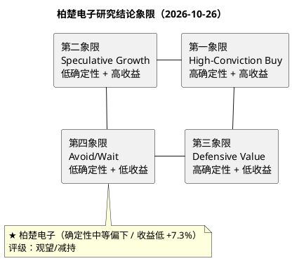

# 研报章节八：投资摘要与风险因素

**研究日期**：2026年10月26日

**目标年份**：2027E（Q4切换期，根据框架模块六规则自动滚算至次年）

---

## 一、投资摘要 (Investment Summary)

### 1.1 核心投资逻辑

柏楚电子（688188.SH）是中国激光切割控制系统的**绝对寡头**，在中低功率市场占据超60%份额，高功率市场以约22%份额位居国产唯一挑战者。公司本质上是一家**以软件定义硬件的工业自动化解决方案提供商**，其商业模式具有以下稀缺特征：

1. **极高的盈利质量（但正在被摊薄）**：2026年前三季度毛利率72.92%、净利率58.55%、加权ROE 17.18%，经营性现金流+7.49%。在A股全市场中，同时满足"毛利率>70%+净利率>50%+ROE>17%+零有息负债"的企业屈指可数；**但毛利率已从2025年的77.66%降至72.92%，Q3单季70.76%创上市新低，盈利质量的下行是当前最大的基本面矛盾**。

2. **五重护城河的叠加效应**：先发品牌优势（18年行业深耕，600余家客户网络）+全栈技术闭环（全球仅3家掌握五大核心技术）+高转换成本（续约率>95%）+规模效应（研发费用绝对值是第二名的2.6倍）+生态网络效应（软硬一体化+MES平台）。护城河未受损，但**软件部分的定价权无法覆盖硬件/整线部分的价格战**。

3. **三重增长驱动力的接力结构（增速与质量双降）**：
   - **第一增长极（进行中）**：高功率控制系统国产替代，份额从22%→目标33%（2027E中性），对应增量空间约15-20亿元；锐科万瓦以上出货+23%佐证需求。
   - **第二增长极（放量但低毛利）**：智能硬件（切割头等）+管材/三维切割，硬件"消耗品属性"提供存量替换收入，但价格战令硬件毛利率承压。
   - **第三增长极（从0到1，低毛利）**：智能焊接+精密微加工，2027E营收占比升至23.1%，但毛利率仅49-52%，**"增收不增利"**。

4. **估值修复空间已被反弹抹去**：10月26日收盘102.50元（较10月22日收盘+8.2%；10月收盘低点为10/15的90.87元，自该点+12.8%），PE_TTM 31.8x（三季报TTM 13.09亿，历史约P1-P2分位）。根据框架模块六规则，Q4切换期滚算至2027E EPS 3.50元，目标价体系从10月13日的83/139/183元下修至75/110/142元，盈亏比从3.35:1暴跌至0.19:1。

### 1.2 核心结论（2027E口径）

**2027年中性情景EPS 3.50元（除权后，14.2亿/4.06亿股），给予30倍PE，经全变量审计矩阵修正（+5%）后，目标价110元（除权后）。** 当前市价**102.50元（10月26日，PE_TTM 31.8x，历史P1-P2）**，较目标价仅有**+7.3%上行空间**（中性），概率加权108元对应+5.0%。**盈亏比0.19:1（107.65 vs 102.50 vs 75）**——较10月13日的3.35:1暴跌，主因盈利预测下修12.9%+股价反弹7.5%+保守目标价下移。

**三态目标价（2027E口径）**：
- **保守（Bear）**：75元（EPS 3.00 × PE 25x）
- **中性（Base）**：110元（EPS 3.50 × PE 30x，含+5%审计调节）
- **乐观（Bull）**：142元（EPS 4.04 × PE 35x）
- **概率加权目标价**：108元（0.25×75 + 0.55×110 + 0.20×142）
- **盈亏比**：0.19:1
- **中性收益率**：+7.3%

**2026Q3三季报（10月26日盘后披露）**：前三季度营收18.80亿（+16.05%）、归母11.00亿（+21.69%）、扣非10.16亿（+20.39%）；Q3单季营收6.01亿（+16.51%）、归母3.13亿（+18.59%）。**核心矛盾：Q3单季毛利率70.76%（同比-5.76pct、环比-2.73pct），首次跌破73%预警阈值，创上市以来单季最低；Q3毛利仅+7.7%、核心经营利润约+2.2%，净利增长主要靠Q3其他收益（+0.43亿），利息收入+0.62亿为前三季度累计口径（主要发生在H1）。** 三季报未对成本+45.1%、毛利率-5.76pct作任何解释（"不适用"），是本轮财报最大的信息缺口。

**技术面**：10月13日89.33元与7月17日89.24元构成周线双底；10/23（+6.17%，37,292手）与10/26（+1.89%，42,854手）连续放量，收复MA20/MA60/MA250，仅差MA120（103.17元）0.65%。**技术面从"全面空头"转为"五线之上、一线压制"，但突破发生在三季报披露前，98.3-103.2元是决策区间。**

**宏观**：9月PMI 50.1%重回扩张（装备制造51.0%、高技术52.5%），宏观预警解除；但1-9月固投-7.2%、制造业投资-2.1%、光伏装机-53.9%，投资端仍弱，"PMI回升、投资仍负"的组合不支持设备商大规模扩产。

**券商跟踪（2026年10月）**：汇丰10月9日上调2026E/2027E至13.77亿/16.54亿；华西13.54/17.36/23.08亿；中信建投13.77/17.21/21.68亿。**我们中性2026E 13.0亿/2027E 14.2亿显著低于机构一致预期（2027E低约14-18%）**，差异核心在毛利率假设（我们71.1% vs 市场约73-74%）与期间费用率（我们23.0% vs 市场约20%）。我们判断市场将在三季报后下修，当前一致预期尚未反映Q3毛利率破位。

---

### 1.3 与市场一致预期的差异

| 机构/口径 | 2026E归母 | 2027E归母 | 关键假设 |
| :--- | :---: | :---: | :--- |
| 汇丰（2026-10-09） | 13.77亿 | 16.54亿 | 毛利率约73-74%、AI邻近领域拉动 |
| 华西（2026-10） | 13.54亿 | 17.36亿 | 焊接/精密放量、费用率下行 |
| 中信建投（2026-10） | 13.77亿 | 17.21亿 | 高功率替代+海外 |
| **本报告** | **13.0亿** | **14.2亿** | **毛利率71.1%、费用率23.0%** |
| 差异（本报告-市场） | **-0.5~-0.8亿（-4~-6%）** | **-2.3~-3.2亿（-14~-18%）** | 毛利率低2-3pct、费用率高2-3pct |

**差异归因**：我们的2027E比市场低14-18%，核心不是收入（我们29.4亿 vs 市场约30-31亿，仅低3-5%），而是**毛利率（71.1% vs 市场73-74%）与期间费用率（23.0% vs 市场20-21%）**。市场一致预期尚未充分反映Q3毛利率70.76%与Q4费用集中确认；若Q4毛利率回升至72%以上，我们可能上调至15.0-15.5亿，但仍低于市场17亿+。**结论：三季报后市场大概率下修，当前一致预期不是可靠的估值锚。**

> **口径提示**：本报告所有目标价均为除权后不复权口径，未考虑2026年激励353.14万股未来归属的0.87%稀释；若全部归属，2027E EPS摊薄至约3.47元、中性目标价约109元。该影响小于1%，不改变评级与目标价区间。

## 二、风险因素 (Risk Factors)

按对股价影响的烈度排序：

| 优先级 | 风险类型 | 具体描述 | 烈度 | 概率 | 应对与跟踪指标 |
| :--- | :--- | :--- | :---: | :---: | :--- |
| **P0** | **毛利率破位（已兑现）** | 2026Q3单季毛利率70.76%、前三季度72.92%，跌破73%预警阈值且低于原熊市假设72.0%；成本+45.1%远超营收+16.5%，三季报未解释 | ★★★★★ 致命 | **100%（已发生）** | 跟踪Q4单季毛利率（≥72%为企稳，<71%为二次恶化）、2026年报分部毛利率 |
| **P0** | **核心利润停滞/盈利质量下降** | Q3毛利仅+7.7%、核心经营利润约+2.2%，净利+18.6%主要靠Q3其他收益+0.43亿（占Q3净利增量约88%）；利息收入+0.62亿为前三季度累计口径（主要发生在H1）；若其他收益回落，净利增速向核心利润收敛 | ★★★★★ 严重 | 70% | 跟踪Q4其他收益/财务费用、扣非与核心利润增速差 |
| **P1** | **存货积压** | 存货4.03亿（较年初+61.3%），周转天数从152天拉长至约216天；购买商品支付现金+93%；若Q4收入不能消化，2027年面临跌价与毛利率二次压力 | ★★★★ 严重 | 45% | 跟踪Q4存货/营收比、资产减值计提 |
| **P1** | **下游需求结构恶化** | 光伏前三季度装机-53.9%、制造业投资-2.1%、金属制品-10.1%；船舶独强（完工+50.7%/新接+163.2%）但新接订单含抢单成分 | ★★★★ 严重 | 55% | 跟踪10月PMI、Q4设备商订单、光伏月度装机、船舶新接订单 |
| **P2** | **基本盘失速** | H1平面+4.39%、三维+2.94%显著低于2025年；Q3整体增速靠其他业务，平面/管材未披露 | ★★★★ 严重 | 60% | 跟踪2026年报分部收入增速 |
| **P2** | **智能焊接/整线低毛利扩张** | 其他业务毛利率48.17%，占比升至20%+；每提升1pct占比拖累综合毛利率约0.3pct；船舶整线项目毛利率更低 | ★★★ 中等 | 70% | 跟踪其他业务毛利率、整线项目确认节奏 |
| **P2** | **芯片断供（尾部风险）** | FPGA/ARM被列入出口管制，短期无法切换国产替代；2026年7月进口FPGA交期52周、涨价10-20% | ★★★★★ 致命但低概率 | 10% | 跟踪BIS实体清单、国产FPGA适配、存货中的战略备货 |
| **P2** | **海外拓展受阻** | 地缘政治恶化导致海外市场准入受限；海外收入占比仅约5%，但增速+49.6% | ★★★ 中等 | 20% | 跟踪分区域收入、海外办事处进展 |
| **P3** | **竞争格局恶化** | 国际厂商大幅降价反击、国内新进入者搅局；行业价格战已持续4年（均价-40%） | ★★ 可控 | 40%（已部分兑现） | 跟踪年报市占率、竞品价格、维宏/锐科毛利率 |
| **P3** | **汇率/税率变动** | 税收优惠退出（15%→25%）、人民币大幅升值；2026年前三季度有效税率仅9.5% | ★★ 可控 | 10% | 跟踪高新技术企业复审、年度有效税率 |

---

### 2.1 风险概率-影响量化（2027E口径）

| 风险 | 触发概率 | 对2027E归母影响 | 对中性目标价影响 | 期望影响（概率×影响） |
| :--- | :---: | :--- | :--- | :---: |
| Q4毛利率<71%（趋势性恶化） | 35% | 14.2→12.8亿（-10%） | 110→95元（-14%） | -4.9% |
| 核心经营利润增速<5% | 40% | 14.2→13.4亿（-6%） | 110→103元（-6%） | -2.4% |
| 存货>5亿且Q4未去化 | 30% | 计提跌价0.3-0.5亿（-2~4%） | 110→105元（-5%） | -1.5% |
| 光伏/通用制造需求再下台阶 | 55% | 收入增速降至+10%（净利-8%） | 110→100元（-9%） | -5.0% |
| FPGA断供（尾部） | 10% | 2027E净利9.0亿（-37%） | 110→44元（-60%） | -6.0% |
| 船舶订单2027年回落 | 30% | 焊接/整线收入-15%（净利-5%） | 110→104元（-5%） | -1.5% |
| **合计期望拖累（未去重）** | — | — | — | **约-21%** |

> **说明**：上表为单因子敏感性，合计期望拖累未去重（多项风险相关），仅用于排序与压力测试，不直接叠加至目标价；基准目标价110元已内含毛利率71.1%、费用率23.0%等中性假设。**最大单一风险仍是毛利率（概率35%、目标价影响-14%）与FPGA断供尾部风险（概率10%、影响-60%）。**

### 2.2 三情景压力测试（2027E）

| 情景 | 关键假设 | 2027E归母 | EPS | 目标价 | 较现价 |
| :--- | :--- | :---: | :---: | :---: | :---: |
| **乐观** | 毛利率73.0%、营收32.0亿、其他收益2.2亿 | 16.4亿 | 4.04元 | 142元 | +38.5% |
| **中性** | 毛利率71.1%、营收29.4亿、其他收益2.15亿 | 14.2亿 | 3.50元 | 110元 | +7.3% |
| **悲观** | 毛利率70.0%、营收26.5亿、其他收益1.2亿 | 12.2亿 | 3.00元 | 75元 | -26.8% |
| **极端（FPGA断供）** | 营收27.5亿、毛利率70%、净利9.0亿 | 9.0亿 | 2.22元 | 44元 | -57.1% |

> **压力测试解读**：中性情景仅较现价+7.3%，而悲观情景-26.8%、极端情景-57.1%，**收益/风险不对称（上行空间有限、下行空间大）**。从期望值看，概率加权目标价108元仅较现价+5.0%，而悲观/极端情景下行-26.8%/-57.1%，风险收益比不匹配。若Q4毛利率跌破71%，基准情景将向悲观情景迁移，目标价下修至90元以下；若Q4毛利率回升至72%以上且核心利润增速恢复至10%，则向乐观情景迁移，目标价上看120-130元。**当前赔率结构不支持重仓，只适合已持有者减仓后的底仓观察；除非Q4出现毛利率≥72%的明确拐点，否则不建议以"低估值"为由加仓。**

## 三、研究结论象限图 (Final Evaluation Matrix)

基于**确定性**与**预期收益空间**的双维评估：

**定位判断**：柏楚电子从10月13日的**第一象限（High-Conviction Buy）**下移至**第四象限（Avoid/Wait）**。**确定性中等偏下（不满足第三象限的高确定性要求）**：护城河、净现金、份额稳固仍在，但毛利率破位、核心利润停滞、盈利预测下修使确定性下降；**预期收益低**：中性目标价110元较现价仅+7.3%，加权+5.0%，盈亏比0.19:1。**评级规则：盈亏比<1.0且加权预期收益<15%即定为第四象限；本报告据此从"买入"下调至"观望/减持"。**

**操作建议**：

1. **已建仓者**：按跟踪手册§三"单季毛利率跌破73%→减仓至30%以下"的规则，**建议减仓至30%以下**，保留底仓等待Q4毛利率企稳；跌破98.3元（S1下沿）进一步减仓，跌破93元（S3双底上沿）清仓观望。

2. **未建仓者**：**不建议追高**。102.50元已基本反映合理估值（2027E PE 29.3x、ex-cash 25.7x），三季报负面尚未定价。等待两种情形之一：①Q4单季毛利率≥72%且核心经营利润增速≥10%；②股价回落至85-90元（2027E PE 24-26x），重新评估赔率。

3. **加仓触发条件（需同时满足）**：（a）Q4单季毛利率≥72%；（b）核心经营利润（毛利-期间费用）同比增速≥10%；（c）技术面站稳103.2元（MA120）且放量。三者缺一不可。

4. **减仓/止损**：Q4毛利率<71%或2027Q1继续下行，目标价下修至90元以下；**战术止损98.3元（S1下沿）→清仓位93元（S3双底上沿）→战略止损75元（熊市目标价）**。

5. **核心风险节点**：10月31日10月PMI（能否站稳50）、2026年报（2027年3-4月，毛利率/智能焊接出货/2027E验证）、2027Q1毛利率（是否二次下行）。**最关键的单一变量是毛利率：Q4能否回到72%，决定目标价是110元还是90元以下。**

---

*（本章为前序七个模块的浓缩总结，并纳入2026年10月26日三季报实际数据校准。所有结论均为研究推演，不构成投资建议。）*
