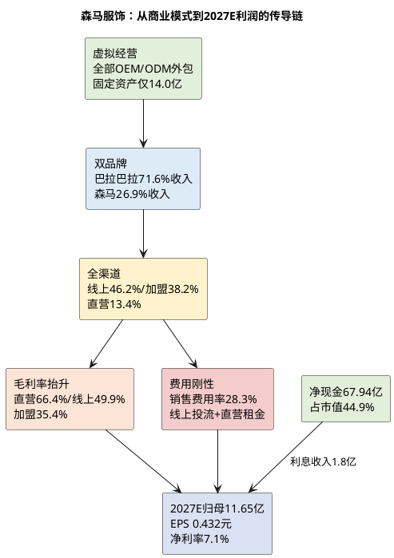

# 研报章节一：企业微观与财务基石

**研究日期**：2026年10月31日  
**标的**：森马服饰（002563.SZ）  
**数据截止**：2026年10月30日收盘（行情）；2026年09月30日（公司最新已披露财务，公告日2026-10-30）  
**目标年份**：2027年（Q4切换期，盈利与估值锚定2027E）  
**研究性质**：首次覆盖

## 结论先行

| 财务判断 | 已验证事实（至2026Q3） | 关键情报/口径提示 | 对2027E估值的含义 |
|:--|:--|:--|:--|
| 盈利质量 | 2026年1-9月归母净利6.91亿元、同比+28.79%，但营业利润增量2.65亿元中约2.02亿元来自财务费用由-0.15亿元转为-2.17亿元（利息收入增加） | 管理层交流口径：2026年全年利息收入计划约3亿元，来自3-4年前高利率大额存单集中到期结算，非均速确认（来源：长江证券2026中报电话会纪要，未经公告核实） | 2027年利息收入大概率回落至1.3-2.3亿元，构成归母净利约0.7-1.0亿元的逆风；不能用2026年净利线性外推 |
| 增长结构 | 2026H1儿童服饰48.27亿元、+11.92%，休闲服饰17.82亿元、+3.43%；儿童占比升至71.81% | 2026Q3单季营收37.08亿元、仅+0.36%，归母净利2.12亿元、+0.14%，扣非-2.60% | 增长引擎在Q3失速，"童装独轮驱动"遭遇出生人口下行与运动童装挤压的双重约束 |
| 渠道结构 | 2025年线上69.72亿元（46.2%）、加盟57.69亿元（38.2%）、直营20.16亿元（13.4%）；2026H1直营+23.32%、线上+13.10%、加盟+0.68% | 2026H1直营坪效5,121.94元/㎡/半年、同比约+17%；门店7,617家、较年初净减314家（加盟净减309家） | 渠道DTC化提升毛利率（直营毛利率66.35%），但同步抬高销售费用；这是"毛利率升、净利率不稳"的结构性原因 |
| 库存与减值 | 2025年存货31.78亿元、周转149天；2026Q3存货40.23亿元、同比-2.9%、周转176天（同比-17天） | 2026年1-9月资产减值3.55亿元、同比+45.6%，公司解释"存货老品增加"；Q3存货较年中+42%属秋冬备货 | 2026年全年资产减值预计5.3亿元（含信用减值合计5.7亿元），2027年基准假设资产减值4.2亿元（含信用合计4.55亿元）；减值是否回落是2027年利润弹性的第一变量 |
| 现金与分红 | 2026Q3货币资金47.66亿元、交易性金融资产12.89亿元、大额存单等15.36亿元，净现金约67.94亿元，占市值44.9% | 2025年度合计分红8.08亿元、派息率90.57%；2026年中期已派4.04亿元、占H1净利84.32%；管理层交流口径全年每股或按0.25元（含中期0.15元） | 净现金与高分红构成估值下限；但若2026年最终分红降至0.25元/股，股息率由5.34%降至4.45% |
| 费用与税率 | 2025年销售费用42.35亿元、+12.88%、费用率28.06%；2026年1-9月销售费用率28.29%、基本持平 | 2025年实际税率29.2%、2026年1-9月29.9%，未向25%回归；公司解释"部分盈利子公司承担较重税收任务" | 税率按28.5-29.5%建模，不假设短期正常化；税率每降1pct约增厚归母净利0.15亿元 |
| 治理与筹码 | 邱光和家族及一致行动人合计持股65.91%；邱坚强质押1.36亿股、占其持股37.78%、占总股本5.04% | 2024年股票期权计划前两个行权期均因未达门槛值（2024年12亿元、2025年15亿元）而注销；2026年考核目标18亿元同样遥不可及 | 高分红意愿可信，但股权激励已失去约束力；治理因素在估值审计中记0%，不给溢价也不额外折价 |

森马服饰是一家以"虚拟经营"为特色的大众服饰集团：产品全部外包生产，公司掌握品牌运营、设计研发、生产组织与成衣采购、零售管理、仓储物流等高附加值环节。2025年营业收入150.90亿元，其中儿童服饰108.00亿元、占71.57%，休闲服饰40.55亿元、占26.87%；归母净利8.92亿元，同比下降21.54%。2026年1-9月营业收入104.31亿元、同比+5.96%，归母净利6.91亿元、同比+28.79%，表面上是强劲修复，但拆开利润表可以看到，修复的主要来源不是卖衣服，而是利息收入和费用节流。**这家公司的财务底色是"现金奶牛+品牌资产"，不是"成长股"；2026年的利润高增含有明显的一次性成分，2027年的核心矛盾是"利息收入退潮后，经营性利润能否接棒"。**

## 1. 商业模式：轻资产、双品牌、全渠道

### 1.1 虚拟经营：把重资产留给供应商

公司产品全部采用外包生产，模式以OEM和ODM为主。2025年末固定资产账面价值14.02亿元，仅占总资产7.52%；在建工程6.12亿元，主要为上海国际运营中心；使用权资产5.72亿元，对应租赁门店。真正占用资金的是存货（31.78亿元）和应收（14.99亿元），而这两项又被应付票据28.01亿元、应付账款19.75亿元大部分对冲。结果是公司营运资本接近零（2025年末约-1.0亿元、2026Q3约+1.5亿元），并非长期负营运资本：2026Q3应付账款29.06亿元、较年初+47.09%，应付票据22.02亿元，合计51.08亿元；存货40.23亿元、应收12.37亿元，合计52.60亿元，营运资本约+1.5亿元。上游供应商实际上为公司的库存和渠道扩张提供了无息融资。

这种模式的好处是资本回报率高、扩张不需要重资本；坏处是产品质量、交期、成本完全依赖供应商，且公司对终端需求的判断一旦失误，库存和跌价损失会集中体现在自己表内。2025年资产减值损失4.53亿元（其中存货跌价4.43亿元），相当于当年归母净利的50.8%；2026年1-9月资产减值3.55亿元，同比再增45.6%。**虚拟经营把固定资产风险转化成了存货风险，这是理解森马利润波动的关键。**

### 1.2 品牌矩阵：巴拉巴拉是利润主体，森马是问题资产

公司采用"双主力、双潜力、全球化"战略：双主力为森马（成人休闲）与巴拉巴拉（儿童服饰），双潜力为儿童运动品牌业务与MOP品牌多层次渠道矩阵。品牌矩阵包括：

| 品牌 | 定位 | 价格带 | 2025年状态 |
|:--|:--|:--|:--|
| 森马 Semir | 大众休闲，都市通勤/日常休闲/轻户外 | 100-800元 | 收入40.55亿元、-3.22%，毛利率40.50%（+5.02pct），仍在调整 |
| 巴拉巴拉 balabala | 0-14岁童装全品类，大众至中端 | 100-500元 | 收入108.00亿元、+5.18%，毛利率46.75%（-0.56pct），绝对主力 |
| 马卡乐 marcolor | 0-12岁儿童服饰 | 99-599元 | 未单独披露 |
| 迷你巴拉 mini bala | 0-6岁亲子/婴幼童 | 100-700元 | 2026H1收入3亿元、+25%，毛利率超40% |
| Hey junior | 校服 | 100-600元 | 未单独披露 |
| 森马儿童 Semir kids | 3-10岁学生童装 | 99-599元 | 2026H1收入1亿元、+11%，毛利率57% |
| 爱肯 AIKEN | 大众潮流服饰 | 99-600元 | 未单独披露 |
| Marc O'Polo | 被授权高端女装/男装 | 590-3,890元 | 授权至2028-11-24，独家 |
| AsicsKids | 被授权儿童运动鞋服 | 290-2,100元 | 2026H1收入2.3亿元、+15%，毛利率48% |
| PUMAKIDS | 被授权童装童鞋 | 149-2,299元 | 2026H1收入2.4亿元、+134%，毛利率52% |

2026H1多品牌业务（mini bala、AsicsKids、PUMAKIDS、Semir kids等）营收占公司约12.9%、占儿童服饰收入约18%，零售端同比+92%，是儿童板块超预期的重要增量。但公司**不披露分品牌收入**，巴拉巴拉单品牌的真实增速、毛利率、门店数均不可得，这限制了估值时对"品牌资产"的精确定价。我们只能以"儿童服饰"品类口径作为代理变量。

### 1.3 渠道：加盟是基本盘，直营与线上是增长极

2025年公司门店7,931家、面积150.85万㎡，其中直营1,028家、加盟6,872家、联营31家；全年新开1,061家、关闭1,455家，净减394家。2026H1进一步降至7,617家（直营1,027、加盟6,563、联营27），净减314家，其中加盟净减309家。管理层交流口径全年净减300-400家，未来不排除恢复净开店。

| 渠道 | 2025收入（亿元） | 占比 | 同比 | 毛利率 | 2026H1收入（亿元） | 同比 | 毛利率 |
|:--|--:|--:|--:|--:|--:|--:|--:|
| 线上销售 | 69.72 | 46.21% | +4.50% | 45.81% | 30.44 | +13.10% | 49.89% |
| 加盟销售 | 57.69 | 38.23% | -5.03% | 36.55% | 23.49 | +0.68% | 35.35% |
| 直营销售 | 20.16 | 13.36% | +30.25% | 65.85% | 11.69 | +23.32% | 66.35% |
| 联营 | 0.98 | 0.65% | -39.93% | 62.28% | 0.47 | -25.76% | 70.61% |
| 其他 | 2.34 | 1.55% | +39.82% | 48.76% | 1.12 | +0.16% | 49.55% |

直营毛利率66.35%、线上49.89%、加盟35.35%，渠道结构变化对综合毛利率的影响是 mechanical 的：直营和线上占比每提升1个百分点，综合毛利率约提升0.1-0.3个百分点。2025年直营收入+30.25%、2026H1再+23.32%，直营坪效由2025年8,946元/㎡/年提升至2026H1的5,122元/㎡/半年（年化约10,244元，+14.5%），说明"大店+购物中心+奥莱"的直营升级确实有效。但直营也带来租金、装修、人员、折旧等固定费用，2026H1销售费用中装潢修理费+57.47%、劳务费+7.37%、广告宣传费+10.05%、服务费+9.56%，正是直营与线上投流共同推高的结果。

线上渠道的另一面是极高的退货率：2025年天猫平台交易金额49.82亿元、退货率49.85%，抖音45.64亿元、退货率54.64%；2026H1天猫20.97亿元、退货率51.70%，抖音19.56亿元、退货率53.73%。这些是GMV口径，不等于确认收入，但意味着每两单就有一单退回，投流费、来回运费、折损处理都是真金白银。**线上增长是"有收入的增长"，不必然是"有利润的增长"。**

## 2. 五年盈利质量透视（2021-2025 + 2026Q3）

| 指标 | 2021 | 2022 | 2023 | 2024 | 2025 | 2026年1-9月 |
|:--|--:|--:|--:|--:|--:|--:|
| 营业收入（亿元） | 154.20 | 133.31 | 136.61 | 146.26 | 150.90 | 104.31 |
| 营收同比 | +1.41% | -13.54% | +2.47% | +7.06% | +3.17% | +5.96% |
| 归母净利（亿元） | 14.86 | 6.37 | 11.22 | 11.37 | 8.92 | 6.91 |
| 归母净利同比 | +84.50% | -57.15% | +76.14% | +1.42% | -21.54% | +28.79% |
| 毛利率 | 42.58% | 41.30% | 44.02% | 43.82% | 45.10% | 46.34% |
| 净利率 | 9.64% | 4.78% | 8.21% | 7.78% | 5.91% | 6.63% |
| 销售费用率 | 21.93% | 24.47% | 24.11% | 25.65% | 28.06% | 28.29% |
| 资产+信用减值（亿元） | 4.65 | 6.56 | 4.74 | 3.03 | 4.61 | 3.91 |
| 经营现金流（亿元） | 20.76 | 11.76 | 19.41 | 12.63 | 17.30 | 4.90 |
| OCF/归母净利 | 1.40x | 1.85x | 1.73x | 1.11x | 1.94x | 0.71x |
| 加权ROE | 12.70% | 5.70% | 10.06% | 9.80% | 7.66% | 5.98%（9M） |
| 存货（亿元） | 40.24 | 38.47 | 27.47 | 34.81 | 31.78 | 40.23 |
| 应收账款（亿元） | 14.52 | 12.63 | 13.43 | 15.95 | 14.99 | 12.37 |
| 净现金（亿元） | 约83 | 约76 | 约85 | 约72 | 77.16 | 67.94 |
| 分红率 | — | — | — | — | 90.57% | 中期84.32% |

注：净现金=货币资金+交易性金融资产+一年内到期非流动资产+其他非流动资产-短期借款-租赁负债；2021-2024年大额存单明细未逐项还原，按货币资金+交易性金融资产近似，故为约数。2026Q3净现金67.94亿元为精确值（47.66+12.89+2.75+12.61-3.00-2.36-2.61）。

### 2.1 利润波动的三段式：疫情、减值、费用

2021年是上一轮高点：营收154.20亿元、归母14.86亿元、净利率9.64%。2022年疫情冲击线下客流，营收-13.54%、归母-57.15%至6.37亿元。2023-2024年修复至11.22/11.37亿元，但净利率只有8.21%/7.78%，再也回不到2021年的9.64%。2025年是最典型的一年：**营收+3.17%、毛利率+1.28pct至45.10%（历史最高），归母却-21.54%**。原因拆解如下：

- 毛利增加3.97亿元，其中毛利率+1.28pct贡献约1.93亿元、营收+3.17%贡献约2.03亿元；
- 销售费用+4.83亿元（37.51→42.35亿元，+12.88%），费用率+2.41pct，主要投向线上投流与线下新开门店；
- 资产减值+1.62亿元（2.92→4.53亿元，+55.5%），其中存货跌价4.43亿元；
- 管理费用+0.11亿元、研发费用-0.04亿元、财务费用+0.38亿元（利息收入减少）；
- 最终营业利润-3.06亿元、归母-2.45亿元。

这说明2025年的利润下滑不是需求崩塌，而是**"毛利率改善被费用和减值吃掉"**。2026年1-9月的修复，则是这个过程的镜像：毛利率再+1.21pct至46.34%，销售费用率持平（28.29% vs 28.26%），减值虽增加1.37亿元，但财务费用由-0.15亿元变为-2.17亿元（利息收入+2.02亿元），最终营业利润+2.65亿元、归母+1.55亿元。

### 2.2 2026年利润增长的含金量：三分之二来自利息

将2026年1-9月营业利润增量拆开：

| 驱动项 | 金额（亿元） | 说明 |
|:--|--:|:--|
| 毛利增量 | +3.91 | 营收+5.87亿元×毛利率+1.21pct，量价齐升 |
| 销售费用 | -1.69 | 费用率持平，随收入同步增长 |
| 管理费用 | -0.12 | 基本稳定 |
| 研发费用 | -0.05 | 基本稳定 |
| 财务费用（利息净收入） | +2.02 | 利息收入由0.60亿元增至约2.17亿元 |
| 其他收益 | -0.14 | 政府补助减少 |
| 投资收益/公允价值 | -0.03 | 可忽略 |
| 资产减值 | -1.11 | 存货老品增加 |
| 信用减值 | -0.26 | 单项计提增加 |
| **营业利润增量** | **+2.65** | 其中利息贡献2.02亿元，占76% |

如果剔除利息收入的增量，2026年1-9月营业利润仅增长约0.63亿元（+8.8%），远低于表观+36.9%。单看Q3更明显：Q3营业利润3.16亿元、同比+10.2%，但剔除财务费用后（Q3利息净收入0.78亿元 vs 上年同期0.01亿元），**经营性营业利润约2.38亿元、同比-16.6%**。这意味着Q3的服装主业实际上在恶化，利润持平完全靠利息和低基数减值。

管理层在2026年中报交流中给出的全年净利指引是+15%-20%（即10.26-10.71亿元），并明确提示"上半年利润高增长含大额利息收入贡献（同比增1亿），全年增速预计放缓"。这个指引是可信的，也侧面确认了2026年利润的质量问题。

### 2.3 现金流与ROE：现金奶牛，但回报率在下台阶

OCF/归母净利在过去五年分别为1.40x、1.85x、1.73x、1.11x、1.94x，2026年1-9月因存货备货降至0.71x，但全年大概率回到1.3x以上（2025年同期为-0.90x）。经营现金流绝对额12-21亿元，资本开支4-6亿元（2025年购建长期资产现金6.14亿元；上海国际运营中心高峰期除外），自由现金流常年10-16亿元，足以覆盖8亿元左右的分红。这是公司最扎实的财务资产。

ROE则持续下台阶：2021年12.70%→2022年5.70%→2023年10.06%→2024年9.80%→2025年7.66%，2026年1-9月5.98%。原因不是杠杆下降（资产负债率稳定在33%-41%），而是净利率从9.64%降至5.91%、总资产周转率从0.90降至0.80。**在净现金占净资产60.3%的情况下，ROE被低收益的现金资产稀释；剔除净现金后的经营性ROIC仍有18%-25%，但这是负营运资本模式的产物，不能简单外推。** 2026年若按10.73亿元归母净利、平均净资产115.5亿元计算，ROE约9.3%；2027E约10.1%，仍低于2019-2021年的12%-16%。

## 3. 收入与利润的二级科目穿透

### 3.1 分产品：儿童服饰是唯一增长引擎

| 分产品 | 2024收入 | 2025收入 | 2025同比 | 2025毛利率 | 2026H1收入 | 2026H1同比 | 2026H1毛利率 |
|:--|--:|--:|--:|--:|--:|--:|--:|
| 儿童服饰 | 102.68 | 108.00 | +5.18% | 46.75% | 48.27 | +11.92% | 48.56% |
| 休闲服饰 | 41.90 | 40.55 | -3.22% | 40.50% | 17.82 | +3.43% | 45.66% |
| 其他 | 1.68 | 2.34 | +39.82% | 48.76% | 1.12 | +0.16% | 49.55% |
| 合计 | 146.26 | 150.90 | +3.17% | 45.10% | 67.22 | +9.32% | 47.78% |

儿童服饰2025年收入108.00亿元、占71.57%，2026H1占比进一步升至71.81%。儿童毛利率46.75%，比休闲高6.25pct；2026H1儿童毛利率48.56%、休闲45.66%，差距收窄至2.9pct，主要因为休闲毛利率同比+2.44pct（折扣收紧、直营占比提升），儿童仅+0.35pct（老品促销、加盟让利）。

休闲服饰是长期问题资产：2011年森马品牌收入约55.86亿元，2025年只剩40.55亿元，2026H1为17.82亿元。公司提出"再造新常服"，聚焦都市通勤、日常休闲、轻运动户外三大场景，2026H1收入终于转正（+3.43%），但绝对规模只有儿童的37%，且毛利率仍低于儿童。**休闲品牌的定位、产品力、渠道效率均未证明反转，2027E只能假设低个位数增长。**

儿童服饰的增长来源可以拆成三层：
1. **主品牌巴拉巴拉**：2026H1儿童服饰+11.92%，但门店净减156家、面积-1.7%，增长来自坪效提升（大店战略、第八代旗舰店、IP主题店）和线上（+13.1%）；
2. **多品牌**：mini bala 3亿元（+25%）、AsicsKids 2.3亿元（+15%）、PUMAKIDS 2.4亿元（+134%）、Semir kids 1亿元（+11%），合计约8.7亿元、占儿童服饰18%，零售端+92%；
3. **海外**：2026H1境外收入0.85亿元、+63.7%，占比1.27%；巴拉巴拉已进入约20个国家和地区，2026年在意大利罗马开欧洲首店，但基数极小，2027年难以成为利润支柱。

### 3.2 分渠道：DTC化是双刃剑

2026H1直营收入11.69亿元、+23.32%，门店仅1,027家（较年初-1家），增长完全来自坪效：直营坪效5,121.94元/㎡/半年、同比约+17%，单店面积222.20㎡。线上收入30.44亿元、+13.10%，毛利率49.89%、同比+2.60pct。加盟收入23.49亿元、+0.68%，门店净减309家，毛利率35.35%、同比-1.99pct。

这三组数字指向同一个结论：**公司在用直营和线上替代加盟，以换取更高的毛利率和更快的反应速度，但代价是销售费用刚性化、加盟商信心受损。** 2026H1加盟收入几乎零增长，加盟门店却减少了309家，说明单店提货额在上升（幸存者偏差），也可能是公司在主动收缩低效加盟、把流量导向直营和线上。无论哪种解释，加盟体系的"蓄水池"功能在减弱：过去加盟商承担库存和终端风险，现在更多库存留在公司表内（2026Q3存货40.23亿元），减值风险相应上升。

### 3.3 费用与减值：2027年的利润弹性来源

| 费用项 | 2024 | 2025 | 2025同比 | 2026年1-9月 | 2026年1-9月同比 |
|:--|--:|--:|--:|--:|--:|
| 销售费用（亿元） | 37.51 | 42.35 | +12.88% | 29.51 | +6.07% |
| 销售费用率 | 25.65% | 28.06% | +2.41pct | 28.29% | +0.03pct |
| 管理费用（亿元） | 5.93 | 6.04 | +1.84% | 4.57 | +2.63% |
| 研发费用（亿元） | 3.06 | 3.02 | -1.24% | 2.15 | +2.40% |
| 财务费用（亿元） | -1.32 | -0.93 | 利息收入减少 | -2.17 | 利息收入增加 |
| 资产+信用减值（亿元） | 3.03 | 4.61 | +52.1% | 3.91 | +53.9% |

2025年销售费用率跳升2.41pct，是利润下滑的第一大原因；2026年费用率持平，说明"控费"已经进入平台期，进一步下降的空间有限。管理层交流口径"下半年毛利率面临成本上升压力，Q4采购成本低个位数增长，公司将采取提价策略应对"，意味着2027年毛利率大概率持平或微升，难以复制2026年+1.2pct的改善。

减值则是2027年最大的利润弹性来源：2025年4.61亿元、2026年预计5.3亿元，均处于历史高位。如果2027年库存老化缓解、减值回落至4.2亿元，可贡献约0.8亿元税前利润（约0.57亿元归母）；如果继续维持在5.3亿元，则2027年利润增长将被完全吞噬。**减值的可预测性很低，这是我们对2027年给出较宽80%区间（8.5-14.5亿元）的核心原因。**

### 3.4 税率：被忽视的结构性拖累

2025年实际税率29.2%、2026年1-9月29.9%，显著高于25%的法定税率。公司在2026年中报交流中解释："所得税率偏高因部分盈利子公司承担较重税收任务。" 这意味着：①盈利子公司的税收优惠有限；②亏损子公司的递延所得税资产可能未确认；③税率短期不会回归25%。我们在2026E/2027E分别按29.5%/28.5%建模，若税率正常化至25%，可增厚归母净利约0.6-0.7亿元（EPS +0.025元），但这不是基准假设。

## 4. 资产负债与现金流：67.94亿净现金是最大的安全垫

### 4.1 净现金与负债结构

2026Q3末：
- 货币资金47.66亿元（较2025年末58.37亿元下降，主要因分红和购买理财）；
- 交易性金融资产12.89亿元（理财产品）；
- 一年内到期的非流动资产2.75亿元（大额存单）；
- 其他非流动资产12.61亿元（大额存单等）；
- 短期借款3.00亿元（全部为带追索权的票据贴现；附注称银行短期借款余额0，系票据贴现会计口径）；
- 一年内到期的租赁负债2.36亿元、租赁负债2.61亿元；
- **净现金=47.66+12.89+2.75+12.61-3.00-2.36-2.61=67.94亿元**，占市值151.41亿元的44.9%，每股2.52元。

这67.94亿元净现金相当于每股2.52元，是当前股价5.62元的44.9%，为估值下限提供参考；但净现金中部分对应应付账款/票据等经营性负债，不能简单视为可分配现金，实际可分配现金需扣除经营所需周转资金。

### 4.2 存货：总量下降，结构恶化

2025年末存货31.78亿元、周转149天；2026H1末28.32亿元、周转157天；2026Q3末40.23亿元、同比-2.9%、周转176天（同比-17天）。Q3环比+42%是秋冬备货的季节性，但**同比只降2.9%，而同期营收+5.96%，说明存货周转确实在改善**。问题在结构：2026H1存货跌价准备5.38亿元（较年初+5.1%），本期计提2.60亿元；2026年1-9月资产减值3.55亿元、同比+45.6%，公司明确解释"存货老品增加"。2025年报的库龄结构已经偏高：1年以内25.61亿元、1-2年9.88亿元、2-3年0.97亿元、3年以上0.44亿元；2026H1的1-2年库龄降至9.04亿元、2-3年升至1.68亿元，1年以上占比由30.6%升至32.8%。**老品占比上升，意味着2027年减值压力不会自动消失。**

### 4.3 应收与应付：供应链议价能力强，但加盟商在承压

应收账款2026Q3为12.37亿元、同比-14.1%，周转天数36天、同比-6天，回款改善。但坏账准备高达3.09亿元（计提比例27.0%），其中单项计提2.08亿元、计提比例100%；前五名应收占25.58%，有两名已全额计提。这说明加盟商/客户的信用风险已经在暴露，只是金额可控。

应付账款29.06亿元、同比+47.1%，周转天数119天、同比+2天；应付票据22.02亿元。公司把资金压力向上游转移，短期改善了现金流，但若供应商要求缩短账期，2027年现金流会承压。

### 4.4 资本开支：上海国际运营中心的最后一笔

上海产业园改扩建项目（森马上海国际运营中心）总投资15亿元，2025年末在建工程6.02亿元、进度40.15%；2026H1末8.01亿元、进度52.19%；2026Q3末8.74亿元、较年初+42.9%。原计划2026年9月竣工，但从进度看大概率延至2027年。项目建成后，每年新增折旧约0.5-0.7亿元，对2027年利润有轻微拖累；资本开支高峰过后，2027年自由现金流将回升至14-16亿元，支持分红。

## 5. 量化对齐：估值处于历史中低位，但便宜有便宜的理由

| 指标 | 当前值（2026-10-30） | 2019年以来分位 | 2016年以来分位 | 历史中位 |
|:--|--:|--:|--:|--:|
| PE TTM | 14.46x | 29.7% | 22.4% | 16.01x |
| PB | 1.34x | 27.4% | 19.8% | 1.55x |
| PS TTM | 0.97x | 12.7% | — | 1.20x |
| 2026E PE | 14.11x | — | — | — |
| 2027E PE | 13.00x | — | — | — |
| 剔除净现金的2026E PE（分母含利息） | 7.78x | — | — | — |
| 剔除净现金的2027E PE（分母含利息） | 7.16x | — | — | — |
| 股息率（2026E 0.25元） | 4.45% | — | — | — |
| 股息率（2025年实际0.30元） | 5.34% | — | — | — |

注：PE/PB分位基于`v_daily_valuation`日频数据实测；2026E/2027E盈利采用本报告模型（2026E归母10.73亿元、2027E 11.65亿元）；净现金67.94亿元。

当前估值处于2019年以来约27%-30%分位，看似便宜，但这是"盈利质量下降+成长性消失"共同作用的结果：2021年市场给森马30.67x的平均PE，是因为当时净利14.86亿元、ROE 12.70%；现在净利8.92亿元、ROE 7.66%，14.46x并不算错杀。**真正的便宜在剔除净现金之后：7.8x/7.2x的剔除净现金PE（分母含利息），对应一个每年产生10-16亿元自由现金流、股息率4.45%-5.34%的现金奶牛。** 市场愿意给这个价格，本质上是在质疑：①利息收入退潮后利润能否维持；②出生人口下行是否会让童装业务进入长期负增长；③高分红能否持续。

同业对照（2026-10-23收盘，因未同步其他个股行情，仅作量级参考）：海澜之家PE 13.3x/PB 1.54x、报喜鸟12.4x/1.15x、比音勒芬22.3x/2.67x、太平鸟27.6x/1.23x、九牧王33.1x/1.41x、七匹狼37.4x/0.81x。森马14.46x处于大众服饰中位，低于高端女装/高尔夫服饰，高于海澜之家。考虑到森马的童装龙头地位、净现金和分红，这个估值不算贵，但也没有明显折价。

## 6. 财务亮点与风险点

### 6.1 财务亮点

1. **净现金67.94亿元、占市值44.9%**，有息负债仅3.00亿元（带追索权票据贴现）+租赁负债4.97亿元，资产负债率39.8%，财务风险极低。
2. **分红意愿强**：2025年度合计分红8.08亿元、派息率90.57%；2026年中期已派4.04亿元、占H1净利84.32%。即使2026年全年降至0.25元/股，股息率仍有4.45%。
3. **童装龙头地位**：儿童服饰108亿元、占71.6%，巴拉巴拉按欧睿零售额口径为亚洲第一；2026H1儿童+11.92%，在出生人口下行中仍实现增长。
4. **DTC/线上能力**：直营收入+23.3%、坪效+17%、线上+13.1%，说明公司在渠道升级上确有执行力。
5. **营运资本接近零**：应付账款+票据51.08亿元，与存货+应收52.60亿元基本相当，供应链议价能力较强（但Q3应付票据较年初减少21.4%，需关注票据到期后的现金支出）。
6. **库存总量改善**：2026Q3存货同比-2.9%、周转天数同比-17天，去库存初见成效。

### 6.2 财务风险点

1. **利润含金量低**：2026年1-9月营业利润增量中76%来自利息收入；Q3经营性营业利润同比-16.6%。2027年利息收入回落将直接冲击利润。
2. **收入失速**：Q3营收+0.36%，较H1的+9.32%大幅放缓；儿童服饰的增长引擎在Q3熄火，原因尚无法区分是天气/基数还是需求趋势。
3. **减值压力**：2026年1-9月资产减值3.55亿元、同比+45.6%，存货老品增加；全年预计5.3亿元，2027年若维持高位将吞噬利润增长。
4. **税率高企**：29.9%的实际税率不会短期回归25%，每年拖累归母净利约0.6-0.7亿元。
5. **出生人口下行**：2025年出生792万人、同比-17.0%（国家统计局），2026年机构预测720-750万人；童装行业的长期总量天花板在下移。
6. **运动童装挤压**：安踏儿童、FILA Kids、361°儿童等运动品牌在童装的份额上升，巴拉巴拉在部分零售监测中已降至第三。
7. **治理与激励**：家族持股65.91%，邱坚强质押5.04%；2024年期权计划连续两年未达考核目标，管理层与股东的利益绑定弱化。
8. **资本开支与折旧**：上海国际运营中心15亿元投资、进度约58%，竣工后每年新增折旧0.5-0.7亿元，ROE进一步承压。

## 7. 本章结论：对2027E的含义

森马服饰的财务画像是"**高现金、高分红、低增长、弱定价权**"。2026年的利润修复是真实的，但质量不高：毛利率提升和费用控制贡献了约一半，利息收入贡献了约三分之二，减值增加又抵消了一部分。2027年，利息收入将从3.0亿元回落至1.8亿元左右，减值能否从5.3亿元回落至4.2亿元是最大的不确定项；在收入+3.5%、毛利率46.2%、销售费用率28.3%的基准假设下，我们预计2027E归母净利11.65亿元、EPS 0.432元，同比增长8.6%。

这意味着：**森马不是一只可以靠盈利增长驱动股价的股票，而是一只可以用净现金、自由现金流和股息率定价的防御型资产。** 估值的关键不是给它多少倍成长溢价，而是判断：①67.94亿元净现金是否真实可用；②每年10-16亿元自由现金流能否持续；③4.45%-5.34%的股息率是否足够补偿出生人口下行的长期风险。这三个问题的答案，将决定它在模块六中落在"防御价值"还是"回避/等待"象限。

### 证据索引（本章）

| 编号 | 来源 | 用途 | 核实状态 |
|:--|:--|:--|:--|
| E1 | 森马服饰2025年年度报告（巨潮，2026-03-31） | 收入、毛利率、费用、减值、门店、分红、现金流 | 公告原文 |
| E2 | 森马服饰2026年半年度报告（巨潮，2026-08-18） | 分产品/渠道、费用、存货、分红、子公司 | 公告原文 |
| E3 | 森马服饰2026年第三季度报告（巨潮，2026-10-30） | 9M/Q3财务、减值、资产科目 | 公告原文 |
| E4 | QuantPyLab `v_daily_valuation`/`fin_ttm`（2026-10-30） | 股价、市值、PE/PB/PS、TTM | 系统实测 |
| E5 | 国家统计局《2026年1-9月份社会消费品零售总额》（2026-10-19） | 社零、服装零售增速 | 官方原文 |
| E6 | 国家统计局《2025年经济发展向新向优》（2026-01-19） | 2025年出生人口792万 | 官方原文 |
| E7 | 长江证券《森马服饰2026年中报业绩交流电话会纪要》（2026-08-18，发现报告转载） | 全年指引、利息收入、开店计划、多品牌 | 二手纪要，未经公告核实 |
| E8 | 森马服饰《2026年半年度利润分配预案》（巨潮，2026-08-18） | 中期分红0.15元/股 | 公告原文 |
| E9 | 森马服饰《关于控股股东股份质押及解除质押的公告》（巨潮，2026-10-08） | 家族持股、质押 | 公告原文 |
| E10 | 森马服饰《关于2024年股票期权激励计划第二个行权期行权条件未成就的公告》（巨潮，2026-03-31） | 激励目标、考核失败 | 公告原文 |
| E11 | 森马服饰《关于上海产业园改扩建项目调整的公告》（巨潮，2025-06-13） | 15亿元投资、竣工时间 | 公告原文 |
