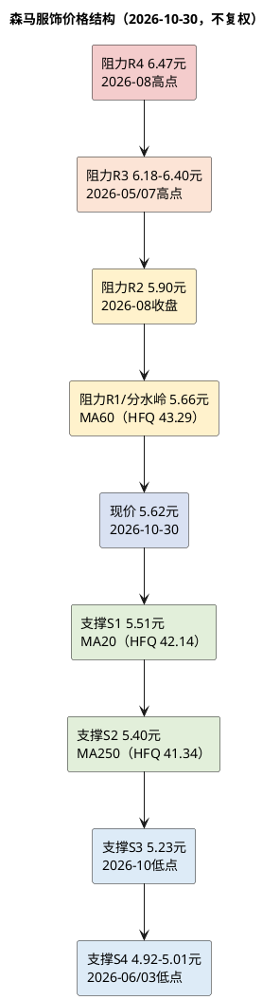

# 研报章节七：技术面分析

**研究日期**：2026年10月31日  
**标的**：森马服饰（002563.SZ）  
**数据截止**：2026年10月30日收盘  
**价格口径**：趋势/均线用后复权价（HFQ），目标价/支撑阻力用不复权市价；HFQ点位同步标注"当前对应不复权市价"

## 结论先行

| 项目 | 数值 | 解读 |
|:--|:--|:--|
| 不复权收盘价 | **5.62元** | 2026-10-30，+3.31% |
| 后复权收盘价 | 43.01元 | 复权因子7.6522 |
| 总市值 | 151.41亿元 | 26.9409亿股 |
| 均线状态 | **纠缠（多空交织）** | MA20 5.51 < 现价5.62 < MA60 5.66；MA120 5.54、MA250 5.40 |
| RSI(14) | **55.4** | 中性，未超买/超卖 |
| MACD | DIF -0.213 / DEA -0.278 / 柱+0.130 | 零轴下方金叉，弱反弹信号 |
| 布林带(20,2) | 下轨40.78 / 中轨42.14 / 上轨43.50 | 现价43.01接近上轨，短线偏强但不极端 |
| 52周实际高低（不复权） | 高6.47元（2026-08-03）/低4.92元（2026-06-29） | 现价距高点-13.1%、距低点+14.2% |
| 短期（1-3个月）判断 | **5.23-5.90区间震荡，5.66为多空分水岭** | 放量冲击MA60未果，需二次确认 |
| 长期（6-12个月）判断 | **5.5-6.5基准，7.0-7.5乐观，4.9-5.2保守** | 与估值目标6.18元一致 |

## 1. 趋势架构分析

### 1.1 年度节奏：三年箱体，没有趋势

| 年份 | 首日收盘 | 末日收盘 | 年度涨跌 | 区间低 | 区间高 | 特征 |
|:--|--:|--:|--:|--:|--:|:--|
| 2023 | 5.38 | 5.77 | +7.2% | 5.27 | 6.98 | 底部震荡 |
| 2024 | 5.85 | 7.02 | +20.0% | 4.41 | 7.34 | 先跌后涨，9月强反弹 |
| 2025 | 7.01 | 5.42 | -22.7% | 5.02 | 7.38 | 全年下跌，Q4反弹失败 |
| 2026 | 5.41 | 5.62 | +3.9% | 4.92 | 6.47 | 宽幅震荡，7-8月冲高回落 |

2024年9月的低点4.41元、2025年12月的高点7.38元、2026年6月的低点4.92元、2026年8月的高点6.47元，构成了一个**3年宽幅箱体（4.4-7.4元）**。当前5.62元处于箱体中部，既没有突破，也没有破位。

### 1.2 中期（周线/月线）：2026年"冲高回落、二次探底"

2026年月度节奏：
- 1-2月：5.33-5.73，横盘；
- 3月：5.01-5.58，探底；
- 4月：5.12-6.13，反弹；
- 5月：5.37-6.18，冲高回落；
- 6月：4.92-5.67，二次探底（全年低点4.92）；
- 7月：5.02-6.40，强反弹（+23%）；
- 8月：5.64-6.47，冲高回落（全年高点6.47）；
- 9月：5.34-6.05，回落；
- 10月：5.23-5.70，震荡，收5.62。

**中期结构是"双底+双顶"的宽幅震荡：4.92（6月）和5.01（3月）构成双底，6.40（7月）和6.47（8月）构成双顶。** 当前价格5.62处于双底与双顶的中间，方向未定。

### 1.3 短期（日线）：MA60是分水岭

均线系统（后复权）：
- MA20 42.14（对应5.51元），现价43.01高于MA20，短线偏强；
- MA60 43.29（对应5.66元），现价43.01低于MA60，中期压力；
- MA120 42.41（对应5.54元），现价高于MA120；
- MA250 41.34（对应5.40元），现价高于MA250，长期支撑。

均线排列为"MA250 < MA20 < MA120 < 现价 < MA60"，属于**纠缠状态**，不是多头排列（MA20>MA60>MA120>MA250），也不是空头排列。**这种状态下，股价容易在均线之间反复，趋势交易者没有优势。**

## 2. 关键支撑与阻力

### 2.1 支撑位（不复权市价）

| 级别 | 价格 | 依据 | 强度 |
|:--|--:|:--|:--:|
| S1 | **5.51元** | MA20（HFQ 42.14） | 中 |
| S2 | **5.40元** | MA250（HFQ 41.34） | 强（年线） |
| S3 | **5.23元** | 2026-10低点（10-23盘中5.23） | 中 |
| S4 | **4.92-5.01元** | 2026-06低点4.92、2026-03低点5.01 | 强（双底） |

### 2.2 阻力位（不复权市价）

| 级别 | 价格 | 依据 | 强度 |
|:--|--:|:--|:--:|
| R1 | **5.66元** | MA60（HFQ 43.29） | 强（多空分水岭） |
| R2 | **5.90元** | 2026-08收盘 | 中 |
| R3 | **6.18-6.40元** | 2026-05高点6.18、2026-07高点6.40 | 强（双顶） |
| R4 | **6.47元** | 2026-08-03盘中高点 | 强（全年高点） |

**关键位判断**：5.40-5.66元是核心攻防带（年线到MA60），当前5.62元处于带内偏上。**站上5.66元并放量，才能打开6.18-6.47元空间；跌破5.40元，则回踩5.23/5.01/4.92元。**

### 2.3 后复权与不复权的折算说明

- 后复权价43.01元对应不复权5.62元（复权因子7.6522）；
- MA60后复权43.29元，折算当前不复权约5.66元；
- MA250后复权41.34元，折算当前不复权约5.40元；
- 布林上轨后复权43.50元，折算当前不复权约5.68元。

**注意**：后复权点位折算成"当前不复权"是一个近似值，历史实际成交价可能不同（例如2026-03低点后复权36.74元折算当前约4.80元，但当时实际不复权低点是5.01元）。支撑/阻力以实际不复权成交价为准，后复权仅用于趋势和均线。

## 3. 量价行为解读

### 3.1 10月30日：放量冲击MA60未果

| 日期 | 开盘 | 最高 | 最低 | 收盘 | 成交量（手） | 成交额（万元） | 涨跌 |
|:--|--:|--:|--:|--:|--:|--:|--:|
| 2026-10-30 | 5.41 | **5.67** | 5.31 | **5.62** | **291,529** | 16,226 | **+3.31%** |
| 2026-10-29 | 5.43 | 5.48 | 5.39 | 5.44 | 136,908 | 7,432 | +0.18% |
| 2026-10-28 | 5.43 | 5.50 | 5.40 | 5.43 | 111,773 | 6,084 | -0.18% |
| 2026-10-27 | 5.49 | 5.54 | 5.44 | 5.44 | 111,800 | 6,131 | -0.91% |
| 2026-10-26 | 5.41 | 5.51 | 5.39 | 5.49 | 130,982 | 7,167 | +0.73% |

10月30日的关键特征：
- 成交量291,529手，是前一日（136,908手）的2.13倍、60日均量（165,202手）的1.76倍，是近20日最大量；
- 盘中最高5.67元，恰好触及MA60（5.66元）后回落，收盘5.62元，留下0.05元上影线；
- 涨幅+3.31%，不是涨停，说明抛压存在；
- 成交额1.62亿元，占自由流通市值（约51亿元）的3.2%，属于"显著放量"但不是"天量"。

**解读：三季报（10-29盘后）后的放量反弹，在MA60遇到阻力，未能有效突破。这是"利好兑现、遇阻回落"的典型形态，短线偏中性，需看后续2-3个交易日能否站稳5.66元。**

### 3.2 量价配合：反弹有量，但缺乏持续性

- 10月23日放量182,744手、涨+1.87%（盘中低点5.23），是短期底部信号；
- 10月26-29日缩量整理（111,000-137,000手），抛压减轻；
- 10月30日放量291,529手、涨+3.31%，但遇阻MA60；
- 11月第一周是关键：若继续放量站上5.66元，则确认反弹；若缩量回落，则5.23-5.66元区间震荡。

### 3.3 量价背离检查

- 股价从8月高点6.47元回落至10月低点5.23元（-19.2%），成交量从8月的日均20-30万手降至10月的11-18万手，属于"缩量下跌"，不是恐慌抛售；
- 10月30日放量反弹，成交量高于8月高点时的水平，说明有资金回补；
- 但MACD仍在零轴下方（DIF -0.213、DEA -0.278），RSI 55.4，没有出现"量价齐升+指标突破"的强信号。

**结论：量价行为偏中性，短线有反弹动能，但中线趋势未确认。**

## 4. 未来走势演绎

### 4.1 短期（1-3个月）：5.23-5.90区间，5.66为分水岭

| 情景 | 概率 | 路径 | 目标 |
|:--|:--:|:--|:--|
| 突破 | 25% | 放量（>20万手）站上5.66元，回踩不破 | 6.18-6.40元 |
| 震荡 | 50% | 5.40-5.66元区间反复，等待Q4销售/双十一数据 | 5.40-5.90元 |
| 破位 | 25% | 跌破5.40元（年线），止损盘涌出 | 5.23/5.01/4.92元 |

**短期催化剂**：①2026年双十一（10月20日-11月13日）的销售数据；②2026年Q4冬装动销/天气；③2027年春季订货会（11-12月）；④2026年全年业绩预告（2027年1月，若触发）。

**短期风险**：①暖冬导致冬装滞销；②双十一退货率/折扣超预期；③2026年分红方案低于0.25元；④运动童装Q4数据超预期，挤压巴拉巴拉。

### 4.2 长期（6-12个月）：5.5-6.5基准，与估值一致

| 情景 | 概率 | 路径 | 目标 |
|:--|:--:|:--|:--|
| 乐观 | 25% | 2027年收入+5%、毛利率47%、减值回落，估值修复至16x | 7.0-7.5元 |
| 基准 | 50% | 2027年收入+3.5%、毛利率46.2%、归母11.65亿元，估值14-15x | 5.8-6.5元 |
| 保守 | 25% | 2027年收入+1.5%、毛利率45.8%、减值5亿元，估值13x | 4.9-5.2元 |

**长期判断**：森马在4.4-7.4元箱体里已经运行3年，没有长期趋势。2027年的基本面（收入+3.5%、归母+8.6%、股息4.45%）不支持突破7.4元；净现金（2.52元/股）和股息（0.25元/股）支撑4.9-5.2元。**基准路径是5.8-6.5元，与估值目标6.18元一致。**

### 4.3 技术面与基本面的共振/背离

- **共振**：估值目标6.18元、技术阻力6.18-6.40元，二者在6.2元附近重合，说明6.2元是"基本面+技术面"的共同目标位；
- **背离**：技术面短期偏强（放量反弹、MACD金叉），基本面短期偏弱（Q3营收+0.36%、利息退潮），二者背离，说明市场在"抢跑"2027年修复预期；
- **结论**：若股价先到6.2元而基本面未兑现（Q4营收<2%），应减仓；若股价在5.2-5.4元而基本面未恶化，可加仓。

### 4.4 年度区间统计：波动收敛，箱体未破

| 年份 | 区间低 | 区间高 | 振幅 | 年末收盘 |
|:--|--:|--:|--:|--:|
| 2024 | 4.41 | 7.34 | 66.4% | 7.02 |
| 2025 | 5.02 | 7.38 | 47.0% | 5.42 |
| 2026（至10-30） | 4.92 | 6.47 | 31.5% | 5.62 |

2026年振幅31.5%，低于2024年的66.4%、2025年的47.0%，波动明显收敛；当前5.62元处于4.92-6.47元区间的45.2%分位（中上部），距高点-13.1%、距低点+14.2%。**区间收敛意味着方向选择临近：向上突破6.47元需要基本面/量能配合，向下跌破4.92元则打开新的下行空间。在区间未被有效突破前，5.23-5.51是支撑带、5.70-5.90是阻力带。**

## 5. 筹码结构与流动性

| 指标 | 数值 | 解读 |
|:--|:--|:--|
| 股东户数（2026-09-30） | 30,706户 | 较2026-06-30的31,862户-3.63%，较2025-09-30的49,853户-38.4%（较2025-06-30的41,447户-25.9%） |
| 户均持股 | 约8.77万股 | 按26.9409亿股/30,706户计算，筹码集中度提升 |
| 家族及一致行动人持股 | 65.91% | 邱光和15.34%、邱坚强13.34%、森马集团12.47%、周平凡9.28%、戴智约9.20%、邱艳芳6.27% |
| 自由流通盘 | 约34.1%、51.6亿元 | 按市值151.41亿元计算；流通盘偏小 |
| 质押 | 邱坚强1.36亿股、占其持股37.78%、总股本5.04% | 质押比例可控，但需跟踪 |
| 近20日日均成交额 | 约0.83亿元 | 占自由流通市值约1.6%，流动性一般 |
| 10-30成交额/换手 | 1.62亿元/总股本1.08%、自由流通3.17% | 放量且换手显著放大，短线资金参与度高 |

**解读**：①股东户数从2025-09-30的49,853户降至30,706户，降幅38.4%，筹码明显集中，这与家族持股65.91%、自由流通盘仅34.1%一致；②近20日日均成交额0.83亿元、自由流通换手约1.6%，流动性一般，大资金进出会放大波动；③10-30成交额1.62亿元、自由流通换手3.17%，为近20日最大量，换手显著放大，说明短线资金参与度高，抛压与承接同时增加，不能据此判断机构是否减仓；④5.66元（MA60）的突破需要持续放量（日成交额>1.5亿元、自由流通换手>2.5%），单日放量不足以确认。

**相对强度**：2026年以来+3.9%，低于高增长板块（AI算力、储能、机器人等），但高于部分消费白马；在防御型资产中表现中性。相对强度不构成买入理由，也不构成卖出理由。

## 6. 技术面评分

| 维度 | 评分 | 依据 |
|:--|:--:|:--|
| 趋势 | 2/5 | 3年箱体、均线纠缠、无趋势 |
| 动能 | 3/5 | MACD零轴下方金叉、RSI 55.4、放量反弹 |
| 量价 | 3/5 | 10-30放量1.76x，但遇阻MA60、上影线 |
| 支撑/阻力 | 3/5 | 5.40-5.66核心带清晰，上方6.18-6.47阻力强 |
| 相对强度 | 2/5 | 2026年+3.9%，未跑赢高增长板块；按中性处理 |
| **综合** | **2.5/5** | **中性，无趋势优势，等待突破/破位** |

**技术面结论：当前不是"技术面买点"，也不是"卖点"。5.40-5.66元是观察带，站上5.66元可短线参与，跌破5.40元需止损；5.40元仅为技术观察位，估值口径的分批点是≤5.1元。中线投资者应以内生价值（6.18元）为锚，忽略短期波动。**

## 7. 关键位汇总表

| 类型 | 后复权 | 折算当前不复权 | 实际不复权成交价 | 性质 |
|:--|--:|--:|--:|:--|
| R4 | 49.52 | 6.47 | 6.47（2026-08-03） | 全年高点 |
| R3 | 47.30-48.98 | 6.18-6.40 | 6.18（05月）/6.40（07月） | 双顶 |
| R2 | 45.15 | 5.90 | 5.90（2026-08收盘） | 次级阻力 |
| R1 | 43.29 | 5.66 | 5.66（MA60） | 多空分水岭 |
| 现价 | 43.01 | 5.62 | 5.62（2026-10-30） | — |
| S1 | 42.14 | 5.51 | 5.51（MA20） | 短线支撑 |
| S2 | 41.34 | 5.40 | 5.40（MA250） | 年线支撑 |
| S3 | 40.02 | 5.23 | 5.23（2026-10-23） | 10月低点 |
| S4 | 37.65-38.34 | 4.92-5.01 | 4.92（06-29）/5.01（03-23） | 双底 |

注：后复权点位=实际不复权价×当前复权因子7.6522的近似；历史实际成交价与"折算当前不复权"可能不同，支撑/阻力以实际成交价为准。

## 8. 本章结论

1. **趋势**：3年箱体4.4-7.4元，当前5.62元处于中部；均线纠缠，无趋势。
2. **短期**：5.23-5.90元区间，5.66元（MA60）为分水岭；10月30日放量1.76x冲击5.66未果，需二次确认。
3. **中期**：5.40元（年线）是强支撑，6.18-6.47元是强阻力；突破/破位前，区间交易。
4. **长期**：基准5.8-6.5元，与估值目标6.18元一致；乐观7.0-7.5元，保守4.9-5.2元。
5. **操作**：不追高；5.40元为技术观察位，估值口径的分批点是≤5.1元；5.66元以上需放量确认；跌破5.01元（双底）则技术面转空，需重新评估基本面。

### 证据索引（本章）

| 编号 | 来源 | 用途 | 核实状态 |
|:--|:--|:--|:--|
| E4 | QuantPyLab `v_daily_valuation`/`daily_kline`（2026-10-30） | 价格、均线、成交量、复权因子 | 系统实测 |
| E25 | 技术面统计快照（`workspace/research/森马服饰/tmp_data/technical_snapshot_20261031.md`，2026-10-31） | MA/RSI/MACD/布林带/52周高低 | 系统生成 |
