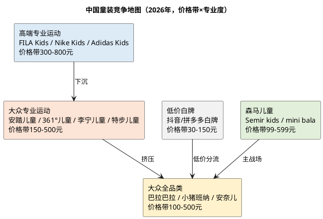

# 研报章节三：竞争格局与地位

**研究日期**：2026年10月31日  
**标的**：森马服饰（002563.SZ）  
**数据截止**：2026年10月30日  
**目标年份**：2027年

## 结论先行

| 竞争判断 | 已验证事实 | 关键证据 | 对2027E估值的含义 |
|:--|:--|:--|:--|
| 童装格局 | 行业分散、CR10约31%-37.6%，巴拉巴拉按 Euromonitor 零售额口径仍为亚洲第一，但按中华全国商业信息中心2026年6月零售监测已降至第三 | 前十品牌：安踏、FILA、巴拉巴拉、阿迪达斯、361度、李宁、NIKE、特步、斯凯奇、AIMER KIDS；前十合计37.56%、同比-2.42pct | 不能再给"市占率第一"的垄断溢价；2027E儿童+4.0%只假设份额稳定，不假设份额提升 |
| 成人休闲格局 | 高度分散，森马休闲40.55亿元仅为海澜之家主品牌（2026年1-9月121.90亿元）的三分之一；2026H1森马休闲+3.43%，弱于海澜主品牌+12.35% | 海澜之家9M营收167.23亿元、+7.2%；太平鸟42.21亿元、+0.09%；森马休闲2025年-3.22% | 休闲业务只能给低个位数增长和低倍数，2027E +2.0% |
| 护城河 | 品牌知名度、门店规模、供应链议价是真实优势；但技术、转换成本、品牌溢价弱，护城河评分3/5（中等） | 儿童毛利率46.75%，低于安踏集团63.9%（FILA分部毛利率未单独披露）；线上退货率51.7%-53.7% | 估值倍数应低于运动龙头，PE 15x已是合理上限，不给20x+ |
| 产业链定价权 | 对上游强（应付+票据51.08亿元、占2025年营业成本61.7%、账期119天）；对下游弱（加盟毛利率35.35%、同比-1.99pct、门店净减309家） | 2026H1加盟收入+0.68%、直营+23.32%；前五供应商仅15.69% | 利润来自"挤压供应商+渠道结构"，不是品牌提价；2027年毛利率只能持平微升 |
| 竞争趋势 | 运动童装（安踏、FILA、361、李宁、特步、Nike、Adidas）持续挤压传统童装；白牌在抖音低价分流 | 安踏儿童2024年流水100亿元、2026年6月门店2,560家；361°儿童2026H1收入13.5亿元、+6.8% | 2027年儿童份额若流失1pct，收入减少约1.1亿元、归母净利减少约0.4亿元 |

## 1. 竞争格局扫描

### 1.1 童装：一超多强，但"超"在缩小

中国童装行业是一个**高度分散、但集中度缓慢提升**的市场。按中研普华口径，2025年童装CR10约31%、较三年前提升8个百分点；按中华全国商业信息中心重点零售企业监测口径，2026年6月前十品牌合计综合占有率37.56%、同比-2.42pct、环比-2.71pct。CR3/CR5未由权威机构披露；按前十37.56%与安踏/FILA/巴拉巴拉排名估算，CR3约20%-22%（非官方，仅量级参考）。两个口径的绝对值不同，但都指向一个事实：**行业在集中，但龙头没有充分享受集中红利。**

森马旗下巴拉巴拉是过去十年的绝对龙头。 Euromonitor 认定巴拉巴拉为"中国及亚洲第一童装品牌"，2025年报也引用"连续多年国内市场份额第一"。但2026年6月的零售监测显示，巴拉巴拉已降至第三，排在安踏、FILA之后。这个变化不是偶然：

- **运动童装崛起**：安踏儿童2024年流水突破100亿元，成为运动行业首个百亿儿童品牌；2026年6月末门店2,560家（2025年末2,652家，2026年目标2,500-2,600家），虽然门店在减少，但单店产出和品牌势能在提升。FILA Kids依托FILA高端时尚运动定位，在购物中心渠道强势；361°儿童2026H1收入13.5亿元、+6.8%、2,202个销售点；李宁儿童、特步儿童、Nike Kids、Adidas Kids均在加码。
- **传统童装分化**：巴拉巴拉、MiniPeace（太平鸟）、安奈儿、小猪班纳、戴维贝拉、英氏。巴拉巴拉靠全品类、全渠道、性价比守住基本盘；MiniPeace靠太平鸟的时尚设计；安奈儿持续亏损（2026-10-23市值26.1亿元、PE为负、PB 4.36x），已退出主流竞争；戴维贝拉是线上强势品牌（2024年天猫童装销售额6.34亿元、排名第二）。
- **白牌分流**：抖音、拼多多上的白牌童装，价格带30-150元，靠流量和低价抢占低线市场。森马线上退货率51.7%-53.7%，部分反映消费者"多买多退、比价"的行为。

**结论：童装行业的竞争维度已经从"渠道覆盖"转向"产品力+品牌力+场景专业度"。巴拉巴拉的规模优势仍在，但品牌势能和专业度不如运动童装，份额被侵蚀是趋势性的，不是周期性的。**

### 1.2 成人休闲：分散、低壁垒、森马不是份额龙头

成人休闲装的市场比童装更分散，竞争维度更单一（款式、价格、渠道），消费者切换成本极低。2026年1-9月：

| 公司 | 营收（亿元） | 同比 | 归母净利（亿元） | 同比 | 备注 |
|:--|--:|--:|--:|--:|:--|
| 海澜之家 | 167.23 | +7.20% | 17.28 | -7.24% | 海澜之家主品牌121.90亿元、+12.35%；京东奥莱等新零售贡献增量 |
| 太平鸟 | 42.21 | +0.09% | 0.82 | +190.61% | 线上毛利率提升、销售/研发费用下降；Q3单季亏损0.20亿元 |
| 森马休闲（2025年） | 40.55 | -3.22% | — | — | 2026H1休闲17.82亿元、+3.43%，毛利率45.66% |
| 比音勒芬 | — | — | — | — | 高端高尔夫服饰，PE 22.3x、PB 2.67x，定位高于森马 |
| 九牧王 | — | — | — | — | 男裤，PE 33.1x、PB 1.41x |
| 七匹狼 | — | — | — | — | 男装，PE 37.4x、PB 0.81x |

森马品牌自称"本土休闲装品牌龙头"，但这更多是**品牌知名度和门店数量**的口径，不是市场份额。按收入规模，森马休闲40.55亿元，低于海澜之家主品牌（2026年1-9月121.90亿元），也低于优衣库中国、太平鸟。2026H1森马休闲+3.43%，虽然转正，但弱于海澜主品牌+12.35%，说明"再造新常服"的效果尚未验证。

成人休闲的竞争格局对森马不利：①优衣库以基本款、高性价比、强供应链占据大众市场；②海澜之家以"男人的衣柜"、京东奥莱、下沉市场占据男装；③太平鸟以年轻化、时尚设计占据女装/潮流；④白牌和直播电商以低价分流。森马休闲的定位"高质价比、跨场景、舒适百搭"缺乏差异化，只能靠渠道效率和成本竞争。

## 2. 竞品参数对比表

| 公司/品牌 | 定位 | 2025/2026H1收入 | 增速 | 毛利率 | 门店/销售点 | 市值/估值（2026-10-23） | 关键动作 |
|:--|:--|--:|--:|--:|--:|:--|:--|
| **森马 儿童（巴拉巴拉为主）** | 0-14岁大众全品类童装 | 108.00亿元（2025） | +5.18% | 46.75% | 儿童门店5,099家（2026H1） | 森马整体市值151.4亿元、PE 14.5x、PB 1.34x | 第八代旗舰店、IP主题店、超级纤维、mini bala/Asics/PUMA多品牌 |
| **森马 休闲** | 大众休闲 | 40.55亿元（2025） | -3.22% | 40.50% | 休闲门店2,518家（2026H1） | 同上 | 再造新常服、城市旗舰店、省份战略 |
| **安踏儿童** | 大众专业运动童装 | 安踏品牌177.71亿元（2026H1，儿童未单列）；安踏儿童2024年流水100亿元 | 安踏品牌+4.8% | 安踏集团63.9% | 2,560家（2026-06），目标2,500-2,600家 | 安踏体育（HK） | 儿童足弓实验室、足弓PRO 2.0、风洞技术跑鞋 |
| **FILA Kids** | 高端时尚运动童装 | FILA分部150.45亿元（2026H1，含FILA Kids/Fusion） | +6.1% | 未单列（集团63.9%） | FILA 1,900-2,000家（含Kids/Fusion） | 安踏体育（HK） | 高端购物中心、时尚运动定位 |
| **361°儿童** | 大众专业运动童装 | 13.5亿元（2026H1） | +6.8% | 集团约41%（儿童未单列） | 2,202个销售点 | 361度（HK） | 儿童运动、校园体育、超品店 |
| **太平鸟 MiniPeace** | 时尚童装 | 未单列；太平鸟9M营收42.21亿元 | +0.09% | 59.83%（服饰运营） | 未披露 | 太平鸟54.7亿元、PE 27.6x、PB 1.23x | 线上毛利率提升、费用下降 |
| **海澜之家** | 大众男装/全品类 | 167.23亿元（2026年1-9月） | +7.20% | 约45% | 未披露 | 海澜之家275.2亿元、PE 13.3x、PB 1.54x | 主品牌+12.35%、京东奥莱、团购定制 |
| **优衣库中国** | 大众基本款 | 未单列 | — | — | — | 迅销（HK/日股） | 不调价、基本款、高性价比 |
| **安奈儿** | 中高端童装 | 亏损 | — | — | — | 26.1亿元、PE负、PB 4.36x | 持续亏损，退出主流竞争 |
| **戴维贝拉** | 线上童装 | 2024年天猫6.34亿元 | — | — | 线上为主 | 未上市 | 线上排名第二，低价+快反 |

注：安踏、FILA、361°为港股，市值/PE未在本地视图覆盖，仅列集团数据；太平鸟、海澜之家、安奈儿为2026-10-23收盘（本地视图未同步至最新），仅作量级参考。

### 2.1 竞品对比的三点发现

**第一，森马的毛利率不占优。** 森马儿童毛利率46.75%、休闲40.50%，综合45.10%（2025年）；安踏集团63.9%（FILA分部毛利率未单独披露）、太平鸟服饰运营59.83%、海澜之家约45%。需注意口径不可比：安踏集团含直营零售，森马儿童为品牌批发+直营混合，品牌毛利率与集团毛利率不能直接相减。森马的毛利率低于运动品牌和时尚品牌，只高于海澜之家。这说明森马的"性价比"定位决定了它没有品牌溢价，只能靠规模和效率赚钱。

**第二，森马的门店数量领先，但单店效率不占优。** 巴拉巴拉儿童门店5,099家，高于安踏儿童2,560家、361°儿童2,202个销售点、FILA 1,900-2,000家。但森马直营坪效8,946元/㎡/年（2025年），安踏、FILA的单店产出通常更高（安踏儿童2024年流水100亿元/约2,700家≈370万元/店/年；巴拉巴拉108亿元/5,255家≈206万元/店/年，按公司收入口径，非零售口径）。门店多不等于效率高，巴拉巴拉的"规模优势"正在变成"规模包袱"——低效门店需要关闭，2026H1儿童门店净减156家。

**第三，森马的增长靠多品牌和线上，不是主品牌。** 2026H1儿童服饰+11.92%，其中mini bala +25%、AsicsKids +15%、PUMAKIDS +134%、Semir kids +11%，多品牌合计约8.7亿元、占儿童18%；主品牌巴拉巴拉的增速可能只有高个位数。这意味着"巴拉巴拉"这块招牌的增量贡献在下降，公司正在用代理品牌和新品牌填补增长缺口。代理品牌（Asics、PUMA）的授权期限有限（Asics至2026-12-31、PUMA至2027-12-31），续约不确定性是2027年后的风险。AsicsKids 2026H1收入2.3亿元、年化约4.6亿元，若2026年底不续约，按50%销售转移、48%毛利率、28.5%税率测算，2027年归母净利影响约-0.5至-0.7亿元。

## 3. 护城河识别

### 3.1 品牌：知名度高，溢价弱

巴拉巴拉创立于2002年，深耕童装24年，品牌知名度、门店覆盖、供应链关系是真实资产。2025年报称"巴拉巴拉品牌占据童装市场绝对优势，连续多年国内市场份额第一"； Euromonitor 认定其为"全亚洲第一童装品牌"；2026年品牌主张升级为"活在热爱里"，通过《中国小朋友》IP、Hello Kitty/CHIIKAWA/小马宝莉主题店、上海武康路"羽绒玩具屋"等制造话题。

但品牌力的另一面是**溢价能力弱**：儿童毛利率46.75%，低于运动童装；线上退货率51.7%-53.7%，说明消费者价格敏感、比价行为强；加盟毛利率35.35%、同比-1.99pct，说明品牌对加盟商的让利在增加。**巴拉巴拉的品牌是"知名度"和"规模"的品牌，不是"溢价"和"忠诚"的品牌。**

### 3.2 规模：采购、供应链、物流

森马儿童服饰收入108亿元，是中国最大的童装品牌公司。规模带来的优势包括：
- **采购议价**：前五供应商仅占15.69%，单一供应商不超过4%，公司对代工厂有较强议价权；
- **物流效率**：温州、上海、杭州、嘉兴产业园，成衣从工厂发往公司仓库，再通过第三方物流配送至门店或消费者；
- **库存共享**：全渠道库存统一管理，线上/线下/奥莱之间可以调货；
- **52周MD**：商品运营按周滚动，快反比例提升；
- **数字化**：自研AI平台"大森3.0"，用于商品企划、经营分析、直播、门店目标管理。

这些优势可以降低1-2pct的成本，但不足以构成"护城河"。服装代工是充分竞争行业，规模和供应链可以复制，优衣库、海澜之家、太平鸟都有类似能力。

### 3.3 渠道：5,000+门店是壁垒，也是包袱

巴拉巴拉5,000+家门店，覆盖一线到五线城市，这是新品牌难以短期复制的壁垒。但渠道的价值取决于单店产出：
- 直营1,027家、坪效10,244元/㎡/年（2026H1年化），表现良好；
- 加盟6,563家、收入+0.68%、门店净减309家，加盟商信心不足；
- 购物中心/奥莱渠道占比提升，但租金、装修、人工成本更高；
- 线上占比46.9%，但退货率52%+，流量成本上升。

**渠道是"重资产化的轻资产"：门店不是公司的固定资产，但租金、装修、人员、库存都是刚性投入。当终端零售增速低于费用增速时，渠道就从壁垒变成包袱。**

### 3.4 转换成本：低

服装是 discretionary 消费，消费者切换成本极低。童装的品牌忠诚度略高于成人装（妈妈群体口碑、尺码习惯、IP偏好），但仍不足以锁定用户。巴拉巴拉的IP主题店（Hello Kitty、CHIIKAWA）可以带来短期流量，但IP热度周期短（3-6个月轮换），无法形成长期护城河。

### 3.5 护城河评分

| 维度 | 森马 | 安踏儿童/FILA Kids | 说明 |
|:--|:--:|:--:|:--|
| 品牌 | 3/5 | 4-5/5 | 森马知名度高但溢价弱；运动品牌专业心智强 |
| 规模 | 4/5 | 4/5 | 森马门店/收入领先；安踏集团规模更大 |
| 渠道 | 4/5 | 4/5 | 森马5,000+店；安踏2,560店但单店产出高 |
| 技术/产品 | 2/5 | 5/5 | 森马"超级纤维"是材料创新，但非运动科技；安踏有足弓实验室、风洞技术 |
| 转换成本 | 2/5 | 3/5 | 服装切换成本低；运动品牌有场景/社群绑定 |
| 成本 | 3/5 | 3/5 | 森马供应链强；安踏规模更大 |
| **综合** | **3/5（中等）** | **4/5（较强）** | 森马护城河中等，不给垄断溢价 |

**结论：森马的护城河是"规模+渠道+供应链"的组合，不是"品牌溢价+技术+转换成本"的组合。这种护城河可以守住份额，但守不住利润率；可以抵御新品牌，但抵御不了运动品牌的降维打击。**

## 4. 产业链定价权

### 4.1 对上游：强

2026Q3末：
- 应付账款29.06亿元、同比+47.09%、账期119天、同比+2天；
- 应付票据22.02亿元；
- 应付+票据合计51.08亿元，占2025年营业成本82.84亿元的61.7%；
- 前五供应商采购占比15.69%，单一供应商不超过4%；
- 存货40.23亿元、应收12.37亿元，合计52.60亿元，与应付+票据51.08亿元基本相当，营运资本约+1.5亿元。

这意味着公司用供应商的钱支撑了自己的库存和渠道，营运资本约+1.5亿元（2025年末约-1.0亿元），接近零。这是森马财务报表中最像"好公司"的地方：对上游有真实的议价权，能够把资金压力转移出去。

### 4.2 对下游：弱

- 加盟毛利率35.35%、同比-1.99pct，说明公司对加盟商的供货折扣在加大；
- 加盟收入+0.68%、门店净减309家，加盟商在收缩；
- 直营毛利率66.35%、线上49.89%，高毛利来自"零售价-成本"，不是"提价"；
- 线上退货率51.7%-53.7%，说明消费者价格敏感、比价行为强；
- 合同负债1.43亿元（2026H1）、同比+9.9%，预收货款1.38亿元，领先指标不强；
- 应收账款12.37亿元、同比-14.1%，但坏账准备3.09亿元、计提比例27.0%，部分加盟商/客户已出现信用风险。

**对下游弱的本质是：童装是充分竞争的可选消费，品牌众多、白牌低价、消费者切换成本低。森马没有能力提价，只能通过折扣、奥莱、直播、加盟让利来维持销量。**

### 4.3 定价权结论

森马的利润来源是"**挤压上游+渠道结构升级+费用控制**"，不是"品牌提价"。这决定了：
1. 毛利率的提升有天花板：渠道结构（直营/线上占比）提升到一定程度后，边际效应递减；2027年毛利率只能持平微升。
2. 对上游的挤压有极限：应付账款+47%已经很高，其中部分来自应付票据减少21.4%的科目转换，不能全部视为议价增强；供应商若要求缩短账期，现金流会承压。
3. 对下游的让利会持续：加盟商信心不足、线上退货率高、白牌低价竞争，折扣难以大幅收窄。

## 5. 市场份额验证（非财务信息）

### 5.1 第三方监测：巴拉巴拉降至第三

中华全国商业信息中心2026年6月童装市场监测：前十品牌为安踏、FILA、巴拉巴拉、阿迪达斯、361度、李宁、NIKE、特步、斯凯奇、AIMER KIDS；前十合计综合占有率37.56%、同比-2.42pct、环比-2.71pct。巴拉巴拉排第三，落后于安踏、FILA。

这个监测的口径是"重点零售企业销售数据"，覆盖购物中心、百货、专卖店，不覆盖线上和白牌，因此不能完全代表全市场。但它至少说明：**在购物中心/百货这一森马正在发力的核心渠道，巴拉巴拉已经不是第一。** 森马2026H1直营+23.32%、购物中心/奥莱新开门店占比80%，说明公司正在把资源投向这个"不是第一"的渠道，竞争压力可想而知。

### 5.2 线上：巴拉巴拉仍是第一，但优势在缩小

2024年天猫童装品牌销售额排名：巴拉巴拉19.35亿元（第一）、戴维贝拉6.34亿元（第二）、优衣库4.26亿元（第三）、左西3.74亿元（第四）、安踏儿童3.72亿元（第五）、棉奇熊2.85亿元（第六）、鸭鸭2.85亿元（第七）、波司登2.70亿元（第八）、太平鸟儿童2.68亿元（第九）、英氏2.66亿元（第十）。巴拉巴拉的线上份额是第二名的3倍，优势明显。

但2025年天猫双11母婴品牌成交榜TOP20中，童装童鞋占9席，除巴拉巴拉外，大部分是FILA Kids、安踏儿童、Nike Kids等运动品牌童装线（界面新闻2025-11-27）。2026年双11首日，服饰品牌24分钟内优衣库破亿，波司登、维密、百丽等紧随，未见巴拉巴拉进入"破亿俱乐部"的报道（新华网2026-10-23）。**线上巴拉巴拉仍是第一，但运动童装和白牌正在分流，优势在缩小。**

### 5.3 门店：数量领先，效率待验证

| 品牌 | 门店/销售点 | 单店收入（估算） | 说明 |
|:--|--:|--:|:--|
| 巴拉巴拉（儿童服饰） | 5,099家（2026H1） | 约206万元/店/年 | 108亿元/5,255家（2025年门店数），公司收入口径，非零售口径 |
| 安踏儿童 | 2,560家（2026-06） | 约370万元/店/年 | 100亿元流水/约2,700家（2024年），零售流水口径 |
| 361°儿童 | 2,202个销售点 | 约123万元/点/年 | 13.5亿元/2,202个（2026H1年化约27亿元），批发口径 |
| FILA Kids | 含在FILA 1,900-2,000家内 | — | 高端购物中心，单店产出高 |

注：单店收入为粗略估算，口径不一致（公司收入 vs 零售流水 vs 批发），仅用于量级对比，不作为精确结论。

**结论：巴拉巴拉门店数量第一，单店收入量级与安踏儿童接近或略低（口径不可比，仅作量级参考）。规模优势没有转化为显著效率优势，这是"大而不强"的症状之一，但不能据此单独下结论。**

## 6. 竞争对手跟踪（模块九输入）

### 6.1 Top3核心竞争对手

| 排名 | 竞争对手 | 跟踪指标 | 披露日历 | 双向解读 |
|:--:|:--|:--|:--|:--|
| 1 | **安踏儿童（安踏体育）** | 安踏品牌收入增速、儿童门店数、儿童流水、足弓/跑鞋新品、折扣率、库存 | 2026年报：2027-03；2027H1：2027-08 | 需求侧：安踏儿童增长=运动童装景气+份额提升；竞争侧：安踏儿童门店调整/折扣加深=行业竞争加剧，对森马不利 |
| 2 | **FILA Kids（安踏体育）** | FILA分部收入、FILA Kids门店、高端购物中心入驻、折扣率 | 同上 | 需求侧：FILA Kids增长=高端童装景气；竞争侧：FILA Kids下沉=巴拉巴拉中高端市场受压 |
| 3 | **361°儿童** | 儿童收入、销售点、儿童运动品类增速、库存 | 2026年报：2027-03；2027H1：2027-08 | 需求侧：361°儿童增长=大众运动童装景气；竞争侧：361°儿童性价比攻势=巴拉巴拉大众市场受压 |

补充跟踪：太平鸟MiniPeace（2026年报2027-04）、海澜之家（2027-04）、优衣库中国（迅销财报）、戴维贝拉（线上数据）。

### 6.2 双向解读示例

- **安踏儿童2026H1门店从2,652家降至2,560家**：需求侧含义——运动童装渠道在优化，不代表需求恶化；竞争侧含义——安踏儿童从"开店驱动"转向"单店驱动"，单店产出提升，对巴拉巴拉的挤压更强。
- **361°儿童2026H1收入+6.8%、销售点2,202个**：需求侧含义——大众运动童装仍有中个位数增长；竞争侧含义——361°以性价比切入，直接争夺巴拉巴拉的大众市场。
- **太平鸟2026Q3单季亏损0.20亿元、9M净利0.82亿元**：需求侧含义——成人休闲/时尚服饰需求疲弱；竞争侧含义——太平鸟收缩，森马休闲的竞争压力略减，但行业需求更弱。

## 7. 本章结论

1. **森马是童装规模龙头，但不是品牌溢价龙头。** 巴拉巴拉按 Euromonitor 零售额口径仍是亚洲第一，但按中华全国商业信息中心2026年6月零售监测已降至第三；运动童装（安踏、FILA、361、李宁、特步、Nike、Adidas）在购物中心/高端渠道持续挤压。
2. **护城河中等（3/5），不给垄断溢价。** 规模、渠道、供应链是真实优势；技术、转换成本、品牌溢价弱。估值倍数应低于运动龙头，PE 15x已是合理上限。
3. **产业链定价权"上强下弱"。** 应付+票据51.08亿元、占营业成本61.7%，对上游强；加盟毛利率35.35%、同比-1.99pct、门店净减309家，对下游弱。利润来自挤压供应商和渠道结构，不是品牌提价。
4. **2027E儿童+4.0%只假设份额稳定，不假设份额提升。** 如果运动童装继续抢份额，儿童增速可能降至0%-2%，归母净利下修0.5-0.9亿元。
5. **竞争跟踪重点：** 安踏儿童/FILA Kids/361°儿童的季度流水、门店数、折扣率；巴拉巴拉的店效、加盟商订货、IP主题店转化；线上退货率和投流成本。

### 证据索引（本章）

| 编号 | 来源 | 用途 | 核实状态 |
|:--|:--|:--|:--|
| E1 | 森马服饰2025年年度报告（巨潮，2026-03-31） | 分产品/渠道、门店、毛利率、品牌 | 公告原文 |
| E2 | 森马服饰2026年半年度报告（巨潮，2026-08-18） | 分产品/渠道、门店、多品牌 | 公告原文 |
| E3 | 森马服饰2026年第三季度报告（巨潮，2026-10-30） | 应付/应收/存货、减值 | 公告原文 |
| E13 | 界面新闻《安踏系集体卖童装，巴拉巴拉最受伤》（2025-11-27） | 中华全国商业信息中心排名、 Euromonitor 4,738亿元、安踏儿童100亿元 | 二手媒体，含两个口径 |
| E17 | 安踏体育2026中期报告（港交所，2026-08-26） | 安踏/FILA收入、门店、毛利率 | 公告原文 |
| E18 | 361度2026中期业绩公告（港交所，2026-08-18） | 361°儿童13.5亿元、+6.8%、2,202个销售点 | 公告原文 |
| E23 | 太平鸟2026年第三季度报告（上交所，2026-10-28） | 42.21亿元、+0.09%、净利0.82亿元 | 公告原文 |
| E24 | 海澜之家2026年第三季度报告（上交所，2026-10-30） | 167.23亿元、+7.2%、净利17.28亿元 | 公告原文 |
| E25 | 知行战略咨询《2025年儿童服饰行业电商消费趋势》（2026-01-14） | 2024年天猫童装品牌排名、抖音儿童服饰GMV | 二手研究机构 |
| E26 | 新华网《时尚产业周报》（2026-10-23） | 2026双十一服饰首日表现 | 二手媒体 |
