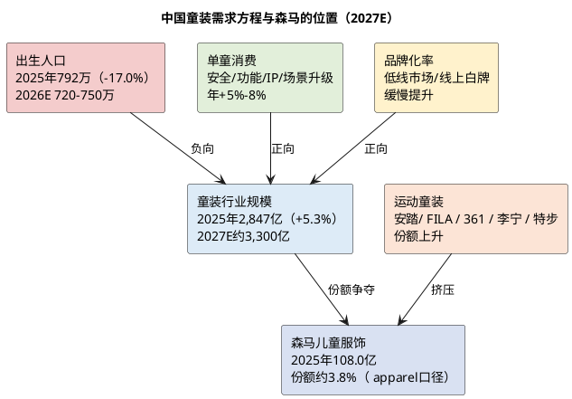
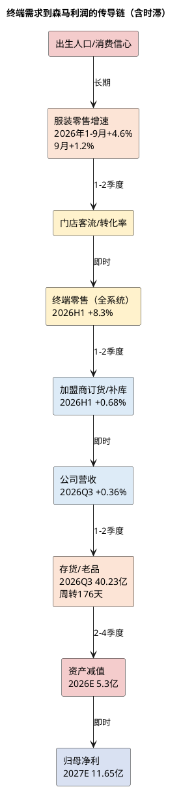

# 研报章节二：产业周期与终端穿透

**研究日期**：2026年10月31日  
**标的**：森马服饰（002563.SZ）  
**数据截止**：2026年10月30日  
**目标年份**：2027年

## 结论先行

| 产业判断 | 已验证事实 | 关键证据 | 对森马2027E的含义 |
|:--|:--|:--|:--|
| 周期定位 | 中国服饰行业处于成熟期后半段，总量低增长、存量博弈；童装是服饰中增速较快的子赛道，但已从双位数降至中个位数 | 2026年1-9月服装鞋帽针纺织品零售额10,824亿元、+4.6%；9月单月1,213亿元、+1.2%；2025年童装市场规模2,847亿元、+5.3%（中研普华口径） | 行业β只有3%-5%，森马2027E收入+3.5%已是"略跑赢行业"，不能假设行业复苏带来高增长 |
| 终端需求 | 最终产品是0-14岁儿童服饰与成人休闲装；童装需求=出生人口×单童消费×品牌化率，出生人口是长期负变量，单童消费是唯一正变量 | 2025年出生人口792万人、同比-17.0%（国家统计局）；2016年1,786万人，十年-55.7%；2026年机构预测720-750万人 | 童装行业总量增速被出生人口拖累，2027-2028年中性+3%-5%；森马儿童服饰P50 +4.0% |
| 库存周期 | 行业处于去库尾声、弱补库初期，不是新一轮补库周期；品牌端库存总量改善但老品占比上升 | 森马2026Q3存货40.23亿元、同比-2.9%、周转176天（同比-17天）；2025年周转149天；服装家纺板块2025年库销比6.7个月、周转216天 | 2027年减值难以大幅回落，基准假设4.2亿元；若维持5.3亿元，归母净利下修约0.8亿元 |
| 供需边际 | 供给端OEM产能充裕、棉价弱势；需求端低增长；品牌端运动童装挤压传统童装，供给过剩而非紧平衡 | 郑棉主力15,315元/吨、3128B现货16,762元/吨（2026-10-30）；安踏儿童门店2,560家、2024年流水破100亿元；361°儿童2026H1收入13.5亿元、+6.8% | 2027年毛利率只能持平微升（46.2%），不存在提价驱动的利润率扩张 |
| 压力传导 | 终端1%的波动，经加盟商订货、库存减值、费用刚性放大后，可造成归母净利4%-5%的波动；减值滞后期2-4个季度 | 2026Q3营收+0.36%、经营性营业利润-16.6%；2026年1-9月资产减值+45.6% | 2027年收入若-2%，归母净利约-9%至-15%（叠加减值上升与折扣加深）；收入+3.5%是基准，不是下限 |

## 1. 产业生命周期：成熟期，存量博弈

### 1.1 服饰大盘：低增长成为常态

中国服饰行业已经走完渗透率驱动的高速成长期。2025年社会消费品零售总额501,202亿元、+3.7%，服装鞋帽针纺织品类零售额15,215亿元、+3.2%，全国居民人均衣着消费支出1,554元、+2.2%（国家统计局，森马2025年报引用）。2026年1-9月，社零370,001亿元、+1.1%，服装鞋帽针纺织品类10,824亿元、+4.6%，9月单月1,213亿元、+1.2%；网上穿类商品零售额+3.4%（国家统计局，2026-10-19）。服装零售增速高于社零，主要是因为2025年同期基数偏低（2025年9月服装零售同比仅+0.8%），以及"双节"错月、秋装换季的节奏因素，并不代表需求强劲。

从结构上看，行业呈现三个特征：
1. **总量低增长**：服装零售增速从2010年代的两位数降至3%-5%，2026年1-9月的4.6%已属较好水平；
2. **渠道碎片化**：直播电商、内容电商、即时零售分流，传统百货、品牌专卖店零售额分别-2.9%/-10.3%（2026年1-9月，限额以上）；
3. **竞争集中化**：供应链、渠道、人才、资金向头部品牌集中，中小品牌和 white-label 在低价带生存，行业CR持续提升。

森马2025年报对行业的判断是准确的："中国服饰行业已从外延扩张式为主的快速发展阶段步入内生式为主的优化发展阶段，增速相对放缓""大众化业务集中化，中高端业务细分化更加明显""从机会导向变成能力导向，从渠道驱动变成产品驱动，从速度变成追求质量"。这段话不是客套，而是公司对自身增长天花板的承认。

### 1.2 童装子赛道：比成人装快，但不再是高成长

童装是服饰行业中增速较快的子赛道，但增速已从双位数降至中个位数。市场对童装规模的统计存在较大口径差异，必须审慎：

| 来源 | 2025年市场规模 | 增速 | 口径说明 | 核实状态 |
|:--|--:|--:|:--|:--|
| 中研普华《2026-2030年中国童装行业深度发展研究》 | 2,847亿元 | +5.3% | 0-14岁童装服饰，不含童鞋/用品 | 二手研究机构，未经官方交叉验证 |
|  Euromonitor（经界面新闻2025-11-27引用） | 4,738亿元（2025年有望） | — | 童装全品类，可能含鞋履/配饰 | 二手媒体引用，未见原报告 |
| 观研报告网 | 2027E 3,300亿元 | 2016-2024 CAGR 7% | 童装服饰 | 二手研究机构 |
| 知行战略咨询 | 2023-2025年天猫+抖音儿童服饰销售额962.9→1,295.3亿元 | CAGR 15.9% | 线上双平台GMV | 二手研究机构 |

口径差异高达66%（2,847亿 vs 4,738亿），说明"童装市场规模"不是一个可以直接引用的数字。我们在建模中采用**2,847亿元（ apparel口径）作为份额分母**，并注明若采用4,738亿元口径，森马儿童服饰的份额从3.8%降至2.3%。无论哪个口径，森马都是行业第一梯队，但"第一"不等于"高增长"。

童装行业的增长逻辑已经切换：**从"人口红利"转向"单童消费升级"**。2025年出生人口792万人、同比-17.0%，2016-2025年十年间从1,786万降至792万、降幅55.7%（国家统计局）。2026年，国家人口与发展研究中心预测出生人口720-750万人（来源：城市圈2026-07-22引用，未经官方确认），多家机构预测800万人以下已是大概率事件。与此同时，单童消费在提升：Z世代父母占比上升、本科及以上学历占比65%、家庭月收入2万元以上占比超40%（《中国童装行业2026趋势洞察报告》，二手），家长愿意为安全、功能、IP、设计支付溢价。结果是**量减价增，行业总额低速增长**：中研普华测算2025-2030年CAGR 4%-6%，观研预测2027年3,300亿元。

对森马的含义：童装行业2027-2028年中性增速3%-5%，森马儿童服饰P50 +4.0%，仅略高于行业，不能假设份额大幅提升。**如果出生人口在2027年进一步跌至700万以下，行业增速可能降至0%-2%，森马的+4%假设将面临下修。**

### 1.3 成人休闲装：存量甚至缩量市场

成人休闲装是森马的原点，也是最大的问题资产。2025年中国成人休闲装市场规模没有权威统一数据，但从上市公司表现看，行业低速甚至负增长：海澜之家2026年1-9月营收167.23亿元、+7.2%（主品牌+12.35%），太平鸟42.21亿元、+0.09%，森马休闲服饰40.55亿元、-3.22%（2025年）、2026H1 +3.43%。海澜之家的增长来自京东奥莱等新零售模式和主品牌复苏，太平鸟靠线上毛利率提升和费用下降，森马休闲则仍在渠道调整中。

成人休闲装的竞争格局比童装更分散：优衣库、海澜之家、太平鸟、森马、美邦、GXG、Jack&Jones、Selected、UR、白牌电商等。价格带从99元到999元，消费者切换成本极低，品牌忠诚度弱。森马休闲的定位"舒服体验、品质生活""高质价比、跨场景、舒适百搭"本质上是一个**大众性价比品牌**，缺乏技术壁垒和身份认同，只能靠渠道效率和供应链成本竞争。2026H1休闲收入+3.43%、毛利率+2.44pct，是"触底反弹"还是"回光返照"，需要2027年春季订货会验证。

## 2. 终端需求穿透：0-14岁儿童的衣橱

### 2.1 最终产品画像

森马的最终产品是**0-14岁儿童服饰（童装、童鞋、配饰、家居、用品）与成人休闲装**，通过线下门店、购物中心、奥特莱斯、电商平台、小程序触达终端消费者。童装的使用场景包括日常穿着、校园、运动、户外、节日送礼、换季囤货；成人休闲装覆盖都市通勤、日常休闲、轻户外。

童装的需求方程可以写成：

**童装市场规模 = 0-14岁人口 × 人均童装消费 × 品牌化率**

- 0-14岁人口：由出生人口和存活率决定，2025年出生792万人，未来3年每年新增0-14岁人口约700-800万，但退出14岁的队列是2012-2014年出生的人口（约1,600-1,700万/年），**每年净减少约800-900万儿童**。这是童装行业最确定、最不可逆的负变量。
- 人均童装消费：2025年2,847亿元/约2.3亿儿童≈1,238元/年；若按4,738亿元口径≈2,060元/年。无论哪个口径，单童消费仍在提升，但增速只有5%-8%，无法完全对冲儿童数量的下降。
- 品牌化率：低线市场、线上白牌仍有替代空间，但直播电商的低价白牌也在反向侵蚀品牌份额。品牌化率提升是慢变量，不足以改变行业低速增长的方向。

### 2.2 终端景气度审计（2027-2028年）

| 终端指标 | 2025A | 2026E | 2027E | 依据 |
|:--|--:|--:|--:|:--|
| 出生人口（万人） | 792 | 720-750 | 700-740 | 国家统计局2025年；2026-2027为机构预测（国家人口与发展研究中心/育娲），未经官方确认 |
| 童装行业规模（亿元， apparel口径） | 2,847 | 2,990-3,050 | 3,100-3,200 | 中研普华+5.3%、2025-2030 CAGR 4-6%；观研2027E 3,300亿为上限 |
| 童装行业增速 | +5.3% | +4%-5% | +3%-5% | 量减价增 |
| 成人休闲装行业增速 | -2%-0% | +2%-4% | +1%-3% | 上市公司合计；海澜+7.2%、太平鸟+0.1%、森马休闲-3.2% |
| 森马儿童服饰增速 | +5.18% | +6.1% | +4.0% | 2026H1 +11.92%、Q3整体+0.36%，H2假设放缓 |
| 森马休闲服饰增速 | -3.22% | +1.4% | +1.9% | 2026H1 +3.43%，低基数修复 |

这张表的核心结论是：**2027年森马的两个板块都只能实现低个位数增长，儿童略快于行业，休闲略慢于行业。** 2026H1儿童+11.92%的高增速不可持续，因为：①2025H1基数低（儿童+5.97%）；②2026Q3整体营收已降至+0.36%，儿童不可能独善其身；③门店数在减少（2026H1儿童门店5,099家、净减156家），增长靠坪效和线上，边际难度递增。

### 2.3 动能溯源：内生力量与外生干预

童装增长的动力可以拆成三层：
1. **内生力量**：单童消费升级（安全、功能、IP、场景）、线上渠道渗透、品牌集中度提升、产品创新（巴拉巴拉"超级纤维"出货量突破千万件、IP主题店、第八代旗舰店）。这些是可持续的，但速度慢。
2. **外生干预**：育儿补贴（每孩每年3,600元、2026年各级财政约1,100亿元）、扩大消费"十五五"规划、地方生育补贴。这些政策对**已生育家庭**的消费有支撑，但对**新增生育**的边际激励有限。2026年育儿补贴申请2,751万条、审核通过2,713万条、实际发放2,516万人（城市圈2026-07-22引用官方数据），覆盖面已接近2022-2024年出生人口累计规模，说明政策重心是"保障已生育家庭"而非"刺激新增生育"。因此，育儿补贴对童装需求的拉动是**存量消费的稳定器**，不是**增量需求的开闸**。
3. **渠道/库存周期**：2022-2025年加盟商去库存，导致品牌端收入低于终端零售；2026年去库存见底，加盟商弱补库，带来一次性回补。这是周期性的，不是趋势性的。

### 2.4 跨期断层审计：需求前置检验

**（1）双十一长窗口。** 2026年天猫双十一从10月15日预售、10月20日开卖、持续至11月13日，周期拉长至近一个月。平台取消跨店满减、改为"官方立减"，品牌增长目标从GMV优先转向利润优先（新华网2026-10-23、钛媒体2026-10-18）。长窗口会把部分11月的需求提前到10月，造成Q4内部月度波动，但不改变Q4总量。2025年双十一综合电商+即时零售+社区团购GMV 16,950亿元、+14.2%（星图数据，经广发证券引用），服装在TOP10品类中排名第三，竞争格局稳定。**双十一对森马是"节奏问题"，不是"总量问题"。**

**（2）以旧换新/消费补贴。** 2026年以旧换新主要集中在汽车、家电、通讯器材，服装不在中央补贴范围。2026年1-9月通讯器材+18.1%、家电-4.9%、家具-4.7%、服装+4.6%，说明补贴对服装的拉动有限。**不存在服装需求被政策前置的证据。**

**（3）生育补贴。** 育儿补贴按年发放、发至3周岁，属于持续性转移支付，不是一次性刺激。它可能让家庭在婴幼儿服饰上的支出更稳定，但不会造成"未来需求被提前透支"。**跨期断层风险低。**

**（4）渠道库存。** 真正的"跨期断层"来自渠道：2022-2025年加盟商去库存，把品牌端的收入压到终端零售以下，形成一个"人为低谷"；2026年弱补库又把这个低谷填平，形成一个"人为高峰"。2026H1森马全系统终端零售+8.3%（森马+4%、巴拉巴拉+7.3%），而公司营收+9.32%，说明补库贡献为正；但Q3营收+0.36%，说明补库已经结束。**2027年不会再有补库红利，收入必须靠终端零售驱动。**

**强制复核项确认：**
1. ✅ 已穿透并引用最终终端产品（0-14岁儿童服饰、成人休闲装）的未来两年景气度预测：童装2027E +3%-5%、成人休闲+1%-3%。
2. ✅ 已审计刺激政策导致的跨期需求移位：双十一、以旧换新、育儿补贴均不构成服装需求的实质性前置；真正的跨期波动来自渠道去库/补库。
3. ✅ 已基于行业产能与终端需求分析供需边际：OEM产能过剩、品牌端竞争加剧、供需宽松，2027年毛利率只能持平微升。

## 3. 库存动力学：去库尾声，不是补库周期

### 3.1 行业库存：总量改善，结构仍高

2025年服装家纺板块库销比6.7个月、同比-0.3个月，存货周转天数216天、同比-5.7天（来源：东方财富研报《纺织服装2025年报&26一季报总结》，二手）。2026Q1服装家纺板块库销比6.1个月、同比-0.8个月，周转天数200.5天、同比-14.3天，库存效率继续改善。但216天/200天的周转天数仍处于历史高位，说明行业只是"从严重过剩回到温和过剩"，不是"供不应求"。

森马的库存节奏与行业一致，但更极致：
- 2025年末存货31.78亿元、周转149天；
- 2026H1末28.32亿元、周转157天、同比-8.9%；
- 2026Q3末40.23亿元、同比-2.9%、周转176天、同比-17天。

Q3存货环比+42%是秋冬备货的季节性（9月末要备Q4冬装），同比-2.9%说明总量在改善。但周转天数176天仍高于2025年的149天，且公司明确说"存货老品增加"。**总量改善、结构恶化，是当前库存的核心特征。**

### 3.2 渠道库存：加盟商的"牛鞭效应"在减弱，但没有消失

牛鞭效应（bullwhip effect）是指终端需求的微小波动，经过渠道层层放大，导致品牌端订单的大幅波动。森马的渠道结构决定了这种放大是双向的：

| 年份 | 全系统终端零售增速 | 公司营收增速 | 加盟收入增速 | 解释 |
|:--|--:|--:|--:|:--|
| 2025 | +5%（管理层口径） | +3.17% | -5.03% | 加盟商去库存，品牌端收入低于终端零售 |
| 2026H1 | +8.3%（森马+4%、巴拉巴拉+7.3%） | +9.32% | +0.68% | 加盟商弱补库，品牌端收入略高于终端零售 |
| 2026Q3 | 未披露 | +0.36% | 未披露 | 补库结束，收入回归终端 |

2025年加盟收入-5.03%、终端零售+5%，差距约10个百分点，这就是牛鞭效应的"去库存放大"；2026H1加盟收入+0.68%、终端零售+8.3%，差距约7.6个百分点，说明加盟商仍在谨慎，补库力度远小于终端零售。**公司营收的波动被加盟商放大了：终端好的时候，公司没有充分受益；终端差的时候，公司会被库存压得更惨。**

2026Q3营收+0.36%，是补库红利结束后的"裸奔"数据。它告诉我们：**终端零售的真实增速可能只有低个位数，甚至零增长。** 这与国家统计局服装零售9月+1.2%一致。

### 3.3 2027年库存判断

基准假设：2027年行业继续温和去库/弱补库，森马存货周转天数维持在150-170天，全年减值4.2亿元（较2026E的5.3亿元回落20.8%）。这一假设的前提是：①2026Q4冬装销售不出现大幅低于预期；②2027年春季货品订货会（通常在前一年11-12月）不再出现加盟商大幅砍单；③公司继续关闭低效门店、清理老品。

如果2027年减值维持5.3亿元，归母净利将下修约0.8亿元至10.9亿元；如果减值升至6.0亿元，归母净利下修至10.4亿元。**减值是我们模型中不确定性最大的F节点，80%区间3.3-5.3亿元。**

## 4. 供需边际：供给过剩，品牌端竞争加剧

### 4.1 供给端：OEM产能充裕，成本红利有限

森马全部外包生产，上游是OEM/ODM成衣厂和面辅料供应商。中国服装代工产能长期过剩，且面临东南亚（越南、孟加拉、柬埔寨）的低成本竞争。2026年10月30日，郑棉主力合约15,315元/吨、3128B现货16,762元/吨，棉价处于弱势震荡；新疆机采籽棉收购价降至7元/公斤以内，加工成本中枢下移（中国棉花信息网、上海国际棉花交易中心）。棉花是森马成本的一部分（面辅料），但占比不高（成衣采购成本中面料约40%-50%，棉花又只是面料的一部分），棉价下跌对毛利率的拉动约0.2-0.5pct，不足以改变趋势。

更重要的是，**供给过剩意味着品牌方对代工厂有议价权**。森马应付账款29.06亿元、应付票据22.02亿元，合计51.08亿元，占营业成本（2025年82.84亿元）的61.7%，账期119天，说明公司可以把部分库存和资金压力转移给上游。这是森马供应链能力的体现，但2026Q3营运资本已转为约+1.5亿元（2025年末约-1.0亿元），"负营运资本"的红利正在消退。

### 4.2 需求端：低增长，但结构分化

需求端的关键不是总量，而是结构：
- **运动童装**：安踏儿童2024年流水破100亿元，2026年6月末门店2,560家（2025年末2,652家，2026年目标2,500-2,600家）；FILA Kids、361°儿童（2026H1收入13.5亿元、+6.8%、2,202个销售点）、李宁儿童、特步儿童、Nike Kids、Adidas Kids均在加码。运动童装的优势是专业科技（足弓、缓震、透气）、运动场景绑定、母品牌背书，价格带高于传统童装。
- **传统童装**：巴拉巴拉、MiniPeace、安奈儿、小猪班纳、戴维贝拉等。巴拉巴拉的优势是全品类、全渠道、性价比、IP运营；劣势是运动科技、户外专业性、品牌年轻化。
- **白牌/低价**：抖音、拼多多上的白牌童装，价格带30-100元，靠流量和低价抢占低线市场。森马线上退货率51.7%-53.7%，部分反映消费者"多买多退、比价"的行为。

中华全国商业信息中心2026年6月监测数据显示，童装市场前十品牌为安踏、FILA、巴拉巴拉、阿迪达斯、361度、李宁、NIKE、特步、斯凯奇、AIMER KIDS；前十合计综合占有率37.56%、同比-2.42pct、环比-2.71pct。巴拉巴拉从过去的"第一"降至"第三"（按该监测口径），这是一个**标志性信号**：传统童装龙头的份额正在被运动童装侵蚀，行业集中度提升的红利没有落到巴拉巴拉身上。

需要说明口径差异：Euromonitor按零售额口径仍认定巴拉巴拉为"中国及亚洲第一"；中华全国商业信息中心按重点零售企业监测口径，安踏、FILA排在前两位。两个口径并不矛盾——巴拉巴拉在童装全品类、低线市场、线下门店数量上仍领先，但在运动童装、高线市场、购物中心渠道上被运动品牌超越。**投资者不能再用"市占率第一"作为无脑持有的理由，必须看结构。**

### 4.3 供需边际判断：2027年仍过剩

| 维度 | 2025 | 2026 | 2027E | 判断 |
|:--|:--|:--|:--|:--|
| 供给 | OEM产能过剩、品牌库存高 | 产能继续过剩、品牌去库 | 产能过剩延续、品牌弱补库 | 宽松 |
| 需求 | 服装零售+3.2% | +4.6%（1-9月） | +3%-4% | 低增长 |
| 价格 | 折扣加深、奥莱增长 | 折扣收窄、直营占比提升 | 折扣稳定、提价难度大 | 温和 |
| 竞争 | 运动童装挤压 | 运动童装加速 | 竞争加剧 | 恶化 |
| 毛利率 | 45.10%（+1.28pct） | 46.34%（9M，+1.21pct） | 46.2%（持平微升） | 见顶 |

**结论：2027年行业供需仍宽松，森马的毛利率改善空间已经基本用完。** 2025-2026年的毛利率提升，主要来自渠道结构（直营/线上占比提升）和折扣收紧，而不是提价或成本下降。2027年渠道结构变化的速度会放缓（直营门店不再快速增加、加盟门店减少但基数变小），毛利率只能持平微升。我们在模型中假设2027E毛利率46.2%、较2026E +0.2pct，已经是偏乐观的假设。

## 5. 压力传导：终端1%的波动，如何变成利润5%的波动

### 5.1 传导链条

### 5.2 放大效应：收入1%、利润4.6%

根据我们的2027E模型：
- 营收163.3亿元，毛利率46.2%，毛利75.44亿元；
- 营收每变动1%（1.63亿元），毛利变动0.75亿元，税后归母变动约0.54亿元，相当于2027E归母净利的4.6%；
- 毛利率每变动1pct，毛利变动1.63亿元，税后归母变动约1.16亿元，相当于归母净利的10.0%；
- 销售费用率每变动1pct，税后归母变动约1.16亿元，相当于10.0%；
- 减值每变动1亿元，税后归母变动约0.71亿元，相当于6.1%。

**这就是为什么森马的利润波动远大于收入波动：收入低增长、费用刚性、减值滞后，三者叠加把1%的收入波动放大成4%-10%的利润波动。**

### 5.3 传导时滞与缓冲

- **时滞**：加盟商订货会通常在上市前1-2个季度，终端零售的变化要1-2个季度才反映到公司营收；存货减值滞后2-4个季度，2026Q3的收入失速可能在2027H1的减值中体现。
- **缓冲**：①加盟模式让加盟商承担部分库存风险；②应付账款/票据让公司占用部分供应商资金；③67.94亿元净现金和10-16亿元自由现金流提供财务缓冲；④童装是刚需，需求不会消失，只会延迟或降级。
- **缓冲的衰减**：DTC化（直营+线上占比提升）让公司直接承担更多库存和费用，缓冲变薄；加盟门店数从2024年的7,260家降至2026H1的6,563家，渠道蓄水池变小。

### 5.4 2027年压力测试

| 情景 | 营收增速 | 毛利率 | 销售费用率 | 减值 | 税率 | 归母净利 | 同比 |
|:--|--:|--:|--:|--:|--:|--:|--:|
| 乐观 | +5.0% | 46.8% | 28.0% | 3.5亿 | 27.5% | 14.12亿 | +31.6% |
| 基准 | +3.5% | 46.2% | 28.3% | 4.2亿 | 28.5% | 11.65亿 | +8.6% |
| 保守 | +1.5% | 45.8% | 28.7% | 5.0亿 | 29.5% | 9.16亿 | -14.6% |

保守情景下，营收仅+1.5%（低于行业），毛利率-0.4pct，销售费用率+0.4pct，减值5.0亿元，税率29.5%，归母净利9.16亿元、同比-14.6%。这不是极端假设，而是"Q3趋势延续+利息收入回落"的自然结果。**投资者需要接受：森马2027年的基准增长只有8.6%，下行风险却有-15%。**

## 6. 本章结论：行业β很弱，森马只能赚α的钱

1. **行业没有β**：服饰零售+4.6%、童装+3%-5%、成人休闲+1%-3%，森马2027E收入+3.5%只是略高于行业，不能指望行业复苏带来超额收益。
2. **终端需求长期承压**：2025年出生人口792万、同比-17.0%，2026-2027年预计720-750万，童装行业总量增速被人口拖累，单童消费升级只能部分对冲。
3. **库存周期不是补库周期**：行业处于去库尾声、弱补库初期，森马2026Q3存货同比-2.9%、周转176天，总量改善但老品增加，2027年减值难以大幅回落。
4. **供需宽松、毛利率见顶**：OEM产能过剩、运动童装挤压、折扣稳定，2027年毛利率只能持平微升（46.2%）。
5. **压力传导放大**：收入1%的波动→利润4.6%，毛利率1pct→利润10%，减值1亿元→利润6.1%；2027年基准归母11.65亿元、保守9.16亿元。

**对模块五的输入：**
- 儿童服饰2027E增速P50 +4.0%（80%区间+1%至+7%）；
- 休闲服饰2027E增速P50 +2.0%（80%区间-1%至+5%）；
- 综合毛利率P50 46.2%（80%区间45.4%-47.0%）；
- 资产减值P50 4.2亿元（80%区间3.3-5.3亿元）；
- 行业β不提供额外增长，森马的α来自份额提升、渠道效率、成本控制和现金回报。

### 证据索引（本章）

| 编号 | 来源 | 用途 | 核实状态 |
|:--|:--|:--|:--|
| E5 | 国家统计局《2026年1-9月份社会消费品零售总额》（2026-10-19） | 社零、服装零售、网上穿类 | 官方原文 |
| E6 | 国家统计局《2025年经济发展向新向优》（2026-01-19） | 2025年出生人口792万 | 官方原文 |
| E12 | 中研普华《童装行业市场规模…（2026年）》（2026-08-30） | 2025年童装2,847亿元、+5.3%、2025-2030 CAGR 4-6% | 二手研究机构 |
| E13 | 界面新闻《安踏系集体卖童装，巴拉巴拉最受伤》（2025-11-27） |  Euromonitor 4,738亿元、中华全国商业信息中心排名、安踏儿童100亿元 | 二手媒体，含两个口径 |
| E14 | 观研报告网《中国童装行业发展趋势分析…》（2026-04） | 2027E 3,300亿元 | 二手研究机构 |
| E15 | 东方财富研报《纺织服装2025年报&26一季报总结》（2026-05-13） | 服装家纺库销比、周转天数 | 二手券商研报 |
| E16 | 中国棉花信息网/上海国际棉花交易中心（2026-10-30） | 郑棉15,315元/吨、3128B 16,762元/吨 | 行业网站 |
| E17 | 安踏体育2026中期报告（港交所，2026-08-26） | 安踏儿童门店2,560家、集团收入+12.9% | 公告原文 |
| E18 | 361度2026中期业绩公告（港交所，2026-08-18） | 361°儿童13.5亿元、+6.8%、2,202个销售点 | 公告原文 |
| E19 | 城市圈《1100亿补贴"补票"一年》（2026-07-22） | 育儿补贴3,600元/年、1,100亿元、2026年出生预测720-750万 | 二手媒体，引用官方数据 |
| E20 | 新华网《时尚产业周报》（2026-10-23） | 2026双十一服饰首日表现 | 二手媒体 |
| E21 | 森马服饰2026年半年度报告（巨潮，2026-08-18） | 分产品/渠道、门店、存货 | 公告原文 |
| E22 | 森马服饰2026年第三季度报告（巨潮，2026-10-30） | 9M/Q3财务、存货、减值 | 公告原文 |
