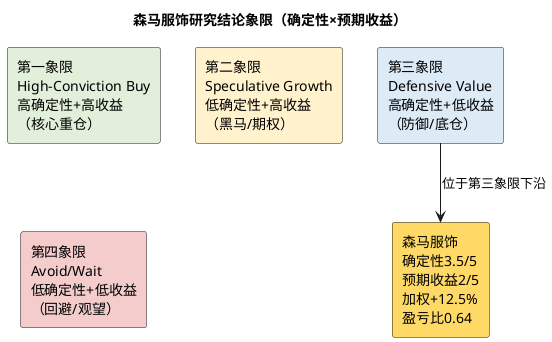

# 研报章节八：投资摘要与风险因素

**研究日期**：2026年10月31日  
**标的**：森马服饰（002563.SZ）  
**数据截止**：2026年10月30日收盘  
**目标年份**：2027年

## 一、投资摘要

### 1.1 一句话结论

**森马服饰是一家"净现金占市值44.9%、股息率4.45%、童装龙头、但增长停滞"的防御型资产。当前5.62元已经反映了净现金和高分红，2027E仅+8.6%的盈利增长不足以支撑估值重估；给予第三象限下沿（Defensive Value），持有/观望，≤5.1元分批。**

### 1.2 核心数据

| 项目 | 2024A | 2025A | 2026E | 2027E（P50） |
|:--|--:|--:|--:|--:|
| 营业收入（亿元） | 146.26 | 150.90 | 157.80 | 163.30 |
| 营收增速 | +7.06% | +3.17% | +4.57% | +3.48% |
| 归母净利（亿元） | 11.37 | 8.92 | 10.73 | 11.65 |
| 归母增速 | +1.42% | -21.54% | +20.26% | +8.57% |
| EPS（元） | 0.422 | 0.331 | 0.398 | 0.432 |
| 毛利率 | 43.82% | 45.10% | 46.00% | 46.20% |
| 净利率 | 7.78% | 5.91% | 6.80% | 7.13% |
| ROE | 9.80% | 7.66% | 9.3% | 10.1% |
| DPS（元） | — | 0.30 | 0.25 | 0.25 |
| 股息率（按5.62元） | — | 5.34% | 4.45% | 4.45% |
| PE | — | 16.97x | 14.11x | 13.00x |

| 估值项目 | 数值 |
|:--|:--|
| 当前股价（2026-10-30） | **5.62元** |
| 总市值 | **151.41亿元** |
| 净现金 | **67.94亿元（占市值44.9%）** |
| 保守情景目标价 | **4.52元**（-19.6%） |
| 中性情景目标价 | **6.18元**（+10.0%） |
| 乐观情景目标价 | **8.39元**（+49.3%） |
| 概率加权目标价 | **6.32元**（+12.5%） |
| 股息率（2026E） | **4.45%** |
| 总回报（加权+股息） | **约16.9%** |
| 盈亏比 | **0.64** |
| 投资评级 | **第三象限下沿（Defensive Value）：持有/观望，≤5.1元分批** |

### 1.3 三条投资逻辑

**逻辑一：净现金+高分红提供估值下限。** 2026Q3末净现金67.94亿元（货币资金47.66+理财12.89+大额存单15.36-短借3.00-一年内到期租赁负债2.36-租赁负债2.61），占市值44.9%，每股2.52元；有息负债仅3.00亿元（带追索权票据贴现）+租赁负债4.97亿元，资产负债率39.8%。2025年派息率90.57%、2026年中期84.32%，2026E DPS 0.25元、股息率4.45%（若按2025年90.57%派息率，DPS约0.36元、股息率6.4%，为上行期权，不进入基准）。净现金相当于市值的44.9%，为估值下限提供参考；但净现金中部分对应经营性负债，不能简单视为可分配现金。4.45%的股息率在10年期国债1.8%的环境下有吸引力。

**逻辑二：童装龙头+渠道升级提供经营韧性。** 儿童服饰108亿元、占71.6%，巴拉巴拉按 Euromonitor 零售额口径为亚洲第一；2026H1儿童+11.92%、毛利率48.56%，直营+23.32%、坪效+17%、线上+13.10%。在出生人口-17%的背景下，公司仍能通过大店战略、IP主题店、多品牌（mini bala/Asics/PUMA）、线上渠道实现增长，说明品牌和渠道有真实竞争力。

**逻辑三：2026年利润修复是"利息+节流"，2027年"利息退潮+减值回落"对冲。** 2026年1-9月归母+28.79%，其中利息收入贡献约2.02亿元、占营业利润增量的76%；2027年利息收入从3.0亿元降至1.8亿元（-0.86亿元归母），但减值从5.3亿元降至4.2亿元（+0.79亿元归母）、收入+3.5%、毛利率+0.2pct，对冲后归母+8.57%至11.65亿元。这是"低增长、高质量现金流"的组合，适合防御型配置。

### 1.4 三条不构成买入的理由

**理由一：成长性不足。** 2027E归母+8.57%、收入+3.48%，低于卖方一致预期的+12.3%收入、+14.6%利润（12.56/10.96-1）；儿童服饰+4.0%、休闲+2.0%，均只是低个位数。出生人口2025年792万、-17.0%，2027年700-740万，童装行业总量增速被人口拖累；运动童装（安踏、FILA、361）持续挤压，巴拉巴拉在部分零售监测中已降至第三。**这不是一只可以靠成长驱动股价的股票。**

**理由二：盈利质量低。** 2026年1-9月营业利润增量2.65亿元中，2.02亿元来自利息收入；剔除利息后，营业利润仅+8.8%。Q3单季营收+0.36%、经营性营业利润-16.6%，说明服装主业在恶化。2026年的高增长是"低基数+利息+节流"的组合，2027年利息退潮后，利润增速将回归个位数。**市场如果把2026年的20%增速线性外推，会失望。**

**理由三：估值不便宜。** 当前PE TTM 14.46x、PB 1.34x，处于2019年以来29.7%/27.4%分位，是"中低位"不是"极端低估"；2027E PE 13.0x，对应+8.6%增长，PEG 1.5（按现价13.0x/8.57%）；剔除净现金的PE 7.2x，看似便宜，但这是"现金+零增长业务"的组合，7x是合理的，不是错杀。**盈亏比0.64<1.0，当前价格的风险收益不对称。**

### 1.5 与市场共识的差异

| 项目 | 本报告 | 卖方共识/主要机构 | 差异 | 差异原因 |
|:--|--:|--:|--:|:--|
| 2026E归母 | 10.73亿元 | 10.96亿元（14家均值） | -2.1% | 我们减值5.3亿元、税率29.5%，略高于卖方 |
| 2027E归母 | 11.65亿元 | 12.56亿元（华西） | -7.2% | 我们收入163.3亿元（+3.5%）vs 华西170.15亿元（+12.3%）；利息1.8亿元 vs 卖方2.5-3.0亿元 |
| 中性目标价 | 6.18元 | 6.95元（均值） | -11.1% | 我们PE 15x、审计Σ-3%；卖方多给16-18x |
| 评级 | 持有/观望 | 多数买入 | 更谨慎 | 盈亏比0.64、2027E+8.6%、利息退潮 |

**核心分歧：市场把2026年的利息收入（3.0亿元）当成可持续收益，我们把利息退潮计入2027E（1.8亿元）；市场假设2027年收入+12%，我们假设+3.5%。这两个假设的差异，导致我们的2027E利润比卖方低7.2%、中性目标价低11.1%。**

**DPS假设的敏感性**：基准DPS 0.25元来自管理层交流口径（中期0.15元+年末0.10元，未经公告），对应派息率62.8%，低于2025年的90.57%和2026年中期的84.32%。若公司维持2025年的90.57%派息率，2026E DPS约0.36元、股息率6.4%，股息率法（4.2%目标）目标价8.57元，将显著抬高估值；若维持2026年中期的84.32%，DPS约0.34元、股息率6.0%，目标价8.10元。**我们把0.25元作为基准，是因为公司正在为上海国际运营中心（15亿元）和渠道转型保留现金；若2026年报实际DPS≥0.30元，中性目标价可上调至6.4-6.6元，这是我们的上行期权，不进入基准。**

### 1.6 操作建议

| 投资者类型 | 建议 | 理由 |
|:--|:--|:--|
| 现有持有人 | **继续持有** | 4.45%股息率、净现金44.9%市值、下行有支撑；若2027H1证伪，再减仓 |
| 新增资金 | **等待≤5.1元** | 当前盈亏比0.64；5.1元对应盈亏比2.10、加权收益率+23.9% |
| 防御型组合 | **不超过5%仓位** | 第三象限下沿，底仓/防御，不是核心重仓 |
| 交易型投资者 | **5.40-5.66区间交易** | 站上5.66元放量可短线参与，跌破5.40元止损 |

**证伪/止损条件**：①2027H1儿童收入增速<0%；②连续两季毛利率<45%；③2026年减值>6.0亿元；④2026年DPS<0.20元；⑤净现金<50亿元。触发任一条件，下调至第四象限（回避）。

## 二、风险因素（按对股价影响的烈度排序）

| 排序 | 风险 | 概率 | 影响 | 触发信号 | 对2027E归母的影响 | 应对/跟踪 |
|:--:|:--|:--:|:--:|:--|:--|:--|
| 1 | **出生人口下行/童装需求萎缩** | 高 | 高 | 2026年出生<720万、2027年<700万 | 每-50万出生→儿童收入-2%-3%、归母-0.7至-1.0亿元；若儿童-2%，归母-0.8亿元 | 2027年1月国家统计局；童装行业规模；巴拉巴拉门店/店效 |
| 2 | **利息收入退潮超预期** | 高 | 高 | 2027H1利息收入<0.7亿元、3年期存单<1.3% | 利息每-0.5亿元→归母-0.36亿元；若1.3亿元，归母-0.36亿元 | 季报财务费用、存款利率、大额存单到期公告 |
| 3 | **存货减值超预期** | 中高 | 高 | 2026年减值>6.0亿元、2027H1>2.5亿元 | 减值每+1亿元→归母-0.71亿元；若6.5亿元，归母-0.86亿元 | 季报资产减值、存货库龄、暖冬/动销 |
| 4 | **运动童装竞争/份额流失** | 中高 | 高 | 安踏儿童/FILA/361流水增速>15%、巴拉巴拉份额再降 | 份额每-1pct→收入-1.1亿元、归母-0.4亿元 | 竞对财报/流水、中华全国商业信息中心排名、双十一榜单 |
| 5 | **收入失速/Q3趋势延续** | 中 | 高 | 2026Q4营收<0%、2027Q1<2% | 触发保守情景（收入+1.5%、毛利率45.8%、减值5.0亿元、利息1.3亿元、税率29.5%）→归母9.16亿元、目标价4.52元（-19.6%） | 季度营收、双十一、春季订货会 |
| 5A | **代理品牌授权续约** | 中 | 中 | AsicsKids 2026-12-31到期不续约、PUMAKIDS 2027-12-31到期不续约 | Asics H1收入2.3亿元；若2026年底不续约，2027年儿童收入-2%至-3%、归母-0.5至-0.7亿元 | 授权公告、品牌方合作动态 |
| 6 | **分红下降** | 低中 | 中高 | 2026年DPS<0.20元 | 股息率降至3.56%，估值下限下移 | 年报分红预案、中期分红、现金流 |
| 7 | **税率高企** | 高 | 中 | 实际税率>30% | 税率每+1pct→归母-0.15亿元 | 季报所得税、子公司税收政策 |
| 8 | **暖冬** | 中（40%） | 中 | 2026/27冬季气温偏高1℃+ | Q4收入-3%→归母-0.5亿元 | 国家气候中心预测、10-11月气温、冬装动销 |
| 9 | **渠道转型/加盟商流失** | 中 | 中 | 加盟门店年减>500家、加盟收入<0% | 加盟收入-2%→归母-0.2亿元 | 门店数、加盟收入、合同负债 |
| 10 | **治理/家族控制/质押** | 低中 | 中 | 质押比例>50%、关联交易/减持 | 估值折价-1%至-3% | 质押公告、减持公告、关联交易 |
| 11 | **上海中心capex/折旧** | 低 | 低 | 投资超15亿元、竣工延期 | 折旧+0.5-0.7亿元/年→归母-0.4至-0.5亿元 | 在建工程进度、竣工公告 |
| 12 | **汇率/关税/地缘** | 低 | 低 | 海外收入占比>3%、关税上调 | 影响<0.1亿元 | 海外收入、关税政策 |

> 注：风险3的"减值"指资产减值+信用减值合计；2026E合计5.70亿元（资产5.30+信用0.40），2027E合计4.55亿元（资产4.20+信用0.35）。

### 2.1 风险之间的关联

- **风险1（出生人口）与风险4（运动童装）同向**：出生人口下行→行业总量萎缩→品牌竞争加剧→巴拉巴拉份额流失。二者叠加，可能导致儿童收入从+4%降至0%甚至-2%，归母净利从11.65亿元降至9.5亿元。
- **风险2（利息）与风险5（收入失速）同向**：若2027年收入+1.5%、利息1.3亿元，归母净利9.16亿元（保守情景），目标价4.52元。
- **风险3（减值）与风险8（暖冬）同向**：暖冬→冬装滞销→存货积压→2027H1减值增加。这是最需要跟踪的短期组合。
- **风险6（分红）是估值下限的锚**：若分红降至0.20元以下，4.45%股息率的故事破灭，估值可能跌至PB 1.0x（约4.2元）。

### 2.2 风险缓释因素

- 67.94亿元净现金、有息负债仅3.00亿元（票据贴现），即使经营恶化也不会出现流动性危机；
- 10-16亿元自由现金流、60%-90%派息率，分红有现金流支撑；
- 童装是刚需，需求不会消失，只会延迟/降级；
- 公司可以通过关店、控费、提价、调整渠道结构对冲成本压力；
- 政策（育儿补贴、十五五扩消费）托底，降低行业下行斜率。

## 三、研究结论象限图

### 3.1 象限定位理由

**确定性：3.5/5（中高）**
- 净现金67.94亿元、有息负债仅3.00亿元、分红率60%-90%，现金/分红确定性高（4.5/5）；
- 童装龙头、5,000+门店、巴拉巴拉品牌，经营确定性中高（3.5/5）；
- 但收入增长、减值、利息收入的不确定性高（2.5-3/5）；
- 综合3.5/5。

**预期收益：2/5（低）**
- 加权目标价6.32元、上行+12.5%；中性6.18元、+10.0%；
- 股息率4.45%，总回报约16.9%；
- 盈亏比0.64<1.0；
- 2027E归母+8.57%，低于卖方一致预期；
- 综合2/5。

**象限：第三象限（Defensive Value）下沿。** 不是第一象限（高确定性+高收益），因为预期收益低、盈亏比<1；不是第二象限（低确定性+高收益），因为确定性中高、收益低；不是第四象限（低确定性+低收益），因为净现金/分红提供了较高的确定性下限。**第三象限下沿的含义是：可以作为防御型底仓持有，但不值得重仓；等待价格下跌至5.1元以下，可升级至第三象限上沿/第一象限边界。**

### 3.2 升级/降级条件

| 方向 | 条件 | 目标象限 |
|:--|:--|:--|
| **升级** | 2027年收入+5%、归母≥13.5亿元、DPS≥0.30元、股价≤5.1元（盈亏比>1.5） | 第三象限上沿→第一象限边界 |
| **降级** | 2027H1儿童收入<0%、毛利率<45%、减值>6亿元、DPS<0.20元 | 第四象限（回避） |
| **维持** | 收入+3.5%、毛利率46.2%、减值4.2亿元、DPS 0.25元 | 第三象限下沿 |

## 四、最终结论

1. **估值**：当前5.62元，保守4.52元、中性6.18元、乐观8.39元，加权6.32元；上行+12.5%，股息率4.45%，总回报约16.9%，盈亏比0.64。
2. **评级**：第三象限下沿（Defensive Value）——持有/观望，≤5.1元分批；防御型仓位不超过5%。
3. **核心逻辑**：净现金67.94亿元（44.9%市值）+4.45%股息率提供下限；童装龙头+渠道升级提供韧性；但2027E仅+8.57%、利息退潮、出生人口下行、运动童装挤压，成长性不足以支撑重估。
4. **与市场差异**：我们2027E比卖方低7.2%、中性目标价低11.1%、加权目标价低9.1%，因为把利息退潮和收入低增长计入基准，不把2026年的高增长线性外推。
5. **关键跟踪**：2026Q4营收、全年减值、DPS、2027春季订货会、利息收入、运动童装竞争、出生人口。
6. **一句话**：**好公司，但当前价格已充分反映其防御价值，不构成好买点；当前不追高，等待5.1元以下的分批机会。**

### 证据索引（本章）

| 编号 | 来源 | 用途 | 核实状态 |
|:--|:--|:--|:--|
| E1-E3 | 森马2025年报、2026半年报、2026三季报 | 财务、分红、净现金 | 公告原文 |
| E4 | QuantPyLab `v_daily_valuation`（2026-10-30） | 股价、市值、估值 | 系统实测 |
| E7 | 长江证券2026中报电话会纪要 | 2026年DPS 0.25元、利息3亿元、全年指引 | 二手纪要，未经公告核实 |
| E8-E10 | 华西证券、中金公司、同花顺一致预期（2026-10-30/31） | 卖方预测、目标价 | 二手券商/媒体 |
| E5-E6 | 国家统计局社零、2025年出生人口 | 行业需求、人口 | 官方原文 |
