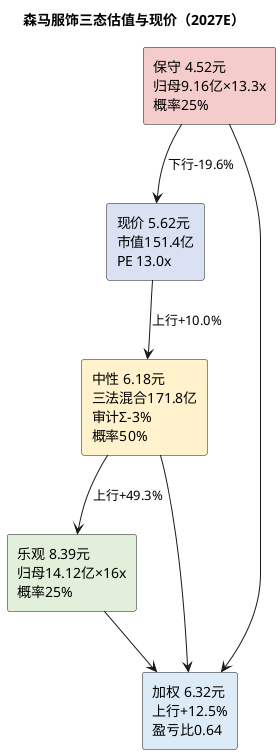

# 研报章节六：估值定价分析

**研究日期**：2026年10月31日  
**标的**：森马服饰（002563.SZ）  
**数据截止**：2026年10月30日收盘  
**目标年份**：2027年（Q4切换期，估值锚定2027E）

## 结论先行

| 项目 | 数值 |
|:--|:--|
| 当前股价（不复权，2026-10-30） | **5.62元** |
| 总股本 | 26.9409亿股 |
| 总市值 | **151.41亿元** |
| 2027E归母净利（P50） | **11.65亿元** |
| 2027E EPS（P50） | **0.432元** |
| 保守情景目标价 | **4.52元**（2027E归母9.16亿元×13.3x÷26.9409） |
| 中性情景目标价（审计后） | **6.18元**（2027E归母11.65亿元，PE/SOTP/股息率三法混合171.8亿元×0.97÷26.9409） |
| 乐观情景目标价 | **8.39元**（2027E归母14.12亿元×16x÷26.9409） |
| 概率加权目标价 | **6.32元**（25%/50%/25%） |
| 中性收益率 | **+10.0%**（6.18/5.62-1） |
| 加权收益率 | **+12.5%**（6.32/5.62-1） |
| 股息率（2026E DPS 0.25元） | **4.45%** |
| 盈亏比 | **0.64**（(6.32-5.62)/(5.62-4.52)） |
| 投资评级 | **第三象限下沿（Defensive Value）：持有/观望，≤5.1元分批** |

**核心结论：森马是一只"净现金占市值44.9%、股息率4.45%、2027E PE 13x、但盈利增长只有8.6%"的防御型资产。当前价格已经反映了净现金和高分红，但没有反映利息收入退潮和出生人口下行的长期风险。我们的加权目标价6.32元、上行空间12.5%，盈亏比0.64，不足1.0的重仓线；建议现有持有人继续持有，新增资金等待≤5.1元（对应盈亏比>2.0）。**

## 1. 价值锚定：适配性方法选择

### 1.1 公司特征与估值方法

森马的特征决定了估值方法：
1. **盈利为正且稳定**（2026E 10.73亿元、2027E 11.65亿元），PE适用；
2. **两个业务板块属性不同**（儿童服饰品牌强、毛利率48%；休闲服饰品牌老化、毛利率约44%），SOTP适用；
3. **高分红、高净现金**（2025年派息率90.57%、净现金67.94亿元），股息率/净现金估值适用；
4. **资本开支和营运资本波动大**（上海中心15亿元、存货40亿元），DCF的终值和营运资本假设太敏感，不作为主方法；
5. **折旧/租赁占比高**（使用权资产5.4亿元、租赁负债4.8亿元），EV/EBITDA受租赁会计影响，不作为主方法。

| 方法 | 适用理由 | 权重 |
|:--|:--|:--:|
| **PE** | 盈利稳定、可比公司多、市场最常用 | **60%** |
| **SOTP** | 儿童/休闲两个板块质量差异大，净现金可单独加回 | **25%** |
| **股息率/净现金** | 派息率60%-90%、净现金占市值44.9%，股息是股东回报的主要形式 | **15%** |

### 1.2 历史分位审计

| 指标 | 当前值（2026-10-30） | 2019年以来分位 | 2016年以来分位 | 历史中位（2019-） | 历史低位 | 历史高位 |
|:--|--:|--:|--:|--:|--:|--:|
| PE TTM | 14.46x | 29.7% | 22.4% | 16.01x | 9.91x（2020） | 62.43x（2021） |
| PB | 1.34x | 27.4% | 19.8% | 1.55x | 1.04x（2022） | 3.38x（2021） |
| PS TTM | 0.97x | 12.7% | — | 1.20x | 0.82x（2022） | 2.40x（2021） |
| 2027E PE | 13.00x | — | — | — | — | — |
| 剔除净现金的2027E PE（分母含利息） | 7.16x | — | — | — | — | — |

注：分位基于`v_daily_valuation`日频数据实测；2027E EPS 0.432元；净现金67.94亿元。

**审慎评估**：当前PE 14.46x处于2019年以来29.7%分位、PB 1.34x处于27.4%分位、PS 0.97x处于12.7%分位，看起来"便宜"。但历史分位不能简单套用：
- 2021年PE 30.67x、PB 2.25x，对应净利14.86亿元、ROE 12.70%；当前净利8.92亿元、ROE 7.66%，盈利能力下了一个台阶，估值中枢理应下移；
- 2022-2026年PE中位约15-16x、PB中位约1.4-1.5x，当前14.46x/1.34x处于中枢下方，但偏离不大；
- 真正的"便宜"在剔除净现金后：7.2x的剔除净现金PE（分母含利息），对应10-16亿元自由现金流、4.45%股息率。

**结论：历史分位显示"中低位"，不是"极端低估"。估值修复的空间来自盈利企稳和分红持续，不是均值回归。**

### 1.3 同业对照

| 公司 | 市值（亿元） | PE TTM | PB | PS TTM | 定位 | 与森马的可比性 |
|:--|--:|--:|--:|--:|:--|:--|
| **森马服饰** | **151.4** | **14.5x** | **1.34x** | **0.97x** | 大众休闲+童装 | — |
| 海澜之家 | 275.2 | 13.3x | 1.54x | 1.22x | 大众男装 | 高（大众服饰、低估值、高分红） |
| 报喜鸟 | 54.0 | 12.4x | 1.15x | 1.00x | 男装 | 高（大众服饰、低估值） |
| 比音勒芬 | 151.1 | 22.3x | 2.67x | 2.91x | 高端高尔夫 | 低（高端、高毛利） |
| 太平鸟 | 54.7 | 27.6x | 1.23x | 0.87x | 时尚休闲 | 中（大众休闲、盈利波动） |
| 九牧王 | 52.9 | 33.1x | 1.41x | 1.74x | 男裤 | 低（男装、盈利下滑） |
| 七匹狼 | 54.2 | 37.4x | 0.81x | 1.78x | 男装 | 低（男装、盈利下滑） |
| 安奈儿 | 26.1 | 负 | 4.36x | 4.66x | 中高端童装 | 低（亏损） |

注：除森马外，其他公司为2026-10-23收盘（本地视图未同步至最新），仅作量级参考。

**同业结论**：森马14.5x PE高于海澜之家13.3x、报喜鸟12.4x，低于比音勒芬22.3x、太平鸟27.6x、九牧王33.1x、七匹狼37.4x。考虑到森马的童装龙头地位（儿童占72%）、净现金（44.9%市值）、分红（90%），相对海澜/报喜鸟的10%-15%溢价是合理的；但不应享受比音勒芬/太平鸟的高端/成长溢价。

## 2. 中性情景市值计算（2027E P50）

### 2.1 方法一：PE法（权重60%）

| 参数 | 取值 | 依据 |
|:--|:--:|:--|
| 2027E归母净利（P50） | 11.65亿元 | 模块五 |
| 2027E EPS | 0.432元 | 11.65/26.9409 |
| 合理PE | **15.0x** | 历史中位16.0x、2022-2026年中枢15-16x、同业海澜13.3x/报喜鸟12.4x；森马童装龙头+净现金+高分红给10%-15%溢价，但成长性低于同业、出生人口负、运动童装挤压给折价，综合15x |
| **PE法市值** | **174.8亿元** | 11.65×15 |
| **PE法目标价** | **6.49元** | 174.8/26.9409 |

**PE 15x的合理性检验**：
- 2027E增速+8.6%，PEG=15/8.6=1.74，高于1，说明15x已经包含了"防御溢价"，不是"成长溢价"；
- 剔除净现金后，EV/经营净利= (151.4-67.94)/10.36=8.06x（按现价），对应2027E经营净利10.36亿元；15x总PE对应EV/经营净利=(174.8-67.94)/10.36=10.31x，对于一个零增长的品牌服装业务，10x是合理的；
- 股息率：0.25/6.49=3.85%，低于当前4.45%，说明15x的目标价已经假设了估值修复、股息率下降。

### 2.2 方法二：SOTP法（权重25%）

| 板块 | 2027E模拟净利 | 倍数 | 市值 | 依据 |
|:--|--:|--:|--:|:--|
| 儿童服饰 | 11.52亿元 | 11x | 126.7亿元 | 品牌龙头、增速4%、份额受压；给低于运动童装的倍数 |
| 休闲服饰 | 2.25亿元 | 6x | 13.5亿元 | 品牌老化、增速2%、盈利波动；给低倍数 |
| 其他 | 0.33亿元 | 5x | 1.7亿元 | 代理/批发，低毛利 |
| 减值/信用（税后） | -3.25亿元 | 10x | -32.5亿元 | 2027E减值4.55亿元×（1-28.5%） |
| 税金及附加（税后） | -0.72亿元 | 10x | -7.2亿元 | 2027E 1.00亿元×（1-28.5%） |
| 净现金 | 67.94亿元 | 1.0x | 67.94亿元 | 全额加回，不承认控股折价 |
| 其他收益/非经营 | 0.18亿元 | 5x | 0.9亿元 | — |
| 投资/处置 | 0.04亿元 | 5x | 0.2亿元 | — |
| **合计** | — | — | **171.3亿元** | — |
| **每股** | — | — | **6.36元** | 171.3/26.9409 |

SOTP（171.3亿元/6.36元）与PE法（174.8亿元/6.49元）相差2.0%，两种方法在6.35-6.50元区间收敛。SOTP的合理性在于：儿童业务11x、休闲业务6x，反映两个板块的增长/品牌质量差异；净现金1.0x全额加回，因为公司分红率60%-90%，现金能够回到股东手中。**SOTP的缺点是减值与税金资本化倍数主观，因此只给25%权重。**

### 2.3 方法三：股息率/净现金法（权重15%）

| 参数 | 取值 | 依据 |
|:--|:--:|:--|
| 2026E DPS | 0.25元 | 中期0.15元+年末0.10元（管理层交流口径，未经公告） |
| 目标股息率 | 4.2% | 当前4.45%、2025年实际5.34%、10年期国债约1.8%；考虑出生人口风险，要求4.2%-4.5% |
| **股息率法目标价** | **5.95元** | 0.25/4.2% |
| **市值** | **160.3亿元** | 5.95×26.9409 |

股息率法的逻辑：森马的股东回报以分红为主（2025年派息率90.57%），自由现金流10-16亿元足以覆盖6.7-9.7亿元分红；如果市场要求4.2%的股息率，对应5.95元。若要求4.5%，对应5.56元（接近现价）；若要求4.0%，对应6.25元。**股息率法给出的区间是5.56-6.25元，低于PE法，说明当前股价的股息率补偿是合理的，估值修复空间有限。**

**DPS假设的双向敏感性**：基准DPS 0.25元对应派息率62.8%，低于2025年的90.57%和2026年中期的84.32%，依据是管理层交流口径"全年或可按0.25元"（未经公告）。若公司维持2025年90.57%派息率，2026E DPS约0.36元，按4.2%目标股息率对应8.57元，将显著高于我们的中性目标6.18元；若维持2026年中期84.32%，DPS约0.34元，对应8.10元。**我们采用0.25元，是因为公司正在为上海国际运营中心（15亿元）和渠道转型保留现金；若2026年报实际DPS≥0.30元，中性目标价可上调至6.4-6.6元。这是上行期权，不进入基准。**

### 2.4 三法混合与审计前中性市值

| 方法 | 市值（亿元） | 目标价（元） | 权重 | 加权市值 |
|:--|--:|--:|--:|--:|
| PE 15x | 174.8 | 6.49 | 60% | 104.9 |
| SOTP | 171.3 | 6.36 | 25% | 42.8 |
| 股息率4.2% | 160.3 | 5.95 | 15% | 24.0 |
| **混合** | **171.8** | **6.38** | **100%** | **171.8** |

审计前中性市值171.8亿元、目标价6.38元。

## 3. 估值全变量对冲审计矩阵

以中性情景市值171.8亿元为"底色"，对以下维度进行定性转量化审计。**审计调节仅作用于中性档，保守/乐观不叠加。**

| 审计维度 | 核心审计因子 | 审慎思考（估值影响力过滤） | 调节建议 | 深度理由 |
|:--|:--|:--|:--:|:--|
| **内部：企业底层特质（DNA）** | 资本配置效率、治理透明度、股权激励、执行力 | 公司无高溢价并购、无商誉、无有息负债依赖，资本配置纪律较好；渠道改革执行力可验证（关店、库存清理、直营坪效+17%）；但家族持股65.91%、期权计划连续两年失败、2026年考核目标18亿元不可达，治理有瑕疵。**净现金与分红已在SOTP/股息率法中计价，本项只评估"资本配置纪律与执行力"，不重复计价现金** | **+1%** | 执行力与资本纪律提升长期确定性；但不足以给更高溢价，因增长停滞 |
| **宏观：政策与战略对齐** | 育儿补贴、十五五扩消费、童装监管 | 育儿补贴1,100亿元、十五五扩消费规划，对童装需求有托底；但服装不在以旧换新范围、补贴不逆转出生人口，政策传导弱。**政策是"锦上添花"，不是"定价权"** | **+1%** | 政策降低行业下行斜率，但不改变2027年+3.5%的收入中枢 |
| **宏观：地缘与外部约束** | 海外收入、关税、供应链 | 海外收入1.3%、无重大海外资产、供应链可切换，地缘/关税影响<0.1亿元。**不构成长期折价，也不构成溢价** | **0%** | 低暴露，剔除 |
| **市场：流动性与风格** | 自由流通盘、机构持仓、风格 | 家族持股65.91%，自由流通盘约34%、市值51亿元；日成交额约1.6亿元，流动性一般；当前市场风格偏成长/科技，防御/红利风格中性。**低自由流通盘给流动性折价，红利风格不给溢价** | **-2%** | 自由流通盘小、机构配置意愿低 |
| **行业：竞争与长期天花板** | 出生人口、运动童装、份额 | 2025年出生792万、-17%，2027年700-740万；运动童装（安踏、FILA、361）持续挤压，巴拉巴拉在部分监测中降至第三。**这是长期终值风险，不是2027年利润风险** | **-3%** | 出生人口下行+份额流失，压制长期PE中枢 |
| **综合调节系数** | — | — | **Σ-3%** | **中性市值×0.97** |

**逻辑纯净性校验**：
- **利息收入退潮**：已计入E（F4，2027E利息1.8亿元 vs 2026E 3.0亿元），不再在PE中折价；
- **减值**：已计入E（F5，2027E 4.2亿元），不再在PE中折价；
- **出生人口下行**：2027年利润影响已计入E（儿童+4.0%），PE中的-3%只反映2028年后的终值不确定性，不重复计算2027年利润；
- **净现金**：本金67.94亿元在SOTP/股息率中加回，利息收入1.8亿元在E中，二者不重复；
- **高分红**：在股息率法中体现，不在E中重复。
- **同一因子不在E与PE中双重计减**：符合框架要求。

**锚点回测**：审计后中性市值=171.8×0.97=166.6亿元、目标价6.18元，隐含2027E PE=166.6/11.65=14.30x，低于历史中位16.01x、高于海澜13.3x/报喜鸟12.4x。这个倍数与"零增长、高分红、净现金"的定位匹配，没有显著偏离历史中枢或同业水平。

## 4. 三态市值与目标价

### 4.1 三态假设

| 情景 | 2027E归母 | EPS | 关键假设 | 情景PE | 市值 | 目标价 | 概率 |
|:--|--:|--:|:--|--:|--:|--:|--:|
| **保守** | 9.16亿元 | 0.340元 | 营收+1.5%、毛利率45.8%、销售费用率28.7%、利息1.3亿元、减值5.0亿元、税率29.5% | 13.3x | 121.8亿元 | **4.52元** | 25% |
| **中性** | 11.65亿元 | 0.432元 | 营收+3.5%、毛利率46.2%、销售费用率28.3%、利息1.8亿元、减值4.2亿元、税率28.5% | 15.0x→审计14.30x | 166.6亿元（审计后） | **6.18元** | 50% |
| **乐观** | 14.12亿元 | 0.524元 | 营收+5.0%、毛利率46.8%、销售费用率28.0%、利息2.2亿元、减值3.5亿元、税率27.5% | 16.0x | 225.9亿元 | **8.39元** | 25% |

**倍数依据**：保守13.3x参照海澜之家13.3x/报喜鸟12.4x的大众服饰下限，考虑盈利下滑（归母-14.6%）给13.3x；中性15.0x参照2022-2026年PE中枢15-16x，考虑零增长给中枢下沿；乐观16.0x参照历史中位16.01x，考虑盈利+31.6%给中枢。三个倍数均低于2021年泡沫期的30x+，高于海澜/报喜鸟的下限，避免"低估值陷阱"和"成长溢价"两个极端。

**三态逻辑**：
- 保守情景不是"黑天鹅"，而是"Q3趋势延续+利息退潮+减值维持高位"的自然结果：营收+1.5%（低于行业）、毛利率45.8%（折扣战）、减值5.0亿元（暖冬/老品）、利息1.3亿元（降息）。归母9.16亿元、同比-14.6%。
- 中性情景是"收入+3.5%、毛利率持平微升、减值回落20%、利息1.8亿元"的基准：归母11.65亿元、同比+8.6%。
- 乐观情景是"消费复苏+份额稳定+减值回落+利息2.2亿元"的偏差：营收+5.0%、毛利率46.8%、减值3.5亿元，归母14.12亿元、同比+31.6%。
- 概率25%/50%/25%：中性是基准（50%），保守和乐观各25%；若采用30%/50%/20%，加权目标价6.12元、上行8.9%、盈亏比0.45。

### 4.2 加权目标价与盈亏比

**加权目标价 = 25%×4.52 + 50%×6.18 + 25%×8.39 = 1.13 + 3.09 + 2.10 = 6.32元**

**中性收益率 = 6.18/5.62 - 1 = +10.0%**  
**加权收益率 = 6.32/5.62 - 1 = +12.5%**  
**股息率（2026E DPS 0.25元）= 4.45%**  
**总回报（加权+股息）= 约16.9%**

**盈亏比 = (加权目标价 - 现价) / (现价 - 保守情景价格) = (6.32 - 5.62) / (5.62 - 4.52) = 0.70 / 1.10 = 0.64**

盈亏比0.64 <1.0，说明当前价格的期望收益（+0.70元）小于下行风险（-1.10元），**不满足重仓条件**。若股价跌至5.10元：
- 加权收益率=(6.32-5.10)/5.10=+23.9%；
- 盈亏比=(6.32-5.10)/(5.10-4.52)=1.22/0.58=2.10，满足分批建仓条件。
若股价跌至4.80元（52周低点）：
- 加权收益率=+31.7%；
- 盈亏比=(6.32-4.80)/(4.80-4.52)=1.52/0.28=5.43，但需重新评估保守情景（4.52元是否会被击穿）。

## 5. 逻辑证伪与极限压力测试

### 5.1 黑天鹅场景：出生人口塌陷+运动童装份额跃升

**定义**：2027年出生人口<650万人（较2025年-18%），运动童装份额年增3pct，巴拉巴拉儿童收入-8%，存货减值8亿元，毛利率降至44%。

**影响**：
- 2027E营收154亿元（-2.5%）、毛利率44.0%、销售费用率29.5%、减值8亿元、利息1.2亿元；
- 归母净利约5.0亿元、EPS 0.186元；
- 给10x PE=50亿元，加净现金67.94×0.8（20%控股折价）=54.4亿元，合计104.4亿元 → **3.87元/股**；
- 较现价-31.1%，较保守情景-14.4%。

**地狱价格**：3.9-4.1元（PB约0.87-0.91x，剔除净现金的市值约36-41亿元）。这是"核心逻辑失效"情形，不是基准。

### 5.2 极限支撑位：净现金+清算价值

| 项目 | 账面价值（亿元） | 清算折扣 | 清算价值（亿元） |
|:--|--:|--:|--:|
| 货币资金+理财+大额存单 | 75.9 | 100% | 75.9 |
| 存货 | 40.2 | 50% | 20.1 |
| 应收账款 | 12.4 | 70% | 8.7 |
| 固定资产 | 14.0 | 50% | 7.0 |
| 投资性房地产 | 5.9 | 70% | 4.1 |
| 其他资产 | 18.5 | 50% | 9.3 |
| 负债合计 | -74.4 | 100% | -74.4 |
| **清算价值** | — | — | **50.7** |
| **每股清算价值** | — | — | **1.88元** |

清算价值1.88元/股，远低于现价5.62元，说明市场给的是"持续经营价值"，不是"清算价值"。需说明：上表未计入在建工程8.74亿元、使用权资产5.70亿元、无形资产4.26亿元、递延所得税资产3.43亿元等约22亿元资产，若按50%折扣计入，清算价值约2.3元/股；即便如此，仍远低于现价，结论不变。**净现金2.52元/股是更现实的参考底线**：但净现金中部分对应经营性负债，不能简单视为可分配现金；且A股市场很少按净现金定价，2018-2022年森马PB最低1.04x（对应股价约4.45元），说明"净现金底"并不牢靠。

### 5.3 压力测试：不同情景下的股价

| 情景 | 2027E归母 | PE | 市值 | 目标价 | 较现价 |
|:--|--:|--:|--:|--:|--:|
| 黑天鹅 | 5.0亿元 | 10x | 104.4亿元 | 3.87元 | -31.1% |
| 保守 | 9.16亿元 | 13.3x | 121.8亿元 | 4.52元 | -19.6% |
| 中性 | 11.65亿元 | 14.30x | 166.6亿元 | 6.18元 | +10.0% |
| 乐观 | 14.12亿元 | 16x | 225.9亿元 | 8.39元 | +49.3% |

**结论：下行风险-20%至-30%，上行空间+10%至+49%，概率加权+12.5%，盈亏比0.64。风险收益不对称，偏向"等待更好价格"。**

## 6. 确定性与胜率矩阵

| 维度 | 评估 | 说明 |
|:--|:--|:--|
| 盈利确定性 | 中 | 2027E归母11.65亿元，80%区间8.5-14.5亿元；减值是最大不确定项 |
| 分红确定性 | 中高 | 2025年派息率90.57%、2026年中期84.32%；2026E DPS 0.25元，股息率4.45% |
| 净现金确定性 | 高 | 67.94亿元；有息负债3.00亿元（票据贴现）+租赁负债4.97亿元，审计确认 |
| 成长确定性 | 低 | 2027E +8.6%，儿童+4%、休闲+2%，出生人口负 |
| 估值确定性 | 中 | PE 14.46x处于29.7%分位，下行有净现金支撑，上行缺成长 |
| **综合确定性** | **中高** | 现金/分红确定性高，成长确定性低 |
| **预期收益** | **低** | 加权+12.5%，总回报约16.9% |
| **象限** | **第三象限（Defensive Value）下沿** | 高确定性+低预期收益，防御/底仓，不是核心重仓 |

## 7. 投资建议

### 7.1 评级与仓位

**评级：第三象限下沿（Defensive Value）——持有/观望，≤5.1元分批。**

- **现有持有人**：继续持有，享受4.45%股息率；若2027年一季报/春季订货会证伪"儿童+4%"假设，减仓。
- **新增资金**：当前5.62元不追高，等待≤5.1元（对应盈亏比2.10）；若跌至4.8元（52周低点）且基本面未恶化，可加仓。
- **仓位建议**：防御型配置不超过组合的5%；不作为核心重仓（盈亏比<1.0）。
- **止损/证伪**：若2027H1儿童收入增速<0%、毛利率<45%、减值>6亿元，或分红降至0.20元以下，下调至第四象限（回避）。

### 7.2 关键跟踪指标

1. 2026Q4营收增速（≥2%为达标，<0%为证伪）；
2. 2026年全年减值（≤5.5亿元为达标，>6.0亿元为证伪）；
3. 2026年DPS（≥0.25元为达标，<0.20元为证伪）；
4. 2027年春季订货会儿童订单（≥+3%为达标）；
5. 2027H1利息收入（0.7-1.3亿元为基准，>1.3亿元为超预期）；
6. 安踏儿童/FILA Kids/361°儿童的门店、流水、折扣；
7. 出生人口（2027年1月国家统计局）。

### 7.3 与卖方观点的差异

| 机构 | 2026E归母 | 2027E归母 | 目标价 | 评级 | 我们的差异 |
|:--|--:|--:|--:|:--|:--|
| 本报告 | 10.73 | 11.65 | 6.18（中性）/6.32（加权） | 持有/观望 | — |
| 华西证券 | 10.74 | 12.56 | — | 买入 | 我们2027E低7.2%，因收入/利息假设更审慎 |
| 中金公司 | 10.63 | — | ≤6.96 | 跑赢行业 | 我们中性目标价低11.1%、加权目标价低9.1%，因审计Σ-3% |
| 卖方一致 | 10.96 | — | 6.95（均值） | 多数买入 | 我们2026E低2.1%、中性目标价低11.1%、加权目标价低9.1% |

**我们不否认森马是"好公司"（净现金、高分红、童装龙头），但"好公司"不等于"好价格"。当前5.62元已经反映了净现金和高分红，2027年+8.6%的增长不足以支撑20%+的上行空间；6.18元的中性目标价对应14.30x PE、4.0%股息率，是合理的。**

## 8. 本章结论

1. **方法**：PE 60% + SOTP 25% + 股息率 15%，交叉验证中性市值171.8亿元、目标价6.38元；审计Σ-3%后166.6亿元、6.18元。
2. **三态**：保守4.52元（25%）、中性6.18元（50%）、乐观8.39元（25%），加权6.32元。
3. **收益**：中性+10.0%、加权+12.5%、股息4.45%、总回报约16.9%；盈亏比0.64。
4. **评级**：第三象限下沿（Defensive Value），持有/观望，≤5.1元分批；不追高。
5. **压力测试**：黑天鹅3.87元（-31.1%）、清算价值1.88元/股、净现金2.52元/股。
6. **关键变量**：2026Q4营收、全年减值、DPS、2027春季订货会、利息收入、运动童装竞争、出生人口。

### 证据索引（本章）

| 编号 | 来源 | 用途 | 核实状态 |
|:--|:--|:--|:--|
| E1 | 森马服饰2025年年度报告（巨潮，2026-03-31） | 2025年分红、净现金、财务数据 | 公告原文 |
| E2 | 森马服饰2026年半年度报告（巨潮，2026-08-18） | 2026H1财务、中期分红 | 公告原文 |
| E3 | 森马服饰2026年第三季度报告（巨潮，2026-10-30） | 2026Q3财务、净现金 | 公告原文 |
| E4 | QuantPyLab `v_daily_valuation`（2026-10-30） | 股价、市值、PE/PB/PS分位 | 系统实测 |
| E7 | 长江证券《森马服饰2026年中报业绩交流电话会纪要》（2026-08-18） | 2026年DPS 0.25元、利息收入3亿元 | 二手纪要，未经公告核实 |
| E8 | 华西证券《森马服饰：Q3收入增速放缓 减值计提增加》（2026-10-30） | 2027E 12.56亿元、目标价 | 二手券商研报 |
| E9 | 中金公司评级（2026-10-31，同花顺转载） | 2026E 10.63亿元、目标价≤6.96元 | 二手媒体 |
| E10 | 同花顺iNews《机构评级》（2026-10-31） | 14家机构一致预期、目标价均值6.95元 | 二手媒体 |
