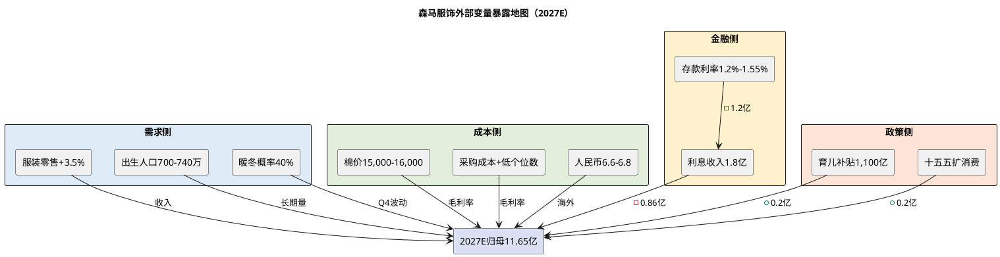

# 研报章节四：外部边界与宏观政策

**研究日期**：2026年10月31日  
**标的**：森马服饰（002563.SZ）  
**数据截止**：2026年10月30日  
**目标年份**：2027年

## 结论先行

| 外部变量 | 暴露度 | 2026年事实 | 2027E基准假设 | 对归母净利的影响 | 判断 |
|:--|:--:|:--|:--|:--|:--|
| 服装零售 | 高 | 1-9月+4.6%、9月+1.2%；Q3明显放缓 | +3.5% | 零售每+1pct→归母+0.5亿元 | 弱复苏，不提供超额β |
| 出生人口 | 中高 | 2025年792万、-17.0%；2026E 720-750万 | 700-740万 | 长期量减，2027年影响约-0.7至-1.0亿元 | 结构性负变量，不可逆 |
| 存款利率 | 高 | 3年期大额存单1.55%、2年期1.20%、5年期部分银行停售（BOC仍售1.60%） | 利息收入1.8亿元（2026E 3.0亿元） | 利息收入每-1亿元→归母-0.72亿元 | 2027年最大确定性逆风 |
| 棉花价格 | 中 | 3128B 16,762元/吨、郑棉15,315元/吨，弱势 | 15,000-16,000元/吨 | 棉价每-5%→毛利率+0.2-0.3pct | 成本红利有限，已被采购价上涨部分抵消 |
| 人民币汇率 | 低 | 在岸约6.7，偏强 | 6.6-6.8 | 海外收入占比1.3%，影响<0.1亿元 | 低暴露 |
| 关税/地缘 | 低 | 海外收入0.85亿元（H1）、1.27% | 1.3%-1.5% | 影响<0.1亿元 | 无实质关税风险 |
| 天气 | 中 | 2026秋冬偏暖概率高 | 暖冬情景 | Q4收入-3%→归母-0.5亿元 | S情景，不进入基准 |
| 生育/消费政策 | 中 | 育儿补贴3,600元/年、1,100亿元；十五五扩消费规划 | 政策延续，不假设强刺激 | +0.2至+0.5亿元（有限） | 托底，不反转 |

## 1. 宏观环境变量

### 1.1 消费：弱复苏，服装略好于大盘，但Q3失速

2026年1-9月，社会消费品零售总额370,001亿元、同比+1.1%；除汽车以外340,574亿元、+2.8%；商品零售328,032亿元、+1.0%；餐饮41,969亿元、+2.4%。服装鞋帽针纺织品类10,824亿元、+4.6%，9月单月1,213亿元、+1.2%；网上穿类商品零售额+3.4%（国家统计局，2026-10-19）。服装增速高于社零，但9月单月已降至+1.2%，与森马Q3营收+0.36%相互印证。

2025年全年：社零501,202亿元、+3.7%；服装鞋帽针纺织品类15,215亿元、+3.2%；全国居民人均衣着消费支出1,554元、+2.2%（国家统计局，森马2025年报引用）。2026H1：社零248,722亿元、+1.3%；服装鞋帽针纺织品类7,709亿元、+6.7%；人均衣着消费支出880元、+4.4%（森马2026半年报引用）。从H1的+6.7%到1-9月的+4.6%，Q3服装零售明显减速。

消费疲弱的背景是：①居民收入预期偏弱、储蓄倾向高；②房地产财富效应负向；③就业压力（2026年9月全国城镇调查失业率5.1%）；④K型消费——高端和低价两头增长，大众中间带受压。森马正好处在"大众中间带"，受K型消费的挤压最明显。

2027年展望：社零+2%-3%、服装零售+3%-4%是中性假设；若"十五五"扩消费政策加码（消费券、收入补贴、服务业开放），可能达到+5%；若房地产/就业继续恶化，可能降至+1%-2%。我们在模型中采用+3.5%的服装零售增速，对应森马营收+3.5%，没有假设政策强刺激。

### 1.2 利率：存款利率下行，利息收入退潮是2027年最大的确定性逆风

2026年7月1日，新一轮存款利率调整落地：国有大行3年期大额存单利率由1.58%降至1.55%，2年期由1.22%降至1.20%，5年期大额存单在部分股份行/城商行对普通零售客户停售，但中国银行仍以1.60%在售；股份制银行3年期大额存单利率区间1.50%-1.60%，2年期压至1.35%以内；深圳农商行2年期1.40%、3年期取消网点专属上浮（深圳新闻网2026-07-01）。中国银行2026年第一期个人大额存单：1个月/3个月0.80%、6个月1.00%、1年期1.10%、2年期1.20%、3年期1.55%、5年期1.60%。

森马的利息收入与存款利率反向变动，原因是"存量高息存单的到期节奏"：
- 2024年利息收入1.83亿元、2025年1.62亿元；
- 2026H1利息收入1.72亿元、2025H1仅0.54亿元；
- 2026年1-9月财务费用-2.17亿元（利息净收入约2.17亿元）；
- 管理层交流口径：2026年全年利息收入计划约3亿元，来自3-4年前高利率大额存单在2026年集中到期结算，非均速确认（来源：长江证券2026中报电话会纪要，未经公告核实）。

这意味着2026年的利息收入是"存量高息资产到期的一次性释放"，不是可持续的收益。2027年，存量高息存单基本到期，新增资金只能按1.2%-1.6%再投资。我们假设2027年利息收入1.8亿元（80%区间1.3-2.3亿元），较2026E的3.0亿元下降1.2亿元，税后影响归母净利约0.86亿元（-7.4%）。测算方法：约40亿元存量高息存单按3.0%计息（贡献约1.2亿元），其余约28亿元现金类资产按1.5%-2.0%计息（贡献约0.4-0.6亿元），合计1.6-1.8亿元，取P50 1.8亿元。

| 利息收入情景 | 2027E利息收入 | 税后归母影响 | 对应2027E归母 |
|:--|--:|--:|--:|
| 乐观 | 2.3亿元 | -0.50亿元 | 12.01亿元 |
| 基准 | 1.8亿元 | -0.86亿元 | 11.65亿元 |
| 保守 | 1.3亿元 | -1.22亿元 | 11.29亿元 |

**这是森马2027年最重要的单一外部变量。** 投资者容易把2026年的高利息收入当成可持续收益，给出偏高的盈利预测；我们的基准假设已经计入了利息退潮，这是与卖方一致预期（2027E 12.56亿元）相差约0.9亿元的主要原因之一。

### 1.3 汇率：低暴露，影响可忽略

2026年10月，人民币在岸即期约6.7，较2024年的7.2有所升值。森马海外收入占比仅1.27%（2026H1 0.85亿元）、0.84%（2025年1.27亿元），且海外业务以东南亚、中东为主，结算货币多样；成本端几乎全部为人民币。汇率对利润的影响<0.1亿元，不构成实质性风险。

若人民币继续升值5%，海外收入减少约0.04亿元、毛利率下降0.5pct，影响归母净利<0.03亿元。**汇率不是森马的投资逻辑变量。**

### 1.4 通胀与成本：棉花弱，但采购成本不一定降

2026年10月30日，中国棉花价格指数3128B为16,762元/吨、2227B为15,277元/吨、2129B为17,088元/吨；郑棉主力CF701收15,315元/吨、CF705收14,995元/吨；Cotlook A指数90.20美分/磅；新疆机采籽棉收购价降至7元/公斤以内，加工成本中枢下移（中国棉花信息网、上海国际棉花交易中心）。棉价处于弱势震荡，原因是新棉集中上市、下游需求疲软、全球供应充足。

但森马的成本不是棉花，而是**成衣采购价**。成衣成本=面料+辅料+人工+制造费用+供应商利润，棉花只占面料成本的一部分，面料又只占成衣成本的一部分。棉价下跌对森马毛利率的传导系数约为0.2-0.5pct，且滞后2-3个月（公司有2-3个月面料库存）。2026年Q4，管理层交流口径"采购成本低个位数增长"，说明棉价下跌被人工、辅料、供应商提价抵消，成本红利有限。

2027年，我们假设采购成本+1%-2%、棉价15,000-16,000元/吨、公司通过提价和产品结构升级抵消大部分成本压力，毛利率46.2%（较2026E +0.2pct）。如果棉价大幅下跌10%，毛利率可+0.4-0.5pct，归母净利+0.5-0.6亿元；如果采购成本+5%，毛利率-1pct，归母净利-1.2亿元。

## 2. 政策与监管

### 2.1 生育政策：补贴托底，不逆转趋势

2025年，中国出生人口792万人、同比-17.0%，人口出生率5.63‰，自然增长率-2.41‰，连续第四年负增长；总和生育率约1.09（国家统计局2026-01-19；育娲人口智库测算）。2016年出生1,786万人，2025年不足800万，十年降幅55.7%。

政策应对：
- **育儿补贴**：国家基础标准每孩每年3,600元，发放至3周岁；2026年各级财政预计投入约1,100亿元，财政部下达补助资金999亿元、同比+10.6%；截至2026年7月21日，2026年度育儿补贴申请2,751万条、审核通过2,713万条、实际发放2,516万人（城市圈2026-07-22引用官方数据）。
- **地方补贴**：云南自2022年累计发放78.01亿元、惠及245.87万人次；常熟2026年预计发放5,327万元、+11.49%。
- **托育/教育**：部分地区推进普惠托育、延长产假、免费学前教育试点（未全国落地）。

政策效果评估：学术研究（黄宗晔，2026）基于2017-2024年城市面板数据，发现育儿补贴对出生率平均提升约5.26%，补贴强度每增加1万元、出生率提升约1.149‰；按月发放效果优于一次性发放，二孩起补贴效果最显著。但补贴对**新增生育**的边际激励有限，更多是"保障已生育家庭"。2025年出生人口仍-17.0%，说明补贴未能逆转趋势。

对森马的含义：①育儿补贴支撑0-3岁婴幼儿服饰消费，但森马的婴幼童业务（mini bala 3亿元）占比小；②补贴不改变2027-2028年出生人口700-750万的中枢；③政策是"托底"而非"反转"，不能作为看多童装的核心逻辑。

### 2.2 消费政策：十五五扩消费，利好但不直接

国务院《扩大消费"十五五"规划》全面落地，明确未来五年扩内需、促消费的核心任务（森马2026半年报引用）。政策方向包括：提高居民收入、扩大服务消费、以旧换新、消费券、县域商业体系、直播电商规范等。

对服装行业的影响：
- **以旧换新**：2026年主要集中在汽车、家电、通讯器材，服装不在中央补贴范围；2026年1-9月通讯器材+18.1%、家电-4.9%、家具-4.7%、服装+4.6%，说明补贴对服装拉动有限。
- **消费券**：地方偶尔发放，覆盖餐饮、零售，服装受益但金额小。
- **收入/就业**：若居民收入预期改善，服装是可选消费，弹性较大；但政策传导需要时间。
- **直播电商规范**：可能提高线上流量成本，对森马线上业务（占比46.9%）是双刃剑。

2027年，我们假设政策延续、无强刺激，服装零售+3.5%。如果出台全国性服装消费券或收入补贴，可能+1-2pct，归母净利+0.5-1.0亿元。

### 2.3 监管：电商退货、质量、广告

- **电商退货**：森马2026H1天猫退货率51.70%、抖音53.73%，平台"仅退款""运费险"规则增加了退货成本；若平台进一步倾斜消费者，销售费用率可能上升。
- **质量/广告**：2026年8月，子公司浙江森马电子商务因"开设有奖销售未明确公布奖品数量或中奖概率"被罚1万元（来源：Loopseek研报引用企查查，未经公告核实），属轻微行政处罚；2026年7-9月有消费者投诉（Asics童鞋质量、网购合同履约），金额小，不构成重大风险。
- **数据/隐私**：AI"大森3.0"、会员数据使用需合规，但目前无重大监管事项。

**监管风险低，不构成估值折价。**

## 3. 地缘与贸易

### 3.1 海外收入低，关税暴露小

森马海外收入：
- 2025年境外收入1.27亿元、占0.84%、同比+58.06%，毛利率57.55%；
- 2026H1境外收入0.85亿元、占1.27%、同比+63.71%，毛利率55.09%；
- 巴拉巴拉已进入约20个国家和地区，2026年在意大利罗马开欧洲首店，跨境电商覆盖130+国家；
- 境外资产占比"不适用"，无重大海外资产。

美国关税、欧盟关税、地缘冲突对森马的影响<0.1亿元。公司产品全部外包生产，主要在中国采购，若美国对华服装加征关税，森马不直接出口美国，影响有限；若供应链转移到东南亚，森马可以通过调整代工厂应对，不构成瓶颈。

### 3.2 供应链重构：China+1不是约束

服装代工是中国最早全球化的行业之一，申洲国际、裕元、健盛等已在越南、柬埔寨、孟加拉布局。森马作为品牌方，可以选择中国或东南亚代工厂，供应链弹性高于重资产制造商。2026年，公司没有披露海外产能布局，但"产品全部外包"意味着可以通过供应商切换应对关税/地缘风险。

**地缘风险低，不给估值折价，也不给溢价。**

## 4. 天气：2026/27暖冬风险

服装销售对天气高度敏感，尤其是Q4的冬装（羽绒服、大衣、毛衣）。2025/26年冬季，国家气候中心预测"我国大部地区气温接近常年同期到偏高"，华北南部、华东大部、华中大部等地偏高，四川西部、云南西北部、西藏、青海南部偏高1-2℃；拉尼娜状态持续至2026年初，但持续时间短、形成事件概率低（国家气候中心2025-11-04；中国气象局2025-11-01）。

2026年秋冬，日本气象协会预测"10-11月偏暖、冬装需求启动推迟"；中国气象局尚未发布2026/27年冬季正式预测，但从2026年10月的天气看，全国多地偏暖，秋装销售启动偏晚。若2026/27年冬季偏暖：
- Q4 2026收入可能-2%至-3%（2025Q4基数52.46亿元，占全年34.8%）；
- 羽绒服/大衣等高单价品类动销放缓，折扣加深，毛利率-0.5至-1.0pct；
- 存货（冬装）积压，2027H1减值增加。

**暖冬是S情景（概率约40%），不进入基准。** 需说明：国家气候中心2025-11-04发布的是2025/26冬季预测，2026/27冬季官方预测尚未发布，此处仅作类比；2026年10月的实际气温偏暖是更直接的观察。 基准假设Q4 2026收入+2%、毛利率45.5%。若暖冬兑现，2026E归母净利可能从10.73亿元降至10.2亿元，2027E降至11.0亿元。

## 5. 外部变量暴露地图与敏感性

| 变量 | 暴露度 | 2026E | 2027E P50 | 对2027E归母的敏感性 | 可对冲性 |
|:--|:--:|:--|:--|:--|:--|
| 服装零售增速 | 高 | +4.6%（1-9月） | +3.5% | 每±1pct→±0.5亿元 | 低（行业β） |
| 出生人口 | 中高 | 720-750万 | 700-740万 | 每-50万→儿童收入-2%-3%、归母-0.7至-1.0亿元 | 低（长期） |
| 存款利率/利息收入 | 高 | 3.0亿元 | 1.8亿元 | 每±0.5亿元→±0.36亿元 | 低（存量到期） |
| 棉花价格 | 中 | 15,315元/吨 | 15,000-16,000元/吨 | 每±5%→毛利率±0.2-0.3pct、归母±0.3亿元 | 中（2-3月库存） |
| 采购成本 | 高 | +低个位数 | +1%-2% | 每±1pct→归母±1.16亿元 | 中（提价/结构） |
| 人民币汇率 | 低 | 约6.7 | 6.6-6.8 | 每±5%→归母±0.03亿元 | 高（自然对冲） |
| 关税/地缘 | 低 | — | — | <0.1亿元 | 高（海外占比低） |
| 天气（Q4） | 中 | 暖冬概率40% | — | Q4收入±3%→归母±0.5亿元 | 低 |

## 6. S情景：material but unpredictable

按照预测协议，以下变量material但不可预测，归入S，不进入基准：

| 编号 | 情景 | 概率 | 触发条件 | 对2027E归母影响 | 尾部条件 |
|:--|:--|:--:|:--|:--|:--|
| S1 | 出生人口反弹 | 10% | 2027年出生>800万（强补贴/生肖效应） | +0.8亿元（儿童+7%-8%） | 政策超预期、生育率回升 |
| S2 | 运动童装份额加速侵蚀 | 30% | 巴拉巴拉份额年降>1pct | -0.8亿元（儿童+0%-2%） | 安踏/FILA/361加速开店、折扣战 |
| S3 | 消费刺激加码 | 20% | 全国性服装消费券/收入补贴 | +0.5亿元（营收+1-2pct） | 政策强刺激 |
| S4 | 暖冬 | 40% | 2026/27冬季气温偏高1℃+ | -0.5亿元（Q4收入-3%） | 冬装积压、减值增加 |
| S5 | 利率继续下行 | 50% | 3年期存单利率<1.3% | -0.4亿元（利息收入1.3亿元） | 降息周期延续 |
| S6 | 关税/地缘冲突 | 5% | 东南亚供应链中断/美国对东南亚加税 | -0.2亿元 | 供应链重构 |

> 注：以下情景之间不互斥（如暖冬与利率下行可同时发生），概率不可加总；概率为单情景主观估计，仅用于压力测试，不进入基准。

这些情景不进入基准，但在模块六的Bear/Bull偏差和压力测试中使用。

## 7. 本章结论：外部环境中性偏负，2027E不假设宏观改善

1. **需求侧**：服装零售+4.6%（1-9月）但9月+1.2%，消费弱复苏；出生人口792万、-17.0%，2027年700-740万，童装行业总量增速被人口拖累。
2. **金融侧**：存款利率1.2%-1.55%，2027年利息收入从3.0亿元降至1.8亿元，是最大的确定性逆风（-0.86亿元归母）。
3. **成本侧**：棉价15,315元/吨、弱势，但采购成本+低个位数，成本红利有限；2027年毛利率只能持平微升。
4. **政策侧**：育儿补贴1,100亿元、十五五扩消费，托底但不反转；服装不在以旧换新范围，政策弹性有限。
5. **地缘/汇率**：海外收入1.3%、汇率影响<0.1亿元，低暴露。
6. **天气**：2026/27暖冬概率40%，Q4收入风险-3%、归母-0.5亿元，S情景。

**对模块五的输入：**
- 2027E营收增速P50 +3.5%（80%区间+1.5%至+5.0%）；
- 2027E利息收入P50 1.8亿元（80%区间1.3-2.3亿元）；
- 2027E毛利率P50 46.2%（80%区间45.4%-47.0%）；
- 2027E采购成本+1%-2%，棉价15,000-16,000元/吨；
- 2027E服装零售+3.5%，出生人口700-740万，无政策强刺激。

### 证据索引（本章）

| 编号 | 来源 | 用途 | 核实状态 |
|:--|:--|:--|:--|
| E5 | 国家统计局《2026年1-9月份社会消费品零售总额》（2026-10-19） | 社零、服装零售、网上穿类 | 官方原文 |
| E6 | 国家统计局《2025年经济发展向新向优》（2026-01-19） | 2025年出生792万、人口数据 | 官方原文 |
| E17 | 深圳新闻网《7月起存款利率再下调》（2026-07-01） | 3年期大额存单1.55%、2年期1.20%、5年期部分银行停售（BOC仍售1.60%） | 二手媒体，引用银行挂牌 |
| E18 | 中国银行《关于发售2026年第一期个人大额存单的公告》（2026-07-01） | 各期限大额存单利率 | 官方原文 |
| E19 | 城市圈《1100亿补贴"补票"一年》（2026-07-22） | 育儿补贴3,600元/年、1,100亿元、2026年出生预测 | 二手媒体，引用官方数据 |
| E20 | 黄宗晔《育儿补贴政策对人口出生率的影响》（2026-04） | 补贴对出生率的实证效果 | 学术研究，非官方 |
| E21 | 中国棉花信息网/上海国际棉花交易中心（2026-10-30） | 棉价、籽棉收购价 | 行业网站 |
| E22 | 国家气候中心《2025/2026年冬季气候趋势预测》（2025-11-04） | 冬季气温偏高 | 官方预测 |
| E23 | 日本气象协会《2026年秋冬预报》（2026-09-01） | 10-11月偏暖、冬装启动推迟 | 二手预测，非中国官方 |
| E2 | 森马服饰2026年半年度报告（巨潮，2026-08-18） | 海外收入、政策引用、退货率 | 公告原文 |
| E7 | 长江证券《森马服饰2026年中报业绩交流电话会纪要》（2026-08-18） | 利息收入3亿元、采购成本、提价 | 二手纪要，未经公告核实 |
