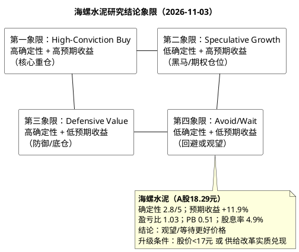

# 研报章节八：投资摘要与风险因素

**研究日期：2026年11月03日**
**标的：安徽海螺水泥股份有限公司（600585.SH / 00914.HK）**
**目标年份：2027E（2026年11月处于Q4切换期，估值锚点按框架自动滚算至次年）**
**当前价格：A股18.29元（2026-11-03收盘，不复权）；总市值965.17亿元**

---

## 一、投资摘要

### 1.1 一句话结论

海螺水泥是水泥行业成本曲线最左侧、资产负债表最厚的龙头，当前PB 0.51倍处于十年3.7%分位、股息率4.9%，下行有净现金和分红下限保护；但2026年是盈利底（预计归母净利32亿元，-60%），2027年只能修复至52亿元，需求长周期下行、价格弹性有限，**当前A股价格的风险收益比仅为1.03倍，不足以支撑重仓**。建议定位为“防御型底仓/周期反转期权”，等待股价回落至17元以下或供给改革实质兑现后再提升配置。

### 1.2 核心数据

| 指标 | 2025A | 2026E | 2027E | 2028E |
|:---|:---|:---|:---|:---|
| 营业收入（亿元） | 825.3 | 745 | 758 | 763 |
| 归母净利（亿元） | 81.1 | 32.3 | 52.0 | 62.9 |
| 同比 | +5.4% | -60.2% | +61.0% | +21.0% |
| EPS（元） | 1.54 | 0.61 | 0.99 | 1.19 |
| 毛利率 | 24.2% | 17.3% | 20.2% | 21.5% |
| ROE | 4.27% | 1.70% | 2.70% | 3.20% |
| 每股分红（元） | 0.85 | ≥0.90 | ≥0.90 | 0.90–1.00 |
| 股息率（现价） | 4.6% | 4.9% | 4.9% | 4.9%–5.5% |
| PB | 0.51 | 0.51 | 0.58 | 0.56 |

### 1.3 投资逻辑（三条主线，一条期权）

**主线一：成本领先是“活下去”的确定性，不是“赚大钱”的弹性。** 2025年公司吨成本166.42元，行业最低；2026H1在煤价上涨中仍下降6.33%至163.12元；行业15家样本公司2026H1扣非合计亏损13.24亿元，海螺扣非仍盈利19.02亿元。成本优势保证公司在行业底部不亏损、不融资、不卖资产，但无法阻止吨价下跌（2026H1吨价-35元/吨），因此它是“防御属性”，不是“进攻属性”。

**主线二：净现金+分红下限构成“硬底”。** 2026Q3货币资金+交易性金融资产425.2亿元，带息债务252.1亿元，窄口径净现金173.1亿元；把定期存款/大额存单计入的宽口径净现金约536亿元，占市值55.6%（半年报国联口径557亿元）。本报告估值保守取450亿元净现金，相当于宽口径打约16%折扣。2026–2027年每股分红不低于0.90元，按现价股息率4.92%，相对10年期国债1.62%的利差330bp。即使2027年盈利不修复，只要分红下限可信，股价的下行空间就被股息率锚定在16.5–17.5元。

**主线三：供给改革是“免费期权”，不是基准假设。** 超产治理、碳市场、错峰三支箭方向正确，2026Q4广东珠三角水泥价格累计上涨72.5元/吨，是政策从“文件”到“实物工作量”的第一个样本。若2027–2028年全国推广，海螺作为成本最低者将获得最大利润弹性（Bull情景2027年净利80亿元）；但政策执行依赖地方政府，2027年只能边际改善，不能假设全国一刀切。

**期权：海外+骨料。** 2026H1海外收入29.79亿元（+21.0%）、毛利率47.4%；骨料收入18.9亿元、毛利率40.78%。两者合计占自产品收入约17%；2027年海外收入约72亿元×47%毛利≈34亿元、骨料40亿元×40%≈16亿元，合计毛利约50亿元（非净利），是估值中“未被单独定价的期权”，但体量不足以改变国内周期。2025年海外收入为58.46亿元（+24.99%），另有出口6.73亿元；此前“66.14亿元”为含出口/内部抵销的旧口径，已更正。

### 1.4 估值与目标价

| 情景 | 概率 | 2027净利 | 目标价 | 相对现价 | 对应PB |
|:---|:---|:---|:---|:---|:---|
| 保守 | 30% | 25亿元 | 16.18元 | -11.5% | 0.45 |
| 中性 | 50% | 52亿元 | 21.40元 | +17.0% | 0.58 |
| 乐观 | 20% | 80亿元 | 24.50元 | +34.0% | 0.68 |
| **加权** | 100% | — | **20.46元** | **+11.9%** | 0.55 |

**盈亏比** = (20.46−18.29)/(18.29−16.18) = **1.03**。这意味着期望收益与下行风险大致相当，不具备显著安全边际。

### 1.5 与市场一致预期的差异

市场一致预期2026年归母净利41–45亿元（国信0.79元/股、西部0.86元/股），本报告P50为32亿元，低20%–25%。差异在Q4：市场假设Q4净利10–15亿元，本报告假设Q4净利约5亿元，理由是Q4煤价1,022元/吨、成本上行，而水泥均价仅回升至270元/吨，吨毛利改善有限。若Q4价格维持10月末水平、煤价回落，2026E有上行至36–38亿元的风险；若Q4需求骤降，也有下行至28–30亿元的风险。

2027年本报告P50 52亿元，处于市场预期（52.8–55亿元）的下沿，差异在吨价假设（216元/吨 vs 市场220–225元/吨）。本报告更保守，因为2026Q4的涨价是“成本倒逼+错峰”的阶段性组合，2027年需求-5%会压制价格弹性。

### 1.6 关键跟踪指标（详见跟踪手册）

- **价格**：全国P.O42.5均价（月度）、公司自产品吨价（半年）；
- **成本**：秦皇岛5500煤价（周度）、公司吨成本（半年）；
- **销量**：公司自产品销量（半年）、全国水泥产量（月度）；
- **政策**：超产治理各省公示、碳配额/碳价、错峰停窑执行率；
- **财务**：经营现金流、分红、净现金、汇兑损失；
- **估值**：PB、股息率、A/H溢价。

---

## 二、风险因素（按对股价影响的烈度排序）

### 风险一：需求与价格超预期下行（烈度：极高）

**触发条件**：2027年地产新开工同比<-20%、基建投资<-5%、全国水泥产量<-8%，水泥均价跌破250元/吨。

**影响**：2027年归母净利降至25亿元以下（Bear），PB跌至0.45倍，股价16.18元（-11.5%）；极端情况下（黑天鹅）跌至14.4元（-21%）。

**概率**：25%–30%。依据：2026年1–9月地产投资-20.6%、新开工-24.9%，政策“控增量、去库存”未转向刺激；基建投资-4.2%，地方财政化债压力大。

**应对**：跟踪月度水泥产量、价格、库容比；若连续两个月均价<250元/吨，下调评级。

### 风险二：煤价上涨超预期（烈度：高）

**触发条件**：2027年秦皇岛5500煤价中枢>950元/吨（安监收紧、进口减少、中东冲突升级）。

**影响**：吨成本+10–12元，2027年归母净利减少25–33亿元，降至20–27亿元；PB跌至0.42–0.45倍，股价15.0–16.2元。

**概率**：25%。依据：2026年10月末现货1,022元/吨，同比+31.4%；安监高压、印尼进口受限、长协法治化使煤价下行空间有限。

**应对**：跟踪周度煤价、公司长协比例、替代燃料热值替代率；若煤价>1,000元/吨持续一个季度，下调2027年盈利。

### 风险三：分红下限不可持续（烈度：中高）

**触发条件**：2026年归母净利<32亿元，0.90元/股分红对应分红率>140%，经营现金流不足以覆盖分红+资本开支。

**影响**：市场质疑分红可持续性，股息率要求上升至6%，股价跌至15元以下；公司可能下调分红或增加负债。

**概率**：20%–25%。依据：2026年0.90元对应47.5亿元，预计净利32亿元、OCF约100亿元、capex约65亿元，FCF约35亿元，分红后净现金减少约12亿元；若2027年盈利不修复，分红将侵蚀净现金。

**应对**：跟踪年度分红公告、经营现金流、净现金变化；若分红率>120%且净现金下降>10%，下调评级。

### 风险四：供给改革执行不及预期（烈度：中高）

**触发条件**：超产治理仅停留在文件、各省公示延期、错峰执行率<70%、碳市场配额宽松。

**影响**：2027年价格中枢维持255–260元/吨，归母净利35–40亿元，PB 0.48倍，股价17.0–17.5元（-4%至-7%）。

**概率**：30%。依据：2025–2026年产能置换允许“换壳生存”，地方保护、职工安置阻力大；广东Q4执行较好，但全国推广需时间。

**应对**：跟踪各省工信厅产能置换公示、错峰停窑执行率、广东/华东价格；若2027年Q1超产治理无实质进展，下调乐观概率。

### 风险五：汇率损失扩大（烈度：中）

**触发条件**：人民币兑美元从6.66升至6.30（升值5%），海外资产折算损失扩大。

**影响**：汇兑损失从6–10亿元增至12–15亿元，2027年归母净利减少6–8亿元（-12%至-15%）。

**概率**：20%。依据：2026年人民币已升值，10月末CNYUSD 0.1502（约6.66）；若美联储降息、中国经济企稳，人民币可能继续升值。

**应对**：跟踪季度汇兑损益、海外资产占比、公司对冲工具；汇兑损失已进E，不重复在PB中折价。

### 风险六：碳成本上升（烈度：中，2027年后）

**触发条件**：2027年碳配额收紧10%、碳价升至150–200元/吨。

**影响**：吨熟料成本+13–17元，年化成本+23–30亿元；但海螺碳排放强度低于行业，实际影响小于同行，相对优势扩大。

**概率**：15%–20%（2027年），2028年后上升至40%。依据：2027年起进入“总量+强度双控”深化阶段，但配额收紧节奏受经济形势制约。

**应对**：跟踪碳配额方案、碳价、公司CCUS/替代燃料进展；碳成本是“尾部退出加速器”，对海螺相对利好。

### 风险七：资产减值与关停损失（烈度：中）

**触发条件**：西部、东北等弱势区域需求持续下滑，公司关停低效产能、计提减值。

**影响**：2025年资产减值8.20亿元；若2027年一次性计提15–20亿元，归母净利减少12–16亿元。

**概率**：20%。依据：公司已关停贵州3条4,500t/d线，行业产能出清加速；减值集中在弱势区域。

**应对**：跟踪年报/半年报资产减值明细、关停公告；减值不影响现金流，但影响PB。

### 风险八：治理与资本配置（烈度：中低）

**触发条件**：大额理财亏损、关联并购定价不公、分红政策被大股东干预。

**影响**：估值折价扩大，PB从0.51降至0.45；但公司为安徽省国资委控股，治理风险可控。

**概率**：10%–15%。依据：2026Q3交易性金融资产272亿元，理财规模大；收购皖维高新水泥资产、新疆尧柏资产涉及关联交易。

**应对**：跟踪理财收益率、关联交易公告、审计意见；若出现大额理财亏损或高溢价关联收购，下调治理评分。

### 风险九：A/H溢价收敛（烈度：低中）

**触发条件**：外资流出、H股流动性改善、A股高股息风格退潮。

**影响**：A股相对H股溢价从24%降至10%，A股股价下跌约10%。

**概率**：20%。依据：A/H溢价长期存在，但2026年A股高股息风格推高溢价；若风格切换，溢价收敛。

**应对**：跟踪A/H溢价、南向资金、外资持股；H股更具性价比。

### 风险十：数据与披露风险（烈度：低）

**触发条件**：公司三季报未披露销量、吨价、吨成本，市场依赖券商测算；若测算偏差大，预期修正。

**影响**：短期股价波动，但不改变基本面。

**概率**：—（已发生）。依据：2026Q3公司未披露经营数据，本报告Q3销量6,440万吨、吨毛利32元引用美银证券研报，未经公司公告交叉验证。

**应对**：以公司半年报/年报披露为准，季度数据仅作趋势参考。

---

## 三、研究结论象限图

**象限判断**：海螺水泥位于**第四象限（Avoid/Wait，回避或观望）**。理由：

1. **确定性中等偏低（2.8/5）**：成本优势和净现金提供下行保护，但2027年盈利修复依赖价格和煤价，二者均不可控；供给改革执行力度不确定。
2. **预期收益中等偏低（+11.9%）**：加权目标价20.46元，较现价仅+11.9%；盈亏比1.03，不足以补偿下行风险。
3. **不是“卖出”**：公司基本面稳健、分红下限4.9%、宽口径净现金占市值约56%，长期持有者可继续持有收息；但新资金在18.29元追高的风险收益比不佳。
4. **升级条件**：①股价回落至17.83元以下（盈亏比>1.6；17.0元对应约4.2）；②2027年Q1水泥均价>280元/吨、煤价<850元/吨（盈利上修）；③超产治理全国推广、碳市场配额收紧（供给改革兑现）。满足任一条件，可上调至第三象限（防御/底仓）甚至第一象限。
5. **H股更优**：H股16.15港元（约14.70元人民币）、股息率6.1%、PB 0.41倍，风险收益比优于A股；若可配置港股，H股是更好的防御选择。

---

## 四、最终结论

**海螺水泥是一家“好公司、普通价格”的防御型标的。** 它的成本优势、净现金、分红下限在行业底部提供了罕见的生存确定性；但水泥需求的长周期下行、价格的弱弹性、2026–2027年盈利的低中枢，决定了它不是一只“买入即赚”的成长股。当前18.29元、PB 0.51倍、股息率4.9%，处于“合理偏下”的位置，但盈亏比仅1.03，安全边际不足。

**对不同类型的投资者**：

- **长期高股息配置者**：可在17.0元以下分批建仓（17.0/16.7/16.2三档），持有收息，接受年化6%–8%的回报；H股优先。
- **周期反转交易者**：等待2027年Q1价格/煤价信号，若均价>280元/吨、煤价<850元/吨，再右侧介入；当前不追。
- **绝对收益/低风险偏好者**：观望，等待股价<17元或供给改革实质兑现；当前不配置。

**一句话操作建议**：**不追高、不割肉、等回调；A股17元以下分批，H股当前即可分批。**

---

## 五、数据与信源声明

1. 本报告财务数据来自公司2025年年报、2026年半年报、2026年三季报及QuantPyLab系统视图实测（2026-11-03）；股价、估值来自`v_daily_valuation`。
2. 行业数据来自国家统计局2026年1–9月投资数据、水泥网/数字水泥网/百年建筑2026年10月数据、国投证券煤炭周报；券商预测（国信、西部、美银、UBS）仅作交叉参考，未直接采信为基准。
3. 2026Q3销量6,440万吨、吨毛利32元来自美银证券研报，公司三季报未披露，标注为“未经公司公告交叉验证”；2026Q3吨价、吨成本为本报告测算值。
4. 2027年需求、价格、煤价为自主推演，非权威机构一致预期，已在模块二/五标注P50、80%区间和证伪条件。
5. 本报告不构成投资建议；投资者应结合自身风险偏好、持仓周期和港股通资格独立决策。
