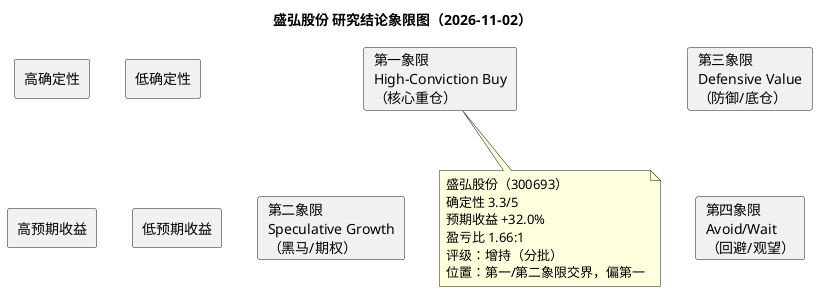

# 研报章节八：投资摘要与风险因素

> **研究日期：2026年11月2日**
> **现价：不复权30.63元（2026年11月2日收盘），市值95.81亿元，PE-TTM 16.94x、PB 4.18x。**
> **目标年份：2027E。三态目标价：保守24.70元、中性38.41元、乐观60.29元；加权40.45元。**

---

## 一、投资摘要

### 1.1 一句话逻辑

**盛弘是一家“被板块杀估值错杀”的电力电子平台公司：2026年前三季度营收+25.0%、归母+32.3%、经营现金流+44.3%，但股价从5月高点69.60元跌至30.63元（-56%），PE-TTM 16.94x低于近5年P10（19.23x），市场把“美国FCC禁令+欧盟限制+储能价格战+原材料涨价+股东减持”的悲观预期一次性打进价格，而忽略了三块“实”的增长——AIDC电能质量、海外储能、重卡超充。**

### 1.2 核心数据

| 指标 | 2025A | 2026E | 2027E | 2027E同比 |
|:---|---:|---:|---:|---:|
| 营业收入（亿元） | 34.63 | 41.50 | 49.50 | +19.3% |
| 归母净利润（亿元） | 4.76 | 5.81 | 7.08 | +21.8% |
| EPS（元） | 1.529 | 1.858 | 2.263 | +21.8% |
| 毛利率 | 38.47% | 39.9% | 40.1% | +0.2pp |
| 净利率 | 13.70% | 14.00% | 14.31% | +0.3pp |
| ROE（加权） | 24.15% | 24.0% | 25.5% | +1.5pp |
| 经营现金流（亿元） | 7.01 | 8.0 | 9.0 | +12.5% |

### 1.3 三块“实”的增长

1. **AIDC电能质量（确定性4/5）**：2026H1工业配套电源收入4.41亿元（+57.81%）、毛利率61.94%（+3.28pp）；AIDC/半导体资本开支驱动，公司是低压电能质量第一梯队、SiC机型先发。2027E收入12.40亿元（+25.3%）。
2. **海外储能（确定性3/5）**：2026H1储能收入3.84亿元（+35.32%）、毛利率38.08%（+10.29pp）；Q3储能海外直接+间接占比70%-80%（东吴测算）。2027E收入13.40亿元（+27.6%），高于BNEF全球+11%的GW增速，依赖份额提升。
3. **重卡超充+3C出清（确定性3.5/5）**：2025年重卡及封闭场景超充收入突破5亿元、超千座站；2026年9月新能源重卡渗透率50.28%；2026年8月充电桩3C强制认证，中小厂商出清。2027E充电收入18.20亿元（+11.0%）。

### 1.4 一块“虚”的期权

**AIDC关键电源新品（中压UPS/HVDC/SST）**：2026年9月完成大型能源企业数据中心备电方案交付，但截至2026年10月27日“样品开发阶段，尚未正式销售”（E4）。我们的P50没有给它任何收入，只在估值审计中给+3%的期权价值。若2027年获大客户订单，是Bull情景的触发点。

### 1.5 估值结论

| 情景 | 概率 | 2027E归母（亿元） | EPS（元） | PE | 目标价（元） | 相对现价 |
|:---|---:|---:|---:|---:|---:|---:|
| 保守 | 25% | 5.15 | 1.647 | 15.0x | **24.70** | -19.4% |
| 中性 | 50% | 7.08 | 2.263 | 16.97x | **38.41** | +25.4% |
| 乐观 | 25% | 8.57 | 2.740 | 22.0x | **60.29** | +96.8% |
| **加权** | **100%** | — | — | — | **40.45** | **+32.0%** |

- 中性目标价38.41元，对应2027E PE 16.97x、PB 3.99x；低于近5年PE P10（19.23x）、低于同业科华（30.97x）、上能（25.72x）、科士达（22.33x）。
- 盈亏比 = (40.45-30.63)/(30.63-24.70) = **1.66:1**。
- 评级：**增持（Accumulate）**，第一/第二象限交界偏第一，分批建仓，不追高。

### 1.6 为什么现在？

- **估值底**：PE-TTM 16.94x、PB 4.18x均低于近5年P10；2027E PE仅13.54x（现价/2.263）。
- **业绩底**：2026Q3收入+18.5%、归母+16.6%，增速换挡已被市场定价；Q4备货（存货+58.5%）、合同负债+59.0%，Q4交付是第一个验证。
- **情绪底**：10月30日29.77元创52周新低、11月2日放量+2.89%，RSI从22.5修复至32.9，MACD空头动能收敛。
- **催化剂**：2026年报（2027年3-4月）、2027Q1（2027年4月）、AIDC订单（时间不确定）。

### 1.7 与市场分歧

- 市场担心：美国FCC/欧盟限制→海外储能失速；原材料涨价→毛利率崩；公共充电桩降速→充电业务负增长；股东减持→治理折价。
- 我们的不同看法：①美国直接收入仅1%-2%，马来西亚代工可规避部分关税；②Q3毛利率仅-1.4pp，提价10%-30%传导有效；③充电业务2026H1仍+18.3%，重卡超充+3C出清对冲公共桩降速；④减持已到期，回购3,000-6,000万元部分对冲。
- **我们不认同“盛弘是下一个阳光电源”**：阳光2026H1营收-29%、归母-32%，是光伏逆变器周期+美国敞口的结果；盛弘没有光伏逆变器业务，美国直接收入1%-2%，2026H1仍+29%。两者不能简单类比。

---

### 1.8 关键分歧与验证指标

| 市场担心 | 我们的看法 | 验证指标（2026年报/2027H1） |
|:---|:---|:---|
| 美国FCC/EO 14420导致海外储能失速 | 美国直接收入仅1%-2%，马来西亚代工可规避部分关税；欧洲/东南亚/日本/拉美是主市场 | 2027H1海外收入占比≥25%；美国直接收入占比≤2% |
| 原材料涨价导致毛利率崩 | 2026年7月提价10%-30%，Q3毛利率仅-1.4pp；Bear已假设毛利率38.9% | 2027H1毛利率≥39.0%；铜/银价格 |
| 公共充电桩降速导致充电业务负增长 | 2026H1充电+18.3%，重卡超充+3C出清对冲；2027E+11% | 2027H1充电收入≥8.5亿元 |
| 股东减持/治理折价 | 2026年减持计划已到期，方兴未减持；回购3,000-6,000万元；但盛剑明冻结/质押仍是折价 | 冻结进展、回购执行、减持新计划 |
| 2027年全球储能+11%，公司+27.6%不可信 | 公司基数小、海外份额低，组串式PCS有差异化；但这是P50最大不确定性 | 2027H1储能收入≥6.0亿元；海外储能订单 |

## 二、风险因素（按对股价影响的烈度排序）

### 2.1 高烈度（可能改变评级/目标价20%以上）

**风险1：美国/欧盟贸易与准入限制升级**
- 2026年7月28日FCC Covered List、8月26日EO 14420、5月欧盟资金限制；若2027年扩大到“存量产品撤销授权”或“全面禁止中国PCS进入公共项目”，盛弘海外收入（2026E占比27.7%、2027E 30.3%）将受重创，海外毛利占比40%。
- 影响：2027E归母可能降至4.5-5.0亿元，按17.5x×0.97计算中性目标价降至25-27元；极端情景（海外收入归零）归母3.8亿元、目标价14.6元。
- 概率：20%-25%（中性偏悲观）；监测：FCC/DOE细则、欧盟资金指引、公司美国/欧洲收入占比。

**风险2：全球储能2027年增速下台阶+价格战**
- BNEF预测2027年全球储能+11% GW（2026年+45%），中国2026H1新增-18%；若2027年全球新增<190GW、PCS价格再降10%，盛弘储能收入可能仅+10%-15%（vs P50 +27.6%）。
- 影响：2027E归母降至5.8-6.2亿元，中性目标价降至31-34元。
- 概率：30%；监测：BNEF/CNESA季度数据、国内2h系统中标价、公司储能毛利率。

**风险3：原材料价格二次冲击+提价不可持续**
- 2026年铜/银/PCB/存储/IGBT涨30%-800%，公司提价10%-30%；若2027年原材料再涨10%-20%、而竞争导致提价无法保留，毛利率可能从40.1%降至35.5%-38.0%。
- 影响：2027E归母降至4.5-5.2亿元，中性目标价降至24-28元；若提价保留5%营收，可对冲大部分。
- 概率：25%；监测：沪铜、白银、PCB、存储价格，公司季度毛利率。

### 2.2 中烈度（影响10%-20%）

**风险4：治理与股东行为**
- 2026年5-8月盛剑明减持282.11万股@44.54元、肖学礼清仓159.66万股@42.01元、魏晓亮/胡天舜小幅减持；盛剑明85.1%持股被冻结、78%持股被质押；2024年盛剑明曾因减持违规被深圳证监局责令改正。
- 影响：估值折价-4%（已计入审计），若冻结原因涉及司法诉讼/控制权稳定，折价可能扩大至-8%。
- 概率：已发生；监测：冻结进展、减持计划、回购执行。

**风险5：应收账款与存货**
- 2026年9月末应收账款10.36亿元（占TTM营收25.8%）、存货10.15亿元（+58.5%）；若Q4交付延迟，2027Q1去库存+坏账可能双杀。
- 影响：减值增加0.3-0.5亿元，归母-5%-7%。
- 概率：20%；监测：Q4营收、存货周转天数、信用减值损失。

**风险6：汇率**
- 2026年9M财务费用0.15亿元（汇兑损失），人民币10月即期6.6419（2022年6月以来最强）；若2027年人民币再升值5%，归母-0.40亿元（-5.6%）。
- 概率：30%；监测：USD/CNY、公司财务费用。

### 2.3 低烈度（影响<10%）

**风险7：AIDC关键电源新品失败**
- 新品尚未销售，若2027年仍无订单，+3%期权价值消失，但不影响P50（P50未计入）。
- 概率：40%；监测：订单公告、客户验证。

**风险8：充电桩公共桩降速**
- 2026年前4月公共桩增量-53.9%，2027年目标完成率88.5%；若重卡超充不及预期，充电收入可能零增长（vs P50 +11%）。
- 影响：归母-0.3亿元；概率：25%。

**风险9：股权激励目标不达**
- 2026年扣非目标5.616亿元、2027年6.739亿元；2026年9M扣非3.657亿元，Q4需1.959亿元（同比-1.5%）即可达标，概率高；2027年目标6.739亿元，我们的P50 7.08亿元高于目标5.1%，达标概率较高。
- 影响：若2027年不达，管理层激励失效，市场信心受损；概率：15%。

**风险10：市场风格/流动性**
- 市值95.8亿元、日均成交2.6-4.2亿元；若成长风格继续跑输、或指数调整导致流动性收缩，估值可能进一步下杀。
- 影响：PE折价-2%（已计入审计）；概率：30%。

---

## 三、研究结论象限图

### 3.1 象限定位

- **确定性**：3.3/5（AIDC 4/5、储能3/5、充电3.5/5、电池2.5/5、AIDC新品1/5）；高于2.5、低于4.0，属于“中等偏高”。
- **预期收益**：加权+32.0%、中性+25.4%；高于20%，属于“高预期收益”。
- **象限**：**第一/第二象限交界，偏第一（High-Conviction Buy的边缘）**，但确定性未达到“核心重仓”（≥4/5）标准。
- **建议**：增持（Accumulate），分批建仓；仓位建议3%-5%（标准配置的下沿），不建议重仓。

### 3.2 象限判断的理由

- **为什么不是第二象限（低确定性+高收益）**：盛弘的三块“实”业务有收入、有毛利率、有客户，2026H1收入+29.2%、归母+44.1%，不是“讲故事”；确定性3.3/5高于第二象限的典型（<2.5）。
- **为什么不是第一象限核心**：储能2027年+27.6%依赖份额提升、AIDC新品尚未销售、治理折价、欧美政策不确定，确定性未到4/5；不宜“核心重仓”。
- **为什么不是第三象限（高确定性+低收益）**：预期收益+32.0%，远高于第三象限的“低收益”；估值处于历史底部，不是防御资产。
- **为什么不是第四象限**：基本面向上、估值向下，赔率1.66:1，不是“回避”。

### 3.3 最终建议

| 项目 | 内容 |
|:---|:---|
| 评级 | **增持（Accumulate）** |
| 象限 | 第一/第二象限交界，偏第一（High-Conviction Buy边缘） |
| 仓位 | 3%-5%（标准配置下沿，分批） |
| 建仓 | 左侧29.8-30.6元1/3；右侧32.88元（MA20）1/3；37.52元（MA60）1/3 |
| 止损 | 收盘跌破29.40元减半，跌破24.70元清仓 |
| 目标 | 38.41元（中性）减半，60.29元（乐观）清仓 |
| 持有期 | 6-12个月（2026年报/2027H1为验证窗口） |
| 关键验证 | 2026年报（2027年3-4月）：Q4营收≥13.5亿元、归母≥5.5亿元；2027H1：海外收入占比≥25%、毛利率≥39% |

---

## 四、结论

盛弘股份是一家“基本面在改善、估值在底部、趋势在下跌”的公司。2026年前三季度的收入+25%、归母+32%、现金流+44%，证明其“AIDC电能质量+海外储能+重卡超充”的三块业务是真实的；但股价从69.60元跌至30.63元，PE-TTM 16.94x低于近5年P10，市场把“美国FCC禁令+欧盟限制+储能价格战+原材料涨价+股东减持”的悲观预期一次性定价。

我们的P50（2027E归母7.08亿元、EPS 2.263元）只计入“三实”，没有给“一虚”（AIDC关键电源新品）任何收入；中性目标价38.41元、加权40.45元，对应2027E PE 17.0x/17.9x，低于历史中枢与同业；保守价24.70元（-19.4%），盈亏比1.66:1。

**这是一个“赔率优于胜率”的机会：适合3%-5%仓位分批建仓，不适合重仓押注。** 如果2026年报/2027H1验证Q4交付、海外收入占比、毛利率，评级可上调至“买入”；如果全球储能失速、欧美限制落地、原材料二次冲击，评级下调至“持有/观望”。

**一句话总结**：**“三实一虚，估值见底；左侧分批，右侧确认；赔率1.66，仓位3-5%。”**

---

## 五、数据来源与核验状态

| 类别 | 来源 | 核验状态 |
|:---|:---|:---|
| 2026年三季报 | 巨潮资讯，公告编号2026-053（2026-10-23） | 已核验（PDF原文） |
| 2026年半年报 | 巨潮资讯（2026-08-11） | 已核验（PDF原文） |
| 2025年年报 | 巨潮资讯（2026-04-10） | 已核验（PDF原文） |
| 2026-10-26/27投资者关系记录 | 巨潮资讯，编号2026-019/2026-020 | 已核验（PDF原文） |
| 2026年限制性股票激励计划 | 巨潮资讯（2026-04-02） | 已核验（考核目标5.616/6.739/8.087亿元） |
| 减持计划期限届满公告 | 巨潮资讯，公告编号2026-051（2026-08-28） | 已核验（盛剑明282.11万股@44.54元、肖学礼159.66万股@42.01元） |
| 回购方案 | 巨潮资讯（2026-10-30） | 已核验（3,000-6,000万元、上限52.19元/股） |
| 行情/估值/财务 | QuantPyLab `v_daily_valuation`、`fin_income_statement`、`fin_balance_sheet`、`fin_cashflow_statement`、`fin_indicator`、`fin_ttm` | 已实测（2026-11-02） |
| 全球储能2027预测 | BNEF《Energy Storage Market Outlook》2026H2（2026-10-22） | 已核验（官网摘要） |
| 中国充电设施 | 国家能源局2026-10-22发布（2026年9月数据） | 已核验（官网） |
| 新能源重卡 | 第一商用车网/交强险（2026-10-19） | 已核验（媒体引述，非交易所公告） |
| 美国FCC Covered List | FCC官网（2026-07-28） | 已核验（媒体与券商引述） |
| EO 14420 | 白宫原文（2026-08-26） | 已核验（媒体与券商引述） |
| 欧盟资金限制 | 2026年5月媒体引述欧盟官员表态 | **未经欧盟官方文件核验**，仅作风险线索 |
| 格物致胜电能质量市场 | 券商引用《2025年中国电能质量行业市场白皮书》 | **未获白皮书原文核验**，按第三方预测采信 |
| 东吴/国信/卖方一致预期 | 东吴2026-10-26、国信2026-10-25、同花顺iFinD（2026-11-01） | 已核验（公开研报/数据终端），仅作交叉对照，不用于倒推 |
| 盛剑明质押/冻结 | 2026年三季报股东表（质押861万股、冻结940.05万股） | 已核验（定期报告） |
