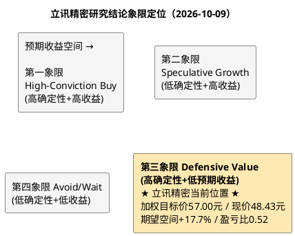

# 研报章节八：投资摘要与风险因素

**研究日期**：2026年10月09日
**研究标的**：立讯精密（002475.SZ）
**现价**：48.43 元（不复权，2026-10-08收盘，视图实测；09-30收盘49.43元）；总市值 3,749.71 亿元（09-30为3,827.13亿）；总股本 77.43 亿股（视图实测7742531980，A+H）

---

## 1. 投资摘要 (Investment Summary)

**核心定位**：全球精密制造平台龙头，正处于从"果链单极"向"消费电子+AI算力+汽车电子"三轮驱动切换的关键验证期；2026年7月完成H股上市后，公司同时握有境内制造纵深与境外资本弹药。09-16临时股东会决议高票通过拟注册250亿债券及章程修订，融资弹性进一步提升。

### 1.1 投资逻辑（三条主线）

1. **AI 算力第二曲线已成规模现实但增速降档临近**：通讯及数据中心板块2026H1收入166.09亿元（+49.66%），电连接/CPC/液冷/电源全栈卡位英伟达生态，GB200单机柜整套方案约209万元（2024年4月纪要口径）；2026年四大云厂capex指引约7,300亿美元（+77%），2027年增速预计自93%回落至约61%（Morgan Stanley 2026年8月最新，BofA近1.08万亿，合计1.2-1.4万亿区间）。确定性评分4/5。但必须同步记录其脆弱性：LightCounting实证光模块行业double ordering泛滥、"从未善终"，且销售领先capex拐点约6个月转负；InP短缺至2026年底限速供给，2027年降档为基准情景。
2. **汽车电子完成规模跃迁**：Leoni并表后板块年收入近667亿元（2026E），跻身全球线束前三量级，管理层口径整合超预期（NPB提前至少一年），毛利率14.5%且修复通道明确。确定性评分3.5/5；
3. **消费电子基本盘量价裂口加深但底盘仍稳固，折叠新品类已兑现（09-09）但首年放量受限**：iPhone组装份额~27%（全球第二）、**折叠屏iPhone Duo已于09-09发布（$1,999/¥15,999，10月23日首批70余国发售，7.6英寸内屏/钛铰链/A20 Pro）**是最大新品催化（2026Q4脉冲、2027年规模验证），但存储危机（RAMageddon）已升级为史上最差一轮——IDC 10月初将2026年全球手机出货从-13.9%进一步下修至**-16.7%至约10亿部**（ASP+27.6%至581美元，低端机型面临淘汰），TrendForce 9-30确认Q4常规DRAM+10-15%/NAND+15-20%续涨（Q3为13-18%/18-23%），郭明錤披露Apple因DRAM短缺削减2026出货计划，BOM涨价压价传导加深。2026H1扣非净利仅+6.47%、Q2转负（-0.13%），盈利质量承压未缓解。

### 1.2 核心矛盾与定价结论

收入表观+40.16%与扣非+6.47%的剪刀差，本质是"并表跳变+涨价抢备货+AI双订"三类不可线性外推成分对真实增长的中和。财务质量三项同向警示（扣非占比76%、OCF-TTM自2025Q3高点三期连降至165亿、ROIC五连降至10.93%）+中报口径有息负债1,371亿元 vs 货币资金718亿元+汇兑年化损失10-20亿元量级，构成估值中枢下移的结构性依据——市场给予PE-TTM 21.07x（十年约18%分位，较09-10的23.67x/20.9%分位再下移）、PB 4.01x（约4%分位，较09-10的4.50x/5.8%分位贴轨加深）的定价，是质量重定价的延续而非情绪错杀；10-08回调后中性收益率+17.7%（09-30 +15.3% vs 09-10 +4.7%）、盈亏比0.52（09-30 0.45 vs 09-10 0.11）赔率被动修复但仍未达1.0重仓线。

**砍单弹性的推导披露**（回应量化锚点可追溯性）：若Apple砍单3%，直接影响组装与零组件收入约95-115亿元；考虑代工模式的经营杠杆——固定成本（折旧约90亿/年+人工刚性）不随收入同比例下降，边际收入的利润率损失约为平均净利率的2倍——归母净利润冲击约8-11亿元，占中性预测196亿的**4%-6%**；若叠加稼动率下滑引发的存货跌价计提（历史经验：砍单年份减值放大50%+），总冲击可达归母的**7%-9%**。研报风险表中"-8~-9%"即取此上限口径，非简单线性外推。

### 1.3 盈利预测与目标价（维持）

| 情景 | 2026E归母净利 | EPS | 情景市值 | **目标价** | 概率 |
| :--- | ---: | ---: | ---: | ---: | :---: |
| 保守 | 145亿 | 1.87元 | 2,460亿 | **31.80 元** | 15% |
| 中性（审计修正后） | 196亿 | 2.53元 | 4,270亿 | **55.20 元** | 60% |
| 乐观 | 228亿 | 2.95元 | 5,920亿 | **76.50 元** | 25% |

- **概率加权目标价：57.00 元**，较现价48.43元+17.7%（09-30为+15.3%，09-10为+4.7%）
- **盈亏比 = (57.00−48.43)/(48.43−31.80) ≈ 0.52**（09-30为0.45，09-10为0.11）——回调后赔率显著改善但仍未达1.0重仓线
- 极端压力锚点（黑天鹅"链主双重背弃"情景）：19-20元（维持）

**维持说明**：09-10至10-09未获新增定期报告/业绩预告/重大合同/中标公示（A/B/C未命中新公告，D/E/F未命中中标；Faiot 1.2亿收购9-04交割已纳入章节一，但金额小不改模型），全域扫描与第零步A/B/C+非公告渠道D/E/F未触发盈利模型调整。本次仅为价格坐标时间戳同步与赔率重算，盈利预测与目标价维持。

### 1.4 一句话结论

立讯精密是A股稀缺的"确定性平台+期权组合"：引擎评分高、赛道方向正确、AH双平台弹药充足，**Duo发布兑现折叠期权但高价与eSIM制约首年放量、Q4存储续涨加深供需裂口**，当前48.43元（10-08）的价格较中性合理锚55.20元折价12.3%（09-10时仅折价1.4%），**盈亏比0.52较09-10的0.11显著修复但仍未达1.0重仓阈值**；**纪律性动作由"等待48元以下"转为"46-48元分批试探、放量收复53.23元（MA20）右侧加仓"，止损锚46.28元（年内低点）**，三季报（10月下旬，Q3扣非54.0-65.6亿中值59.8亿）与10-16 Duo预购为下一方向决定变量。

---

## 2. 风险因素（按烈度优先级排序）

| 烈度 | 风险因子 | 具体内容与量化锚点（截至10-09） |
| :---: | :--- | :--- |
| 🔴 高 | **第一大客户集中** | Apple占营收56.68%（1,883.81亿）；砍单3%经经营杠杆放大后≈归母净利-7~-9%（推导见1.2节）；任何份额调整均无法内部对冲；折叠屏iPhone首年良率60%风险传闻（Jiemian/富士康信源线索，待官方核验不入模型）提示新品类爬坡不确定性 |
| 🔴 高 | **AI资本开支周期逆转** | 光模块销售历史上领先capex拐点约6个月转负；五大厂外部融资占capex升至32%；LightCounting明示double ordering"从未善终"；2027年行业增速自93%降至61%（Morgan Stanley最新）为基准情景降档已定价，非尾部情景 |
| 🔴 高 | **盈利质量趋势恶化** | 扣非占比93%→76%（四年）；OCF-TTM自276亿高点降至165亿；若2026年报OCF/净利<0.5，触发逻辑降级；存储Q4续涨（DRAM+10-15%/NAND+15-20%）将加剧存货与毛利率压力 |
| 🟠 中高 | **汇率与利率挤压** | 2026H1汇兑损失19.86亿元；中报口径有息负债1,371亿 vs 货币资金718亿（H股募资223亿部分回补后仍偏紧）；人民币已升至6.70（离岸6.69-6.70/中间价6.7330，UOB/Rabobank 12个月6.65），年内再升值空间有限但汇兑回冲弹性>贬值风险；利率每上行100bp年利息+5-7亿 |
| 🟠 中高 | **存储涨价传导压价** | iPhone BoM大涨倒逼Apple供应链降本谈判（TrendForce估算新机BOM同比+38%；9-30续报Q4 DRAM+10-15%）；组装环节首当其冲，毛利率保护依赖自动化对冲；IDC -16.7%全球手机萎缩加剧Apple压价动机 |
| 🟡 中 | **光模块竞争地位薄弱** | 未进LightCounting TOP10；公司自认新进入者短期挑战大；800G价格战2026年加剧且InP短缺缓解后竞争加剧，但公司CPC/电连接地位稳固可部分对冲 |
| 🟡 中 | **印度产能分流与仲裁悬置** | 2026年印度产26%全球iPhone（富士康/塔塔主导）；立讯印度资产包深陷SIAC仲裁（来源：闻泰科技公告，涉案约19.77亿卢比，最终庭审排期2027年9月当周）；09-16股东会后印度产能布局未有新增披露 |
| 🟡 中 | **Leoni整合不确定性** | 德国卡特尔局反垄断调查未结；欧洲宏观逆风；管理层改善口径缺单体审计数据验证；9-04 Faiot收购（1.2亿）丰富汽车/通讯版图但整合变量增加 |
| 🟡 中 | **H股解禁与AH价差** | 控股股东所持H股限售至2027-01-08/2027-07-08分阶段届满；09-16股东会修订关联交易办法与发行250亿债券授权（融资弹性提升），但若H股相对A股深度折价仍比价压制A股估值上限 |
| ⚪ 低 | 可转债博弈 | 存续立讯转债34.92亿元，转股价55.67元显著高于现价48.43元（价差7.24元，09-10时价差1.22元），促转股压力短期解除但转股价上方抛压预期后移 |
| ⚪ 低 | 折旧与减值刚性 | 固定资产659亿+在建工程53亿，折旧压制毛利率0.2-0.3pct/年；2025年资产减值15.45亿（占利润总额7.9%）已是预警信号；Q4存储续涨将放大存货跌价风险 |
| ⚪ 低 | 商誉 | 商誉22.39亿元仅占净资产2.5%，风险可控 |
| ⚪ 低 | 苹果管理层更迭 | 已于2026年9月1日落地：Tim Cook改任执行董事长、John Ternus接任CEO并主持09-09 Duo发布会，短期扰动窗口关闭，政策连续性待观察；09-16股东会进一步巩固治理框架 |

## 3. 研究结论象限图

**象限判定：第三象限 Defensive Value（防御/底仓），赔率修复靠近边界**

判定理由：确定性维度得分高（利润引擎93%来自评分≥4的驱动力，ROE连续四年21%，客户关系与竞争地位稳固，AH双平台融资通道打开，Duo兑现折叠期权；09-16债券授权进一步巩固融资确定性）；但预期收益维度由09-10的+4.7%修复至+17.7%，盈亏比0.52仍显著低于可操作阈值1.0（需现价≤44.4元方越线）。该象限的标准动作由"以底仓思维持有、不追高"转为**"分批试探（46-48元，止损46.28元）+ 右侧确认（放量收复53.23元 MA20）"**，等待三季报（10月下旬，关注Q3扣非54.0-65.6亿兑现、OCF是否转正、汇兑收敛、通讯毛利率）与10-16 Duo预购作为升级催化。

---

*本章数据来源：《研报章节一至七》全部实测与调研结论汇总（更新至2026-10-09，含09-16临时股东会决议高票通过250亿债券注册及章程修订、09-04 Faiot收购交割、IDC 10月初-16.7%/TrendForce Q4存储续涨、鸿海Q2及7月放量、LightCounting 09-30续验）；H股发行信息来自公司公告2026-074/2026-075（巨潮资讯），Q3业绩预告2026-090（132.46-143.98亿），视图实测 workspace/scripts/luxshare_20261009_views.py + luxshare_20261009_tech.py（10-08收盘48.43元 PE 21.07x/PB 4.01x/RSI 32.1/MACD死叉，09-30收盘49.43元 PE 21.50x/PB 4.09x）。*
