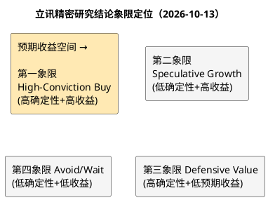

# 研报章节八：投资摘要与风险因素

**研究日期**：2026年10月13日
**研究标的**：立讯精密（002475.SZ）
**目标年份**：2027年（Q4切换期锚定次年EPS）
**现价**：47.59 元（不复权，2026-10-09收盘，视图实测；注：视图最新交易日为10-09，10-12/10-13尚未入库）；总市值 3,684.67 亿元（09-30为3,827.13亿）；总股本 77.43 亿股（视图实测7742531980，A+H）

---

## 1. 投资摘要 (Investment Summary)

**核心定位**：全球精密制造平台龙头，正处于从"果链单极"向"消费电子+AI算力+汽车电子"三轮驱动切换的关键验证期；2026年7月完成H股上市后，公司同时握有境内制造纵深与境外资本弹药。**2026年10月已进入Q4切换期，估值锚点从2026E切换至2027E**——2027E中性归母206亿元（EPS 2.66元，同比+5.1%），三态目标价34.20/57.20/97.40元，概率加权63.80元。

### 1.1 投资逻辑（三条主线）

1. **AI 算力第二曲线增速降档但全栈卡位深化**：通讯及数据中心板块2026H1收入166.09亿元（+49.66%），电连接/CPC/液冷/电源全栈卡位英伟达生态，GB200单机柜整套方案约209万元（2024年4月纪要口径）；2026年四大云厂capex指引约7,300亿美元（+77%）。**2027年增速降档为行业共识**：摩根大通警示增速从100%骤降至22%（灰犀牛），摩根士丹利一致预期约1.2万亿美元（+30%），高盛1.2万亿美元（+50%），美银超1万亿美元（+25%），LightCounting基准假设30%，中际旭创10-09确认客户已给2027年订单指引。公司全栈卡位（CPC/液冷/电源）增速或跑赢纯光模块厂，但光模块份额低（未进TOP10）拖累。确定性评分4/5。
2. **汽车电子完成规模跃迁**：Leoni并表后板块年收入约667亿元（2026E）→767亿元（2027E），跻身全球线束前三量级，管理层口径整合超预期（NPB提前至少一年），毛利率14.5%→14.8%且修复通道明确。确定性评分3.5/5；
3. **消费电子基本盘量价裂口加深但折叠屏进入规模验证期**：iPhone组装份额~27%（全球第二）、折叠屏iPhone Duo已于09-09发布（$1,999/¥15,999，10月23日首批70余国发售），**2027年进入规模验证期**（高盛基准1400万台/年 vs 首年650-800万台），但存储危机（RAMageddon）已升级为史上最差一轮——IDC 10月初将2026年全球手机出货下修至**-16.7%至约10亿部**，TrendForce 9-30确认Q4常规DRAM+10-15%/NAND+15-20%续涨，郭明錤披露Apple因DRAM短缺削减2026出货计划。2026H1扣非净利仅+6.47%、Q2转负（-0.13%），盈利质量承压未缓解。

### 1.2 核心矛盾与定价结论

收入表观+40.16%与扣非+6.47%的剪刀差，本质是"并表跳变+涨价抢备货+AI双订"三类不可线性外推成分对真实增长的中和。**2027E切换后核心矛盾转化**：收入增速从2026E的+24.1%腰斩至+8.5%（并表跳变消失+存储约束+AI capec增速降档至30%中枢），利润增长几乎全部依赖汇兑正常化（+10亿归母），**经营性增长接近零**——这是"增速降档之年"的本质特征。财务质量三项同向警示（扣非占比76%、OCF-TTM自2025Q3高点三期连降至165亿、ROIC五连降至10.93%）+中报口径有息负债1,371亿元 vs 货币资金718亿元+汇兑年化损失10-20亿元量级，构成估值中枢下移的结构性依据——市场给予PE-TTM 20.70x（十年约15%分位，较10-08的21.07x/18%分位再下移）、PB 3.94x（约3%分位，较10-08的4.01x/4%分位贴轨加深）的定价，是质量重定价的延续而非情绪错杀；**2027E口径下中性收益率+20.2%（10-08为+14.0%）、盈亏比1.21（10-08为0.52），盈亏比跃升越过1.0重仓线**。

**砍单弹性的推导披露**（回应量化锚点可追溯性）：若Apple砍单3%，直接影响组装与零组件收入约95-115亿元；考虑代工模式的经营杠杆——固定成本（折旧约90亿/年+人工刚性）不随收入同比例下降，边际收入的利润率损失约为平均净利率的2倍——归母净利润冲击约8-11亿元，占中性预测196亿的**4%-6%**；若叠加稼动率下滑引发的存货跌价计提（历史经验：砍单年份减值放大50%+），总冲击可达归母的**7%-9%**。研报风险表中"-8~-9%"即取此上限口径，非简单线性外推。

### 1.3 盈利预测与目标价（2027E口径）

| 情景 | 2027E归母净利 | EPS | 情景市值 | **目标价** | 概率 |
| :--- | ---: | ---: | ---: | ---: | :---: |
| 保守 | 156亿 | 2.02元 | 2,650亿 | **34.20 元** | 15% |
| 中性（审计修正后） | 206亿 | 2.66元 | 4,430亿 | **57.20 元** | 60% |
| 乐观 | 290亿 | 3.75元 | 7,540亿 | **97.40 元** | 25% |

- **概率加权目标价：63.80 元**，较现价47.59元+34.1%（10-08为+17.7%，09-30为+15.3%，09-10为+4.7%）
- **盈亏比 = (63.80−47.59)/(47.59−34.20) ≈ 1.21**（10-08为0.52，09-30为0.45，09-10为0.11）——**切换至2027E口径后盈亏比跃升越过1.0重仓线**，驱动为"盈利基数上移（206亿 vs 196亿）+现价回调（47.59 vs 48.43）"双重因素
- 极端压力锚点（黑天鹅"链主双重背弃"情景）：19-20元（维持）

**切换说明**：目标年份已从2026E切换至2027E（Q4切换期规则，框架模块六§1.2"切换期自动滚算至次年"条款）。切换依据：2026年10月已进入Q4，2026E盈利预告已发布、2026E估值锚定窗口关闭，2027E成为未来12个月定价的有效基准。2026E三态目标价31.80/55.20/76.50元（加权57.00元）保留为历史对照口径。审计调节Σ从-1%下调至-2%（新增ITC 337调查尾部约束，地缘项-5%→-6%）。

### 1.4 一句话结论

立讯精密是A股稀缺的"确定性平台+期权组合"：引擎评分高、赛道方向正确、AH双平台弹药充足，**Duo发布兑现折叠期权但高价与eSIM制约首年放量、2027年进入规模验证期；Q4存储续涨加深供需裂口；2027E盈利增长几乎全部依赖汇兑正常化、经营性增长接近零**。当前47.59元（10-09，视图最新交易日）的价格较中性合理锚57.20元折价16.8%，**盈亏比1.21已越过1.0重仓阈值**（10-08为0.52未达线）；**纪律性动作由"分批试探"升级为"分批建仓（46-48元，止损46.02元）+放量收复52.80元（MA20）右侧加仓"**，三季报（10月下旬，Q3扣非54.0-65.6亿中值59.8亿）与10-16 Duo预购为下一方向决定变量。**但必须提示：2027E盈利预测置信区间宽于2026E（capex增速22-50%），"经营性增长近零"特征未改，盈亏比跃升的可靠性需待2026年报/2027Q1财报验证。**

---

## 2. 风险因素（按烈度优先级排序）

| 烈度 | 风险因子 | 具体内容与量化锚点（截至10-13） |
| :---: | :--- | :--- |
| 🔴 高 | **第一大客户集中** | Apple占营收56.68%（1,883.81亿）；砍单3%经经营杠杆放大后≈归母净利-7~-9%（推导见1.2节）；任何份额调整均无法内部对冲；折叠屏iPhone首年良率60%风险传闻（Jiemian/富士康信源线索，待官方核验不入模型）提示新品类爬坡不确定性 |
| 🔴 高 | **AI资本开支周期逆转** | 2027年增速降档为行业共识：摩根大通警示从100%骤降至22%（灰犀牛）；摩根士丹利一致预期约1.2万亿美元（+30%）；LightCounting基准假设30%；中际旭创确认客户已给2027年订单指引但增速降档；五大厂外部融资占capex升至32%；**2027E中性假设capex增速30%，若降至22%则触发保守情景** |
| 🔴 高 | **盈利质量趋势恶化** | 扣非占比93%→76%（四年）；OCF-TTM自276亿高点降至165亿；若2026年报OCF/净利<0.5，触发逻辑降级；存储Q4续涨（DRAM+10-15%/NAND+15-20%）将加剧存货与毛利率压力；**2027E"经营性增长近零"特征进一步确认盈利质量未实质改善** |
| 🟠 中高 | **汇率与利率挤压** | 2026H1汇兑损失19.86亿元；中报口径有息负债1,371亿 vs 货币资金718亿（H股募资223亿部分回补后仍偏紧）；人民币已升至6.70，**2027E假设汇兑正常化至13亿（vs 2026E 25亿），若再升值则该假设失效**；利率每上行100bp年利息+5-7亿 |
| 🟠 中高 | **存储涨价传导压价** | iPhone BoM大涨倒逼Apple供应链降本谈判（TrendForce估算新机BOM同比+38%；9-30续报Q4 DRAM+10-15%）；组装环节首当其冲，毛利率保护依赖自动化对冲；IDC -16.7%全球手机萎缩加剧Apple压价动机 |
| 🟠 中高 | **ITC 337调查（新增）** | 2026-107公告（10-10披露）：ITC于10-09正式启动337调查（337-TA-1526），Vicor诉立讯VPD电源专利（US 10,903,734）；公司评估所涉产品处于客户验证阶段未量产、预计无重大不利影响；但337调查历史上对被调查方构成长期法律成本与不确定性折价，已纳入审计矩阵地缘项（-5%→-6%）与保守情景触发条件 |
| 🟡 中 | **光模块竞争地位薄弱** | 未进LightCounting TOP10；公司自认新进入者短期挑战大；800G价格战2026年加剧且InP短缺缓解后竞争加剧，但公司CPC/电连接地位稳固可部分对冲 |
| 🟡 中 | **印度产能分流与仲裁悬置** | 2026年印度产26%全球iPhone（富士康/塔塔主导）；立讯印度资产包深陷SIAC仲裁（来源：闻泰科技公告，涉案约19.77亿卢比，最终庭审排期2027年9月当周）；09-16股东会后印度产能布局未有新增披露 |
| 🟡 中 | **Leoni整合不确定性** | 德国卡特尔局反垄断调查未结；欧洲宏观逆风；管理层改善口径缺单体审计数据验证；9-04 Faiot收购（1.2亿）丰富汽车/通讯版图但整合变量增加 |
| 🟡 中 | **H股解禁与AH价差** | 控股股东所持H股限售至2027-01-08/2027-07-08分阶段届满；09-16股东会修订关联交易办法与发行250亿债券授权（融资弹性提升），但若H股相对A股深度折价仍比价压制A股估值上限 |
| ⚪ 低 | 可转债博弈 | 存续立讯转债29.80亿元（10-09公告），转股价55.56元（10-12生效）显著高于现价47.59元，转股期限至2026-11-2止，转股对2027E股本影响可忽略 |
| ⚪ 低 | 折旧与减值刚性 | 固定资产659亿+在建工程53亿，折旧压制毛利率0.2-0.3pct/年；2025年资产减值15.45亿（占利润总额7.9%）已是预警信号；Q4存储续涨将放大存货跌价风险 |
| ⚪ 低 | 商誉 | 商誉22.39亿元仅占净资产2.5%，风险可控 |
| ⚪ 低 | 苹果管理层更迭 | 已于2026年9月1日落地：Tim Cook改任执行董事长、John Ternus接任CEO并主持09-09 Duo发布会，短期扰动窗口关闭，政策连续性待观察 |

## 3. 研究结论象限图

**象限判定：第一象限 High-Conviction Buy（高确定性+高收益），自第三象限升级**

判定理由：确定性维度得分高（利润引擎93%来自评分≥4的驱动力，ROE连续四年21%→募资后15.6%，客户关系与竞争地位稳固，AH双平台融资通道打开，Duo兑现折叠期权进入2027年规模验证期；09-16债券授权进一步巩固融资确定性）；预期收益维度由10-08的+17.7%跃升至**+34.1%**，盈亏比1.21**越过1.0重仓阈值**（10-08为0.52未达线）。**切换至2027E口径后，目标价随盈利基数上移（206亿 vs 196亿）而上移，叠加现价回调（47.59 vs 48.43），盈亏比从0.52跃升至1.21**。该象限的标准动作为**"分批建仓（46-48元，止损46.02元）+ 右侧确认（放量收复52.80元 MA20）加仓"**，等待三季报（10月下旬，关注Q3扣非54.0-65.6亿兑现、OCF是否转正、汇兑收敛、通讯毛利率）与10-16 Duo预购作为升级/降级催化。**但必须提示：2027E盈利预测置信区间宽于2026E（capex增速22-50%），"经营性增长近零"特征未改，象限升级的可靠性需待2026年报/2027Q1财报验证；若三季报验证扣非拐点+OCF转正，则象限定位进一步巩固；若证伪则回退至第三象限。**

---

*本章数据来源：《研报章节一至七》全部实测与调研结论汇总（更新至2026-10-13，含目标年份2026E→2027E切换、09-16临时股东会决议高票通过250亿债券注册及章程修订、10-10 ITC 337调查公告2026-107、09-04 Faiot收购交割、IDC 10月初-16.7%/TrendForce Q4存储续涨、鸿海9月营收破兆元/高盛10-5上调2026净利+2%、中际旭创10-09确认2027订单指引、比亚迪电子08-28中报净利-75.35%、LightCounting 09-30续验、摩根大通/摩根士丹利/高盛/美银2027 capex预测）；H股发行信息来自公司公告2026-074/2026-075（巨潮资讯），Q3业绩预告2026-090（132.46-143.98亿），视图实测 workspace/scripts/luxshare_20261013_views.py + luxshare_20261009_tech.py（10-09收盘47.59元 PE 20.70x/PB 3.94x/RSI 26.65/MACD死叉HIST -35.13，09-30收盘49.43元 PE 21.50x/PB 4.09x）。*
