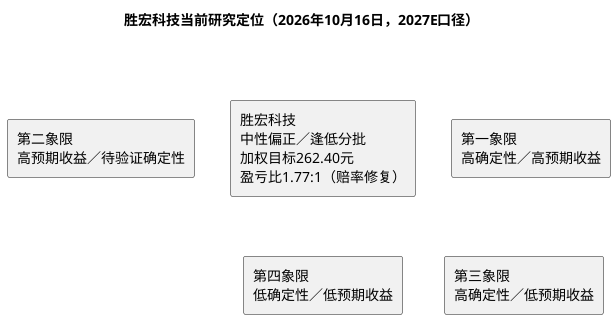

# 研报章节八：投资摘要与风险因素

**研究日期**：2026年10月16日

**分析目标年份**：2027年（Q4切换期锚定，估值口径见章节六）

---

## 一、投资摘要

### 1.1 核心投资逻辑（2027E口径）

胜宏科技的可验证基础是：2025年营收192.92亿元、归母43.12亿元、毛利率35.22%；**2026H1营收116.29亿元（+28.77%）、归母28.57亿元（+33.30%）、扣非24.18亿元（+12.50%）、毛利率33.22%（Q2 32.10%）、Q2扣非-5.28%、OCF 29.11亿元（+144.61%，但Q2仅7.95亿环比-62.5%）**，在建52.23亿（转固16.40亿，越南32.52%/泰国87.53%）、存货58.90亿（+86%）、财务费用2.97亿（+694%，汇兑主因）。公司披露"订单至2027+新拓50+家（半数AI）+14阶36层攻克+100层+能力+mSAP用于1.6T光模块+2030年千亿产值目标"，但客户、平台、单板价值量、良率与新增产能收入仍未拆分披露。**2026H1验证显示"量增"已兑现但"利增"质量分化，2026Q3受Rubin节奏扰动弱于预期（公司未披露Q3预告）**。

**三句话浓缩（2027E口径）**：
1. **量**：2027E中性营收480亿（保守380／乐观600），较2026E保守270亿增长约78%，驱动力为厂房十/十一产能释放、泰国A1二期批量、越南一期投产与VR200全年放量；订单能见度至2027提供基础，但"订单→有效产出"的转化须以季度数据验证。
2. **价与利润率**：2027E中性毛利率33.0%（较2026H1 33.22%小幅回落0.22pp、较Q2 32.10%企稳），归母净利率22.9%（与2025年22.35%持平）；关键变量是CCL/电子布/铜价成本传导、人员+30%的摊薄与新增折旧的覆盖。
3. **估值**：10月15日不复权价格186.00元（较09-23的244.30元**-23.9%**；视图实测PE(TTM) 36.37x已回落至P50附近、PB 4.82x）。以78／110／155亿元三态净利和18／24／30倍2027E PE复算，中性249.82元（+34.3% vs现价）、加权262.40元（+41.1%）、盈亏比**1.77:1（正向）**；这是前瞻模型，不是公司承诺。

### 1.2 三态估值快照（2027E口径）

| | 2027E EPS | 目标 PE | 目标价（不复权） | 较现价（186.00）空间 |
|:---|:---|:---|:---|:---|
| **保守** | 7.94 元 | 18x | 142.86 元 | **-23.2%** |
| **中性** | 11.19 元 | 24x | 249.82 元 | **+34.3%** |
| **乐观** | 15.77 元 | 30x | 473.15 元 | **+154.4%** |
| **当前价** | — | — | **186.00 元** | — |
| **加权目标** | — | — | **262.40 元** | **+41.1%** |

> 概率30/50/20。2027E中性110亿要求厂房十/十一产能释放+VR200放量+毛利率企稳三重共振；现价186.00元已低于中性及加权目标，盈亏比由09-24的负向修复至**1.77:1**。

### 1.3 投资评级（中性偏正）

基于"现价经-23.9%回撤后估值中枢修复（PE回落至P50、PB跌破P25上方）、目标年份切换至2027E、盈亏比由负转正（1.77:1）、2027年为产能释放与VR200放量兑现大年"的定位，给予**"中性偏正／逢低分批，等待Q3兑现验证"**评级。加权目标+41.1%、盈亏比1.77:1，**赔率已由负转正**；但Q3尚未证实拐点（毛利率是否企稳、扣非是否转正、Rubin节奏），**新增资金可在180-195元区间逢低分批，并以142.86元（-23.2%）为风控线**。

### 1.4 证据使用边界

本报告将财报、招股书、公司公告和可追溯调研记录作为公司事实依据；券商研报、行业预测与供应链信息可以作为前瞻模型输入，但须注明来源、日期、概率与验证条件。**2026H1已提供核心证据：营收116.29亿、归母28.57亿、扣非24.18亿、Q2扣非-5.28%、毛利率33.22%/Q2 32.10%、财务费用2.97亿、在建52.23亿/转固16.40亿/越南32.52%/泰国87.53%**，上述为公司事实；未披露客户名称、订单金额、产品ASP、良率或收入拆分时，不将该类线索表述为公司已确认事实（如"Rubin 50-55%份额""正交背板70%订单"均为产业链/自媒体线索，未经公司确认）。

---

## 二、风险因素（按烈度排序）

### 🔴 高风险（可能触发 -20% 以上跌幅）

**1. AI算力需求周期性回落与"定价逻辑切换"共振（外部）+ 毛利率持续承压（内部）**

华泰证券10-15研报指出，全球AI资产关注点已从"需求确定性"向"回报弹性"切换，短期全球利率上行是AI资产分母端核心约束；Gartner警示2030年AI基础设施投资或面临3.5万亿美元减损风险。若2027年CSP capex增速从90%收敛至50%后进一步放缓，或主要客户调整采购，公司2027E中性480亿营收的极高要求将落空；叠加CCL/电子布（10月或再涨）+铜价高位传导滞后，毛利率或进一步下探。

- 冲击路径：H1已现毛利率-3pp+扣非转负，若Q3仍低于33%，2027E中性毛利率33.0%假设证伪→净利率下行→110亿难以达成→估值中枢下移至保守
- 量化方式：以Q3毛利率、扣非增速、存货58.90亿消化率为检验

**2. 美国关税37.5%+11-09豁免崖+原产地规则**

37.5%（25% legacy +12.5% forced-labor）已于07-24生效，2/4层板豁免（9903.88.69）延至11-09，逾期回退；实质性改变检验决定泰国/越南能否合规避税，胜宏泰国验证板 vs 沪电满载的兑现差使风险不对称。

- 冲击路径：11-10后若豁免未续，小板成本跳升25pp；若泰国未能被认定为实质性改变，海外产能对冲失效
- 量化方式：按HTS、原产地、豁免及公司海外批量交付核验

**3. 大客户订单、Rubin节奏与汇率三重杠杆**

若最大客户或前五大客户削减采购、Rubin出货节奏持续扰动（09-15说明会多个投资者问询Rubin确收/延期，公司以"商业政策限制"未答）、或人民币进一步升至6.7以下且30亿套保未覆盖，集中度51.0%/29.7%（招股书口径）将放大波动。H1财务费用+694%（2.97亿）已兑现汇率杠杆，人民币中间价10-15报6.7253延续升值。

- 冲击路径：客户集中度+Rubin节奏+汇兑损益同步恶化，Q3-Q4扣非或再承压
- 量化方式：以客户集中度、应收、汇兑损益、衍生品公允价值季度变化确认

### 🟡 中等风险（可能触发 -10% 至 -20% 下跌）

**4. 产能扩张与现金流错配**

H1在建52.23亿、投资-219.59亿（含理财140.25亿）、短借32.39亿（+115.9%）、长借59.92亿（+54.9%）、固投上限180亿。若转固折旧（5.56亿）与人员+30%不能被收入覆盖，2027年折旧与利息将进一步压低净利率；Q2 OCF/NP已降至0.51，现金流波动加剧。

- 冲击路径：资本开支和借款增加而产能利用率、收入和经营现金流未同步改善
- 量化方式：以转固、折旧、在建、短借、OCF/NP为检验

**5. 2027H2 新型封装与材料瓶颈**

SiC及新型封装可能改变PCB规格，但更直接的是**材料瓶颈**：电子玻纤布结构性紧缺（7628以下薄布涨幅达厚布2倍、10月或再涨）、ABF膜垄断等，H1存货+86%至58.90亿已现战略备货压力。

- 冲击路径：客户认证、产品结构及毛利率发生不利变化后才予以确认

**6. 海外产能兑现节奏落后于竞对**

沪电泰国已满载（Q2营收3.75亿/净利0.43亿）、深南泰国+南通四期爬坡，而胜宏泰国仍处验证板阶段，且公司在09-15说明会明确"优先国内产能、海外优先级下调"，海外兑现节奏落后1-2个季度。

- 冲击路径：海外订单落地不及预期，"订单能见度至2027"面临交付能力证伪

### 🟢 低风险（注意观察）

7. 实控人/高管股权与减持观察（陈涛家族控股；08-27公告系上层股东（胜华欣业/宏大投资）内部股权结构调整及一致行动协议签署，不涉及公司股份变动、非减持，H股上市后仍可能稀释）
8. 股价波动剧烈（截至10-15，15日区间183.80-252.00约±16%、逼近年内低点180.36，融资余额连续净偿还，不适合低风险偏好）

---

## 三、研究结论象限图

**定位**：胜宏科技仍位于**第二象限（高预期收益/待验证确定性），但赔率显著修复**：2027E中性预测下现价有+34.3%上行空间、加权+41.1%、盈亏比1.77:1（由09-24的负向转正），但"订单至2027+180亿固投+海外网络"的兑现确定性仍待Q3-Q4验证；保守情景下行-23.2%为实质风控线。**下一站由Q3的毛利率企稳、扣非转正、存货消化、泰国批量、Rubin节奏五变量决定象限去留**。

**与可比标的对比**：
- 沪电股份前三季预告54.50-57.00亿（+100.5%~109.7%）、Q3单季25.27-27.77亿、泰国满载，兑现质量当前领先；
- 深南电路前三季40.50-41.50亿（+74.1%~78.4%）、封装基板爆发，协同溢价；
- 广合科技前三季+100%~107%、扣非质量扎实（非经常仅约1600万），服务器PCB纯度最高；
- 胜宏Q3预告缺位（创业板非强制）、H1增速与毛利在三极中最低，**相对位次阶段性落后**，需Q3追赶。

---

## 四、核心操作建议

| 策略维度 | 建议 |
|:---|:---|
| **建仓时机** | 现价186.00低于中性249.82及加权262.40，**赔率转正**；但技术面逼近年内低点（180.36）且量价无企稳信号，可在**180-195元区间逢低分批**，右侧确认需放量收复MA10（205.92） |
| **仓位建议** | 盈亏比1.77:1，**中性偏正、分批建仓**；既有仓位以142.86元（-23.2%）为风控线 |
| **风险控制** | 放量跌破180.36（年内低点）且量能不缩时，警惕向保守价142.86回测；**基本面止损：Q3毛利率<32%或扣非再负** |
| **加仓条件** | **Q3验证**：营收环比改善、毛利率企稳回升（≥33%）、扣非转正（vs Q2 -5.28%）、OCF/NP>0.8、存货58.90亿显著消化、泰国A1二期批量+越南一期投产、汇兑收敛（30亿套保兑现） |
| **下调条件** | Q3毛利率继续走低（<32%）、扣非再负、Rubin节奏持续扰动、转固/认证延迟、汇兑损失扩大、客户集中度上升且回款走弱 |
| **模型更新条件** | Q3披露后用实际Q3数据替换H1锚，重算P×Q、2027E EPS、目标价与盈亏比；若Q3未达预期，应向保守78亿切换 |

**执行边界**：当前模型维持78/110/155亿2027E三态总额与18/24/30倍PE，概率30/50/20且现价已低于中性及加权目标，应以"**中性偏正、逢低分批**"而非"追高"执行。若Q3验证失败，应果断向保守情景（142.86）切换并下调仓位。
