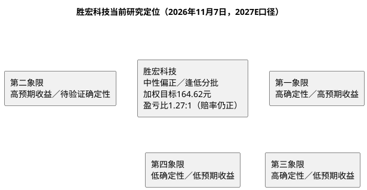

# 研报章节八：投资摘要与风险因素

**研究日期**：2026年11月7日

**分析目标年份**：2027年（Q4切换期锚定，估值口径见章节六）

---

## 一、投资摘要

### 1.1 核心投资逻辑（2027E口径）

胜宏科技的可验证基础是：2025年营收192.92亿元、归母43.12亿元、毛利率35.22%；**2026年1-9月营收184.61亿元（+30.77%）、归母33.84亿元（+4.28%）、扣非36.94亿元（+13.74%）、Q3单季营收68.31亿元（+34.30% YoY/+11.81% QoQ）、扣非12.76亿元（+16.16%/+9.99%）、毛利率34.17%（环比+2.06pp）、归母5.27亿元（-52.17%，非经常性-7.49亿元）**；在建63.07亿、固定资产128.13亿、存货92.49亿（较年初+192.49%）、1-9月OCF 35.21亿、财务费用4.76亿。公司披露“订单至2028+2027年北美大客户及ASIC客户需求略超当前产能+泰国A1满产+mSAP两栋新厂年产值约200亿”，但客户、平台、单板价值量、良率与新增产能收入仍未拆分披露。**Q3验证显示“量增价稳、扣非改善”已兑现，但营收低于卖方预期17-21%、归母被证券投资浮亏腰斩，报表利润的可读性显著下降**。

**三句话浓缩（2027E口径）**：
1. **量**：2027E中性营收450亿（保守380／乐观520），较2026E P50 276.6亿增长62.7%，驱动力为厂房十/十一、mSAP两栋、泰国A2、越南一期五处产能释放与VR200全年放量；订单能见度至2028提供基础，但Q3已证明“订单→有效产出”会受良率/料号换代/客户认证约束。
2. **价与利润率**：2027E中性毛利率35.5%（较1-9月33.57%修复1.9pp、接近2025年35.22%），归母净利率22.2%（较2026E 19.3%修复2.9pp）；关键变量是电子布/CCL/铜价成本传导、五处新产能的折旧摊薄与人员前置成本。
3. **估值**：11月6日不复权价格124.31元（较10-15的186.00元**-33.2%**、较5月高点392.95元**-68.36%**；视图实测PE(TTM) 27.45x低于P25、PB 3.19x贴近P10、市值1,221.70亿）。以65／100／126亿元三态净利和14／17／22倍2027E PE复算，中性160.87元（+29.4% vs现价）、加权164.62元（+32.4%）、盈亏比**1.27:1**；这是前瞻模型，不是公司承诺。**17x作用于本报告P50 100亿，等价于13.2x卖方共识129亿（审计后12.3x），与同业2027E 12-13x基本持平，并非倍数溢价**。

### 1.2 三态估值快照（2027E口径）

| | 2027E EPS | 目标 PE | 目标价（不复权） | 较现价（124.31）空间 |
|:---|:---|:---|:---|:---|
| **保守** | 6.61 元 | 14x | 92.59 元 | **-25.5%** |
| **中性** | 10.18 元 | 17x | 160.87 元 | **+29.4%** |
| **乐观** | 12.82 元 | 22x | 282.04 元 | **+126.9%** |
| **当前价** | — | — | **124.31 元** | — |
| **加权目标** | — | — | **164.62 元** | **+32.4%** |

> 概率30/50/20。2027E P50 100亿要求五处产能同时顺利爬坡；现价124.31元已低于中性及加权目标，盈亏比1.27:1（上期1.77:1）。

### 1.3 投资评级（中性偏正／逢低分批）

基于“现价经-33.2%回撤后PE跌破P25、PB贴近P10、2027E Forward PE仅12.21x、盈亏比1.27:1仍为正，但Q3已miss一次、2027年五处产能同时爬坡、美国中期选举后AI capex政治风险上升”的定位，维持**“中性偏正／逢低分批，等待Q4兑现验证”**评级。加权目标+32.4%、盈亏比1.27:1，**赔率仍具吸引力但较上期下降**；**首笔仓位（计划仓位1/3）可在120-128元区间左侧分批，余量待放量收复135.24（11-04高点）并站稳149.41（MA10）后加仓；既有仓位以92.59元（-25.5%）为基本面风控线、118.67元（11-04盘中低点）为技术止损参考**。

### 1.4 证据使用边界

本报告将财报、公司公告、投资者关系记录和可追溯调研记录作为公司事实依据；券商研报、行业预测与供应链信息可作为前瞻模型输入，但须注明来源、日期、概率与验证条件。**2026Q3已提供核心证据：营收68.31亿、归母5.27亿、扣非12.76亿、毛利率34.17%、非经常性-7.49亿、存货92.49亿、在建63.07亿、OCF 35.21亿、财务费用4.76亿**，上述为公司事实；未披露客户名称、订单金额、产品ASP、良率或收入拆分时，不将该类线索表述为公司已确认事实（如“Rubin 50-55%份额”“正交背板70%订单”均为产业链/自媒体线索，未经公司确认）。

---

## 二、风险因素（按烈度排序）

### 🔴 高风险（可能触发 -20% 以上跌幅）

**1. AI资本开支周期性回落与美国数据中心审批风险（外部，S变量）**

2026-11-03美国中期选举（民主党获胜）后，市场开始定价“国会及州/地方层面对数据中心的审批趋严、建设限制”风险；11-05费城半导体指数单日-12.25%（2020年3月以来最大跌幅）、英伟达-9%、AMD-17%、台积电ADR-10%。瑞银测算约30%原计划2028年新增的数据中心容量可能受影响；招商电子统计9-10月PCB板块指数回调约40%、部分高AI占比标的回撤约50%。若2027年CSP capex增速从+60%回落至0%附近，公司2027E中性450亿营收与100亿净利将落空，估值中枢下移至保守。

- 冲击路径：AI capex预期下修→PCB板块估值压缩→胜宏Forward PE从12.2x降至8-10x
- 量化方式：以北美四大云厂商Q4财报/2027 capex指引、NVIDIA FY27Q3（11-17）与2027年rack出货、美国数据中心审批进展为检验

**2. 盈利质量与治理：证券投资浮亏可抹去半数表观利润**

Q3非经常性损益-7.49亿（公允价值及处置-6.90亿、捐赠约2.08亿），使归母同比-52.17%；公司以基石投资者身份参与大族数控、华勤技术、领益智造等港股IPO（来源：21世纪经济报道10-30转述公司回应，未经公告逐笔确认），标的三季度回撤导致浮亏。**证券投资相关资产合计118.77亿（交易性金融资产85.34亿+其他权益工具投资33.43亿），占归母权益31.0%**；公司称已修订证券投资管理制度、后续执行更审慎风控，但**“制造业主业+证券投资”混业配置的治理折价难以短期消除**；若Q4金融资产继续波动，报表利润仍可能大幅偏离扣非。

- 冲击路径：证券投资亏损→归母低于预期→市场给予治理折价→PE中枢下移
- 量化方式：以Q4/年报公允价值变动、交易性金融资产余额（85.34亿）、处置损益为检验

**3. 存货激增与减值风险**

存货92.49亿（较年初+192.49%、环比H1+57%），约为单季营业成本2.06倍、可支撑6.2个月生产（去年同期2.4个月）。公司称新增存货中在产品占一半以上、库存商品占比极低，且对应确定订单；但若客户料号换代、项目延期或电子布/CCL价格回落，按5%计提即约4.6亿，相当于Q3扣非的36%。Q3资产减值损失仅0.23亿，暂未暴露压力。

- 冲击路径：存货周转天数上升→跌价准备→毛利率/净利率双杀
- 量化方式：以Q4存货余额、存货周转天数、跌价准备计提比例为检验

**4. 2027年五处产能同时爬坡的执行风险**

厂房十（2027H1满产）、厂房十一、mSAP两栋（年产值约200亿）、泰国A2、越南一期将在2027年集中释放，任何一处延期或良率不达标都会使2027E 450亿营收/100亿净利落空。Q3营收低于卖方预期17-21%已是一次预演；花旗归因于部分谷歌项目后移、英伟达新一代产品PCB爬坡不及预期、高规格ASIC有效产能不足。

- 冲击路径：产能延期→折旧与费用先行→收入后至→净利率下滑
- 量化方式：以厂房十投产/满产公告、mSAP设备到位、泰国A2/越南季度收入为检验

### 🟡 中等风险（可能触发 -10% 至 -20% 下跌）

**5. 关税与原产地规则（2027年1月节点）**

37.5%（25% legacy +12.5% forced-labor）已于2025-07-24生效；178项301排除于2026-11-06再延两个月（至2027年1月），短期断崖解除但非结构性解决。泰国A1已满产、北美客户审厂认证基本完成，是第一个实质对冲证据；但A2/越南2027年才释放，若2027年1月豁免未续期且泰国未被认定为“实质性改变”，小板成本将跳升25pp。

- 冲击路径：豁免到期→2/4层板成本+25pp→海外产能对冲失效
- 量化方式：按HTS、原产地、豁免及公司海外批量交付核验

**6. 汇率与利息双升**

1-9月财务费用4.76亿（+482.92%），短借45.87亿（较年初+205.89%）、长借70.53亿（+82.36%）。人民币中间价11-06报6.7168，进入平台期，汇率边际冲击钝化；但30亿美元套保的实际覆盖效果仍未披露，利息支出随借款上升。若人民币重启升值至6.6以下，财务费用将再次侵蚀净利率。

- 冲击路径：人民币升值+利息上升→财务费用率从2.58%维持高位
- 量化方式：以季度财务费用、衍生品公允价值、套保覆盖比例为检验

**7. 电子布/CCL/铜价成本传导反复**

11月电子布再涨1.5元/米至14.60-14.65元/米、G75电子纱2.88万元/吨；Q3毛利率环比+2.06pp证明部分传导，但1-9月毛利率仍同比-2.28pp、营业成本增速（+35.42%）高于营收（+30.77%）。若Q4提价跟不上材料涨价，毛利率修复将中断。

- 冲击路径：电子布/CCL涨价→毛利率回落至33%以下→2027E P50下修
- 量化方式：以季度毛利率、单位成本、产品ASP为检验

**8. 竞争格局恶化与份额流失**

2026Q3沪电/深南/广合归母分别+160.77%/+94.42%/+129.29%，而胜宏+4.28%；胜宏营收增速（+34.30%）为四家最低。若2027年竞对产能继续释放、价格竞争加剧，胜宏的相对份额与定价权将进一步承压。招商电子认为未来2年不会发生价格战，但2027-2028年供给趋于拥挤。

- 冲击路径：份额流失→营收增速低于行业→估值折价扩大
- 量化方式：以季度营收增速、毛利率与竞对差值、客户集中度为检验

### 🟢 低风险（注意观察）

9. 实控人/高管股权与减持观察（陈涛家族控股；08-27公告系上层股东内部股权结构调整、不涉及公司股份变动；员工持股计划10-30完成购买477.54万股、均价145.57元、锁12个月，当前浮亏约15%；贝莱德10-28将H股持股由5.93%降至4.13%；商誉11.10亿占权益2.9%，年报关注减值测试）
10. 股价波动剧烈（20日年化波动率94.4%、60日77.3%；11-06收124.31元，距11-04盘中低点118.67约+4.8%、距11-03收盘低点122.71约+1.3%；融资余额与北向资金持续波动，不适合低风险偏好）

---

## 三、研究结论象限图

**定位**：胜宏科技仍位于**第二象限（高预期收益/待验证确定性）**：2027E P50下现价有+29.4%上行空间、加权+32.4%、盈亏比1.27:1，但“订单至2028+五处产能+海外网络”的兑现确定性仍待Q4-2027H1验证；保守情景下行-25.5%为实质风控线。**下一站由Q4的毛利率（≥34.5%）、存货去化、厂房十投产、泰国A1收入贡献、2026年报2027年指引五变量决定象限去留**。

**与可比标的对比**：
- 沪电股份Q3归母26.99亿（+160.77%）、1-9月毛利率40.9%，泰国规模化，兑现质量当前领先；
- 深南电路Q3归母18.78亿（+94.42%）、PCB+载板全栈，协同溢价；
- 广合科技Q3归母5.33亿（+129.29%）、1-9月毛利率37.9%，服务器PCB纯度最高；
- 胜宏Q3营收增速最低、归母受非经常性拖累，**相对位次阶段性落后**，但订单能见度至2028、估值分位最低（PE低于P25、PB贴近P10），属于“**基本面相对弱、估值绝对低**”的组合。

---

## 四、核心操作建议

| 策略维度 | 建议 |
|:---|:---|
| **建仓时机** | 现价124.31低于中性160.87及加权164.62，赔率仍正；但技术面完全空头、11-04弱反弹失败，**首笔1/3可在120-128元左侧分批**（不追高），右侧确认需放量收复135.24（11-04高点）并站稳MA10（149.41）后再加余量 |
| **仓位建议** | 盈亏比1.27:1，**中性偏正、分批建仓**（首笔不超过计划仓位1/3）；既有仓位以92.59元（-25.5%）为基本面风控线、118.67元（11-04盘中低点）为技术止损参考 |
| **风险控制** | 放量跌破118.67（11-04盘中低点）且量能不缩时，警惕向117.53/100-110回测；**基本面风控：Q4毛利率<33% → 预警并减仓1/4，连续两季<33% → 减仓至计划仓位1/3；存货单季计提>3亿 → 下修，连续两季上升且计提>3亿 → 止损；扣非环比转负 → 观察** |
| **加仓条件** | **Q4验证**：毛利率≥34.5%、扣非环比+15%以上、存货环比去化、OCF/扣非>0.8、厂房十投产、泰国A1收入贡献披露、汇兑收敛；技术面放量收复149.41（MA10） |
| **下调条件** | Q4毛利率<33%、存货继续上升且计提增加、厂房十延期、美国数据中心审批进一步收紧、人民币升破6.6、2027年1月关税豁免未续 |
| **模型更新条件** | 2026年报披露后用Q4实际替换Q4 P50，重算2026E/2027E EPS、目标价与盈亏比；若Q4未达P50 19.7亿，2027E应向保守65-80亿切换 |

**执行边界**：当前模型维持65/100/126亿2027E三态与14/17/22倍PE，概率30/50/20；现价已低于中性及加权目标，应以“**中性偏正、逢低分批**”而非“追高”执行。若Q4验证失败（毛利率<33%或存货减值），应果断向保守情景（92.59元）切换并下调仓位。
