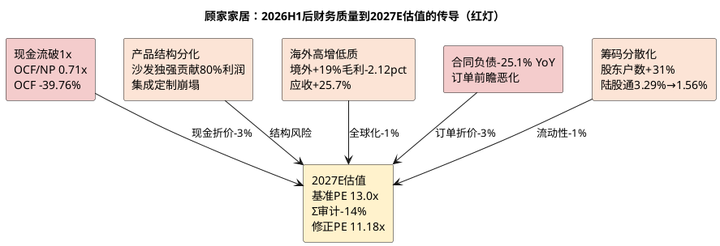

# 顾家家居：企业微观与财务基石

**研究日期**：2026年10月15日  
**标的**：顾家家居（603816.SH）  
**数据截止**：2026年10月15日（行情）；2026年06月30日（公司最新已披露财务，公告日2026-08-28）  
**目标年份**：2027年（Q4 切换期，盈利与估值锚定 2027E）

## 结论先行

| 财务判断 | 已验证事实（至2026H1） | 截至2026-10-15情报 | 对2027E估值的含义 |
|:--|:--|:--|:--|
| 盈利质量 | 2021—2025年OCF/归母净利均高于1x；2025年为1.49x | **2026H1 OCF/归母跌至0.71x**，OCF -39.76%至6.59亿，扣非-14.59% | 现金流不再无条件支撑估值下限，计入现金转化折价-3% |
| 产品结构 | 2025年沙发放量、卧室毛利率42.91% | **2026H1沙发+13.81%至64.50亿但毛利率35.16%微降0.89pct；卧室-0.13%至16.91亿、毛利率39.83%降2.98pct；集成-29.05%、定制-38.67%** | 内销结构改善证伪，沙发单腿贡献80.3%利润（2027E SOTP） |
| 全球化 | 2025年境外收入+11.46% | **2026H1境外50.67亿+19.01%占主营52.6%，但境外毛利率24.24%同比-2.12pct；境内45.61亿-12.71%毛利率42.14%反而+2.55pct** | 海外扩张稀释综合毛利至32.49%，2027E关税再上调压制境外毛利率至23.5% |
| 最新经营 | 2026Q1扣非-10.64% | **2026H1扣非-14.59%且Q2单季-18.69%、营收-0.92%；销售费用+3.81%/研发+20.35%/财务费用0.96亿同比+1.21亿汇兑扰动** | 2027E中性归母仅17.2亿（+1.3%），本质零增长年 |
| 资产负债 | 2025年末应收18.70亿+26.63% | **2026H1应收19.16亿+25.73% YoY远快于营收+0.75%；合同负债11.54亿-25.1% YoY；短期借款11.91亿+113%** | 营运资本三链共振恶化，Q3（10-28披露）为第一道硬检验 |
| 股东结构与治理 | — | **股东户数2026-06-30达20,238户（+30.96%）；陆股通持股占流通A股由3.29%降至1.56%（09-30）；第二大股东德烨嘉俊重整案已收到2家投资人报名；2026-06-29财务负责人由高林变更为刘海兰** | 筹码分散化+北向减配，新增PE折价-1% |

顾家家居仍是以沙发为核心、向卧室、整家定制、智能零部件及海外供应链延展的软体龙头。2026H1将首次覆盖时「盈利质量中上、增长待验证」的判断修正为 **「现金流与订单领先指标转弱、内销失速、海外以质换量」**；2026年10月的情报进一步把定位收紧为 **「三链恶化未修复 + 筹码结构恶化 + 治理与股东层面存在待解事项」**。核心约束从「弱需求下的费用刚性」升级为「需求、盈利、现金三链共振恶化，叠加股东结构与关税的外部约束」。

2026H1实现营收98.75亿元、归母净利9.26亿元、扣非净利7.69亿元，同比分别+0.75%、-9.31%、-14.59%；Q2单季营收48.42亿元-0.92%、扣非3.59亿元-18.69%（Q1扣非-10.64%持续扩大），盈利下滑在Q2加速。2025年利润修复（营收200.56亿+8.53%、归母17.90亿+26.37%）建立在低基数上，2026H1已证实不能线性外推。

## 业务结构与盈利质量（更新至2026H1）

| 2026H1业务（主营96.28亿） | 收入（亿元） | 毛利率 | 同比 | 在2027E模型中的定位 |
|:--|--:|--:|:--|:--|
| 沙发 | 64.50 | 35.16% | +13.81%，成本+15.40% | 唯一增长极，2027E贡献80.3%模拟净利，但毛利率-0.89pct显示无提价权 |
| 卧室产品 | 16.91 | 39.83% | -0.13%，成本+5.09% | 收入停滞且毛利率-2.98pct，2027E假设+3.2%止跌 |
| 集成产品 | 8.25 | 31.60% | -29.05%，成本-30.45% | 大幅收缩，2027E假设-4.9%（跌幅收窄） |
| 定制家具 | 3.39 | 32.82% | -38.67%，成本-38.43% | 新房链拖累，2027E假设-4.1% |
| 信息技术服务 | 2.98 | 80.23% | -20.24% | 高毛利但萎缩，2027E贡献3.26亿模拟净利 |
| 其他 | 0.25 | 6.25% | -25.15% | 忽略 |

| 2026H1区域（主营口径） | 收入（亿元） | 同比 | 毛利率 | 同比变化 |
|:--|--:|--:|--:|:--|
| 境内 | 45.61 | -12.71% | 42.14% | +2.55pct（结构提纯但量崩） |
| 境外 | 50.67 | +19.01% | 24.24% | -2.12pct（以价换量） |
| 合计主营 | 96.28 | +1.53% | 32.72% | -0.93pct |

合并营业收入98.75亿（含其他业务）与主营96.28亿的差额为合并口径其他，综合毛利率从上年同期32.89%降至32.49%（-0.40pct），Q2单季毛利率仅31.35%（去年同期33.40%）环比显著恶化，说明综合毛利改善逻辑已被推翻。

**口径校正（对2027E SOTP建模有实质影响）**：公司披露的**分产品毛利率（沙发35.16%/卧室39.83%/集成31.60%）为不含运输费的产品口径**，与合并口径（综合32.49%）之间不可直接相加。2026H1按产品口径加权毛利为35.53亿（64.50×35.16% + 16.91×39.83% + 8.25×31.60% + 3.39×32.82% + 2.98×80.23%），而按区域口径合计主营毛利仅31.50亿（境内45.61×42.14% + 境外50.67×24.24%），差额4.03亿，与半年报披露的**主营运输费4.04亿**几乎完全一致。**该校正意味着：任何按分产品毛利率直接汇总的利润预测都会系统性高估约4pp（2026H1口径），2027E SOTP必须单列运输费扣减项（8.30亿）**。

| 年度/期 | 营收（亿元） | 归母净利（亿元） | 扣非净利（亿元） | 毛利率 | ROE（加权） | ROIC | OCF/归母 |
|:--|--:|--:|--:|--:|--:|--:|--:|
| 2021 | 183.42 | 16.64 | 14.27 | 28.87% | 23.18% | 19.18% | 1.23x |
| 2022 | 180.10 | 18.12 | 15.44 | 30.83% | 21.61% | 17.91% | 1.33x |
| 2023 | 192.12 | 20.06 | 17.81 | 32.67% | 21.87% | 18.09% | 1.22x |
| 2024 | 184.80 | 14.17 | 13.01 | 32.72% | 14.72% | 12.48% | 1.89x |
| 2025 | 200.56 | 17.90 | 16.29 | 32.76% | 17.68% | 15.66% | 1.49x |
| **2026H1** | **98.75** | **9.26** | **7.69** | **32.49%** | **8.37%（半年度）** | **7.65%** | **0.71x** |
| **2027E（中性）** | **206.1** | **17.2** | 未预测 | **31.7%** | **约12.7%** | 未预测 | 假设回升至0.95x |

核心变化：ROE半年度8.37%较上年同期9.83%降1.46pct，投入资本回报率7.65%较上年同期9.00%降1.35pct，净利率从10.41%降至9.48%（-0.93pct）。五年OCF持续覆盖利润的纪录在2026H1首次中断。**2027E中性ROE约12.7%，将连续第三年下滑（2025年17.68%→2026E约14.4%→2027E约12.7%，均按期初期末归母权益均值口径），ROE下行是估值倍数由14.0x下调至13.0x的第一性依据**。

## 从「收入恢复」到「利润与现金双杀」的再审计

| 2025年修复来源 | 2026H1实际表现 | 证伪程度 | 2027E后续验证 |
|:--|:--|:--|:--|
| 沙发放量 | 收入+13.81%但成本+15.40%致毛利率-0.89pct | 量增不增利，提价假设证伪 | 2027E假设+4.4%，需沙发毛利率止跌至34.5%以上 |
| 卧室结构改善 | 收入-0.13%、毛利率-2.98pct至39.83% | 高毛利结构转负 | 2027E假设+3.2%、毛利率回升至40.0% |
| 集成收缩避损 | 收入-29.05%进一步收缩 | 被动收缩非主动优化 | 2027E假设-4.9%，跌幅收窄但不转正 |
| 低基数修复 | 2026H1扣非-14.59%且Q2加速至-18.69% | 线性外推证伪 | 2027E中性利润+1.3%，即「零增长」 |
| 海外对冲 | 境外+19.01%但毛利率-2.12pct | 收入对冲成立、利润对冲证伪 | 2027E关税25%→30%确认，境外毛利率降至23.5% |

不能再将2025年利润+26.37%解读为杠杆打开。2026H1营业成本+1.36%快于营收+0.75%，毛利润仅32.09亿 vs 去年32.24亿微降；销售费用16.90亿+3.81%（费用率17.11%→17.12%看似稳定但在收入零增长下刚性凸显）、研发2.37亿+20.35%（费用率2.01%→2.40%）、财务费用0.96亿（去年-0.25亿）汇兑扰动合计增加1.21亿，三项合计侵蚀毛利29bp以上的剩余空间。

产销端未披露标准套销量，但门店质量信号未改善：半年报未更新门店净增减，但2025年净关店25家的优化趋势未逆转，且境内收入-12.71%暗示单店产出仍承压。**渠道层面的新证据（2026年10月）**：顾家星选北京首家大型独立旗舰店于2026年5月亮相（万隆汇洋，丰台），按规划后续还将落地三家旗舰店覆盖北京东南西北核心区域（来源：新京报2026-10-15）——这是渠道从「数量扩张」转向「大店体验+社区小店」双轨的实体信号，但尚未体现为收入。

## 营运资本、资产负债与费用审计（2026H1触发红灯）

| 营运资本 | 2026H1（YoY） | 2025年末 | 环比Q1 | 结论 |
|:--|:--|:--|:--|:--|
| 应收账款 | 19.16亿 **+25.73%** | 18.70亿+26.63% | 16.84→19.16 **+13.77% QoQ** | 连续两期增速远快于营收（H1营收+0.75%境外+19%），以账期换收入确认 |
| 存货 | 18.19亿 -2.37% YoY | 22.68亿 | 19.21→18.19 -5.3% | 表内去库但不能替代渠道库存，境内-12.71%暗示渠道库存压力未除 |
| 合同负债 | 11.54亿 **-25.11% YoY** | 16.60亿 | 12.71→11.54 **-9.26% QoQ** | 触发手册「>15%下降」警报，且连续两季下滑，订单前瞻恶化 |
| 短期借款 | 11.91亿 **+113% vs年初**（YoY -9.4%） | 5.58亿 | 7.80→11.91 +52.7% | 杠杆快速上升，货币资金33.46亿（账面）中受限13.42亿，真实流动性需扣除 |
| 在建工程 | 4.94亿 +32.83% vs年初（YoY +23.0%） | 3.72亿 | — | 印尼基地投入加速，资本开支前置 |
| 商誉 | 3.63亿 持平 | 3.63亿+31.98% | — | 仍占总资产1.85%，需ROIC验证 |
| 股权质押 | 前10大股东中TB Home 26,668,066股**质押及冻结(100%)**、杭州代明14,700,000股质押、邹妙琴9,508,700股质押，合计约5,080万股占总股本5.5% | — | — | 平仓风险需关注；第三方平台（理杏仁）显示2026-10-09质押股数与前十大股东持股之比约54.13%（市值约72.86亿元，**未经公司公告交叉验证，仅作线索**） |
| 定增限售 | 2026-08-07新增1.0428亿股@17.94元，净额18.63亿，限售期**36个月（控股股东锁定，2029-08-07前不可上市流通）** | — | — | 解禁冲击延后至2029年，当期仅摊薄（2027年无新增摊薄） |

| 费用与现金质量 | 2026H1 | 同比 | 风险定级 |
|:--|:--|--:|:--|
| 销售费用率 | 17.11% | 16.61%+0.50pct | 低增下刚性，高 |
| 管理费用率 | 1.64% | 1.69%-0.05pct | 已处历史低位，2027E无压缩空间 |
| 研发费用率 | 2.40% | 2.01%+0.39pct | 逆周期加码侵蚀当期利润，中高 |
| 财务费用 | 0.96亿 | -0.25亿→0.96亿 | 汇兑损失为Q2恶化主因，高 |
| 经营现金流 | 6.59亿 **-39.76%** | 10.94亿 | **OCF/NP 0.71x跌破1.0，中** |
| 投资现金流 | -0.61亿 | -5.32亿 | 金融产品支出减少，但资本开支仍高 |
| 筹资现金流 | +2.61亿 | -0.73亿 | 借款增加所致，非经营改善 |

**三链共振诊断**：
- **需求链**：合同负债-25.1% YoY且QoQ -9.26%、境内收入-12.71%、家具社零1-8月-4.9%（8月-7.9%）→ **恶化（未修复）**
- **盈利链**：毛利率-0.40pp（Q2 -2.05pp）、扣非-14.59%（Q2 -18.69%）、销售/研发/财务费用合计占收比上升→ **恶化（未修复）**
- **现金链**：OCF -39.76%、OCF/NP 0.71x<0.8、应收+25.7%显著快于收入→ **恶化（未修复）**
- 结论：三链中至少两条恶化持续成立，2027E必须维持保守情景30%的权重，不能「等待行业叙事好转」。

**行业级参照**：国家统计局数据显示2026年1-6月规模以上家具企业营收-8.6%、**利润总额-52.7%**，利润降幅远超营收（来源：乐居财经2026-09-04引国家统计局）。顾家H1扣非-14.59%显著优于行业利润-52.7%，说明公司相对行业仍具成本与结构优势，但**行业盈利中枢的塌陷速度本身构成对估值倍数的系统性压制**。

资产负债表质量：总资产195.96亿+2.97% vs年初（YoY +7.03%），归母权益103.97亿-1.79% vs年初（分红及利润下滑），资产负债率45.26% vs 42.75%年初上升2.51pct，杠杆在定增18.63亿净额到账前（8月7日登记，H1报表尚未体现）仍快速抬升。定增新增1.0428亿股（17.94元/股，募资净额18.63亿，限售36个月锁定至2029-08-07），总股本由8.2145亿增至9.2573亿（+12.68%）。**2027年加权股本=年末股本=9.2573亿股，无新增摊薄，每股口径第一次恢复干净**。

## 股东结构、治理与股东层面待解事项

| 事项 | 事实 | 对2027E估值的含义 |
|:--|:--|:--|
| 筹码分散化 | 股东户数2026-06-30达**20,238户**，较Q1的15,453户**+30.96%**；户均持股市值由177.54万降至90.76万 | 散户化是真实的边际资金流出，计入流动性折价-1% |
| 陆股通减配 | 陆股通持股占流通A股由**3.29%（2026-06-30）降至1.56%（2026-09-30）**，持股金额由6.01亿降至3.03亿（来源：理杏仁，未经公司公告交叉验证） | 北向资金减配约一半，反映外资对地产后周期链的规避 |
| 第二大股东重整 | 持股5%以上股东**杭州德烨嘉俊企业管理有限公司**（由顾家集团有限公司变更名称而来，创始股东及原控股股东）持有公司88,471,483股（占总股本约9.56%，为第二大股东），2025-10-15向杭州市钱塘区法院申请重整并被裁定受理；2026-04-24发布招募重整投资人公告；**2026-05-23报名期限届满，共收到2家投资人报名**；2026-07-23为《重整投资方案》提交截止日 | 公司明确该股东非控股股东/实际控制人，不影响控制权与经营；但遴选与重整计划表决存在不确定性，属治理层面的待解事项 |
| 高管变动 | 2026-06-01董事顾江生因个人原因辞去董事及战略与ESG委员会职务（不再担任任何职务）；2026-06-29财务负责人高林因工作调整辞任（转任事业部副总经理），聘任**刘海兰**为副总裁兼财务负责人（公司内部培养的资深财务高管，历任财务管理中心总经理、外贸价值链事业本部副总经理） | 财务负责人一年内变更（2025-07高林上任、2026-06刘海兰接任）需在后续财报审计质量上持续观察 |
| 一次性事件 | 2026-10-10晚河北涿州一加盟店建筑起火，品牌方10-12回应门店端受损、**仓库未受影响、交付不受影响**（来源：经济观察网2026-10-14） | 加盟店门店火灾，仓库独立，属一次性扰动；需关注消防调查结论与对经销商的帮扶安排 |
| 子公司经营 | 全资子公司顾家智能家居嘉兴有限公司2026H1净利润**-5,966.34万元**（2025年全年+2,107.02万元，营收8.09亿 vs 2025年17.37亿）；KUKA HOME (SINGAPORE) 2026H1净利润+1,804.92万元（营收9.08亿） | 嘉兴智能（智能家具制造）由盈转亏，是H1盈利下滑的组成部分，需在2026年报中验证是否延续 |

## 财务基石的可验证新结论

本章将顾家评级维持为 **「盈利与现金质量处于观察期，资产负债表在定增后修复但股东结构与治理存在待解事项」**。正面仅剩：沙发单品仍能以量跑赢行业（+13.81% vs 敏华沙发-4%、社零-4.9%）、境内高毛利产品结构提纯（境内毛利率+2.55pct至42.14%）、越南/墨西哥基地运营稳健（境外+19%）、定增18.63亿净额完成补流（2027年无新增摊薄）。负面已占主导：OCF首次跌破NP、合同负债与订单前瞻大幅恶化、应收以25%+增速换取19%境外增长、境内收入双位数崩塌且卧室/集成/定制集体停滞或衰退、费用刚性叠加汇兑使净利率连续两季度承压、**股东户数+31%与陆股通减配一半**、**财务负责人一年内变更**、**第二大股东重整未落定**。

后文传导：产业章节需解释为何境内-12.71%显著弱于家具社零-4.9%（份额丢失或渠道失速）并评估2027年竣工无改善基础的影响；竞争章节需回答沙发+13.81%是否可持续且能否抵消卧室/定制塌陷，并纳入敏华控股盈利预警的行业级含义；盈利预测必须给出2027E三态（13.4/17.2/21.8亿）并计入2027-01-01关税上调；估值需扣除现金、订单与流动性三重折价（Σ=-14%）。

**主要证据**：公司2026年半年度报告全文（180页，公告编号2026-064，披露日2026-08-28）、2026年Q1报告、2025年年报；公司公告2026-040（高级管理人员离任暨聘任，2026-06-29）、公告2026-032（董事离任，2026-06-01）、公告2026-031（持股5%以上股东重整案重整投资人招募进展，2026-05-25）、公告2026-028（重整投资人招募，2026-04-24）、公告2026-046（高级管理人员减持结果，2026-07-14，欧亚非减持539,900股，价格区间22.35~31.10元）；担保公告（2026-09-22，嘉兴智能与顾家新加坡财务指标）；项目统一视图`fin_indicator`（H1营收98.75亿+0.75%/归母9.26亿-9.31%/扣非7.69亿-14.59%/OCF 6.59亿-39.76%/ROE加权8.37%/ROIC 7.65%/实际税率19.02%）、`fin_balance_sheet`（合同负债11.54亿/应收19.16亿/存货18.19亿/短借11.91亿/归母权益103.97亿）、`holder_number`（2026-06-30 20,238户）、`v_daily_valuation`（2026-10-15收盘23.45元 PE_TTM 12.81x/PB 2.09x/市值217.08亿）；理杏仁陆股通持股（2026-09-30 1.56%，第三方来源）。
