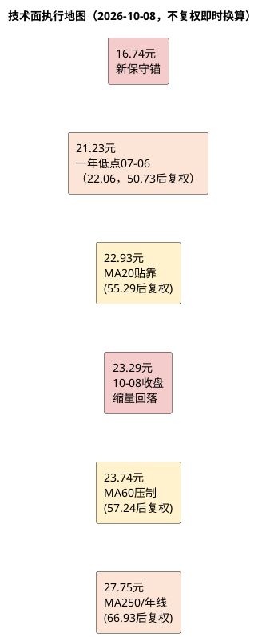

# 顾家家居：技术面分析

**研究日期**：2026年10月09日
**行情数据截止**：2026年10月08日

## 趋势结构（H1公告后放量跌破MA60→09-30放量反抽未确认→10-08再失守，弱势震荡）

| 价格区域 | 触发条件 | 对应动作 | 避免误读 |
|:--|:--|:--|:--|
| 21.23元以下 | **三链恶化已兑现（合同-25%、OCF/NP 0.71、扣非-14.6%）** | 已触发保守情景，不以低PE补仓 | 跌破不等于黄金坑 |
| 22.93元（MA20） | **10-08收盘+1.61%贴靠但未放量站稳，09-30曾+4.00%站上** | 短线未确认，观察 | MA20非固定绝对价，单日企稳不改趋势 |
| 23.29-23.74元 | **10-08收盘23.29再失守MA60 -1.85%，09-30曾+0.40%短暂收复** | **中期仍压制，放量反抽未确认** | 09-30放量反抽一次不算趋势反转 |
| 25.2元以上 | 放量+Q3扣非与订单企稳 | 方可讨论趋势改善 | 需基本面二次确认 |
| 27.75元附近 | 长均线重叠+地狱压力12.95元 | 观察解套压，不追价 | 基本面目标23.07不等同阻力 |

技术结论维持 **“放量破位后弱势震荡，放量反抽未确认”** 。10月08日不复权收盘23.29元（后复权56.18元），较09-30收盘23.81元回落2.18%（后复权57.43→56.18），较09-14收盘23.47元回落0.77%，较08-31收盘23.61元回落1.35%。09-30放量108,233手（+78.9% vs 20日均60,761手）+4.00%收复MA20并短暂站上MA60，但10-08缩量54,418手（-49.7%）回落再失守MA60，呈现**放量反抽→缩量回落**的标准弱势结构，未形成趋势反转。08-31放量168,909手 vs 20日均74,615手（+126%）的年内放量阴线仍为本轮高点，15日均量59,709手较60日74,241手偏低，缩量磨底延续。

**均线系统（后复权，折算当日不复权，复权因子2.4121）**：
- MA20 55.29元（后复权，折算约22.93元→**贴靠+1.61%，09-30时55.23元+4.00%曾站上，10-08回落贴靠未有效站稳**）
- MA60 57.24元（后复权，折算约23.74元→**10-08收盘23.29元再失守-1.85%，09-30曾57.20元+0.40%短暂收复，确认未站稳**）
- MA120约60.38元后复权，折算约25.03元；MA250约66.93元后复权，折算约27.75元（较08-31的68.0元/28.2元下移0.5元，长期压制仍远，距现价19.1%）
- 52周后复权高低点81.95/50.73（不复权37.59/22.06），现价56.18处区间21.5%分位（靠近底部但未创新低，一年低点22.06元距现价5.6%）。

## 量价和执行框架（放量破位后缩量磨底，放量反抽未确认）

| 量价指标 | 2026-10-08数值 | 2026-09-30数值 | 2026-08-31数值 | 交易含义 |
|:--|--:|:--|:--|:--|
| 不复权收盘价 | **23.29元** | 23.81元 | 23.61元 | 10-08缩量回落再失守MA60 |
| 后复权收盘价 | 56.18元 | 57.43元 | 56.95元 | 用于均线判断 |
| MA20 | 55.29元，折算22.93元 | 55.23元，折算22.89元 | 59.14元，折算22.59元 | 09-30站上→10-08贴靠，未确认 |
| MA60 | 57.24元，折算约23.74元 | 57.20元，折算约23.71元 | 57.22元，折算约23.72元 | **10-08再失守-1.85%，反抽失败** |
| MA250/年线 | 约66.93元，折算约27.75元 | 约66.98元，折算约27.77元 | 约68.0元，折算约28.2元 | 长期趋势压制，距现价19.1% |
| 当日成交量 | 54,418手 | 108,233手 | 168,909手 | 08-31峰值→09-30次峰→10-08缩量 |
| 20日平均成交量 | 59,709手 | 60,761手 | 74,615手 | 15日均量偏低，缩量磨底 |
| 60日平均成交量 | 74,241手 | 74,876手 | 86,441手 | 量能持续萎缩 |
| 相对MA20 | +1.61%（56.18/55.29） | +4.00%（57.43/55.23） | -3.71%（56.95/59.14） | 09-30短暂转正→10-08贴靠 |
| 相对MA60 | **-1.85%**（56.18/57.24） | +0.40%（57.43/57.20） | -0.47%（56.95/57.22） | 09-30短暂收复→10-08再失守 |
| 相对MA250 | -16.1%（56.18/66.93） | -14.2%（57.43/66.98） | -16.2%（56.95/68.0） | 中期仍深度压制 |

| 条件化价格路径 | 价格/量能条件 | 基本面条件（联动） | 执行纪律 |
|:--|:--|:--|:--|
| **短线贴靠未确认** | **23.29元贴靠MA20但缩量，未放量站稳** | 三链恶化已兑现（合同-25%、OCF/NP 0.71） | **不追涨，观察是否放量站稳3日** |
| **中期仍压制** | **再失守MA60（23.74）且09-30反抽失败** | H1扣非-14.59%、境内-12.71% | **趋势仍弱，等待右侧** |
| 理想赔率出现 | 回调至**18.5-20.5元**（新） | 合同负债跌幅<15%、OCF/NP>0.8、境内<-5%收敛 | 方可分批、小仓验证 |
| 中期反转尝试 | **放量收复并站稳23.74元3日+** 成交>60,000手/日 | Q3扣非企稳、费用率不升、合同QoQ企稳 | 才能提高跟踪优先级 |
| 长期趋势改善 | 越过27.75元年线区 | ROE>12%、海外毛利企稳、扣非回正 | 重新评估目标价23.07 |
| 下行证伪 | 跌破21.23元（一年低点07-06双底22.06） | 需求/盈利/现金三链持续恶化 | 转保守16.74元，不补仓 |
| 极端压力 | 向12.95元周期压力靠近 | 系统性需求与海外订单崩塌 | 非止损，仅资产底线 |

**价格行为解读（15日审计）**：09-10 23.43元→09-11 22.97元（-1.96%）→09-14 23.47元（+2.18%）→09-15 22.75元（-3.07%）→09-16 22.49元→09-17 22.30元→09-18 22.50元→09-21 22.36元→09-22 22.41元→09-23 22.44元→09-24 22.55元（磨底）→09-28 22.25元→09-29 22.97元（+3.24%）→09-30 23.81元（+3.66%，放量108,233手，单日涨幅为15日内最大）→10-08 23.29元（-2.18%缩量回落）。**09-30放量站上MA20/短暂收复MA60为15日内唯一强阳，但10-08未延续且再失守MA60，量价配合转回“反抽未确认”**。15日内量能峰值09-30 108,233手仅为08-31峰值168,909手的64%，缩量磨底主导，未出现08-31级别放量破位或反转。

**关键位区分**：22.93元（MA20）由09-14的57.72后复权→55.29后复权下移2.43元，现价+1.61%贴靠为弱势反抽贴靠，非支撑；23.74元（MA60）由57.20→57.24后复权微升，09-30短暂收复0.40%后10-08再失守-1.85%，确认中期趋势仍压制；22.06元为一年不复权低点（07-06，50.73后复权），距现价5.6%为最后心理防线，跌破则打开向16.74元保守锚的空间；27.75元为MA250/年线重叠，距现价19.1%为长期卖压区，上行需盈利上修支撑。

| 时间框架 | 判断（修正后） | 关键位（不复权） | 交易含义 |
|:--|:--|:--|:--|
| 1-3个月 | **弱势震荡，放量反抽未确认** | 支撑18.5-20.5、22.06；压力23.74 | **不抄底，等待放量站稳MA60 3日或基本面拐点** |
| 6-12个月 | 取决于Q3验证 | 压力27.75 | 需站稳年线+ROE回升 |
| 极端风险 | 三链共振恶化 | 保守16.74 / 周期12.95 / 资产10.24 | 风控优先 |

本章与估值的衔接修正：09-30放量反抽至23.81元时曾短暂收复MA60并接近中性23.07元上方，但10-08回落至23.29元再失守MA60，与估值**仍共振偏弱**（中性23.07元、加权22.55元仍低于或贴靠现价，盈亏比-0.11仍为负），技术破位后的反抽未被确认为趋势改善，18.5-20.5元观察区仍需更严苛的订单与现金验证。

**纪律重申**：
1. 所有交易价用**不复权**（23.29），所有均线用**后复权**（56.18）并按当日2.4121折算；
2. **23.74元MA60为多空分水岭**，未放量收复3日前不讨论趋势改善（09-30单日收复不计）；
3. **22.06元（07-06）为一年低点风控线**，跌破且三链未改善则直接切换保守估值16.74元，不以PE 12.72x低位机械加仓；
4. 09-30放量108,233手为次峰，未达08-31峰值168,909手量级，不构成趋势反转。

**数据来源**：项目统一视图`daily_kline`与`v_daily_valuation`，截至2026年10月08日收盘（23.29元/56.18元，后复权MA20 55.29/MA60 57.24/MA250约66.93，成交54,418手，20日均59,709手/60日均74,241手）。
