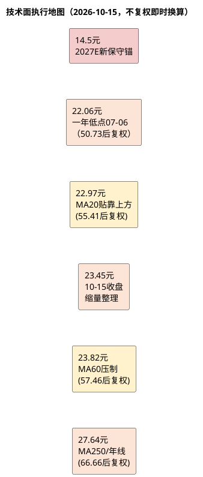

# 顾家家居：技术面分析

**研究日期**：2026年10月15日
**目标年份**：2027年（Q4 切换期，技术位与执行纪律对应 2027E 三态目标价）
**行情数据截止**：2026年10月15日（收盘）

## 趋势结构（10月缩量窄幅整理，MA20上方贴靠、MA60仍压制，弱势格局未改）

| 价格区域 | 触发条件 | 对应动作 | 避免误读 |
|:--|:--|:--|:--|
| 22.06元以下 | **三链恶化未修复（合同-25.1%、OCF/NP 0.71x、扣非-14.59%）** | 已触发保守情景，不以低PE补仓 | 跌破一年低点不等于黄金坑 |
| 22.97元（MA20） | 10-15收盘23.45元贴靠MA20上方+2.08%，MA20已由降转平 | 短线企稳但未放量确认 | MA20非固定绝对价，贴靠不构成买入理由 |
| 23.82元（MA60） | **10-15收盘仍低于MA60 -1.57%，10-12盘中曾触24.16元但收盘回落** | **中期仍压制，需放量+站稳3日** | 单日盘中触及MA60不构成突破 |
| 27.64元（MA250） | 放量+2027E盈利企稳 | 方可讨论趋势改善 | 需基本面二次确认 |
| 31.8元（2027E乐观价） | 印尼投产达产+境内转正+毛利率回33% | 观察解套压，不追价 | 基本面目标≠技术阻力 |

**技术结论**：维持 **「放量破位后弱势震荡，10月缩量窄幅整理，MA20上方贴靠但MA60未收复」**。2026年10月15日不复权收盘23.45元（后复权56.56元），较10月14日23.40元微涨0.21%，较10月09日23.53元跌0.34%，较09月30日23.81元跌1.51%，较08月31日23.61元跌0.68%。**9月30日放量108,233手+3.66%收复MA20并短暂站上MA60后，10月（10-08至10-15，6个交易日）在23.29-23.71元区间缩量窄幅整理，日均量仅52,032手（较9月30日单日108,233手腰斩）**，10月12日盘中最高24.16元曾触及MA60上方，但收盘23.71元未能站稳，随后连续三日收于23.37-23.45元，**MA60（23.82元）仍为未突破的中期压力**。

**均线系统（后复权，折算当日不复权，复权因子2.412146）**：
- MA20 **55.41元**（后复权，折算约22.97元 → 收盘**贴靠上方+2.08%**；MA20由08-31的59.14元→10-08的55.29元→10-15的55.41元，**已由下行转为走平并小幅上翘，是本轮唯一的边际改善信号**）
- MA60 **57.46元**（后复权，折算约23.82元 → 收盘**仍失守-1.57%**；MA60由10-08的57.24元缓升至57.46元，与MA20的差距稳定在约2.05元后复权/0.85元不复权，**无金叉迹象**）
- MA120约**59.80元**后复权，折算约24.79元（距现价-5.4%）
- MA250约**66.66元**后复权，折算约**27.64元**（较08-31的68.0元/28.2元下移0.56元，距现价**-15.2%**，长期压制仍远）
- 52周后复权高低点**83.38/50.73**（不复权36.75/22.06，高点2026-02-11、低点2026-07-06），现价56.56元处区间**17.9%分位**（靠近底部但未创新低，一年低点22.06元距现价+6.3%）
- RSI14 = **65.3**（自09-15的31.1连续回升34.2点，进入偏强区但未达超买70）

## 量价和执行框架（缩量整理，量能持续萎缩）

| 量价指标 | 2026-10-15数值 | 2026-10-08数值 | 2026-09-30数值 | 2026-08-31数值 | 交易含义 |
|:--|--:|--:|--:|--:|:--|
| 不复权收盘价 | **23.45元** | 23.29元 | 23.81元 | 23.61元 | 10月窄幅整理，未破10-08低点 |
| 后复权收盘价 | 56.56元 | 56.18元 | 57.43元 | 56.95元 | 用于均线判断 |
| MA20 | 55.41元，折算22.97元 | 55.29元，折算22.93元 | 55.23元，折算22.89元 | 59.14元，折算22.59元 | **由降转平，现价贴靠上方** |
| MA60 | 57.46元，折算约23.82元 | 57.24元，折算约23.74元 | 57.20元，折算约23.71元 | 57.22元，折算约23.72元 | **仍压制，10-12盘中触及未站稳** |
| MA250/年线 | 约66.66元，折算约27.64元 | 约66.93元，折算约27.75元 | 约66.98元，折算约27.77元 | 约68.0元，折算约28.2元 | 长期趋势压制，距现价15.2% |
| 当日成交量 | 54,004手 | 54,418手 | 108,233手 | 168,909手 | 08-31峰值→09-30次峰→10月缩量 |
| 15日平均成交量 | 59,203手 | 59,261手 | 59,535手 | — | 持续低于60日均量 |
| 60日平均成交量 | 72,544手 | 74,241手 | 74,876手 | 86,441手 | 量能中枢持续下移 |
| RSI14 | **65.3** | 48.6 | 53.3 | — | 自31.1（09-15）连续回升，偏强未超买 |
| 相对MA20 | +2.08% | +1.61% | +4.00% | -3.71% | 贴靠上方，未放量确认 |
| 相对MA60 | **-1.57%** | -1.85% | +0.40% | -0.47% | 09-30短暂收复后持续失守 |
| 相对MA250 | -15.2% | -16.1% | -14.2% | -16.2% | 中期仍深度压制 |

| 条件化价格路径 | 价格/量能条件 | 基本面条件（联动） | 执行纪律 |
|:--|:--|:--|:--|
| **短线贴靠未确认** | 23.45元站上MA20但缩量，MA60未收复 | 三链恶化未修复（合同-25.1%、OCF/NP 0.71x） | **不追涨，观察是否放量站稳MA60 3日** |
| **中期仍压制** | 10月6个交易日在23.29-23.71元窄幅整理，量能腰斩 | H1扣非-14.59%、境内-12.71% | **趋势仍弱，等待右侧** |
| 理想赔率出现 | 回调至**13.0-15.5元**（2027E新观察区） | 合同负债跌幅<15%、OCF/NP>0.8、境内<-5%收敛 | 方可分批、小仓验证 |
| 中期反转尝试 | **放量收复并站稳23.82元3日+** 成交>70,000手/日 | Q3扣非企稳、费用率不升、合同QoQ企稳 | 才能提高跟踪优先级 |
| 长期趋势改善 | 越过27.64元年线区 | ROE>12.7%、海外毛利企稳、扣非回正 | 重新评估中性目标价20.6元 |
| 下行证伪 | 跌破22.06元（一年低点07-06） | 需求/盈利/现金三链持续恶化 | 转保守14.5元，不补仓 |
| 极端压力 | 向9.60元周期压力靠近 | 系统性需求与海外订单崩塌 | 非止损，仅资产底线 |

**价格行为解读（15日审计，2026-09-17至2026-10-15）**：09-17 22.30元 → 09-18 22.50元 → 09-21 22.36元 → 09-22 22.41元 → 09-23 22.44元 → 09-24 22.55元 → 09-28 **22.25元（15日低点）** → 09-29 22.97元（+3.24%）→ 09-30 **23.81元（+3.66%，放量108,233手，15日内唯一强阳，收复MA20并短暂站上MA60）** → 10-08 23.29元（-2.18%缩量回落，再失守MA60）→ 10-09 23.53元 → 10-12 **23.71元（盘中最高24.16元触及MA60上方，收盘未站稳）** → 10-13 23.37元 → 10-14 23.40元 → 10-15 **23.45元（-0.21%，量54,004手）**。15日区间22.25-23.81元，涨幅+5.16%（自09-17的22.30元）；15日不复权均价22.96元、后复权均价55.45元。**量能特征**：15日累计成交888,042手，均量59,203手，仅为60日均量72,544手的81.6%；15日内量能峰值09-30的108,233手仅为08-31峰值168,909手的64%，**缩量磨底延续，未出现08-31级别的放量破位或反转**。

**关键位区分**：22.97元（MA20）由08-31的22.59元→09-14的23.93元→09-30的22.89元→10-15的22.97元，**经历了「下移—走平—微翘」的完整过程，是本轮15日中唯一转向的均线**，但现价仅贴靠上方2.08%，尚未形成有效支撑；23.82元（MA60）由57.22→57.46后复权缓升，10-12盘中触及24.16元（对应后复权58.28元）后回落，**确认MA60上方存在实质抛压**；22.06元为一年不复权低点（07-06，50.73后复权），距现价6.3%为最后心理防线，跌破则打开向14.5元保守锚的空间；27.64元为MA250/年线重叠，距现价15.2%为长期卖压区，上行需盈利上修支撑。

| 时间框架 | 判断 | 关键位（不复权） | 交易含义 |
|:--|:--|:--|:--|
| 1-3个月 | **缩量窄幅整理，MA20走平贴靠、MA60未收复** | 支撑22.06、22.97；压力23.82 | **不抄底，等待放量站稳MA60 3日或Q3基本面拐点** |
| 6-12个月 | 取决于2027E盈利兑现与印尼投产 | 压力27.64 | 需站稳年线+ROE回升至12.7%以上 |
| 极端风险 | 三链共振恶化 | 保守14.5 / 周期9.60 / 资产7.86 | 风控优先 |

**本章与估值的衔接修正**：10月价格在23.29-23.71元区间窄幅整理，与2027E估值口径**由「基本吻合」转为「明确偏贵」**——2026E口径下中性目标价23.07元曾贴靠现价（-0.9%），切换至2027E口径后中性目标价降至20.6元、加权降至21.0元，**现价已高出中性目标价12.2%**，技术面的「缩量整理、MA60未收复」与估值面的「下行12.2%」形成**共振偏空**。原18.5-20.5元观察区在新口径下已高于中性目标价，不再具备安全垫，故观察区下移至13.0-15.5元。**技术面不提供任何买入理由，仅提供「等待右侧」的时间窗**。

**纪律重申**：
1. 所有交易价用**不复权**（23.45元），所有均线用**后复权**（56.56元）并按当日2.412146折算；
2. **23.82元（MA60）为多空分水岭**，未放量收复3日前不讨论趋势改善（10-12盘中触及不计）；
3. **22.06元（07-06）为一年低点风控线**，跌破且三链未改善则直接切换保守估值14.5元，不以PE 12.81x低位机械加仓；
4. **MA20走平是本轮唯一边际改善信号，但不构成买入依据**——在盈利零增长（2027E中性+1.3%）与盈亏比-0.27为负的前提下，均线走平的交易价值极低；
5. RSI14已从31.1升至65.3，接近超买区，**短线继续上行的空间小于回落空间**。

**数据来源**：项目统一视图 `daily_kline` 与 `v_daily_valuation`，截至2026年10月15日收盘（23.45元/56.56元，后复权MA20 55.41/MA60 57.46/MA120 59.80/MA250约66.66，成交54,004手，15日均59,203手/60日均72,544手，RSI14 65.3，52周后复权区间50.73-83.38）。
