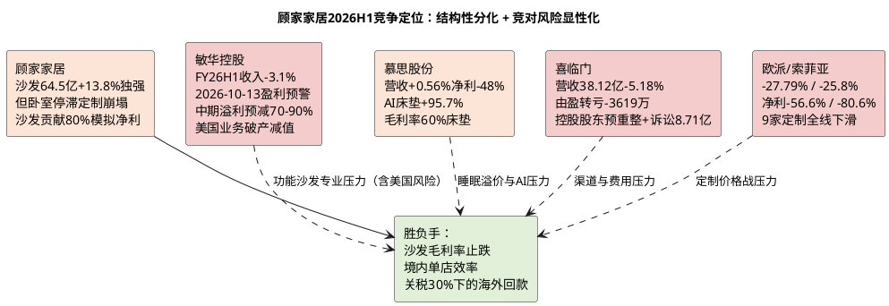

# 顾家家居：竞争格局与地位

**研究日期**：2026年10月15日  
**目标年份**：2027年（Q4 切换期，竞争地位评估面向2027E）

## 竞争结论仪表盘（2027E 口径：沙发单腿支撑，全品类护城河承压，竞对出现结构性风险）

| 赛道 | 顾家H1表现 | 最强对手最新表现 | 相对结论 | 2027E 可验证胜负手 |
|:--|:--|:--|:--|:--|
| 沙发 | 64.50亿 **+13.81%**，毛利率35.16% -0.89pct | 敏华功能沙发收入-约4%（FY26H1）；**2026-10-13盈利预警：中期溢利预减70%-90%**（美国子公司Southern Motion申请第11章破产） | **顾家跑赢且份额提升确认；竞对出现结构性风险** | 沙发毛利率能否止跌至34.5%以上 |
| 卧室/睡眠 | 16.91亿 **-0.13%**，毛利率39.83% **-2.98pct** | 慕思床垫+7.83%但归母-48.13%（费用侵蚀）；喜临门转亏-3,619.77万且控股股东预重整 | **顾家亦承压但优于喜临门，逊于慕思产品韧性** | 卧室收入能否转正且毛利率回到40% |
| 定制/整家 | 3.39亿 **-38.67%**、集成8.25亿-29.05% | 欧派H1 59.5亿**-27.79%**（净利-56.62%、扣非-61.71%）、索菲亚33.77亿**-25.8%**（净利-80.61%）；9家定制上市公司营收**全部下滑** | **顾家塌陷幅度超行业，整家协同证伪** | 定制能否收敛跌幅至-5%以内 |
| 海外 | 50.67亿 **+19.01%**，毛利率24.24% -2.12pct | 敏华北美+2.6%（FY25/26）但美国业务并购失败；慕思境外+22.69%（基数1.34亿）；索菲亚海外+108%、志邦泰国基地投产 | **顾家海外增速领先且为自建产能（非并购），相对风险更低** | 2027-01-01关税升至30%后的客户分担与毛利率 |

## 竞争位置：沙发龙头韧性确认，但全品类与定制短板暴露，竞对风险反向利好份额

顾家核心竞争场仍为中高端软体家具，2026H1将「全品类协同」叙事证伪为「沙发单腿支撑」。沙发64.50亿+13.81%在家具社零-4.9%、竞对敏华沙发-4%（FY25/26全年沙发及配套产品下降4.2%）、喜临门-5.18%、慕思营收+0.56%的对比中显著跑赢，份额提升有硬数据支撑。然而卧室-0.13%、集成-29%、定制-38.67%的集体回撤，说明公司「一体化整家」尚未形成跨品类护城河，定制赛道面对欧派、索菲亚等专业化对手无优势，反而成为境内-12.71%的重灾区。

**竞争格局新变量——竞对风险显性化**：

1. **敏华控股盈利预警（2026-10-12签署、2026-10-13于港交所披露；来源：HKEXnews「内幕消息 盈利警告」公告）**：预期截至2026-09-30止六个月权益拥有人应占溢利较2025年同期约**11.456亿港元减少约70%至90%**（折合约1.15-3.44亿港元）。**公告披露的两项主因需精确区分**：①**成本端（主因）**——「海湾冲突爆发以来，化工行业关键原材料价格持续飙升，推高生产成本；同时行业竞争加剧，产品价格调整滞后，未能完全抵消原材料成本上升」，导致集团**整体毛利率下滑**；公告明确**期内营业额与去年同期基本持平**，即**并非需求崩塌**；②**美国业务（一次性）**——2025年12月收购的美国业务因原材料成本上涨及市场需求疲弱产生营运亏损，被收购公司的直接全资附属公司**Southern Motion, Inc.已在美国申请第11章破产程序**（属重组程序，工厂继续运营），相关商誉及其他无形资产于期内确认减值。**三向解读**：①**成本侧含义（最重要）**——敏华作为功能沙发全球龙头、毛利率长期40%以上，仍无法向下游转嫁化工原料涨价，说明**2026H2起化工原料（TDI/聚醚/海绵）的新一轮上行是行业级、且转嫁能力普遍缺失**，这对顾家2026H2—2027E的综合毛利率假设（31.7%）构成实质下行风险；②**并购风险含义**——收购不足一年即申请破产保护，印证海外并购整合风险极高，**顾家为自建产能（越南/墨西哥/美国/印尼）而非并购整合，风险性质显著不同，这是顾家海外模式的相对优势**；③**需求侧含义**——敏华营业额基本持平、仅美国业务需求疲弱，说明海外需求整体尚未崩塌，故不应据此下调顾家境外收入增速（+8%已含关税影响），仅应据此下调毛利率假设。

2. **定制家居集体塌陷**：9家定制上市公司2026H1营收同比**全部下滑**，欧派59.5亿-27.79%（归母4.42亿-56.62%、扣非-61.71%）、索菲亚33.77亿-25.8%（归母0.6192亿-80.61%）、志邦-22.88%、金牌-19.41%、我乐-15.95%（降幅最小）。9家中扣非后仅欧派、索菲亚、我乐三家为正（来源：乐居财经2026-09-04）。**顾家集成-29.05%/定制-38.67%的跌幅处于行业中等偏深位置，说明「整家协同」未能提供竞争缓冲。**

3. **喜临门风险升级**：H1营收38.12亿-5.18%、归母转亏-3,619.77万（-113.58%），财务费用6,479.57万同比+383.42%（汇兑损失）；控股股东及其关联方资金占用致其他应收款由8,722万暴增至5.92亿（+578.41%），另面临三起诉讼涉案金额合计8.71亿元；控股股东已启动预重整投资人招募。**ST喜临门的风险出清对顾家是份额机会，但顾家境内-12.71%亦弱，竞争未显著获益。**

4. **海外模式分化**：索菲亚海外+108%（轻资产「高端零售经销商+工程」双轮驱动，41家海外经销商覆盖50+国家）、志邦泰国基地投产、金牌海外2亿+30%。**顾家的差异化在于「自建产能+本土运营」重资产模式**——董秘2026-10-13明确外销定位为「全球布局、本土运营」的「软体家居集成供应链服务商及品牌运营商」，拥有中国、越南、墨西哥等多地产能，具备为北美/欧洲/亚太提供沙发、床垫、集成配套的一站式交付能力。**该模式在关税环境下的优势是原产地灵活，劣势是资本开支前置与固定成本刚性。**

海外模式：顾家50.67亿+19.01%增速在软体同业中居前，但毛利率24.24%较境内42.14%低17.9pct，且应收+25.73%快于境外收入，显示竞争策略为「低价+账期换份额」，与敏华毛利率40.4%的高盈利模式形成鲜明反差——顾家可以抢量，却未证明能抢利润池。**2027年关税由25%升至30%后，该模式的可维持性将成为核心问题。**

## 量化竞争比较与不足（2026H1刷新）

| 竞争要素 | 顾家H1验证 | 竞争边界 | 财报验证 |
|:--|:--|:--|:--|
| 品牌与渠道 | 约5,959家门店（2025年末），H1未更新但境内-12.71%暗示单店产出显著下滑；顾家星选北京旗舰店2026-05开业（后续规划3家） | 规模未转化为效率，单店承压；大店+轻量化小店双轨转型进行中 | 境内收入/门店估算单店下滑双位数 |
| 产品组合 | 沙发独强（2027E贡献80.3%模拟净利），卧室停滞，集成定制崩塌 | 品类宽不等于每条赛道有溢价，整家联单证伪 | 沙发+13.81% vs 定制-38.67%分化20pp+ |
| 供应链 | 越南/墨西哥基地支撑境外+19%，但TDI+31%推高成本、运费仍高 | 海外基地是必要条件非超额利润源 | 境外毛利率-2.12pct、原材料65.28%暴露 |
| 研发与专利 | 研发2.37亿+20.35%，专利3000+、H1新增400项 | 投入加码但当期费用化侵蚀利润（2027E研发4.90亿） | 研发费用率2.40% vs 毛利率-0.40pp |
| 会员与履约 | 750万会员、99.4%齐单交付（2025披露） | 未经审计且H1境内失速显示转化未起 | 复购数据H1未更新，需三季报验证 |

| 2026H1可比口径 | 顾家家居 | 敏华控股（FY26H1：2025.10-2026.03；FY27H1为2026.04-09） | 慕思股份 | 喜临门（ST喜临门） | 欧派家居 | 索菲亚 |
|:--|--:|--:|--:|--:|--:|--:|
| 收入 | 98.75亿元 (H1) | 80.45亿港元（约73亿人民币，-3.1%） | 24.91亿（+0.56%） | 38.12亿（-5.18%） | 59.5亿（-27.79%） | 33.77亿（-25.8%） |
| 归母/股东应占利润 | 9.26亿（-9.31%） | 11.46亿港元（+0.6%）但**FY27H1预警预减70-90%（成本端+美国业务减值，收入基本持平）** | 1.86亿（-48.13%） | -0.36亿（由盈转亏） | 4.42亿（-56.62%） | 0.6192亿（-80.61%） |
| 综合毛利率 | 32.49%（-0.40pct） | 40.40%（+0.9pct H1，回落至39.4%全年） | 床垫60.02% | 未披露但亏损 | 35.87% | 31.86% |
| 核心赛道信号 | 沙发+13.81%独强 | 沙发及配套-约4%、中国市场-6.8%、**美国业务破产** | AI床垫+95.69%（2.36亿） | 控股股东预重整、诉讼8.71亿 | 衣柜-34.51%、整装渠道615家门店 | 海外+108% |
| 竞争含义 | 量增利不增，以账期换境外 | 毛利率优势仍高但中国侧承压+美国并购失败 | 技术驱动但费用激增致利润腰斩 | 风险出清但自身亦弱 | 定制龙头亦无法对冲地产 | 定制塌陷，海外为唯一亮点 |

*注：敏华财年为4-3月，FY26H1为2025.10-2026.03，FY26全年162.76亿港元-2.8%、股东利润-12.1%，与顾家H1周期不完全可比，仅作方向参考。*

| 2026H1可比结论 | 事实依据 | 对2027E估值的含义 |
|:--|:--|:--|
| 顾家沙发跑赢行业 | +13.81% vs 行业社零-4.9% vs 敏华沙发-4% | 支持沙发份额上调，但为唯一亮点，且贡献80.3%利润形成集中度风险 |
| 卧室/定制集体承压 | 卧室-0.13%毛利率-2.98pct、定制-38.67%；欧派/索菲亚营收-27.79%/-25.8% | 全品类溢价证伪，不给整家估值溢价 |
| 敏华美国业务破产 | Southern Motion申请第11章、商誉减值、FY27H1预减70-90%（收入持平） | 海外并购模式风险高；顾家自建产能相对优势；**化工原料涨价无法转嫁为行业级毛利率风险（须下调2027E毛利率假设的敏感性）** |
| 慕思AI高增但利润崩 | AI +95.69%但净利-48%（销售费用7.91亿+18.9%广告2.74亿） | 睡眠赛道技术投入期，顾家追赶成本高 |
| 喜临门风险升级 | 转亏、控股股东预重整、资金占用5.92亿、诉讼8.71亿 | 行业底部区域且风险加速出清，但顾家境内-12.71%亦弱 |
| 定制价格战至地板价 | 欧派/索菲亚子品牌定制衣柜499元/㎡、599元/㎡，业内测算毛利10-15% | 顾家集成定制2027E仅假设-4.7%，若价格战延伸则进一步下修 |
| 规上家具利润总额-52.7% | 国家统计局1-6月（营收-8.6%） | 行业盈利中枢塌陷，压制板块PE中枢 |

## 护城河拆解：2027E 口径下「存活率」仍存，「扩张性」进一步存疑

**第一层渠道与履约**：5,959家门店的密度在需求-12.71%时从资产变为负担。原模型假设「门店筛选+坪效提升」带来经营杠杆，H1销售费用仍+3.81%而境内-12.71%，显示费用刚性远超单店改善，渠道护城河未转化为利润。**渠道转型的新证据**：顾家星选北京首家大型独立旗舰店（2026年5月，万隆汇洋）落地，规划后续再落地3家覆盖北京东南西北；同时推行「轻量化小整家店态」（广东省样板区域占区域总营收50%）。**方向正确但尚无收入验证，2027E不给渠道溢价。**

**第二层供应链与产品工程**：集中采购与海外本土化未能抵御TDI +31%成本冲击（营业成本+1.36%快于营收+0.75%），且沙发成本+15.40%快于收入+13.81%。功能铁架（锴创）、电机（登丰）越南布局支撑海外+19%，但H1毛利率仍降，说明零部件自研尚未转化为毛利优势。**关键暴露**：公司披露的分产品毛利率为不含运输费口径，产品口径加权毛利（H1 35.53亿）与主营毛利（31.50亿）差额4.03亿即运输费，**说明「产品毛利率好看但合并毛利率被运输费吃掉4pp」是结构性问题，且随境外占比提升而放大**（海外发运单箱成本更高）。2027E SOTP已单列运输费8.30亿扣减项。

**第三层全球化供给**：越南、墨西哥、美国基地进入常态化（合计65万㎡+），印尼基地2026-03奠基（1.6亿美元、19.56万㎡、**一期2027年3月投产、达产后年产值2.2亿美元**、一期吸纳约6000名本地员工），为2029年后选项。短期看，海外基地使顾家境外增速领先同业，但代价是境外毛利率-2.12pct+应收账期拉长+汇率敞口（财务费用+1.21亿），重资产交付能力不等同于品牌溢价。**相对优势**：敏华因收购美国业务而确认商誉减值并申请第11章破产，顾家的自建产能模式无并购整合风险，这是2027年海外竞争中的真实差异化。

## 非财务交叉验证与竞争结论（2027E 口径）

- **订单维度**：主营不存在重大合同，但合同负债-25.1% YoY与应收+25.7%组合，替代「在手订单」指标显示：国内订单萎缩、海外以信用扩张。**2027E境内假设-4%即以该领先指标为约束。**
- **供应链维度**：印尼可研（总投11.24亿、土地建筑占85.09%）与奠基进度（2026-03-16）确认项目进入建设期，一期2027-03投产；但尚未产生收入，估值不计入利润。
- **技术维度**：慕思AI床垫+95.69%、专利+AI投入致净利-48%，验证智能睡眠赛道「投入期」属性；顾家两款高端睡眠产品合计带动卧室高端品类销售+9.3%（但板块整体-0.13%），技术代差未转化为报表。
- **渠道维度**：欧派自研AI出图累计超13万张、AI工具覆盖近7000家终端门店（2026年定义为「全面启动AI战略元年」）；金牌推出行业首个家装设计智能体「飞流AI」覆盖300+城市。**顾家在AI/数字化渠道工具上的对外披露显著少于定制系竞对，是2027年零售转型的执行风险点。**
- **竞争对手跟踪机制**：核心竞对披露日历——**敏华控股2026-11-16中期业绩**（含美国业务减值规模、毛利率、中期股息）、慕思2026年报2027-04、喜临门Q3预计2026-10下旬。竞对披露日与顾家自身财报日（2026-10-28三季报）同等对待，到期即触发情报同步。

**本章结论**：从「沙发单品护城河仍硬，全品类与定制护城河证伪，海外护城河以利润稀释为代价」进一步收紧为 **「沙发单品护城河仍硬但贡献80.3%利润形成集中度风险；全品类与定制护城河证伪且面对价格战；海外自建产能模式相对敏华并购模式有优势，但2027年关税升至30%将检验其经济性」**。盈利模型应：**维持沙发份额假设（2027E +4.4%），卧室+3.2%止跌，定制/集成-4.7%（跌幅收窄但不转正），信息服务-1.5%**，且不预设综合毛利率向40%靠拢（2027E 31.7%）。

## 定价权和渠道审计（2027E 口径）

| 审计问题 | H1答案 | 证据 | 2027E 结论 |
|:--|:--|:--|:--|
| 沙发增长是否提价？ | 否，成本+15.40% > 收入+13.81% | 沙发毛利率35.16% -0.89pct | 量增以让利为代价，2027E不给提价假设 |
| 是否有成本转嫁？ | 尚未，综合毛利率-0.40pp（Q2 -2.05pp） | TDI+31% vs 毛利率下降 | 无强转嫁能力；2027年关税成本同样难以全额转嫁（假设客户分担50%） |
| 渠道是否杠杆？ | 否，境内-12.71%而销售费用+3.81% | 销售费用率17.11%→17.12%在零增长下刚性 | 2027E销售费用率仅假设降至17.0%，无杠杆 |
| 零部件壁垒？ | 未兑现，ROIC 7.65% vs 9.00%去年 | 研发+20.35%但毛利率仍降 | 仍为投入期，2027E研发加码至4.90亿 |
| 海外模式是否更优？ | 自建产能无并购减值风险 | 敏华Southern Motion破产 vs 顾家越南/墨西哥/印尼自建 | 相对优势成立，但关税30%下需验证经济性 |
| 行业相对优势是否存在？ | 是，扣非-14.59% vs 行业利润-52.7% | 规上家具1-6月营收-8.6%、利润-52.7% | 相对优势存在但不改变绝对下滑 |

**主要证据**：公司2026H1报告分产品/地区分拆（沙发64.50亿+13.81%/卧室16.91亿-0.13%/集成8.25亿-29.05%/定制3.39亿-38.67%/境内45.61亿-12.71%/境外50.67亿+19.01%/合同负债11.54亿-25.1%/应收19.16亿+25.7%）；敏华控股FY26H1（80.45亿港元-3.1%毛利率40.4%净利+0.6%）、FY26全年（162.76亿港元-2.8%净利-12.1%毛利率39.4%）、**2026-10-13盈利警告公告（中期溢利预减70%-90%、Southern Motion申请第11章破产）**、2026-10-06董事会会议通告（2026-11-16审议中期业绩）；慕思2026H1（24.91亿+0.56%净利1.86亿-48.13% AI+95.69%毛利率床垫60.02%）；喜临门2026H1（38.12亿-5.18%转亏-3,619.77万财务费用6,479.57万+383.42%其他应收款5.92亿+578.41%诉讼8.71亿）；欧派家居2026H1（59.5亿-27.79%归母4.42亿-56.62%扣非-61.71%毛利率35.87%衣柜-34.51%）；索菲亚2026H1（33.77亿-25.8%净利0.6192亿-80.61%毛利率31.86%海外+108%）；乐居财经2026-09-04（9家定制全线下滑、扣非仅3家为正、规上家具企业1-6月营收-8.6%利润-52.7%）；新浪财经2026-09-03（定制衣柜价格战499/599元每㎡）；公司投资者关系回复（2026-10-13）；印尼项目奠基公告（2026-03-16）；新京报2026-10-15（顾家星选北京旗舰店）。
