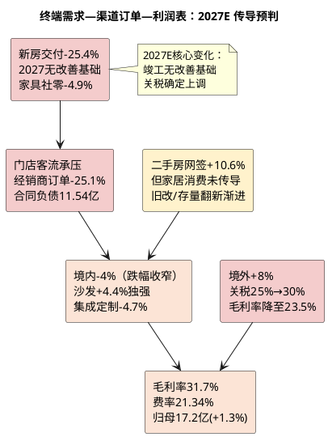

# 顾家家居：产业周期与终端穿透

**研究日期**：2026年10月15日  
**目标年份**：2027年（Q4 切换期，终端景气推演覆盖2026Q4—2027全年）

## 一页周期判断（2027E 口径：竣工无改善基础，存量翻新不足以对冲）

| 需求层 | 最新信号（2026年1-8月/9月） | 2026—2027基准判断 | 验证指标 |
|:--|:--|:--|:--|
| 新房交付/首次装修 | 住宅竣工1-8月14798万㎡**-25.4%**（H1 -25.3%未收敛），新开工-25.4%，销售面积-13.0% | **2027年竣工不具备改善基础**（期房库存2025年末同比-58.9%，自发竣工滞后2年）；仍是国内需求主要拖累 | 竣工、施工、销售面积 |
| 二手房/改善装修 | 二手房交易网签1-8月54923万㎡**+10.6%**，连续多个月高于新房销售面积；但家居定制-38.67%显示改善需求传导未至 | 二手房交易量改善未转化为家居消费，缓冲作用有限但方向正确 | 定制/集成收入、门店客流、二手房网签 |
| 存量替换/以旧换新 | 家具类社零1-8月1149亿**-4.9%**（8月单月147亿-7.9%，7月-8.8%），补贴延续但成交仍降；2026年国补聚焦6类家电，家装/智能家居由地方自主 | **政策未能扭转下滑，前置透支已兑现；预计延续至2027年但边际乘数递减**（2025年拉动系数8.3 vs 2024年8.7） | 家具社零、补贴落地、客单价 |
| 海外耐用消费 | 公司境外+19.01%但毛利率-2.12pct；**美国232条款软体家具关税2027-01-01由25%升至30%**；敏华控股FY27H1盈利警告（收入基本持平、利润预减70-90%，主因化工原料涨价未转嫁+美国业务减值） | 境外收入仍可对冲但代价加深，**2027年增速假设由+17%降至+8%**；**毛利率受关税+行业级原料上行双重压制** | 境外毛利、应收、运费、关税进度、TDI/聚醚 |
| **顾家印证** | **境内-12.71%远弱于家具社零-4.9%，说明份额丢失而非跑赢** | **境内已从「跑赢行业」转为「跑输行业」，2027E假设-4%（跌幅收窄但未转正）** | 合同负债-25.1% YoY |

## 周期定位：新房后周期下行延续至2027年，存量更新仅提供渐进缓冲

| 周期指标 | 最新读数 | 较2026-10-08研报时变化 | 含义 |
|:--|--:|:--|:--|
| 家具类零售额 | 1-8月1149亿 **-4.9%**；8月单月147亿 **-7.9%** | 1-7月-4.5%→1-8月-4.9%，**累计降幅扩大0.4pp**（8月单月-7.9%较7月-8.8%收窄0.9pp） | 终端动销仍在负区间，单月降幅小幅收窄 |
| 住宅竣工面积 | 1-8月14798万㎡ **-25.4%** | 1-7月-25.5%→1-8月-25.4%，**基本持平未收敛** | 新房配套需求池继续收缩 |
| 住宅新开工面积 | 1-8月21840万㎡ **-25.4%** | 1-7月-24.6%→-25.4%，**降幅扩大** | 未来1-2年交付前瞻仍弱 |
| 住宅销售面积 | 1-8月 **-13.0%** | 1-7月-12.7%→-13.0% | 二手房/改善装修前瞻亦弱 |
| 二手房交易网签 | 1-8月54923万㎡ **+10.6%** | 新增指标（住建部口径） | 交易量向存量转移，但未转化为家居消费 |
| 新建商品房待售 | 8月末-1.1%（连续六个月下降，3年以下-4.2%） | 库存去化持续 | 供给端出清推进，但土地库存占65% |
| 9月重点50城新房成交 | 约1020万㎡，环比+2.4%、**同比-20.1%** | 新增（中房网2026-10-08） | 「金九」成色不足，同比降幅扩大9.5pct |
| 顾家境内收入 | H1 45.61亿 **-12.71%** | 未变 | 份额丢失，渠道效率问题暴露 |
| 顾家合同负债 | 11.54亿 **-25.1% YoY** | 未变（Q3待披露） | 订单前瞻进入深度负区间 |

**2027年周期判断的三条关键新证据**：

1. **竣工无改善基础（决定境内需求池）**：国信证券《房地产行业2026年中期投资策略》预测2026年竣工面积4.7亿㎡（-20%），并明确「竣工在未来3年内，可能都不具备改善的可能性」——依据是自发竣工相对期房库存滞后2年，而2025年末期房库存同比-58.9%，跌幅继续扩大。**这意味着2027年住宅竣工大概率仍在-15%至-20%区间，新房配套需求（定制/集成）的负增长将持续。**

2. **供给收缩利好价格但不利竣工（结构性矛盾）**：高盛2026-09-18中国房地产专家电话会（丁祖昱）判断「2027年3月起新房可能出现持续12-18个月的明显供应缺口」，原因是新拿地项目需主体封顶才能预售、开发商转向「抢竣工」；同时判断「2030年或成楼市价格和成交量趋稳之年，旧库存可能需5-20年消化」。花旗认为「2027年将成为核心城市房价复苏的关键年份」，但对2026Q4保持谨慎。**供给收缩将先改善房价与二手房成交，而竣工端（家居需求池）反而因「现房销售+按楼栋验收」新规而延后。**

3. **存量翻新是渐进变量而非突变（决定境内能否筑底）**：以旧换新政策预计延续至2027年，但边际乘数递减（2025年直接拉动系数约8.3 vs 2024年8.7）；2026年国补聚焦6类家电（冰箱/洗衣机/电视/空调/电脑/热水器），**家装/家具在国家层面无统一补贴**，仅「智能家居产品（含适老化家居）」可用中央资金由地方自主制定标准。二手房网签+10.6%与旧改需求是真实的结构性增量，但欧派家居在业绩说明会中明确「存量旧改需求的释放节奏将更多呈现『稳步渐进』的特征，短期内难以出现集中爆发式放量」（来源：欧派家居2026年半年度业绩说明会公告，2026-09-03）。**故2027E境内仅假设-4%（跌幅收窄），不给正增长。**

## 终端拆分与跨期需求审计（2027E 口径：前置透支已兑现，无二次透支空间）

顾家H1产品分化为理解终端穿透提供了细颗粒度证据：
- **沙发**：收入64.50亿+13.81%逆势增长，验证功能沙发仍具结构性需求，但毛利率35.16%同比-0.89pct且成本+15.40%快于收入，说明增长以成本让利为代价，非提价权。**2027E假设+4.4%（增速自H1的+13.81%收敛），依据是家具社零-4.9%的终端约束与竞对敏华沙发-4%的行业底色。**
- **卧室/床垫**：收入16.91亿-0.13%且毛利率39.83% -2.98pct，彻底逆转2025年「床垫毛利率+2.11pct至42.91%」的结构改善逻辑。业绩说明会披露「两款高端睡眠产品合计带动卧室高端品类销售规模同比增长9.3%」，说明高端结构性需求存在，但**未拉动板块整体（板块-0.13%），高端化对总收入的边际贡献有限**。2027E假设+3.2%。
- **集成/定制**：-29.05%/-38.67%崩塌，证明新房链对定制柜类的直接拖累远超模型假设的「低个位数增长」。行业参照：9家定制家居上市公司2026H1营收同比**全部下滑**，欧派59.5亿-27.79%、索菲亚33.77亿-25.8%（净利-80.61%）。2027E合计-4.7%（跌幅收窄但不转正）。
- **信息服务**：-20.24%，高毛利小业务亦萎缩。2027E假设-1.5%。

跨期需求审计结论维持「前置透支已兑现」：2025年家具零售+14.6%的高基数由补贴脉冲驱动，2026年1-8月-4.9%的回落符合「补贴前移—需求透支—基数透支」路径。**2027年的关键在于「无二次透支空间」**——补贴基数效应在2026年已基本出清，2027年家具社零的同比基数将回归正常（2026年已是负增长年），这为2027年境内跌幅收窄提供了基数支撑，但也意味着**任何政策刺激的边际效果都将更弱**（因为需求已被2024-2025年提前释放）。

## 库存、供需与压力传导（2027E：压力仍以「价+账期」而非库存暴涨传导）

| 库存/订单代理变量 | 2026H1最新事实 | 较Q1变化 | 2027E预判 |
|:--|:--|:--|:--|
| 表内库存（存货） | 18.19亿，-2.37% YoY | 19.21→18.19 -5.3% | 表内去库延续，但渠道库存未去化 |
| 合同负债 | 11.54亿 **-25.11% YoY**，-30.51% vs年初 | 12.71→11.54 **-9.26% QoQ** | Q3为关键：若YoY跌幅收窄至-15%以内则境内假设可上调 |
| 应收账款 | 19.16亿 **+25.73% YoY** | 16.84→19.16 **+13.77% QoQ** | 以账期换境外收入，若2027关税成本上升而客户分担不足，账期压力将进一步加大 |
| 应付账款 | 19.80亿，+3.5% YoY | — | 对上游占款未显著增强，定价权未改善 |
| 在建工程 | 4.94亿 +32.83% vs年初 | — | 印尼基地持续投入，2027-03一期投产 |

| 供需压力传导 | 2026H1已发生的财务表现 | 2027E 模型动作 |
|:--|:--|:--|
| 新房/社零走弱→客流降 | 境内-12.71%、合同负债-25%、销售费用仍+3.81% | 境内2027E假设-4%（较2026E的-10%收窄） |
| 渠道库存积压→促销 | Q2毛利率31.35% vs 33.40%去年、综合-0.93pp | 综合毛利率2027E 31.7%（较2026E的32.24%再降0.54pp） |
| 海外客户去库存→ODM波动 | 境外+19%但应收+25%、毛利率-2.12pp | 境外2027E假设+8%，毛利率降至23.5%（关税+5pp） |
| 产能扩张早于需求 | 在建工程4.94亿+32.8%、短借+113% | 不计入印尼项目利润，且计入资本开支对现金流拖累 |

压力传导路径在2026H1已走完前半程：上游TDI均价1.63万+31% YoY推高中游海绵成本，但顾家因海外本土采购及集中采购缓冲，营业成本仅+1.36%快于营收+0.75% 0.61pp，未出现大幅成本失控；压力更多以「国内量崩+海外低价换量+费用刚性+应收拉长」形式传导，符合家具行业「需求弱→促销+账期」而非「工厂库存暴涨」的典型路径。**2027年的两个新增传导变量**：①**关税**——美国232条款软体家具关税自2027-01-01由25%升至30%，越南/墨西哥/印尼原产一律适用（除英国10%、欧盟/日本/韩国/台湾15%），转运认定另加40%；公司境外收入占主营比重2027E将达54.0%，关税成本能否转嫁至客户将成为2027年毛利率的第二大变量（第一大变量为沙发毛利率）。②**化工原料第二轮上行**——敏华控股2026-10-13盈利警告披露「海湾冲突爆发以来化工行业关键原材料价格持续飙升」，其毛利率长期40%以上仍「价格调整滞后、未能完全抵消」，且**期内营业额与去年同期基本持平**，说明这是一次**行业级、需求无关的成本冲击**。顾家2026H2—2027E的综合毛利率假设31.7%因此存在实质下修风险（若TDI/聚醚再涨10%，2027E归母下修约0.5-0.8亿），须在2026年三季报与年报中验证。

## 需求不是一个数字：2027E 结构性分化结论

1. **新房链仍为核心拖累且2027年不会见底**：竣工1-8月-25.4%、新开工-25.4%、销售-13.0%三项同步负增长且降幅未收窄，定制-38.67%与竣工同步。机构一致判断2027年竣工不具备改善基础，故模型仅给集成定制-4.7%（跌幅收窄），不给正增长。
2. **存量替换对冲渐进且不足以扭转**：家具社零1-8月-4.9%且8月-7.9%仍在负区间，境内-12.71%跑输社零7.8pp。二手房网签+10.6%与旧改是方向正确的结构性增量，但欧派家居自身判断存量旧改「稳步渐进、短期难以集中爆发」。**2027E境内-4%已包含该结构性增量的贡献。**
3. **海外对冲的代价因关税而加深**：境外+19.01%对冲境内-12.71%，使总营收+0.75%勉强为正，但代价是境外毛利率-2.12pct+应收+25.7%+运输费高位+汇率扰动。**2027年关税再升5pp，海外业务从「收入对冲」进一步降格为「收入对冲但利润拖累」。**
4. **行业盈利中枢塌陷速度快于收入**：2026年1-6月规上家具企业营收-8.6%、利润总额**-52.7%**。顾家H1扣非-14.59%显著优于行业，相对优势存在，但**行业级利润塌陷直接压制板块估值中枢，是PE基准由14.0x下调至13.0x的行业依据**。

## 供给、库存与牛鞭效应：2027E 再评估

TDI等原材料31%涨价未充分传导至家具出厂价（顾家综合毛利率仍降0.40pp），说明上游成本压力被中游吸收，下游议价能力弱。家具行业7,425家规上企业分散格局未变，供给出清缓慢，价格竞争将持续。欧派/索菲亚将定制衣柜单价打至499元/㎡、599元/㎡（业内测算毛利空间压缩至10%-15%，终端经销商几乎无利润，来源：新浪财经2026-09-03），价格战已延伸至整家/定制赛道，**对顾家的集成定制业务构成直接压制**。

顾家约5,959家门店网络未披露H1净增减，但境内-12.71%暗示单店产出显著下滑，「门店数量≠单店效率」判断在H1得到验证。渠道形态正在变化：顾家星选北京首家大型独立旗舰店2026年5月开业（后续规划再落地3家），同时公司推行「轻量化小整家店态」（广东省样板区域轻量化小整家业务占区域总营收比例达50%，来源：业绩说明会2026-09-29）。**渠道从「铺数量」转向「大店体验+轻量化小店」，是2027年境内能否筑底的观察点。**

印尼项目（总投11.24亿元，建设期4年，达产3年，满产25.20亿收入）于2026-03-16奠基，**一期计划2027年3月底投产，达产后年产值2.2亿美元**。H1在建工程+32.8%至4.94亿显示投入已启动，短期仅增加折旧与现金流出；2027年当年贡献有限，模型不计入2027E利润。

## 本章对2027E预测的红线与强制复核

1. **终端景气**：国内新房相关需求偏弱且2027年竣工无改善基础，存量更新（二手房网签+10.6%、旧改）为渐进增量；海外2027年增长因关税升至30%而减速。→ **盈利预测中境内2027E假设-4%（2026E为-10%），境外+8%（2026E为+17%），境外毛利率23.5%（2026E 24.4%）**
2. **需求前置**：2025年补贴高增→2026年1-8月-4.9%，前置透支已兑现；2027年基数效应出清但政策边际效果更弱，**模型不计入政策缓冲**
3. **供需边际**：国内供给未出清，竞争以价/账期传导，顾家Q2毛利率31.35%已体现。→ **2027E综合毛利率假设31.7%（2026E 32.24%）**
4. **强制复核项回答**：①已穿透并引用最终终端（住宅竣工/二手房网签/家具社零）2026-2027年景气度预测（国信/高盛/花旗/统计局）；②已审计刺激政策导致的跨期需求移位（以旧换新前置透支已兑现，2027年无二次透支空间）；③已分析供需边际演变（供给收缩利好房价但延后竣工，对家居需求池不利）及压力传导特征（价格战+账期+关税）。

本章给盈利预测的硬约束为：境内2027E -4%（2026E -10%），境外+8%（2026E +17%）且境外毛利率23.5%，合计总营收206.1亿（2026E 201.3亿），综合毛利率31.7%（2026E 32.24%）。

**主要证据**：国家统计局2026年1-8月社零（家具类1-8月1149亿-4.9%、8月147亿-7.9%、7月145亿-8.8%、1-7月1004亿-4.5%）与房地产（住宅竣工14798万㎡-25.4%、新开工21840万㎡-25.4%、销售-13.0%、二手房网签54923万㎡+10.6%、待售-1.1%）、中房网2026年9月全国房地产市场研究报告（50城成交1020万㎡同比-20.1%、供应1368万㎡同比-15.7%）、国信证券《房地产行业2026年中期投资策略》（2026竣工4.7亿㎡-20%、2027-2029无改善基础）、高盛2026-09-18中国房地产专家电话会（2027年3月起12-18个月供应缺口、2030年价格企稳）、花旗（2027年核心城市房价复苏关键年）、国家发改委/财政部发改环资〔2025〕1745号与商务部等7部门2026年以旧换新通知（6类家电、家装无统一国补、智能家居地方自主）、华尔街见闻2025-12-31（2026年补贴约2500亿、拉动系数8.3 vs 8.7）、美国联邦公报232条款关税公告与香港工业贸易署商业资料通告第1/2026号（2027-01-01软体家具关税25%→30%、转运40%）、欧派家居2026年半年度业绩说明会公告（2026-09-03）、乐居财经2026-09-04（9家定制家居营收全线下滑、规上家具企业1-6月利润总额-52.7%）、公司2026H1产品/地区分拆、业绩说明会（2026-09-29）、印尼项目奠基公告（2026-03-16）、新京报2026-10-15（顾家星选北京旗舰店）。
