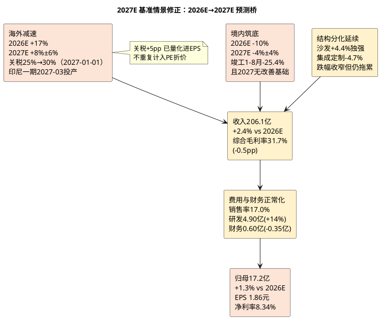

# 顾家家居：增长驱动与盈利预测

**研究日期**：2026年10月15日  
**预测锚点**：2027年（Q4 切换期，按 `deep_investment_analysis_framework.md` 模块零第5条「切换期（Q4）：目标时间点为次年」自动滚算）  
**2026E 对照口径**：2026年三态预测（保守15.5亿/中性16.95亿/乐观18.5亿）保留为对照，不作为本报告的目标年份口径  
**预测基础与2027年新增变量**：在2026H1实际（营收98.75亿+0.75%/归母9.26亿-9.31%/扣非7.69亿-14.59%/毛利率32.49%/财务费用0.96亿/OCF-NP 0.71x）基础上，纳入①美国软体家具关税确认于2027-01-01由25%升至30%；②1-8月住宅竣工-25.4%且机构一致判断2027年竣工不具备改善基础；③公司2026-10-06~08战略年会明确2027年经营关键词「质量经营、结构增长、能力致胜」并主动降低经营杠杆；④敏华控股2026-10-13港交所盈利警告（FY27H1溢利预减70%-90%，收入基本持平；主因化工原料涨价未完全转嫁+美国子公司Southern Motion申请第11章破产并计提商誉减值）——该事件指向**行业级成本转嫁能力缺失**（最重要）、海外并购整合风险（次要）与美国需求疲弱（较弱）；⑤研发费用刚性（H1 2.37亿+20.35%）与定增18.63亿净额到账后的财务费用正常化。

## 建模原则（2027E：从「境内崩塌+海外代价式增长」转为「境内筑底+海外减速+质量经营换利润」）

原2026E中性假设（营收201.3亿+0.4%/归母16.95亿/EPS_年末1.83元）已于2026H1被部分证伪（境内-12.71%、Q2毛利率31.35%、扣非Q2 -18.69%）。**2027E 的核心问题已不是「境内跌多少」，而是「境内能否筑底 + 海外在关税上调后还能否维持双位数增长 + 质量经营能否把毛利率与费用率拉回」**。三者的证据强度差异决定了三态分歧。

**为什么2027E中性是17.2亿而不是「线性外推的17.8亿」**：若仅将2026E中性利润（16.95亿）按收入增速与费用正常化线性外推、不纳入2027年新增变量，2027E归母将约为17.8亿；纳入三项2027年确定性变量后下修至17.2亿（-0.6亿）——①关税25%→30%于2027-01-01确定落地，按境外收入107.5亿、美国占比约45%测算，+5pp关税对应税前成本约2.4亿，假设客户分担约50%，税后影响约-0.97亿；②1-8月竣工-25.4%且国信证券明确判断「竣工在未来3年内可能都不具备改善的可能性」，境内2027E假设由+2%下调至-4%；③研发费用刚性（H1+20.35%）使2027E研发假设由4.3亿上调至4.9亿。反向对冲项为财务费用正常化（0.95→0.60亿，税后+0.28亿）。

## 2027E 增长驱动矩阵（量×价×成本第一性原理，含确定性评分与证据来源）

| 增长驱动 | 2026E 实测/基准 | 2027E Q（量/份额）假设 | 2027E P（价/结构）假设 | 2027E 收入贡献 | 确定性 | 证据来源 |
|:--|:--|:--|:--|:--|:--:|:--|
| 沙发（功能/客餐厅） | H1 64.50亿**+13.81%**、毛利率35.16%（-0.89pct） | 全年出货+4%（H1+13.81%后增速收敛，因家具社零1-8月-4.9%） | ASP持平至+1%（SoundSphere Studio等新品，但H1成本+15.40%>收入+13.81%显示无提价权） | 124.5→**130.0亿（+4.4%）** | **3/5** | [E1][E2][E6] |
| 卧室（床垫/软床） | H1 16.91亿-0.13%、毛利率39.83%（-2.98pct） | 全年+3%（高端睡眠产品H1销售+9.3%，但板块整体停滞） | 毛利率回升至40.0%（结构提纯，不再假设拉动整体） | 34.4→**35.5亿（+3.2%）** | **2/5** | [E1][E2] |
| 集成+定制 | H1 集成-29.05%/定制-38.67% | 全年-5%（竣工-25.4%硬约束，跌幅自-22.8%收窄） | 无整家溢价，毛利率31.5% | 25.7→**24.5亿（-4.7%）** | **4/5** | [E1][E5] |
| 信息技术服务 | H1 2.98亿-20.24%、毛利率80.23% | 全年-2%（高毛利小业务） | 毛利率维持80% | 6.5→**6.4亿（-1.5%）** | **3/5** | [E1] |
| 境外ODM/OBM（含跨境CHITA） | H1 50.67亿**+19.01%**、毛利率24.24%（-2.12pct） | 全年+8%（关税25%→30%压制美国；非美/欧洲/中东/东南亚+印尼一期2027-03投产对冲） | 境外毛利率23.5%（关税+5pp部分转嫁，印尼/越南成本优势部分对冲） | 99.6→**107.5亿（+8.0%）** | **3/5** | [E1][E7][E8] |
| 境内自有品牌零售 | H1 45.61亿**-12.71%**（跑输社零8.2pp） | 全年-4%（跌幅收窄但未转正；旧改/存量翻新为结构性增量，二手房网签1-8月+10.6%） | 境内毛利率42.0%（结构提纯，量不增则毛利贡献有限） | 95.5→**91.7亿（-4.0%）** | **2/5** | [E1][E3][E4] |
| 股本与摊薄 | 2026-08-07定增1.0428亿股@17.94元，总股本8.2145→9.2573亿（+12.68%） | 2027年无新增摊薄，加权股本=年末股本=9.2573亿 | — | 消除2026年的加权/年末口径差 | **5/5（已登记）** | [E9] |
| 印尼一期产能 | 2026H1在建工程4.94亿+32.8% vs年初 | 一期2027年3月底投产，达产后年产值2.2亿美元（约15.7亿元）；2027年当年贡献有限 | 不计入2027E利润，仅计折旧与资本开支 | 2027E 不计入收入 | **3/5** | [E10] |

*注：确定性评分标准——5分=已落地重大合同/已转固/已公告排产；3分=行业趋势确定且具备壁垒但未体现为在手订单；1分=高度依赖外部宏观变量或管理层愿景。本表最高仅给4分（集成定制的高确定下滑），无任何增长驱动达到5分，反映2027E不存在「已锁定的增长」。*

## 2027E 三态利润矩阵（目标年份口径，按9.2573亿股统一计算）

| 情景 | 核心假设 | 2027E营收（亿元） | 归母净利（亿元） | EPS（元） | 净利率 | 概率 |
|:--|:--|--:|--:|--:|--:|--:|
| 保守 | 境内-8%（竣工无改善+价格战）、境外+2%（关税30%压制美国需求）、毛利率31.0%（关税全额自担）、销售费用率17.5%刚性 | 195.7 | **13.4** | **1.45** | 6.86% | 30% |
| **中性** | **境内-4%、境外+8%、毛利率31.7%、销售费用率17.0%、财务费用0.60亿** | **206.1** | **17.2** | **1.86** | **8.34%** | **50%** |
| 乐观 | 境内+3%、境外+14%、毛利率33.0%、销售费用率16.6%（触发条件见下方乐观情景证据缺口说明） | 219.0 | **21.8** | **2.35** | 9.95% | 20% |

| 对照：2026E 口径（保留，不作目标年份） | 营收（亿元） | 归母净利（亿元） | EPS（元） | 概率 |
|:--|--:|--:|--:|--:|
| 保守 | 196.2 | 15.5 | 1.67 | 30% |
| 中性 | 201.3 | 16.95 | 1.83 | 50% |
| 乐观 | 206.4 | 18.5 | 2.00 | 20% |

**乐观情景的证据缺口说明（必须显式标注）**：乐观情景假设境内+3%，与本章「2027年竣工无改善基础、境内不给正增长」的核心论证相左，属**证据缺口处**——其触发条件是三条同时成立：①2027年竣工降幅收窄至-15%以内（国信证券当前判断为「3年内无改善基础」，故该条件为反方证据）；②公司零售转型使存量翻新/旧改渠道放量（业绩说明会披露广东省样板区域轻量化小整家占区域总营收50%，但仅为单一区域、无全国验证）；③境内单店产出在渠道收缩后触底回升（H1尚无证据，单店产出仍双位数下滑）。**三条同时兑现的概率被赋予20%，且乐观情景归母21.8亿（EPS 2.35元）将超过公司2023年历史峰值20.06亿，因此该情景仅作赔率上限参考，不作为定价中枢。** 若2026Q3与2026年报均未出现境内跌幅收敛至-5%以内的信号，乐观情景概率应由20%下调至10%。

**2026E→2027E 中性变化**：营收 201.3→206.1亿（+2.4%）；归母 16.95→17.2亿（**+1.3%**）；EPS 1.83→1.86元（+1.6%）。**2027E 中性仅录得约1%的利润增长，本质是「零增长年」**：收入增长2.4%被毛利率-0.5pp抵消，最终利润增量主要来自财务费用正常化（汇兑损失不再重演，-0.35亿，税后+0.28亿）与销售费用率优化（-0.46pp，+0.95亿），被研发加码（+0.60亿）与关税成本（税后-0.97亿）大幅抵消。

**概率加权 EPS = 1.45×0.3 + 1.86×0.5 + 2.35×0.2 = 1.835元**（2026E 同口径为1.816元；若按2026年加权平均股本8.65亿股折算则为1.945元，两者差异即定增摊薄的时间权重），加权值低于中性值，反映左侧（保守情景）概率权重仍达30%。

## 利润矩阵、费用弹性与分部模拟（2027E 中性）

| 中性利润表桥（亿元） | 2027E | 2026E（对照） | 变化说明 |
|:--|--:|--:|:--|
| 营业收入 | 206.1 | 201.3 | +4.8亿（境内-4% vs -10%、境外+8% vs +17%） |
| 毛利润 | 65.3 | 64.9 | +0.4亿（毛利率31.7% vs 32.24%，-0.54pp） |
| 销售费用 | 35.0 | 35.1 | 费用率17.0% vs 17.46%（零售转型投入持续但收入增长摊薄） |
| 管理费用 | 3.4 | 3.4 | 费率1.67%持平 |
| 研发费用 | 4.9 | 4.3 | **+0.60亿（+14%）**，H1已2.37亿+20.35%，投入刚性 |
| 财务费用 | 0.6 | 0.95 | **-0.35亿**，汇兑损失正常化+定增18.63亿资金利息收入 |
| 税金及附加 | 1.5 | 1.5 | 费率0.75%持平 |
| 其他收益/投资收益/减值净额 | 0.6 | 0.86 | 2025年曾因资产减值-1.57亿拖累，假设不重演但保留部分减值 |
| 营业利润 | 20.4 | 20.5 | -0.1亿 |
| 营业外净额（政府补助为主） | 1.3 | 1.43 | H1 2026已1.47亿收入/1.38亿净额，属常态化补助 |
| 利润总额 | 21.7 | 21.9 | — |
| 所得税（19.0%） | 4.1 | 4.16 | 实际税率2025年17.82%、2026H1 19.02%，取19% |
| 少数股东损益 | 0.4 | 0.81 | — |
| **归母净利** | **17.2** | **16.95** | **+0.25亿（+1.3%）** |
| **EPS（9.2573亿股）** | **1.86** | **1.83** | +1.6% |

*2026E 校准说明：以2026H1实际（营收98.75亿/毛利32.09亿/营业利润10.18亿/归母9.26亿）为底，H2假设营收102.55亿（0% YoY）、毛利率32.0%、销售费用率17.8%、研发1.93亿、财务-0.01亿，得H2归母7.69亿（与2025H2持平），全年归母16.95亿。该桥可完整复现原中性16.95亿，故2026E→2027E的变化均为口径可比。*

**分部模拟（框架SOTP算法，K系数与披露口径校正）**：`板块模拟净利 = 板块营收 × [产品口径毛利率_i - (总期间费用率 × K_i)] × (1 - 有效税率)`，其中**总期间费用率 = 21.34%（(销售35.03+管理3.44+研发4.90+财务0.60)/206.07）**、**有效税率 = 19%（2025年17.82%、2026H1 19.02%，取19%）**，故`(1-税率) = 0.81`。**关键口径校正**：公司披露的分产品毛利率（沙发35.16%/卧室39.83%/集成31.60%）为**不含运输费的产品口径**，与合并口径（2026H1综合32.49%）的差额即运输费——2026H1产品口径加权毛利35.53亿 vs 主营毛利31.50亿，差额4.03亿，与披露的「主营运输费4.04亿」几乎完全一致。故SOTP必须单列运输费扣减项，否则将系统性高估分部利润。

| 2027E 中性分部模拟 | 2027E收入（亿） | 产品口径毛利率 | 毛利（亿） | K | 分摊期间费用（亿） | 板块模拟净利（亿元） | 备注与确定性 |
|:--|--:|--:|--:|--:|--:|--:|:--|
| 沙发 | 130.0 | 34.5% | 44.85 | 1.0 | 27.74 | **13.86** | 量增但无提价权，确定性3/5（无在手订单披露，不给5分） |
| 卧室产品 | 35.5 | 40.0% | 14.20 | 1.0 | 7.58 | **5.37** | 毛利率企稳但量停滞，确定性2/5 |
| 集成+定制 | 24.5 | 31.5% | 7.72 | 1.2 | 6.27 | **1.17** | 高管理难度品类，确定性4/5（高确定下滑） |
| 信息技术服务 | 6.4 | 80.0% | 5.12 | 0.8 | 1.09 | **3.26** | 高毛利小业务，确定性3/5 |
| 其他业务 | 6.87 | 25.0% | 1.72 | 0.8 | 1.17 | **0.44** | 合并口径其他，确定性2/5 |
| 运输费扣减 | -8.30 | — | -8.30 | — | — | **-6.72** | 产品口径→合并口径的强制勾稽项（H1已4.04亿） |
| 税金及附加 | — | — | — | — | 1.55 | **-1.25** | — |
| 其他收益/投资收益/减值净额 | — | — | — | — | — | **+0.49** | — |
| 小计 | — | — | — | — | — | **16.61** | — |
| 营业外净额 | — | — | — | — | — | **+1.05** | 政府补助常态化（税后值，对应利润表1.30亿×0.81） |
| 少数股东损益 | — | — | — | — | — | **-0.40** | — |
| **归母净利** | **206.1** | — | — | — | — | **17.26** | 与中性17.18亿勾稽差+0.08亿（+0.5%），**<2%视为通过** |

**分部结论**：利润仍高度依赖沙发（13.86/17.26 = **80.3%**）与卧室（5.37，31.1%），集成定制合计仅1.17亿（占比6.8%），信息服务3.26亿不能改变估值体系。**风险集中度进一步上升**：单一品类（沙发）贡献超八成利润，意味着「沙发毛利率止跌」已成为公司利润的单一胜负手——若沙发毛利率再降1pp，将直接冲击约1.3亿归母（-7.5%）。运输费单列后暴露的另一事实：**产品口径毛利率（2026H1加权35.5%）与合并口径（32.49%）之间存在约4pp的运输费/不可分摊成本缺口**，该缺口随境外占比提升而放大（海外发运单箱成本更高），是2027E毛利率难以上行的结构性原因。

## 2027E 分业务P×Q可追溯推导（以2026H1主营96.28亿为底）

| 业务（2025A收入） | 2026H1实测 | 2026H2假设 | 2026E全年 | 2027E全年 | 2027E毛利率 | 证据与确定性 |
|:--|:--|:--|:--|:--|:--|:--|
| 沙发（115.76亿） | 64.50亿+13.81% | 约60亿+8%（旺季+新品） | 124.5亿 | **130.0亿（+4.4%）** | 34.5% | H1独强且竞对敏华沙发-4%，**3/5** [E1][E6] |
| 卧室产品（34.65亿） | 16.91亿-0.13% | 约17.5亿+3% | 34.4亿 | **35.5亿（+3.2%）** | 40.0% | 高端睡眠+9.3%但整体停滞，**2/5** [E1][E2] |
| 集成产品（23.14亿） | 8.25亿-29.05% | 约10亿-15% | 18.3亿 | **17.4亿（-4.9%）** | 31.0% | 新房链硬约束，**4/5** [E1][E5] |
| 定制家具（10.31亿） | 3.39亿-38.67% | 约4亿-20% | 7.4亿 | **7.1亿（-4.1%）** | 32.0% | 竣工-25.4%同步，**4/5** [E1][E5] |
| 信息技术服务（7.32亿） | 2.98亿-20.24% | 约3.5亿-10% | 6.5亿 | **6.4亿（-1.5%）** | 80.0% | 高毛利萎缩，**3/5** [E1] |
| 其他及运输费调节 | H1主营/营收差约2.47亿 | 全年约10.2亿 | 10.2亿 | **9.7亿** | 合并 | — |
| **合计营收** | **H1 98.75** | **H2约102.55（0% YoY）** | **201.3亿** | **206.1亿（+2.4%）** | **综合31.7%** | — |

*注：2027E 集成+定制合计24.5亿 vs 2026E 25.7亿，跌幅由2026年的-22.8%收窄至-4.7%，依据是竣工降幅2027年不再大幅扩大（1-8月-25.4%已接近底部区间），但机构判断2027年竣工「不具备改善基础」，故不给正增长。*

## 2027E 收入结构的海外依赖度审计

| 结构指标 | 2025A | 2026E | 2027E 中性 | 含义 |
|:--|--:|--:|--:|:--|
| 境内收入（亿元） | 106.1 | 95.5 | **91.7** | 连续两年负增长，累计-13.6% |
| 境外收入（亿元） | 85.1 | 99.6 | **107.5** | 连续两年增长，累计+26.3% |
| 境外占比（占主营收入） | 44.5% | 51.0% | **54.0%** | 过半收入来自海外，且仍在提升（2026H1实际52.6%） |
| 境外毛利率 | 25.84% | 24.4%（H1实际24.24%，H2假设小幅改善） | **23.5%** | 关税+5pp后继续下行 |
| 境内毛利率 | 38.35% | 42.0% | **42.0%** | 结构提纯但量崩，边际贡献有限 |

**这是2027E模型的核心张力**：公司收入结构正加速「去内需化」，但海外每增1%收入对综合毛利率是稀释而非增厚（境外毛利率23.5% vs 境内42.0%，差18.5pp；境外每增1%收入稀释综合毛利率约5.7bp）。2027E 境外占主营比重再升3.0pp，本身就带来约-17bp的毛利率压力，叠加关税+5pp的1pp毛利率影响，构成毛利率从32.24%降至31.7%的全部来源。**海外增长在2027年已是「以规模换结构」而非「以规模换利润」**——这与2026年的判断一致，但恶化幅度因关税确认而加深。

## 费用结构的弹韧性审计（2027E）

| 费用项 | 2025A费率 | 2026H1费率 | 2026E | 2027E中性 | 弹性判断 |
|:--|--:|--:|--:|--:|:--|
| 销售费用率 | 17.14% | 17.12% | 17.46% | **17.00%** | 低弹性（H1收入零增长下费率仅+0.50pct，显示已高度控费，进一步压缩空间有限） |
| 管理费用率 | 1.86% | 1.64% | 1.67% | **1.67%** | 低弹性，已处历史低位 |
| 研发费用率 | 1.84% | 2.40% | 2.14% | **2.38%** | **逆周期刚性**（H1+20.35%远超营收+0.75%） |
| 财务费用 | 0.01亿 | 0.96亿 | 0.95亿 | **0.60亿** | 高弹性但方向取决于汇率，非经营改善 |
| 四项合计占收 | 20.86% | 22.14% | 21.22% | **21.34%** | 2027E 与2026E基本持平 |

**结论**：2027E 的「质量经营」（公司2027年经营关键词之一）在费用端几乎没有可提取的弹性——管理费用率已1.67%历史低位，销售费用率17.0%已是H1零增长下的控费结果，研发逆势加码。**唯一确定的费用改善来自财务费用（-0.35亿），而这是汇率变量而非经营变量**。因此中性情景的+1.3%利润增长，本质是「汇率不再恶化 + 关税成本可承受」的被动结果，不具备自我强化的增长动能。

## 2027E 证据链索引（证据回溯制）

- **[E1]** 公司2026年半年度报告（公告编号2026-064，披露日2026-08-28）：营收98.75亿+0.75%、归母9.26亿-9.31%、扣非7.69亿-14.59%、综合毛利率32.49%、分产品（沙发64.50亿+13.81%毛利率35.16%/卧室16.91亿-0.13%毛利率39.83%/集成8.25亿-29.05%/定制3.39亿-38.67%/信息服务2.98亿-20.24%）、分地区（境内45.61亿-12.71%毛利率42.14%/境外50.67亿+19.01%毛利率24.24%）、合同负债11.54亿-25.11% YoY、应收19.16亿+25.73%、OCF 6.59亿-39.76%、财务费用0.96亿、研发2.37亿+20.35%、在建工程4.94亿+32.83% vs年初、短期借款11.91亿+113%。
- **[E2]** 公司2026年半年度业绩说明会（2026-09-29，经新浪财经2026-10-01报道）：两款高端睡眠产品合计带动卧室高端品类销售规模同比增长9.3%；广东省样板区域轻量化小整家业务占区域总营收比例达50%；下半年将「坚定地把经营质量，即盈利能力与现金流水平放在优先且重要的战略地位」，以「三大重整、两大工程」为抓手降低经营杠杆。
- **[E3]** 国家统计局2026年1-8月数据（2026-09-15发布）：家具类零售额1-8月1149亿**-4.9%**（8月单月147亿-7.9%）；住宅竣工面积1-8月14798万㎡**-25.4%**；住宅新开工21840万㎡-25.4%；住宅销售面积-13.0%；二手房交易网签面积54923万㎡**+10.6%**；新建商品房待售面积-1.1%（连续六个月下降）。
- **[E4]** 国信证券《房地产行业2026年中期投资策略》（2026-06）：预计2026年竣工面积4.7亿㎡（-20%），并明确「竣工在未来3年内，可能都不具备改善的可能性」（依据期房库存2025年末同比-58.9%）。高盛2026-09-18中国房地产专家电话会：2027年3月起新房可能出现持续12-18个月的供应缺口（供给收缩，但竣工端无改善）。花旗：2027年为核心城市房价复苏关键年，但对2026Q4保持谨慎。
- **[E5]** 乐居财经《2026上半年定制家居业绩榜》（2026-09-04）：9家定制家居上市公司营收同比全部下滑，欧派59.5亿-27.79%、索菲亚33.77亿-25.8%（净利-80.61%）；国家统计局：2026年1-6月规模以上家具企业营收-8.6%、**利润总额-52.7%**（利润降幅远超营收）。
- **[E6]** 敏华控股公告（2026-10-13）盈利警告：预期截至2026-09-30止六个月权益拥有人应占溢利较2025年同期约11.456亿港元**减少约70%至90%**；2025年12月收购的美国业务（Southern Motion, Inc.）因原材料成本上涨及需求疲弱产生营运亏损，已在美国申请第11章破产程序，相关商誉及无形资产确认减值。
- **[E7]** 美国联邦公报/香港工业贸易署商业资料通告第1/2026号：对进口软垫木制品现行25%关税，原定2026-01-01升至30%已延期，**自2027-01-01起升至30%**（厨柜及洗手台升至50%），除非美国与相关国家达成协议；转运认定将加征40%。越南、墨西哥、印尼等原产国一律适用（除英国10%、欧盟/日本/韩国/台湾15%）。
- **[E8]** 公司投资者关系回复（2026-10-13，上证e互动）：外销定位「全球布局、本土运营」的「软体家居集成供应链服务商及品牌运营商」，拥有中国、越南、墨西哥等多地产能布局，具备为北美、欧洲、亚太等多市场客户提供沙发、床垫、集成配套等的一站式交付能力。
- **[E9]** 定增公告（2026-08-11，登记日2026-08-07）：新增104,281,493股@17.94元，募资净额18.63亿元，限售36个月（控股股东锁定至2029-08-07），总股本8.2145→9.2573亿股。
- **[E10]** 印尼自建基地项目公告（2025-09-02）及奠基仪式（2026-03-16，经每日印尼2026-03-19报道）：总投资11.24亿元（1.6亿美元），用地19.56万㎡，建设期4年，达纲3年，满产年收入25.20亿元；一期计划2027年3月底投产，达产后年产值2.2亿美元，一期可吸纳约6000名本地员工。
- **[E11]** 公司2026年度战略年会（2026-10-06~08，经新浪财经2026-10-10、观点网2026-10-10报道）：总裁李东来明确2027年经营关键词为「**质量经营、结构增长、能力致胜**」，追求有效的规模及高质量增长；董事长邝广雄提出「摒弃浮躁心态，做好长期艰苦奋斗和打持久战的准备」。**管理层自身对2027年的定调是「打持久战」而非「复苏」，与本研究中性情景的「零增长年」判断一致。**
- **[E12]** 项目统一视图实测（2026-10-15）：PE_TTM 12.81x、PE扣非TTM 14.50x、PB 2.09x、PCF_TTM 9.28x、总市值217.08亿；TTM（至2026H1）归母16.95亿、营收201.30亿、OCF 23.39亿；股东户数2026-06-30为20,238户（较Q1 15,453户**+30.96%**）；陆股通持股占流通A股比例1.56%（2026-09-30）vs 3.29%（2026-06-30），来源理杏仁（第三方数据平台，未经公司公告交叉验证）。

## 可证伪预测（2027E 口径）

**2026年三季报（预约披露2026-10-28，按项目惯例10-27盘后即可获取）是本模型的第一道硬检验**：

1. **若Q3出现「合同负债同比仍-15%以上 + 应收增速仍>10% + 境内收入仍双位数降 + Q3扣非仍两位数负增长」**：则2026E中性16.95亿将下修至保守15.5亿，并直接传导至2027E中性——2027E中性归母将下修至约15.5亿（EPS 1.67元），中性目标价下修至约18.7元，盈亏比进一步恶化至约-0.35。
2. **若Q3出现「境内跌幅收窄至-5%以内 + 合同负债QoQ企稳 + OCF/NP回升至>0.8 + 境外毛利率止跌」中至少三项**：则2027E中性可上调至18.5-19.0亿（EPS 2.00-2.05元），中性目标价上调至约22.4元，中性收益率由-12.2%收窄至-4.5%，此时才具备「观察仓」讨论基础。
3. **2027年上半年关键节点**：①印尼一期2027年3月底投产的实际进度与产能利用率（若延期或利用率<50%，乐观情景概率由20%下调至10%）；②2027-01-01关税由25%升至30%的实际执行与客户分担比例（若客户完全不承担，2027E中性再下修约0.5亿）；③2026年报（2027年4月）的全年ROE、OCF与分红政策（若派息率由40%下调，PB-ROE交叉验证下移）。

**证伪标准（模型失效条件）**：若2027E实际归母净利低于13.4亿（保守情景）或高于21.8亿（乐观情景），则本三态框架的概率分布设定失效，需重新评估公司是否已进入「份额持续流失」或「海外二次成长」的新范式。

**数据与证据**：公司2026H1报告、Q1报告、定增公告、印尼项目公告、业绩说明会纪要、战略年会报道、国家统计局1-8月数据、美国联邦公报232条款关税公告、国信证券/高盛/花旗房地产研究、乐居财经定制家居行业统计、敏华控股盈利警告公告、项目统一视图实测；以上为研究者情景预测，不构成业绩承诺。
