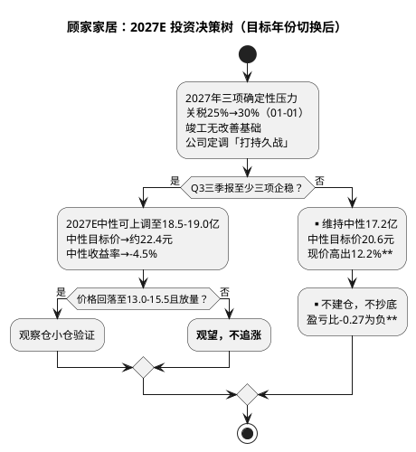

# 顾家家居：投资摘要与风险因素

**研究日期**：2026年10月15日  
**目标年份**：**2027年**（Q4 切换期自动滚算，估值锚定 2027E EPS 1.86元）

## 投资摘要（2027E 口径：从「回调建仓」到「等待右侧」，目标年份切换后下行空间扩大）

| 投资驾驶舱 | 2027E 口径（2026-10-15） | 2026E 口径（2026-10-08） | 决策含义 |
|:--|:--|:--|:--|
| 评级 | **持有/观望，等待验证（第四象限 Avoid/Wait：低确定性+负预期收益）** | 持有/观望，等待验证（第三象限偏第四象限） | **正式落入第四象限，回避/观望** |
| **现价（不复权）** | **23.45元** | 23.29元 | 10月缩量窄幅整理 |
| **保守目标价** | **14.5元** | 16.74元 | 下行风险锚下移13.4% |
| **中性目标价** | **20.6元** | 23.07元 | **下移10.7%（盈利持平但倍数由11.76x→11.18x）** |
| **乐观目标价** | **31.8元** | 29.98元 | 上移6.1%（乐观情景盈利上台阶至21.8亿） |
| **加权目标价** | **21.0元** | 22.55元 | 下移6.9% |
| **中性收益率** | **-12.2%** | -0.9% | **由基本持平转为明确下行** |
| **盈亏比** | **-0.27** | -0.11 | **进一步恶化** |
| 估值坐标 | PE_TTM 12.81x / PB 2.09x / 市值217.08亿 | 12.72x / 2.07x / 215.60亿 | 低估值安全边际持续收窄 |
| 主要上行证据 | 沙发H1+13.81%（64.50亿）为唯一亮点；境内毛利率提纯至42.14%；定增18.63亿补流 | 同 | 收窄至单品 |
| 主要下行证据 | **三链共振恶化未修复**：境内-12.71%/合同-25.1%/OCF-NP 0.71x + **2027年关税确认25%→30%** + 竣工无改善基础 | 三链共振恶化 | 新增确定性负面变量 |

| 风险 | 领先指标（H1已兑现） | 预警阈值 | 2027E 模型动作 |
|:--|:--|:--|:--|
| 国内需求/渠道 | 家具社零1-8月-4.9%（8月-7.9%）、合同11.54亿-25.1% YoY、境内-12.71% | 已触发 | 境内2027E -4%（跌幅收窄但未转正） |
| 竞争/促销 | 沙发毛利率35.16% -0.89pct、Q2综合31.35% -2.05pp；规上家具企业1-6月利润总额-52.7% | 已触发 | 综合毛利率31.7%（-0.54pp） |
| 海外质量与关税 | 境外毛利率24.24% -2.12pct、应收+25.7%、**关税2027-01-01升至30%** | 已触发+新增确定 | 境外毛利率23.5%、PE尾部折价-3% |
| 化工原料（新增） | TDI上半年均价1.63万+31%、海绵+40%；**敏华2026-10-13警告「海湾冲突以来化工原料持续飙升、价格调整滞后未能完全抵消」（收入持平、利润预减70-90%）** | 行业级转嫁能力缺失 | 综合毛利率31.7%存在下修风险（原料再涨10%则归母下修约0.5-0.8亿） |
| 汇率 | 财务费用0.96亿（vs -0.25亿）、人民币1H升值3% | 已触发 | 财务费用0.60亿（正常化假设） |
| 海外基地 | 在建4.94亿+32.8%、短借+113% | 投入加速 | 不计入2027E利润，全球化折价-1% |
| 现金流 | OCF 6.59亿-39.76%、OCF/NP 0.71x | 已跌破0.8x | PE折价-3% |
| 筹码与流动性（新增） | 股东户数+30.96%至20,238户、陆股通持股3.29%→1.56% | 边际恶化 | PE折价-1% |

**目标年份切换的核心含义**：2026E→2027E 中性归母仅由16.95亿升至17.2亿（**+1.3%，本质是零增长年**），但中性目标价由23.07元降至20.6元（-10.7%），差异全部来自**估值倍数下移**（未调整基准PE由14.0x降至13.0x，审计Σ由-16%收窄至-14%，净得修正PE由11.76x降至11.18x）。这揭示了一个关键事实：**切换目标年份并未带来「盈利增长消化估值」的改善，反而暴露公司已进入「盈利零增长 + 倍数下行」的双重挤压阶段**。

三项2027年确定性负面证据支撑该判断：①**美国软体家具关税确认于2027-01-01由25%升至30%**（原为「拟提，已延期」，现为联邦公报明确执行日期），公司境外收入占主营比重2027E将达54.0%（2026H1已达52.6%），越南/墨西哥/印尼原产一律适用；②**机构一致判断2027年竣工不具备改善基础**（国信证券：期房库存2025年末同比-58.9%，竣工在未来3年内可能都不具备改善的可能性；1-8月住宅竣工-25.4%）；③**公司自身在2026-10-06~08战略年会上将2027年定调为「打持久战」**，经营关键词为「质量经营、结构增长、能力致胜」，明确「降低经营杠杆、优化经营结构」，即管理层不预期2027年出现需求复苏。

## 三态定价与决策含义（2027E 口径，含审计调节与概率加权）

| 情景 | 概率 | 2027E归母（亿） | 2027E EPS（元） | 情景PE | **情景市值（亿元）** | **目标价（不复权）** | 相对现价23.45 | 触发组合 | 投资含义 |
|:--|--:|--:|--:|--:|--:|--:|--:|:--|:--|
| **保守** | 30% | 13.4 | 1.45 | 10.0x | **134** | **14.5元** | **-38.2%** | 境内-8%、境外+2%、毛利率31.0%、关税全额自担 | 风控锚，不以低PE加仓 |
| **中性** | 50% | 17.2 | 1.86 | **11.18x** | **191** | **20.6元** | **-12.2%** | 境内-4%、境外+8%、毛利率31.7%、财务费用0.60亿 | 现价高出12.2%，无上行 |
| **乐观** | 20% | 21.8 | 2.35 | 13.5x | **294** | **31.8元** | **+35.6%** | 境内+3%、境外+14%、毛利率33.0%、印尼投产+非美放量（**证据缺口：境内+3%与「2027竣工无改善」相左，需三条同时兑现，仅作赔率上限，详见章节五**） | 需2027上半年实质验证 |
| **概率加权** | 100% | 17.2 | **1.835** | — | **194** | **21.0元** | **-10.5%** | — | 低于中性，反映左侧风险仍大 |

**加权目标价 = 21.0元**（= 14.5×0.30 + 20.6×0.50 + 31.8×0.20）；**中性收益率 = (20.6-23.45)/23.45 = -12.2%**；**盈亏比 = (21.0-23.45)/(23.45-14.5) = -0.27**。

三态意义在于揭示「低估值幻觉的进一步深化」：即使PE维持11.18x（仅较2026E的11.76x下调0.58x），盈利零增长已使中性价跌破现价12.2%。**原18.5-20.5元「理想观察区」在2027E口径下已高于中性目标价20.6元，不再具备安全垫**，故下移至**13.0-15.5元**（对应保守价14.5元上下约±7%）。

**悲观情景的下行锚**：保守目标价14.5元较现价-38.2%，是本报告最需正视的数字——它意味着若2027年境内继续-8%、境外仅+2%、毛利率跌至31.0%，市场将给予10.0x PE（低于近5年PE_TTM低点11.08x），对应市值134亿。**该情景不是危言耸听**：1-6月规上家具企业利润总额已同比-52.7%，行业盈利中枢的塌陷速度远超收入下滑速度。

## 风险优先级（2027E 口径：前三项已触发并新增关税确定性风险）

1. **国内需求与订单失速（已触发，高）**：境内-12.71%（跑输社零8.2pp）、家具社零1-8月-4.9%且8月-7.9%、合同-25.1% YoY且QoQ -9.26%、定制-38.67%/集成-29%。→ 已兑现为境内收入崩塌；2027年竣工无改善基础（国信证券），二手房网签+10.6%与旧改仅提供部分缓冲，模型仅假设跌幅收窄至-4%。**Q3若合同仍<-15%则2027E中性下修至约15.5亿**。
2. **关税与海外盈利质量（已触发+新增确定，高）**：境外+19%但毛利率-2.12pct、应收+25.7%远快于营收；**美国232条款关税2027-01-01由25%升至30%（联邦公报明确），转运认定加征40%**。→ 已量化进2027E（境外毛利率23.5%），尾部风险保留PE折价-3%。**敏华控股2026-10-13盈利预警（FY27H1溢利预减70%-90%，美国子公司Southern Motion申请第11章破产）是行业级警示：主因是化工原料涨价无法向下游转嫁（收入基本持平）+海外并购整合风险高**。
3. **盈利质量与费用刚性（已触发，高）**：扣非-14.59%（Q2 -18.69%）、综合毛利率32.49% -0.40pp（Q2 -2.05pp）、销售+3.81%/研发+20.35%/财务+1.21亿致费用率22.14% vs 21.52%去年。→ 已兑现；2027E研发加码至4.90亿，费用端无弹性可提。
4. **化工原料第二轮上行与转嫁能力缺失（新增，中高）**：敏华控股2026-10-13盈利警告明确「海湾冲突以来化工行业关键原材料价格持续飙升，行业竞争加剧、产品价格调整滞后未能完全抵消」，其毛利率长期40%以上仍无法转嫁，说明**2026H2起的原料上行为行业级且转嫁能力普遍缺失**。→ 顾家2026H2—2027E综合毛利率假设31.7%存在下修风险；若TDI/聚醚再涨10%，2027E归母将下修约0.5-0.8亿。
5. **现金流与营运资本（已触发，高）**：OCF 6.59亿-39.76%、OCF/NP 0.71x首次跌破1.0、应收19.16亿+25.73%、短借11.91亿+113%。→ 已兑现，PE折价-3%，需Q3回正验证。
6. **筹码结构恶化（新增，中高）**：股东户数2026-06-30达20,238户（**+30.96%**），户均持股市值由177.5万降至90.8万；陆股通持股占流通A股由3.29%（06-30）降至1.56%（09-30）。→ 散户化+北向减配是真实的边际资金流出，PE折价-1%。来源理杏仁（第三方平台，未经公司公告交叉验证）。
7. **治理与股东层面（中）**：持股5%以上股东**德烨嘉俊**（原顾家集团，持股88,471,483股，占总股本约9.56%，为第二大股东）重整案已收到2家投资人报名（2026-05-23报名截止，2026-07-23提交重整投资方案截止），后续遴选与重整计划表决存在不确定性；公司明确该股东非控股股东/实控人，不影响控制权与经营。**2026-06-01董事顾江生（创始股东方）辞去董事及战略与ESG委员会职务；2026-06-29财务负责人高林因工作调整辞任、由刘海兰接任——财务负责人一年内变更（2025-07高林上任、2026-06刘海兰接任）需在后续财报审计质量上持续观察**。另有TB Home等合计约5,080万股（占总股本5.5%）质押及冻结需持续跟踪；第三方平台（理杏仁）显示2026-10-09质押股数与前十大股东持股之比约54.13%（**未经公司公告交叉验证，仅作线索**）。
8. **汇率（中，持续）**：人民币1H升值3%致财务费用+1.21亿。→ H1已兑现，2027E假设汇率正常化（财务费用0.60亿），若人民币继续单边升值则再下修约0.3-0.5亿。
9. **子公司与一次性事件（中低）**：全资子公司**顾家智能家居嘉兴有限公司2026H1净利润-5,966.34万元**（2025年全年+2,107.02万元，营收8.09亿 vs 2025年17.37亿），由盈转亏是H1盈利下滑的组成部分，需在2026年报中验证是否延续；**2026-10-10晚河北涿州一加盟店建筑起火**，品牌方10-12回应门店端受损、仓库未受影响、交付不受影响（来源：经济观察网2026-10-14），属一次性扰动，但需关注消防调查结论与对经销商的帮扶安排是否引发渠道端信心问题。
10. **商誉与资本开支回报（中低）**：商誉3.63亿持平（2025年末+31.98%），占总资产1.85%，需ROIC验证；印尼基地总投11.24亿元处于建设期，2027-03一期投产前仅增加折旧与现金流出，若达产进度或产能利用率不及预期（乐观情景假设达产后年产值2.2亿美元），将触发商誉与固定资产减值风险。ROIC已由2025年15.66%降至2026H1的7.65%。

**风险排序的变化**：新增两项——**关税确定上调（从尾部变为已量化）**与**筹码结构恶化（从无到有）**，另将治理/股东层面、子公司与一次性事件、商誉与资本开支回报纳入清单。前三项（需求/海外/盈利质量）维持「已触发」定级，估值从「盈利折价」进一步升级为「现金+订单+流动性三重折价」（PE -14%）。

## 研究结论象限（2027E 口径：第四象限 Avoid/Wait）

| 维度 | 2027E 口径（2026-10-15） | 2026E 口径（2026-10-08） | 变化 |
|:--|:--|:--|:--|
| 确定性 | **低**：三链共振恶化未修复，2027年关税确认上调，管理层自定调「打持久战」，单一品类（沙发）贡献80.3%利润 | 中低 | 下调一档 |
| 预期收益空间 | **负且扩大**：中性-12.2%、加权-10.5%，盈亏比-0.27 | 负：中性-0.9%、加权-4.5%，盈亏比-0.11 | **恶化** |
| 象限 | **第四象限（Avoid/Wait：低确定性 + 负预期收益）** | 第三象限偏第四象限 | **正式落入第四象限** |
| 建议 | **持有/观望，等待验证；不抄底，不追涨；观察区13.0-15.5元** | 持有/观望，等待验证；观察区18.5-20.5元 | **取消原观察区** |

**象限迁移路径**：按框架模块八定义，第四象限为「低确定性 + 低（负）预期收益」。原第三象限（高确定性+低收益）的确定性已由中高降至**低**（三链恶化未修复+关税确认+竣工无改善+单一品类依赖），预期收益已转为 **-12.2%** 的明确负值，**两项条件同时满足第四象限（Avoid/Wait）**，故本次正式定性为第四象限回避/观望。若Q3境内跌幅收敛至-5%以内且合同/现金企稳、确定性回升至中档，可回退至第三象限边缘；若Q3继续三链恶化，则2027E中性将下修至约15.5亿、中性目标价约18.7元，回避判断强化。

本结论的核心是：**顾家已从「龙头在低估值下值得跟踪」进一步转为「龙头在盈利零增长+倍数下行+关税确认上调下需等待右侧，且右侧价格比上一轮判断更低」**。目标年份切换到2027年并未改善赔率，反而因关税落地与竣工无改善基础而恶化。

从组合角度，顾家**不适合作为「现金流防御型观察仓」**：OCF/NP 0.71x已破坏现金流防御叙事，2027E中性利润零增长且单一品类（沙发）贡献80.3%利润，组合中应降至**标配以下或观察仓**，仅在13.0-15.5元且三链验证后再考虑战术配置。

## 行动清单（2027E 口径）

1. **评级与仓位语言**：维持 **「持有/观望，等待验证」**，观察区由18.5-20.5元**下移至13.0-15.5元**（原观察区在新口径下已高于中性目标价，不具备安全垫）。该表述对-0.27盈亏比、-12.2%中性收益率与2027年关税确认上调负责。
2. **上调条件（苛刻）**：2026Q3出现：①境内收入YoY跌幅收窄至-5%以内、②合同负债YoY跌幅<15%且QoQ止跌、③OCF/NP回升至>0.8且应收增速<10%、④境外毛利率止跌。其中①+②为必需，③+④至少一项。技术上需放量收复并站稳MA60（23.82元）3日。达成后2027E中性上调至18.5-19.0亿、中性目标价约22.4元。
3. **下调条件（已半触发）**：三链中至少两条持续恶化已满足；若Q3扣非仍两位数负增长且合同/应收继续恶化，则**正式切换保守情景（14.5元）并评估周期压力9.60元**，不以PE 12.81x低位机械加仓。跌破22.06元一年低点则无条件风控。
4. **长期重估条件**：仅当①功能沙发毛利率企稳>35%、②卧室收入转正且毛利率>40%、③海外回款改善（应收增速<收入增速）、④印尼一期2027年3月投产且产能利用率>70% 被连续两季验证，才讨论估值修复至13.5x以上，否则维持PE 11.18x折价。
5. **关键时间节点**：**2026-10-28（三季报预约披露，按惯例10-27盘后获取）为第一道硬检验**；2026-11-16敏华控股中期业绩（海外需求与竞争强度验证）；2027-01-01美国关税由25%升至30%生效；2027-03印尼一期投产；2027-04-23前后2026年报（全年ROE/OCF/分红政策）；2029-08-07定增股份（1.0428亿股）解禁。

这份2027E重锚定的核心贡献，是把顾家从「质量转弱、赔率转负」进一步定位为 **「盈利零增长年 + 倍数下行 + 关税确认上调」的三重压制**，用2027年三项确定性证据（关税落地、竣工无改善、管理层自定调持久战）说明：**切换目标年份不产生价值，只产生更清晰的风险定价**。
