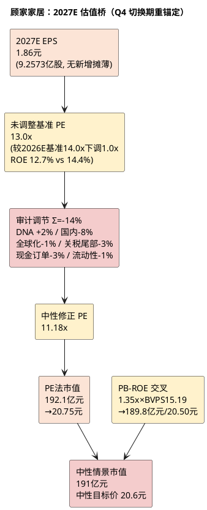

# 顾家家居：估值定价分析

**研究日期**：2026年10月15日  
**目标年份**：**2027年**（Q4 切换期，按 `deep_investment_analysis_framework.md` 模块零第5条与模块六「估值锚点切换：切换期（Q4）自动滚算至次年」自动锚定 2027E EPS）  
**市价口径**：2026年10月15日不复权收盘价 **23.45元**（后复权56.56元，复权因子2.412146；来源：项目统一视图 `daily_kline` / `v_daily_valuation` 实测）

## 方法选择（2027E：股本摊薄已出清，估值压力全部来自盈利与倍数）

**为什么切换到2027E**：框架模块零第5条与模块六「估值锚点切换」明确规定，Q4 为切换期，估值锚点自动滚算至次年。2026年已进入Q4（10月），继续以2026E EPS（1.83元）定价将产生「目标价随年末临近而失效」的时间错配；且2026-08-07定增完成后，2027年**不存在新增股本摊薄**（加权股本=年末股本=9.2573亿股），每股口径第一次恢复干净，此时切换到2027E可避免2026年「加权/年末EPS双口径」带来的定价模糊。

**估值工具选择**：家居行业已从「成长性消费赛道」重构为「地产后周期制造赛道」（行业板块估值中枢自2017年44x下移至2024年19x，2025-2026修复至近十年30-40%分位），属于**低增长、重资产、周期敏感、盈利质量依赖现金流**的商业模式，故：
1. **主锚 PE**：盈利与现金流的直接映射，适配公司盈利驱动特征；三态市值均由「情景盈利×情景PE」给出。
2. **交叉验证 PB-ROE**：软体家居具备实体资产（海外基地65万㎡+印尼19.56万㎡）与稳定的账面净资产，PB-ROE 可校验PE法在ROE下行期是否失真。
3. **不采用 DCF**：公司资本开支处于前置期（印尼建设期4年）且汇率扰动使自由现金流波动过大，DCF 假设敏感度远高于结论价值。
4. **历史分位仅作参考不套用**：现价 PE_TTM 12.81x 处近5年约30%分位（原08-31为12.89x/32%分位），但A股家居板块在极端非理性时段（2024年PE 19x为十年低点、2026年2月股价36.75元时PE更高）分位参考意义有限，故只作为倍数选择的边界校验，不作为定价依据。

| 估值锚 | 2027E 口径（新） | 2026E 口径（旧，已切换） | 变化 | 它回答的问题 |
|:--|--:|--:|--:|:--|
| 现价（不复权，10-15） | **23.45元** | 23.29元（10-08） | +0.16 | 市场已交易价格 |
| 股本 | **9.2573亿（2027年加权=年末同口径）** | 9.2573亿年末/8.65亿加权 | 口径统一 | 摊薄已出清，2027无新增 |
| 2027E EPS（中性） | **1.86元** | 1.83元（2026E年末） | +1.6% | 目标年份每股盈利 |
| 概率加权价值 | **约21.0元** | 约22.55元 | **-6.9%** | 三态风险调整后价值 |
| 中性目标价 | **20.6元** | 23.07元 | **-10.7%** | 盈利持平但倍数下移 |
| 保守目标价 | **14.5元** | 16.74元 | **-13.4%** | 下行风险锚亦下移 |
| 乐观目标价 | **31.8元** | 29.98元 | **+6.1%** | 乐观情景盈利上台阶 |
| 理想观察区 | **13.0-15.5元** | 18.5-20.5元 | 下移约5元 | 赔率修复所需安全边际 |

现价对应的估值坐标（2026-10-15实测）：**PE_TTM 12.81x、PE扣非TTM 14.50x、PB 2.09x、PS_TTM 1.08x、PCF_TTM 9.28x、总市值217.08亿**。现价对应 **2027E 中性 PE 12.63x**、**2027E 中性 PB 1.54x**。低估值安全边际已明显收窄：2026-08-31时PE TTM 12.89x（约32%分位）、PB 2.10x（约35%分位），当前12.81x/2.09x基本持平，**盈利下修与股价横盘使「低估值故事」持续弱化**。

## 三态市值与目标价（2027E，强制性口径）

**计算路径（严格按框架）**：三态市值 = 各情景2027E归母净利 × 情景估值倍数（PE为主、PB-ROE交叉验证后取整）；三态目标价 = 各情景市值 ÷ 9.2573亿股；中性情景使用**审计调节后的修正市值**，保守/乐观情景**不叠加调节**。

| 情景 | 概率 | 2027E归母（亿） | 2027E EPS（元） | 情景PE | **情景市值（亿元）** | **目标价（不复权，元）** | 相对现价23.45 | 触发组合 |
|:--|--:|--:|--:|--:|--:|--:|--:|:--|
| **保守** | 30% | 13.4 | 1.45 | 10.0x | **134** | **14.5** | **-38.2%** | 境内-8%、境外+2%、毛利率31.0%、关税全额自担 |
| **中性** | 50% | 17.2 | 1.86 | **11.18x**（修正后） | **191**¹ | **20.6** | **-12.2%** | 境内-4%、境外+8%、毛利率31.7%、财务费用0.60亿 |
| **乐观** | 20% | 21.8 | 2.35 | 13.5x | **294** | **31.8** | **+35.6%** | 境内+3%、境外+14%、毛利率33.0%、印尼投产+非美放量 |
| **概率加权** | 100% | 17.2 | **1.835** | — | **194** | **21.0** | **-10.5%** | — |

*注¹：中性市值由 PE 法 192.1亿（17.2×11.18）与 PB-ROE 法 189.8亿（1.35x×BVPS 15.19）交叉后取整为 191亿元，故「17.2×11.18」的直接乘积（192.1亿）与表内191亿存在1.1亿的表观差，系交叉取整所致，详见下文「PB-ROE 交叉验证」。*

*情景倍数选择依据*：
- **中性 11.18x** = 未调整基准13.0x × (1 + Σ调节-14%)。基准13.0x 较2026E基准14.0x下调1.0x，理由是2027E ROE（约12.7%）低于2026E（约14.4%，均按期初期末权益均值口径），且2027年关税确认上调、竣工无改善基础，盈利能见度下降；同时定增完成后财务结构与流动性改善部分对冲，故不下调至更低。
- **保守 10.0x**：与2026E保守档持平。该档为「境内失速+关税全额自担+价格战」的盈利塌陷情景，PE压至10.0x（近5年PE_TTM低点为11.08x，保守情景假设跌破历史低点，反映盈利与信心双杀）。**未叠加任何正向调节**（框架强制：对保守情景施加正向调节会人为抬高下行风险锚）。
- **乐观 13.5x**：较2026E乐观档15.0x下调1.5x，因即便乐观情景下ROE（约15.9%）仍低于2023年峰值期的21.87%，且行业估值中枢已系统性下移，不宜再给2026年的15.0x。
- **PB-ROE 交叉验证（中性）**：2026年末归母权益估算约130.3亿（H1末归母权益103.97亿 + H2归母7.69亿 + 定增净额18.63亿）→ BVPS 14.07元；2027年末归母权益约140.6亿（派息率40%）→ **BVPS 15.19元**；2027E平均ROE约12.69%。按 PB=(ROE-g)/(r-g)=(12.69%-3%)/(11%-3%)=1.21x 得纯模型价18.2元；考虑公司海外实体资产与品牌溢价，取 **1.35x PB → 市值189.8亿 / 目标价20.50元**，与PE法192.1亿/20.75元高度吻合（差异1.2%），故中性情景市值取整为 **191亿元**，中性目标价 **20.6元**。

**加权目标价 = 14.5×0.30 + 20.6×0.50 + 31.8×0.20 = 21.0元**（ΣP=100%）。

## 全变量估值审计矩阵（2027E：随2027证据重新审视各因子与Σ）

| 审计维度 | 核心审计因子 | 估值影响力过滤（审慎思考） | 调节（2027E新） | 2026E旧值 | 结论 |
|:--|:--|:--|--:|--:|:--|
| **内部：企业底层特质（DNA）** | 现金转换破1x未修复、品牌渠道（约5,959家门店）、精益与研发投入、定增18.63亿补流 | OCF/NP 0.71x<1x已削弱「现金支撑」溢价；但研发+20.35%、境内毛利率+2.55pct至42.14%显示产品与结构能力尚存；定增后资产负债表修复。属「平庸的优秀」偏正面，但不构成稀缺性溢价 | **+2%** | +2% | 质量溢价维持但不加码 |
| **宏观：国内政策与需求** | 家具社零1-8月-4.9%（8月-7.9%）、住宅竣工1-8月-25.4%、机构判断2027竣工无改善基础；以旧换新延续但边际乘数递减、家装国家层面无统一补贴 | 需求下滑已量化进EPS（境内-4%）；此处保留的是「持续性不确定性」对估值中枢的压制。**较2026E的-10%收窄至-8%**：理由为2027年处于周期下半程、二手房网签1-8月+10.6%与旧改/存量翻新构成结构性增量、且公司自身已下修预期（战略年会定调「打持久战」），预期差空间收窄 | **-8%** | -10% | 主要折价，但幅度收窄2pp |
| **宏观：地缘与外部约束（全球化）** | 境外占主营比重升至54.0%、境外毛利率连续下滑（2025A 25.84%→2026E 24.4%→2027E 23.5%）、敏华控股美国子公司Southern Motion申请第11章破产（敏华营业额基本持平、利润下滑主因化工原料涨价无法转嫁+美国业务商誉减值） | **逻辑纯净性切分**：美国需求疲软与关税成本已量化进EPS（境外增速降至+8%、毛利率23.5%），此处不重复扣减；本档仅计入「模式与整合风险」这一非盈利因子——敏华并购美国资产失败而顾家为自建产能，两者风险性质不同，故仅作小幅中枢折价而非大幅扣除 | **-1%** | 0% | 新增：海外模式风险显性化（与EPS不重复） |
| **宏观：汇率与关税尾部** | 关税现行25%→**2027-01-01确定升至30%**（已量化进EPS：境外毛利率下调1pp）；转运认定加征40%；人民币1H升值3%致财务费用+1.21亿（已进EPS） | **逻辑纯净性关键**：主要关税上调与汇兑损失已进入2027E EPS（境外毛利率23.5%、财务费用0.60亿），此处**严禁重复扣减**，仅保留不可量化的尾部——转运原产地认定（越南/墨西哥/印尼「洗产地」审查）、进一步加征的可能性 | **-3%** | -5% | 下调2pp（原-5%含未确认的30%关税，现该部分已进EPS） |
| **市场：流动性与风格** | PE约30%分位、PB 2.09x；股东户数2026-06-30达20,238户（**+30.96%**）、户均持股市值由177.5万降至90.8万；陆股通持股占流通A股由3.29%（06-30）降至1.56%（09-30） | 筹码结构显著恶化：散户化+北向减配是真实的边际资金流出信号，而非短期风格噪声。但A股家居板块本身非机构重仓赛道，流动性折价幅度有限，故仅小幅计入 | **-1%** | 0% | 新增：筹码分散化折价 |
| **现金与订单（独立维度）** | OCF 6.59亿-39.76%、OCF/NP 0.71x、合同负债11.54亿-25.11% YoY、应收19.16亿+25.73% | 订单与现金是领先指标，其恶化属「信心折价」而非可量化成本（可量化部分已进EPS）。Q3（10-28披露）前无法证伪，保留折价 | **-3%** | -3% | 维持 |
| **综合调节系数** | — | — | **Σ = -14%** | -16% | **中性修正 PE 11.18x vs 原11.76x** |

**逻辑纯净性校验（严禁重复计算）**：

| 因子 | 已进EPS（2027E） | 已进PE折价 | 严禁重复 |
|:--|:--|:--|:--|
| 境内需求下滑 | 境内收入-4%、境内毛利率42.0% | -8%（持续性不确定性） | 同一份需求下滑不可再压低倍数 |
| 关税25%→30% | 境外毛利率23.5%（-1pp，约-1.08亿毛利） | 仅-3%保留尾部（转运/原产地） | 30%主关税已量化，不得在PE中再扣 |
| 汇率升值 | 财务费用0.60亿（H1已0.96亿） | 无 | 汇兑已全额进EPS |
| 原材料（TDI/聚醚） | 综合毛利率31.7% | 无 | 成本已进毛利率 |
| 海外基地（印尼） | 不计入利润，仅计折旧与资本开支 | 已含在全球化-1% | 不双重计价 |
| 现金/订单恶化 | OCF未进EPS（非损益项） | -3% | 单一维度 |

**锚点回测**：中性修正后隐含 PE 11.18x（2027E），略高于近5年 PE_TTM 低点11.08x，显著低于2017-2023年家居板块估值中枢。该位置是否合理？——需商业逻辑支撑：公司2027E ROE约12.7%（较2023年21.87%腰斩）、净利率8.34%（2023年10.44%）、单一品类（沙发）贡献80.3%利润、收入过半依赖关税敏感市场。**以11x PE定价一个「零增长、单一品类依赖、海外结构恶化」的制造企业，属合理而非低估**。若市场给出12.6x（现价对应2027E PE），则隐含对「境内筑底+海外持续双位数+毛利率企稳」的乐观组合定价，与当前证据链不匹配。

## PB-ROE 与现金流交叉检查（2027E）

| 交叉验证项 | 2026E | 2027E中性 | 判断 |
|:--|--:|--:|:--|
| 归母权益（亿元） | 约130.3 | 约140.6 | 定增18.63亿到账后权益恢复增长 |
| BVPS（元，9.2573亿股） | 14.07 | **15.19** | — |
| 现价对应 PB | 1.67x | **1.54x** | 已跌破2026-08-31的2.10x，但仍高于PB-ROE模型值1.21x |
| 平均ROE | 约14.35% | **约12.69%** | 连续两年下滑（2025年17.68%）；均按期初期末归母权益均值口径 |
| OCF/NP | 0.71x（H1） | 假设回升至0.95x | 需Q3-Q4验证，未回到2021-2025年均>1.22x的纪录 |
| PCF_TTM | 9.28x（实测） | — | 已从2026-08-31的约9.5x微降，不再处5年2%极低分位 |

现金流不再无条件支撑估值下限：2025年OCF/NP 1.49x、2021-2025年均>1.22x的纪录在2026H1跌至0.71x，五年中枢被破坏。定增后货币资金将增约18.6亿（H1货币34.36亿，其中受限13.42亿），但经营性现金流质量需Q3回正验证。**PB-ROE交叉给出的20.50元与PE法20.75元的一致，本身就是「盈利与净资产双视角均不支持现价」的验证**。

## 确定性与胜率矩阵（2027E）

| 情景 | 概率 | 依据 |
|:--|--:|:--|
| 保守 30% | 维持30% | 三链恶化尚未修复（合同负债-25.1%、OCF/NP 0.71x），Q3未披露前不可上调；2027年关税+5pp为确定性新增压力；竣工无改善基础 |
| 中性 50% | 维持50% | 与公司自身2027年定调（「质量经营」「打持久战」）一致；收入微增、利润零增长、毛利率微降的组合最符合当前证据链 |
| 乐观 20% | 维持20% | 需印尼一期2027-03投产顺利+非美市场放量+旧改放量三者同时兑现，属低概率高赔率组合 |

**盈亏比计算（框架强制分子口径）**：
- 加权目标价 = 21.0元（三态概率加权，期望收益口径）
- 现价 = 23.45元
- 保守情景目标价 = 14.5元（未调节，下行风险口径）
- **盈亏比 = (21.0 - 23.45) / (23.45 - 14.5) = -2.45 / 8.95 = -0.27**
- **中性收益率 = (20.6 - 23.45) / 23.45 = -12.2%**

现价23.45元 **高于**中性目标价20.6元与加权目标价21.0元，故盈亏比为负（分子为负、分母为正），符合「现价≥保守情景价格时直接计算」的规则，无需按 ∞+ 处理。

## 极限压力测试与操作结论（2027E 口径）

| 压力层级 | 2027E 假设 | 价格锚（不复权） | 2026E旧锚 | 使用方式 |
|:--|:--|--:|:--|:--|
| 保守情景 | 归母13.4亿、EPS 1.45元、10.0x | **14.5元** | 16.74元 | 主要下行风险锚，盈亏比分母 |
| 周期压力 | EPS 1.20元、8.0x（需求+渠道+海外三重共振，ROE跌破10%） | **9.60元** | 12.95元 | 极端共振，非止损 |
| 资产折价 | H1 BVPS 11.23元×70%（按新股本重算） | **7.86元** | 10.24元 | 清算底线，仅作极端情形提示 |
| 加权价值 | 21.0元 | — | 22.55元 | 现价-10.5%，无上行空间 |

**黑天鹅场景（一击毙命）**：美国对越南/墨西哥/印尼「转运认定」全面落地并加征40%，导致公司境外54.0%（占主营）的收入在12个月内失去价格竞争力——该情景下境外收入将下滑30%以上，叠加境内继续-8%，2027E归母将跌至约9-10亿（EPS 1.0-1.1元），对应8x PE即8.0-8.8元，接近资产折价锚。**触发信号**：美国海关对越南/印尼原产地规则的最终裁定、公司境外毛利率单季跌破22%。

**操作结论**：维持 **「持有/观望，等待订单与现金验证」**（**第四象限 Avoid/Wait：低确定性+负预期收益**），并因目标年份切换与倍数下移，**下调理想观察区至13.0-15.5元**。现价23.45元已高于中性20.6元（-12.2%）与加权21.0元（-10.5%），盈亏比-0.27为负，不支持追涨，亦不支持在18.5-20.5元（原观察区）机械抄底——原观察区在新口径下已高于中性目标价，不具备安全垫。

- **13.0-15.5元**（新观察区）：对应保守价14.5元上下约±7%，需同时满足「合同负债YoY跌幅收窄至-10%以内 + OCF/NP回正至>0.8 + 境内跌幅收敛至-5%以内 + 境外毛利率止跌」四项中至少三项，方可小仓验证。
- **14.5元**保守价为止损式风控线，跌破且三链恶化未改善则切换周期压力9.60元情景，不以低PE补仓。
- **23.8元**（MA60 57.46后复权折算）为中期压力，需放量+且Q3扣非企稳才可讨论趋势改善。
- **31.8元**乐观目标价需印尼一期达产进度超预期+境内转正+毛利率回到33%三者同时兑现，2027年内兑现概率约20%。

**股本口径纪律**：2027年无新增摊薄，加权股本=年末股本=9.2573亿股，所有目标价均按此单一口径计算，不再出现2026年的「加权/年末」双口径差异。**严禁**继续使用定增前8.2145亿旧股本报价（会使中性价虚高至23.2元，高估约12.7%）。

**重要提示**：以上为研究情景与估值框架，已计入定增摊薄、2026H1三链恶化、2027年关税上调与竣工无改善基础，不构成个性化投资建议。
