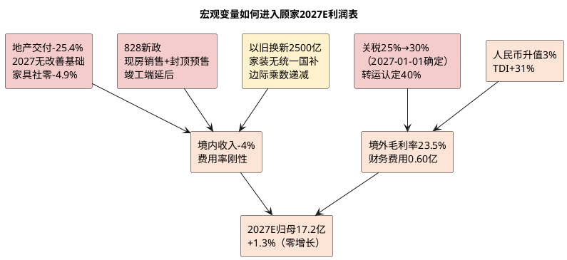

# 顾家家居：外部边界与宏观政策

**研究日期**：2026年10月15日  
**目标年份**：2027年（Q4 切换期，外部变量推演覆盖2027E）

## 外部变量决策矩阵（2027E 口径：关税确定上调是最大新增变量）

| 外部变量 | 最新方向 | 进入2027E模型的位置 | 不能重复计算的部分 |
|:--|:--|:--|:--|
| 住宅竣工、家具社零 | 1-8月住宅竣工-25.4%、家具社零-4.9%（8月-7.9%），境内-12.71%跑输行业 | 国内销量（境内2027E -4%）、单店产出与销售费用率 | 同一份需求下滑不可再重复压低EPS |
| **美国232条款关税** | **软体家具现行25%，自2027-01-01升至30%（联邦公报明确执行日期），转运认定加征40%** | **境外毛利率（2027E降至23.5%）** | **30%主关税已量化进EPS，PE中仅保留转运/原产地认定尾部-3%** |
| 汇率 | 2026H1人民币升值3%（1H末6.7852），财务费用0.96亿（去年-0.25亿） | 财务费用（2027E 0.60亿，假设正常化） | 汇兑已全额进EPS，不在PE中再扣 |
| 原材料（TDI/聚醚） | TDI上半年均价1.63万+31% YoY，软泡聚醚+14.6%；**敏华控股2026-10-13盈利警告称「海湾冲突以来化工行业关键原材料价格持续飙升、产品价格调整滞后未能完全抵消」** | 综合毛利率（2027E 31.7%） | 已进成本，不再单独PE折价；**但H2起的第二轮原料上行为2027E毛利率的实质下行风险** |
| 以旧换新 | 2026年约2500亿（聚焦6类家电），家装国家层面无统一补贴，智能家居/适老化地方自主；预计延续至2027但边际乘数递减 | 删除销量缓冲假设（境内假设中不额外加分） | 不给政策题材估值溢价 |
| 住房制度（现房销售） | 北京/上海/广州2026-09-24至09-30先后落地「828新政」细则：新出让项目预售须主体结构封顶、优先现房销售、主办银行制、按揭竣工备案后发放 | 竣工端延后（2027年家居需求池进一步承压） | 已体现在竣工无改善的假设中 |
| 海外基地 | 印尼3月奠基、一期2027-03投产；在建4.94亿+32.8% | 资本开支与远期执行风险（不计入2027E利润） | 不双重计价 |

## 宏观边界：地产后周期未见底，2027年竣工无改善基础

| 外部变量 | 最新读数 | 较2026-10-08研报时变化 | 对2027E模型的影响 |
|:--|--:|:--|:--|
| 家具社零 | 1-8月1149亿 **-4.9%**；8月147亿 **-7.9%** | 1-7月-4.5%→1-8月-4.9%，累计扩大0.4pp | 境内2027E假设-4%（较2026E的-10%收窄） |
| 住宅竣工 | 1-8月14798万㎡ **-25.4%** | 1-7月-25.5%→-25.4%，未收敛 | 新房配套需求池继续萎缩，机构判断2027无改善基础 |
| 住宅新开工 | 1-8月21840万㎡ **-25.4%** | 1-7月-24.6%→-25.4%，降幅扩大 | 2028年交付前瞻更弱 |
| 住宅销售面积 | 1-8月 **-13.0%** | 1-7月-12.7%→-13.0% | 二手房/改善装修前瞻仍弱 |
| 二手房交易网签 | 1-8月54923万㎡ **+10.6%** | 新增指标 | 交易量向存量转移，但未转化为家居消费 |
| 以旧换新 | 2026年约2500亿（6类家电），家装/智能家居地方自主；预计延续至2027 | 新增：确认家装国家层面无统一补贴 | 删除缓冲，境内假设不额外加分 |
| 现房销售制度 | 北京（09-24，全国首个）/上海（09-28）/广州（09-30）落地「828新政」细则 | 新增 | 竣工端延后，2027年家居需求池承压 |
| 汇率 | 人民币1H升值3%；2026-09-29中间价6.7411 | 9月延续升值后趋稳 | 财务费用2027E假设0.60亿（正常化） |
| 关税 | **软体家具25%→30%（2027-01-01）** | **由「拟提，已延期」变为「已确定执行」** | **境外毛利率2027E降至23.5%** |
| 原材料 | TDI上半年均价1.63万+31% YoY | 成本未再加剧 | 综合毛利率2027E 31.7% |

**2027年宏观边界的三条判断**：

1. **竣工无改善基础（最硬的约束）**：国信证券明确判断「竣工在未来3年内，可能都不具备改善的可能性」（期房库存2025年末同比-58.9%，自发竣工滞后2年）。叠加北京/上海/广州「828新政」要求新出让项目预售须主体结构封顶、优先现房销售，开发商从「抢预售」转向「抢竣工」的节奏调整将进一步**延后**竣工数据的改善时点。**这直接决定顾家集成/定制业务2027年无法转正。**

2. **存量翻新是渐进变量**：以旧换新政策预计延续至2027年，但边际乘数递减（2025年直接拉动系数约8.3 vs 2024年8.7，来源：华尔街见闻2025-12-31）；2026年国补聚焦6类家电，**家装/家具在国家层面无统一补贴**，仅智能家居（含适老化）可用中央资金由地方自主制定标准。二手房网签+10.6%与旧改需求是真实增量，但欧派家居自身判断存量旧改「稳步渐进、短期难以集中爆发」。**2027E境内-4%已包含该增量的贡献，不再额外计入政策缓冲。**

3. **住房被重新定位为「消费升级平台」而非投资引擎**：JPMorgan指出，促消费「十五五」规划将住房重新定位为家庭消费信心、财富与升级需求的支撑，住房相关消费外延从新房购买扩展至**装修、家居、家电、建材、养老适老化改造、智能家居和物业服务**（来源：河洛投研2026-07-15引JPM）。**这对家居行业是中长期正面定性，但短期（2027年）住房活动指数仍在下行，属「长期叙事、短期无量化贡献」。**

融资成本仍为次要变量：H1短期借款11.91亿+113% vs 年初、货币资金中受限13.42亿，但定增18.63亿净额8月到账后净负债压力将缓解，利率下行对利息费用影响有限。

## 外贸、汇率与贸易摩擦（2027E：关税确定上调成为主导变量）

境外收入50.67亿（+19.01%）占主营52.6%，对冲境内-12.71%使总营收+0.75%勉强为正，但引入三重恶化：

1. **关税（2027年最大新增变量）**：美国232条款对进口软垫木制品现行25%关税（2025-10-14起实施），原定2026-01-01升至30%已延期一年，**自2027-01-01起升至30%**（厨柜及洗手台升至50%），除非美国与相关国家达成协议；**转运认定将加征40%**。适用范围为所有原产国（除英国10%、欧盟/日本/韩国/台湾15%）。**关键含义：越南、墨西哥、印尼等「产能转移目的地」的原产一律适用30%，即海外产能布局不能豁免关税上调，只能规避原产地国（如中国）的额外301关税。** 按境外收入107.5亿、美国占比约45%测算，+5pp关税对应税前成本约2.4亿，假设客户分担约50%，税后影响约-0.97亿，已量化进2027E中性（境外毛利率降至23.5%）。

2. **汇率**：2026H1人民币升值3%（1H末6.7852），130家A股公司预告提及汇兑损失。顾家财务费用H1 0.96亿 vs 去年-0.25亿，合计增加1.21亿，几乎吞噬半数毛利降幅。同业梦百合净利近乎归零、海尔智家汇兑损失7.04亿+扰动15.86亿、TCL智家1.98亿损失均指向行业共性。**2027E假设汇率趋稳（财务费用0.60亿），若人民币继续单边升值则中性再下修约0.3-0.5亿。**

3. **运输费口径发现**：2025年运输费8.94亿+17.51%已高于营收，2026H1主营运输费4.04亿-2.64%（得益于海外本土采购及集中发运，但境外毛利率仍-2.12pct，说明物流改善不足以抵消价格竞争）。**更重要的是，公司披露的分产品毛利率为不含运输费口径，产品口径加权毛利与主营毛利的差额（2026H1为4.03亿）即运输费**——这意味着「境外占比提升」通过运输费进一步侵蚀合并毛利率，是2027E毛利率难以上行的结构性原因之一。

**印尼项目（对冲关税的关键）**：总投11.24亿元（1.6亿美元）、用地19.56万㎡、土地建筑占85.09%、HGB使用权30年可续、建设期4年、达纲3年、满产25.20亿元、回收期8.6年，于2026-03-16奠基，**一期计划2027年3月底投产、达产后年产值2.2亿美元**、一期可吸纳约6000名本地员工。**经济性判断**：印尼对美出口适用30%关税（与越南/墨西哥相同），但人工成本与土地成本更低、且可规避中国原产的301关税叠加。H1在建+32.8%至4.94亿仅为投入期，**2027E不计入利润，仅计折旧与现金流出及PE折价**。

**模式差异**：敏华控股2025年12月收购的美国业务（Southern Motion）因原材料成本上涨及需求疲弱产生营运亏损，已申请第11章破产并确认商誉减值，导致中期溢利预减70%-90%。**顾家为自建产能（越南/墨西哥/美国/印尼）而非并购整合，无商誉减值与整合失败风险，这是2027年海外竞争中的真实差异化**——但代价是资本开支前置（在建工程持续增长）与固定成本刚性。

## 宏观变量如何进入2027E利润表

2026H1的传导链条已走完：**竣工-25.4%/社零-4.9%→境内-12.71%/合同负债-25.1%→费用率22.14%→毛利率32.49%（-0.40pp, Q2 -2.05pp）→财务费用+1.21亿→扣非-14.59%**。以旧换新不再作为缓冲：境内-12.71%显著弱于社零-4.9%，说明存量翻新的份额争夺中顾家并未受益。

**2027E 的传导链条预判**：**竣工仍-20%左右（无改善基础）/社零仍在负区间→境内-4%（跌幅收窄）→关税25%→30%+境外占主营比重升至54.0%→境外毛利率23.5%→综合毛利率31.7%（-0.54pp）→财务费用正常化至0.60亿→归母17.2亿（+1.3%）**。

成本传导受阻：TDI+31% vs 顾家营业成本+1.36%（缓于TDI涨幅，显示集中采购与海外本土化部分对冲），但Q2毛利率仍降2.05pp，说明下游议价能力弱，上游涨价最终以综合毛利率下降形式兑现，而非转嫁。**2027年的成本压力来源从「原材料」转为「关税」**，且关税的转嫁难度不低于原材料（家具零售终端价格敏感、竞争激烈）。

## 原材料、运输与监管（2027E 更新）

| 成本变量 | 2026H1验证 | 2027E建模处理 | 信号 |
|:--|:--|:--|:--|
| 原材料（TDI/聚醚/海绵） | TDI 1.63万+31%、海绵+40%（Q1）、家具制造成本65.28%中原材料79.48%沙发 | 进入毛利率：2027E 31.7% | 成本上行已兑现为毛利率-0.40pp；2027年假设趋稳 |
| 关税 | 现行25%，**2027-01-01升至30%** | 进入境外毛利率：23.5%（-0.9pp vs 2026E的24.4%） | 客户分担假设50%，若完全不承担则再下修约0.5亿 |
| 运费 | 主营运输费4.04亿-2.64%但产品口径与合并口径差额4.03亿 | 进入毛利率与SOTP运输费扣减项（2027E 8.30亿） | 境外占比提升放大运输费侵蚀 |
| 汇兑 | 财务费用+1.21亿、人民币1H升值3% | 财务费用2027E 0.60亿（正常化） | H1已兑现130家公司共性 |
| 合规/环保 | 龙头可摊薄但不创造需求 | 不单独溢价 | 中性 |

| 外部风险处理纪律 | 应进2027E EPS | 应进PE折价 | 已量化 |
|:--|:--|:--|:--|
| 国内需求下行 | 境内收入-4%、费用率刚性 | 持续不确定性-8%（较2026E的-10%收窄） | 是 |
| 关税25%→30% | 境外毛利率23.5% | 仅尾部（转运40%/原产地认定）-3%（较2026E的-5%下调，因主关税已量化） | 是 |
| 汇率 | 财务费用0.60亿 | 无 | 是 |
| 海外基地 | 在建资本开支、折旧 | 爬坡不确定性（已含全球化-1%） | 进行中 |
| 以旧换新 | 删除缓冲 | 不溢价 | 是 |
| 筹码与流动性 | — | 股东户数+31%、陆股通减配-1% | 是 |

## 边界结论（2027E 口径）

基准情景从「国内崩塌超行业、以旧换新证伪、汇兑与原材料成本已兑现为利润侵蚀」修正为 **「国内跌幅收窄但仍未转正、2027年竣工无改善基础、关税确定上调30%、汇兑成本假设正常化」**。境内2027E -4%、综合毛利率31.7%、财务费用0.60亿、境外毛利率23.5%将传导至章节五P×Q模型。**2027E 归母17.2亿（+1.3%），本质是零增长年**——盈利未能增长的原因不是公司经营恶化，而是三项外部变量（竣工无改善、关税上调、政策缓冲消失）恰好抵消了财务费用正常化与费用率优化。

**2027年外部变量的可证伪清单**：①2027-01-01关税执行后的客户分担比例（若客户完全不承担，2027E中性下修约0.5亿）；②美国海关对越南/印尼原产地规则的最终裁定（若转运认定落地加征40%，则触发黑天鹅情景，2027E归母跌至9-10亿）；③2027年竣工实际降幅（若优于-15%，境内假设可上调至0%）；④人民币汇率走向（若2027年再升值3%，财务费用回升至约1.0亿）。

**主要证据**：国家统计局2026年1-8月社零（家具类1149亿-4.9%、8月147亿-7.9%）与房地产（住宅竣工14798万㎡-25.4%、新开工-25.4%、销售-13.0%、二手房网签54923万㎡+10.6%）；中房网2026-09（北京09-24/上海09-28/广州09-30「828新政」细则：封顶预售、现房销售、主办银行制、按揭竣工备案后发放）；国信证券《房地产行业2026年中期投资策略》（2027-2029竣工无改善基础）；JPMorgan促消费「十五五」规划住房定位（经河洛投研2026-07-15）；国家发改委/财政部发改环资〔2025〕1745号及商务部等7部门2026年以旧换新通知；华尔街见闻2025-12-31（2026年补贴约2500亿、拉动系数8.3 vs 8.7）；**美国联邦公报232条款关税公告（2025-12-31签署，软体家具关税延期至2027-01-01升至30%）**、香港工业贸易署商业资料通告第1/2026号、Commercial Outdoor Furniture（2026-10-12，按原产国关税表：中国/越南等30%，欧盟/日本15%，英国10%）、新华网2026-01-01（美暂停对软体家具等再加关税至2027）；人民币汇率（央行CNFIN 1H +3%）；TDI（隆众1.63万+31%/FX168+30%）；公司2026H1（财务费用0.96亿 vs -0.25亿/境外毛利率24.24% -2.12pct/在建4.94亿+32.8%/主营运输费4.04亿）；印尼奠基（2026-03-16，总投1.6亿美元，一期2027-03投产，达产年产值2.2亿美元）；敏华控股盈利警告公告（2026-10-13）。
