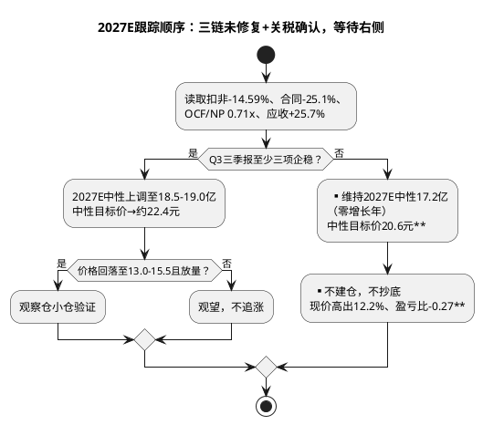

# 顾家家居跟踪手册

**建立日期**：2026年07月26日  
**最后更新**：2026年10月15日（**目标年份与目标价由2026E切换至2027E**：Q4切换期按框架自动滚算；三态目标价16.74/23.07/29.98→**14.5/20.6/31.8元**，加权22.55→**21.0元**，中性收益率-0.9%→**-12.2%**，盈亏比-0.11→**-0.27**；技术面手术式修正至10-15）
**当前评级**：持有/观望，等待验证（**第四象限 Avoid/Wait：低确定性+负预期收益**，自第三象限偏第四象限正式落入第四象限）

## 核心逻辑验证点（2027E 口径：三链恶化未修复 + 2027年关税确定上调）

| 指标 | 看好阈值（上调需满足） | 警戒阈值（已触发） | 2026H1实测 | 结论 |
|:--|:--|:--|:--|:--|
| 扣非净利增速 | 转正或跌幅<5% | **连续两季双位数下降** | H1 -14.59%（Q2 -18.69%）、Q1 -10.64% | **触发，已连续两季** |
| 综合毛利率 | ≥32.5% | <31.5%且连续两季 | H1 32.49%（-0.40pp）、Q2 31.35%（-2.05pp）| 接近警戒，Q2已逼近 |
| 境外收入与毛利 | 收入增且毛利率≥25% | **收入增、毛利率持续下滑** | 境外+19.01%但毛利率24.24% **-2.12pct** | **触发；2027年关税25%→30%将进一步压制至23.5%** |
| 销售费用率 | 稳定或下降 | **上升且收入低增** | 17.11%→17.12%（H1零增长下+0.50pp，Q1 +2.02pp）| **触发** |
| 合同负债 | QoQ企稳且YoY跌幅<15% | **连续两季同比明显下降** | 11.54亿 **-25.1% YoY**、QoQ -9.26%（去年+2.5%）| **触发** |
| OCF/归母净利 | ≥1.0x | **<0.8x** | **0.71x**（H1 6.59亿-39.76%）| **触发，首次破1x** |
| 应收账款 | 增速≤境外收入增速 | **增速显著高于营收** | **+25.73% vs 营收+0.75%、境外+19.01%** | **触发** |
| **筹码结构（2026-10-15新增）** | 股东户数下降、陆股通持股回升 | **股东户数+30.96%、陆股通由3.29%降至1.56%** | 20,238户（2026-06-30）、陆股通1.56%（2026-09-30） | **新增触发：边际资金流出** |

**H1触发统计**：8项中6项已触发警戒（扣非、境外毛利、销售费用率、合同负债、OCF/应收、筹码结构），仅毛利率暂守32.5%上方但Q2已31.35%接近警戒。满足手册「至少两条链恶化即切换保守」条件，且实际三链（需求/盈利/现金）全部恶化。**2027E 口径下保守情景权重维持30%。**

## 外部变量（2026-10-15更新）

| 变量 | 10-15基准 | 10-09基准 | 变化 |
|:--|:--|:--|:--|
| 家具类社零 | **1-8月1149亿-4.9%（8月单月147亿-7.9%）** | 1-8月约-5.1% | **权威口径确认为-4.9%，8月-7.9%较7月-8.8%收窄0.9pp** |
| 住宅竣工 | **1-8月14798万㎡-25.4%（机构判断2027-2029无改善基础）** | 1-7月-25.5%，8月未披 | **8月权威数据已出，未收敛；2027年无改善基础** |
| 二手房交易 | **1-8月网签54923万㎡+10.6%（住建部口径，连续多个月高于新房销售）** | 未获取 | **新增：存量交易活跃但未传导至家居消费** |
| 汇率 | **人民币1H升值3%，9月末中间价6.7411，近期趋稳；2027E假设正常化（财务费用0.60亿）** | 9月6.77→6.74 | 延续而非跃迁 |
| **关税** | **软体家具现行25%，自2027-01-01升至30%（联邦公报明确）；转运认定加征40%；越南/墨西哥/印尼原产一律适用** | 「2027拟提30%延期至2027-01-01」 | **由「拟提」变为「已确定执行」，是2027E最大新增负面变量** |
| 原材料/运费 | **TDI上半年均价1.63万+31%，H2未再加剧；运输费H1 4.04亿-2.64%但产品口径与合并口径差额4.03亿** | TDI分化上行 | **新增口径发现：运输费是产品口径与合并口径的4pp缺口** |
| 以旧换新 | **2026年约2500亿（聚焦6类家电），家装国家层面无统一补贴，智能家居/适老化地方自主；预计延续至2027但边际乘数递减（8.3 vs 8.7）** | 2026延续3000亿国补但家装discontinued | 政策缓冲证伪维持，不溢价 |
| 住房制度 | **北京09-24/上海09-28/广州09-30落地「828新政」细则（封顶预售、优先现房销售、主办银行制）** | 未获取 | **新增：竣工端进一步延后** |
| 股本 | **9.2573亿（+12.68%），8月7日定增完成，募资净额18.63亿；2027年无新增摊薄（加权=年末）** | 9.2573亿 | 2027年每股口径恢复干净 |

## 逻辑证伪警报（2027E 口径：4项已触发 + 1项新增）

1. **国内自有品牌门店连续两期净关闭且合同负债下降超过15%** → **已触发**：合同负债11.54亿-25.1% YoY（>15%），境内-12.71%印证单店产出双位数下滑，虽门店数H1未更新但单店效率已证伪。**2027E境内假设-4%（跌幅收窄但未转正）。**
2. **综合毛利率低于31.5%并持续两个报告期，且销售费用率上升** → **半触发**：H1 32.49%仍守但Q2 31.35%已接近31.5%，且销售费用率17.11%在零增长下上升。**2027E假设毛利率31.7%，若Q3-Q4跌破31.5%则中性下修。**
3. **境外收入连续两期负增长，或应收账款连续两期显著快于境外收入** → **已触发**：应收+25.73% vs 境外+19.01%（快6.7pp），且Q1应收16.84→Q2 19.16 +13.77% QoQ加速。**2027年关税30%将进一步检验海外回款质量。**
4. **OCF/净利连续两期低于0.8x，显示利润质量转弱** → **已触发**：H1 0.71x首次跌破0.8x且较去年1.07x（H1）大幅恶化，需Q3回正验证否则连续。
5. **印尼等海外产能投入显著超预算且没有订单/利用率证据** → **观察中**：在建4.94亿+32.8%符合预期，一期2027-03投产，但境外毛利率-2.12pct显示新增产能尚未转化为利润。**2027年3月投产后的利用率是第一验证点。**
6. **筹码结构持续恶化**：股东户数2026-06-30达20,238户（+30.96%）、陆股通持股由3.29%（06-30）降至1.56%（09-30）。→ **若Q3股东户数继续上升且陆股通继续减配，则第四象限回避判断成立。**

**证伪强度**：6项中4项已完全触发、1项半触发、1项观察中。按手册「至少两条链恶化即切换保守」，2027E保守情景权重维持30%，且确定性降为「低」+预期收益转负，象限正式落入**第四象限（Avoid/Wait）**。

## 关键时间节点与操作纪律（2027E 口径）

| 验证顺序 | 先看什么 | H1结论如何传导至2027E |
|:--|:--|:--|
| 需求 | 家具社零1-8月-4.9%、合同11.54亿-25.1% YoY、境内-12.71% | 已触发→境内2027E假设-4%（较2026E的-10%收窄） |
| 盈利 | 扣非-14.59%（Q2 -18.69%）、毛利率32.49% -0.40pp、销售+3.81%/研发+20.35%/财务+1.21亿 | 已触发→2027E中性归母17.2亿（+1.3%，零增长年） |
| 现金 | OCF/NP 0.71x<0.8、OCF -39.76%、应收+25.7% vs 境外+19% | 已触发→PE折价-3% |
| 关税 | 2027-01-01软体家具25%→30%（已确定） | 已量化→境外毛利率23.5%、PE尾部折价-3% |
| 筹码 | 股东户数+30.96%、陆股通3.29%→1.56% | 新增→PE折价-1% |
| 价格 | 23.45 / 22.97(MA20) / 14.5(2027E保守) / 20.6(2027E中性) / 23.82(MA60) | 现价已高于中性12.2%，盈亏比-0.27，不建仓 |

| 时间 | 事件 | 关注点（2027E更新） | 状态 |
|:--|:--|:--|:--|
| 2026年8月 | 2026H1报告（已披露2026-08-28） | 扣非-14.59%、合同-25.1%、OCF/NP 0.71x、境外毛利率24.24% -2.12pct、境内-12.71% | **已触发保守切换** |
| 2026年8月7日 | 定增完成（新增1.0428亿股@17.94，净额18.63亿，总股本9.2573亿） | 股本摊薄12.7%；**2027年无新增摊薄** | **已完成** |
| **2026年10月28日** | **2026年三季报（预约披露日2026-10-28，按惯例10-27盘后获取）** | **境内跌幅是否<5%、合同QoQ是否企稳、OCF/NP是否>0.8、应收增速是否<10%、境外毛利是否止跌、股东户数是否继续上升** | **决定性验证，6项中至少3项企稳方可上调** |
| **2026年11月16日** | **敏华控股FY27H1中期业绩（2026-10-13已发盈利预警：溢利预减70-90%，美国子公司Southern Motion申请第11章破产；公告称收入基本持平、主因化工原料涨价无法转嫁）** | **毛利率下滑幅度（验证行业级成本转嫁能力缺失）、美国业务减值规模、中期股息、中国区收入** | **新增：行业级成本与竞争强度的验证** |
| 2026年10月下旬 | 喜临门三季报 | 亏损是否扩大、控股股东预重整进展 | 观察 |
| **2027年1月1日** | **美国232条款软体家具关税由25%升至30%生效（越南/墨西哥/印尼原产一律适用，转运认定加征40%）** | **实际执行、客户分担比例、境外毛利率** | **新增：2027E最大外部变量** |
| 2027年3月 | 印尼一期投产（达产后年产值2.2亿美元） | 进度、产能利用率、订单、对美出口原产地安排 | 观察（决定乐观情景概率） |
| 2027年4月 | 2026年报（2026年4月23日披露前次，预计同期） | 全年ROE、OCF、分红政策及印尼进度 | 观察 |
| 2029年8月7日 | 定增股份解禁（1.0428亿股，控股股东锁定36个月） | 流动性冲击评估 | 远期 |
| 持续 | 家具社零/竣工/汇率/TDI/股东户数/陆股通 | 月度跟踪，重点为9-12月社零旺季与竣工降幅 | 每月跟踪 |

- **现价23.45元（>中性20.6元、>加权21.0元）**：**不建仓，不追涨**。已高于中性与加权，盈亏比-0.27为负，观望为主。
- **回落至13.0-15.5元（新观察区，较原18.5-20.5元下移约5元）**：需同时满足「合同YoY跌幅<15%且QoQ企稳 + OCF/NP>0.8 + 境内跌幅<5% + 境外毛利止跌」至少3项，否则即使到15元亦不抄底。
- **上涨至23.82元（MA60）以上而基本面未超预期**：评估减仓，等待新证据。
- **任一证伪警报持续（已4项触发）**：维持保守情景，不以PE 12.81x低位机械补仓。

## 估值与技术联动纪律（2026-10-15更新，2027E 口径）

| 场景 | 不复权价格（2027E） | 需要同时满足的事实 | 动作 |
|:--|--:|:--|:--|
| 低于近一年低点 | <22.06元 | 已满足三链恶化（合同-25%、OCF/NP 0.71、扣非-14.6%）→**直接风控**，不讨论分批 | 优先切换周期压力9.60元 |
| 新观察区 | **13.0-15.5元**（原18.5-20.5元） | 合同跌幅<15%且QoQ企稳、OCF/NP>0.8、境内<-5%、境外毛利止跌（至少3项） | 分批、小仓验证，需放量 |
| 趋势确认 | >23.82元（MA60）并放量3日 | Q3扣非企稳、费用率不升、合同QoQ企稳 | 可提高跟踪优先级 |
| 基准价值区 | **20.6元附近（2027E新中性）** | 无新盈利上修 | 不追涨，现价已高于基准12.2% |
| 保守情景价 | **14.5元（2027E新）** | 三链恶化未修复 + 关税30%落地，维持保守 | 下调模型，不以低估值补仓 |
| 周期压力 | **9.60元**（原12.95元） | 系统性需求与海外订单崩塌 | 资产底线，非止损 |
| 资产折价 | **7.86元**（原10.24元，H1 BVPS 11.23元×70%，按新股本） | 清算价值 | 极端情形提示 |

技术均线已更新：**2026-10-15 MA20 55.41后复权（22.97元，贴靠上方+2.08%，已由降转平）、MA60 57.46后复权（23.82元压制，-1.57%）、MA120 59.80后复权（24.79元）、MA250约66.66后复权（27.64元）**。10月（10-08至10-15，6个交易日）在23.29-23.71元区间缩量窄幅整理，日均量仅52,032手（较09-30单日108,233手腰斩）；10-12盘中最高24.16元触及MA60上方但收盘未站稳；RSI14自09-15的31.1回升至65.3（偏强未超买）；15日均量59,203手仅为60日均量72,544手的81.6%，缩量磨底延续。

**纪律重申**：跟踪手册首要任务是避免把低估值与图形破位混淆，同时避免把「均线走平」误读为「趋势反转」。H1三链恶化已证实核心假设破坏，2027年又新增关税确定上调与竣工无改善基础两项确定性压力，**价格回调不再自动改善赔率，且原18.5-20.5元观察区在2027E口径下已高于中性目标价**，仅当订单与现金验证企稳后，13.0-15.5元观察区才具备战术意义。

## 竞争对手跟踪（Top3：敏华/慕思/喜临门，2026-10-15更新）

| 竞对 | 跟踪指标 | 披露日历 | 最新表现 | 对顾家的双向含义 |
|:--|:--|:--|:--|:--|
| 敏华控股 | 收入/中国市场/毛利率/境外、产能利用率、扩产、**美国业务减值规模、原材料转嫁能力** | **FY27H1中期业绩2026-11-16（已公告）**、FY27全年预计2027-05、FY28H1预计2027-11 | FY26H1收入80.45亿港元-3.1%（中国-6.8%）、毛利率40.4%、FY26全年-2.8%净利-12.1%；**2026-10-13港交所盈利警告：FY27H1溢利预减70%-90%（约1.15-3.44亿港元），收入基本持平，主因化工原料涨价未完全转嫁+美国子公司Southern Motion申请第11章破产并计提商誉及无形资产减值** | **成本侧（最重要）**：龙头毛利率40%+仍无法转嫁原料涨价，说明2026H2起原料上行为行业级且转嫁能力普遍缺失，对顾家2027E毛利率31.7%构成下行风险；**需求侧**：收入基本持平说明海外需求尚未崩塌，不据此下调顾家境外收入增速；**竞争侧**：敏华美国并购失败 vs 顾家自建产能，顾家模式相对优势成立 |
| 慕思股份 | 营收/归母/毛利率60%/AI床垫/境外、研发/广告费用 | H1 2026-08-26、年报2027-04 | H1营收24.91亿+0.56%/归母1.86亿-48.13%/AI床垫+95.69%至2.36亿/境外+22.69% | **需求侧**：营收+0.56%显示睡眠赛道韧性；**竞争侧**：AI高增但费用致净利腰斩，顾家追赶需高投入，卧室-0.13%承压 |
| 喜临门（ST） | 营收/转亏/毛利率/销售费用、ST及控股股东预重整、**诉讼与资金占用** | H1 2026-08-26、Q3预计2026-10下旬 | H1营收38.12亿-5.18%/转亏-3,619.77万、财务费用6,479.57万+383.42%、**其他应收款5.92亿+578.41%（控股股东资金占用）、三起诉讼涉案8.71亿、控股股东启动预重整投资人招募** | **需求侧**：由盈转亏验证行业底部；**竞争侧**：风险加速出清对顾家是份额机会，但顾家境内-12.71%亦弱，竞争未显著获益 |
| （参照）欧派/索菲亚 | 营收/净利/毛利率/海外/整装渠道 | 三季报预计2026-10下旬 | H1欧派59.5亿-27.79%（净利-56.62%扣非-61.71%）、索菲亚33.77亿-25.8%（净利-80.61%）；9家定制上市公司营收全部下滑 | **行业级**：定制赛道塌陷幅度超顾家集成定制，印证「软体优于定制」的结构分化 |

联动更新：竞对财报与预警已纳入本次2027E重锚定的产业周期（章二）与竞争格局（章三）联动；若属行业级信息变化（如关税30%、规上家具利润-52.7%、定制价格战）需评估行业研报是否更新。**关联研报盘点结论**：`investigation/industry/` 已全量盘点，覆盖风电/光伏/储能/生猪/功率半导体/钠离子电池/电解铝/碳酸锂/人形机器人/氢能/特高压/新型电力系统/海缆/端侧AI芯片/AI泡沫等，**无直接家居/软体家具/地产后周期行业研报，无可复用结论**；`investigation/macro/` 已盘点（《中国经济十五年变迁_上市公司财报视角_2011-2026_20260829》《中国经济十年变迁_上市公司财报视角_2014-2026H1_20260828》），为宏观背景与财报视角研究，与家居地产后周期链条无直接可复用结论，亦无与本次判断相悖的内容。记录在案。

## 2026-10-15 目标年份与目标价切换（2026E→2027E）

- **切换依据**：框架模块零第5条「切换期（Q4）：目标时间点为次年」与模块六「估值锚点切换：Q4自动滚算至次年」。2026年已进入Q4（10月），继续以2026E EPS（1.83元）定价产生时间错配；且定增完成后2027年无新增摊薄（加权股本=年末股本=9.2573亿股），每股口径恢复干净。
- **行情视图实测**：**10-15收盘23.45元**（量54,004手/1.26亿元，后复权56.56，复权因子2.412146），较10-14的23.40元+0.21%、较10-09的23.53元-0.34%、较09-30的23.81元-1.51%、较08-31的23.61元-0.68%；**MA20 55.41（贴靠上方+2.08%，由降转平）、MA60 57.46（-1.57%压制）、MA120 59.80、MA250约66.66**；RSI14 65.3（自09-15的31.1回升）；15日均量59,203手/60日72,544手，缩量磨底；一年低点22.06元（07-06）距现价+6.3%，一年高点36.75元（2026-02-11）距现价-36.2%。
- **估值坐标实测（10-15）**：**PE_TTM 12.81x、PE扣非TTM 14.50x、PB 2.09x、PS_TTM 1.08x、PCF_TTM 9.28x、市值217.08亿**（vs 10-08 12.72x/2.07x/215.60亿，**+0.09x/+0.02x**）；TTM（至2026H1）归母16.95亿、营收201.30亿、OCF 23.39亿。
- **2027E 三态盈利**：保守 营收195.7亿/归母**13.4亿**/EPS 1.45元；中性 营收206.1亿/归母**17.2亿**/EPS **1.86元**（+1.3% vs 2026E中性16.95亿，零增长年）；乐观 营收219.0亿/归母**21.8亿**/EPS 2.35元。概率维持30%/50%/20%，概率加权EPS 1.835元。
- **2027E 三态市值与目标价**：保守 13.4亿×10.0x=**134亿→14.5元**；中性 17.2亿×**11.18x**（基准13.0x×Σ-14%）=**191亿→20.6元**（PB-ROE 1.35x交叉验证189.8亿/20.50元）；乐观 21.8亿×13.5x=**294亿→31.8元**。**加权目标价21.0元**。
- **审计矩阵Σ由-16%收窄至-14%**：企业DNA +2%（维持）；国内宏观 -8%（原-10%，因2027处周期下半程、二手房网签+10.6%、公司自身已下修预期）；全球化 -1%（原0%，新增：敏华美国业务并购失败+商誉减值，海外模式与整合风险显性化，与已进EPS的美国需求疲软不重复）；汇率/关税尾部 -3%（原-5%，因30%主关税已量化进EPS，仅保留转运/原产地尾部）；现金与订单 -3%（维持）；市场风格/流动性 -1%（新增：股东户数+31%、陆股通减配）。
- **收益与赔率**：**中性收益率(20.6-23.45)/23.45 = -12.2%**（vs 2026E口径 -0.9%）；**盈亏比(21.0-23.45)/(23.45-14.5) = -0.27**（vs -0.11）。现价高于中性与加权，盈亏比为负，无需按∞+处理。
- **旧→新目标价对照**：保守 16.74→14.5元（-13.4%）、中性 23.07→20.6元（-10.7%）、乐观 29.98→31.8元（+6.1%）、加权 22.55→21.0元（-6.9%）；**观察区由18.5-20.5元下移至13.0-15.5元**（原观察区在2027E口径下已高于中性目标价，不具安全垫）。
- **公告/非公告扫描（09-14至10-15）**：
  - **A 公告**：2026-09-22 对外担保公告（为嘉兴智能提供3亿、顾家新加坡1亿连带责任担保，累计担保余额11.44亿占最近一期净资产10.81%）；2026-09-24 拟披露季报提示（**三季报预约披露日2026-10-28**）；2026-10-06 无新公告；**无新定期报告、无业绩预告、无重大合同、无新增减持/回购/诉讼（除喜临门为他司）**。
  - **B 业绩预告**：无（公司近年仅在2021年报发过业绩预增公告，2026年三季报无预告）。
  - **C 重大合同**：无（主营无重大合同披露惯例；合同负债为替代前瞻指标）。
  - **D 非公告·公司动态**：**2026-10-06~08 召开2026年度战略年会**（连续第十三年），总裁李东来明确**2027年经营关键词「质量经营、结构增长、能力致胜」**，董事长邝广雄提出「摒弃浮躁心态，做好长期艰苦奋斗和打持久战的准备」；**2026-09-29 半年度业绩说明会**（下半年将「盈利能力与现金流水平放在优先且重要的战略地位」，以「三大重整、两大工程」降低经营杠杆；广东省样板区域轻量化小整家业务占区域总营收50%；两款高端睡眠产品带动卧室高端品类销售+9.3%）；**2026-10-13 董秘上证e互动回复**（外销定位「全球布局、本土运营」的软体家居集成供应链服务商及品牌运营商）。
  - **E 非公告·媒体与第三方**：**2026-10-10晚河北涿州一加盟店建筑起火**，10-12品牌回应门店端受损、仓库未受影响、交付不受影响（经济观察网2026-10-14）；理杏仁显示**陆股通持股占流通A股1.56%（2026-09-30）vs 3.29%（06-30）**、质押股数与前十大股东持股之比54.13%（72.86亿元，2026-10-09，**未经公司公告交叉验证**）；新京报2026-10-15（顾家星选北京首家大型独立旗舰店2026-05亮相，规划再落地3家）。
  - **F 非公告·股东层面**：**持股5%以上股东德烨嘉俊（原顾家集团，持股88,471,483股约占总股本9.56%，第二大股东）重整案**：2025-10-15申请、法院裁定受理；2026-04-24发布招募重整投资人公告（尽调保证金2000万、遴选保证金合计5000万）；**2026-05-23报名期限届满共收到2家投资人报名**；2026-07-23为《重整投资方案》提交截止日；公司明确该股东非控股股东/实控人，不影响控制权与经营。
  - **竞对扫描**：**敏华控股2026-10-13港交所盈利警告（FY27H1溢利预减70%-90%、收入基本持平、化工原料涨价未完全转嫁、美国子公司Southern Motion申请第11章破产）+2026-10-06公告将于2026-11-16审议中期业绩**；慕思/喜临门无9-10月新定期报告（喜临门Q3预计10月下旬）；欧派/索菲亚三季报预计10月下旬。
- **环境变量（已与盈利预测解耦，本轮部分触发重估）**：家具社零**1-8月-4.9%（8月-7.9%）**；**住宅竣工1-8月-25.4%（机构判断2027-2029无改善基础）**；**二手房网签1-8月+10.6%**；人民币1H升值3%后趋稳；TDI上半年均价1.63万+31%未再加剧；**美国232条款软体家具关税自2027-01-01由25%升至30%（联邦公报明确），转运认定加征40%**——该项为本轮唯一触发重估的外部变量，已量化进2027E境外毛利率（23.5%）。
- **下次验证**：**2026年三季报（预约披露2026-10-28，按惯例10-27盘后获取）**——境内跌幅是否收敛至-5%以内、合同YoY跌幅<15%且QoQ企稳、OCF/NP是否>0.8且应收增速<10%、境外毛利率是否止跌、扣非是否止跌、股东户数是否继续上升，至少3项企稳方可上调2027E中性至18.5-19.0亿。

## 归档记录

- **2026-07-26 建立**：初始评级持有/观察，回调建仓，20-21元理想区，基于Q1扣非-10.64%、家具社零-3.7%、竣工-25.3%。
- **2026-08-31 H1审计归档**：三链恶化已触发（合同-25.1%、扣非-14.59%、OCF/NP 0.71x、应收+25.7%、境内-12.71%），触发保守切换，盈利下修至16.95亿（加权EPS 1.96→年末1.83）、目标价27.70→23.07元、盈亏比0.74→-0.15、评级下调至持有/观望、技术放量破位MA60。三链验证前维持保守情景。
- **2026-09-14 例行巡检归档**：无重大增量，维持保守情景与三态目标16.74/23.07/29.98元；现价23.47元中性收益率-1.7%、盈亏比约-0.14；研报8章仅时间戳同步至09-14，正文不动。
- **2026-10-09 例行巡检归档**：无重大增量，维持保守情景与目标价；行情截止10-08（23.29元，PE 12.72x/PB 2.07x，中性收益率-0.9%、盈亏比-0.11）；技术面09-30放量108,233手+3.66%站上MA20/短暂收复MA60后10-08缩量回落再失守MA60，章七手术式修正至10-08；竞对敏华/慕思/喜临门无9-10月新定期报告。
