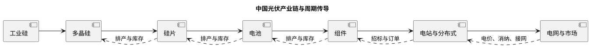
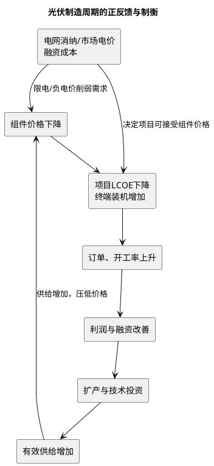

# 中国光伏行业深度研究报告

**日期**：2026年11月3日  
**研究覆盖**：中国光伏制造、国内应用、出口与电力系统，重点研究供给、价格、技术与需求的周期性  
**数据截至**：2026年11月3日；除另注外，制造端为CPIA口径、应用端为国家能源局（NEA）并网口径。NEA并网截至2026年9月底（9月新增13.64GW、环比+23.6%、同比+41.2%，1—9月累计110.83GW、同比-53.9%，截至9月底累计光伏13.13亿千瓦、同比+16.5%，国家能源局2026-10-26发布）、CPIA制造与价格截至2026年6月底/7月20日（2026-07-23发布会，全年装机预测180—240GW于2026-09-09重申）、硅业分会多晶硅产量与价格截至2026年10月底/11月初（9月产量12.04万吨、环比+1.3%，10月实际产量约9.7—10.4万吨、低于10.5万吨计划，11月排产8.5—8.7万吨；N型复投料成交4.30万元/吨），高频价格与排产截至2026年11月2日（Mysteel 10-30、InfoLink 10-28、SMM 11-02、百川盈孚11月排产）、上市公司2026年三季报截至2026年10月31日（晶澳10-28、TCL中环10-29、通威10-30、晶科10-30、隆基10-30、天合10-31披露）；NEA 10月装机与10月海关出口明细截至2026-11-03尚未发布  
**研究性质**：行业研究，不构成对任何证券、项目或企业的投资建议

---

## 一、执行摘要

### 核心判断

中国光伏处于**产能出清已开始、但盈利反转尚未确认**的深度调整中段。2025年国内新增并网太阳能发电装机318GW、累计装机1.20TW，全球光伏新增装机也首次超过600GW；终端能源转型需求并未消失。与此同时，2025年中国多晶硅、硅片、电池片、晶硅组件的名义产能已分别约350万吨、1,500GW、1,400GW和1,100GW，显著大于当期有效需求。由此形成的并非单一“需求周期下行”，而是**供给资本开支周期、技术替代周期、价格—利润周期、终端收益率周期和贸易重构周期叠加**。

2026年前9个月，国内新增光伏装机110.83GW，同比下降53.9%；其中9月新增13.64GW、环比+23.6%、同比+41.2%，为连续第二个月同比正增长；三季度合计新增约38.76GW、同比约+38%、环比约+26%（国家能源局2026-10-26发布，季度值按月度累计差推算）。装机同比降幅的大头来自基数：2025年6月1日前投产项目可按旧规则衔接电价，导致2025年上半年出现异常抢装，抬高基数（2025年1—9月为240.27GW）。更有解释力的指标是：2026年H1制造端多晶硅53.8万吨、硅片293GW、电池260.7GW、组件201.3GW，分别同比下降9.8%、7.3%、21.9%、35.1%（CPIA 2026-07-23发布会）；三季度丰水期复产使硅料产量环比+24.6%至33.27万吨，10月、11月排产才连续降至约10万吨、8.5—8.7万吨，供给真正转向收缩。量缩与价跌并存：10月底N型复投料成交仍为4.30万元/吨、颗粒硅4.03万元/吨，组件成交0.66—0.72元/W，均低于完全成本；行业库存高位（硅业分会9月底约57.2万吨，SMM厂家库存10月29日37万吨），去化尚未开始。供给侧在10—11月出现本轮周期首次跨月、非季节性的主动收缩，但仍未到足以恢复行业利润的程度。

**本报告的基准判断**是：2026年更可能是”底部磨底与结构性修复”而不是全行业V形反转。10—11月硅料产量连续下降（10月约10万吨、11月8.5—8.7万吨），是本轮周期首次出现跨月延续、非单纯枯水季节性的主动减产；但9月底行业库存仍约57.2万吨、SMM厂家库存10月反而由33.8万吨升至37万吨，减产尚未转化为有效去库，成交价也仅持平。三季度财报给出第一个同向的财务信号：头部六家单季合计归母亏损约69.6亿元，较二季度约93.0亿元收窄约25%，隆基（-10.29亿元，环比减亏41.7%）、晶科（-2.90亿元，环比减亏83%）、晶澳（-9.74亿元，环比减亏39%）、通威（-16.39亿元，环比减亏38.7%）、TCL中环（-13.52亿元，环比减亏13.2%）五家环比减亏，天合因剩余股权资产公允价值下降单季转亏16.72亿元；但同比看通威、隆基、晶澳仍增亏，1—9月六家合计仍亏损约249.8亿元。盈利修复的斜率已出现，绝对亏损与现金流压力尚未解除。最先改善的环节可能是具备现金成本优势、可真实减产且集中度相对高的上游；但其价格修复也最易诱发复产。组件、电池等同质化环节需要看到低效产线永久退出、应收和存货压力缓解、海外本地化供给形成成本纪律，才能确认修复。技术差异化（BC、高效TOPCon、场景化组件）能改善企业相对份额（隆基1—9月BC出货31.64GW、同比+118.6%），却不能单独消除全行业过剩。

### 五项关键结论

1. **需求仍增长，制造业却可以长期亏损。** 光伏终端需求由度电成本、能源安全和减排目标支撑；制造环节的利润却由有效供给决定。2025年中国组件产量约620GW，而全球新增装机约600GW，且全球安装并不只使用当年中国产组件；单用年度装机与产量比较会低估库存、海外产能和供应链重复建设。
2. **目前是供给主导的熊市，不是传统库存小周期。** 2025年以名义产能除以产量计算，硅料、硅片、电池、组件的“产量/名义产能”分别仅约38%、45%、47%、56%。这不是严格的开工率，但足以显示产能利用不足；低利用率反过来又令固定成本摊薄变差、企业以现金成本而非全成本接单。
3. **价格尚未构成反转证据。** 2026年上半年产量已主动收缩，然而7月硅料、硅片、电池价格相对年初继续走弱，说明减产更多是排产调节而非不可逆的资产退出。10月底N型复投料成交4.30万元/吨、颗粒硅4.03万元/吨，已连续一个月持平而非继续上行；期货主力合约10月31日收34,955元/吨，较现货贴水约8,000元/吨；组件成交0.66—0.72元/W、头部报价0.72—0.75元/W，仍低于行业测算的0.8元以上完全成本，报价挺价未兑现为利润。
4. **136号文改变的是需求的质量与时点。** 新项目全面进入市场交易、通过竞价决定机制电价，组件需求从“是否建设”转为“项目在市场电价下能否获得足够IRR”。截至2026-10-30，已有17个省级区域公布机制电价竞价结果、6个仅发布公告；光伏机制电价大体落在0.26—0.40元/kWh（山东2026年0.261、广西2027年0.305、山西2026年0.3168、河北0.3344—0.352、四川0.373、安徽2025—26年0.384、重庆2025—26年0.3963），广西2027年光伏较2026年的0.31元/kWh小幅下移。因此，今后装机增速、限电、现货低价时段、配储成本和融资条件的解释力将高于单纯的核准备案规模。
5. **出清的终点不等于价格暴涨。** 行业具有短建设周期、设备可迁移、地方就业与融资支持、以及技术升级触发的新一轮扩产等特征。即使硅料先涨价，若不能同步看到资本开支下降、落后产线永久关停、经营现金流改善和应收账款周转恢复，价格反弹仍可能只是”去库反弹”。10月11日杭州会议划出硅料不低于4.3万元/吨、TOPCon组件不低于0.79元/W、BC组件不低于0.86元/W的价格底线并设相互监督机制，但无法律约束力、无公司级配额；10月华电5GW集采最低报价仍至0.665元/W，说明底线在招投标端尚未兑现。多晶硅“收储平台”自2026年初被市场监管总局约谈后，公开信息未见实质落地进展，产能治理重心转向能耗国标与《光伏制造行业规范条件》。

### 周期定位：五条链条的当前信号

| 周期链条 | 2026年11月观察 | 所处阶段 | 对行业的含义 |
|---|---|---|---|
| 终端需求/电力系统 | 1—9月新增110.83GW（9月单月13.64GW，环比+23.6%、同比+41.2%）；9月底累计光伏13.13亿kW（同比+16.5%）；Q3新增约38.76GW、同比+38%；10月明细尚未发布 | 政策切换后的再定价 | 装机不再是单一数量目标，消纳与收益率决定项目质量；Q3同比转正含低基数与年末并网节奏 |
| 制造供给/资本开支 | 2025名义产能远超当年产量，2026H1产量同比-9.8%至-35.1%；Q3丰水期硅料产量环比+24.6%至33.27万吨，10月降至约9.7—10.4万吨、11月排产8.5—8.7万吨，首次跨月主动收缩 | 被动减产转向主动出清、但仍处初期 | 减产已从排产计划落到产量，但库存未有效去化、复产弹性仍在，核心看是否出现永久关停 |
| 价格/利润 | 10月底N型复投料成交4.30万元/吨、颗粒硅4.03万元/吨，期货主力34,955元/吨贴水约8,000元；组件成交0.66—0.72元/W、头部报价0.72—0.75元/W，硅片0.95—1.15元/片；头部六家1—9月合计亏损约249.8亿元，Q3单季约69.6亿元、环比收窄约25% | 现金成本竞争、挺价与成交背离 | 报价持稳而非上行，减产尚未传导为价格与利润修复；Q3减亏是斜率改善而非扭亏 |
| 技术迭代 | TOPCon主导，BC/HJT等争取差异化溢价；隆基1—9月BC出货31.64GW（+118.6%）、占比65%以上；TCL中环启动20GW电池+25GW组件BC技改；10月16日《光伏制造行业规范条件（2026年本）》征求意见进一步抬高新建效率门槛 | 路线再分化 | 技改可淘汰旧线，也可能造成重复投资；2027年1月1日能耗与能效国标是硬约束 |
| 贸易/区域化 | 2026H1出口额171.83亿美元同比+24.3%（CPIA）；1—9月组件出口180.84GW同比约-12%（9月22.13GW、环比+45%、同比约-17%，沙特单月贡献约1.87GW增量），电池片累计87.27GW同比约+12%；美国对印度/印尼/老挝AD/CVD终裁于11月2日下单、12月4日起叠加232最低进口价与15%关税 | 全球化重构、壁垒硬化 | 9月反弹主要是递延交付与抢运，累计仍负增长；区域化提高固定成本，不等于全球供给收缩 |

---

## 二、行业定义、边界与数据口径

### 2.1 产业链与价值实现

光伏行业不是单纯的“组件制造业”。制造端成本下降必须最终在电站端以更低LCOE、更高可利用电量和更稳定现金流实现价值。完整链条如下：



本报告研究边界包括工业硅至组件、国内集中式和分布式电站、主要出口市场与电力市场化；逆变器、支架、玻璃、胶膜、银浆、储能和电网作为影响需求质量或制造成本的关键配套环节讨论，但不单独建立产能平衡表。

### 2.2 必须区分的四个口径

| 概念 | 含义 | 常见误用 | 本报告处理方式 |
|---|---|---|---|
| 名义产能 | 设计或公告的年化产出能力 | 直接等同于可供货量 | 仅用来判断潜在供给压力 |
| 可运行产能 | 已建成、具备开车条件的产能 | 忽略检修、技改、现金流约束 | 作为供给上限的第二层口径 |
| 有效供给 | 在特定价格下愿意且能够持续生产并交付的产能 | 把停产产线永久剔除 | 结合现金成本、订单、融资、复产周期判断 |
| 新增装机 | 已并网的交流侧电站容量 | 与组件出货GW一一对应 | 使用NEA并网口径，并说明与直流侧组件、出口和库存的差异 |

国际机构与中国官方对2025年中国新增光伏的估计并不完全一致：IEA在全球能源回顾中以“commissioned”口径估算中国约370GW，而NEA正式并网统计为318GW。两者可能受到直流/交流容量、分布式统计、统计时点和预估方法差异影响。**本报告国内历史序列固定使用NEA正式并网数据，不用不同口径相加或互相替代。**

---

## 三、周期框架：为什么光伏比一般制造业更易“长需求、长亏损”

### 3.1 五个相互耦合的循环



1. **需求与电力系统周期**：组件降价会降低初始投资，但当午间现货价格下降、弃光增加、接网排队拉长时，项目的有效发电收入可能下降得更快。因而“组件更便宜”不必然转化为同等比例的装机增加。
2. **供给与资本开支周期**：光伏设备建设周期相对短、模块化程度高，上一轮利润与融资容易转化为扩产；在价格下跌后，既有产线为覆盖现金费用继续生产，压低全行业价格。
3. **价格、库存与利润周期**：价格下降先刺激渠道补库和项目抢装，随后若终端收益率不支持，则订单回落、库存与应收抬升。账面毛利改善不能替代经营现金流改善。
4. **技术迭代周期**：PERC退出、TOPCon快速普及、BC和HJT推进时，旧产线可能发生经济性折旧；但设备改造和新技术扩产也能在供给过剩期继续增加产能，延长出清。
5. **贸易与区域化周期**：贸易壁垒会压缩某一路径，却可能经由市场多元化、海外建厂或供应链再配置改变流向。它抬高合规和资本成本，但不会自动减少全球组件供给。

### 3.2 周期真正反转的必要条件

行业反转至少需要“价格止跌”之外的三类共同证据：

| 维度 | 必要证据 | 伪反转信号 |
|---|---|---|
| 供给 | 连续两个以上季度的永久关停、项目取消、资本开支下降，且复产受制于资产负债表 | 单月排产下调、检修或行业自律倡议 |
| 价格 | 主链价格高于领先企业的完全成本，且可通过订单、回款和毛利兑现 | 现货报价上调、短期补库、硅料单点涨价 |
| 财务 | 经营现金流转正、应收天数回落、存货跌价损失减少、固定资产减值充分计提 | 通过压缩采购付款或处置资产带来的短期现金流 |
| 需求质量 | 竞价项目收益率稳定、并网接入可得、市场化电量和绿证收入可预期 | 仅由政策截止日触发的集中抢装 |

结论是：**供给侧“减产”是反转的必要条件，不是充分条件；终端收益率和财务出清才决定反弹能否跨越一个季度。**

---

## 四、需求端：装机高增长进入“电力系统约束”阶段

### 4.1 中国装机的历史跃迁

| 年份 | 新增太阳能并网装机（GW） | 年末/期末累计（GW） | 年度特征 |
|---|---:|---:|---|
| 2021 | 54.9 | 307 | 补贴退出后平价项目扩张 |
| 2022 | 87.4 | 393 | 分布式和大基地共同拉动 |
| 2023 | 216.9 | 609 | 产业链降价释放需求 |
| 2024 | 277.6 | 887 | 集中式大基地与分布式高景气 |
| 2025 | **318.0** | **1,200** | 136号文前抢装；风光累计装机超过火电 |
| 2026H1 | **72.07**（NEA发布会71.77GW） | **1,274**（NEA 12.74亿kW，风光合计19.51亿kW） | 高基数、机制切换和项目收益率重估；6月单月12.48GW同比-13%降幅显著收窄 |
| 2026年1—7月 | **86.15**（其中7月单月14.08GW，环比+12.8%、同比+27.5%） | **1,286**（7月底，首次超过煤电12.85亿千瓦，占全国总装机31.5%） | 抢装基数扰动消退、单月同比转正；光伏成为第一大电源 |
| 2026年1—8月 | **97.19**（其中8月单月11.04GW，环比-21.6%、同比+50%） | **1,299**（8月底，同比+16.3%） | 抢装高基数消退、同比降幅仍大但单月同比转正 |
| 2026年1—9月 | **110.83**（其中9月单月13.64GW，环比+23.6%、同比+41.2%） | **1,313**（9月底，同比+16.5%） | 连续两个月单月同比正增长，Q3合计约38.76GW、同比约+38%；全年仍同比-53.9% |

**来源**：NEA历年全国电力统计及2025年可再生能源并网运行情况；2026H1新增装机为CPIA在2026年7月23日发布会披露72.07GW，与NEA 7月30日发布会披露的7177万千瓦（集中式2955万千瓦、分布式4222万千瓦）交叉验证，误差在统计口径内。2026年6月底NEA披露太阳能发电装机12.74亿千瓦（7月22日电力统计为12.7亿千瓦）、风光合计19.51亿千瓦、风电6.79亿千瓦（同比+18.5%），风光占全国总装机48.3%；光伏利用率91.4%、风电利用率90.9%、全国发电设备平均利用1392小时（同比-113小时）。2026年7月新增14.08GW为TaiyangNews 2026-08-26转引NEA（环比+12.8%、同比+27.5%），1—7月累计86.15GW；7月底太阳能发电装机12.86亿千瓦，首次超过煤电12.85亿千瓦、占全国总装机31.5%（新华社2026-09-01与人民日报2026-09-11分别转引NEA交叉验证，后者转载于nea.gov.cn）。2026年8月新增11.04GW（环比-21.6%、同比+50%），1—8月累计97.19GW（同比约-57.5%），8月底太阳能发电装机12.99亿千瓦（同比+16.3%），为国家能源局1—8月全国电力统计数据经新浪财经2026-09-24转引。2026年9月新增13.64GW（环比+23.6%、同比+41.2%），1—9月累计110.83GW（同比-53.9%，2025年同期240.27GW），9月底太阳能发电装机13.13亿千瓦（同比+16.5%），为国家能源局2026-10-26发布的1—9月全国电力统计数据，经pv magazine（2026-10-27）、世纪新能源网（2026-10-27）、新浪财经（2026-10-26）三家独立转引交叉验证；按累计差推算三季度新增约38.76GW、同比约+38%。NEA 10月装机明细截至2026-11-03尚未发布（按历史节奏，1—10月数据通常在11月下旬发布，2025年1—10月数据于2025-11-20发布）。

2025年新增318GW、同比增加约40GW，但年度总量掩盖了强烈的时点错配：136号文以2025年6月1日作为存量与增量机制的分界，大量项目在窗口前集中并网。2026年1—9月同比降幅约53.9%，因此同时包含基数效应、项目审批和招标节奏重排、收益率重新测算，而不能简单外推全年需求下降53.9%。9月单月同比+41.2%、环比+23.6%，为连续第二个月同比正增长，显示节奏向常态回归，但仍受项目并网批次与年末集中交付扰动。CPIA在2026-09-09重申全年180—240GW预测；按下沿计算，四季度需新增69.17GW（月均23.06GW），高于三季度月均12.92GW，全年落在区间下沿仍依赖年末集中并网与大型基地交付（CPIA预测经中国能源网、北极星2026-09-10转引）。国家能源局建档立卡公告显示，2026年6月新增项目中有36个集中式光伏、3,751个工商业分布式光伏；2026年8月新增4,007个新能源项目（不含户用光伏），其中集中式光伏23个、工商业分布式光伏3,949个、风电29个、生物质6个；该数据是项目数而非容量，不能替代月度并网GW，但显示分布式项目仍是备案端的主要构成（8月工商业分布式占98.5%）。

#### 4.1.1 集中式与分布式：同一装机总量下的两种需求函数

| 指标 | 2025年集中式 | 2025年分布式 | 合计/含义 |
|---|---:|---:|---|
| 新增装机 | **164GW** | **153GW** | 317GW，集中式占51.7%、分布式占48.3% |
| 年末累计装机 | 670GW | 530GW | 1.20TW；集中式仍略高，但分布式已接近一半 |
| 首要约束 | 大基地外送、用地、接网、市场电价 | 配电网承载、屋顶资源、用户负荷和自发自用比例 | 组件价格对二者的传导不同 |
| 制造端订单特征 | 单体项目大、招标集中、容易受并网节点扰动 | 订单更碎片化、渠道与融资更重要 | 共同决定组件排产，但季节性不同 |

**来源**：[NEA 2025年可再生能源并网运行情况](https://www.nea.gov.cn/20260212/742b8c6a078347b0b39de676c05c5d58/c.html)。

这组拆分改变对2026年低装机的解释。集中式项目往往受基地外送、竞价和并网窗口影响，单月波动可很大；分布式则更受配电网接入、工商业负荷和屋顶投资者收益影响。两者都进入市场化定价，但不能把一个类别的抢装或收缩外推为另一个类别的需求函数。

#### 4.1.2 装机、出货与制造产量的“缺口表”

| 指标 | 2025年 | 能回答的问题 | 不能回答的问题 |
|---|---:|---|---|
| 国内新增并网 | 317—318GW | 中国终端项目完成量 | 当年组件采购量与库存变化 |
| 中国晶硅组件产量 | >620GW | 国内制造的供给规模 | 中国企业海外产线、非晶硅组件、年初年末库存 |
| 中国组件出口量 | 约258GW | 直接出口的跨境需求 | 境外本地制造和目的地库存 |
| 全球新增光伏装机 | >600GW | 全球终端部署强度 | 各国使用的产地、直流/交流容量和组件库存 |

因此，报告不采用“620GW产量－318GW国内装机－258GW出口≈剩余44GW”的机械算法。它忽略了直流/交流容配比、海外中国企业本地制造、产品口径、渠道库存以及跨年交货。正确做法是把这张表视为**供需压力的方向性证据**，再以企业库存、应收、开工率和价格验证。

### 4.2 136号文：需求从“补贴/标杆价驱动”转为“市场收益率驱动”

2025年1月，国家发展改革委、国家能源局印发[发改价格〔2025〕136号](https://zfxxgk.ndrc.gov.cn/web/iteminfo.jsp?id=20482)。其核心是推动新能源上网电量全面进入电力市场，存量和增量项目分别衔接，并对增量项目通过竞价形成机制电价和机制电量。

对制造业的传导不是“政策不支持光伏”，而是以下四项变化：

- **收益不确定性前移**：开发商须在决策时估计现货价、绿证、保障机制电量、配储、调峰和接网成本；组件采购价格下降只是其中一个变量。
- **抢装与真需求分离**：临界日期会把未来部分项目提前并网，随后出现阶段性真空，制造商不能按抢装月份排产外推全年。
- **区域分化扩大**：同一组件价格在资源禀赋、电网接入、负荷中心距离和市场规则不同的省份，对项目IRR的影响不同。
- **竞争焦点下沉至系统能力**：组件效率、双面率、衰减、运维、支架与储能方案、融资和履约能力，对开发商的价值将高于单一名义功率价格。

#### 4.2.1 机制电价的地方落地：价格中枢与电量比例共同决定需求质量

截至2026-10-30，已有17个省级区域公布机制电价竞价结果、另有6个仅发布竞价公告（energyfootnote对各省官方文件的逐条追踪，最新核对日2026-11-03）。已公布结果的光伏机制电价大体落在0.26—0.40元/kWh、以0.30—0.40为主流区间（下表节选可核对省份）；目前可比的2027年批次仅广西一地，其光伏出清价较2026年小幅下移。

| 省份/批次 | 光伏机制电价（元/kWh） | 规模与机制电量比例 | 观察 |
|---|---:|---|---|
| 山东 2026 | 0.261 | 光伏3.946TWh | 已公布结果中的低位 |
| 山西 2026 | 0.3168 | 光伏4.626TWh | 中部资源区中枢 |
| 河北南网 2025—26 | 0.3344 | 光伏1.401TWh | 分布式为主 |
| 冀北 2025—26 | 0.352 | 光伏3.613TWh | 高于河北南网 |
| 贵州 2026 | 0.345 | 光伏5.375TWh | 西南水电省份 |
| 四川 2025—26 | 0.373 | 光伏4.128TWh | 全国较高水平 |
| 广西 2026 | 0.310 | 光伏19.42亿kWh、7,467个项目 | 2026年基准 |
| 广西 2027 | 0.305 | 光伏13.95亿kWh入选（申报14亿kWh）、8,775个项目；单项目机制电量≤全上网电量80%，执行12年 | 较2026年下移0.005元/kWh；风电0.359元/kWh接近上限 |
| 广东 2026 | 待出清 | 分布式光伏初始竞价规模79.34亿kWh；110kV以下申报比例上限80%、其他70% | 申报上限0.36元/kWh、竞争有效性系数1.2 |

**来源**：广西电力交易中心《广西2027年增量新能源项目机制电价竞价交易结果》（2026-10-30公示，光伏0.305元/kWh、风电0.359元/kWh；经索比光伏网、金谷讯2026-11-03转引，数值一致）；广东省发改委、广东省能源局《关于开展2026年新能源项目机制电价竞价工作有关事项的通知》（粤发改价格函〔2026〕1805号，2026-10-10）；各省结果汇总经energyfootnote《Document 136 auctions》逐条核对官方原文（数据截至2026-10-30）。

机制电价是增量项目现金流的第一支柱，但并非全部收入：机制外电量按现货/中长期价格结算，配储、接网和辅助服务成本由项目承担。0.26—0.40元/kWh的机制电价区间（主流0.30—0.40），叠加省级机制电量总规模按增量预测上网电量约40%（广西）至更高比例确定、单项目申报比例上限70%—80%（广东），意味着增量项目仍有相当部分电量暴露于午间低电价。广西2027年光伏机制电价较2026年小幅下移，说明“以量换价”的竞价逻辑并未因行业亏损而逆转。这解释了为何9月装机同比转正（+41.2%）不能直接外推为需求V形反转：装机回升更多来自前期递延项目并网与年末交付，而非项目收益率系统性改善。

### 4.3 消纳、现货价格与储能：长期需求的约束变量

2025年风电和太阳能合计发电量2.3万亿千瓦时，约占全社会用电量22%；这验证了新能源已从边际电源变为系统主体之一。随着渗透率提高，光伏的挑战从“能否建成”转向“能否在有价值的时段发电并结算”。IEA也指出，多国的弃电和负电价增加与太阳能出力高峰重合，反映灵活性和电网投资不足。

对光伏周期而言，需持续追踪：

| 指标 | 含义 | 对组件需求的影响 |
|---|---|---|
| 弃光率、限发电量 | 电站物理消纳约束 | 抬高项目要求的组件降价幅度，抑制边际项目 |
| 午间现货价/捕获电价 | 光伏实际获得的电价，不等于平均电价 | 决定新增项目的真实收入 |
| 接网排队和并网周期 | 建设到发电的时间成本 | 拉长库存和资金占用，平滑制造订单 |
| 新型储能、抽蓄、调峰规模 | 对出力波动的吸收能力 | 改善项目价值但增加初始投资 |
| 跨省交易与绿证 | 电量和环境价值的变现渠道 | 提高外送基地与绿电直连项目的可融资性 |

### 4.4 海外需求：总量增长与中国直接出口并非同义词

IEA预计2025—2030年全球可再生能源新增装机约4,600GW，光伏约占其中80%，长期需求空间仍大。2025年全球新增光伏装机超过600GW；中国仍是最大市场，但欧洲、印度、中东、拉美、东南亚等市场的重要性上升。

中国机电产品进出口商会统计，2025年中国硅片、电池片、组件出口额约294.5亿美元，同比下降8%。同时，行业统计显示硅片、电池、组件出口量仍分别约70GW、113GW、258GW，量增价跌的组合表明：出口成为消化产量的通道，却未必给制造商带来盈利。东南亚四国的贸易限制、美国对第三国路径的调查，以及印度本地化规则，使出口目的地与产地结构持续重排。

---

## 五、供给端：名义产能过剩到有效供给收缩之间，仍有很长距离

### 5.1 2025年制造能力与产量

| 环节 | 2025年名义产能 | 2025年产量 | 产量/名义产能（测算） | 周期解读 |
|---|---:|---:|---:|---|
| 多晶硅 | 约350万吨 | 约134万吨 | **38%** | 高资本开支后的低负荷运行，停复产和现金成本最关键 |
| 硅片 | 超1,500GW | 约680GW | **45%** | 尺寸、薄片化与技术迭代令部分产能经济性下降 |
| 电池片 | 超1,400GW | 超660GW | **47%** | TOPCon同质化快速形成，供需压力向中游集中 |
| 晶硅组件 | 超1,100GW | 超620GW | **56%** | 产能最易全球化，品牌和渠道并未阻止价格竞争 |

**来源及限制**：产能来自CPIA在2026年行业年度回顾中披露的年末规模，产量来自CPIA年度统计。上表是“年度产量/名义产能”的近似利用度，**不是设备实际开工率**；产能投产月份、检修、产品良率、技改和跨年度库存会导致二者不完全匹配。该测算的价值在于判断供给冗余量级，而非精确计量每家企业的开工水平。

### 5.2 2026年：上半年收缩、三季度回冲、四季度才真正减产

| 环节 | 2026H1产量 | 同比变化 | 10—11月高频验证（截至11月3日） | 观察 |
|---|---:|---:|---|---|
| 多晶硅 | 53.8万吨 | -9.8% | 9月产量12.04万吨、环比+1.3%；Q3合计33.27万吨、环比+24.6%（丰水期复产，光大期货口径）；10月实际约9.7—10.4万吨、低于10.5万吨计划，环比约-14%至-19%；11月排产8.5—8.7万吨（SMM环比-11.25%、百川盈孚环比-10.0%，各自口径）；N型复投料成交4.30万元/吨；行业库存9月底约57.2万吨、SMM厂家库存10月29日37万吨 | 10—11月首次跨月主动收缩，但库存未有效去化、价格仅持平，减产尚未传导为涨价 |
| 硅片 | 293GW | -7.3% | 11月排产约54.47GW、环比-1.66%；10月全球产量56.55GW；库存约24—27GW；M10L约0.95—1.00元/片、G12R约1.02—1.05元/片、G12约1.10—1.15元/片 | 按需排产、库存偏高，价格弱稳；210大尺寸相对抗跌，210R承压 |
| 电池片 | 260.7GW | -21.9% | 11月排产约49.3GW、环比-1.46%；10月排产环比约-4%；库存6—7天；M10L约0.29元/W、G12约0.305元/W、G12R约0.31—0.32元/W | 技改与减产并行，尺寸分化明显（210N强、183N弱） |
| 光伏组件 | 201.3GW | -35.1% | 11月排产约41.2GW、环比-1.99%；10月约44GW、产能利用率约45%；成交0.66—0.72元/W、头部报价0.72—0.75元/W；库存小幅下降 | 排产回落、年末冲量让利，价格“明稳暗降” |

**来源**：CPIA 2026年7月23日”2026年上半年发展回顾与下半年形势展望”披露（多途径交叉：财新、TaiyangNews、索比）；硅业分会/安泰科多晶硅周评（2026-10-28：N型复投料4.30万元/吨、颗粒硅4.03万元/吨，11月继续减产）；SMM（2026-11-02：11月多晶硅产量约8.5万吨、环比-11.25%；10月29日多晶硅库存37万吨）、百川盈孚（2026-10-30：10月9.69万吨、11月8.72万吨、开工率31%；11月硅片54.47GW、电池49.3GW、组件41.2GW）、光大期货（2026-11：10月9.81万吨）、Mysteel（2026-10-30：N型致密料均价40.5元/kg、现金成本33.2元/kg、完全成本45元/kg）、InfoLink（2026-10-28/11月现货）、集邦（2026-10-28）。多晶硅产量口径差异约5%（Mysteel 9月11.40万吨、硅业分会12.04万吨），本报告以硅业分会为主口径并保留区间。硅业分会10月底行业库存数据截至2026-11-03尚未发布，暂以9月底约57.2万吨为最后协会口径，并以SMM厂家库存（10月29日37万吨）作高频替代。10月组件排产、库存与11月全链排产均为第三方高频口径，尚待协会月度数据验证。

一个重要但常被忽略的事实是：H1组件产量降幅远大于硅料和硅片。这可能意味着组件端更先进行排产削减，也可能反映前段库存、代工结构和出口节奏差异；不能据此断言上游供需更好。应与各环节库存、现货成交和企业现金流一并观察。

#### 5.2.1 本轮出清的实物证据：减产、停产、复产必须分开统计

| 事件类型 | 已观察到的例子（截至2026年11月3日） | 对有效供给的含义 | 研究处理 |
|---|---|---|---|
| 排产下调 | 2026H1组件产量同比-35.1%，电池同比-21.9% | 反映短期订单与库存压力 | 仅记为”减产”，不直接计为产能退出 |
| 完全停产 | 公开行业跟踪显示通威曾在2026年1月底完全停产部分多晶硅产能 | 能快速降低当期供给与库存压力 | 必须继续确认停产范围、人员/设备处置和复产条件 |
| 复产/提产 | 7—8月硅料产量连续环比+13.1%（7月10.51万吨、8月约11.89万吨）；9月12.04万吨环比+1.3%；10月实际约9.7—10.4万吨、低于10.5万吨计划，11月排产8.5—8.7万吨，连续两月下降 | 证明供给弹性极高，高价预期即诱发复产；但本轮首次出现跨月主动收缩 | 作为价格反弹的上限约束；须验证12月及2027年枯水期结束后是否快速复产 |
| 并购与退出 | 2025年12月多晶硅企业设立联合平台（北京光和谦成，注册资本30亿元）推动过剩产能收购与退出；2026年1月市场监管总局约谈相关企业，要求不得对产能、产销量、价格进行约定，公开信息未见实质性收购落地；2026H1光伏相关企业注销5,089户、同比+8.3% | 可能减少低效供给，也可能仅发生资产所有权转移；反垄断约束使“收储”难以成为主路径 | 看收购后是否实际关停旧线、是否新增复产；尾部注销多为小企业，对有效供给影响有限 |
| 行业自律（部分落地） | 2026年8月6日通威、协鑫、大全、新特、亚洲硅业、东方希望、青海丽豪、戈恩斯8家企业签署”反内卷倡议书”（不低于完全成本销售、以销定产）；10月11日杭州会议划出硅料不低于4.3万元/吨、TOPCon组件不低于0.79元/W、BC组件不低于0.86元/W的价格底线并设相互监督机制，但无公司级配额、无法律约束力；10月16日工信部《光伏制造行业规范条件（2026年本）》征求意见，进一步抬高新建/改扩建效率门槛；三项能耗与能效强制国标将于2027年1月1日实施 | 若落实可实质收缩上游供给；但自律协议的法律约束力存疑，价格底线在招投标端尚未兑现（华电5GW集采最低0.665元/W） | 记为”制度约束+自律”双重信号；须经协会原文或公司公告确认、并观察连续产量与库存下降后才计入供给台账 |

**证据等级**：前两类可用协会产量和公司公告交叉验证；停复产的精确GW/万吨通常属于高频行业数据，应标注为待公司财报或项目环评验证。仅凭“反内卷”表态或一次停产消息，不能推导为有效供给永久减少。

#### 5.2.2 分环节出清速度为何不同

| 环节 | 固定成本/停复产特点 | 2026H1量的信号 | 本轮最关键的验证变量 |
|---|---|---|---|
| 多晶硅 | 单厂规模大、能耗与折旧高，停复产有显著成本 | 产量仅同比-9.8% | 低成本产线复产速度、在建项目是否取消、库存与现金成本 |
| 硅片 | 规格切换快，PERC旧线与N型适配度决定经济性 | 同比-7.3% | 旧尺寸/低效产线是否报废而非技改待命 |
| 电池 | TOPCon供给同质、技术切换快，客户认证影响产能价值 | 同比-21.9% | TOPCon改造与BC/HJT新增是否净增加有效产能 |
| 组件 | 设备相对通用、品牌与渠道驱动，最容易以低价维持出货 | 同比-35.1% | 海外库存、质保义务、应收账款及低价订单的现金回收 |

这解释了一个看似矛盾的现象：组件的减产最显著，却未必最先盈利；硅料减产较慢，却可能在短期最先对价格产生弹性。前者的供给分散且可通过出口和渠道库存缓冲，后者更集中但复产杠杆更高。

### 5.3 出清为何缓慢

1. **沉没成本与现金成本定价**：已建成产线若仍能覆盖电力、原料和工资等现金支出，即使不能覆盖折旧与利息，也可能继续生产；这会拖慢全成本意义上的出清。
2. **产线并非同质资产**：高效率、低能耗、可转换为新技术的产线与老旧线有不同的复产价值，公告的“减产”需要区分是检修、技改、永久关停还是产能迁移。
3. **地方融资与就业约束**：大型项目停产涉及银行、供应商、地方税收与就业，清算速度通常慢于商品价格下跌。
4. **技术升级可能制造新供给**：以淘汰PERC为名的新建TOPCon或BC项目，在总需求不足时会抵消旧产线退出。
5. **出口与海外建厂延缓压力暴露**：海外订单和境外制造可吸收部分产能，但贸易合规、低价竞争和资本支出也会把过剩从中国境内转移到全球。

### 5.4 供给出清的可验证阈值

| 观察项目 | 底部磨底 | 趋势反转的最低要求 |
|---|---|---|
| 排产 | 季节性降负荷、月度波动 | 多季度低负荷后出现不可逆关停/项目取消 |
| 资本开支 | 已公告项目延后 | 在建规模下降，新增扩产少于淘汰与折旧替代 |
| 资产减值 | 个别企业计提 | 龙头普遍充分计提、低效资产被处置或退出 |
| 价格 | 短期涨跌受补库影响 | 连续覆盖头部企业完全成本且订单量不萎缩 |
| 资产负债表 | 靠短债、票据或延长账期维持 | 经营现金流改善、应收与存货周转同步好转 |

---

## 六、价格、成本和盈利：低价并非需求刺激的免费午餐

### 6.1 2023年以来的价格冲击

IEA指出，中国光伏组件价格自2023年以来下降超过60%，最大的制造商净利率降至约-10%，自2024年初累计亏损接近50亿美元。价格下降显著降低全球项目的初始投资，是光伏装机增长的基础之一；但对制造商而言，它已越过多数企业全成本线。

2026年7月相对1月，CPIA价格指数（截至7月20日）显示多晶硅30元/kg、硅片0.999元/片、电池0.282元/W，分别较年初下跌42.3%、28.7%和27.7%，组件0.726元/W较年初上涨3.0%。三季度现货先磨底后抬升：9月上旬OPIS中国单晶致密料37.389元/kg持平、M10/210R硅片周环比约-2%；9月底至10月，N型复投料报价抬升至40—43元/kg。进入10月下旬，价格转为“持稳而非续涨”：硅业分会/安泰科10月28日N型复投料成交4.30万元/吨、颗粒硅成交均价4.03万元/吨，均环比持平；Mysteel 10月30日N型致密料均价40.5元/kg，对应现金成本33.2元/kg、完全成本45元/kg，单公斤净利约-1.2元。硅片M10L约0.95—1.00元/片、G12R约1.02—1.05元/片、G12约1.10—1.15元/片；电池M10L约0.29元/W、G12约0.305元/W、G12R约0.31—0.32元/W；组件成交0.66—0.72元/W、头部报价0.72—0.75元/W、InfoLink中国均价0.717元/W（10月30日下调），分布式约0.70—0.72元/W（Mysteel/InfoLink/集邦10-28至10-30）。但涨价基础仍薄弱：广州期货交易所多晶硅主力合约10月31日收34,955元/吨，较现货贴水约8,000元/吨、10月累计下跌约4.5%；行业库存高位（硅业分会9月底约57.2万吨、SMM厂家库存10月29日37万吨），10月减产尚未带来有效去库。

组件招标端的信息同样重要：10月华电5GW框架集采26家企业报价0.66—0.75元/W、最低0.665元/W；中能建15GW集采31家企业报价0.69—0.79元/W；上海新能源1GW框采第一至第三中标候选人分别为隆基0.785元/W、晶科0.787元/W、通威0.770元/W；10月3—16日双周定标均价0.757元/W（区间0.691—0.830元/W），10月12—18日SMM统计定标加权均价0.70元/W。招标价较9月略有回升，但头部与二线、集中式与分布式分化明显，最低价仍显著低于0.79元/W的行业底线，说明“报价底线”尚未成为可执行的成交约束。

该组数据支持以下判断：

- 上游和中游尚未摆脱价格竞争，Q3丰水期复产（硅料产量环比+24.6%）已抵消上半年减产量，10—11月才转为连续减产；
- 10月硅料报价持稳于4.30万元/吨、成交清淡，属于成本线与自律约束下的“挺价”，不能单独证明终端需求全面改善；
- 不同环节的价格变化不应简单相加：硅料价格持稳可能挤压硅片毛利，也可能被更激烈的中下游降价完全传导；当前硅片、电池已出现尺寸分化，组件则“明稳暗降”；
- 只有组件ASP、单位制造成本、出货、回款和库存同时改善，才可确认利润修复；10月减产未伴随有效去库，暂不视为修复。

#### 6.1.1 量价周期复盘：三段而非单一“价格暴跌”

| 阶段 | 量价特征 | 利润与资本开支行为 | 对当前周期的遗产 |
|---|---|---|---|
| 2021—2022：硅料紧缺与高价期 | 上游供给约束，硅料价格一度处于历史高位；组件成本受压 | 高利润与长期需求预期推动全链扩产 | 为2023年后的名义产能过剩埋下基础 |
| 2023—2024：产能集中释放与价格重估 | 硅料、硅片、电池、组件价格下行，组件价格自2023年以来累计降幅超过60% | 利润从上游向全链收缩，企业仍以规模和技术升级竞争 | 存量设备、在建工程、低价长单和库存形成财务压力 |
| 2025—2026年四季度初：低价磨底与结构性波动 | 2025年中组件成交价约0.6元/W；2026H1产量下降但上游至电池价格仍弱，Q3丰水期硅料复产（33.27万吨、环比+24.6%），10月、11月产量连续降至约10万吨、8.5—8.7万吨；10月底硅料成交4.30万元/吨、组件0.66—0.72元/W，期货贴水、库存高企 | 减产、减值、并购和海外本地化并行；10—11月首次跨月主动减产，能耗国标与规范条件构成制度约束 | 价格修复受复产、银等辅材成本和终端收益率共同约束；减产已落地但库存未有效去化，挺价未转化为利润 |

> 注：不同高频机构对规格、税口径和交付地的报价不同，表中不把单一现货报价当作全行业ASP；趋势结论由CPIA价格指数、公司财报和行业成交信息共同支持。

#### 6.1.2 成本线与价格线：必须同时观察的五个差额

| 差额 | 计算 | 为何重要 | 常见误读 |
|---|---|---|---|
| 现货价－现金成本 | 即期售价减原料、电力、人工等可变成本 | 判断企业是否有继续生产的短期动机 | 正数不代表覆盖折旧、利息与质保 |
| ASP－完全成本 | 销售均价减现金成本、折旧、费用、财务成本 | 判断行业是否真正盈利 | 用领先企业成本替代行业平均成本 |
| 组件ASP－辅材成本变化 | 组件售价变化减银、玻璃、胶膜等变化 | 判断组件端是否获得成本传导 | 只看硅料降价而忽略银与账期 |
| 出货增速－应收增速 | 量增与信用扩张的差 | 判断订单是否健康 | 把长账期或渠道压货当作需求复苏 |
| 经营现金流－净利润 | 营运资本与真实现金创造的差 | 判断能否承受下一轮价格战 | 把单季回款改善等同于经营性盈利 |

#### 6.1.3 龙头财务验证：规模没有自动转化为利润

| 公司/样本 | 最新可核验指标（截至2026-11-03） | 周期含义 | 数据来源 |
|---|---|---|---|
| 通威股份 | 2025年归母净亏损95.53亿元；2026Q1归母-24.44亿元；**Q3营收239.80亿元（同比-0.46%）、归母-16.39亿元（同比-420.8%，上年同期为盈利约5.1亿元）、扣非-15.85亿元，环比Q2（-26.75亿元）减亏38.7%；1—9月营收583.37亿元（-9.69%）、归母-67.59亿元、扣非-68.68亿元、经营现金流+20.24亿元、资产减值-27.22亿元** | 亏损环比收窄但同比大幅转差；减值与折旧仍压利润，经营现金流为正但依赖营运资本 | 2025年报、2026Q1报（04-30）、2026三季报（10-30，公司公告） |
| 隆基绿能 | 2025年归母净亏损64.20亿元；**2026Q3营收168.19亿元（-7.08%）、归母-10.29亿元（环比减亏41.66%）、扣非-15.02亿元，单季毛利率同比与环比改善、经营现金流单季转正；1—9月营收438.64亿元（-13.85%）、归母-47.13亿元（同比扩大38.48%）、扣非-55.33亿元、经营现金流-34.67亿元、毛利率3.05%；1—9月组件出货48.61GW，BC销量31.64GW（+118.58%）、占比65%以上，Q3 BC 12.09GW** | BC放量改善毛利与减亏斜率，但汇兑损失与联营亏损拖累；1—9月经营现金流仍大幅为负 | 2025年报、2026三季报（10-30，公司公告） |
| 晶澳科技 | **2026Q3营收106.16亿元（-17.74%）、归母-9.74亿元（同比基本持平，环比Q2 -15.96亿元减亏39%）、扣非-11.14亿元（同比减亏4.45%）；1—9月营收281.13亿元（-23.62%）、归母-36.40亿元（同比扩大2.32%）、扣非-41.37亿元（同比扩大19.81%）、经营现金流+39.81亿元；1—9月电池组件出货36.22GW，海外组件出货占比60.92%** | 海外渠道支撑出货与现金流，但价格压力下扣非亏损仍扩大；Q3环比改善 | 2026三季报（10-28，公司公告） |
| TCL中环 | **2026Q3营收91.99亿元（+12.55%）、归母-13.52亿元（同比改善11.9%、环比改善13.2%）、扣非-12.52亿元；1—9月营收235.14亿元（+9.01%）、归母-45.56亿元（同比收窄21.12%）、扣非-51.50亿元、经营现金流+4.31亿元；1—9月硅片出货83.4GW、电池组件销量14.5GW（+43%）；期末应收账款较期初+63.78%、存货+34.57%** | 组件与海外放量驱动营收正增长，但应收与存货同步扩张，现金流质量需警惕 | 2026三季报（10-29，公司公告） |
| 天合光能 | **2026Q3营收159.93亿元（-15.45%）、归母-16.72亿元（Q2为+0.13亿元）、扣非-12.15亿元；1—9月营收479.78亿元（-3.99%）、归母-19.42亿元、扣非-41.05亿元、经营现金流+47.03亿元（+64.73%）** | Q3归母转亏源于剩余股权资产公允价值下降（非经营项），扣非亏损环比收窄；储能与系统方案形成正向贡献 | 2026三季报（10-31，公司公告） |
| 晶科能源 | 2025年归母-67.86亿元；2026Q1归母-13.50亿元；**Q3营收136.13亿元（-15.74%）、归母-2.90亿元（同比减亏71%、环比减亏83%）、扣非-6.85亿元；1—9月营收383.40亿元（-20.10%）、归母-33.67亿元、扣非-40.46亿元、经营现金流+6.11亿元、研发投入14.17亿元** | “量利均衡”策略下减亏幅度最大，储能业务经营性扭亏；但扣非仍亏6.85亿元，汇率与财务费用仍高 | 2025年报、2026三季报（10-30，公司公告） |
| 大全能源（美股DQ） | **2026Q3营收13.26亿元、归母-4.11亿元（Q1 -8.01亿元、Q2 -7.94亿元）；Q3多晶硅产量5.35万吨、1—9月累计14.05万吨（+72.5%）；ASP 4.12美元/kg、完全成本5.37美元/kg、毛利率-31.2%；Q4产量指引3.5—4.5万吨；期末资金储备111.74亿元、资产负债率10.27%** | 以低于完全成本价格出货，Q3减亏来自销量增加、价格小幅回升与存货跌价计提减少；Q4减产指引确认上游收缩 | 2026-10-28三季报/公司IR |
| 头部六家合计 | **1—9月归母亏损合计约249.8亿元（通威-67.59、隆基-47.13、晶科-33.67、晶澳-36.40、TCL中环-45.56、天合-19.42），扣非合计约-298.4亿元；Q3单季归母亏损约69.6亿元，较Q2约93.0亿元收窄约25%，五家环比减亏、天合因非经营项目转亏** | 亏损斜率改善、绝对亏损仍大；扣非口径无一转正，现金流分化（通威、晶澳、天合、晶科、TCL中环为正，隆基为负） | 六家2026三季报汇总 |

财务表的正确读法是：企业“减亏”可能来自价格、成本、减值基数、汇兑或营运资本变化，不能仅凭归母净利润同比改善判定周期反转。三季报中至少有三类“非价格修复”因素：天合Q3归母转亏来自剩余股权资产公允价值下降，晶科与隆基的减亏含汇兑和联营亏损变化，TCL中环营收+9.01%的同时应收账款较期初+63.78%、存货+34.57%，说明组件放量伴随营运资本扩张。报告后续更新以单位ASP、毛利率、经营现金流、应收/存货周转和资本开支五项同时确认。

### 6.2 成本曲线：决定谁能熬过周期，而非决定行业一定盈利

| 环节 | 主要成本与变量 | 周期低点的胜负手 | 不能忽略的风险 |
|---|---|---|---|
| 多晶硅 | 电力、工业硅、折旧、能耗与良率 | 低电价、低单位能耗、稳定运行、现金与停复产纪律 | 高固定成本和复产冲动导致价格二次承压 |
| 硅片 | 硅料、拉晶电力、坩埚、切片、薄片化良率 | N型适配、薄片化、非硅成本下降 | 技术规格变化令设备和库存减值 |
| 电池 | 硅片、银浆、设备折旧、转换效率、良率 | 提效、少银/无银、良率、专利与客户认证 | TOPCon同质化、银价与专利纠纷 |
| 组件 | 电池、玻璃、胶膜、边框、人工、保修与渠道 | 可靠性、品牌、海外渠道、项目交付能力 | 账期、质保、汇率、关税和低价订单 |

以2026年10月底口径，N型致密料均价40.5元/kg、现金成本33.2元/kg、完全成本45元/kg：现金毛利约7.3元/kg为正，全成本亏损约4.5元/kg。这解释了为何减产与复产冲动并存——只要售价高于现金成本，企业就有维持或恢复生产的动机；而全成本亏损决定了行业整体无法积累资本。组件端集中式成交0.66—0.72元/W，低于行业测算的0.8元以上完全成本，情况类似。

成本领先企业可以在价格战中扩大份额，却不能保证行业利润回归：当领先企业的边际成本仍低于市场价格、且其目标是利用率或客户份额时，价格下限会进一步下移。因而研究重点应从“谁成本最低”延伸到“最低成本企业是否仍在扩大供给、其现金流能否支持持续扩张”。

### 6.3 财务压力已经从利润表传导至资产负债表

2025—2026年三季报头部企业的财报验证行业并未完成出清：

| 企业 | 主体环节 | 2025年归母净利润/损益 | 2026年1—9月归母（Q3单季） | 需要怎样解读 |
|---|---|---|---:|---|
| 通威股份 | 硅料、电池、组件 | **-95.53亿元** | **-67.59亿元（Q3 -16.39亿元）** | 硅料与电池组件毛利承压并计提减值（1—9月资产减值-27.22亿元）；Q3环比减亏38.7%，但同比由盈转亏 |
| 隆基绿能 | 硅片、电池、组件 | **-64.20亿元** | **-47.13亿元（Q3 -10.29亿元；1—9月经营现金流-34.67亿元）** | BC出货占比65%以上、Q3毛利率改善且单季现金流转正，但汇兑与联营亏损使1—9月亏损同比扩大38.48% |
| 晶科能源 | 一体化组件 | **-67.86亿元** | **-33.67亿元（Q3 -2.90亿元）** | Q3环比减亏83%、同比减亏71%，为头部最大幅度；扣非仍亏6.85亿元，财务费用与汇兑仍高 |
| 晶澳科技 | 电池、组件 | **-25.8亿元（2025H1）** | **-36.40亿元（Q3 -9.74亿元）** | 海外出货占比60.92%、经营现金流+39.81亿元，但扣非亏损同比扩大19.81% |
| TCL中环 | 硅片、组件、半导体 | **-42.42亿元（2025H1）** | **-45.56亿元（Q3 -13.52亿元）** | 硅片出货83.4GW、组件销量+43%驱动营收+9.01%，但应收+63.78%、存货+34.57%，现金流质量待验证 |

天合光能2026年1—9月归母-19.42亿元、扣非-41.05亿元、经营现金流+47.03亿元；Q3归母-16.72亿元（Q2为+0.13亿元），转亏主要来自剩余股权资产公允价值下降，扣非-12.15亿元、环比收窄，储能与系统方案业务形成正向贡献。通威2025年营业收入841.28亿元、归母净亏损95.53亿元；隆基2025年年报披露归母净亏损64.20亿元，且全年经营活动现金流净额为43.59亿元——后者说明经营现金流可以因收款、采购和营运资本变化而优于利润，不能被直接解读为制造盈利全面恢复。研究者应同时检查：应收账款及合同资产、存货跌价、固定资产和在建工程减值、资本开支、短期债务与票据；**截至2026-11-03，通威、隆基、晶科、晶澳、TCL中环、天合2026年三季报均已披露，1—9月六家合计归母亏损约249.8亿元、扣非合计约-298.4亿元；Q3单季合计亏损约69.6亿元、环比收窄约25%，但同比仍有通威、隆基、晶澳增亏，扣非口径无一转正，行业尚未进入“出清确认”**。

---

## 七、技术路线：出清的工具，也是新一轮过剩的来源

### 7.1 从PERC到TOPCon，再到BC/HJT的经济含义

| 路线 | 当前产业位置 | 对周期的正面作用 | 对周期的负面作用 |
|---|---|---|---|
| PERC | 成熟且被N型替代 | 低效产线退出可减少有效供给 | 退出资产若未报废、可低价外溢，仍可能扰乱市场 |
| TOPCon | 当前量产主流 | 提效与成熟供应链降低LCOE | 进入门槛相对可复制，形成快速同质化扩产 |
| BC | 高效率、场景化和品牌差异化方向 | 有望形成效率、外观和应用价值溢价 | 量产良率、设备投资和客户认证周期长；未必能普遍溢价 |
| HJT/钙钛矿叠层 | 潜在下一代方向 | 长期效率上限更高，可能重构设备和材料价值 | 技术尚未完全规模化时的提前扩产风险最高 |

CPIA路线图披露的量产效率中，TOPCon、HJT、XBC在2025年已分别达到约25.7%、25.9%、26.5%。效率差异是真实的，但投资判断必须把“电池效率”转换为“组件功率、系统BOS节省、衰减与质保、产线良率、专利费用及全生命周期发电量”。只比较实验室或电池端效率，会高估技术溢价。

#### 7.1.1 技术路线的市场验证，而非实验室排序

| 指标 | TOPCon | BC | HJT | 研究结论 |
|---|---|---|---|---|
| 2025年产业位置 | N型主流路线，行业统计产出份额约85% | 约60GW出货、约9%产出份额的差异化路线 | 约19GW产出、利用率相对偏低 | TOPCon仍是产量主线，BC/HJT是否扩大取决于成本和客户价值 |
| 核心优势 | 供应链成熟、PERC升级路径相对清晰 | 效率与外观/场景化潜力 | 效率潜力高、工艺差异明显 | 优势要落实为组件端度电收益或溢价 |
| 核心风险 | 同质化扩产与专利/银耗压力 | 良率、资本开支、认证与规模化 | 成本、设备投资、材料体系和低利用率 | 任何路线的新建产能都可能延缓行业出清 |
| 必须跟踪 | 实际出货、良率、售价与非硅成本 | BC组件占总出货、溢价、订单复购 | 产能利用率、铜电镀等降本验证 | 用商业化指标取代“发布效率纪录” |

数据来自CPIA路线图及行业统计，属于行业汇总口径；不同机构对“产能”“产出”及技术归类有差异，后续应以公司产线与产品出货披露复核。2026年10月16日工信部《光伏制造行业规范条件（2026年本）》征求意见稿把新建/改扩建电池效率门槛提至TOPCon 26.2%、HJT 26.0%、xBC 26.6%，组件门槛提至24.2%/24.0%/24.4%，并将行业自律结果作为入围参考、严禁恶意拖欠货款。这意味着“技术领先”正从发布会效率纪录转为信贷、招标与准入的硬约束；但也可能在过渡期引发一轮以达标为目的的技改投资，短期增加而非减少有效产能。

#### 7.1.2 PERC退出、TOPCon技改与BC新建：三类资本开支的周期含义

| 资本开支类型 | 对行业有效供给 | 对企业的正确评价 |
|---|---|---|
| PERC永久报废 | 减少低效供给，是出清 | 看固定资产处置、减值和设备去向 |
| PERC→TOPCon改造 | 可能降低成本、也可能维持总供给 | 看改造资本开支、良率和新产品是否真实替代旧线 |
| BC/HJT新建 | 在需求未同步增长时增加供给 | 只有已验证的客户溢价、订单和现金回收才支持其合理性 |

### 7.2 技术替代对供给的两面性

技术升级会带来三种不同结果：

1. **替代型出清**：低效产线无经济改造价值、永久报废，行业有效供给下降；这是最有利于周期修复的情形。
2. **改造型延寿**：旧产线以较低资本开支切换路线，成本下降但总产能不减；这会提高龙头竞争力，却未必改善行业供需。
3. **新增型扩张**：企业一边保留旧线、一边以新技术新建大规模产能；若需求未同步增长，技术叙事会延后出清。

因此，判断技术周期对盈利的影响，关键不是发布会上的转换效率，而是旧线处置、改造资本开支、新线爬坡良率、单位折旧和实际订单溢价。

---

## 八、竞争格局与全球化：规模、技术、渠道和资产负债表的四维淘汰赛

### 8.1 竞争不再只看GW规模

| 竞争维度 | 作用 | 周期低点的含义 |
|---|---|---|
| 制造成本 | 决定现金成本下的生存能力 | 是必要条件，不是盈利充分条件 |
| 技术与知识产权 | 决定效率、良率和客户差异化 | 需转换为可验证溢价和出货，而非单点纪录 |
| 海外渠道与本地交付 | 降低单一市场和贸易路径风险 | 同时带来库存、汇率、关税和本地合规成本 |
| 资产负债表 | 决定能否承受亏损、给客户账期并完成技改 | 周期末往往比产能规模更重要 |

头部一体化企业具备采购、客户、技术和融资协同，但一体化并不能消除供给过剩，反而可能使价格压力沿产业链内部传导。专业化企业若在某一技术或成本节点形成极强优势，仍可生存；但其对单一价格的敏感性与客户集中度通常更高。

### 8.2 贸易重构不是“出口消失”

2026年H1中国光伏产品（硅片、电池、组件）出口总额约171.83亿美元同比+24.3%（CPIA 7月23日发布，另一口径173.21亿美元同比+24.7%），结构上硅片、电池出口比重提升、组件出口额占比首次跌破80%，组件出口量微降2.5%但出口额+14%为2023年下半年以来首次回升。下半年海关量价先弱后反弹：InfoLink口径7月组件出口15.23GW同比约-28%、8月15.26GW同比约-50%（去年同期30.82GW基数极高，含印度ALMM List-II实施前抢运约2.68GW），9月回升至22.13GW、环比约+45%、同比约-17%；1—9月累计180.84GW、同比约-12%，累计降幅与1—8月大致持平。9月反弹高度集中：沙特单月2.45GW、贡献月增约1.87GW，中东区域4.13GW、环比+153%且为唯一年增转正区域；欧洲7.88GW（环比+21%、同比-28%）、亚太5.84GW（环比+45%、同比-11%）、美洲2.72GW（环比+24%、同比-28%）、非洲1.56GW（环比+72%、累计+31%）。若扣除沙特增量，其余市场月增幅由约45%降至约33%，说明反弹主要是航运与项目递延交付的集中释放，不是终端需求趋势反转。电池片9月出口14.01GW、环比+79%、同比+25%，1—9月87.27GW、同比约+12%，其中含2027年1月1日电池出口退税取消前的抢运。海关金额口径：9月组件26.86亿美元（同比+14.6%、环比+42.6%）、电池6.57亿美元（同比+44.3%、环比+80.6%）；1—9月组件196.41亿美元（+7.8%）、电池45.36亿美元（+51.7%），光伏产品出口额同比+10.3%（Caixin 2026-10-23）。价格口径：9月组件出口均价约0.115美元/W、同比+11.5%、环比-2.7%（盖锡咨询），单价同比回升主要来自高功率产品占比与区域结构变化，不等于同规格产品涨价。InfoLink（22.13GW）与SMM（23.92GW）的单月GW差异来自海关数据换算方法，方向一致。10月海关出口明细截至2026-11-03尚未发布。贸易壁垒的影响主要是：

- **第三国转口路径被系统性抬价**：美国商务部对印度、印度尼西亚、老挝晶硅电池及组件的反倾销/反补贴终裁于2026年11月2日正式下单（印度AD现金保证金107.17%、CVD 126.09%；印尼AD 94.36%、CVD 73.20%；老挝AD 65.03%、CVD 82.03%），ITC已于10月14日一致裁定实质损害；12月4日起输美组件还须叠加232条款最低进口价（约38美分/W）与15%从价关税。印度Waaree已主动从订单簿剔除约3GW美国相关订单。
- 增加直接出口与经第三国转口的合规成本和不确定性；
- 推动电池、组件等环节在海外本地化，改变中国企业的资本开支结构；
- 降低单一市场的可得性，却未必削弱中国企业在设备、硅片、电池工艺、供应链与项目经验上的竞争力；
- 使“海外产能”也成为需要核验的名义产能：必须区分宣布、建设、认证、达产和可进入特定市场的产能。

对行业周期而言，贸易壁垒可能使某些企业的供给约束更早出现，但全球产能区域化会提高固定成本并造成重复建设，长期未必等于全球供给收缩。

### 8.3 出口目的地与贸易壁垒：看金额、数量、路径三张表

| 维度 | 2026年最新事实 | 周期含义 | 不能据此推导 |
|---|---|---|---|
| 总出口金额与量 | 2026H1硅片+电池+组件出口额171.83亿美元同比+24.3%（组件额+14%、量-2.5%）；InfoLink海关1—9月组件累计180.84GW同比约-12%（9月22.13GW、环比+45%、同比约-17%），电池片累计87.27GW同比约+12%（9月14.01GW、环比+79%）；海关金额9月组件26.86亿美元（+14.6%）、电池6.57亿美元（+44.3%），1—9月组件196.41亿美元（+7.8%）、电池45.36亿美元（+51.7%）；10月明细截至11-03尚未发布 | 2025年”量增额降”转为2026年”额增量平”；9月反弹由沙特递延交付与电池抢运驱动，累计仍负增长 | 海外需求已趋势性复苏 |
| 东南亚四国路径 | 2025年对泰越马柬出口量同比约-65%；2026年电池片对印尼7.71GW、印度3.62GW，6月后印度ALMM List-II及美对印尼老挝AD/CVD初裁压缩原有路径；**2026年11月2日美对印度、印尼、老挝AD/CVD正式下单（印度AD现金保证金107.17%+CVD 126.09%；印尼94.36%+73.20%；老挝65.03%+82.03%），12月4日起叠加232最低进口价与15%关税** | 转口路径被系统性关闭或大幅抬价，供应链向非洲、土耳其、中东等新节点分散 | 中国企业全球竞争力终结 |
| 拉美、中东与非洲 | 9月中东组件出口4.13GW、环比+153%（沙特2.45GW、贡献月增1.87GW），为唯一年增转正区域；非洲1.56GW、环比+72%、累计+31%；美洲2.72GW、同比-28%；1—9月中东累计17.19GW（-25%）、非洲16.46GW（+31%）、欧洲73.31GW（-12%） | 新兴市场承接增量但多为事件驱动（沙特项目集中交付、非洲清关恢复），Q4面临回吐 | 可无限替代欧美市场的利润池 |
| 多晶硅出口 | 2026H1多晶硅出口1.17万吨同比+3.15%、出口额1.42亿美元同比+94.13%（均价12.09美元/kg同比+88.2%），对越南同比+707%；9月出口2,873.72吨、环比-15.19%（Mysteel 2026-10-30） | 上游向RCEP区域配套扩产，量平价升由低碳与区域化驱动，非全链需求回暖 | 上游价格已反转 |
| 2026年逆变器出口区域 | 1—4月欧洲金额最高，亚太次之，中东、非洲、拉美紧随 | 逆变器可作为项目活跃度的辅助领先指标 | 可直接替代组件出口数据 |

贸易数据的跟踪纪律：每月同时看HS口径数量、金额、单位价值、目的地、原产地规则和企业海外产能利用率。只看出口量会把低价清库存误判为需求繁荣；只看出口金额又会把单位价格下降误判为终端需求衰退。

---

## 九、周期定位与2026—2028年情景推演

### 9.1 基准情景的逻辑

本报告不以单一“年度新增装机预测”代替周期判断。基准情景认为：全球能源转型仍支持需求增长；中国终端需求将在市场化电价机制下重新定价；制造端将持续减产、降资本开支、处置低效资产，但存量产能与复产弹性令全行业盈利修复慢于价格预期。

需求端的2027年锚点尚不牢固。晶科能源在2026年10月交流中预计2026年国内组件需求约200—230GW、2027年全球市场增速约10%（证券时报2026-10-14）；部分卖方预计2027年全球组件需求升至600GW以上，但这一判断依赖机制电价企稳、储能与输送通道改善，目前只有方向、缺少可核验的订单与并网数据。本报告因此不把2027年需求增长作为当期供给出清已完成的证据。

### 9.1.1 从组件价格到项目IRR：需求质量的最小模型

136号文后，项目是否投资取决于收益率而非单纯的组件降价。建议用下列透明模型按省份、项目类型和投产批次重算，而不使用一个全国统一IRR：

```text
初始投资 = 组件 + 逆变器/支架/电缆 + EPC + 土地/屋顶 + 接网 + 储能 + 建设期利息
年可结算电量 = 装机 × 等效利用小时 × (1 - 弃光/限发率) × 系统可用率
年收入 = 机制电量 × 机制电价 + 市场电量 × 光伏捕获电价 + 绿证/其他收益
年净现金流 = 年收入 - 运维 - 土地/屋顶租金 - 辅助服务/调节成本 - 税费 - 更新支出
项目IRR = 使全生命周期净现值为零的折现率
```

| 敏感变量 | 对IRR的方向 | 2026年应优先取得的数据 |
|---|---|---|
| 组件价格 | 降低初始投资，抬升IRR | 实际中标/交付价，而非单一现货报价 |
| 光伏捕获电价 | 直接决定市场化部分收入 | 省级现货/中长期交易、时段电价和机制结算规则 |
| 弃光与接网 | 降低可结算电量、延后现金流 | 分省利用率、接网排队、限发记录 |
| 储能与调节成本 | 抬高初始投资或运营成本，也可能改善收益 | 配储比例、容量/电量成本、市场化调用收益 |
| 利用小时和容配比 | 改变单位装机发电量与组件需求 | 项目可研、资源评估与实际运行数据 |

这不是为了制造精确到小数点的“全国平均IRR”，而是为了识别边际项目何时从可投变为不可投。报告将优先跟踪西部基地与东部工商业两类项目，因为二者分别代表消纳/外送约束与配电网/自发自用约束。

### 9.2 情景表

| 情景 | 概率判断* | 2026—2028年的关键假设 | 价格与利润路径 | 验证指标 |
|---|---:|---|---|---|
| **基准：磨底后结构修复** | 50% | 国内市场化规则逐步稳定；海外新增装机增长但贸易壁垒持续；低效产线逐步退出 | 2026年价格低位震荡（10月底硅料成交4.30万元/吨、组件0.66—0.72元/W），1—9月头部六家合计亏损约249.8亿元，Q3单季亏损环比收窄约25%、扣非仍无一家转正；2027年后部分环节才恢复全成本盈利 | 资本开支下降、减值充分、回款改善、组件价格覆盖行业测算的0.8元以上全成本（当前仍低于）；10—11月产量连续下降为首次供给收缩，但库存未有效去化、期货贴水约8,000元/吨 |
| **乐观：供给出清加速** | 25% | 大量低效产能永久退出，融资收紧抑制新扩产；电网和储能改善带动高质量需求 | 上游先修复，再向中下游传导；行业利润率回升但不回到上一轮暴利 | 连续季度退出大于新增、订单与价格同步增长、资产负债表去杠杆（10—11月减产+4.3万元/吨底线+2027年能耗国标为早期信号，但收储平台停滞、无公司级配额，需两季度永久退出验证） |
| **保守：反复价格战** | 25% | 停产产线快速复产，新技术名义扩产抵消退出；电价和消纳压力令项目延期 | 局部价格反弹后再下行，亏损延长，资产减值和现金流压力加大 | 价格上涨但排产未降、资本开支高企、应收/库存恶化；Q3扣非仍合计亏损约298亿元、11月全链排产环比下降、美国AD/CVD与232关税压缩转口 |

> *概率为研究框架下的主观判断，不是统计预测；每个季度应随数据更新。

### 9.3 哪些事件会改变基准判断

**上修为乐观的触发器**：

- 多晶硅至组件的价格连续覆盖龙头完全成本，且订单、回款未下降；
- 多季度出现可核验的永久关停、项目取消、并购重组或破产清算，而非临时检修；
- 头部企业资本开支显著下降、固定资产减值充分，经营现金流和应收周转共同改善；
- 现货市场、绿证、储能和跨省交易提高新增项目的捕获电价，使需求从抢装转为常态化建设。

**下修为保守的触发器**：

- 短期涨价诱发大规模复产与新扩产；
- 新增项目因并网、机制电价、限电或融资而持续延期；
- 海外贸易限制进一步扩展，同时本地化产能无法形成有利润的交付；
- 龙头为维持市占率以低于全成本价格接单，导致应收、质保义务和现金流继续恶化。

**2026年11月至2027年一季度的四个关键观察窗口**：①12月及2027年3月枯水期结束后，硅料产量是否快速反弹（当前11月排产已降至8.5—8.7万吨）；②2027年1月1日能耗与能效强制国标执行后，是否出现可核验的永久关停而非技改延寿；③四季度装机能否达到CPIA预测下沿所需的69.17GW（10月、11月并网数据将给出方向）；④美国AD/CVD与232条款叠加后，中国经印度、印尼、老挝的转口量及海外本地化产能利用率的变化。

---

## 十、风险全景

| 风险 | 传导路径 | 领先信号 | 缓释或验证方式 |
|---|---|---|---|
| 供给复产 | 价格反弹→复产/扩产→再次过剩 | 开工率快速抬升、扩产公告增加 | 追踪实际开工、设备交付与资本开支而非公告 |
| 消纳与低捕获电价 | 项目IRR下降→招标延后→组件需求弱 | 弃光、午间现货价、接网排队 | 分省跟踪市场规则、储能和跨省交易 |
| 原材料涨价 | 银、玻璃、硅料等上涨→组件毛利压缩 | 原材料价格领先组件ASP | 同时看长协、传导能力和产品结构 |
| 技术路线错配 | 旧产线减值/新线良率不达标 | 良率、转换效率、客户认证延迟 | 观察单位资本开支、折旧和真实溢价 |
| 海外贸易与汇率 | 关税、原产地、汇兑→订单/利润下降 | 海外库存、目的地变化、调查进展 | 用目的地、产地和本地化成本拆分验证 |
| 信用风险 | 长账期/项目回款慢→现金流恶化 | 应收天数、票据、坏账、经营现金流 | 区分真实销售与渠道压货 |

---

## 十一、结论：从“赌反弹”转向“验证出清”

光伏的长期能源价值没有因制造业亏损而消失：组件成本下降、全球能源安全、减排目标和电气化仍构成需求底座。但一个长期正确的产业并不自动产生当期制造利润。当前周期的核心矛盾是，过去高利润期形成的名义产能和技术扩张，超过了在市场化电价、消纳和贸易约束下的有效需求。

因此，行业观察的优先级应是：

1. **先验证供给是否永久收缩**，而不是先预测某一月价格；
2. **再验证需求是否有经济性**，而不是只看备案和并网总量；
3. **最后验证利润是否转化为现金流**，而不是只看毛利率或出货量。

在基准情景下，2026年是分化扩大的一年：低成本、技术领先、渠道和资产负债表更强的企业更可能边际减亏（TCL中环1—9月亏损同比收窄21.12%、天合扣非亏损环比收窄且经营现金流+47.03亿元、晶科Q3单季亏损收窄至2.90亿元、隆基Q3环比减亏41.66%），但全行业仍巨亏（头部六家1—9月合计归母亏损约249.8亿元、扣非约-298.4亿元）；10—11月硅料产量连续降至约10万吨、8.5—8.7万吨，标志着上游供给纪律从排产计划走向产量执行，但9月底行业库存仍约57.2万吨、SMM厂家库存10月继续累积、期货贴水约8,000元/吨且成交价仅持平，证明供给收缩尚未转化为价格与利润修复。全行业盈利反转仍须等待供给、价格、需求质量和财务指标共同确认。对周期研究最重要的纪律是：把”减产””涨价””抢装”视为待验证的中间信号，而不是底部结论。

---

## 十二、持续跟踪框架

### 12.1 月度与季度监测仪表盘

| 频率 | 指标 | 数据源优先级 | 关注阈值与解释 |
|---|---|---|---|
| 周度 | 硅料、硅片、电池、组件成交价与报价 | 行业协会/高频机构/公司采购信息 | 价格必须结合成交量、库存和成本，避免只看报价 |
| 月度 | 分环节排产、库存、开工 | 行业协会与高频机构交叉验证 | 连续两月下调不等于退出；看是否伴随停产与裁员 |
| 月度 | NEA新增装机、累计装机、电力投资 | NEA | 以季节性和政策窗口调整后的同比判断 |
| 月度 | 弃光、现货价、绿证价、储能投运 | NEA、交易中心、电网公司 | 捕获电价与接网约束比平均电价更重要 |
| 季度 | 龙头出货、ASP、毛利、现金流、应收、存货 | 上市公司公告 | 出货增长若以应收和库存扩张换取，不是高质量复苏 |
| 季度 | 资本开支、在建工程、减值、停复产 | 公司公告、环评、项目备案 | 对照“公告产能—设备到厂—试产—量产”四个阶段 |
| 年度 | 全球装机、出口目的地、贸易政策 | IEA/IRENA/海关/监管机构 | 防止把市场转移误读为全球需求下降 |

### 12.2 供需平衡的最小数据集

#### 12.2.1 周期阶段判据：把“底部”拆成可证伪的状态

| 阶段 | 供给与资本开支 | 价格与利润 | 需求质量 | 当前判断（2026年11月） |
|---|---|---|---|---|
| 高景气扩产 | 新增产能持续高于退出，开工率高 | 价格覆盖完全成本，利润与现金流扩张 | 项目收益率和并网顺畅 | 已结束 |
| 价格下行初期 | 产能投放快于需求，企业仍扩产 | ASP下跌但部分环节尚有利润 | 低组件价刺激装机 | 已结束 |
| 深度调整 | 排产下调、减值出现，但存量产能仍大 | 多环节低于完全成本，亏损扩大 | 装机仍高但掺杂政策抢装 | 2024—2025年的主要状态 |
| **磨底/出清初期** | 2026H1产量同比-9.8%至-35.1%；Q3硅料产量33.27万吨、环比+24.6%（丰水期复产），10月降至约9.7—10.4万吨、11月排产8.5—8.7万吨，首次跨月主动收缩；库存9月底约57.2万吨、SMM厂家库存10月仍升 | 硅料成交4.30万元/吨持平、期货贴水约8,000元/吨；组件0.66—0.72元/W；1—9月六家合计亏损约249.8亿元，Q3单季约69.6亿元、环比收窄约25% | 9月装机13.64GW、同比+41.2%，连续两月正增长，Q3同比约+38%；但Q4排产回落、机制电价中枢偏低，需求质量仍未改善 | **当前状态** |
| 出清确认 | 永久退出大于新增，资本开支下降 | 价格稳定覆盖完全成本，现金流改善 | 捕获电价、接网和绿证支撑常态化建设 | 尚未确认 |
| 再扩产风险 | 价格/利润修复后新项目快速上马 | 供应紧张溢价扩大 | 需求仍强或预期过强 | 未来需防范 |

当前状态不能仅由”上半年产量同比下降”或”9月装机同比转正”决定。2026H1多晶硅产量仅同比下降9.8%而组件下降35.1%，三季度丰水期复产使硅料产量环比+24.6%至33.27万吨，10—11月才首次出现跨月主动收缩（约9.7—10.4万吨、8.5—8.7万吨）。供给端已从”被动减产”推进到”主动减产”，但三项出清确认条件仍未满足：①库存未有效去化（硅业分会9月底约57.2万吨，SMM厂家库存10月由33.8万吨升至37万吨）；②价格未覆盖完全成本（硅料成交4.30万元/吨 vs 完全成本约4.5万元/吨，组件0.66—0.72元/W vs 行业测算的全成本0.8元以上）；③财务仅边际减亏、扣非无一转正（六家1—9月扣非合计约-298.4亿元）。因此仍定为”磨底/出清初期”，而非”出清确认”；减产由排产计划变为实际产量、且连续两月，只是从”被动减产”向”主动减产”的推进，尚不构成阶段升级。

#### 12.2.2 光伏周期的信号灯

| 信号 | 当前基准（2026年11月3日） | 升级为趋势的条件 | 降级/证伪条件 | 频率与来源 |
|---|---|---|---|---|
| 制造端减产 | 2026H1多晶硅53.8万吨/-9.8%、硅片293GW/-7.3%、电池260.7GW/-21.9%、组件201.3GW/-35.1%；Q3硅料33.27万吨、环比+24.6%；10月约9.7—10.4万吨、11月8.5—8.7万吨，连续两月下降 | 连续两个季度下降，且公司披露永久关停/资本开支取消 | 价格微涨后快速复产、在建项目继续增加（12月及2027年春季须验证） | 月度协会数据；季度财报/环评；硅业分会/SMM/百川周报 |
| 组件价格修复 | 硅料成交4.30万元/吨、颗粒硅4.03万元/吨，期货主力34,955元/吨、贴水约8,000元/吨；组件成交0.66—0.72元/W、头部报价0.72—0.75元/W；硅片0.95—1.15元/片；均低于完全成本 | 组件ASP、毛利、订单和回款同步改善 | 仅报价上涨、成交量下降或账期拉长（当前即此状态） | 周度价格（Mysteel/InfoLink/集邦）；三季报 |
| 上游供给纪律 | 8月6日8家企业签署"反内卷倡议书"、10月11日杭州会议划出4.3万元/吨等价格底线，10—11月减产落地；但行业库存约57.2万吨、SMM厂家库存37万吨，收储平台公开信息未见实质进展 | 复产受限且库存连续下降 | 复产规模超出需求增长（12月/2027年春季须验证） | 周度行业数据；公司公告；硅业分会 |
| 国内需求质量 | 1—9月新增110.83GW（9月13.64GW、环比+23.6%、同比+41.2%）；9月底累计13.13亿kW（+16.5%）；Q3约38.76GW、同比约+38%；10月明细截至11-03尚未发布 | 分省机制规则稳定、接网和捕获电价改善 | 项目备案/招标增长但并网和结算延后；机制电价中枢下移（广西2027年0.305元/kWh） | 月度NEA（10-26发布1—9月）；电网/交易中心 |
| 出口质量 | 2026H1出口额171.83亿美元同比+24.3%；1—9月组件180.84GW同比约-12%（9月22.13GW、环比+45%、同比约-17%）、电池87.27GW同比约+12%；海关1—9月组件196.41亿美元+7.8%、电池45.36亿美元+51.7%；10月明细尚未发布 | 单位价值、回款和海外库存同步改善 | 量增但单位价值继续下跌、贸易壁垒扩散（美国AD/CVD+232已落地） | 月度海关；CPIA；InfoLink/SMM |
| 财务出清 | 头部六家1—9月：通威-67.59亿、隆基-47.13亿（OCF -34.67亿）、晶科-33.67亿、晶澳-36.40亿、TCL中环-45.56亿、天合-19.42亿；合计-249.8亿元、扣非约-298.4亿元；Q3单季-69.6亿元、环比收窄约25% | 应收与存货周转改善、经营现金流持续转强 | 靠票据/延付或融资维持现金流（隆基OCF为负、TCL应收+63.78%须跟踪） | 三季报（10-28至10-31）、2026年报（2027年3—4月） |

#### 12.2.3 噪声与趋势：更新时的强制校验

1. **一周现货涨价不是趋势**：至少需要四周成交价、订单量与排产方向一致；否则按补库或规格切换处理。
2. **单月装机骤降不是需求崩塌**：先剔除政策截止日抢装、季节性、并网统计时点和集中式项目并网批次。
3. **停产公告不是退出**：只有设备处置、员工/订单转移、固定资产减值、环评注销或持续多个季度零产出，才计入永久退出。
4. **出货增长不是盈利修复**：必须检查ASP、应收账款、存货、经营现金流和质保负债；其中任一显著恶化，优先解释为以信用或低价换量。
5. **技术发布不是技术商业化**：必须有量产良率、客户认证、真实出货、组件端溢价和生命周期发电收益五项证据。

#### 12.2.4 更新纪律

| 更新类型 | 触发条件 | 必做动作 |
|---|---|---|
| 数据刷新 | NEA月度装机、CPIA季度/半年度制造数据、海关月度数据发布 | 更新数据表、保留原口径和统计截止日，不立即改写结论 |
| 信号标注 | 单一价格/停产/政策事件达到预警条件 | 标记“待验证”，列出需要的第二来源与确认期限 |
| 研判修正 | 两个季度以上的供给、价格、财务信号同向确认 | 上调或下调周期阶段，并同步修改情景概率和触发器 |
| 结构性重写 | 136号文地方细则显著改变收益模式；大规模永久退出；核心技术路线替代；贸易规则导致主要市场关闭 | 重算项目收益率模型、供给台账和出口地图，重写核心判断 |

> **一条纪律**：光伏的价格传导快于资产出清。任何“反转”结论都必须晚于价格信号，等待资本开支、退出和现金流三项慢变量确认。

#### 12.2.5 最小数据集与计算

每次更新应至少重算下列关系，而不是复用旧结论：

```text
有效供给 = 可运行产能 × 可持续开工率 × 良率 × 产品可销售性
有效需求 = 国内并网对应组件需求 + 出口/海外本地交付 + 库存变化
盈利修复 = ASP − 现金成本 − 折旧/财务/质保等全成本 > 0
需求质量 = 市场化电量 × 捕获电价 + 绿证/机制收入 − 接网/储能/调节成本
```

其中“有效需求”不能把国内并网、组件出货和出口简单相加；需剔除重复口径并显式列示渠道库存、海外库存、直流/交流容量和统计时差。

---

## 十三、资料来源与置信度说明

### Tier 1：官方、协会与公司原始披露

- [国家能源局：2025年可再生能源并网运行情况](https://www.nea.gov.cn/20260212/742b8c6a078347b0b39de676c05c5d58/c.html)：2025年累计光伏装机、集中式/分布式结构。
- [国家能源局：2025年全国新增风电、太阳能装机4.38亿千瓦](https://www.nea.gov.cn/20260212/7778cf9907bf4eabb0e73a939ff2ade2/c.html)：其中太阳能新增318GW。
- [国家能源局：2026年1—6月全国电力统计数据](https://www.nea.gov.cn/20260722/3b678308556b4df0a574537b59a28731/c.html)：截至6月底太阳能发电装机12.7亿千瓦（与7月30日发布会12.74亿千瓦交叉）。
- [国家能源局：2026年6月全国新增建档立卡新能源发电项目](https://www.nea.gov.cn/20260720/f978dbe5fcbc4d8085a3909410b9366e/c.html)：集中式及工商业分布式光伏新增项目数量（不含户用光伏）。
- [国家能源局新闻发布会文字实录（2026-07-30）](https://www.nea.gov.cn/20260730/3ce671c387574eeeb120fc3825be0399/c.html)：2026H1太阳能新增7207万千瓦（集中式2955万千瓦、分布式4222万千瓦）、光伏利用率91.4%、风电利用率90.9%、风光合计19.51亿千瓦、煤电发电量占比首次低于50%。
- 2026年7月太阳能新增装机14.08GW（TaiyangNews 2026-08-26转引NEA，环比+12.8%、同比+27.5%）；截至7月底光伏累计12.86亿千瓦、首超煤电12.85亿千瓦、占全国总装机31.5%（新华社2026-09-01与人民日报2026-09-11分别转引NEA交叉验证）。
- 2026年8月太阳能新增装机11.04GW（环比-21.6%、同比+50%），1—8月累计97.19GW（同比约-57.5%），截至8月底太阳能发电装机12.99亿千瓦（同比+16.3%），为国家能源局1—8月全国电力统计数据经新浪财经2026-09-24转引。
- [国家能源局：2026年1—9月份全国电力统计数据](https://www.nea.gov.cn/20261026/7e48f52542c94c0f99c166262453627d/c.html)（2026-10-26发布）：9月底全国发电装机41.3亿千瓦（+11.2%），其中太阳能13.13亿千瓦（+16.5%）、风电7.00亿千瓦（+20.4%）；1—9月光伏新增110.83GW（同比-53.9%），9月单月13.64GW（环比+23.6%、同比+41.2%）。该月度值经pv magazine（2026-10-27）、世纪新能源网（2026-10-27）、新浪财经（2026-10-26）三家独立转引交叉验证。NEA 10月装机明细截至2026-11-03尚未发布。
- [国家能源局：关于2026年8月全国新增建档立卡新能源发电项目情况的公告](https://www.nea.gov.cn/20260923/aaadb598d4cc4c0a92585bfd26c8728e/c.html)：2026年8月新增4,007个新能源项目（不含户用光伏），其中集中式光伏23个、工商业分布式光伏3,949个、风电29个、生物质6个。
- [国家发展改革委、国家能源局：发改价格〔2025〕136号](https://zfxxgk.ndrc.gov.cn/web/iteminfo.jsp?id=20482)：新能源上网电价市场化改革与机制电价安排。
- [国家发展改革委、国家能源局：促进新能源消纳和调控的指导意见](https://www.ndrc.gov.cn/xxgk/zcfb/tz/202511/t20251110_1401469.html)：电力系统、调节资源和市场机制。
- 中国光伏行业协会：2025年度行业发展系列报告、2025—2026年发展路线图、2026年上半年发展回顾与展望（2026-07-23发布会：多晶硅53.8万吨/-9.8%、硅片293GW/-7.3%、电池260.7GW/-21.9%、组件201.3GW/-35.1%、新增装机72.07GW/-66%、价格指数硅料-42.3%等、出口额171.83亿美元/+24.3%）。协会数据的公开转引已以财新、TaiyangNews、索比等多源交叉核验。
- 协会高频补充：中国有色金属工业协会硅业分会/安泰科（9月多晶硅产量12.04万吨、环比+1.3%；10月排产下调至10.5万吨左右、环比-12.9%，实际约9.7—10.4万吨；10月28日N型复投料成交4.30万元/吨、颗粒硅4.03万元/吨，环比持平；预计11月继续减产）、SMM（11月多晶硅产量约8.5万吨、环比-11.25%、同比-25.65%；10月29日多晶硅库存37万吨；11月2日组件集中式报价0.66—0.72元/W）、百川盈孚（10月9.69万吨、11月8.72万吨、行业开工率31%；11月硅片54.47GW、电池49.3GW、组件41.2GW）、光大期货（10月9.81万吨、产能利用率34.11%）、Mysteel（10-30：N型致密料均价40.5元/kg、现金成本33.2元/kg、完全成本45元/kg；10月产出环比-8.68%、折合约10.4万吨）、InfoLink（10-28现货：中国组件均价0.717元/W；9月组件出口22.13GW、电池14.01GW）、集邦（10-28：182 TOPCon组件0.70元/W）、期货机构（10月多晶硅10.78万吨、11月9.67万吨、12月8.44万吨的季度推演）。多晶硅产量口径差异约5%，本报告以硅业分会为主口径并保留区间。
- 海关总署2026年9月光伏出口数据（2026-10-20/21发布，经ChinaData、Mysteel、SMM整理）：组件出口额26.86亿美元（同比+14.6%、环比+42.6%）、1—9月196.41亿美元（+7.8%）；未组装电池出口额6.57亿美元（同比+44.3%、环比+80.6%）、1—9月45.36亿美元（+51.7%）；组件出口数量5,455.51万个（+10.6%）、电池13.87亿个（+11.3%）。9月GW口径：InfoLink 22.13GW（环比+45%、同比-17%）、SMM 23.92GW（环比+44.18%、同比-6.67%），差异来自换算方法。
- 工业和信息化部《光伏制造行业规范条件（2026年本）》（征求意见稿，2026-10-16）：新建/改扩建电池效率门槛TOPCon 26.2%、HJT 26.0%、xBC 26.6%，组件24.2%/24.0%/24.4%；商务部、科技部拟增列12项光伏技术进入《中国禁止出口限制出口技术目录》（2026-10-16）。三项能耗与能效强制国标于2026年7月发布、2027-01-01实施。
- 美国商务部/国际贸易委员会：对印度、印度尼西亚、老挝晶硅电池及组件的AD/CVD终裁（[Commerce 2026-09-11公布](https://www.trade.gov/final-affirmative-determinations-antidumping-duty-and-countervailing-duty-investigations-0)，ITC 2026-10-14一致裁定实质损害），AD/CVD命令于2026-11-02签发；印度AD现金保证金107.17%+CVD 126.09%，印尼AD 94.36%+CVD 73.20%，老挝AD 65.03%+CVD 82.03%；12月4日起叠加232条款最低进口价（约38美分/W）与15%从价关税。
- 组件招标：华电5GW与中能建15GW框架集采于2026-10-09开标、报价区间分别0.66—0.75元/W和0.69—0.79元/W；10月3—16日双周定标均价0.757元/W（区间0.691—0.830元/W），数据来自数字新能源DataBM双周统计（2026-10-19）；上海新能源1GW框采中标候选人公示（2026-10-26，隆基0.785、晶科0.787、通威0.770元/W，东方财富转引）；SMM 2026-10-20定标周报（10月12—18日加权均价0.70元/W）。
- 广西电力交易中心《广西2027年增量新能源项目机制电价竞价交易结果》（2026-10-30公示，经索比光伏网、金谷讯2026-11-03转引）：光伏0.305元/kWh、风电0.359元/kWh；广东省发改委、广东省能源局《关于开展2026年新能源项目机制电价竞价工作有关事项的通知》（粤发改价格函〔2026〕1805号，2026-10-10）：分布式光伏初始竞价规模79.34亿kWh、110kV以下申报上限80%。各省结果经energyfootnote《Document 136 auctions》逐条核对官方原文（截至2026-10-30：17省公布结果、6省仅发公告）。
- 中国光伏行业协会：2026年全年国内新增装机预测维持180—240GW（江华，2026-09-09，经中国能源网、北极星2026-09-10转引）；按下沿需四季度新增69.17GW（月均23.06GW）。
- 公司定期报告：[隆基绿能2025年年度报告](https://static.cninfo.com.cn/finalpage/2026-04-29/1225251647.PDF)、[晶科能源2025年年度报告](https://ir.jinkosolar.com/financials/annual-reports)、通威股份2025年年度报告；2026年三季报：通威（2026-10-30：Q3营收239.80亿元/-0.46%、归母-16.39亿元；1—9月营收583.37亿元/-9.69%、归母-67.59亿元、扣非-68.68亿元、经营现金流+20.24亿元，[公司公告](https://static.cninfo.com.cn/finalpage/2026-10-31/1225648921.PDF)）、隆基（2026-10-30：Q3营收168.19亿元/-7.08%、归母-10.29亿元；1—9月438.64亿元/-13.85%、归母-47.13亿元、扣非-55.33亿元、经营现金流-34.67亿元，BC出货31.64GW，[公司公告](http://big5.sse.com.cn/site/cht/www.sse.com.cn/disclosure/listedinfo/announcement/c/new/2026-10-31/601012_20261031_ZJZC.pdf)）、晶科（2026-10-30：Q3营收136.13亿元/-15.74%、归母-2.90亿元、扣非-6.85亿元；1—9月383.40亿元/-20.10%、归母-33.67亿元、扣非-40.46亿元、经营现金流+6.11亿元，[公司公告](http://dataclouds.cninfo.com.cn/shgonggao/hsomarket/2026/20261030/7ce81cccc57740a7b524c9f36458aeb7.PDF)）、晶澳（2026-10-28：Q3营收106.16亿元/-17.74%、归母-9.74亿元；1—9月281.13亿元/-23.62%、归母-36.40亿元、扣非-41.37亿元、经营现金流+39.81亿元，出货36.22GW）、TCL中环（2026-10-29：Q3营收91.99亿元/+12.55%、归母-13.52亿元；1—9月235.14亿元/+9.01%、归母-45.56亿元、扣非-51.50亿元、经营现金流+4.31亿元，硅片83.4GW、组件14.5GW，[公司公告](https://static.cninfo.com.cn/finalpage/2026-10-30/1225645511.PDF)）、天合（2026-10-31：Q3营收159.93亿元/-15.45%、归母-16.72亿元、扣非-12.15亿元；1—9月479.78亿元/-3.99%、归母-19.42亿元、扣非-41.05亿元、经营现金流+47.03亿元，[公司公告](https://static.cninfo.com.cn/finalpage/2026-10-31/1225648245.PDF)）；大全能源2026Q3季报（2026-10-28：营收13.26亿元、归母-4.11亿元、产量5.35万吨、ASP 4.12美元/kg、完全成本5.37美元/kg、Q4指引3.5—4.5万吨）。上述利润数字为公司公告口径，并与晶科业绩预告及多家财经媒体转引交叉核对。
- [晶澳科技2026年第一季度报告](https://static.cninfo.com.cn/finalpage/2026-04-29/1225249473.PDF)、[晶科能源2026年第一季度业绩](https://ir.jinkosolar.com/news-releases/news-release-details/jinkosolar-announces-first-quarter-2026-financial-results)：海外出货、应收与收入的公司层验证。

### Tier 2：国际机构与行业组织

- [IEA《Renewables 2025》执行摘要](https://www.iea.org/reports/renewables-2025/executive-summary)：全球装机预测、中国组件价格及制造商盈利压力。
- [IEA《Global Energy Review 2026》：Solar PV and Wind](https://www.iea.org/reports/global-energy-review-2026/technology-solar-pv-and-wind)：2025年全球及中国风光装机比较。
- [中国机电产品进出口商会：2025年光伏产业对外贸易形势](https://www.cccme.org.cn/model5-1/news/details.aspx?classid=3AFFFDC5D50285DC&id=B31FE14D32F9104E20D30B61AB70D332&xgid=F868932F64EB7AAF)：出口金额、贸易路径和壁垒。
- [中国新能源报：光伏上市企业退出与并购](https://paper.people.com.cn/zgnyb/pc/content/202607/20/content_30170405.html)：尾部退出和行业整合的事件性证据。

### 使用限制

1. 高频价格、排产和库存信息具有样本覆盖、报价/成交差异与修订风险，不能替代财报和协会年度统计。
2. 产能公告不能视为已投产，更不能视为有效供给；本报告对供给结论优先使用“产量、减值、资本开支、停复产、现金流”的组合证据。
3. 预测与情景为研究推演，明确区别于实绩；尚未发布的全年官方数据不作确定性表述。
