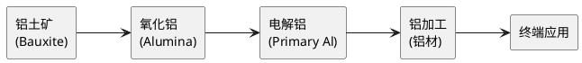
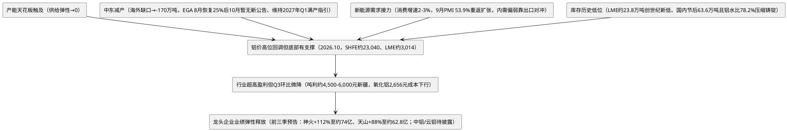

# 中国电解铝行业深度研究报告

> **报告日期**：2026年10月17日
> **数据截止**：2026年10月16日
> **调研方法**：中英双语多源检索、动态规划—搜索—评估循环
> **置信度**：核心数据来自 Tier 1（国家统计局/IAI/SMM/各公司年报）+ Tier 2（投行研报/行业机构/期货公司研报）

---

## 一、执行摘要 (Executive Summary)

### 核心判断

**中国电解铝行业正站在供给硬约束与需求结构升级的历史交汇点。4500万吨产能天花板已被触及（2025年产量45.02Mt，产能利用率98.7%），供给弹性趋于零。国家统计局最新口径显示，2026年1-8月原铝产量3,112万吨、同比增长3.9%，8月398万吨、同比增长4.7%创单月纪录（Mysteel口径388万吨、同比+2.41%、环比+0.02%）。SMM 9月产量374.9万吨、同比+1.74%、环比-12.5万吨（日均12.16万吨、铝水比78.2%），10月中旬NBS 9月数据尚未发布。全球层面，中东地缘冲突造成百万吨级减产，EGA Al Taweelah自8月26日恢复至25%电解槽（315/1,262槽）后10月暂无新公告、维持2027年Q1满产指引，海外供给同步收紧，全球铝市场2026年预计出现59-150万吨缺口。国内新能源车轻量化、光伏边框、特高压电网、储能用铝等新兴需求持续放量，正接力传统建筑需求成为增长新引擎。铝价10月中旬回调至SHFE主力约23,040元/吨（10月15日收盘）、LME约3,014美元/吨（10月16日），受美国CPI超预期推高加息预期压制风险偏好，但低库存（LME 23.8万吨、国内社会库存63.6万吨）与旺季刚需采购形成底部支撑。9月铝加工PMI大幅回升至53.9%重返扩张区间（较8月48.7%跳升5.2个百分点），下游开工全面回暖但建筑型材仍处收缩区间（48.9%），行业高盈利状态延续、成本端氧化铝价格继续下行至SMM指数约2,656元/吨（10月16日）。**

### 关键结论（5条）

1. **供给刚性不可逆**：国内产能天花板4500万吨已被触及，2026年1-8月产量3,112万吨、同比+3.9%，8月单月398万吨、同比+4.7%创纪录（年化约4,670万吨、超红线运行），全年预计4470-4530万吨，同比增量仅约1%。SMM 9月产量374.9万吨（同比+1.74%、环比-12.5万吨，日均12.16万吨）， Mysteel口径运行产能4,537.16万吨（9月末），SMM口径4,557万吨。10月中旬NBS 9月数据尚未发布。SMM测算9月铝水比78.2%、铸锭量约81.7万吨（同比-6.2%），供需紧平衡延续。海外中东减产约180万吨 vs 印尼新增仅约90万吨（Adaro KIPI仍处调试期），全球净供给收缩，EGA 8月26日进度25%后10月暂无新公告、维持2027年Q1满产指引。

2. **需求结构升级加速**：新能源领域（光伏、新能源车、特高压、储能）正成为铝消费核心驱动力，2026年新能源用铝占比预计达22%（较2020年提升12个百分点）。9月新能源车产销181.4/182.3万辆（+12.2%/+13.6%），渗透率61.6%；光伏1-8月新增装机97.19GW（国家能源局9月24日发布），建筑用铝占比则从峰值30%+降至约26%。

3. **成本端分化与利润扩张**：氧化铝产能严重过剩带动原料成本下行，SMM氧化铝指数10月16日约2,656元/吨（较9月中旬2,674下行约18元），行业平均完全成本约16000-17000元/吨。区域分化持续——新疆自备煤电铝吨利最高（5000-7000元），云南丰水期紧随其后，河南/山东火电铝利润最薄。2026H1龙头业绩爆发：云铝净利润76.84亿（+177.6%）、神火47.81亿（+151.1%）、中铝118.71亿（+67.9%）、天山铝业41.77亿（+100.4%），Q2环比均继续走强。**神火股份10月13日发布前三季度业绩预告：归母净利润约74亿元、同比+112.05%，单Q3约26.19亿、环比-6.9%首次出现环比回落，但仍处历史高位。天山铝业前三季预告约62.8亿元、同比+88%。** 铝价Q3环比回落致Q3利润环比微降，属预期之内。

4. **碳约束成为格局重塑器**：2026年CBAM正式征税 + 国内碳市场履约元年，绿电铝与火电铝的碳成本差达1000-1500元/吨铝，电解铝行业正从"电价为王"进入"低碳溢价"时代。全国碳市场碳价10月16日97.56元/吨，持续在95-98元区间高位运行。

5. **库存加速去化后国庆节后短暂累库再转去库**：国内铝锭社会库存自5月初146.5万吨峰值持续去库，9月30日降至63.8万吨（三周去库15.8万吨创历史同期最大），国庆节后短暂累库至10月8日68.6万吨（+7.5%），节后第一周快速去库5万吨至10月15日63.6万吨，基本回到国庆前水平。LME库存进一步降至约23.8万吨（10月16日，1990年以来最低；其中95%为俄罗斯品牌，可用金属极紧），上期所仓单约9.51万吨（10月15日）。

---

## 二、行业概览与价值链

### 2.1 电解铝定义与产业链定位

电解铝（又称原铝/Primary Aluminum）是通过冰晶石-氧化铝熔盐电解法（Hall-Héroult法），在约950℃高温下电解氧化铝而制取的金属铝。铝产业链分为上中下游：

**生产工艺核心参数**：
- 生产1吨电解铝需要：约**1.92-2.0吨氧化铝** + **0.5吨预焙阳极** + **13,500度电**
- 成本结构：氧化铝~35% + 电力~35% + 预焙阳极~12% + 其他辅料及制造费用~18%
- 铝土矿→氧化铝转化：约2吨铝土矿 → 1吨氧化铝（拜耳法）
- 铝土矿对外依存度：约71%，主要进口来源为几内亚、澳大利亚

### 2.2 全球与中国市场地位

| 指标 | 2024 | 2025 | 2026E |
|------|------|------|-------|
| 全球原铝产量 | ~7,300万吨 | ~7,500万吨 | ~7,320万吨 |
| 中国原铝产量 | 4,400万吨 | 4,502万吨 | ~4,520万吨 |
| 中国占全球比重 | ~60% | ~60% | ~62% |
| 中国建成产能 | 4,510万吨 | 4,519万吨 | ~4,629万吨 |
| 中国运行产能 | 4,350万吨 | 4,469万吨 | ~4,557万吨 |
| 产能利用率 | 97.6% | 98.7% | ~98.5% |

> Source: [IAI](https://international-aluminium.org/), [国家统计局](https://www.stats.gov.cn/), [SMM 9月产能统计](https://news.smm.cn/keywords/%E7%94%B5%E8%A7%A3%E9%93%9D?page=2), [Mysteel 9月产能](https://youse.mysteel.com/a/26100916/DEB648AA1F4C9BFF.html), [IndexBox](https://www.indexbox.io/blog/chinas-2025-aluminium-output-hits-4502m-tons-growth-slows-to-24/)

### 2.3 历史产量轨迹

| 年份 | 中国产量（万吨） | 同比增速 | 全球产量（万吨） | 关键事件 |
|------|----------------|---------|----------------|---------|
| 2019 | 3,504 | — | 6,370 | — |
| 2020 | 3,708 | +5.8% | 6,530 | 新冠疫情冲击 |
| 2021 | 3,852 | +3.9% | 6,730 | 能耗双控限产 |
| 2022 | 4,043 | +5.0% | 6,855 | 云南限电频繁 |
| 2023 | 4,203 | +4.0% | 7,070 | 云南复产 |
| 2024 | 4,400 | +4.6% | 7,300 | 产能天花板逼近 |
| 2025 | 4,502 | +2.4% | 7,500 | **天花板触达**，增速见顶 |

### 2.4 2026年最新月度产量追踪

| 统计周期 | 产量 | 同比 | 累计 | 累计同比 | 来源 |
|---------|------|------|------|---------|------|
| 1-2月 | 347.36万吨（2月） | +3.44% | — | — | Mysteel终值 |
| 1-4月 | 373.93万吨（4月） | +3.15% | 1,532.5万吨 | +3.5% | 国家统计局/Mysteel |
| 1-5月 | 387-389万吨（5月） | +1.7-3.15% | 1,921.5万吨 | +3.5% | 国家统计局 |
| 1-6月 | 398万吨（6月） | +4.7% | **2,319万吨** | **+3.8%** | 国家统计局 |
| 1-7月 | 389.6万吨（7月） | +3.8%（NBS）/+2.73%（Mysteel 388.01万吨） | 2,716.5万吨 | +3.8% | 国家统计局（8月19日发布）/Mysteel（8月25日终值） |
| 1-8月 | **398万吨（8月，创单月纪录）** | **+4.7%（NBS）/+2.41%（Mysteel 388万吨，环比+0.02%）** | **3,112万吨** | **+3.9%** | 国家统计局（9月15日发布）/Mysteel全样本（9月上旬） |
| 1-9月（SMM） | **374.9万吨（9月）** | **+1.74%** | — | — | SMM（10月上旬，日均12.16万吨、铝水比78.2%） |
| 9月（NBS） | **尚未发布** | — | — | — | 国家统计局预计10月中旬发布 |

> 关键观察：国家统计局8月数据显示1-8月累计3,112万吨（+3.9%）、8月单月398万吨（+4.7%）创纪录，年化约4,670万吨、超4500万吨红线运行；SMM 9月产量374.9万吨（日均12.16万吨、环比-12.5万吨），同比+1.74%但环比回落，主因云南枯水期临近部分产能压降及国庆前下游备货节奏变化。铸锭量约81.7万吨（同比-6.2%），铝水比78.2%仍处高位，铸锭供给持续被压缩。

---

## 三、供给端深度分析

### 3.1 4500万吨产能天花板：从政策约束到物理极限

2017年，国家发改委等部委明确划定电解铝产能4500万吨天花板。截至2026年9月末：

| 指标 | 数值 | 较2025年底变化 | 来源 |
|------|------|-------------|------|
| 合规产能红线 | ~4,543万吨 | 不变（8月NBS年化4,670万吨已超红线运行） | 工信部/国家统计局 |
| 建成产能 | ~4,628.87万吨（9月末，SMM口径） | +109万吨（Mysteel 9月末4,637万吨） | SMM/Mysteel 9月统计 |
| 运行产能 | ~4,557万吨（9月末，SMM）/ Mysteel 4,537.16万吨 | +88万吨/+68万吨 | SMM/Mysteel 9月 |
| 开工率 | ~98.45%（SMM 9月末） | 高位持稳 | SMM |
| 铝水比 | **78.2%**（9月，SMM）/ 9月初曾回升至78.78% | -0.5pct MoM（节后回落） | SMM 9月统计 |
| 剩余合法闲置 | <80万吨 | 多为水电配套 | 长江有色 |

> Source: [SMM 9月产能统计](https://news.smm.cn/keywords/%E7%94%B5%E8%A7%A3%E9%93%9D?page=2), [Mysteel 9月产能](https://youse.mysteel.com/a/26100916/DEB648AA1F4C9BFF.html), [SMM H1回顾](https://news.metal.com/newscontent/103997071), [长江有色](https://www.ccmn.cn/news/ZX018/202605/c0e9a466c7814d4db8f478412dfdd9ff.html)

**铝水比例提升是关键供给结构变化**：铝水比从2024年的~73%升至2026年8月77.38%（Mysteel）、9月78.2%（SMM，铸锭量同比-6.2%）。这意味着铸锭量减少、铝水直供下游加工的比例提升，直接压缩铝锭流通量，是社会库存去化的核心原因。但需关注枯水期云南产能压降可能推升铸锭比例的"反铝水比"风险。

**天花板机制下的产能转移**：合规产能采用等量/减量置换制度，已形成运行权利的"二级市场"。山东、河南、山西等传统产区的运行权正加速向云南、内蒙古、新疆等能源价格洼地转移，置换交易价格可达约1,000元/吨运行产能。

**2026年产能变化**：新疆天山铝业技改投产47万吨 + 辽宁某铝企复产30万吨 + 万基铝业（新疆）58万吨开工。1-9月运行产能累计增约88万吨（4,469→4,557），增量已近全年极限；全年净增运行产能约88-100万吨，产量增速预计0.8%-1.0%。

### 3.2 海外供给：中东减产的结构性冲击（逐厂追踪）

#### 3.2.1 减产明细

| 铝厂 | 国家 | 产能（万吨/年） | 减产幅度 | 恢复预期 |
|------|------|--------------|---------|---------|
| Al Taweelah (EGA) | 阿联酋 | **160** | 3月28日完全停产 | 需6个月，年中起爬产 |
| Alba 1-3号线 | 巴林 | ~55（Q1减产） | 运行产能降至30% | 9个月恢复期 |
| Qatalum (Hydro) | 卡塔尔 | 64.8 | 降至60%运行（天然气断供） | 暂无复产消息 |
| Salco | 伊朗 | ~5 | 预防性减产 | 不确定 |
| Iralco | 伊朗 | ~2.3 | 预防性减产 | 不确定 |
| Al-Mahdi | 伊朗 | ~1 | 预防性减产 | 不确定 |
| Mozal (South32) | 莫桑比克 | **58** | 3月15日起无限期停产 | FY26指引由60→24万吨 |
| Grundartangi 2号线 | 冰岛 | ~21 | 设备故障停产 | 4月重启，逐步恢复 |
| **中东6家合计Q1产量** | — | — | **95.3万吨（环比-12.7万吨）** | — |

> Source: [中信建投期货](https://finance.sina.com.cn/money/future/fmnews/2026-06-15/doc-inicnyqk9931934.shtml), [SMM H1回顾](https://news.metal.com/newscontent/103992259), [高盛](https://www.ainvest.com/news/goldman-sachs-forecasts-720kt-deficit-590kt-surplus-2026-27-aluminium-2606/)

#### 3.2.2 复产进度关键节点

| 铝厂 | 最新进展（截至2026年10月17日） | 对2026-2027年供应的影响 |
|------|-------------------------------|-------------------------|
| EGA Al Taweelah | **8月26日官方披露：已重启315/1,262槽（25%），三条电解槽列分别于5月26日、7月13日、8月3日通电；氧化铝精炼厂50%运行；耗资约4亿美元；指引2027年Q1满产。9月22日启动E40技术试点（先改造13台DX槽），若推广至1、2系列全部808台可增产约6.7万吨/年。截至10月17日暂无新官方公告，市场确认年内贡献有限、2027年Q1满产路径不变** | 全年产量无法恢复至冲突前水平；复产斜率较此前市场预期的"6个月满产"明显偏慢，年内贡献有限 |
| 巴林 Alba | 1-3号产线受控关停，Q1产量同比-14% | 日产损失持续 |
| 卡塔尔 Qatalum | 天然气供应问题未解 | 60%运行或持续至Q4 |
| 西班牙 San Ciprián (Alcoa) | 4月8日完成重启，年中达产 | 全年正向贡献 |

#### 3.2.3 印尼新增产能：希望与现实

| 项目 | 母公司 | 产能（万吨/年） | 时间线（截至2026年10月17日） | 2026年实际贡献 |
|------|--------|--------------|---------------------------|--------------|
| KIPI (Kalimantan) | Adaro Minerals (ADMR/KAI) | 50（一期）→150（远期） | 2025年底首批出铝，**2026年6月首次出口美国3.15万吨+韩国0.36万吨；公司指引2026年销售目标35万吨；目前仍处全面调试期至2026年Q4，满产推迟至2026年底。Fastmarkets截至2026年4月数据：名义产能198万吨/年（含爬坡），2026年实际产量估计55-90万吨** | ~25-35万吨（与此前预估一致） |
| Inalum 新冶炼厂 | Inalum (国企) | 60 | BFS 2026年初完成，COD 2028-2029 | 0 |
| 华青铝业 | 中国企业在莫罗瓦利 | 50 | 2026年建设中 | <10万吨 |
| 其他中资项目（南山/青山等） | 多家 | 合计规划~1,300万吨 | 多处于前期 | <65万吨 |
| **2026年印尼实际新增** | — | — | — | **约70-90万吨** |

> **关键认知**：印尼规划产能合计超1,300万吨，但电力（需自建电厂）、码头、审批三大瓶颈制约实际投产进度。Fastmarkets 2026年4月报告确认截至2026年底名义产能约198万吨/年，实际可用约88万吨/年新增，产量55-90万吨。Adaro项目爬坡缓慢验证斜率偏慢。

> Source: [Reuters](https://www.reuters.com/world/asia-pacific/chinese-firms-drive-aluminium-expansion-indonesia-raise-surplus-fears-2025-10-27/), [SMM](https://news.metal.com/newscontent/103624465), [Fastmarkets](https://www.fastmarkets.com/uploads/2026/04/Indonesia-Focus-Miami-Andy-Farida-2026.pdf), [The Jakarta Post](https://www.thejakartapost.com/business/2024/03/21/adaros-kipi-aluminum-smelter-aims-for-full-operation-by-early-2026), [CRU](https://www.aluminummarketupdate.crugroup.com/global-trade/indonesia-aluminum-china-exports-imports-smelters/)

### 3.3 区域产能分布：山东、云南、内蒙古三足鼎立

| 省份 | 6月建成产能（万吨） | 6月运行产能（万吨） | 开工率 | 能源特点 | 成本竞争力 |
|------|------------------|------------------|--------|---------|-----------|
| 内蒙古 | 714.1 | — | 高位 | 自备煤电 | ★★★★ |
| 新疆 | 665.5 | 661.5 | 99.40% | 自备煤电（低价煤） | ★★★★★ |
| 山东 | 636.0 | 636.0 | 100.00% | 自备煤电+孤网 | ★★★☆ |
| 云南 | — | —（同比+10.64%） | 高 | 水电为主 | ★★★★（丰）/ ★★☆（枯） |
| 甘肃 | — | — | 100% | 自备+网电 | ★★★ |
| 青海 | — | — | — | 水电+网电 | ★★★ |
| 广西 | — | — | 91.64% | 网电+氧化铝就近 | ★★☆ |

> Source: [Mysteel 7月/6月区域产能](https://youse.mysteel.com/a/26080517/2F7E584BBEDA9EAD.html), [前瞻产业研究院](https://www.qianzhan.com/analyst/detail/220/260509-88c6bf3e.html)

### 3.4 云南水电铝的特殊性：丰枯摇摆的结构性风险

云南是国内最具成本弹性和供给不确定性的产能区域：

- **建成产能**：约660万吨/年（占全国14%，全球9%）
- **电力依赖**：65%-78%发电量来自水电，85%电解铝产能采用水电直供
- **丰水期电价（6-10月）**：0.25-0.28元/度 → 吨铝电费4,300-4,700元
- **枯水期电价（11-4月）**：0.38-0.45元/度 → 吨铝电费升至6,000-7,400元，单吨成本环比增加约1,700元
- **历史限产案例**：
  - 2022-2023年：限产110-115万吨
  - 2023-2024年：第二轮限产，累计减产约190万吨
  - 2025年：受厄尔尼诺影响，Q1阶段性减产约50-80万吨

**2026下半年厄尔尼诺风险（分情景）**：

| 情景 | 概率 | 云南压减幅度 | 产能影响 | 全球供应冲击 |
|------|------|-----------|---------|------------|
| 中性 | 60% | 10%-15% | 65-95万吨 | ~0.9-1.3% |
| 悲观 | 25% | 20% | 约130万吨 | **~1.7%** |
| 乐观 | 15% | 无大规模限电 | 满产 | 无冲击 |

> **10月最新进展**：截至10月17日，云南省尚未正式发布2026-2027年枯水期限电/限产文件。省气候中心判断2026年1-5月主要江河来水"正常略少"，但6-8月滇南/滇西南降水偏多对水库蓄水有一定缓冲。云南宏合新型材料192.86万吨项目2025年已分段投产，新增产能抬高枯水期电力调度压力。关键观察窗口：汛期末水库蓄水率和主要流域来水，若蓄水不足，11月后限电减产可能集中兑现。

> Source: [世铝网](https://news.cnal.com/2026/05-18/1779085052663515.html), [证券时报](https://www.stcn.com/article/detail/807954.html), [云南省应急管理厅](https://yjglt.yn.gov.cn/html/2026/tjfx_0204/4032489.html), [财新网](https://www.caixin.com/2023-11-08/102126178.html)

---

## 四、需求端深度分析

### 4.1 消费结构：新能源接力传统需求

| 细分领域 | 2024年消费量 | 2025年E消费量 | 占比（2025） | 增速 |
|---------|------------|------------|-------------|------|
| 建筑地产 | ~1,200万吨 | ~1,150万吨 | ~26% | -4% |
| 交通运输 | ~1,027万吨 | ~1,170万吨 | ~26% | +14% |
| 电力电子（含光伏/电网） | ~1,000万吨 | ~1,060万吨 | ~24% | +6% |
| 包装 | ~456万吨 | ~479万吨 | ~11% | +5% |
| 耐用品 | ~386万吨 | ~402万吨 | ~9% | +4% |
| 机械设备 | ~295万吨 | ~305万吨 | ~7% | +3% |
| **合计** | **~4,350万吨** | **~4,566万吨** | **100%** | **~2.6%** |

> Source: [前瞻网](https://www.qianzhan.com/analyst/detail/220/260622-d65875c8.html), [中信证券](https://finance.eastmoney.com/a/202601133616454348.html)

**结构变迁核心特征**：
- 建筑用铝占比从2019年约32%持续降至2025年约26%，且仍有下行空间
- 新能源（光伏+新能源车+储能）用铝占比从2020年约10%升至2026年约22%
- 2026年新能源领域用铝总量预计约950万吨

### 4.2 核心增长引擎

#### 4.2.1 新能源汽车轻量化

- 新能源车单车用铝量：~283.5kg（较燃油车高56%），其中电池系统用铝59.3kg、轻量化车身用铝增长275%
- **2026年9月国内新能源车产销181.4/182.3万辆、同比+12.2%/+13.6%（中汽协10月12日发布）；1-9月累计1248.3/1247.2万辆、同比+11.0%/+11.1%；9月新能源销量占比61.6%再创新高。国内销量125.2万辆、同比-9.4%显示内需仍偏弱、出口为增量主体**，年内用铝增量约25-33万吨
- 一体化压铸趋势进一步推升单车用铝，汽车板毛利率超30%

#### 4.2.2 光伏边框/支架

- 每GW光伏装机消耗约2.0-2.2万吨铝型材（边框+支架）
- **2026年1-8月全国太阳能新增9,719万千瓦（97.19GW）、风电5,326万千瓦（国家能源局9月24日发布）；其中8月单月光伏约1,104万千瓦（11.04GW）。1-8月光伏新增同比明显回落，行业"抢装"后增速放缓**，2026H1光伏用铝约220万吨（+25%）但下半年增量有限
- 光伏用铝占国内铝消费比重已升至约8.5%，为铝消费增长最快的细分市场
- 风险提示：光伏产业链价格战向上游铝加工传导，铝边框加工费降至3200-3500元/吨（较高点降35%），部分中小企业开工率不足65%

#### 4.2.3 特高压/电网

- 铝在特高压建设中占比约23%（钢芯铝绞线等导线材料）
- 2026年电网用铝增量预计约46万吨
- "十五五"特高压规划持续释放用铝需求

#### 4.2.4 储能及铝代铜

- 储能用铝：预计2026-27年增量47/41万吨
- 空调铝代铜：政策出台+行业自律公约签署，2026-27年增量16/15万吨
- 铜铝比处于历史高位，替代经济性显著提升

### 4.3 需求增速预测（机构对比）

| 机构 | 2026E中国需求增速 | 2026E全球需求增速 | 2027E | 核心假设 |
|------|-----------------|------------------|-------|---------|
| 中信证券 | 1.8% | 2.2% | 3.8% | 新能源持续高增 |
| 南华期货 | 3.0% | — | — | 电力+交通对冲建筑下滑 |
| CMB国际 | 0.4% | 0.6% | 1.9% | 全球GDP增速下修 |
| 高盛 | — | 0.6% | 1.9% | 伊朗战争拖累需求 |
| **综合共识** | **1.5-3.0%** | **0.6-2.2%** | **加速** | 分歧源于对中国地产和全球GDP的假设差异 |

### 4.4 2026年7-9月内需现实：PMI确认回暖但建筑型材仍弱

- 新能源汽车国内9月125.2万辆、同比-9.4%，内需走弱延续但产销总量靠出口支撑
- 光伏装机1-8月新增97.19GW，同比增速较上半年进一步放缓
- 地产竣工面积持续负增长，建筑用铝延续下行
- 铝加工PMI企稳回升：6月46.6%重回收缩区间，7月42.2%全线收缩，8月回升至48.7%仍低于50，**9月大幅回升至53.9%重返扩张区间（SMM 10月16日发布），原生合金61.6%最强、再生铝60.1%、板带56.7%，但建筑型材仍处收缩区间（48.9%拖累整体）。SMM预计10月综合PMI或回落至荣枯线附近**

**出口需求提供有效对冲**：**海关9月出口未锻轧铝及铝材65.6万吨、同比+25.9%、环比+4.8%（海关总署10月14日发布），1-9月累计约532万吨、同比+17.8%**，9月出口创近三月新高；沪伦比修复至7.73（10月12日）、进口亏损扩大至约1,300-1,650元/吨（进口窗口关闭），但铝材出口订单仍高位，有效消化铝水产能。

---

## 五、成本与利润分析

### 5.1 成本结构全景

| 成本项目 | 占比 | 2025Q3基准 | 2026年10月最新 |
|---------|------|-----------|--------------|
| 氧化铝 | ~35-39% | ~3,100-3,300元/吨 | **SMM指数约2,656元/吨（10月16日2,655.91，较9月中旬2,674下行约18元），山东2,620-2,690、河南2,660-2,720、山西2,650-2,710、广西2,570-2,610、贵州2,660-2,720；供需宽松格局未改、现货承压下行、内外价差持续扩大** |
| 电力 | ~32-37% | 0.39-0.43元/千瓦时 | →（季节性波动，7月均价0.3923元/度；云南丰水期0.25-0.28元/度稳定） |
| 预焙阳极 | ~10-12% | ~4,000-4,700元/吨 | ↓（石油焦走弱，8月维持弱势） |
| 氟化盐等辅料 | ~3-5% | — | ↓ |
| 人工/折旧/其他 | ~15% | — | → |
| **完全成本均值** | **100%** | **~16,500-17,500元/吨** | **16,000-17,000元/吨，10月维持低位** |

> Source: [SMM](https://m.smm.cn/aluminum/content/103405110), [SMM氧化铝10.16](https://hq.smm.cn/aluminum/content/104161163), [SMM氧化铝周评10.15](https://m.smm.cn/aluminum/content/104159729), [百川盈孚](https://news.cnal.com/2025/08-14/1755141124651103.shtml)

### 5.2 区域成本竞争矩阵

| 区域 | 吨铝完全成本（元/吨） | 吨铝电费 | 电力来源 | 氧化铝采购 | 碳成本影响 |
|------|-------------------|---------|---------|-----------|-----------|
| **新疆** | 13,600-14,500 | 1,215-1,755 | 自备煤电（低价煤） | 高运费+400元/吨 | 高（火电铝，碳税压力大） |
| **云南（丰水期）** | 14,500-15,500 | 4,300-4,700 | 水电直供 | 就近采购 | 低（绿电铝，碳配额盈余） |
| **云南（枯水期）** | 16,200-17,000 | 6,000-7,400 | 水电+外购火电 | 就近采购 | 中 |
| **内蒙古** | 14,500-16,000 | 2,200-2,700 | 自备煤电 | 河南/山西采购 | 中高 |
| **山东** | 15,700-16,300 | 5,000-5,700 | 自备煤电+孤网 | 自给（成本优势700元/吨） | 高 |
| **河南** | 16,000-18,000 | 4,000-5,000 | 自备+网电 | 自给 | 高 |
| **广西/贵州** | 15,500-17,500 | 网电为主 | 大工业直购电 | 就近 | 中 |

> Source: [智通财经](https://m.zhitongcaijing.com/contentnew/appcontentdetail.html?content_id=58753), [雪球](https://xueqiu.com/1618383229/330195282)

### 5.3 行业利润水平与2026年三季度业绩验证

| 指标 | 2025Q3（7月） | 2026Q1 | 2026H1（已披露） | 2026Q3预告/最新 |
|------|------------|--------|-----------------|-----------|
| 现货铝均价 | ~20,673元/吨 | **~24,100元/吨** | **SMM H1均价24,139元/吨（同比+3,821）、氧化铝均价2,685元/吨（同比-749）；Q3均价约23,200-23,800（10月中旬SMM A00约23,260、SHFE主力约23,040）** | Q3铝价环比回落约4-5% |
| 行业平均完全成本 | ~16,533 | ~16,500-17,000 | ~16,000-17,000（氧化铝2,680元支撑下行） | 16,000-17,000（氧化铝降至2,656） |
| 吨铝平均利润 | ~4,510 | ~7,000-7,500 | **日度峰值超8,000元/吨（创历史），H1吨利5000-7000元（新疆）** | Q3环比小幅回落，吨利约4,500-6,000元 |
| 盈利企业占比 | 100% | 接近100% | 接近100% | 接近100% |

**2026年三季度业绩预告/披露进展（截至2026年10月17日）**：

| 公司 | 前三季度归母净利润（预告） | YoY | H1已披露 | Q3单季趋势 | 核心驱动 |
|------|-----------------|-----|----------|----------|---------|
| 神火股份 | **约74.00亿元**（10月13日预告） | **+112.05%** | 47.81亿（+151.06%） | Q3约26.19亿、环比-6.9% | 铝价Q3回落致环比微降，但仍处历史高位；新疆低成本优势延续 |
| 天山铝业 | **约62.8亿元**（预告） | **约+88%** | 41.77亿（+100.44%） | Q3约21亿、环比-0.8% | 新疆成本优势+高纯铝/铝箔销量增长 |
| 中国铝业 | 尚未发布（预约10月30日） | — | 118.71亿（+67.91%） | 预期Q3环比小幅回落 | 全产业链+氧化铝成本下降；拟中期分红47.35亿 |
| 云铝股份 | 尚未发布（预约10月30日） | — | 76.84亿（+177.61%） | 预期Q3环比基本持平 | 绿电铝满负荷+丰水期低电价 |
| 中国宏桥 | 尚未发布 | — | — | — | 山东+云南双基地，利润弹性大 |

> **关键观察**：Q3为2026年铝价环比首个回落季度，神火、天山Q3利润环比微降6-7%属正常季节性回调，非趋势性拐点。氧化铝价格持续下行（10月16日约2,656元/吨）继续利好成本端。正式三季报预计10月30日前后集中披露。

> Source: [神火股份前三季度业绩预告](https://disc.static.szse.cn/disc/disk03/finalpage/2026-10-13/760a3aa2-300a-469e-8270-62de69ef12a6.PDF), [天山铝业业绩预告](https://quote.cfi.cn/yjyg/11511/002532.html), [中国铝业2026中报](https://www.nbd.com.cn/articles/2026-08-27/4561624.html), [云铝股份2026中报](http://static.cninfo.com.cn/finalpage/2026-08-28/1225522152.PDF), [神火股份2026中报](https://finance.sina.com.cn/jjxw/2026-07-27/doc-inikhcku8366183.shtml), [天山铝业2026中报](https://disc.static.szse.cn/disc/disk03/finalpage/2026-08-19/92a5e344-8ac2-4061-9dd2-a6615da9cf14.PDF)

---

## 六、政策与碳约束

### 6.1 产能天花板制度

- 2017年：发改委设定4500万吨电解铝产能天花板
- 2024年9月：电解铝正式纳入全国碳排放权交易市场
- 2025年：产能天花板被触及，行业进入"零增量"时代
- 2026年：发改委等部门启动重点行业节能降碳改造攻坚三年行动，电解铝列为重点行业

> Source: [生态环境部](https://www.mee.gov.cn/xxgk2018/xxgk/xxgk06/202409/W020240909573354718696.pdf)

### 6.2 CBAM碳边境调节机制

欧盟CBAM自2026年1月1日起正式进入征税阶段：

| 维度 | 具体情况 |
|------|---------|
| 覆盖范围 | 铝产品（HS 7601-7616部分）+ 钢、水泥、化肥、电力、氢 |
| 2026年税率 | 仅对直接排放（Scope 1）征税，免费配额97.5%，铝产品加价率+10% |
| 碳价 | 2026Q1欧盟碳价75.36欧元/吨（约580元/吨），中国碳价**97.56元/吨（10月16日收盘，10月区间94.94-98.40、整体高位企稳；年初至今累计成交约1.410亿吨、122.65亿元）** |
| 对铝出口影响 | 火电铝出口欧盟成本增加约497元/吨铝（不含间接排放） |
| 中国铝出口欧盟 | 年贸易额约30亿欧元 |
| 2028年扩围 | 覆盖180类下游产品（汽车零部件、机械设备等），间接排放或纳入，加价率升至+30% |

**CBAM成本测算示例**：2026年中国火电铝出口欧盟，直接排放计算碳税≈(1.8 - 1.55×97.5%) × (90×7.8 - 100) ≈ 497元/吨铝。若2028年间接排放（Scope 2）也纳入，火电铝成本将额外增加约1,000元/吨。

**CBAM对中国铝业的分层影响**：
1. **短期（2026）**：仅直接排放征税，影响有限（吨铝约50-100元）。但默认值（3.3吨CO2/吨铝）远高于中国实际（1.57吨/吨铝），若无法提供实测数据，成本将显著提升。
2. **中期（2028-2030）**：间接排放（Scope 2）若纳入，火电铝将面临重大成本压力；绿电铝享受结构性溢价（300-800元/吨）。
3. **长期（2034+）**：免费配额归零，碳价差完全体现，绿电铝与火电铝的成本分化彻底固化。

> Source: [界面新闻](https://www.jiemian.com/article/14473498.html), [SMM CBAM分析](https://hq.smm.cn/aluminum/content/103686397), [商务部](https://price.mofcom.gov.cn/article/yjzx/hyzx/hskc/202509/63658.html), [环球网](https://news.qq.com/rain/a/20260519A08CW000)

### 6.3 国内碳市场

| 阶段 | 时间 | 关键变化 |
|------|------|---------|
| 启动实施 | 2024-2026年 | 配额全部免费，2026年12月31日前完成2025年度首次清缴履约；**全国碳市场10月16日97.56元/吨（10月区间94.94-98.40，高位企稳）；2026年累计配额成交量约1.410亿吨、成交额约122.65亿元** |
| 深化完善 | 2027年起 | 引入5%-10%有偿配额，行业碳配额缺口34-120万吨/年 |
| 全面成熟 | 2030年前 | 免费配额逐年下降，若碳价达100-150元/吨，吨铝碳成本增加200-2,000元 |

**碳排放对比**：
- 吨铝总排放：原生铝13-15吨CO2（间接排放占86%），再生铝仅0.5-1吨CO2
- 火电铝碳排放成本：约1,565元/吨铝 | 水电铝碳排放成本：约180元/吨铝
- 碳价每上涨100元/吨，火电铝VS水电铝的成本差距扩大约1,078元/吨铝

---

## 七、竞争格局与企业分析

### 7.1 头部企业格局

截至2025年6月，中国前十五大电解铝企业集团合计产能3,645.4万吨，占全国80.6%。

| 排名 | 企业 | 产能（万吨/年） | 全国占比 | 核心竞争优势 |
|------|------|--------------|---------|-------------|
| 1 | 中铝集团 | 825 | 18.2% | 全产业链，铝土矿-氧化铝-电解铝-铝材，规模第一 |
| 2 | 宏拓实业（中国宏桥） | 646 | 14.3% | 全球最大民营铝企，氧化铝自给率高，山东+云南双基地 |
| 3 | 国家电投 | ~410 | 9.1% | 央企，蒙东/宁夏等地布局 |
| 4 | 信发集团 | ~390 | 8.6% | 自备电孤网运行，氧化铝自给，成本优势显著 |
| 5 | 东方希望 | ~250 | 5.5% | 新疆低价煤电，成本控制能力极强 |
| 6 | 神火集团 | 170 | 3.8% | 新疆+云南双基地，新疆吨铝成本行业最低 |

> Source: [阿拉丁](https://aladdiny.com/news/article.aspx?infoCode=202507052461500)

### 7.2 重点上市公司对标

| 公司 | 代码 | 电解铝产能 | 吨铝成本 | 2025前三季度ROE | 2026前三季度业绩（截至10月17日） | 绿色属性 |
|------|------|----------|---------|----------------|--------------------------------------|---------|
| 中国铝业 | 601600 | 825万吨 | 中等 | ~14% | H1归母118.71亿（+67.91%）；Q3预约10月30日披露 | 全产业链，择机并购 |
| 云铝股份 | 000807 | 308万吨 | 丰水期最低 | >14%（H1 21.89%） | H1归母76.84亿（+177.61%）；Q3预约10月30日披露 | ★★★★★（87%+水电铝） |
| 神火股份 | 000933 | 170万吨（新疆80+云南90） | 新疆最低 | >14% | **前三季预告约74.00亿（+112.05%）**，Q3约26.19亿环比-6.9% | ★★☆→★★★（云南绿电扩张） |
| 中国宏桥 | 01378.HK | 646万吨 | 中低 | — | 尚未披露 | ★★★ |
| 天山铝业 | 002532 | 140万吨 | 中低 | 13.42%（H1） | **前三季预告约62.8亿（+88%）**，Q3约21亿环比-0.8% | ★★★ |

> Source: [浙商证券](https://wap.hibor.com.cn/repinfodetail_4163044.html), [中邮证券](http://wap.hibor.com.cn/data/b46c1c58adb8bfb820c466efc42f3fc3.html), [华泰证券](https://www.hibor.com.cn/data/3ee15dc94c6b59943cf062a8f3665f8b.html), [神火股份前三季度业绩预告](https://disc.static.szse.cn/disc/disk03/finalpage/2026-10-13/760a3aa2-300a-469e-8270-62de69ef12a6.PDF), [天山铝业业绩预告](https://quote.cfi.cn/yjyg/11511/002532.html)

### 7.3 竞争趋势总结

1. **从"电价为王"到"低碳+全产业链"**：纯靠低价煤电的模式受到碳约束挑战，拥有绿电+氧化铝自给的综合性企业将获得估值重定价。
2. **产能向西部清洁能源富集区转移**：山东→云南/新疆/内蒙古的产能大迁徙仍在进行。2026年9月行业开工率98.45%（SMM）。
3. **深加工延伸成关键**：汽车板、电池箔、航空铝材等高端产品毛利率30%+。神火旗下神隆宝鼎电池箔出货量Q1同比+200%至1.2万吨，毛利率超35%。

---

## 八、库存与价格走势

### 8.1 库存全景：节前极致去库、节后短暂累库再转去库

#### 国内铝锭社会库存

| 时间节点 | 库存（万吨） | 变化 | 关键背景 |
|---------|-----------|------|---------|
| 2026年5月初（峰值） | **146.5** | — | 春节后累库至三年新高 |
| 2026年6月30日 | **116.5** | -30（累计） | 三周去库近15万吨，出库17万吨创近四年新高 |
| 2026年7月30日 | **95.3** | -21.2（月内）/-51.2（累计-35%） | 如期跌破100万吨，出库回落至12.77万吨/周 |
| 2026年8月27日 | 85.2 | -10.1（8月累计） | 去库维持但斜率放缓；同期上期所24.17万吨、LME 24.67万吨 |
| 2026年9月7日 | **80.2** | -1.3（周环比） | 如期跌破80万吨临界点 |
| 2026年9月30日（节前） | **63.8** | -16.4（三周去库15.8万吨创历史同期最大） | 节前备货+铝水比78.78%极致去库 |
| 2026年10月8日（节后高点） | **68.6** | +4.8（+7.5%） | 国庆期间季节性累库 |
| **2026年10月15日** | **63.6** | -5.0（-7.3%） | 节后第一周快速去库，基本回到国庆前水平 |

> Source: [SMM国庆库存分析10.15](https://news.metal.com/pt/newscontent/104157903-inventory-changes-of-aluminum-ingots-and-billets-around-the-2026-national-day-holiday-updated-to-october-15-smm-data), [SMM 9月库存](https://hq.smm.cn/aluminum/content/104081462), [SHFE](https://www.shfe.com.cn/)

**去库驱动逻辑演变**：
1. 6月为"出库放量型去库"（单周出库17万吨创近四年新高，真实需求消化）；7-8月切换为"供应收缩型去库"——铝水比升至78%以上铸锭量同比大幅减少、华南到货锐减
2. 9月三周去库15.8万吨创历史同期极致水平，铝水比78-79%为核心驱动
3. 国庆节后短暂累库4.8万吨属正常季节性（历史均值+4.0%-17.3%），节后第一周快速去库5万吨恢复至节前水平，消费韧性确认
4. 铝棒库存10月15日约16.85万吨（较10月8日-1.9万吨），铝棒也同步去库

**10月展望**：华泰期货认为下游刚需采购补库需求仍在、社会库存去库延续；但中东复产与东南亚新增产能带来长期过剩预期，"至少2026年4季度将继续保持短缺状态"。

#### LME全球库存

| 时间节点 | LME铝库存 | 变化 | 含义 |
|---------|----------|------|------|
| 2025年底 | 50.9万吨 | — | — |
| 2026年6月底 | **30.2万吨** | -20.7万吨 | **2008年以来1%分位** |
| 2026年9月16日 | **24.36万吨** | -5.5万吨（较6月底） | **1990年以来最低、较年初51.18万吨腰斩；95%为俄罗斯品牌，可用金属极紧** |
| **2026年10月16日** | **约23.8万吨（237,900吨）** | -0.3万吨（较9月中旬） | **持续去库但降速趋缓；可用（on-warrant）库存约22.7万吨（9月底），几乎全部为俄罗斯品牌，缓冲极薄** |

> Source: [LME仓库报告](https://www.lme.com/market-data/reports-and-data/warehouse-and-stocks-reports), [The Vault Report 10.16](https://thevaultreport.com/lme/aluminum), [Kitco 10.14](https://www.kitco.com/news/off-the-wire/2026-10-14/russian-aluminiums-share-available-lme-stocks-almost-100-september)

**LME库存极低的市场含义**：当前约23.8万吨相当于全球约1.2天的消费量，较均值55.25万吨低124%、较年初51.18万吨腰斩。虽仓库持续去化但Cash-3M仅轻微Backwardation（约2美元/吨contango），显示中国出口增加、中东复产预期及仓单结构削弱了逼仓交易；但95%为俄罗斯品牌、表外库存仅约8.6万吨，缓冲极薄意味着任一供给扰动都能快速放大价格波动。

### 8.2 价格走势

| 时期 | SHFE铝（元/吨） | LME铝（美元/吨） | 核心驱动 |
|------|---------------|-----------------|---------|
| 2025全年 | 19,500-22,000 | 2,400-3,000 | 天花板触及+中东减产预期 |
| 2026.1月 | 26,000（冲高） | 3,560（冲高） | 中东冲突全面爆发 |
| 2026.3-5月 | 22,000-24,000 | 3,100-3,560 | 冲突升级+海峡危机 |
| 2026.6月回调 | 21,500-23,000 | 3,000-3,200 | 美伊和解备忘录+风险溢价回吐 |
| 2026.7月 | 22,840-24,315 | 3,111-3,242 | 去库加速但PMI 42.2%承压 |
| 2026.8月 | 23,820（主力收盘8.27）/区间23,500-24,300 | 3,225-3,242（LME 3M） | 内外库存同创低位支撑 |
| 2026.9月 | 24,180-24,560（SMM A00：9.10 24,560、9.17 24,180） | 3,280-3,300（LME 3M） | 低库存+旺季去库托底 vs 美国非农超预期压制 |
| **2026.10月（截至10月16日）** | **SHFE主力AL2611约23,040（10月15日收盘跌305元）/SMM A00华东约23,260（10月16日）；10月12日AL2611收23,465；区间22,940-23,615** | **约3,014美元/吨（10月16日现金）；10月15日LME 3M约3,012** | 美国CPI超预期推高加息预期压制风险偏好；低库存+旺季刚需采购形成底部支撑；华泰期货"受压但有韧性"区间行情 |

> Source: [华泰期货10.16](https://finance.sina.com.cn/money/future/fmnews/2026-10-16/doc-inivksmv8270206.shtml), [SMM收盘](https://hq.smm.cn/futures/104152513), [The Vault Report](https://thevaultreport.com/lme/aluminum), [长江有色](https://www.ccmn.cn/news/ZX018/202610/456645ed9f144a35b81af05294abeece.html)

**10月沪伦比与进出口**：10月12日沪伦比修复至7.73，LME铝折算CIF成本约25,487元/吨 vs 国内现货23,830元/吨，进口亏损约1,657元/吨（进口窗口关闭）。但铝材出口9月65.6万吨创近三月新高（+25.9%），铝材出口利润仍在，深加工出口持续消化国内产能。

### 8.3 2026H2-2027价格展望（机构最新对比）

| 机构 | 2026H2 SHFE | 2026H2 LME | 2027E LME | 核心逻辑 |
|------|-----------|-----------|----------|---------|
| 华泰期货（10.16） | — | — | — | 受压但有韧性；Q4保持短缺状态，但长期过剩预期制约涨幅 |
| 华泰证券 | — | 有望上探**4,000** | — | 全球缺口94.9万吨 |
| 中信证券 | 23,000（中枢） | — | — | 缺口扩大（中国-29，全球-40） |
| 南华期货 | 21,500-25,000 | 2,900-3,400 | — | 供给刚性+政策期待 |
| Bernstein | — | **3,100** | — | 中东复产快于预期 |
| 高盛 | — | 3,300（Q3） | **2,950** | 缺口72万吨，2027转小幅过剩 |
| 摩根大通 | — | H1 3,000 / Q4 2,650 | 下行 | 印尼产能集中释放 |

**综合判断（10月更新）**：
- **最可能的路径（概率50%）**：2026H2 SHFE 21,500-25,000元/吨，LME 2,900-3,400美元/吨。H2去库延续+枯水期减产推动供需收紧，但中东复产预期与美国加息压制风险偏好。
- **乐观路径（概率20%）**：厄尔尼诺强袭 + 中东复产再推迟 + 新能源超预期 → SHFE突破28,000，LME突破3,800。
- **悲观路径（概率30%）**：印尼+中东产能集中释放 + 地产加速下滑 + 全球加息周期延长 → 2027年SHFE回落至17,000-19,000元/吨。**10月悲观概率上调5个百分点，因美国CPI超预期引发加息预期升温、压制整个有色板块。**

### 8.4 全球供需平衡表

| 指标 | 2025A | 2026E | 2027E |
|------|-------|-------|-------|
| 全球产量 | ~7,500万吨 | ~7,320万吨（-2.4%） | ~7,541万吨 |
| 全球消费 | ~7,440万吨 | ~7,470万吨 | ~7,614万吨 |
| 供需差 | +60万吨 | **-150万吨（缺口）** | -73万吨 |
| 中国产量 | 4,502万吨 | ~4,520万吨 | ~4,563万吨 |
| 中国消费 | ~4,566万吨 | ~4,590万吨 | ~4,754万吨 |
| 中国供需差 | -64万吨 | **-70万吨** | **-191万吨** |

> 华泰证券测算2026年全球缺口约94.9万吨，高盛测算缺口约72万吨。分歧源于对中国需求增速和印尼产能释放节奏的不同假设。

> Source: [CMB International](https://hk-official.cmbi.info/upload/4df2ee3d-7aef-42e2-9e34-925967235938.pdf), [华泰证券](https://www.hibor.com.cn/data/3ee15dc94c6b59943cf062a8f3665f8b.html), [高盛](https://www.ainvest.com/news/goldman-sachs-forecasts-720kt-deficit-590kt-surplus-2026-27-aluminium-2606/)

---

## 九、关键争议辨析

> 以下三个核心争议直接决定了未来12个月铝价的走向，需要逐一拆解正反方论据。

### 9.1 争议一：印尼产能是否会"淹没"全球铝市场？

#### 多方（看多铝价）观点：
- 印尼11个规划项目合计~1,300万吨产能，但2026年实际增量仅70-90万吨
- 自备电厂建设周期2-3年，电力是致命瓶颈
- Adaro KIPI项目2025年底首批出铝后爬坡缓慢，远低于年初预期；Fastmarkets确认2026年底名义产能约198万吨/年，实际产量55-90万吨
- Inalum新厂最早2028-2029年才能投产
- **"规划产能 ≠ 当年产量"**是核心认知偏差

#### 空方（看空铝价）观点：
- 高盛：2026年印尼新增200万吨（该预测已被实际投产进度证伪）
- 摩根大通：2026H2起印尼产能集中释放，将逆转供需格局
- 印尼2026年产量已同比+89%，增速惊人
- 2027年才是真正的投产高峰（Adaro满产 + Taijing + 青山投产）

#### 综合评估（权重偏向多方）：
2026年印尼增量有限（70-90万吨），不足以冲击市场。但2027-2028年若多个大项目集中投产（合计可达200-300万吨/年），将与中东复产形成供给共振，届时将是真正的供需拐点。**高盛的200万吨叙事在2026年被证伪，但在2027年可能被证明"迟到但未缺席"。**

### 9.2 争议二：4500万吨天花板是否真不可突破？

#### 多方（产能天花板牢不可破）：
- 工信部2026年再次明确严格执行红线
- 全国碳市场2027年引入有偿配额，新增产能的碳成本将大幅提高
- 花旗：中国电解铝已是"bad investment"，碳/能/环政策叠加使新建审批几乎不可能
- 产能置换制度本身也在收紧，等量置换逐步转向减量置换

#### 空方（天花板可能松动）：
- 2025年实际产量4,502万吨，2026年产量有望达到4,520-4,530万吨，"超产"已常态化
- 运行产能已突破4,557万吨（9月末，高于合规产能红线），"超红线运行"得到默许
- 高盛将中国2026年产量预期上修至4,560万吨，2027年至4,630万吨
- 若铝价持续高位，政策层可能在"经济发展"和"产能约束"之间重新权衡

#### 综合评估：
政策"名义红线"不会被正式取消，但实际执行存在弹性空间（±100-200万吨）。更可能的路径是：通过铝水比提升（→铸锭量不增）、再生铝替代（2027年目标1500万吨）来缓解原铝供给压力，而非直接突破天花板。

### 9.3 争议三：高盛看多2026缺口 vs 看空2027过剩，哪个方向对？

#### 高盛2026年缺口预测的关键假设：
| 假设项 | 高盛 | 实际/市场判断 | 偏差方向 |
|--------|------|-------------|---------|
| 中东复产时间 | 2027年初 | EGA 6个月，但海峡通关+实际爬产更慢；10月无新公告确认进度偏慢 | **高盛可能偏乐观** |
| 印尼产量 | 200万吨（2026） | 70-90万吨 | **已证伪（偏空）→实际上利多** |
| 中国产量 | 4,560万吨 | 4,520-4,530万吨 | 高盛偏乐观 |
| 全球需求增速 | 0.6% | 0.6-2.2% | 高盛偏保守 |
| **2026缺口** | **72万吨** | **可能更大（100-150万吨）** | **高盛可能低估了缺口** |
| **2027过剩** | **59万吨** | — | 取决于中东复产+印尼节奏 |

**结论**：高盛2026年"缺口"判断方向正确，但量级可能低估（印尼新增被高估、中东复产时间被低估）。2027年"过剩"判断高度依赖复苏假设——若中东复产再推迟+印尼爬坡低于预期，2027年可能仍是紧平衡而非过剩。

---

## 十、风险全景评估

### 10.1 上行风险（利好铝价）

| 风险因素 | 概率 | 影响量级 | 描述 |
|---------|------|---------|------|
| 超级厄尔尼诺致云南大减产 | 25% | -130万吨（全球1.7%） | 2026Q4-2027Q1为最高风险窗口；截至10月17日尚无官方限电文件，来水偏弱风险存在 |
| 中东复产不及预期 | 40% | 缺口扩大至100-150万吨 | EGA需6个月恢复，10月无新公告、Qatalum天然气问题未解 |
| 国内新能源需求超预期 | 30% | 需求额外+30-50万吨 | 储能/铝代铜增速上修 |
| LME库存极低 + 逼仓风险 | 15% | LME短期冲高至3,800+ | 当前约23.8万吨库存（10月16日，1990年以来最低，95%俄品牌），缓冲极薄 |
| 铜铝比修复 | 20% | 铝价补涨10-15% | 铜铝比处历史高位，均值回归逻辑 |

### 10.2 下行风险（利空铝价）

| 风险因素 | 概率 | 影响量级 | 描述 |
|---------|------|---------|------|
| 房地产持续低迷 | 50% | 建筑用铝-50~80万吨/年 | 竣工面积持续下降 |
| 印尼产能超预期释放 | 35%（2026低/2027中） | +50-200万吨 | 2027年才是真正考验 |
| 中东快速复产 | 25% | 恢复+100-150万吨 | 海峡通关+复产进度超预期 |
| 全球衰退拖累工业需求 | 25% | 需求下调0.5-1.0% | **美国CPI超预期、加息预期升温，10月概率上调** |
| 再生铝大规模替代 | 15% | 需求减量30-50万吨 | 2027年目标1500万吨（较2024 +450万吨） |
| 光伏装机不及预期 | 20% | 光伏用铝增速回落 | 消纳瓶颈+产业链亏损 |
| 国内铝锭库存高压（出口窗口关闭） | 30% | 国内铝价承压回落 | 若LME-SHFE价差进一步收窄，出口动能消退；10月沪伦比7.73、进口亏损1,300-1,650元 |

### 10.3 核心风险情景推演（量化版）

| 情景 | 概率 | SHFE铝价2026H2 | LME铝价2026H2 | 触发条件 |
|------|------|--------------|-------------|---------|
| **牛市** | 20% | >28,000元/吨 | >3,800美元/吨 | 厄尔尼诺强袭 + 中东复产再推迟 + 新能源超预期 |
| **中性偏强** | 30% | 23,000-25,000 | 3,200-3,400 | 中东缓慢恢复 + 去库持续 |
| **中性偏弱** | 25% | 21,500-23,000 | 2,900-3,200 | 中东复产快于预期 + 内需疲软 + 加息压制 |
| **熊市** | 25% | 17,000-19,000（2027） | 2,650-2,800（2027） | 印尼+中东产能共振 + 地产下滑 + 全球紧缩 |

### 10.4 行业周期阶段判断

参照产业周期框架，中国电解铝行业当前处于**"扩张后期→高位平台期"**的过渡阶段：

| 阶段特征 | 当前状态 | 信号 |
|---------|--------|------|
| 产能增速 | 降至~1% | 天花板已触达，符合"高位平台"特征 |
| 产能利用率 | 98.45%（极高，9月末） | 典型过热信号，但属于政策驱动而非周期驱动 |
| 行业盈利 | 吨利4,500-6,000元（Q3），100%产能盈利 | 处于周期顶部区域 |
| 供给弹性 | 趋于零 | 与典型周期顶部一致 |
| 库存水平 | 节后去库至63.6万吨，LME约23.8万吨 | 偏牛市 |
| 新进入者 | 无法进入（政策壁垒） | 非典型——政策而非市场决定格局 |

**关键拐点判据**（预警信号）：
1. **景气向下预警**：(1) 印尼多个项目集中投产且量级超预期（月产量+15万吨以上）；(2) 中东产能恢复速度超过月增5万吨；(3) LME库存从30万吨以下止跌回升；(4) 国内铝水比回落（铸锭增加）；(5) 吨铝利润连续两季下降超过20%。
2. **景气向上延续**：(1) 云南枯水期限产超100万吨；(2) 中东复产持续推迟；(3) SHFE铝价维持在22,000元以上且下游接受度保持。

---

## 十一、结论、投资方向与标的筛选

### 11.1 核心逻辑链

### 11.2 投资方向排序

| 优先级 | 方向 | 逻辑 | 代表标的 |
|--------|------|------|---------|
| **高** | 低成本电解铝龙头（新疆煤电/云南绿电） | 吨利最高，业绩弹性最大，PE处于历史低位（神火不足8倍） | 神火股份、天山铝业、云铝股份 |
| **高** | 全产业链一体化巨头 | 氧化铝自给+电解铝+高端铝材，穿越周期能力强 | 中国铝业、中国宏桥 |
| **中** | 铝加工高端化（汽车板/电池箔） | 深加工毛利率30%+，受益新能源需求+不受产能天花板约束 | 南山铝业、神隆宝鼎（神火子公司） |
| **中** | 绿电铝先行者 | CBAM碳关税避险，碳配额盈余可出售获利 | 云铝股份 |
| **谨慎** | 纯火电高成本铝企 | 碳成本压力大，成本无优势，产能退出风险 | 河南/广西部分高成本企业 |

### 11.3 标的筛选框架

**优质标的特征**：
1. 低成本电力（新疆自备煤电 / 云南丰水期水电 / 内蒙古低价煤电）
2. 氧化铝自给或就近配套（降低原料成本波动）
3. 绿电占比高（碳关税避险 + 碳配额盈余出售）
4. 深加工延伸（汽车板/电池箔/航空铝材，毛利率30%+）

**成本优势排序**：新疆煤电铝 ≈ 云南水电铝（丰水期） > 内蒙古煤电铝 > 山东自备电铝 > 其他网电铝

### 11.4 2027年关键拐点预警

2027年是电解铝行业最可能发生结构性转向的年份：
- **供给侧**：印尼多个大项目集中投产 + 中东产能逐步恢复 → 海外供给增速从-2.4%跳升至+3.0%
- **需求侧**：新能源用铝继续高增但增速放缓，建筑用铝下行加速
- **平衡表**：2027年缺口大幅缩窄（从-150万吨→-74万吨），若复产超预期可能转为小幅过剩

**三大前瞻信号**（提前6-12个月预警）：
1. 印尼月均铝产量是否在2026Q4起持续攀升（超过月增5万吨）
2. EGA Al Taweelah复产公告时间（越早→铝价压力越早）
3. 国内吨铝利润是否从当前的4,500-6,000元/吨（新疆）回落至3000元以下

---

## 十二、关键监测指标

### 日度/周度指标

| 指标 | 频率 | 数据来源 | 方向信号 |
|------|------|---------|---------|
| SHFE铝主力合约收盘价 | 日度 | 上期所 | — |
| LME铝3M收盘价 | 日度 | LME | — |
| LME铝库存（注册仓单+注销仓单） | 日度 | LME | 持续去库→利多 |
| LME Cash-3M升贴水 | 日度 | LME | 由contango转backwardation→价格上行信号 |
| 国内铝锭主要消费地库存 | 周度 | SMM/Mysteel | 去库→利多 |
| 铝锭出库量 | 周度 | SMM | >13万吨/周→加速去库信号 |
| 国内铝棒库存 | 周度 | SMM/Mysteel | 去库→下游开工率回升 |
| 国内铝水比例 | 周度 | SMM | 上升→铸锭量减少→利多铝锭 |
| SHFE铝仓单库存 | 日度 | 上期所 | 下降→现货趋紧 |

### 月度指标

| 指标 | 频率 | 数据来源 | 方向信号 |
|------|------|---------|---------|
| 中国电解铝月度产量 | 月度 | 国家统计局/IAI/SMM | 增速>2%→供给压力 |
| 中国电解铝运行产能 | 月度 | Mysteel/SMM | 上升→供给增量 |
| 月度铝材出口量 | 月度 | 海关总署 | 上升→内需替代出口，去库支撑 |
| 月度氧化铝产量 | 月度 | 国家统计局 | 增速>需求→氧化铝继续跌价→电解铝利润扩张 |
| 铝加工PMI | 月度 | SMM | <50且恶化→内需疲软信号 |
| 新能源车月度销量 | 月度 | 中汽协 | 环增→用铝需求旺 |
| 光伏月度新增装机 | 月度 | 国家能源局 | 超预期→用铝增 |
| 云南主要水库水位/来水量 | 月度 | 云南省水利厅 | 低于常年→枯水期限产风险 |
| 中国碳市场碳价 | 月度 | 上海环交所 | 持续上涨→碳成本压力增大 |

### 季度/半年指标

| 指标 | 频率 | 数据来源 | 方向信号 |
|------|------|---------|---------|
| 上市公司季度报告（吨铝成本/产量/利润） | 季度 | 公司公告 | 毛利率趋势→盈利拐点 |
| 全球供需平衡表更新 | 季度 | IAI/各投行 | 缺口扩大/缩窄 |
| 印尼铝产量数据 | 季度 | 印尼能矿部/IAI | 加速增长→2027拐点预警 |
| CBAM碳价更新 | 季度 | 欧盟委员会 | 2026年1月1日起正式实施；2026年证书价格按EU ETS拍卖价季度均值计算，碳价差扩大→绿电铝溢价提升 |
| 厄尔尼诺/拉尼娜气候预测 | 季度 | NOAA/国家气候中心 | 强厄尔尼诺→云南水电风险 |
| 欧盟碳市场碳价 | 实时 | EEX | 碳价上行→CBAM成本增加 |

### P0级最高优先级指标

以下指标对铝价方向的判断力最强，应优先跟踪：

1. **LME铝库存（日度）**：当前约23.8万吨（10月16日，已跌破24万吨，1990年以来最低），Cash-3M仅轻微contango约2美元/吨暂未触发逼仓，但95%俄品牌、缓冲极薄
2. **国内铝锭社会库存（周度）**：**节后10月8日短暂累库至68.6万吨后快速去库，10月15日已回到63.6万吨**；华泰期货确认Q4保持短缺状态，下游刚需采购补库需求仍在
3. **云南来水量/水库水位（月度）**：截至10月17日尚无官方枯水期限电文件；来水偏弱风险存在（省气候中心判断正常略少），关键窗口为汛期末蓄水率；11月后是否出现"停槽、压降负荷"信号
4. **中东复产进度（持续追踪）**：**EGA Al Taweelah 8月26日25%已重启，9月22日启动E40技术试点；截至10月17日暂无新官方公告，进度仍慢于市场此前6个月满产预期**
5. **印尼月度铝产量**：Adaro 35万吨年销目标验证爬坡慢，提前预警2027年供需拐点；Fastmarkets确认2026年实际产量55-90万吨
6. **SHFE-LME价差（日度）**：已修复至7.73（10月12日）、进口亏损扩大至1,300-1,650元/吨，进口窗口关闭；但铝材出口仍高位（9月65.6万吨+25.9%），深加工出口利润持续

---

## 十三、信息源分级体系

| 层级 | 类型 | 代表来源 | 使用原则 |
|------|------|---------|---------|
| **Tier 1** | 官方统计与监管 | 国家统计局、IAI（国际铝业协会）、国家能源局、工信部、LME、上期所、生态环境部、欧盟委员会 | 数据事实可直接采纳；政策解读需交叉验证 |
| **Tier 2** | 行业数据平台 | SMM（上海有色网）、Mysteel（我的钢铁网）、阿拉丁（Aladdiny）、百川盈孚、长江有色金属网、世铝网 | 高频数据首选来源，需多源交叉验证（SMM与Mysteel统计数据口径有差异） |
| **Tier 3** | 投行/券商研报 | 高盛、摩根大通、CMB国际、中信证券、华泰证券、南华期货、中邮证券、浙商证券、光大期货 | 关注假设而非结论数字；对比多家找分歧 |
| **Tier 4** | 公司披露 | 上市公司年报/季报/IR材料、CNINFO公告 | 管理层陈述需第三方验证 |
| **Tier 5** | 媒体与行业平台 | 界面新闻、财联社、证券时报、东方财富、前瞻产业研究院、智研咨询、36氪 | 核对原始来源，警惕PR稿；可用于交叉验证 |

**交叉验证原则**：任一研判结论需至少两个不同层级来源支撑。单一Tier 3/5来源信息仅作为"待验证信号"。

---

## 十四、更新纪律

| 更新类型 | 触发条件 | 动作 |
|---------|---------|------|
| **数据刷新** | 月度产量/库存/成本数据发布；季度上市公司财报发布 | 更新对应小节的数据表 |
| **信号标注** | 单一数据点出现异常变化（如单周出库骤降、LME库存跳升、云南来水量异常） | 加注"待验证"，等待下一期数据确认 |
| **研判修正** | 连续两期同向异常 + 多源交叉验证通过 | 更新趋势判断和价格预期 |
| **结构性修订** | 发生以下任一事件：(1) 印尼多个大项目宣布提前投产；(2) EGA宣布Al Taweelah复产；(3) 4500万吨天花板政策松动；(4) 国内碳市场碳价突破200元/吨；(5) CBAM宣布间接排放纳入时间表 | 新增分析小节或重写受影响章节 |
| **定期审视** | 每季度末 | 重新检查：(1) 全球供需平衡表；(2) 铝价中枢；(3) 竞争格局变化；(4) 标的筛选框架有效性 |

> **一条原则**：电解铝行业当前最大的结构性问题不是需求和价格，而是**2027年供给拐点何时到来**。月度价格波动多为噪声，真正决定行业中期走势的是印尼投产节奏和中东复产速度。**印尼月度铝产量和EGA复产公告是高于任何其他指标的P0级跟踪数据。**

---

## 十五、关键术语表

| 术语 | 英文 | 说明 |
|------|------|------|
| 电解铝/原铝 | Primary Aluminum / Electrolytic Aluminum | 通过冰晶石-氧化铝熔盐电解法制取的金属铝 |
| 氧化铝 | Alumina (Al2O3) | 电解铝的核心原料，由铝土矿经拜耳法精炼而成 |
| 预焙阳极 | Prebaked Anode | 电解铝生产中的导电材料和还原剂，吨铝消耗约0.5吨 |
| 铝水比 | Liquid Aluminum Ratio | 电解铝以液态（铝水）形式直接供应下游的比例，提高→铸锭量减少 |
| 合规产能 | Compliant Capacity | 工信部认定的合法电解铝产能，总量约4543万吨 |
| 产能置换 | Capacity Replacement | 淘汰落后产能以换取新产能指标的机制 |
| 孤网运行 | Isolated Grid Operation | 自备电厂不接入公共电网，直接向铝厂供电，无过网费 |
| 碳边境调节机制 | CBAM (Carbon Border Adjustment Mechanism) | 欧盟对进口高碳产品征收碳成本的机制 |
| 绿电铝 | Green Aluminum | 使用可再生能源（水电/风电/光伏）生产的电解铝 |
| 火电铝 | Coal-powered Aluminum | 使用燃煤发电生产的电解铝，碳排放高 |
| 再生铝 | Secondary/Recycled Aluminum | 通过回收废铝再熔炼生产的铝，能耗/碳排放为原铝的5%左右 |
| Backwardation | 现货升水 | 现货价格高于期货价格，通常表示现货市场紧张 |
| Contango | 期货升水 | 期货价格高于现货价格，通常表示现货市场宽松 |
| LME Cash-3M | LME现货对3月期货价差 | 衡量短期供需紧张程度的核心指标 |
| 吨铝完全成本 | Full Cost per Tonne of Aluminum | 含电力/氧化铝/阳极/辅料/人工/折旧/期间费用的总成本 |

---

## 十六、资料来源

### 全球产量与供需
1. [International Aluminium Institute (IAI)](https://international-aluminium.org/) — 全球原铝产量月度统计
2. [世界金属统计局 (WBMS)](https://www.world-bureau.com/) — 全球金属供需平衡表

### 中国统计与政策
3. [国家统计局](https://www.stats.gov.cn/) — 中国电解铝/氧化铝月度产量数据
4. [Mysteel 我的钢铁网](https://youse.mysteel.com/) — 电解铝产能/产量/库存/成本全链条跟踪
5. [生态环境部](https://www.mee.gov.cn/xxgk2018/xxgk/xxgk06/202409/W020240909573354718696.pdf) — 电解铝纳入碳市场工作方案

### 行业数据平台
6. [SMM 上海有色网](https://www.smm.cn/) — 电解铝日度价格/周度库存/月度成本/产量数据
7. [阿拉丁 Aladdiny](https://aladdiny.com/) — 前十五大电解铝/氧化铝企业集团产能排名
8. [百川盈孚](https://www.baiinfo.com/) — 电解铝月度成本测算
9. [长江有色金属网](https://www.ccmn.cn/) — 现货价格与行业分析
10. [世铝网 (CNAL)](https://www.cnal.com/) — 行业动态与云南限电专题

### 国际机构与投行研报
11. [CRU Aluminum Market Update](https://www.aluminummarketupdate.crugroup.com/) — 中国产能天花板与全球贸易格局
12. [Reuters](https://www.reuters.com/) — 中国铝产能天花板系列报道
13. [CMB International](https://hk-official.cmbi.info/upload/4df2ee3d-7aef-42e2-9e34-925967235938.pdf) — 全球铝供需平衡表与中东减产影响
14. [高盛 Goldman Sachs](https://www.ainvest.com/news/goldman-sachs-forecasts-720kt-deficit-590kt-surplus-2026-27-aluminium-2606/) — 2026-27铝价预测
15. [Bernstein](https://www.tradevae.com/news/commodities/bernstein-holds-2h-2026-aluminium-forecast-at-3100-amid-supply-normalization/) — 2026H2铝价预测
16. [摩根大通 JPMorgan](https://www.aviationaluminum.com/news/will-aluminum-prices-experience-a-roller-coaster-ride-jpmorgan-chase-rise-and-fall-in-202627-indonesian-production-capacity-is-key) — 2026/27全球铝市场展望

### 国内券商研报
17. [中信证券](https://finance.eastmoney.com/a/202601133616454348.html) — 新动能支撑电解铝需求稳增
18. [华泰证券](https://www.hibor.com.cn/data/3ee15dc94c6b59943cf062a8f3665f8b.html) — 神火股份2026Q1报点评/全球供需缺口测算
19. [南华期货](https://wap.hibor.com.cn/data/146e8c009cbd3165090a3f935b2af5ae.html) — 2026年铝产业链半年度展望
20. [光大期货](https://max.book118.com/html/2026/0629/5122211044013234.shtm) — 2026年下半年铝报告
21. [中信建投期货](https://finance.sina.com.cn/money/future/fmnews/2026-06-15/doc-inicnyqk9931934.shtml) — 海外铝企2026Q1产量追踪
22. [浙商证券/中邮证券](https://wap.hibor.com.cn/repinfodetail_4163044.html) — 电解铝企业弹性表与季度业绩总结

### 公司披露
23. [中国铝业 2026Q1](https://stockmc.xueqiu.com/202604/601600_20260424_H8NF.pdf) — 利润总额119.17亿（+82.5%）
24. [云铝股份 2026Q1](http://static.cninfo.com.cn/finalpage/2026-04-24/1225161365.PDF) — 归母净利36亿（+269.45%）
25. [神火股份 2026Q1/华泰证券](https://www.hibor.com.cn/data/3ee15dc94c6b59943cf062a8f3665f8b.html) — 归母净利22.9亿（+223.28%）

### 碳政策与CBAM
26. [界面新闻](https://www.jiemian.com/article/14473498.html) — 碳关税对国内铝行业影响深度分析
27. [SMM CBAM分析](https://hq.smm.cn/aluminum/content/103686397) — 欧盟CBAM机制及对全球铝市场影响
28. [商务部商品价格网](https://price.mofcom.gov.cn/article/yjzx/hyzx/hskc/202509/63658.html) — 碳税与CBAM政策深度解读
29. [环球网](https://news.qq.com/rain/a/20260519A08CW000) — 绿电直连：中国出口企业的碳通关密钥

### 印尼产能与海外供给
30. [Reuters - Indonesia](https://www.reuters.com/world/asia-pacific/chinese-firms-drive-aluminium-expansion-indonesia-raise-surplus-fears-2025-10-27/) — 中国企业驱动印尼铝产能扩张
31. [The Jakarta Post](https://www.thejakartapost.com/business/2024/03/21/adaros-kipi-aluminum-smelter-aims-for-full-operation-by-early-2026) — Adaro KIPI铝冶炼厂进展
32. [SMM INALUM](https://news.metal.com/newscontent/103624465) — 印尼Inalum推进铝土矿下游四大项目
33. [SMM海外铝企Q1追踪](https://finance.sina.com.cn/money/future/fmnews/2026-06-15/doc-inicnyqk9931934.shtml) — 中东铝厂2026Q1产量逐厂分析
34. [EGA 8.26官方](https://media.ega.ae/egas-al-taweelah-smelter-restoration-reaches-25-completion-milestone/) — Al Taweelah 25%重启、Q1 2027满产指引
35. [Fastmarkets Indonesia](https://www.fastmarkets.com/uploads/2026/04/Indonesia-Focus-Miami-Andy-Farida-2026.pdf) — 印尼电解铝冶炼厂产能报告
36. [Petromindo](https://www.petromindo.com/news/article/analysis-indonesia-s-aluminium-expansion-faces-a-2027-power-test) — 印尼铝扩张面临2027电力考验
37. [国家统计局8月](https://www.stats.gov.cn/sj/zxfb/202609/t20260915_1965308.html) — 8月原铝398万吨、1-8月3112万吨
38. [Mysteel 9月产能](https://youse.mysteel.com/a/26100916/DEB648AA1F4C9BFF.html) — 9月分省产能统计
39. [SMM国庆库存分析](https://news.metal.com/pt/newscontent/104157903-inventory-changes-of-aluminum-ingots-and-billets-around-the-2026-national-day-holiday-updated-to-october-15-smm-data) — 国庆前后铝锭铝棒库存变化
40. [海关9月出口](https://news.mysteel.com/a/26101410/1B4C32FA4509EEA9.html) / [SMM](https://news.smm.cn/news/104156304) — 9月出口65.6万吨、同比+25.9%
41. [中汽协9月](https://www.miit.gov.cn/gxsj/tjfx/zbgy/qc/art/2026/art_8a878aeeb8a34a5b88975c5bbe94f7bf.html) — 新能源产销181.4/182.3万辆
42. [国家能源局1-8月](https://www.nea.gov.cn/20261016/a113c8e6a4aa4f4a9842a6d76065a76d/c.html) — 太阳能9719万千瓦、风电5326万千瓦
43. [SMM PMI 9月53.9%](https://hq.smm.cn/aluminum/content/104140031) — 加工PMI重返扩张区间
44. [SMM氧化铝10.16](https://hq.smm.cn/aluminum/content/104161163) — 氧化铝指数约2,656元/吨
45. [华泰期货10.16](https://finance.sina.com.cn/money/future/fmnews/2026-10-16/doc-inivksmv8270206.shtml) — 沪铝受压但有韧性、Q4保持短缺
46. [神火股份前三季业绩预告](https://disc.static.szse.cn/disc/disk03/finalpage/2026-10-13/760a3aa2-300a-469e-8270-62de69ef12a6.PDF) — 归母约74亿、+112.05%
47. [天山铝业业绩预告](https://quote.cfi.cn/yjyg/11511/002532.html) — 前三季约62.8亿、+88%
48. [全国碳市场10.16](https://www.cnfin.com/dz-lb/detail/20261016/4482084_1.html) — 碳价97.56元/吨
49. [The Vault Report LME](https://thevaultreport.com/lme/aluminum) — LME 10月16日约23.8万吨、约3,014美元/吨
50. [EGA E40试点](https://media.ega.ae/ega-to-pilot-technology-upgrades-at-al-taweelah-further-improving-productivity-and-efficiency/) — 9月22日启动E40技术试点

### 云南限电与厄尔尼诺
51. [世铝网 - 厄尔尼诺](https://news.cnal.com/2026/05-18/1779085052663515.html) — 超级厄尔尼诺情景下的铝产量风险
52. [云南省应急管理厅](https://yjglt.yn.gov.cn/html/2026/tjfx_0204/4032489.html) — 2026年度自然灾害风险预测
53. [证券时报](https://www.stcn.com/article/detail/1028855.html) — 云南铝企历年限产分析
54. [财新网](https://www.caixin.com/2023-11-08/102126178.html) — 云南枯水期限产常态化

### 行业竞争与成本
55. [前瞻产业研究院](https://www.qianzhan.com/analyst/detail/220/260509-88c6bf3e.html) — 电解铝行业竞争格局
56. [智通财经](https://m.zhitongcaijing.com/contentnew/appcontentdetail.html?content_id=58753) — 中国14省电解铝区域竞争力指南
57. [腾讯新闻](https://news.qq.com/rain/a/20260222A055ZY00) — 电解铝产能大迁徙：从煤电到绿电

### 库存数据
58. [LME仓库报告](https://www.lme.com/market-data/reports-and-data/warehouse-and-stocks-reports) — LME铝日度库存
59. [The Vault Report](https://thevaultreport.com/lme/aluminum) — 历史库存数据分析
60. [SMM库存数据](https://hq.smm.cn/h5/alu-stock) — 周度库存出库

---

*本报告基于截至2026年10月16日的公开信息撰写，所引用数据均标注来源URI。不同研究机构对供需缺口、价格中枢等核心数据的预测存在显著差异（缺口预测从59万吨到150万吨不等），已在正文中予以列示和辨析。报告不构成任何投资建议。*
