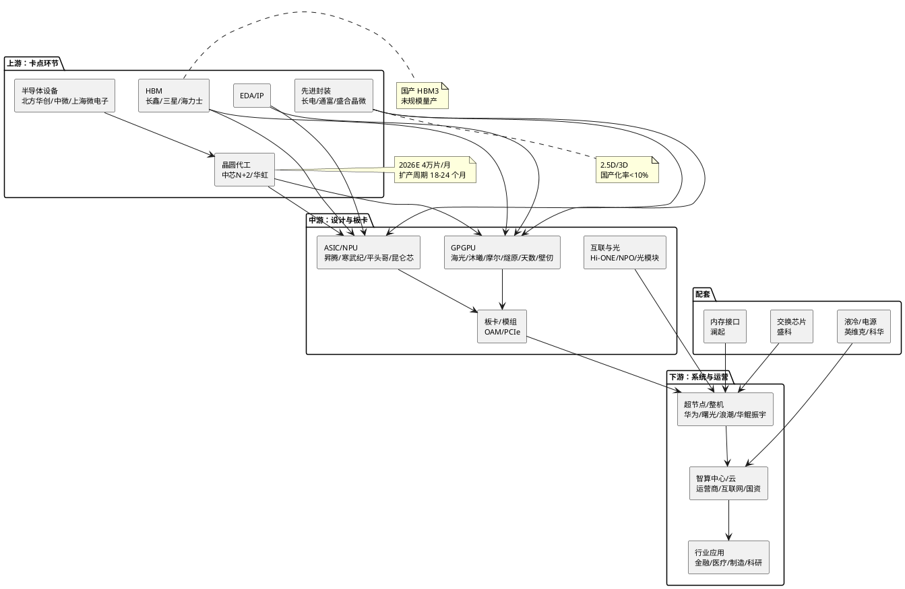

# 国产算力卡行业深度研究报告：从"备胎"到主力供应商——供给约束下的国产 AI 加速器产业图谱

> **报告日期**：2026年11月3日
> **数据截至**：2026年11月3日（IDC 2026H1 中国数据中心 AI 加速器数据 10月13日发布；2026 三季报已披露：海光信息 10月20日、寒武纪 10月24日、中科曙光 10月27日盘后/10月28日、浪潮信息 10月28日、摩尔线程 10月28日晚、澜起科技 10月29日晚、燧原科技 10月30日晚、沐曦股份 10月31日、长电科技 10月；中芯国际预约 11月13日披露，截至本报告日尚未发布；中国移动新一代超节点集采 10月28日公示中标候选人；QuantPyLab 视图行情最新交易日 2026年10月30日，全部核心标的行情已统一至该日）
> **报告类型**：行业深度研究（含需求—供给—格局—公司—估值五段验证）
> **关联研报**：《端侧AI芯片行业深度研究报告》（2026年10月17日）——本报告聚焦**数据中心训练/推理加速卡**，与端侧 NPU/SoC 口径不混用；《新型电力系统》《中国特高压》（2026年8月）——数据中心电力约束章节引用其电网侧结论
> **研究性质**：行业研究，不构成投资建议

---

## 一、执行摘要

### 1.1 核心判断（7条）

1. **国产替代已从"政策叙事"变成"出货事实"，且拐点发生在 2026 年上半年。** IDC 2026年10月13日数据显示：2026H1 中国数据中心 AI 加速器出货 **200.8 万颗**，其中英伟达 67.8 万颗（份额 34%，同比 **-44%**）、华为昇腾 57.2 万颗（28%，同比增长近九成）、阿里平头哥 14.1 万颗（7%）、寒武纪 10.0 万颗（5%）、百度昆仑芯 8.0 万颗（4%）、海光 6.0 万颗（3%）[1][2]。**国产阵营合计份额约 66%，为英伟达（34%）的近两倍；而 2025 年同期国产份额仅约 35%（IDC 2025H1：本土品牌约占 35%）[3]。** 一年之内提升约 **31 个百分点**，是本轮国产算力最硬的证据。**截至 2026-11-03，IDC 未发布 10 月或 Q3 的新增/修正口径，该结论不因三季报而改变——三季报只验证了"出货在放量"，不构成份额口径的重新计算。**

2. **产品结构同步逆转：非 GPU 加速器出货首次超过 GPU，推理取代训练成为主战场。** 2026H1 GPU 出货 99.1 万颗（-26%），含推理 ASIC/NPU 在内的非 GPU 加速器 101.6 万颗（**+80%**），占比 50.6%，首次过半（2024 年 28%、2025 年 34%）[1][4]。这与"训练看生态、推理看成本"的产业规律一致：推理对通用性要求低、对单位 Token 成本与功耗敏感，恰好是 ASIC/NPU 的用武之地；也意味着**国产厂商的份额提升首先来自"够用+便宜+可交付"，而非"单卡性能追平"**。

3. **需求侧的斜率被智能体重新拉陡，但供给才是 2026-2027 年的主矛盾。** IDC《2026 中国人工智能计算力发展评估报告》将 2026 年中国智能算力规模上修至 **2,576.5 EFLOPS（+87.9%）**、2030 年 10,524.3 EFLOPS（2025-2030 CAGR **50.3%**，较上一版 46.2% 显著上调）；全球 AI 算力需求满足率从 2024 年 79% 降至 2027 年 **71% 的谷底**，缺口从 389 亿美元扩大至 2030 年 3,809 亿美元[5]。华为轮值董事长徐直军 10月6日直言："目前制约昇腾进一步放量的主要问题已经不是市场需求，而是供货能力……现在能产多少就供多少"，并判断**全球供需平衡要到 2029 年、中国更慢**[6]。

4. **供给瓶颈精确落在三处：先进制程晶圆、HBM、2.5D/3D 先进封装，且三者都不可快速扩产。** 中芯国际 N+2（7nm 级）月产能 2026 年约 **4 万片**（Morgan 于 SEMICON China 2026 现场测算）[7]，2026Q3 业绩预约 11月13日披露，截至本报告日尚未发布；AI 加速器用 2.5D/3D 封装 2026 年全球市场 148.4 亿美元、CAGR 32.09%，台积电 CoWoS 产能 2026 年底扩至 13-14 万片/月仍存 **约 20% 缺口**，而**中国大陆 2.5D/3D 高端封装国产化率不足 10%**[8]，台积电 10月拟将先进封装价格上调最高 **20%**[52]；国产 HBM 方面，长鑫 12 层堆叠 HBM 量产与"仍处测试、无量产订单"两种说法并存（Tier3，未获权威交叉验证），本报告按**未规模量产**处理[9][10]；**关键新证据：长鑫科技（688825）2026Q3 业绩说明会（10月30日）披露的先进产品进展集中于 LPDDR6、G5 平台与 4F² 架构 DDR5 RDIMM，未提及 HBM 量产节点**[53]，维持"未规模量产"判断。**结论：2027 年国产算力卡的出货上限由晶圆与 HBM 决定，而非订单。**

5. **中国走的是"以系统补单卡"的路径，代价是功耗与资本开支。** 昇腾 Atlas 950 SuperPoD 在 WAIC 2026 首次真机亮相：**1024 卡集群、1 EFLOPS FP8 / 2 EFLOPS FP4、256TB 全局统一内存、TB 级 NPU 互联、3μs RTT**；昇腾 384 超节点已在全球部署 750+ 套[11]；系统化路线的最强工程证据来自中科曙光：**曙光8000 由十万余张国产计算卡、约 30 亿个电子元件、1,600 公里互连线缆构成，2026 年 7 月落成投用，11月2日以真机亮相世界互联网大会"互联网之光"博览会**，已支撑 300 余项重点应用、覆盖 30 多个科研与产业领域[54]。华为同时发布基于 NPO 的 Hi-ONE 光模组（7.2T 带宽、光引擎距主芯片约 5cm）[6]。这条路线的产业含义是：**国产算力的竞争力指标从"单卡 TFLOPS"切换为"每 EFLOPS 的交付成本与可用性"**，超节点、光互联、液冷、电力成为价值量再分配的关键环节。

6. **业绩兑现剧烈分化，"利润表繁荣 vs 现金流赤字"在二线 GPU/整机三季报中并未缓解、而是被规模放大；同时二线 GPU 毛利率出现集体下滑。** 2026 三季报（全部 Tier1）给出的分化图景是：**ASIC 双龙头**——寒武纪 9M 营收 95.26 亿元（+106.76%）、归母 37.15 亿元（+131.49%）、OCF 仅 2.28 亿元（Q3 单季 -0.84 亿元），存货从年初 49.44 亿元增至 **116.65 亿元**[12][13]；海光 9M 营收 149.55 亿元（+57.58%）、归母 28.47 亿元（+45.12%）、毛利率 56.6%（同比 **-3.5pct**）、OCF **-24.43 亿元（同比 -208.35%）**、应收 60.26 亿元[14]。**二线 GPU——收入爆发、单季扣非转正，但毛利率下台阶、现金流出翻倍**：摩尔线程 9M 营收 32.89 亿元（+319.15%）、扣非 **-1.31 亿元**（Q3 单季首次转正 +0.20 亿元）、毛利率 **53.71%（同比 -8.16pct）**、OCF **-33.09 亿元**（约为营收的 100%）、存货 33.63 亿元[15][55]；沐曦 9M 营收 28.24 亿元（+128.45%）、归母 6.39 亿元、扣非 2.59 亿元（Q3 单季扣非 3.08 亿元，连续两季转正）、毛利率 54.99%、OCF -13.38 亿元[16][35][56]；燧原 9M 营收 23.32 亿元（+331.74%）、归母 -7.54 亿元、毛利率 **32.15%（同比 -4.26pct）**、OCF -20.17 亿元，**合同负债 63.85 亿元对预付款项 77.09 亿元**——客户预付款与公司向上游垫资同时放大[17][57]。**整机端则出现方向相反的修复**：浪潮 9M 营收 1,293.29 亿元（+7.18%）、归母 39.32 亿元（+165.32%）、毛利率 **8.61%（上年同期 4.91%，同比 +3.7pct）**、Q3 单季毛利率 8.35%（同比 +2.73pct），但存货 **1,187.04 亿元（较年初 +155.23%）**、合同负债 770.89 亿元（+295.20%）、OCF -64.01 亿元[58][59]；中科曙光 9M 营收 122.38 亿元（+38.75%）、归母 17.25 亿元（+78.51%）、扣非 15.53 亿元（+105.02%）、毛利率 27.26%、**OCF 转正 +2.66 亿元**、合同负债从 H1 的 14.58 亿元升至 27.55 亿元[60][61]。**结论：现金流赤字不是个别公司的会计噪音，而是"用营运资金换产能与份额"的行业性商业模式；区别只在于——龙头用利润和应付票据垫，二线用股权融资垫。**

7. **估值已把 2027 年叙事打进去，安全边际不在"赛道"而在"兑现节奏"；三季报后板块估值已系统性回落，但分位仍不便宜。** 按 QuantPyLab 视图实测（2026-10-30 收盘，全部核心标的行情已统一至该日）：寒武纪 880.00 元、市值 5,533.9 亿元、PE-TTM **132.7x**（TTM 净利 41.69 亿元，已含 Q3）、PS-TTM **48.5x**、PB 36.6x；海光 170.20 元、市值 3,956 亿元、PE-TTM 115.3x、PS 19.9x、PB 15.0x；摩尔线程 PS 37.8x、沐曦 PS 87.7x、燧原 PS 80.8x[19]。相较 10月23日口径，寒武纪股价 -5.6%、PS 由 61.0x 降至 48.5x（含 TTM 切换），海光股价 -11.6%。以寒武纪 2026 年股权激励目标 135 亿元收入测算，Forward PS 约 **41x**；**2027 年考核目标隐含"2026-2027 累计 405 亿元"，即 2027 年需做到约 270 亿元（同比约 +100%），这是当前估值最脆弱的一环**[12][20]。沐曦 2026 年激励草案给出 2027 年营收不低于 60 亿元目标（2027-2028 累计不低于 150 亿元、2027-2029 累计不低于 300 亿元）[56]，是本轮二线 GPU 中第一个把 2027 年收入锚公开化的公司。

**结论性排序（按"供给确定性 → 现金流质量 → 估值容忍度"）：上游卡点（先进封装/HBM/设备）＞ 华为超节点产业链（整机、光互联、液冷）＞ 已跨过规模效应的 ASIC 双龙头（寒武纪、海光）＞ 高估值未盈利 GPU 新势力（摩尔、沐曦、燧原）＞ 通用服务器整机（低毛利；2026 年靠低价库存与产品结构修复，2027 年面临高价 DRAM/HBM 合约的反向成本冲击）。**

### 1.2 投资时钟定位与配置建议

**投资时钟位置：从"主题投资期"进入"产能兑现 + 现金流验证期"（2026Q4-2027Q3）。** 2024-2025 年的定价主线是"能不能做出来"（制程突破、单卡对标），2026 年已切换为"能不能交付、交付后能不能收回现金"。IDC 判断 2026 全年中国 AI 加速器出货 +19%、其中 GPU -9%[1]，意味着**总量增速下台阶、结构继续向国产与非 GPU 倾斜**——这是典型的"份额逻辑强于总量逻辑"阶段。三季报后这一阶段特征被进一步确认：二线 GPU 收入同比 +128%~+332%、单季扣非首次转正，但经营现金流净流出普遍等于或超过当期营收（摩尔 -33.09 亿元/营收 32.89 亿元），**"能不能收钱"已经取代"能不能卖出去"成为估值的核心分歧点**。

**当前立场（一句话）：超配供给卡点与华为链，标配已兑现的 ASIC 龙头，低配高估值未盈利 GPU 新势力，回避低毛利整机。**

| 环节 | 当前判断 | 配置动作 | 验证指标 |
|------|---------|---------|---------|
| 先进封装/2.5D-3D | 国产化率<10%，AI 封装 2026 年 148.4 亿美元、CAGR 32%；长电 9M 归母 +69.6%、全年 capex 计划上调 73.4% 至 173.1 亿元 | **超配（第一梯队）** | 长电/通富/盛合晶微产能、HBM 封装良率 |
| HBM/存储配套 | 长鑫 HBM3 未规模量产（Q3 业绩会未披露量产节点），DRAM 价格处超级周期（长鑫 Q3 毛利率 89.53%），价格与供给双紧 | **超配（第一梯队，长鑫科技已上市消除标的稀缺）** | 长鑫 HBM 月产能、华为/寒武纪 BOM 中 HBM 占比 |
| 华为超节点链 | 950DT 年底/明年初规模供货；移动 10月28日公示 117 亿元/20,480 卡超节点集采，五家中标全部为华为生态 | **超配（第一梯队）** | 运营商集采、超节点交付套数、Hi-ONE 量产 |
| ASIC 双龙头 | 寒武纪/海光已跨过百亿收入，现金流仍为负（OCF -2.41/-26.00 亿元 TTM） | **标配（选龙头，等现金流拐点）** | OCF/净利、存货周转、Q4 交付 |
| GPU 新势力 | 收入爆发、单季扣非转正，但毛利率同比 -2.2~-8.2pct、OCF 全线为负 | **低配/观察** | 扣非亏损收敛、毛利率、客户集中度 |
| 通用服务器整机 | 收入大、毛利率 8.6%（同比 +3.7pct），但存货 1,187 亿元、OCF -64.01 亿元 | **低配** | 毛利率、存货、OCF |
| IDC/算力运营 | 利用率 36.8%，结构性过剩 | **中性（只选头部满租资产）** | 上架率、利用率、租金 |

> **可执行性说明：** 2026年7月27日长鑫科技（688825）已登陆科创板（发行价 8.66 元、首日开盘 49.50 元、发行市值 5,791.88 亿元，为科创板史上最大 IPO），**HBM 环节不再是"无标的"**——但需注意其收入结构以 DDR/LPDDR 为主、HBM 贡献未单独披露，本质仍是 DRAM 周期股（10月30日市值 2.84 万亿元、PE-TTM 34.7x）[53][62]。整机环节（华鲲振宇/长江计算/河南昆仑/宝德/华启智慧/神州鲲泰）多数为非上市资产或上市公司子公司，**A 股纯正标的仍稀缺**；封装环节可通过长电科技、通富微电、盛合晶微参与，华为链需逐一核验上市公司映射。若无合适标的，应以"主题仓位 + 严格止损"执行，而非重仓单一概念股——这是本报告配置建议的最大局限。

### 1.3 景气信号面板（P0，10项快照）

本面板回答"当前是什么情况"，跟踪方法与阈值见第十二章。

| # | 指标 | 当前值（截至 2026-11-03） | 近季变化 | 方向 | 阈值/红灯条件 | 影响环节 |
|---|------|--------------------------|---------|------|--------------|---------|
| P0-1 | 中国 AI 加速器出货与国产份额 | 2026H1 200.8 万颗；国产约 66%、英伟达 34%（67.8 万颗，-44%）；IDC 半年度口径，**10月无新增发布** | 国产份额由 2025H1 约 35% 升至 66% | ↗ | 国产份额环比回落 >5pct | 全行业 |
| P0-2 | 非 GPU 占比 | 101.6 万颗（50.6%，+80%），首次超 GPU（99.1 万颗，-26%） | 2025 年 34%→50.6% | ↗ | 占比回落至 <40% | ASIC/NPU |
| P0-3 | 中国智能算力规模 | 2026E 2,576.5 EFLOPS（+87.9%）；2030E 10,524.3 EFLOPS | 预测上修（CAGR 46.2%→50.3%） | ↗ | 增速 <40% | 需求 |
| P0-4 | 全球 CSP 资本开支 | 2026E 9,570 亿美元（+106%）；2027E >1.5 万亿美元（+60%） | 2027 增速由 +50% 上修至 +60% | ↗ | 2027 增速 <30% | 全球算力链 |
| P0-5 | 运营商国产算力集采 | **移动 2026-2027 累计 30,528 卡/约 150.5 亿元**（4月 6,208 卡/20.6 亿 + 8月 3,840 卡/12.9 亿 + **10月28日公示 20,480 卡/115.99-117.02 亿元**）；电信 115 亿元/4 万台（100% 国产） | **10月新增单笔 117 亿元、2 万卡级超节点，为本年度最大单** | ↗ | 单笔集采同比 -20% | 华为链/整机 |
| P0-6 | 先进制程产能 | 中芯 N+2 约 4 万片/月（2026E）；利用率 93.7%（2026Q2）。**2026Q3 业绩预约 11月13日，截至 11-03 未发布** | 无新增数据 | ↗（慢） | 扩产延期 >2 季度 | 训练卡供给 |
| P0-7 | HBM/先进封装 | 2.5D/3D 国产化率 <10%；CoWoS 缺口约 20%（台积电 10月拟涨价最高 20%）；长鑫 HBM3 未规模量产 | **长鑫科技 Q3 业绩会仍未披露 HBM 量产节点** | → | 国产 HBM 量产节点后移 | 全行业上限 |
| P0-8 | 龙头毛利率 | 寒武纪 56.5%（9M，+1.2pct）、海光 56.6%（9M，**-3.5pct**）、摩尔 53.7%（9M，**-8.2pct**）、沐曦 55.0%（9M，-2.2pct）、燧原 32.2%（9M，**-4.3pct**）、浪潮 8.6%（9M，+3.7pct）、曙光 27.3%（9M，持平） | **二线 GPU 毛利率集体下台阶，整机反向修复** | ↓ | 跌破 45%（设计）/25%（系统） | 盈利质量 |
| P0-9 | 经营现金流/存货 | 寒武纪 OCF 2.28 亿 vs 存货 116.65 亿；海光 OCF -24.43 亿；摩尔 -33.09 亿（≈营收 100%）；燧原 -20.17 亿；沐曦 -13.38 亿；浪潮 OCF -64.01 亿 vs 存货 1,187.04 亿 | **二线厂商净流出规模翻倍** | ↓ | OCF/净利 <0.2 连续两季 | 资产负债表 |
| P0-10 | 估值 | 寒武纪 PE-TTM 132.7x/PS 48.5x/PB 36.6x；海光 115.3x/19.9x（均为 10-30） | 寒武纪 PS 处近 5 年 19.1% 分位、海光 1.1% 分位；板块估值回落 | ↘ | Forward PS >50x | 配置节奏 |

**综合读数：** 10 项中 5 项上行（出货份额、非 GPU 占比、算力规模、CSP capex、集采）、1 项慢速上行（制程，本期无新数据）、1 项持平（HBM/封装）、2 项下行（毛利率、现金流）、1 项回落（估值）。**当前是"需求与份额双强、供给与现金流双紧、估值正在消化"的组合**：份额逻辑已被 IDC 验证（P0-1/P0-2），需求被运营商 117 亿元单笔集采再次确认（P0-5），但盈利质量尚未验证（P0-8 由"海光单点下滑"扩散为"二线 GPU 集体下滑"，P0-9 红灯加深）。这意味着**行业 beta 仍在，但个股 alpha 将迅速向"能交付且能收钱"的少数公司收敛；整机环节的毛利率修复是库存周期红利，不构成趋势性反转。**

### 1.4 关键数据一览（口径分层披露，不可直接相加/相减）

| 指标 | 数据 | 时间节点 | 口径/来源 Tier | 备注 |
|------|------|----------|----------------|------|
| 中国数据中心 AI 加速器出货 | 200.8 万颗（英伟达 67.8 万/34%、华为 57.2 万/28%、平头哥 14.1 万/7%、寒武纪 10.0 万/5%、昆仑芯 8.0 万/4%、海光 6.0 万/3%） | 2026H1 | IDC 2026-10-13，Tier1-2（经媒体转引，见 13.1） | 颗数口径；IDC 追踪 11 家中国厂商，9 家同比增长 |
| 非 GPU 加速器 | 101.6 万颗（+80%），占比 50.6%；GPU 99.1 万颗（-26%） | 2026H1 | 同上 | 首次超过 GPU |
| 中国 AI 加速卡份额（金额/颗数） | 2025 年出货 +47%，GPU 66%/非 GPU 34%；本土品牌约 45% | 2025 全年 | IDC《中国 AI 加速卡市场份额，2025》Tier2（付费报告） | 与 2026H1 颗数口径不可直接衔接 |
| 中国加速服务器市场 | 2025H1 160 亿美元（同比 +100%+）；2029E >1,400 亿美元 | 2025H1/2029E | IDC 官方新闻稿 Tier1 | 金额口径，含整机 |
| 中国加速芯片出货（旧口径） | 2025H1 >190 万张，非 GPU 30%、本土品牌 35% | 2025H1 | IDC 官方新闻稿 Tier1 | 与 2026H1 的 200.8 万颗存在统计边界差异，**不做同比** |
| 中国智能算力规模 | 2026E 2,576.5 EFLOPS（+87.9%）；2030E 10,524.3 EFLOPS；2025-2030 CAGR 50.3% | 2026E-2030E | IDC《2026 中国 AI 计算力发展评估报告》Tier2（会议材料） | 算力口径 |
| 全球 AI 算力需求满足率 | 2024 79% → 2027 71%（谷底）→ 2030 77%；缺口 389 亿→3,809 亿美元 | 2024-2030 | IDC Tier2 | 供需缺口口径 |
| 全球九大 CSP 资本开支 | 2026E 9,570 亿美元（+106%）；2027E >1.5 万亿美元（+60%） | 2026E/2027E | TrendForce 2026-10-14 Tier2[45] | 含字节/腾讯/阿里/百度 |
| 全球 AI Server | 2026E 出货 +32.2%、产值约 4,790 亿美元；2027E 出货 +36%、产值近 9,200 亿美元（+90%） | 2026E/2027E | TrendForce 2026-10-14 Tier2 | 产值含整柜 |
| 智算中心利用率 | 2025 年智能算力供应 38 亿卡时、使用 14 亿卡时、利用率 36.8%；2026Q1 GPU 平均利用率约 30% | 2025/2026Q1 | 信通院/浪潮研究院，经媒体转引 Tier2 | 卡时口径 |
| 智算中心数量 | 在用 >500 个，在建及规划近 400 个 | 截至 2026-06 | 国家数据局 Tier2 | 项目数口径 |
| "十五五"算力网投资 | 新增直接投资约 4 万亿元 | 2026-2030 | 国家发改委（机构测算）Tier2 | 含网络与数据中心 |
| 运营商 AI 超节点集采 | 中国移动 2026-2027 累计 **30,528 卡/约 150.5 亿元**：4月 6,208 卡/20.6 亿元 + 8月 3,840 卡/12.9 亿元 + **10月28日公示 20,480 卡/115.99-117.02 亿元（含 RoCE 交换机 448 台、存储 82 套，单卡约 56.9 万元）**；五家中标：华鲲振宇 6,144 卡（30%）、宝德 5,120 卡（25%）、华启智慧 4,096 卡（20%）、百信 3,072 卡（15%）、神州鲲泰 2,048 卡（10%） | 2026-04/08/10 | 招标公示 Tier1（经媒体转引） | 全部为华为昇腾/鲲鹏生态；117 亿元单笔含交换机与存储，**不可与 4月 20.6 亿元的单卡均价直接比较** |
| 电信服务器集采 | 2026-2027 高性能服务器 115 亿元/4 万台，100% 国产；鲲鹏生态 81.61 亿元（70.7%） | 2026-06 | 招标公示 Tier1（经媒体转引） | ARM-A 2.8 万台/C86 1.2 万台 |
| 曙光8000（超智融合） | 十万余张国产计算卡、约 30 亿个电子元件、1,600 公里互连线缆；2026-07 落成投用，11-02 世界互联网大会真机亮相；300 余项重点应用完成优化、覆盖 30 多个领域 | 2026-07/2026-11 | 公司披露 + 央视报道 Tier1 | 全国产十万卡级，非上市主体分拆口径 |
| 华为经营数据 | 2026H1 收入 4,678.19 亿元（+9.55%）、净利 238.09 亿元（-36%）、研发 1,213.82 亿元（25.94%）；2025 全年 8,809.41 亿元、净利 680.36 亿元、研发 1,923 亿元（21.8%） | 2026H1/2025 | 华为半年报/年报 Tier1 | 非上市，无分部数据 |
| 昇腾超节点 | Atlas 950 SuperPoD：1024 卡、1 EFLOPS FP8/2 EFLOPS FP4、256TB 统一内存、3μs RTT；昇腾 384 已部署 750+ 套 | 2026-07 | 华为官网 Tier1 | 8192 卡版本为路线图 |
| 中芯国际 | 2026Q2 收入 30.06 亿美元、毛利率 25.3%、利用率 93.7%、capex 18.36 亿美元；N+2 月产能 2026E 约 4 万片 | 2026Q2/2026E | 公司财报 Tier1；Morgan Tier2 | 人民币口径见 8.8 |
| 先进封装 | AI 加速器 2.5D/3D 市场 148.4 亿美元（2026E）→451.9 亿美元（2031E），CAGR 32.09%；中国大陆 2.5D/3D 国产化率 <10% | 2026E-2031E | 集微咨询 Tier2 | 金额口径 |
| 寒武纪 2026Q3 | 9M 营收 95.26 亿元（+106.76%）、归母 37.15 亿元（+131.49%）、扣非 35.23 亿元（+148.30%）、OCF 2.28 亿元；Q3 单季营收 35.30 亿元（+104.47%）、归母 14.04 亿元（+147.74%）、OCF -0.84 亿元、毛利率 56.53% | 2026Q3 | 巨潮 Tier1 | 存货 116.65 亿元、预付 30.44 亿元、合同负债 1.41 亿元 |
| 海光信息 2026Q3 | 9M 营收 149.55 亿元（+57.58%）、归母 28.47 亿元（+45.12%）、扣非 25.84 亿元（+42.25%）、OCF -24.43 亿元（-208.35%）、毛利率 56.59%（-3.5pct） | 2026Q3 | 巨潮 Tier1 | Q3 单季营收 58.56 亿元（+45.46%）、归母 10.48 亿元（+37.90%）；10-22 业绩会称"在手订单充足、存货将于 Q4 及后续转为收入" |
| 摩尔线程 2026Q3 | 9M 营收 32.89 亿元（+319.15%）、归母 0.38 亿元（扭亏）、扣非 **-1.31 亿元**、毛利率 **53.71%（-8.16pct）**、OCF **-33.09 亿元**；Q3 单季营收 15.52 亿元（+1773.92%，环比 +55.4%）、扣非 +0.20 亿元（首次单季转正） | 2026Q3 | 巨潮 Tier1 | 存货 33.63 亿元（较上年末 +20.31 亿元）、应收 9.94 亿元、货币+交易性金融资产 74.44 亿元 |
| 沐曦 2026Q3 | 9M 营收 28.24 亿元（+128.45%）、归母 6.39 亿元、扣非 **2.59 亿元**（同比扭亏）、毛利率 54.99%、OCF -13.38 亿元；Q3 单季营收 15.00 亿元（+367.12%）、扣非 3.08 亿元（连续两季转正）、归母仅 0.27 亿元 | 2026Q3 | 巨潮 Tier1 | Q3 单季扣非高于归母 2.82 亿元，非经常性损益转负；2026 激励草案 2027 年营收目标 ≥60 亿元 |
| 燧原 2026Q3 | 9M 营收 23.32 亿元（+331.74%）、归母 -7.54 亿元、扣非 -7.62 亿元、毛利率 **32.15%（-4.26pct）**、OCF -20.17 亿元、研发 9.89 亿元；Q3 单季营收 12.12 亿元（+395.34%）、毛利率 33.8%（同比 +2.35pct）、归母 -1.22 亿元 | 2026Q3 | 巨潮 Tier1（经媒体转引） | 合同负债 63.85 亿元（较年初 +1745%）、预付款项 **77.09 亿元**、存货 8.07 亿元 |
| 浪潮信息 2026Q3 | 9M 营收 1,293.29 亿元（+7.18%）、归母 39.32 亿元（+165.32%）、扣非 34.41 亿元（+157.90%）、毛利率 **8.61%（上年同期 4.91%）**、OCF **-64.01 亿元**（同比改善 49.10%）；Q3 单季营收 449.50 亿元（+11.05%）、毛利率 8.35%（同比 +2.73pct） | 2026Q3 | 巨潮 Tier1 | 存货 1,187.04 亿元（较年初 +155.23%）、合同负债 770.89 亿元（+295.20%）、预付 133.94 亿元、资产负债率 85.37% |
| 中科曙光 2026Q3 | 9M 营收 122.38 亿元（+38.75%）、归母 17.25 亿元（+78.51%）、扣非 15.53 亿元（+105.02%）、毛利率 27.26%、**OCF +2.66 亿元（转正）**；Q3 单季营收 47.73 亿元（+60.68%）、归母 7.53 亿元（+217.19%） | 2026Q3 | 巨潮 Tier1 | 存货 80.71 亿元、合同负债 27.55 亿元（H1 14.58 亿元）；10-28 公告与海光共同投资企业级芯片参股子公司 |
| 澜起科技 2026Q3 | 9M 营收 54.14 亿元（+33.44%）、归母 32.37 亿元（+98.32%）、扣非 23.27 亿元（+58.60%）；互连类芯片收入 51.58 亿元（+34.6%）、毛利率 68.9%（+4.1pct） | 2026Q3 | 巨潮 Tier1 | 投资收益+公允价值变动 9.04 亿元（+709%）；Q4 交付在手订单 25.0-27.9 亿元 |
| 长电科技 2026Q3 | 9M 营收 309.5 亿元（+8%）、归母 16.2 亿元（+69.6%）、扣非 15.6 亿元（+99.2%）；Q3 营收 114.3 亿元（+13.5%）、归母 7.7 亿元（+60%） | 2026Q3 | 公司公告 Tier1（经媒体转引） | 年度固定资产投资计划由 99.8 亿元上调至 **173.1 亿元（+73.4%）** |
| 长鑫科技 2026Q3 | 9M 营收 2,690 亿元（+738%）、归母 1,320 亿元；Q3 营收 1,187.14 亿元（+613.18%）、归母 544.35 亿元；**Q3 毛利率 89.53%** | 2026Q3 | 公司三季报/业绩说明会 Tier1 | 2026-07-27 科创板上市（688825）；业绩会先进产品披露为 LPDDR6、G5、4F² DDR5 RDIMM，**未提 HBM 量产** |
| 壁仞/天数（港股） | 壁仞 2025 收入 10.35 亿元（+207.2%）、毛利率 53.8%、经调亏损 8.74 亿元；壁仞 2026H1 收入 12.36 亿元、亏损 3.77 亿元；天数 2026H1 收入 9.46 亿元（+191.6%）、毛利率 17.2%、净利 1.06 亿元（含盛合晶微股权浮盈约 7.56 亿元） | 2025/2026H1 | 披露易 Tier1[39][40] | 未纳入 A 股估值对比；壁仞无三季报（港股中期口径） |

> **口径纪律：**（1）**颗数 ≠ 金额 ≠ 算力**：IDC 的 200.8 万颗为出货台数口径，TrendForce 的 9,200 亿美元为整柜产值口径，IDC 的 2,576.5 EFLOPS 为算力口径，三者不可相加或相减；（2）**"AI 加速卡"与"加速服务器"**：前者只含芯片/板卡，后者含整机与系统，毛利率与市场规模不可混用；（3）2025H1 的"加速芯片 >190 万张"与 2026H1 的"AI 加速器 200.8 万颗"统计边界可能不同，本报告**只用 IDC 给出的同比（GPU -26%、非 GPU +80%）**，不自行计算总量同比；（4）国产份额 66% 为"1-34%"的算术结果，与 IDC 直接披露的份额表述可能有 ±1pct 差异；（5）**移动超节点集采不可跨批次比价**：4 月/8 月两批为"计算节点"口径（约 33.3 万元/卡），10 月批次含 RoCE 交换机 448 台与存储 82 套（约 56.6-57.1 万元/卡），**批次间价差主要来自配套范围而非涨价**。

### 1.5 主要风险

1. **供给瓶颈后移超预期**：中芯 N+2 扩产不及 4 万片/月（Q3 业绩 11月13日披露，尚未验证）、长鑫 HBM3 量产再延后（Q3 业绩会未披露节点）、CoWoS 类封装产能被海外客户占满且台积电 10 月拟涨价最高 20%，导致 2027 年国产卡出货低于订单。
2. **"利润表繁荣、现金流赤字"演变为减值，且规模已放大一个量级**：寒武纪存货 116.65 亿元、浪潮信息存货 **1,187.04 亿元**、海光应收 60.26 亿元、摩尔预付 25.99 亿元、燧原预付款 77.09 亿元。整机与二线 GPU 的存货是在**DRAM/HBM 价格上行期**建立的，若 2027 年产品代际切换（华为 950DT→960、寒武纪思元690→下一代）叠加存储价格回落，将同时触发库存跌价与高价长约履约亏损。
3. **需求透支与结构失衡**：信通院口径 2025 年算力利用率仅 36.8%，地方国资智算中心空置严重；若"带订单批项目"执行不严，2027 年可能出现订单断层。
4. **美国政策反复**：2026 年 1 月 BIS 将 H200 及以下对华出口由"推定拒绝"改为"逐案审查"[21]，英伟达已向中国少量出货 H200，但因中方态度未用满许可额度并计提 4 亿美元存货减值[22]；若管制进一步放松且国产采购约束松动，国产份额逻辑将被削弱。**本报告检索范围内，2026 年 10 月未见 BIS 新增对华先进计算规则，该跟踪项本期维持原判。**
5. **估值与解禁**：摩尔线程、沐曦、燧原上市时间短（截至 10-30 分别为 217/209/30 个交易日），2027-2028 年将面临大额限售解禁；摩尔线程 9 月已有 2,577.45 万股解禁、当日跌停 20%；寒武纪 PE-TTM 132.7x、Forward PS 约 41x，对 2027 年 +100% 增长假设高度敏感。

---

## 二、研究框架与定义

### 2.1 "国产算力卡"的边界

本报告的"国产算力卡"指**在中国大陆设计、用于数据中心 AI 训练与推理的加速卡/加速模组**，包含三类形态：

- **GPGPU 卡**：通用图形处理器架构，兼容 CUDA 类编程模型（海光 DCU、摩尔线程 MTT、沐曦曦云、燧原、天数、壁仞）；
- **ASIC/NPU 卡**：面向张量计算的专用架构（华为昇腾、寒武纪 MLU、阿里平头哥 PPU、百度昆仑芯）；
- **超节点/整机柜**：以高速互联把数十至数千张卡组织为单一逻辑算力单元（昇腾 Atlas 950/CloudMatrix 384、昆仑芯天池、云燧 ESL）。

**不入本报告口径**：端侧 NPU/SoC（见《端侧AI芯片》）、通用 CPU、消费级显卡、纯网络设备（光模块/交换机仅在价值分配章节作为配套出现）。

### 2.2 三种技术路线的分工

| 维度 | GPGPU（通用） | ASIC/NPU（专用） | 超节点（系统） |
|------|--------------|-----------------|---------------|
| 代表 | 海光深算、沐曦 C600、摩尔 S5000、燧原 L600、天数天垓、壁仞 | 昇腾 910C/950、寒武纪思元 590/690、平头哥 PPU、昆仑芯 P800/M100 | Atlas 950 SuperPoD、CloudMatrix 384、天池 512 |
| 优势 | 生态兼容、训练通用性强、客户迁移成本低 | 单位 Token 成本低、能效高、供应可控 | 绕开单卡落后，用互联换系统性能 |
| 劣势 | 单卡性能受制程/HBM 限制，追平难度大 | 生态封闭、算子库需长期沉淀 | 功耗与资本开支高、故障域大 |
| 典型场景 | 训练+推理混合、科学计算 | 推理为主、推荐/搜索、行业模型 | 万亿参数训练、高并发推理 |
| 2026H1 出货 | GPU 99.1 万颗（-26%） | 非 GPU 101.6 万颗（+80%） | 运营商集采为主（移动累计 30,528 卡） |

> **判断：** 三条路线并非替代关系，而是**分层共存**——GPGPU 守住"通用训练+科学计算"，ASIC 吃下"推理+行业闭环"，超节点负责"把不可用的单卡组织成可用的集群"。2027 年胜负手不在单卡，而在**"芯片+互联+软件栈+交付"的系统能力**。

### 2.3 算力分级的口径纪律

行业普遍存在"唯 TFLOPS 论"，本报告强制标注精度与测试条件：

| 等级 | 单卡算力（FP16/BF16 稠密） | 显存 | 典型产品 | 适用场景 |
|------|--------------------------|------|---------|---------|
| L1 推理卡 | 100-300 TFLOPS | 32-64GB | 昇腾 310P、寒武纪思元 370、燧原 S60 | 中小模型推理、一体机 |
| L2 主流训练/推理 | 300-500 TFLOPS | 96-144GB | 昇腾 950PR（500T）、沐曦 C600（385.6T）、燧原 L600、寒武纪思元 590（345T） | 千亿参数训练、高并发推理 |
| L3 旗舰 | 500-800 TFLOPS | 144-196GB | 昇腾 950DT（500T/1P FP8）、寒武纪思元 690（700T）、摩尔 S5000（FP8 1000T） | 万亿 MoE 训练、超长上下文 |
| L4 系统级 | >1 EFLOPS/集群 | 全局统一内存 | Atlas 950 SuperPoD（1 EFLOPS FP8/1024 卡） | 十万亿参数、万卡集群 |

> **口径提示：**（1）FP8/FP4 算力通常是 FP16 的 2x/4x，厂商标称"1000 TFLOPS"多指 FP8；（2）带稀疏（Sparse）标注的算力约为稠密 2 倍；（3）"显存容量"比"算力"更能决定推理能否跑起来——2026 年新卡标配已从 64GB 升至 144GB，老卡因此被结构性淘汰[23]。

### 2.4 产业链全景（PlantUML）



### 2.5 数据来源层级与置信度评级

| Tier | 定义 | 本报告用法 |
|------|------|-----------|
| Tier 1 | 公司公告/定期报告、交易所、监管机构、公司官网、官方新闻稿 | 财务数据、产品参数、集采公示；可单独作为事实依据 |
| Tier 1-2 | 官方/press release 数据经可靠媒体转引（无法取得原文时） | 出货、份额等；标注转引来源，必要时另找第二来源 |
| Tier 2 | 付费咨询报告、行业协会测算、政府会议材料（IDC 付费报告、TrendForce、信通院、集微） | 市场规模、预测；需双源交叉或注明单一来源 |
| Tier 3 | 媒体转引、第三方数据库、券商研报、供应链传闻 | 仅作线索；关键结论不得单独依赖 |

> 本报告所有财务数字优先取自巨潮/披露易原文或 QuantPyLab 统一视图（Point-in-Time 对齐公告日），行情与估值取自 `v_daily_valuation` 视图；凡引用 Tier2 预测，均在正文标注发布机构与日期。

---

## 三、需求侧：智能体重估斜率，结构向推理迁移

### 3.1 中国智能算力：预测被连续上修

IDC《2026 中国人工智能计算力发展评估报告》给出三个关键数字[5]：

| 指标 | 2026E | 2030E | 复合增速 |
|------|-------|-------|---------|
| 中国智能算力规模 | **2,576.5 EFLOPS**（+87.9%） | **10,524.3 EFLOPS** | 2025-2030 **50.3%**（上一版 46.2%） |
| 中国通用算力规模 | — | — | 2025-2030 **27.7%**（上一版 18.8%） |
| 全球 AI 算力需求满足率 | — | 2027 年 **71%**（谷底）→2030 年 77% | 缺口 389 亿美元（2024）→3,809 亿美元（2030） |

上修的直接原因是**智能体（Agent）带来的乘数效应**：IDC 测算全球活跃智能体数量将从 2026 年的 3,940 万个增至 2030 年的 22.16 亿个（CAGR **129.8%**），而单任务 Token 消耗与多智能体协同使全球 Token 消耗量 CAGR 达 **4,822.6%**，约为智能体数量增速的 37 倍；中国 2026 年智能体部署渗透率 **81.0%**，高于全球平均水平[5]。

> **口径提示：** EFLOPS 是"算力规模"口径（含在运与在建），与出货颗数、服务器产值不可直接换算；IDC 的智能算力口径通常按 FP16 稠密折算，不同精度（FP8/FP4）标注会使同一硬件的"算力"翻倍，跨报告比较需谨慎。

### 3.2 需求来源拆解：四类买家、四种行为

| 买家 | 2026 年行为特征 | 代表数据 | 对国产卡的含义 |
|------|----------------|---------|---------------|
| 互联网大厂 | 自建万卡集群 + 自研芯片 + 扫货国产旗舰 | 阿里 6 月季度 capex **676.78 亿元**、腾讯 Q2 capex **528 亿元（+176%）**、字节 2026 年 AI 支出上调至 **2,000 亿元**、字节 296 亿美元银团贷款[24] | 需求最真实、付款最好，但要求"能训能推"，是寒武纪/昇腾/平头哥的主战场 |
| 三大运营商 | 集团级集采、锁定国产生态 | 移动 AI 超节点累计 **30,528 卡/约 150.5 亿元**（4月 20.6 亿 + 8月 12.9 亿 + **10月28日公示 117 亿元/20,480 卡**，含 RoCE 交换机 448 台与存储 82 套）；电信高性能服务器 **115 亿元/4 万台（100% 国产）**；2026 年前 7 个月运营商在亿元级数据中心项目中成交金额合计超 550 亿元[25][26][63] | 单笔金额大、交付确定，是超节点与整机厂的核心订单；10 月的 117 亿元单笔是本年度国产算力最大单笔采购 |
| 国资/地方智算 | "带订单批项目"+ 专业化运营 | 在用智算中心 **>500 个**、在建及规划近 **400 个**；"十五五"算力网新增直接投资约 **4 万亿元**；中国银行 3,000 亿元金融支持[23] | 量大但质量分化，是低端卡与二线厂商的主要去处，也是空置率来源 |
| 行业客户 | 金融/医疗/制造/科研，一体机为主 | 海光 DCU 覆盖 20+ 行业、300+ 场景、适配 365 款大模型[27]；燧原 S60 出货 7 万颗、庆阳 10,016 卡推理集群[18] | 单价低、粘性高，是 ASIC 与推理卡的基本盘 |

**关键判断：** 四类买家的"付款质量"排序为 **互联网 > 运营商 > 行业 > 地方国资**。这解释了为何寒武纪前五大客户占比 88.66%（2025）却仍能在 2026 前三季维持 56.5% 毛利率——客户集中不是缺点，而是"头部互联网客户 + 卖方市场"的结果[46]；也解释了为何地方国资项目空置率最高——它们买到的是"排名 5-30 位厂商的卡"，缺乏真实商用负载[23]。

### 3.3 训练 vs 推理：结构性拐点已至

2026H1 的数据给出了明确的结构信号：

- **GPU（以训练为主）99.1 万颗，同比 -26%**；
- **非 GPU（含推理 ASIC）101.6 万颗，同比 +80%**，首次超过 GPU[1]。

三条证据支撑"推理主导"的判断：

1. **模型侧**：DeepSeek 2026 年 4 月发布的 V4 全栈基于昇腾生态完成训练，其乌兰察布自建万卡级集群主要采用昇腾方案[23]——国产卡已能承担"旗舰模型训练"，但更广泛的需求在推理。
2. **成本侧**：推理对通用性要求低、对单位 Token 成本敏感，ASIC/NPU 的能效优势可直接转化为毛利；反观训练，生态迁移成本高，客户更倾向"能跑通优先"。
3. **供给侧**：先进制程与 HBM 优先保障训练卡，推理卡可用成熟制程+较小显存，产能弹性更大——**供给结构本身在把需求往推理端推**。

> **推论：** 2027 年国产卡的增量将主要来自"推理卡 + 行业一体机"，而非"训练旗舰"。这意味着**出货颗数的增速会高于收入增速**（推理卡单价低），投资者不应把"颗数份额"直接等同于"金额份额"。

### 3.4 需求透支审计：36.8% 的利用率是绕不过去的数字

**这是本报告对"算力无限需求"叙事最重要的反驳证据。**

| 指标 | 数值 | 来源/口径 |
|------|------|----------|
| 2025 年中国智能算力供应量 | 约 **38 亿卡时** | 中国信通院（经媒体转引）[23] |
| 2025 年实际使用量 | 约 **14 亿卡时** | 同上 |
| 算力实际使用率 | **36.8%**（超六成闲置） | 同上 |
| 2026Q1 全国智算中心 GPU 平均利用率 | 约 **30%** | 浪潮人工智能研究院[23] |
| 在用/在建智算中心 | >500 个 / 近 400 个 | 国家数据局，截至 2026-06[23] |

**结构性失衡而非总量过剩**，分化沿四个维度展开[23]：

1. **运营主体**：头部互联网自建集群满负荷；运营商依托自有业务与信创订单，空置率可控；地方城投/国资平台广泛空置。
2. **集群规模**：千卡级小集群空转（达不到万卡训练门槛），万卡级供不应求。
3. **芯片代际**：老卡显存 64GB，无法适配当前模型；2026 年新卡标配 144GB，利用率显著更高。
4. **厂商梯队**：英伟达、昇腾"算力一旦释放一周内被抢订"；排名 5-30 位的国产中小厂商"上架后难有真实商用负载"。

> **对投资的含义：**（1）"国产算力"不是同质化板块，**头部与尾部的利用率差可达 3 倍以上**；（2）地方国资的采购会继续存在（信创指标），但**应收账款质量与退货风险**需单独评估；（3）老卡贬值速度快，2026 年前采购的非头部卡"或难以实现投资回本"[23]——这会压制二线厂商的复购。

### 3.5 2026-2030 需求测算（三情景，本报告测算）

> **测算说明：** 下表为**本报告基于 IDC 出货/份额与 TrendForce 资本开支的推算**，非官方预测。2026E 总出货 440 万颗为**本报告设定值**（H1 已实现 200.8 万颗 + H2 环比约 +19%），据此反推 2025 年约 370 万颗；2026H1 同比仅约 +5.7%（200.8 vs >190），隐含 H2 需 +33%（同比）才能达成 +19% 全年指引，**该斜率跳变是本测算最大的不确定性**。10 月新增的两条证据倾向于支持"H2 斜率兑现"：一是中国移动 10月28日公示 20,480 卡/117 亿元超节点集采（单笔规模约为 4 月首期的 5.7 倍）；二是二线 GPU 三季度收入环比大幅加速（摩尔 Q3 环比 +55.4%、燧原 +45.5%、沐曦 Q3 单季超过 H1 合计）。均价采用 **5-7 万元/颗**（按寒武纪 2026H1 10.0 万颗对应 59.96 亿元反推，隐含 ASP 约 6.0 万元/颗），已剔除整机与超节点溢价。

| 情景 | 假设 | 2026E 出货 | 2027E 出货 | 2026E 国产份额 | 2027E 国产份额 | 2027E 国产卡市场（均价 5-7 万元） |
|------|------|-----------|-----------|---------------|---------------|-----------------------------------|
| 基准（55%） | IDC +19% 兑现；950DT 按期；HBM 小批量（H2 国产份额约 68%） | ~440 万颗 | ~540 万颗（+22%） | ~67% | ~70% | ~1,900-2,600 亿元 |
| 乐观（25%） | 推理需求超预期；国产 HBM 突破；H200 采购受限（H2 国产份额约 72%） | ~480 万颗 | ~650 万颗（+35%） | ~69% | ~76% | ~2,500-3,500 亿元 |
| 悲观（20%） | 制程/HBM 卡点后移；地方项目资金收紧；管制放松（H2 国产份额回落至约 57%） | ~400 万颗 | ~440 万颗（+10%） | ~61% | ~62% | ~1,400-1,900 亿元 |

**三个可证伪的观察点：**

- 若 2027Q1 台积电 CoWoS 缺口收敛至 10% 以内且国产 HBM 仍未量产，则"供给约束"判断被削弱，基准情景应上修出货、下修单价；
- 若 2027 年运营商集采金额同比转负，则"国资托底"逻辑失效，悲观情景概率上修至 35%；
- 若寒武纪 2026 年收入落在 108 亿元（激励触发值）以下，则全行业"高增长"假设需系统性下修。

> **情景概率维持 55%/25%/20%，但驱动力的构成已调整。** 不调整概率的理由：需求侧（117 亿元单笔集采、二线 GPU 收入环比 +45%~+55%）与供给侧（长鑫 HBM 未量产、中芯 Q3 未披露）的新信息方向相反，且相互抵消；中芯 Q3 数据 11月13日才落地，构成明确的信息缺口，此时上调乐观概率缺乏依据。但两个结构性判断被三季报强化：（1）**"利润表繁荣 vs 现金流赤字"在二线 GPU 与整机端同时加剧**，二线厂商 9M 经营净流出已接近或超过营收（摩尔 -33.09 亿元/营收 32.89 亿元），意味着 2027 年的出货上限除晶圆、HBM、封装外，**还应加一条"营运资金约束"**——二线厂商的扩产节奏将由再融资能力决定，而非订单；（2）**整机毛利率的同比修复来自低价库存，属周期性红利而非格局改善**，2027 年将随高价 DRAM 合约执行而反向，因此"低配整机"的判断不变、但触发时点后移至 2027H1。

---

## 四、供给侧：三道闸门决定 2027 年的天花板

### 4.1 闸门一：先进制程晶圆

| 项目 | 数据 | 来源/口径 |
|------|------|----------|
| 中芯国际 N+2 月产能 | 2026E 约 **4 万片**（12 吋） | Morgan 于 SEMICON China 2026 现场测算（Tier2）[7] |
| 2027 年 | 继续扩张（未给出具体数字） | 同上 |
| 中芯 2026Q2 产能利用率 | **93.7%**，等效 8 吋出货 286.95 万片 | 公司财报（经第三方整理，Tier2）[28] |
| 中芯 2026Q2 资本开支 | **18.36 亿美元**（Q1 15.63 亿美元） | 同上 |
| 中芯 2026Q3 指引 | 收入环比 +2%~4%，毛利率 26%~28% | 同上 |
| 中芯 2026Q3 实际 | **截至 2026-11-03 尚未发布**；公司已公告拟于 11月13日召开第三季度业绩说明会 | 公司公告 Tier1 |

**为什么 4 万片/月不等于"够用"：**

1. **产能是共享的**：N+2 同时服务手机 SoC、基站、AI 加速器，AI 拿到的只是分配额；
2. **大 die 良率低**：AI 旗舰多为 600-800mm² 大 die 或双 die Chiplet，业界估算早期良率显著低于成熟制程；
3. **扩产周期 18-24 个月**：设备交付（尤其 DUV 光刻、刻蚀、薄膜）与客户认证无法压缩；
4. **设备是隐性卡点**：国产光刻在先进制程上仍受限（芯上微装 350nm 步进投影光刻机刚通过化合物半导体客户验证）[29]，先进制程设备依赖存量、二手渠道与进口许可。

> **供给弹性示意（本报告测算，仅作数量级校验）：** 若 2026 年 N+2 年化 48 万片、其中 30%-40% 分配给 AI、双 die 卡单卡等效良品 13-21 张/片，则对应高端训练卡年供给约 **190-400 万张**。该区间与"2026H1 国产出货约 130 万颗（200.8×66%）×2"量级吻合，但假设不可公开验证，**不应作为精确预测使用**。

### 4.2 闸门二：HBM

HBM 是"显存容量决定能不能跑、带宽决定跑多快"的环节，也是国产化最不确定的一环：

| 说法 | 内容 | Tier | 本报告处理 |
|------|------|------|-----------|
| 量产说 | 长鑫已启动 12 层堆叠 HBM 大规模生产，DRAM 总产能约 20% 投向 HBM，月晶圆产能可达 6 万片；2025 年底已向华为交付 16nm HBM3 样品，预计 2026 年全面量产 | Tier3（台湾媒体转引）[10] | 仅作线索 |
| 受阻说 | 长鑫 HBM3 仍处测试阶段，原材料仅够样品生产，2026 年内难以就绪，尚未接到量产订单 | Tier3（路透转引）[9] | 仅作线索 |
| 封装侧 | 长电科技发布基于 2.5D 堆叠的 HBM3e 封装方案（单堆叠 960GB/s），但制造能力不足、需外包 | Tier3（媒体转引）[9] | 佐证"封装能力先于存储能力" |

**本报告判断：国产 HBM3 在 2026 年内未规模量产，2027 年进入"小批量+优先保障华为/寒武纪旗舰"阶段。** 依据是三条独立线索的交叉：一是华为 950DT 的超节点"仍在测试、年底或明年初规模供货"[6]，若 HBM 充足无需如此谨慎；二是据 Tier3 报道，DeepSeek 的昇腾 950DT 订单受 HBM 等高端存储供应限制，整单交付需一年以上，部分算力预计 2027 年底至 2028 年初上线[24]（媒体口径，未经 DeepSeek/华为确认）；三是**长鑫科技（688825）2026Q3 业绩说明会（10月30日）披露的"先进产品进展"全部集中在 LPDDR6 首发、G5 平台量产与 4F² 架构 DDR5 RDIMM 导入，未提及任何 HBM 量产节点**[53]——上市公司在业绩会上对已量产产品通常主动披露，缺席本身构成负面证据。

> **存储价格已成为与 HBM 供给并列的第二条成本冲击线：** 长鑫科技 2026Q3 毛利率 **89.53%**（同比、环比双升，Q3 营收 1,187.14 亿元、归母 544.35 亿元），前三季度经营净现金流 2,548 亿元（同比 +1,865%），并已与多家头部客户签订长期供货协议[53]。上游议价权之强，直接对应下游（设计公司与整机厂）的 BOM 压力——这与本节 HBM 逻辑同源，但影响面更宽（DDR5 RDIMM 是每一台 AI 服务器的基础配置）。**这也是本报告对 2027 年毛利率最担心的变量：不是 HBM 单点涨价，而是"DRAM 全面高价长约 + HBM 涨价"的叠加。**

> **HBM 对 BOM 的影响：** 144GB HBM3e 单卡 HBM 成本约占整卡 BOM（≈营业成本）的 40-55%（本报告估算，基于 HBM 单价与 12 层堆叠良率）；按毛利率 56.5%（BOM 占售价约 43.5%）折算，**HBM 涨价 20% 对应毛利率约 -3.5~-4.8pct**（敏感性见附录 A.3）。这也是寒武纪/海光毛利率能否维持 55%+ 的关键变量。

### 4.3 闸门三：2.5D/3D 先进封装

| 指标 | 数据 | 来源 |
|------|------|------|
| AI 加速器 2.5D/3D 封装市场 | 2026E **148.4 亿美元** → 2031E **451.9 亿美元**，CAGR **32.09%** | 集微咨询（Tier2）[8] |
| 台积电 CoWoS 产能 | 2025 约 7 万片/月 → 2026 年底 **13-14 万片/月**，缺口仍约 **20%** | 同上 |
| 台积电先进封装定价 | 2026 年 10 月据传拟将先进封装价格最高上调 **20%** | 媒体转引（Tier3）[52] |
| 中国大陆 2.5D/3D 国产化率 | **不足 10%**（2030 目标约 30%） | 集微咨询 |
| 国产进展 | 长电 XDFOI 已实现 4nm 节点多芯片集成封装出货；盛合晶微为国内唯一具备 2.5D/3D 大规模量产能力的企业，2024 年中国大陆 2.5D 收入份额约 85% | 同上 |
| 国产扩产强度 | 盛合晶微江阴+上海项目规划投资 **198 亿元**；长电科技 2026 年固定资产投资计划由 99.8 亿元上调至 **173.1 亿元（+73.4%）** | 券商/公司公告（Tier1-2）[64] |
| 封测格局 | 长电 388.71 亿元、通富 279.21 亿元、华天 172.14 亿元（2025 营收） | 集微咨询（Tier2）[44] |

> **判断：** 封装是"最容易被低估的卡点"。市场关注晶圆与 HBM，但**国产 2.5D/3D 产能不足 10%** 意味着即使晶圆与 HBM 到位，高端卡仍可能卡在"把 die 和 HBM 封在一起"这一步。长电 XDFOI 的 4nm 多芯片集成出货是实质性突破，但产能爬坡需要 12-18 个月，**2027 年封装仍是卖方市场**。

### 4.4 隐性约束：电力与土地

- 国家发改委明确"十五五"算力网新增直接投资约 **4 万亿元**[23]；
- 2026 年 9 月工信部等五部门启动"国家绿色算力设施"推荐，要求 PUE 达 GB 40879 二级及以上、上架率不低于 60%、可再生能源占比不低于所在省消纳责任权重[30]；
- 超节点把单机柜功率密度推向 100kW+，液冷从"可选"变"必选"（昇腾 950 超节点已用液冷方案，同时推出风冷 850E 以适配存量机房[11]）。

**含义：** 电力不再是"成本项"，而是"选址权"。西部低电价+自然冷源（内蒙、宁夏、甘肃）成为万卡集群首选，这也是燧原庆阳 10,016 卡、DeepSeek 乌兰察布集群选址的共同逻辑[18][23]。

### 4.5 供给结论：2027 年的天花板由"木桶最短板"决定

| 环节 | 2026 状态 | 2027 判断 | 对出货的约束强度 |
|------|----------|----------|----------------|
| 先进制程 | 4 万片/月，利用率 93.7%（Q2；Q3 待 11-13 披露） | 扩产但被多产品分摊 | ★★★★★ |
| HBM | 未规模量产（长鑫 Q3 业绩会未披量产节点） | 小批量、优先旗舰 | ★★★★★ |
| 2.5D/3D 封装 | 国产化率 <10%，长电 capex +73.4% 扩产 | 产能爬坡，仍紧张（台积电拟涨价 20%） | ★★★★☆ |
| 营运资金 | 二线 GPU 9M OCF -13~-33 亿元，预付/存货同步激增 | 由再融资能力决定扩产节奏 | ★★★★☆（新增，仅约束二线） |
| 电力/土地 | 结构性紧张 | 西部缓解、东部紧张 | ★★★☆☆ |
| 软件生态 | CANN 开源、算子覆盖提升 | 迁移成本下降 | ★★★☆☆（影响利用率而非产能） |

**一句话结论：2027 年国产算力卡的出货上限，约等于"中芯 N+2 的 AI 分配额 × HBM 可得量 × 2.5D 封装产能"三者最小值；三者中任何一个后移一个季度，全行业收入确认就后移一个季度。叠加 2026 三季报的新信息，需补充一条分层的资金约束：对华为链与 ASIC 龙头，上限仍由硬件三闸门决定；对二线 GPU，上限 = min(硬件三闸门, 自身可动用的营运资金)，后者的边际变化（H 股融资、定增、涨价）将决定二线内部谁被淘汰。**

---

## 五、技术路线：单卡追不上，就用系统追

### 5.1 单卡参数对比（强制标注精度与状态）

| 厂商/产品 | 架构 | 制程（宣称） | 显存 | 显存带宽 | FP16/BF16（稠密） | FP8 | 互联带宽 | 功耗 | 状态 | 信源 Tier |
|-----------|------|-------------|------|---------|------------------|-----|---------|------|------|-----------|
| 华为 昇腾 950PR | DaVinci | 国产先进制程 | 128GB | 1.6TB/s | 500 TFLOPS | 1 PFLOPS | 2TB/s | n.a. | 2026Q1 上市，量不大 | Tier3（路线图整理） |
| 华为 昇腾 950DT | DaVinci | 国产先进制程 | 144GB | 4TB/s | 500 TFLOPS | 1 PFLOPS | 2TB/s | n.a. | 2026Q4/2027 初规模供货 | Tier3（路线图整理） |
| 寒武纪 思元690 | MLUarch | 中芯 N+2（双 die） | 196GB HBM3 | 3.35TB/s | 700 TFLOPS | n.a. | 890 Gbps | 400-500W | 2026Q1 量产 | Tier3（第三方数据库） |
| 寒武纪 思元590 | MLUarch | 7nm Chiplet | 96GB HBM2e | ~2TB/s | 345 TFLOPS | n.a. | MLU-Link | ~350W | 量产 | Tier3（第三方数据库） |
| 海光 深算三号 | DCU | 未披露 | 未披露 | 未披露 | 未披露 | 未披露 | HSL | n.a. | 研发进展顺利 | Tier1（公司仅确认进展） |
| 沐曦 曦云C600 | 自研 GPU | 国产供应链 | 144GB HBM3E | 3.2TB/s | 385.6 TFLOPS | n.a. | 384GB/s | 680W | 量产 | Tier2（政采公告参数） |
| 摩尔线程 MTT S5000 | 平湖（第四代） | 未披露 | 80GB | 1.6TB/s | — | 1000 TFLOPS（稠密） | 784GB/s | n.a. | 量产 | Tier3（第三方转引公司互动） |
| 燧原 L600 | 训推一体 | 未披露 | 144GB | 3.6TB/s | — | 原生 FP8 | 800GB/s | n.a. | 2025-07 发布 | Tier1-2（发布会+媒体） |
| 天数 天垓Gen4 | SIMT | 未披露 | 未披露 | 未披露 | 未披露 | 未披露 | 未披露 | n.a. | 2026-07 发布 | Tier2（公告确认发布、参数未披露） |

> **Tier 判定标准（回答"Tier 是谁的 Tier"）：** 本列是**信源置信度**，不是产品性能分级——Tier1 = 公司公告/官网/官方发布；Tier1-2 = 官方信息经可靠媒体转引；Tier2 = 权威咨询/政采公告/第三方机构；Tier3 = 媒体转引/第三方数据库/未经公司确认。**产品性能分级见 2.3 的 L1-L4**，二者不可混用。
>
> **对比纪律：**（1）华为未公开 910C/950 的完整规格，上表 950 系列来自公开路线图与第三方整理（[41]），**未经华为逐项确认**；（2）寒武纪官网未列 690 规格，参数来自第三方芯片数据库（[42][50]），**单价已从早期 19 万元下修至 14-15 万元（第三方口径）**；（3）"1000 TFLOPS"若为 FP8，则折算 FP16 约 500 TFLOPS，不可与 700 TFLOPS（FP16）直接比较；（4）沐曦 C600 的 17 万元为政府采购公告的模组预算单价（[43]），非市场成交价；（5）2.3 的分级按 FP16 稠密算力划分，950PR 与 950DT 同为 500 TFLOPS 但定位不同（推理/训练），燧原 L600 未披露算力、归入 L2 属估计。**本表的 Tier 3 参数只能用于"量级对标"，不能用于精确的性价比排序。**

### 5.2 互联与超节点：中国的"非对称竞争"武器

| 系统 | 规模 | 关键指标 | 状态 |
|------|------|---------|------|
| 昇腾 Atlas 950 SuperPoD | 1024 卡（真机）/8192 卡（路线图） | 1 EFLOPS FP8、2 EFLOPS FP4、256TB 统一内存、TB 级互联、3μs RTT | WAIC 2026 真机亮相[11] |
| 昇腾 CloudMatrix 384 | 384 卡 | 全球部署 **750+ 套**，国内唯一训练出 SOTA 模型的超节点 | 商用[11] |
| 昇腾 Atlas 850E | 单风冷超节点可扩展至 96 卡 | VCE 相变散热，无需液冷改造 | 2026 发布[11] |
| 华为 Hi-ONE（NPO） | 7.2T 带宽 | 光引擎距主芯片约 5cm，内置光源，接近全光超节点 | 已量产[6] |
| 中科曙光 曙光8000 | **十万卡（全国产）** | 十万余张国产计算卡、约 30 亿个电子元件、1,600 公里互连线缆；FP64 至 INT8 全精度，超算与智算原生融合 | 2026-07 落成投用，11-02 乌镇真机亮相[54] |
| 昆仑芯 天池 256/512 | 256/512 卡 | 512 卡单节点可完成万亿参数训练 | 2026H1/H2 上市[31] |
| 壁仞 BR2xx NPO 超节点 | **1024 卡（Scale-up）** | BLink2.0、共享内存空间、FP8/FP4、Chiplet | WAIC 2026 发布[49] |
| 燧原 云燧 ESL64-O | 64 卡 | OEX 正交无背板、0 线缆、与中兴联合发布 | WAIC 2026 发布[49] |
| 寒武纪 256 卡集群 | 256 卡 | MLU-Link 890Gbps；拓扑/统一内存编址未披露 | 第三方称已在多地智算中心部署（**Tier3，未获公司确认**）[50] |
| 寒武纪 玄思1000 POD | 16/24/32 卡（POD） | MLU-Link 8×100GB/s，4×MLU290/2U | 2021 年量产（历史产品）[51] |

> **寒武纪有没有超节点？** 有"多卡系统"，但**没有与昇腾 Atlas 950 同量级、经官方确认的超节点**：官方产品是 2021 年的玄思1000（4 卡整机，可组 16/24/32 卡 POD）与 MLU-Link 多卡互联；第三方（Tier3）称 2026 年已落地 256 卡集群方案，但寒武纪官网、半年报与 WAIC 2026 官方报道均未确认 1024 卡级产品。这与本报告 5.3 的判断一致——**寒武纪的短板正在千卡以上分布式训练的互联与工程成熟度**，其优势在单卡显存（196GB）与推理性价比。
>
> **其他厂商：** 沐曦、摩尔线程亦在 WAIC 2026 展示超节点方案，但未披露规模参数[49]。

**为什么这条路成立：** 单卡落后（思元690 FP16 约 H100 的 70%、950PR 约 H200 的 50-60%，本报告估算），但通过"更多卡 + 更高互联带宽 + 统一内存编址"，系统级训练吞吐可以逼近甚至局部超越。代价是**功耗与成本非线性上升**：1024 卡 1 EFLOPS FP8 的系统，其电力与制冷投入远高于同算力的 GPU 集群。

> **可证伪点：** 若 2027 年国产超节点的"每 EFLOPS 交付成本"不能降到英伟达方案的 1.3 倍以内，则"以系统补单卡"在经济性上不成立，客户会回流到 H200/B30 或等待国产单卡追平。

### 5.3 软件生态：从"能用"到"好用"的距离

| 生态 | 进展 | 量化指标 | 差距 |
|------|------|---------|------|
| 华为 CANN | 全面开源开放 | 社区项目 **67 个**、开源代码 **1,244 万行**、月活开发者 **3,500 人**[11]；昇腾开发者 **400 万**、伙伴 9,800+、方案 26,000+[38] | 算子覆盖与调优工具仍弱于 CUDA |
| 寒武纪 NeuWare | 云边端一体、训推一体 | CNNL/CNCL、MagicMind（业界首个 MLIR 商用推理引擎）、BangC、Torch-MLU-Ops；原生支持 PyTorch/vLLM/Diffusers；**DeepSeek-V4 Day 0 适配**；与 FlagOS 合作[47][48] | 千卡以上集群工程成熟度待验证；开发者规模未披露 |
| 海光 DTK/DAS/DAP | 兼容主流 AI 框架 | 算子覆盖度 **>99%**，适配 **365 款**大模型，覆盖全球 99% 非闭源模型[27] | "零成本迁移"是营销口径，实际仍需调优 |
| 沐曦 MXMACA | 兼容 CUDA 生态 | 支持 PyTorch/Megatron/vLLM/SGLang（公司官网，Tier1） | 大集群稳定性待验证 |
| 摩尔 MUSA | 全栈平台 | 支持主流框架，夸娥集群商业化[33] | 生态最年轻 |
| 燧原 软件栈 | 训推一体 | 支持 DeepSeek 满血版单机部署[18] | 客户高度集中（腾讯 83%）[37] |

**利用率是最诚实的生态指标：** 全国 GPU 平均利用率约 30%，但陕西某国企昇腾项目经华为团队驻场调优后，集群利用率升至 **80%-90%**[23]。**差距不在硬件，在"调优人力"**——这意味着国产卡的隐性成本是"服务"，而非"芯片"；也意味着**能提供驻场调优能力的厂商（华为、寒武纪、海光）享有溢价**。

> **寒武纪生态的定位：** NeuWare 是国内少有的"云边端统一 + 训推一体"栈，且是**全球首批商用 MLIR 推理引擎**（MagicMind）；2026-04-24 对 DeepSeek-V4（285B flash / 1.6T pro）完成 **Day 0 适配**并开源适配代码[48]。这说明其**单模型迁移能力已接近第一梯队**，但生态规模（开发者数、社区项目数）显著小于 CANN，且**千卡以上集群的工程成熟度**是其与华为的核心差距——这与 5.2"寒武纪无官方 1024 卡超节点"的判断互相印证。

### 5.4 能效与精度：2027 年的竞争焦点

- **精度下探**：训练从 FP16/BF16 向 FP8 迁移（DeepSeek 已用 FP8 训练），推理向 FP4/INT4 迁移；谁的 FP8 算子库更成熟，谁的"有效算力"更高。
- **能效比**：单卡功耗 500-680W，超节点单柜 100kW+，PUE 约束使"每瓦 Token 数"成为招标硬指标。
- **内存墙**：HBM 带宽 3.2-4TB/s 已成为瓶颈，HBM3e/HBM4 的代际差直接决定大模型推理的吞吐。

> **判断：** 2026-2027 年的技术竞争不是"谁的单卡 TFLOPS 更高"，而是"**谁的 FP8 有效利用率更高、谁的集群更稳、谁能让客户少雇调优工程师**"。这三项都指向同一个结论：**生态与服务能力将比纸面参数更值钱。**

---

## 六、产业链与价值分配：钱被谁赚走了

### 6.1 单卡 BOM 拆分（本报告估算区间）

> **说明：** 以下为基于公开披露（毛利率、HBM/晶圆报价区间、封装报价）与产业惯例的**估算**，非公司披露的分部成本。不同产品（HBM 容量、die size、是否含整机）差异极大，**各项区间不可直接相加**，仅用于判断价值分配方向。

| 环节 | 占单卡 BOM 比例 | 关键成本项 | 国产化率 | 议价权 |
|------|----------------|-----------|---------|--------|
| HBM | **40-55%** | 144GB HBM3e（12 层堆叠） | 低（<20%，估算） | 极强（三星/海力士/长鑫） |
| 晶圆代工 | **20-28%** | 7nm 级大 die/双 die，良率敏感 | 中（中芯 N+2） | 强（产能为王） |
| 先进封装 | **8-12%** | 2.5D/3D、CoWoS 类 | **<10%** | 强 |
| 板卡/PCB/电源/散热 | **8-12%** | 高多层 PCB、DrMOS、液冷板 | 高 | 中 |
| 互联/光模块 | **3-6%** | Hi-ONE/NPO、光引擎、连接器 | 中高 | 中 |
| 设计与软件摊销 | **10-15%**（研发费用+IP 授权，不含毛利） | 研发费用、IP 授权 | 高 | 取决于生态 |

**三条推论：**

1. **HBM 是最大单一成本项**，其价格波动对毛利率的杀伤力大于晶圆。HBM 涨价 20% → 毛利率约 **-3.5~-4.8pct**（附录 A.3）。
2. **晶圆与封装的产能比价格更重要**：在卖方市场下，拿到产能比谈到低价更能决定交付。
3. **"设计+软件"的毛利看似高（55-65%），但被研发费用吃掉**：寒武纪 2026 前三季研发 12.25 亿元（占收入 12.9%）、海光 42.80 亿元（28.6%）、燧原 9M 9.89 亿元（42.4%，H1 为 57.1%）、摩尔 9M 40.8%——**收入规模决定研发摊薄，这是"百亿收入"的分水岭意义**；反过来说，二线厂商研发费用率的快速下降（燧原 57.1%→42.4%、沐曦 39.7%→29.3%）**主要来自分母扩张而非绝对投入收缩**，其可持续性取决于收入能否延续高增。

### 6.2 毛利率分层：谁在"卖芯片"，谁在"卖系统"

| 类型 | 代表 | 2026 毛利率（9M） | 同比 | 说明 |
|------|------|------------|------|------|
| 芯片设计（高毛利） | 寒武纪 56.5%、海光 56.6%、沐曦 55.0%、摩尔 53.7%、壁仞 53.8%（2025） | 54-57% | 寒武纪 +1.2pct；海光 -3.5pct；沐曦 -2.2pct；摩尔 **-8.2pct** | 纯芯片/模组，规模效应与降价让利并存，**二线毛利率普遍下台阶** |
| 系统/整机（中低毛利） | 燧原 32.2%、中科曙光 27.3%、天数 17.2%（H1） | 17-32% | 燧原 -4.3pct | 含服务器、集群、集成服务，规模越大越接近集成商 |
| 通用服务器（低毛利） | 浪潮信息 8.6%（2025 全年 4.9%） | 5-9% | **+3.7pct** | 低价库存 + AI 服务器占比提升，**同比修复但环比已见顶（Q3 8.35% < H1 8.75%）** |
| 晶圆代工 | 中芯国际 23.2%（H1）、21.6%（2025） | 19-26% | — | 折旧重、产能利用率敏感；Q3 待 11-13 披露 |
| 封测 | 长电 16.0%（9M，H1 15.2%）、通富 | 13-20% | 长电 +0.9pct（环比口径） | 先进封装溢价高于传统封测 |
| 内存接口 | 澜起科技 66.2%（9M，互连类芯片 68.9%） | 60-70% | 互连类 +4.1pct | DDR5 子代迭代 + MRCD/MDB 放量 |

> **关键洞察：** 燧原 32.2% 与天数 17.2% 的毛利率，说明它们**卖的是"系统"而非"芯片"**——这既是快速做大规模的捷径（客户要的是能跑的集群），也是盈利能力的枷锁（系统集成不产生软件溢价）。反过来，寒武纪/海光坚持"卖卡+卖软件"的模式，毛利率 56%+，但对客户的技术能力要求更高。**2026 三季报的增量信息是：二线 GPU 的毛利率并未随规模扩大而改善，反而集体下台阶（摩尔 -8.2pct、燧原 -4.3pct、沐曦 -2.2pct），说明它们在"以价换量"争夺窗口期；同期整机毛利率的修复（浪潮 +3.7pct）来自低价库存，与二线 GPU 的降价让利是同一枚硬币的两面——上游（长鑫 89.5% 毛利率）把钱赚走了。2027 年，谁能从"卖系统"升级到"卖平台"，谁才能穿越周期。**

### 6.3 国产化卡点清单（按紧迫度排序）

| 卡点 | 现状 | 突破标志 | 受益环节 |
|------|------|---------|---------|
| HBM3/HBM3e | 未规模量产（长鑫） | 月产能 >3 万片、良率 >70% | 存储、封装 |
| 2.5D/3D 封装 | 国产化率 <10% | 盛合晶微/长电产能翻倍 | 封测[8][44] |
| 先进制程 | N+2 4 万片/月 | 2027 扩至 6 万片+/月 | 代工、设备 |
| EDA/IP | 部分受限 | 国产 EDA 覆盖 7nm 设计 | EDA |
| 光刻设备 | 先进制程受限于 DUV 存量与进口许可 | 28nm DUV 验证通过 | 设备 |
| 高速互联 | Hi-ONE 已量产 | 1.6T/3.2T 光模块国产化 | 光模块/连接器 |
| 软件生态 | CANN 开源、算子 99% | 主流模型"零修改"迁移 | 软件/服务 |

### 6.4 投资含义：价值正在从"卡"向"卡点"迁移

- **2024-2025 年**：市场为"谁能做出卡"定价（设计公司享受高估值）；
- **2026-2027 年**：市场开始为"谁能保证卡造出来"定价（HBM、封装、晶圆、设备）；
- **证据**：长电 PE 39.3x、PS 2.13x（10-30），显著高于浪潮 PE 16.4x、PS 0.46x；澜起 PS 28.4x 高于中芯 11.3x——**资本市场已把"卡点稀缺性"计入估值**。需注意通富 PE 已由 10月23日的 30.5x 降至 10月30日的 19.0x（Q3 净利 13.43 亿元、TTM 净利升至 34.2 亿元），说明**封装环节的估值溢价正在被业绩快速消化，而非持续扩张**。

> **风险提示：** 卡点环节的高估值同样依赖"短缺持续"假设。若 2027 年 HBM/封装产能集中释放，卡点溢价会快速收敛，届时"卖卡"的设计公司反而受益于成本下降。**操作上的时点安排：2026Q4-2027H1 超配卡点（短缺交易），2027H2 起逐步转向设计公司（成本下降 + 估值消化），切换信号为 HBM/2.5D 封装产能利用率见顶回落。** 这是本报告认为最值得提前布局的"第二层思维"。

---

## 七、竞争格局：一超多强，但"多强"内部正在分层

### 7.1 全球视角：英伟达在中国的"政策性退坡"

| 指标 | 2025H1 | 2026H1 | 变化 |
|------|--------|--------|------|
| 英伟达中国数据中心 AI 芯片份额 | 约 **64%**（按 2026H1 -44% 反推出货约 121 万颗） | **34%**（67.8 万颗） | **-30pct** |
| 英伟达出货同比 | — | **-44%** | 大幅下滑 |
| 国产阵营份额 | 约 **35%**（IDC 2025H1 口径） | **约 66%** | **+31pct** |
| 华为份额 | — | **28%**（57.2 万颗） | 逼近英伟达 |

> **口径提示：** 上表为 2025H1 与 2026H1 的同季对比；IDC 年度口径下，2025 全年英伟达约 55%、国产约 45%（IDC 年度份额 + 媒体转引），与本表的 H1 口径不可直接衔接，故不并列。

**政策变量：** 2026 年 1 月 15 日，BIS 将 H200 及以下对华出口由"推定拒绝"改为"逐案审查"[21]；英伟达 2026 年 8 月确认已向中国客户少量出货 H200，但**未用满许可额度**（中方态度），并对过剩 H200 库存计提 **4 亿美元**减值[22]。

> **判断：** 美国"放开"与中国"不买"同时存在，说明**国产替代已从"被动"转为"主动"**——即使 H200 可买，头部客户仍优先国产（供应安全+政策要求+成本）。但这不意味着国产可以高枕无忧：一旦国产产能跟不上，H200 仍是"备胎"，这会限制国产卡的涨价空间。

### 7.2 国内格局：华为一超，第二梯队混战

| 排名 | 厂商 | 2026H1 出货 | 份额 | 核心产品 | 主要客户 |
|------|------|------------|------|---------|---------|
| 1 | 英伟达 | 67.8 万颗 | 34% | H200/B30 | 互联网、外资 |
| 2 | **华为昇腾** | **57.2 万颗** | **28%** | 910C/950PR/950DT、Atlas 超节点 | 运营商、互联网、国资 |
| 3 | 阿里平头哥 | 14.1 万颗 | 7% | 真武 M890/PPU | 阿里云+外部 650+ 客户 |
| 4 | 寒武纪 | 10.0 万颗 | 5% | 思元 590/690 | 字节等头部互联网 |
| 5 | 百度昆仑芯 | 8.0 万颗 | 4% | P800/M100 | 百度智能云+外部 |
| 6 | 海光信息 | 6.0 万颗 | 3% | 深算三号/四号 DCU | 科研、金融、医疗 |
| — | 其他（沐曦/摩尔/燧原/天数/壁仞等） | 38.7 万颗 | 19% | 曦云/MTT/L600/天垓 | 地方国资、行业 |

> **口径提示：** 上表为**颗数口径**。若按金额或算力口径，华为的份额会更高（超节点单价高），而低端推理卡厂商的份额会下降。IDC 追踪 11 家中国厂商，其中 9 家同比增长，说明"蛋糕在变大，但分配极不均"。
>
> **"其他 19%"的收入校验：** 沐曦 H1 13.24 亿元 + 摩尔 17.36 亿元 + 燧原 11.20 亿元 + 天数 9.46 亿元 + 壁仞 2025 全年 10.35 亿元 ≈ 51 亿元，对应 38.7 万颗的隐含 ASP 仅约 **1.3 万元/颗**，与旗舰卡 14-19 万元的单价相差一个数量级。这说明 IDC 的"其他"包含大量低价值推理卡/一体机/白牌，**"颗数份额"严重高估了二线厂商的价值份额**，也部分解释了其利用率与盈利困境。

### 7.3 双口径验证：颗数、金额、算力

| 口径 | 英伟达 | 华为 | 寒武纪 | 海光 | 其他国产 | 说明 |
|------|--------|------|--------|------|---------|------|
| 颗数（2026H1） | 34% | 28% | 5% | 3% | 30% | IDC 直接披露[1] |
| 金额（推算，误差 ±5pct） | 35-38% | 32-35% | 5-7% | 2-3% | 20-25% | 本报告按均价推算 |
| 算力（EFLOPS，推算） | 28-30% | **38-42%** | 6-8% | 2-3% | 18-22% | 本报告按单卡算力×出货推算 |

> **说明：** 金额与算力两行为**方向性推算**（因厂商单价与单卡算力未完整披露），各行加总因区间取整可能不等于 100%，仅用于判断"谁的价值份额高于颗数份额"。

**为什么"金额份额"高于"颗数份额"：** 华为的 910C/超节点**整机折算价**在 2026 年 4-8 月口径下约 33.3 万元/卡（移动集采 33.5 亿元/10,048 卡，"计算节点"口径），而 **10月28日公示的新一代超节点折算约 56.6-57.1 万元/卡（117 亿元/20,480 卡，且含 RoCE 交换机 448 台与存储 82 套）**——两个口径不可直接比较，但都显著高于沐曦 C600 模组预算单价约 17 万元/卡（板卡口径）。若统一到板卡口径，华为单价仍高于寒武纪（H1 隐含 ASP 6.0 万元/颗），因此**按金额计华为与英伟达已基本持平**（32-35% vs 35-38%）；若按 10 月含配套口径，华为的金额份额还会更高。这也是徐直军"昇腾应该已经超过英伟达"表述的统计基础[6]——若按"算力"口径，华为已领先。**该结论对 ASP 与口径假设高度敏感，仅作方向参考。**

### 7.4 集中度与竞争要素

| 指标 | 数值 | 含义 |
|------|------|------|
| 国产阵营 CR2（华为+平头哥） | 约 **35%**（颗数） | 双寡头格局初现 |
| 国产阵营 CR5（+寒武纪+昆仑芯+海光） | 约 **47%**（颗数） | 头部锁定近半市场 |
| 非 GPU 市场 CR4（华为/平头哥/昆仑芯/寒武纪） | **约 95%**（IDC 原文） | 推理 ASIC 几乎被四家瓜分 |
| 全球 AI 加速卡 CR3（英伟达/AMD/华为） | >80%（行业估算） | 全球仍是一家独大 |

> **口径差异：** 按本报告 7.2 的颗数加总，上述四家占非 GPU 的 **87.9%**（89.3/101.6 万颗），与 IDC 原文"95%"相差约 7pct，可能因 IDC 剔除了部分白牌/非数据中心品类。两个数字**不可互换使用**。

**竞争要素正在从"参数"转向"交付"：**

1. **产能配额**：能否从中芯拿到 N+2 配额、从长鑫拿到 HBM，决定 2027 年出货；
2. **大客户绑定**：字节之于寒武纪、腾讯之于燧原、阿里之于平头哥、百度之于昆仑芯——**自研自用+外部输出**成为标准模式；
3. **软件生态**：CANN 的成熟度决定华为能否守住 28% 并向 35% 进攻；
4. **服务能力**：驻场调优团队规模，决定客户的实际利用率（30% vs 80-90%）。

> **对二线厂商的判断：** 沐曦/摩尔/燧原/天数/壁仞合计约 19% 份额，但**内部差距正在拉大，且排序已发生变化**——按 2026 前三季营收，摩尔线程 32.89 亿元居首、沐曦 28.24 亿元次之、燧原 23.32 亿元第三、天数 H1 9.46 亿元；按扣非口径，只有沐曦（+2.59 亿元）与摩尔（单季 +0.20 亿元）接近盈亏平衡，燧原仍亏 7.62 亿元。部分厂商已出现"上架后无负载"的困境[23]。**2027 年将是二线厂商的"淘汰赛"，而非"普涨"；分水岭不是收入增速（三家均超 +128%），而是毛利率能否止跌与经营现金流能否转正。**

---

## 八、核心公司深度

> **统一说明：**（1）财务数据取自巨潮/披露易原文与 QuantPyLab 视图，估值取自 `v_daily_valuation`（Point-in-Time 对齐公告日）；（2）**行情口径已统一**：全部 12 家核心标的的 QuantPyLab 日线最新入库交易日至 **2026-10-30**（11-02 为交易日但尚未入库），估值一律以 10-30 收盘为准；（3）2026E/2027E 为本报告测算，非公司指引。

### 8.1 寒武纪（688256）：第一个跑通"规模效应"的国产 ASIC

**业务与产品**：云端训练/推理 ASIC（思元 590/690）、边缘加速卡、IP 授权。2026 年主力为思元 590（96GB HBM2e）与思元 690（196GB HBM3，双 die Chiplet），客户以头部互联网为主，2025 年前五大客户占比 **88.66%**（2023/2024 分别为 92.36%/94.63%）[46]。

**2026 三季报（10-24 披露，Tier1）**：

| 指标 | 2026 前三季 | 同比 | 2026Q3 单季 | 同比 |
|------|------------|------|------------|------|
| 营业收入 | **95.26 亿元** | +106.76% | 35.30 亿元 | +104.47% |
| 归母净利润 | **37.15 亿元** | +131.49% | 14.04 亿元 | +147.74% |
| 扣非归母 | 35.23 亿元 | +148.30% | 13.58 亿元 | +168.13% |
| 研发费用 | 12.25 亿元 | **+45.35%** | 5.23 亿元 | +73.66% |
| 毛利率 | **56.5%** | +1.2pct | — | — |
| 经营现金流 | **2.28 亿元** | 转正 | **-0.84 亿元** | 转负 |

**资产负债表（2026-09-30）**：存货 **116.65 亿元**（2025 年末 49.44 亿元）、预付款项 **30.44 亿元**（年初 7.45 亿元）、应付票据 **49.66 亿元**（年初 3.5 亿元）、货币资金 5.55 亿元 + 交易性金融资产 38.1 亿元、总资产 223.64 亿元、资产负债率 32.4%、合同负债 1.41 亿元（年初 61 万元）[12][13]。

**核心逻辑：**

1. **需求端**：字节等头部客户"排队下单"，合同负债从 61 万元增至 1.41 亿元，是下游提前打款抢货的直接证据；
2. **供给端**：存货+预付合计约 147 亿元、占总资产 2/3，本质是**用资产负债表锁定产能**——在卖方市场下这是正确策略，但也把风险从"拿不到货"转成"卖不掉货"；
3. **规模效应**：研发费用率从 2024 年的 103%（12.16/11.74）降至 2026 前三季的 12.9%，是毛利率维持 56.5% 的核心原因；
4. **激励目标**：2026 年营收目标 **135 亿元**（触发值 108 亿元），2026-2027 累计 405 亿元（触发 324 亿元），2026-2028 累计 1,000 亿元[20]；
5. **生态与系统**：NeuWare 原生支持 PyTorch/vLLM/Diffusers，2026-04-24 完成 DeepSeek-V4（285B/1.6T）**Day 0 适配**并开源[47][48]；MLU-Link 890Gbps，第三方称已落地 256 卡集群（Tier3，未获公司确认），但官方无 1024 卡级超节点——**千卡以上互联是其与华为的核心差距**[50][51]。

**估值（10-30 收盘）**：880.00 元、市值 **5,533.9 亿元**、PE-TTM **132.7x**（TTM 净利 41.69 亿元、营收 114.16 亿元，已含 Q3）、PS-TTM **48.5x**、PB 36.6x。PS 处近 5 年 **19.1% 分位**（区间 2021-11-03~2026-10-30）；PE 在**正样本（累计 371 个交易日）中处 0.3% 分位**（2025 年 PE 曾达 4,463x，负 PE 已剔除），PB 处 61.5% 分位[19]。**分位低是因为 2023-2025 年估值基数极高，"低分位"不等于"便宜"：PE 132.7x 的绝对水平仍要求 2027 年兑现约 +100% 增长。**

**本报告测算**：2026E 营收 135 亿元（激励目标，Q4 需 39.7 亿元、环比 +12.5%）、归母约 52 亿元；2027E 营收 270 亿元（激励隐含）、归母约 105 亿元。对应 2026E PS **41.0x**/PE 106.4x，2027E PS **20.5x**/PE 52.7x。

**风险**：存货跌价（**前三季**资产减值损失 5.02 亿元，其中 Q3 单季约 1.05 亿元）、客户集中度、2027 年 +100% 增长假设过于激进、限售解禁；存货 116.65 亿元对年化营业成本 55.2 亿元，周转约 **770 天**。

**下一验证点**：2026 年报（2027 年 3-4 月）——Q4 收入是否 ≥39.7 亿元、存货是否去化、OCF 是否转正。

### 8.2 海光信息（688041）：CPU+DCU 双轮，但现金流是硬伤

**业务与产品**：国产 x86 CPU（海光三号/四号）+ DCU（深算二号/三号，深算四号研发中）。DCU 兼容主流 AI 框架，算子覆盖度 **>99%**，适配 **365 款**大模型，覆盖 20+ 行业、300+ 场景[27]。

**2026 三季报（10-20 披露，Tier1）**：

| 指标 | 2026 前三季 | 同比 | 2026Q3 单季 | 同比 |
|------|------------|------|------------|------|
| 营业收入 | **149.55 亿元** | +57.58% | 58.56 亿元 | +45.46% |
| 归母净利润 | **28.47 亿元** | +45.12% | 10.48 亿元 | +37.90% |
| 扣非归母 | 25.84 亿元 | +42.25% | 9.53 亿元 | +31.12% |
| 研发费用 | **42.80 亿元** | — | 17.43 亿元 | — |
| 毛利率 | **56.6%** | **-3.5pct** | — | — |
| 经营现金流 | **-24.43 亿元** | **-208.35%** | — | — |

**资产负债表（2026-09-30）**：存货 **89.21 亿元**（H1 75.18 亿元）、应收账款 **60.26 亿元**（H1 35.97 亿元）、货币资金 76.77 亿元、总资产 406.88 亿元[19]。

**核心逻辑：**

1. **CPU 基本盘**：信创与运营商集采（电信 C86 标包 33 亿元）提供稳定现金流；
2. **DCU 弹性**：深算三号放量、深算四号"研发进展顺利"（9月29日董秘回复），2027 年是关键；
3. **现金流恶化 + 毛利率下滑**：OCF 从 2025 前三季 +22.55 亿元转为 -24.43 亿元；毛利率同比 **-3.5pct**（60.1%→56.6%），在收入 +57.6% 的背景下，说明放量伴随价格或产品结构让利；应收（60.26 亿元）与存货（89.21 亿元）较 H1 合计增加约 38 亿元——**收入质量下降**，需在年报中验证是否可回收；
4. **与中科曙光的合并已于 2025-12-09 终止**（"市场环境较筹划之初发生较大变化"）[34]，此前市场预期的"CPU+整机"协同落空。**但 2026-10-28 出现新的资本纽带：中科曙光公告与海光共同投资一家专注企业级芯片的参股子公司**[60]，"协同"从股权合并转为联合投资，需持续跟踪该标的的技术路线与出资比例。
5. **管理层口径（10-22 业绩说明会，Tier1）**：董事长历军表示"海光五号 CPU 与深算四号 DCU 进展顺利，新一代产品在算力密度、互联带宽等指标上显著升级"；总经理沙超群表示"在手订单充足，已备存货将于第四季度及后续年度逐步转化为收入及现金流，存货不存在明显积压风险"，并解释 Q3 利润环比波动来自研发投入加大与产品结构变化、Q3 毛利率已环比回升[65]。**该口径与 OCF -24.43 亿元的现实构成当期最大的多空分歧点，2026 年报是唯一可验证节点。**

**估值（10-30 收盘）**：170.20 元、市值 **3,956 亿元**、PE-TTM 115.3x、PS 19.9x、PB 15.0x；PS 处近 5 年 **1.1% 分位**、PE 4.1% 分位、PB 23.5% 分位[19]。**PS 分位已降至近 5 年最低区间——这是"用估值换时间"的典型形态：市场已不再为海光付成长溢价，而在等现金流拐点。**

**本报告测算**：2026E 营收约 205 亿元、归母约 38 亿元；2027E 营收约 270 亿元、归母约 50 亿元。对应 2026E PS **19.3x**/PE 104.1x，2027E PS **14.6x**/PE 79.1x。

**风险**：OCF 持续为负、应收账款周转下降、深算四号量产时点、CPU 价格战。

**下一验证点**：2026 年报——OCF 能否转正、应收/存货是否去化、深算四号是否量产。

### 8.3 摩尔线程（688795）：全功能 GPU 的"稀缺标的"，Q3 单季扣非首次转正

**业务与产品**：全功能 GPU（MTT S5000，平湖架构，FP8 稠密 1,000 TFLOPS、80GB、1.6TB/s、互联 784GB/s）+ 夸娥（KUAE）智算集群。2025-12 上市，为 A 股稀缺的"全功能 GPU"标的。

**2026 三季报（10-28 晚披露，Tier1）**：

| 指标 | 2026 前三季 | 同比 | 2026Q3 单季 | 同比/环比 |
|------|------------|------|------------|------|
| 营业收入 | **32.89 亿元** | +319.15% | **15.52 亿元** | +1,773.92% / +55.4% |
| 归母净利润 | 0.38 亿元 | 扭亏（上年 -7.24 亿元） | 0.49 亿元 | 单季扭亏 |
| 扣非归母 | **-1.31 亿元** | 减亏 | **+0.20 亿元** | 上市以来单季首次转正 |
| 毛利率 | **53.71%** | **-8.16pct** | — | 环比继续走低 |
| 经营现金流 | **-33.09 亿元** | 净流出扩大 | — | 约为同期营收的 100% |
| 研发费用率 | 40.75% | 下降 | Q3 研发 5.7 亿元（+87.9%） | — |

**资产负债表（2026-09-30）**：存货 **33.63 亿元**（较上年末 +20.31 亿元，**超过前三季营收**）、预付款项 **25.99 亿元**、应收账款 9.94 亿元、货币资金 53.90 亿元（+交易性金融资产合计 74.44 亿元）、总资产 177.43 亿元、资产负债率 32.45%[15][55]。

**核心逻辑：**

1. **收入进入爆发期，但盈利质量依赖非经常性损益**：9M 非经常性损益 1.68 亿元（政府补助 0.91 亿元 + 金融资产公允价值及处置 0.89 亿元），扣非仍亏 1.31 亿元；Q3 单季扣非 +0.20 亿元虽为首次转正，但非经常性损益占当季归母净利润的 59.3%[55]；
2. **毛利率下台阶是最值得警惕的信号**：53.71%（同比 -8.16pct），与"卖集群/系统"占比提升、以及为抢窗口期让利一致；这意味着**收入翻三倍并未带来规模效应，反而稀释了单位盈利**；
3. **现金消耗速度已超过收入增长速度**：OCF -33.09 亿元≈营收 32.89 亿元，采购支出（预付 25.99 亿元）是主因；账面 74.44 亿元金融资产可支撑约 2 年，公司已于 8 月公告筹划发行 H 股[55]；
4. **订单可见度提升**：与京东云合作拟建十万卡全功能 GPU 集群（计划 2027 年建成），MUSA 开发者突破 80 万[55]；
5. **估值相对位置已大幅下修**：PS 由 10-09 的 69.7x 降至 10-30 的 37.8x，主因市值回落（10-28 收盘 381.50 元→10-29 收盘 333.99 元，单日 -12.45%）叠加 TTM 营收升至 40.10 亿元。

**估值（10-30 收盘）**：322.65 元、市值 **1,516.5 亿元**、PS-TTM **37.8x**、PB 12.65x、PE 为负；PS 处上市以来 **0.5% 分位**（样本 217 个交易日，**样本不足，分位参考意义有限**）[19]。

**本报告测算**：2026E 营收约 50 亿元（9M 32.89 亿元 + Q4 约 17 亿元）、扣非约 -1.3 亿元；2027E 营收约 75 亿元（京东云十万卡集群 2027 年建成为主要增量假设）、扣非约 +3 亿元。对应 2026E PS **30.3x**、2027E PS **20.2x**。

**风险**：毛利率能否止跌、OCF 净流出何时见顶、H 股发行摊薄、限售解禁（2027-2028）、生态最年轻。

**下一验证点**：2026 年报——全年扣非能否转正、毛利率是否止跌于 50% 以上、存货（33.63 亿元）能否随交付去化、H 股发行进度。

### 8.4 沐曦股份（688802）：扣非先于归母转正，利润质量出现方向性反转

**业务与产品**：曦云 C 系列 GPGPU（C600：144GB HBM3E、3.2TB/s、BF16 385.6 TFLOPS、INT8 771.2 TOPS、680W、MetaXLink 384GB/s[43]），"1+6+X"战略，主攻智算中心与行业。

**2026 三季报（10-30 晚披露，Tier1）**：营收 **28.24 亿元**（+128.45%）、归母 **6.39 亿元**（扭亏，上年同期 -3.46 亿元）、扣非 **2.59 亿元**（扭亏，上年同期 -3.93 亿元）、毛利率 **54.99%**、经营现金流 **-13.38 亿元**、研发投入 8.28 亿元（占收入 29.33%）；Q3 单季营收 **15.00 亿元**（+367.12%，单季超过 H1 合计）、扣非 **3.08 亿元**（连续两季扣非盈利，Q2 约 0.54 亿元），但**归母仅 0.27 亿元**。资产负债表：存货 12.95 亿元、应收账款 14.22 亿元、货币资金 38.75 亿元、总资产 148.44 亿元、资产负债率 **6.15%**（三家中最低）[16][56]。

**核心逻辑：**

1. **Q3 收入结构性跳变**：单季 15.00 亿元相当于 H1 两季合计，曦云 C600 于 5 月量产后进入集中交付期；
2. **利润质量发生方向性反转**：H1 归母 6.12 亿元中大部分来自对产业链公司投资，Q3 则相反——**扣非 3.08 亿元高于归母 0.27 亿元，非经常性损益转为 -2.82 亿元**。这意味着本期利润的"含金量"首次来自主业，而非投资收益，是本轮二线 GPU 中最实质的改善；
3. **资产负债表最干净**：资产负债率 6.15%、无大额预付款（23.14 亿元）、存货仅 12.95 亿元，抗周期能力优于摩尔/燧原；但应收账款升至 14.22 亿元（H1 9.69 亿元），需跟踪回款；
4. **2027 年收入锚已公开**：2026 年限制性股票激励草案将 2027 年营收考核目标设为**不低于 60 亿元**、2027-2028 累计不低于 150 亿元、2027-2029 累计不低于 300 亿元[56]，是本轮二线 GPU 中唯一给出显性 2027 年收入目标的公司；
5. **系统级能力补强**：7 月 WAIC 发布曦景 S 系列超节点（S600 支持柜内高速互连并横向扩展至万卡级）与曦索 X300；MXMACA 3.9.0 完成智谱 GLM、阿里千问、腾讯混元 Day 0 适配；9 月与魔形智能合作的万卡级"Token 超级工厂"投产[56]。

**估值（10-30 收盘）**：450.00 元、市值 **1,800.5 亿元**、PS-TTM **87.7x**、PB 12.98x（PE-TTM 因净利接近零而失真，不作参考）；PS 处上市以来 **3.8% 分位**（样本 209 个交易日，**样本不足**）[19]。

**本报告测算**：2026E 营收约 40 亿元（9M 28.24 亿元 + Q4 约 12 亿元）、扣非约 4.1 亿元；2027E 营收约 60 亿元（公司激励目标）、扣非约 7 亿元。对应 2026E PS **45.0x**、2027E PS **30.0x**。

**风险**：投资收益不可持续（Q3 已反向）、应收账款上升、GPU 价格战、客户集中、限售解禁。

**下一验证点**：2026 年报——全年扣非是否 ≥4 亿元、Q4 毛利率能否维持 55%、应收（14.22 亿元）回款情况。

### 8.5 燧原科技（688801）：腾讯系"系统商"，毛利率是最大短板

**业务与产品**：训推一体（L600：144GB、3.6TB/s、原生 FP8、互联 800GB/s；S60 推理卡已出货 7 万颗）、云燧 OGX400（单机 8 卡）/ ESL64-O（64 卡，与中兴联合发布）集群。2026-09 上市，腾讯为最大客户（约 **83%** 收入）[37]。

**2026 三季报（10-30 晚披露，Tier1）**：营收 **23.32 亿元**（+331.74%）、归母 **-7.54 亿元**（同比减亏 15.07%）、扣非 -7.62 亿元、毛利率 **32.15%（同比 -4.26pct）**、经营现金流 **-20.17 亿元**、研发费用 9.89 亿元（+11.11%，占收入 42.40%）；Q3 单季营收 **12.12 亿元**（+395.34%，环比 +45.50%）、毛利率 33.8%（同比 +2.35pct、环比 -0.7pct）、归母 -1.22 亿元（同比减亏 56.12%）[17][57]。资产负债表：**合同负债 63.85 亿元**（较上年末 +1,745%）、**预付款项 77.09 亿元**、存货 8.07 亿元、应收账款 11.26 亿元、货币资金 74.27 亿元（含 IPO 募资 61.4 亿元）[19]。

**2025 全年**：营收 9.90 亿元（+37.1%）、归母 -11.64 亿元、毛利率 31.9%；2023-2025 累计研发 36.76 亿元、累计营收 20.14 亿元，研发/营收 **182.55%**[36]。

**核心逻辑：**

1. **订单可见性最强，但也是"双向垫资"最极端的一家**：合同负债 63.85 亿元（客户预付）对应预付款项 77.09 亿元（向上游锁产能）——**客户的钱不够覆盖垫给上游的钱**，差额需靠 IPO 募资与借款填补，这是"卖系统+代工依赖"模式的必然结果；
2. **毛利率是结构性短板**：32.15%（同比 -4.26pct，但 Q3 单季同比 +2.35pct），显著低于同行 54-57%，因"卖系统"（含服务器/集群）而非"卖卡"；Q3 环比 -0.7pct 说明改善尚不稳定；
3. **客户集中度极高**：腾讯约 83%，既是优势（订单稳定）也是风险（议价权在对方）；
4. **产品迭代与出货基础**：邃思 320 截至 2026H1 累计出货突破 16 万卡，邃思 400 有望年内完成小规模交付；云燧 ESL64-O/ESL64-C 两款超节点（正交架构 / Cable-tray）可支撑万卡级组网[57]；
5. **亏损收窄但绝对额仍大**：9M 归母 -7.54 亿元，按当前季度亏损节奏（Q3 -1.22 亿元），2027 年转正需要收入再翻一倍以上。

**估值（10-30 收盘，上市第 30 个交易日）**：340.57 元、市值 **1,465.6 亿元**、PS-TTM **80.8x**、PB 55.4x[19]。**上市样本仅 30 日，分位无统计意义，不建议使用**；只能做同业 PS 横向对比——燧原 80.8x 仅次于沐曦 87.7x，为可比第二高，而其毛利率（32.15%）为全板块最低，**"高 PS + 低毛利"的组合缺乏基本面支撑**。

**本报告测算**：2026E 营收约 35 亿元（9M 23.32 亿元 + Q4 约 12 亿元）、归母约 -9 亿元；2027E 营收约 55 亿元、归母约 -3 亿元。对应 2026E PS **41.9x**、2027E PS **26.6x**。

**风险**：毛利率难提升（9M 同比 -4.26pct）、腾讯依赖、预付款 77.09 亿元的交付与减值风险、解禁。

**下一验证点**：2026 年报——毛利率能否回升至 35% 以上、合同负债能否维持 60 亿元以上、腾讯以外客户收入占比是否提升、邃思 400 是否实现规模交付。

### 8.6 中科曙光（603019）：整机+液冷+超智融合平台，Q3 现金流已转正

**业务与产品**：高性能服务器、存储、智算中心、液冷（曙光数创）、超智融合集群（曙光8000）。**2026 三季报（10-27 盘后/10-28 披露，Tier1）**：营收 **122.38 亿元**（+38.75%）、归母 **17.25 亿元**（+78.51%）、扣非 **15.53 亿元**（+105.02%）、毛利率 **27.26%**、经营现金流 **+2.66 亿元（转正）**、总资产 538.58 亿元；Q3 单季营收 47.73 亿元（+60.68%）、归母 7.53 亿元（+217.19%）、扣非 7.09 亿元（+275.46%）。资产负债表：存货 80.71 亿元（H1 67.92 亿元）、**合同负债 27.55 亿元（H1 14.58 亿元）**、应收账款 24.74 亿元、货币资金 124.93 亿元[19][60][61]。2025 全年营收 149.64 亿元、归母 21.76 亿元。

**核心逻辑：**

1. **Q3 是三季报中最"干净"的一份**：扣非增速（+275%）远超收入增速（+61%），毛利率 27.26% 同比持平略升，且**经营现金流由 H1 的 -1.87 亿元转为前三季 +2.66 亿元**——公司明确归因于"配套软件等高毛利产品销售增加，推动综合毛利率提升"[61]；
2. **合同负债接近翻倍（14.58→27.55 亿元）**，是整机环节中少见的"预收款加速"，指向 Q4 与 2027 年收入确定性；
3. **曙光8000 是系统级能力的工程证据**：十万余张国产计算卡、约 30 亿个电子元件、1,600 公里互连线缆，2026 年 7 月落成投用，11-02 以真机亮相世界互联网大会；已支撑 300 余项重点应用、覆盖 30 多个科研与产业领域[54]。这是"以系统补单卡"路线在超十万卡量级的首次工程化验证；
4. **与海光的资本纽带重建**：10-28 公告与海光共同投资一家专注企业级芯片的参股子公司，分散半导体研发风险并强化"芯片—整机"协同[60]；同期公告 3-5 亿元回购方案（董事长提议）；
5. **估值仍是全板块最低的"整机+算力"标的**：PE 35.5x、PS 5.67x，显著低于芯片设计公司。

**估值（10-30 收盘）**：71.29 元、市值 **1,043 亿元**、PE-TTM 35.5x、PS 5.67x、PB 4.35x；PS 处近 5 年 **57.4% 分位**、PE 33.4% 分位[19]。

**本报告测算**：2026E 营收约 180 亿元（9M 122.38 亿元 + Q4 约 58 亿元）、归母约 25 亿元；2027E 营收约 215 亿元、归母约 31 亿元。对应 2026E PS **5.8x**/PE 41.7x，2027E PS **4.9x**/PE 33.6x。

**风险**：整机毛利率受上游 DRAM/HBM 涨价挤压、曙光8000 类项目回款周期长、海光参股标的的研发投入分摊。

**下一验证点**：2026 年报——Q4 毛利率能否守住 27%、合同负债是否继续上升、经营现金流是否连续为正。

### 8.7 华为（非上市）：规则的制定者

**经营数据（Tier1）**：2026H1 收入 **4,678.19 亿元**（+9.55%）、净利 **238.09 亿元**（-36%）、研发 **1,213.82 亿元**（占收入 25.94%）；2025 全年收入 8,809.41 亿元（+2.2%）、净利 680.36 亿元、研发 1,923 亿元（21.8%）[32][38]。

**昇腾业务（Tier1/2）**：

- 2026H1 出货 **57.2 万颗**、份额 28%，同比增长近九成[1]；
- **运营商侧出现单笔规模跃升**：中国移动 10月28日公示的 20,480 卡/117 亿元超节点集采，五家中标（华鲲振宇、宝德、华启智慧、百信、神州鲲泰）均带华为昇腾/鲲鹏生态背景，是华为生态迄今最大单笔运营商订单[63]；
- Atlas 950 SuperPoD 真机 1024 卡、1 EFLOPS FP8、256TB 统一内存、3μs RTT；CloudMatrix 384 全球部署 **750+ 套**[11]；
- 950PR（推理）已上市但"量不算大"，950DT（训练）"年底或明年初规模供货"[6]；
- CANN 开源：67 个项目、1,244 万行代码、3,500 月活开发者[11]；昇腾开发者 400 万[38]；
- Hi-ONE NPO 光模组：7.2T 带宽、光引擎距主芯片 5cm、内置光源[6]。

**核心判断：** 华为是国产算力的"规则制定者"——它定义了超节点架构、互联协议（灵衢）、软件栈（CANN），并通过运营商集采锁定生态。**华为的产能就是行业的产能**：徐直军"能产多少就供多少"意味着 2027 年华为份额的上限由中芯 N+2 与 HBM 决定，而非订单。

**对投资的映射：** 华为非上市，弹性在供应链——整机（前两批中标：河南昆仑/长江计算/华鲲振宇/宝德/华启智慧；10 月第三批中标：华鲲振宇/宝德/华启智慧/百信/神州鲲泰，其中神州鲲泰为神州数码子公司、华启智慧为大华股份子公司、宝德正被慧博云通收购）、光互联（Hi-ONE 产业链）、液冷、PCB。**需注意：上述整机厂多为非上市或上市公司体系内资产，映射关系需逐一核验，本报告不展开个股。**

### 8.8 中芯国际（688981）：产能即估值

**2026Q2（公司财报，经第三方整理 Tier2）**：收入 **30.06 亿美元**、毛利率 **25.3%**、产能利用率 **93.7%**、等效 8 吋出货 286.95 万片、资本开支 **18.36 亿美元**；Q3 指引收入环比 +2%~4%、毛利率 26%~28%[28]。**2026Q3 实际业绩截至 2026-11-03 尚未发布，公司已公告拟于 11月13日召开第三季度业绩说明会**[66]——这是本报告下一次最重要的供给侧验证节点。

**2025 全年（Tier1）**：营收 673.23 亿元、归母 50.41 亿元、毛利率 21.6%；2026H1 营收 386.35 亿元、归母 44.67 亿元、毛利率 23.2%[19]。**利润质量提示：2026H1 归母中含投资收益 13.63 亿元 + 公允价值变动收益 2.75 亿元（2025H1 投资收益为 -1.42 亿元），剔除后经营性利润约 28-30 亿元**；9.3 的 2026E 归母 65 亿元已包含该笔一次性收益，不应按"经营性利润"外推。

**核心逻辑：**

1. **N+2 是国产算力的"总闸门"**：4 万片/月（2026E），AI 分配额决定全行业出货；
2. **利用率 93.7%**：产能已满，扩产是唯一出路；
3. **估值**：PE-TTM 115.0x、PS 11.26x（10-30 收盘 96.79 元、市值 8,287.5 亿元），反映"战略资产"溢价而非当期盈利。

**风险**：折旧压力、成熟制程价格战、设备受限、Q3 业绩低于指引。

### 8.9 澜起科技（688008）：AI 服务器的"卖水人"

**业务**：DDR5 内存接口（RCD/MRCD/MDB）、PCIe Retimer、CXL 芯片。**2026 三季报（10-29 晚披露，Tier1）**：营收 **54.14 亿元**（+33.44%）、归母 **32.37 亿元**（+98.32%）、扣非 **23.27 亿元**（+58.60%）、毛利率 **66.17%**；其中互连类芯片收入 51.58 亿元（+34.6%）、**互连类毛利率 68.9%（+4.1pct）**；Q3 单季营收 20.79 亿元（+45.97%，环比 +10.9%）、归母 12.40 亿元（+161.98%）、扣非 10 亿元（+167%）、互连类毛利率 68.4%[67][68]。**Q4 在手订单：截至 10月26日，预计 2026Q4 交付的互连类芯片订单金额 25.0-27.9 亿元**[67]。

**核心逻辑：** AI 服务器内存容量与带宽升级（DDR5 子代迭代、MRCD/MDB 放量）直接拉动接口芯片需求，互连类毛利率逆势提升至 68.9%，是产业链最高。**利润质量提示：2026 前三季投资收益与公允价值变动收益合计 9.04 亿元（同比 +709%），占归母 32.37 亿元的 27.9%**；扣非 23.27 亿元才是主业口径，扣非增速（+58.6%）亦显著高于收入增速（+33.4%），说明主业景气真实。10-29 同步公告新一期 3-5 亿元回购（价格上限 280 元/股）。风险在于 2027 年 DRAM 供给紧张可能压制模组出货节奏，以及 CXL/PCIe 6.0 新品验证节奏。

**估值（10-30 收盘）**：158.30 元、市值 **1,932 亿元**、PE-TTM 50.3x、PS 28.4x、PB 8.72x；PS 处近 5 年 **67.4% 分位**、PE 4.2% 分位[19]。**PE 分位低而 PS 分位高，反映"利润增速快于收入"的结构；若 2027 年 DRAM 涨价红利消退，PE 的低分位并不构成保护。**

### 8.10 对照：浪潮信息（000977）——规模最大、毛利最薄

**2026 三季报（10-28 披露，Tier1）**：营收 **1,293.29 亿元**（+7.18%）、归母 **39.32 亿元**（+165.32%）、扣非 **34.41 亿元**（+157.90%）、毛利率 **8.61%**（上年同期 4.91%，**同比 +3.70pct**）、经营现金流 **-64.01 亿元**（同比改善 49.10%）；Q3 单季营收 449.50 亿元（+11.05%）、归母 9.80 亿元（+43.46%）、扣非 10.22 亿元（+54.28%）、**Q3 单季毛利率 8.35%（同比 +2.73pct、环比 -0.40pct）**[58][59]。资产负债表：**存货 1,187.04 亿元（较年初 +155.23%）**、**合同负债 770.89 亿元（+295.20%）**、预付款项 133.94 亿元（+343.76%）、应收账款 195.81 亿元（+50.04%）、资产负债率 **85.37%**（上年末 73.64%）[19][58]。2025 全年营收 1,647.82 亿元、归母 24.13 亿元、毛利率 4.9%。

**估值（10-30 收盘）**：54.18 元、市值 **795.6 亿元**、PE-TTM 16.36x、PS-TTM 0.459x、PB 3.12x；PS 处近 5 年 **6.6% 分位**、PE 9.0% 分位[19]。

**判断：** 三个必须区分的事实：

1. **毛利率没有跌破 7% 的红灯线，反而同比大幅修复**（8.61% vs 4.91%）。归因有二：AI 服务器/超节点等高附加值产品占比提升，以及上半年提前备货形成的低价内存库存在 Q3 集中结转。**这修正了此前"整机被上游持续挤压"的单向叙事**——在涨价周期前半段，整机厂反而因库存获得毛利红利。
2. **但修复已见顶**：Q3 单季毛利率 8.35% 低于 H1 的 8.75%，环比 -0.40pct；而合同负债 770.89 亿元（+487 亿元环比）与存货 1,187.04 亿元（+660 亿元环比）意味着 **Q4 起将按更高的 DRAM/GPU 采购价交付**，2027 年毛利率面临反向压力。
3. **资产负债表风险已到全行业最高量级**：存货 1,187 亿元≈2026 年前三季营收的 92%，经营现金流 -64.01 亿元，资产负债率 85.37%。**整机厂仍是"规模最大、议价最弱、表最重"的一环**，只是 2026 年的利润表被库存周期暂时美化了。

**本报告测算**：2026E 营收约 1,890 亿元（9M 1,293.29 亿元 + Q4 约 597 亿元）、归母约 49 亿元；2027E 营收约 2,100 亿元、归母约 55 亿元。对应 2026E PS **0.42x**/PE 16.2x，2027E PS **0.38x**/PE 14.5x。**PS 0.42x 的低估值反映的是"低毛利、高周转、高杠杆"的商业模式，不应按成长股定价，也不构成安全边际。**

**风险**：2027 年高价 DRAM/HBM 合约的成本冲击、1,187 亿元存货的减值、资产负债率 85.37% 的融资成本。

---

## 九、财务与估值锚点

### 9.1 行业估值分位（QuantPyLab 视图实测）

| 代码 | 名称 | 行情日 | 收盘（元） | 市值（亿元） | PE-TTM | PS-TTM | PB | PE 分位 | PS 分位 | PB 分位 |
|------|------|--------|-----------|-------------|--------|--------|-----|---------|---------|---------|
| 688981 | 中芯国际 | 10-30 | 96.79 | 8,287 | 115.0 | 11.3 | 4.83 | 59% | 54% | 63% |
| 688256 | 寒武纪 | 10-30 | 880.00 | 5,534 | 132.7 | 48.5 | 36.6 | 0.3%* | 19% | 62% |
| 688041 | 海光信息 | 10-30 | 170.20 | 3,956 | 115.3 | 19.9 | 15.0 | 4% | **1%** | 24% |
| 688347 | 华虹宏力 | 10-30 | 132.00 | 2,546 | 363.1 | 13.5 | 5.38 | 55% | 79% | 82% |
| 688008 | 澜起科技 | 10-30 | 158.30 | 1,932 | 50.3 | 28.4 | 8.72 | 4% | 67% | 55% |
| 688802 | 沐曦股份 | 10-30 | 450.00 | 1,800 | n.a. | 87.7 | 13.0 | n.a. | 4% | 4% |
| 688795 | 摩尔线程 | 10-30 | 322.65 | 1,517 | n.a. | 37.8 | 12.7 | n.a. | 0.5% | 2% |
| 688801 | 燧原科技 | 10-30 | 340.57 | 1,466 | n.a. | 80.8 | 55.4 | n.a. | n.a. | n.a. |
| 603019 | 中科曙光 | 10-30 | 71.29 | 1,043 | 35.5 | 5.67 | 4.35 | 33% | 57% | 38% |
| 600584 | 长电科技 | 10-30 | 49.00 | 877 | 39.3 | 2.13 | 2.97 | 65% | 86% | 70% |
| 000977 | 浪潮信息 | 10-30 | 54.18 | 796 | 16.4 | **0.46** | 3.12 | 9% | **7%** | 31% |
| 002156 | 通富微电 | 10-30 | 40.72 | 649 | 19.0 | 1.99 | 2.91 | 14% | 76% | 43% |
| 300442 | 润泽科技 | 10-30 | 50.96 | 836 | 38.9 | 11.4 | 5.80 | 73% | 28% | 1% |
| 688702 | 盛科通信 | 10-30 | 163.68 | 671 | n.a. | 46.1 | 29.6 | n.a. | 67% | 42% |

> **分位说明：** 分位为当前值在 2021-11-03 至 2026-10-30 区间内的百分位（全部核心标的行情统一至 10-30，11-02 为交易日但尚未入库）。\*寒武纪 PE 分位：全样本 69%（受 2024 年以前负 PE 影响失真），**在正样本（累计 371 个交易日）中处 0.3% 分位**，正文以正样本口径为准。燧原上市仅 30 个交易日、摩尔 217 日、沐曦 209 日，**样本不足，分位仅供参考**；摩尔、燧原、盛科、沐曦（净利接近零）的 PE 为负或失真，PE 分位统一列 n.a.。**估值的关键读数：海光 PS 已降至近 5 年 1% 分位、浪潮 PS 7% 分位、寒武纪 PS 48.5x（19% 分位）——分位低是因为 2023-2025 年基数极高，"低分位"不等于"便宜"**。华虹、润泽仅作配套/运营环节的估值参照，正文不展开。

### 9.2 龙头盈利质量对比（TTM 口径，报告期锚定不一致，见注）

| 名称 | 营收 TTM | 归母 TTM | 扣非 TTM | OCF TTM | OCF/净利 | 存货 | 应收 | 毛利率 | 研发费用率 |
|------|---------|---------|---------|---------|---------|------|------|--------|-----------|
| 寒武纪 | 114.16 | 41.69 | 38.74 | **-2.41** | **-0.06** | **116.65** | 9.38 | 56.5% | 12.9% |
| 海光信息 | 198.42 | 34.30 | 30.72 | **-26.00** | **-0.76** | 89.21 | **60.26** | 56.6% | 28.6% |
| 摩尔线程 | 40.10 | -2.40 | -4.32 | **-47.66** | n.a. | 33.63 | 9.94 | **53.7%** | 40.8% |
| 沐曦股份 | 32.32 | 1.95 | -1.77 | -16.97 | n.a. | 12.95 | 14.22 | 55.0% | 29.3% |
| 燧原科技 | 27.82 | -10.30 | -10.47 | -22.12 | n.a. | 8.07 | 11.26 | **32.2%** | 42.4% |
| 中科曙光 | 183.82 | 29.35 | 26.33 | 28.75 | 0.98 | 80.71 | 24.74 | 27.3% | 11.5% |
| 浪潮信息 | 1,734.42 | 48.63 | 41.88 | **+116.26** | 2.39 | **1,187.04** | 195.81 | **8.6%** | 3.0% |
| 中芯国际 | 736.10 | 72.07 | 52.14 | 349.43 | 4.85 | 297.30 | 71.17 | 23.2% | 7.1% |
| 澜起科技 | 68.13 | 38.40 | 28.81 | 33.20 | 0.86 | 11.66 | 5.30 | **66.2%** | 11.8% |
| 盛科通信 | 14.56 | -1.80 | -2.33 | -0.63 | n.a. | 5.37 | 1.18 | 43.2% | 38.9% |

> **口径说明：** TTM 为 2026Q3 滚动十二个月（中芯国际仍为 2026Q2，Q3 未披露）；毛利率与研发费用率为 2026 前三季期间值（中芯为 H1）。**全部 A 股核心标的的 TTM 均已切换至含 Q3 口径，与 H1 口径不可直接比较。**
>
> **四点评注：**（1）**ASIC 双龙头的 OCF 仍为负**——寒武纪 TTM -2.41 亿元、海光 -26.00 亿元，利润来自"卖卡"，现金押在"备货"上；（2）**二线 GPU 的现金消耗规模已接近其全年营收**——摩尔 TTM OCF -47.66 亿元 vs 营收 40.10 亿元，燧原 -22.12 亿元 vs 27.82 亿元，这是"利润表转正、现金流恶化"的最直接反例；（3）**浪潮 TTM OCF 为 +116.26 亿元，但这是 2025Q4 大额回款的季节性效应**，其 2026 前三季 OCF 仍为 -64.01 亿元，**不可用 TTM 口径为其现金流辩护**；（4）**澜起 66.2% 毛利率 + 0.86 的 OCF/净利**，是产业链中少见的"轻资产、高毛利"环节，但需扣除 9.04 亿元非经常性收益（约占归母 27.9%）后再看真实盈利能力。

### 9.3 估值纪律（计算公式披露）

**本报告采用的估值方法：**

1. **PS 为主**：国产算力公司处于"收入高增、利润波动"阶段，PE 波动极大或为负（寒武纪 132.7x、摩尔 -633x、燧原 -123.6x），PS 更能反映成长性；
2. **Forward PS = 总市值 / 下一年度营收**，收入预测优先采用公司公开指引（如寒武纪激励目标），无指引则用"前三季年化 × 季节性系数"；
3. **PEG 仅作辅助**：PEG = Forward PE / 未来两年净利 CAGR，净利为负时不适用；
4. **分位法**：用近 5 年 PS 分位判断"贵/便宜"，但新上市公司（摩尔/沐曦/燧原）样本不足，改用"同业 PS 横向对比"。

**2026E/2027E 测算与估值：**

| 名称 | 2026E 营收 | 2026E 归母 | 2027E 营收 | 2027E 归母 | 2026E PS | 2027E PS | 2026E PE | 2027E PE | 估值判断 |
|------|-----------|-----------|-----------|-----------|---------|---------|---------|---------|---------|
| 寒武纪 | 135（激励目标） | 52 | 270（激励隐含） | 105 | 41.0x | 20.5x | 106.4x | 52.7x | 贵，但 2027 兑现可消化 |
| 海光信息 | 205 | 38 | 270 | 50 | 19.3x | 14.6x | 104.1x | 79.1x | 偏贵，等 OCF 拐点（PS 已处 1% 分位） |
| 摩尔线程 | 50 | -1.3 | 75 | 3 | 30.3x | 20.2x | n.a. | 505x | 贵（毛利率下滑是最大折价项） |
| 沐曦股份 | 40 | 4.1（扣非） | 60（激励目标） | 7 | 45.0x | 30.0x | 439x | 257x | 最贵，但利润质量首次转实 |
| 燧原科技 | 35 | -9 | 55 | -3 | 41.9x | 26.6x | n.a. | n.a. | 毛利率最低，估值缺支撑 |
| 中科曙光 | 180 | 25 | 215 | 31 | 5.8x | 4.9x | 41.7x | 33.6x | 合理（现金流已转正） |
| 浪潮信息 | 1,890 | 49 | 2,100 | 55 | 0.42x | 0.38x | 16.2x | 14.5x | 便宜，但 2027 成本压力未定价 |
| 中芯国际 | 780 | 65* | 900 | 85 | 10.6x | 9.2x | 127x | 97x | 战略溢价 |
| 澜起科技 | 70 | 35 | 82 | 42 | 27.6x | 23.6x | 55x | 46x | 合理偏贵 |

> **口径提示：** 上表为**本报告测算**，与卖方一致预期可能存在差异；市值统一取 2026-10-30 收盘。寒武纪 2027E 营收 270 亿元来自"2026-2027 累计 405 亿元 - 2026 年 135 亿元"的激励目标倒算，**是考核目标而非公司指引**，实际达成存在不确定性；沐曦 2027E 60 亿元为公司激励草案考核目标值（不低于 60 亿元）[56]；\*中芯 2026E 归母 65 亿元含 H1 投资收益与公允价值变动合计约 16.4 亿元（税前），剔除后经营性归母约 52-55 亿元，对应 PE 约 151-159x；浪潮 2026E 归母 49 亿元按"9M 已实现 39.32 亿元 + Q4 约 10 亿元"测算，Q4 显著低于前三季均值，主要因 H1 含内存涨价带来的库存收益与公允价值变动（9M 非经常性损益 4.91 亿元），Q4 按正常毛利率回归测算。

### 9.4 估值结论：分环节的回归参考位

1. **寒武纪**：2027E PS 20.5x，对应"PS 20x"约 **859 元/股**（较 10-30 收盘 880 元约 -2.4%，仅作回归参考，不构成"安全边际"）；当前估值已高于海光（2027E PS 14.6x），**若 Q4 收入 <35 亿元，估值将向 2026E PS 30x（约 644 元）回归**。
2. **海光**：2027E PS 14.6x、PS-TTM 处近 5 年 **1% 分位**，**估值不贵，但 OCF -24.43 亿元是硬约束**；管理层"存货将于 Q4 及后续转为收入与现金流"的表述需要年报验证，OCF 转正前难有系统性重估。
3. **二线 GPU（摩尔/沐曦/燧原）**：2026E PS 30-45x、PS-TTM 37.8-87.7x，收入规模仅为寒武纪的 1/3-1/2，**估值透支仍然最严重**；三季报后分化的关键变量已从"收入增速"切换为"毛利率斜率"——摩尔 -8.2pct、燧原 -4.3pct、沐曦 -2.2pct，**只有毛利率止跌的那一家才配得上 30x 以上的 PS**。
4. **整机（浪潮/曙光）**：浪潮 PS 0.42x 属"低毛利、高杠杆"的合理定价，曙光 5.8x 且现金流已转正，**整机环节的相对优选从"规模"转向"现金流与合同负债"**——本期曙光的合同负债接近翻倍、OCF 转正，已优于浪潮。

---

## 十、风险分析

### 10.1 风险矩阵

| 维度 | 风险描述 | 传导路径 | 领先信号 | 概率 | 影响 | 缓释/跟踪 |
|------|---------|---------|---------|------|------|----------|
| 供给 | 中芯 N+2 扩产不及 4 万片/月（Q3 待 11-13）、HBM 量产延后 | 出货低于订单→收入确认后移→估值下杀 | 中芯 capex、长鑫 HBM 月产能 | 60% | 高 | 跟踪季报 capex、产业链验证 |
| 现金流 | 存货/应收/预付激增，OCF 持续为负且规模扩大（浪潮存货 1,187 亿元、摩尔 OCF -33.09 亿元） | 减值→利润下修→融资压力→二线扩产受限 | 存货周转天数、OCF/净利、H 股/定增进度 | **60%** | 高 | 跟踪 Q4 去化、应付票据与预付款规模 |
| 估值 | 二线 GPU PS-TTM 38-88x，解禁压力 | 杀估值→融资能力下降 | 解禁时间表、PS 分位 | **40%** | 中高 | 跟踪限售解禁、大股东减持 |
| 需求 | 智算中心利用率 36.8%，地方项目空置 | 订单断层→二线厂商出清 | 上架率、集采金额 | 40% | 中高 | 跟踪国家数据局、运营商集采 |
| 技术 | 单卡性能追平失败、生态迁移慢 | 客户回流海外方案 | 有效利用率、算子覆盖 | 35% | 中 | 跟踪 CANN 版本、模型适配数 |
| 地缘 | BIS 规则反复（H200 放量）；国产厂商自身受实体清单/EDA-IP 约束 | 份额逻辑削弱；流片与工具链受限 | 许可额度、EDA 授权、实体清单更新 | 30% | 中高 | 跟踪 BIS 联邦公报、EDA 供应商公告 |
| 治理 | 股权激励摊薄、关联交易、质押 | 每股收益摊薄 | 激励费用、质押率 | 20% | 低中 | 跟踪公告 |

**风险排序（概率×影响）：供给（60%×高）＝ 现金流（60%×高）> 估值（40%×中高）＝ 需求（40%×中高）> 技术（35%×中）> 地缘（30%×中高）> 治理（20%×低中）。** **现金流风险定为 60%，与供给并列最高**（依据：二线 GPU 9M 经营净流出合计 **66.64 亿元**（摩尔 -33.09、燧原 -20.17、沐曦 -13.38），已接近三者同期营收合计 84.45 亿元的八成；叠加浪潮存货 1,187 亿元，该风险已从"个别公司"扩散为"商业模式"）；**估值风险定为 40%**（依据：板块估值已系统性回落，寒武纪 PS 48.5x、海光 19.9x，二线 PS 亦下修至 37.8-87.7x）。上表概率为**单一风险事件的发生概率**，非情景概率；情景概率为综合路径概率，二者不可直接换算（见第十一章）。

### 10.2 治理核查（有限披露，列示已知项）

> **诚实声明：** 本报告未完成对全部核心公司近 6 个月股东与治理事项的逐家穿透（受披露窗口与检索范围限制），以下仅为已核实的公开信息，**不构成"无风险"结论**，应作为后续跟踪项。

- **寒武纪**：2026 年限制性股票激励计划（7 月 29 日公告）考核目标 2026 年营收 135 亿元；股份支付费用将持续摊销（2025 年 2.39 亿元）[20][46]；质押/减持情况未在本报告完成逐项穿透，列为待核验项。
- **沐曦**：限售股解禁日 **2028-12-18**（8,256.875 万股，第三方 F10 数据，Tier3，需以公司公告为准）；H1 归母含大额投资收益，需关注扣非。
- **摩尔线程**：首次公开发行网下配售限售股已于 2026-08 上市流通（公司公告，Tier1）；后续首发原股东/战略配售批次的解禁时间以公司公告为准，2027-2028 年为集中解禁窗口。
- **燧原**：2026-09-11 上市（发行价 142.18 元、募资 61.4 亿元），Q3 末货币资金 74.27 亿元较 H1 的 27.86 亿元大幅补充；但预付款项同步升至 77.09 亿元，**募资款基本等额转化为对上游的产能预付**，需跟踪交付与减值；腾讯科技（上海）持股 17.95% 为第一大股东，关联交易定价需持续关注。
- **海光/中芯/浪潮/澜起**：未发现需特别提示的治理事件（以巨潮公告为准）；海光与曙光合并终止已于 2025-12-09 公告[34]。
- **中科曙光/海光（关联交易）**：2026-10-28 双方公告共同投资一家专注企业级芯片的参股子公司，属关联交易，需关注出资比例、技术路线与后续是否触发同业竞争问询[60]。
- **长鑫科技**：2026-07-27 科创板上市，为科创板史上最大 IPO（超额配售全额行使后募资约 666 亿元），发行市盈率 308.92 倍；上市初期流通股仅占总股本约 6%，**2027 年起将进入解禁窗口**，且公司处 DRAM 强周期，盈利波动需与估值一并评估[62]。

---

## 十一、未来一年走势预测（2026Q4-2027Q3，三情景）

| 维度 | 基准情景（55%） | 乐观情景（25%） | 悲观情景（20%） |
|------|----------------|----------------|----------------|
| **核心假设** | IDC 2026 全年 +19% 兑现；950DT 年底/明年初规模供货；HBM 小批量；运营商集采维持 | 推理需求超预期；国产 HBM 突破；H200 采购受限；地方项目资金到位 | 中芯扩产延期；HBM 再延后；地方项目资金收紧；管制放松 |
| **中国 AI 加速器出货** | 2026E ~440 万颗、2027E ~540 万颗 | 2026E ~480 万、2027E ~650 万 | 2026E ~400 万、2027E ~440 万 |
| **国产份额** | 2026E 67%、2027E 70% | 2026E 69%、2027E 76% | 2026E 61%、2027E 62% |
| **华为份额** | 28%→30% | 28%→34% | 28%→27% |
| **寒武纪** | 2026 营收 135 亿元、2027 年 270 亿元 | 2026 年 145 亿元、2027 年 320 亿元 | 2026 年 120 亿元、2027 年 180 亿元 |
| **海光** | 2026 年 205 亿元、2027 年 270 亿元 | 2026 年 215 亿元、2027 年 300 亿元 | 2026 年 190 亿元、2027 年 230 亿元 |
| **二线 GPU** | 摩尔/沐曦 2027 年扣非转正（本报告测算 +3/+7 亿元），燧原仍亏 3 亿元 | 三家均接近盈亏平衡 | 两家以上亏损扩大，融资受压 |
| **毛利率** | 寒武纪/海光维持 55-57%；二线 GPU 50-55%；燧原 32-35% | 提升 2-3pct（HBM/DRAM 降价） | 下降 3-5pct（DRAM+HBM 双涨价 + 价格战） |
| **经营现金流** | 二线 GPU 全年净流出 90-110 亿元，靠股权融资填补 | 2027H2 起单季转正 | 一家以上再融资受阻，被迫缩表 |
| **估值** | 寒武纪 2027E PS 20-25x；海光 15-18x | 寒武纪 30x、海光 20x | 寒武纪 12x、海光 10x |
| **触发条件** | 950DT 按期、寒武纪 Q4 收入 ≥40 亿元、HBM 小批量 | HBM 量产、集采超预期、H200 受限 | 中芯扩产延期、寒武纪 Q4 收入 <35 亿元、HBM 再延 |

**情景切换的领先指标：**

1. **中芯季度 capex**（连续两季低于 15 亿美元 → 悲观）；
2. **长鑫 HBM 月产能**（突破 3 万片 → 乐观）；
3. **运营商集采金额**（2027 年同比转负 → 悲观）；
4. **寒武纪 Q4 收入**（≥40 亿元 → 基准；<35 亿元 → 悲观）；
5. **英伟达中国区收入**（H200 放量 → 国产份额承压）。

---

## 十二、持续跟踪框架

**跟踪纪律：** 本框架为强制执行，研究员须按频率更新第一章 P0 面板与 1.4 关键数据，并在季报后 48 小时内完成复盘。

### 12.1 分层设计

| 层级 | 频率 | 目的 | 覆盖指标数 |
|------|------|------|-----------|
| P0 月度 | 月度 | 快照出货、份额、价格、产能 | 10 项（1.3 面板；12.2 列示 5 项高频可观测） |
| P1 季度 | 季度 | 验证业绩、现金流、库存 | 4 项 |
| P2 半年度 | 半年度 | 校验技术路线、生态、估值 | 2 项 |
| E 事件驱动 | 不定时 | 捕捉政策、产品、集采突变 | 3 项 |

### 12.2 具体跟踪指标（14 项）

| # | 指标 | 当前基准值（2026-11-03） | 来源 Tier | 频率 | 观察点/阈值 |
|---|------|------------------------|----------|------|------------|
| P0-1 | 中国 AI 加速器出货与国产份额 | 2026H1 200.8 万颗、国产约 66%（IDC 半年度口径，10 月无新增发布） | IDC Tier1-2 | 月度/半年 | 国产份额环比 -5pct 为警报 |
| P0-2 | 非 GPU 占比 | 50.6%（101.6 万颗，+80%） | IDC Tier1 | 半年 | 回落至 <40% 为结构逆转 |
| P0-5 | 运营商集采 | 移动累计 **30,528 卡/约 150.5 亿元**（含 10月28日公示 20,480 卡/117 亿元）；电信 115 亿元/4 万台 | 招标公示 Tier1 | 事件 | 单笔同比 -20% |
| P0-6 | 中芯 N+2 产能/利用率 | 4 万片/月（2026E）、利用率 93.7%（Q2）；**Q3 业绩 11-13 待披露** | Morgan Tier2/公司 Tier1 | 季度 | 扩产延期 >2 季度 |
| P0-7 | HBM/封装 | 2.5D/3D 国产化 <10%（长电 capex +73.4% 扩产）；长鑫 HBM3 未规模量产（Q3 业绩会未披节点） | 集微 Tier2/公司 Tier1-3 | 月度 | 长鑫月产能 >3 万片为突破 |
| P1-1 | 寒武纪营收/存货/OCF | 9M 营收 95.26 亿元、存货 116.65 亿元、OCF 2.28 亿元 | 巨潮 Tier1 | 季度 | Q4 收入 <35 亿元或 OCF 转负扩大 |
| P1-2 | 海光营收/应收/OCF | 9M 营收 149.55 亿元、应收 60.26 亿元、OCF -24.43 亿元 | 巨潮 Tier1 | 季度 | OCF 连续两季为负（已满足） |
| P1-3 | 二线 GPU 毛利率/扣非 | 摩尔 53.7%/-1.31 亿元；沐曦 55.0%/+2.59 亿元；燧原 32.2%/-7.62 亿元 | 公司公告 Tier1 | 季度 | 毛利率 <50% 或扣非亏损扩大（**摩尔 53.7% 已接近警戒线**） |
| P1-4 | 整机/配套毛利率 | 浪潮 8.6%（Q3 单季 8.35%）、曙光 27.3%、澜起 66.2%（互连 68.9%） | 公司公告 Tier1 | 季度 | 浪潮毛利率 <7%（**本期未触发，但环比已回落**） |
| P2-1 | 技术与生态 | CANN 67 项目/1,244 万行；海光算子 99%/365 模型；MUSA 开发者 80 万 | 公司官网 Tier1 | 半年 | 主流模型"零修改"迁移 |
| P2-2 | 估值分位 | 寒武纪 PS-TTM 48.5x（19% 分位；Forward 41.0x）、海光 19.9x（1% 分位） | QuantPyLab Tier1 | 半年 | Forward PS >50x |
| E-1 | 美国出口管制 | BIS 2026-01-15 逐案审查；H200 少量出货、4 亿美元减值；**10 月无新增对华先进计算规则** | 联邦公报 Tier1/彭博 Tier2 | 事件 | 许可额度用满或新规 |
| E-2 | 国产 HBM/封装突破 | 长鑫 HBM3（Q3 未披露进展）、长电 XDFOI 4nm、盛合晶微 2.5D（江阴+上海规划 198 亿元）；台积电先进封装拟涨价 20% | 公司公告 Tier1 | 事件 | 量产节点提前/延后 |
| E-3 | 大客户与自研芯片 | 字节 2026 AI capex 2,000 亿元；平头哥真武系列累计出货 56 万片（截至 2026-04）、M890 已发布；昆仑芯 M100 2026 年初上市、6 月起小规模出货；摩尔×京东云十万卡集群（2027 建成） | 公司/IDC Tier1-2 | 事件 | 自研芯片对外销售放量 |

**定期审视与更新纪律：**

- **月度（P0）**：每月 10 日前更新出货/份额/集采快照，输出一页红黄绿灯面板；P0-7（HBM）连续两月红灯则下修 2027 年出货。
- **季度（P1）**：财报后 48 小时内完成"收入—毛利率—现金流—存货"四维复盘，更新估值锚与情景概率（±5pct）。
- **半年度（P2）**：复盘技术路线（单卡 vs 超节点）与生态进展，评估"每 EFLOPS 交付成本"是否下降。
- **事件驱动（E）**：政策/发布会/集采后 24 小时内点评，评估对份额与估值的边际影响。

> **下一次强制复核节点：2026-11-13（中芯国际 Q3 业绩）**——需同时回答三个问题：N+2 产能是否上调、利用率是否维持 93% 以上、Q4 指引是否隐含 AI 需求延续。该节点直接决定 P0-6 的方向，并可能触发基准/悲观情景切换。

---

## 十三、信息来源与 Tier 评级

### 13.1 信源清单（编号与正文引用一致，逐条标注 Tier）

| # | Tier | 来源 | 关键内容与链接 |
|---|------|------|---------------|
| 1 | Tier1-2 | IDC 2026H1 中国数据中心 AI 加速器（2026-10-13） | 200.8 万颗；英伟达 67.8 万/34%、华为 57.2 万/28%、平头哥 14.1 万/7%、寒武纪 10.0 万/5%、昆仑芯 8.0 万/4%、海光 6.0 万/3%；GPU 99.1 万（-26%）、非 GPU 101.6 万（+80%）；2026 全年 +19%、GPU -9%。IDC 原报告付费，经通信世界/腾讯新闻转引：https://news.qq.com/rain/a/20261014A0499J00 |
| 2 | Tier3（转引交叉） | 集成电路快讯（seccw） | 同上数据交叉：英伟达份额降至 34%、华为 28%、差距 6pct；2025 全年英伟达份额约 55%。https://www.seccw.com/Document/detail/id/51208.html ；另一交叉：https://www.readaitime.com/news/2026-10-14/2ijkgajm |
| 3 | Tier1 | IDC《中国半年度加速计算市场（2025 上半年）跟踪》（2025-10-08） | 中国加速服务器 160 亿美元（+100%+）、2029E >1,400 亿美元、加速芯片 >190 万张、非 GPU 30%、本土品牌 35%。https://my.idc.com/getdoc.jsp?containerId=prCHC53858025 |
| 4 | Tier1 | IDC《中国人工智能加速卡市场份额，2025》+ Reuters（2026-04-01） | 2025 年出货 +47%、GPU 66%、非 GPU 34%（2024 年 28%）；中国厂商接近拿下本土一半。https://my.idc.com/getdoc.jsp?containerId=CHC54360326 ；https://www.reuters.com/world/china/chinese-chipmakers-claim-nearly-half-of-local-market-nvidias-lead-shrinks-idc-2026-04-01/ |
| 5 | Tier2 | IDC《2026 中国人工智能计算力发展评估报告》 | 2026E 2,576.5 EFLOPS（+87.9%）、2030E 10,524.3 EFLOPS、CAGR 50.3%；需求满足率 79%→71%→77%，缺口 389 亿→3,809 亿美元；智能体 3,940 万→22.16 亿个、Token CAGR 4,822.6%、中国渗透率 81.0%。https://www.aicconf.net/2026/report/ |
| 6 | Tier2 | 徐直军访谈（2026-10-06） | 950PR 上市量不大、950DT 年底/明年初规模供货、"能产多少就供多少"、全球供需平衡约 2029 年、Hi-ONE NPO 7.2T。https://finance.sina.com.cn/tech/roll/2026-10-06/doc-iniuhpzc8897696.shtml |
| 7 | Tier2 | Morgan 于 SEMICON China 2026 的测算（2026-03-30） | 中芯国际 N+2 月产能 2026 年约 4 万片，2027 年进一步扩张。https://finance.sina.com.cn/wm/2026-03-30/doc-inhsuquq3848951.shtml |
| 8 | Tier2 | 集微咨询《2026 年先进封装行业研究报告》 | 2025 年中国封测 3,533.9 亿元（+12.3%）；AI 加速器 2.5D/3D 148.4 亿美元（2026）→451.9 亿美元（2031），CAGR 32.09%；台积电 CoWoS 7 万→13-14 万片/月、缺口 20%；中国大陆 2.5D/3D 国产化率 <10%。http://www.ijiwei.com/n/1091097 |
| 9 | Tier3 | 自由财经（2026-04-21） | 长鑫 HBM3 仍处测试、原材料仅够样品、2026 年内难就绪、未接量产订单。https://ec.ltn.com.tw/article/breakingnews/5411299 |
| 10 | Tier3 | 工商时报（2026-04-09） | 长鑫已启动 12 层 HBM 大规模生产、DRAM 约 20% 产能投向 HBM、月晶圆产能可达 6 万片；2025 年底已向华为等客户交付 16nm HBM3 样品、预计 2026 年全面量产。https://www.chinatimes.com/newspapers/20260410000273-260203 |
| 11 | Tier1 | 华为《昇腾950超节点真机亮相2026世界人工智能大会》（2026-07-17） | 1024 卡、1 EFLOPS FP8/2 EFLOPS FP4、256TB 统一内存、TB 级互联、3μs RTT；昇腾 384 部署 750+ 套；CANN 67 项目/1,244 万行/3,500 月活。https://www.huawei.com/cn/news/2026/7/atlas-950-superpod |
| 12 | Tier1 | 寒武纪 2026 年第三季度报告（2026-10-24） | 9M 营收 95.26 亿元（+106.76%）、归母 37.15 亿元（+131.49%）、扣非 35.23 亿元（+148.30%）、OCF 2.28 亿元；Q3 营收 35.30 亿元、归母 14.04 亿元、OCF -0.84 亿元。http://static.cninfo.com.cn/finalpage/2026-10-24/1225620944.PDF |
| 13 | Tier3 | 21 经济网《寒武纪三季报：赚37亿到手只有2亿？》（2026-10-23） | 存货 116.65 亿元、预付 30.44 亿元、应付票据 49.66 亿元、资产减值 5.02 亿元、分红 6.32 亿元、交易性金融资产 38.1 亿元、合同负债 1.41 亿元。https://www.21jingji.com/article/20261023/herald/f4632719610e72e6820d8363c9cd7091.html |
| 14 | Tier1 | 海光信息 2026 年第三季度报告（2026-10-20） | 9M 营收 149.55 亿元（+57.58%）、归母 28.47 亿元（+45.12%）、扣非 25.84 亿元（+42.25%）、OCF -24.43 亿元（-208.35%）；Q3 营收 58.56 亿元（+45.46%）、归母 10.48 亿元（+37.90%）、扣非 9.53 亿元（+31.12%）。https://static.cninfo.com.cn/finalpage/2026-10-20/1225611145.PDF |
| 15 | Tier1 | 摩尔线程 2026 年半年度报告（2026-08-10） | 营收 17.36 亿元（+147.42%）、归母 -0.12 亿元、扣非 -1.51 亿元、OCF -21.69 亿元、研发占收入 44.30%、净资产 121.77 亿元、存货 35.50 亿元。http://file.finance.sina.com.cn/211.154.219.97:9494/MRGG/CNSESH_STOCK/2026/2026-8/2026-08-10/12484622.PDF |
| 16 | Tier1 | 沐曦 2026 年半年度报告（2026-08-31） | 营收 13.24 亿元（+44.67%）、归母 6.12 亿元、扣非 -0.49 亿元、OCF -12.97 亿元。https://static.cninfo.com.cn/finalpage/2026-08-31/1225535168.PDF |
| 17 | Tier1（转引） | 燧原科技 2026 年半年度报告（2026-08-25） | 营收 11.20 亿元（+279.08%）、归母 -6.32 亿元、扣非 -6.34 亿元。经东方财富图解转引：https://finance.eastmoney.com/a/202609113870951552.html |
| 18 | Tier2 | 燧原 L600 发布（2025-07-27）/S60 出货 | L600：144GB、3.6TB/s、800GB/s、原生 FP8、对标 H20；S60 出货 7 万颗、庆阳 10,016 卡。https://www.jiemian.com/article/13091027.html ；https://static.nfnews.com/content/202507/28/c11556084.html |
| 19 | Tier1 | QuantPyLab 统一视图 | `v_daily_valuation`/`fin_ttm`/`fin_income_statement`/`fin_balance_sheet`/`fin_cashflow_statement`，Point-in-Time 对齐公告日；取数脚本 `workspace/guochan_suanlika_20261103_views.py`（三季报与资产负债表）、`_val.py`（估值与近 5 年分位）、`_ttm2.py`（TTM 盈利质量）（workspace 中间产物不提交）。 |
| 20 | Tier1 | 寒武纪 2026 年限制性股票激励计划（2026-07-29） | 2026 年营收目标 135 亿元/触发 108 亿元；2026-2027 累计 405/324 亿元；2026-2028 累计 1,000/800 亿元。http://static.cninfo.com.cn/finalpage/2026-07-29/1225445747.PDF |
| 21 | Tier1 | BIS 最终规则（2026-01-15） | H200 及以下对华出口由"推定拒绝"改为"逐案审查"。https://www.federalregister.gov/documents/2026/01/15/2026-00789/revision-to-license-review-policy-for-advanced-computing-commodities |
| 22 | Tier2 | 彭博（2026-08-26） | 英伟达向中国少量出货 H200、占数据中心收入 <1%、未用满许可额度、计提 4 亿美元存货减值。https://www.bloomberg.com/news/articles/2026-08-26/nvidia-steps-back-into-china-market-with-first-h200-chip-sales |
| 23 | Tier2 | 21 经济网/证券时报《智算中心"满载"与"闲置"并存》（2026-09-29） | 信通院：2025 年供应 38 亿卡时、使用 14 亿卡时、利用率 36.8%；浪潮研究院 2026Q1 GPU 利用率约 30%；国家数据局：在用 >500 个、在建近 400 个；发改委："十五五"算力网新增投资约 4 万亿元；中国银行 3,000 亿元支持；DeepSeek V4 全栈昇腾训练；老卡 64GB vs 新卡 144GB。https://www.21jingji.com/article/20260929/herald/33e985765b61482bc02bad2277138183.html |
| 24 | Tier3 | 智脑时代（2026-10-09） | 阿里 6 月季度 capex 676.78 亿元、腾讯 Q2 528 亿元（+176%）、字节 2026 年 AI 支出 2,000 亿元、字节 296 亿美元银团贷款、DeepSeek 昇腾 950DT 订单受 HBM 限制。https://www.zgeo.com.cn/news/ai-infrastructure-financing-tencent-alibaba-bytedance-deepseek |
| 25 | Tier1（招标公示转引） | 中国移动 AI 超节点集采前两批（2026-04-10/08-26） | 4 月 6,208 卡/20.6 亿元、8 月 3,840 卡/12.9 亿元，前两批累计 33.5 亿元/10,048 卡；中标方河南昆仑、长江计算、华鲲振宇、宝德、华启智慧；锁定华为 CANN 生态。**10 月第三批 20,480 卡/117 亿元见 [63]，三批合计 30,528 卡/约 150.5 亿元**。https://finance.sina.com.cn/tech/roll/2026-04-10/doc-inhtztiu0105347.shtml ；https://finance.sina.com.cn/stock/relnews/cn/2026-08-26/doc-iniprytk0844797.shtml |
| 26 | Tier1-2 | 中国电信高性能服务器集采（2026-06-25）+ 1-5 月运营商集采统计 | 115 亿元/4 万台、100% 国产；ARM-A 2.8 万台、C86 1.2 万台；鲲鹏 81.61 亿元（70.7%）、C86 33 亿元；1-5 月三家合计 191.17 亿元。https://finance.sina.com.cn/roll/2026-06-25/doc-iniertwk0923353.shtml ；https://news.qq.com/rain/a/20260608A07JXK00 |
| 27 | Tier1 | 海光信息投资者关系记录（2026-04-10） | 2025 年营收 +56.92%、2026Q1 +68.06%；DCU 覆盖 20+ 行业、300+ 场景、365 款大模型、算子覆盖 >99%。https://pdf.dfcfw.com/pdf/H22_AN202604131821153904_1.pdf |
| 28 | Tier2 | 中芯国际 2026Q2 业绩（第三方研究整理，原始数据以公司公告为准） | 收入 30.06 亿美元、毛利率 25.3%、利用率 93.7%、出货 286.95 万片、capex 18.36 亿美元；Q3 指引 +2%~4%、毛利率 26%~28%。https://www.pattwang.com/content/reports/smic/01_Report/SMIC_Complete_Final_Report_2026-09-17 |
| 29 | Tier2 | 中国经济网《光刻机产业链国产化进程提速》（2026-08-12） | 芯上微装 350nm 步进投影光刻机 AST6200 通过化合物半导体客户验证并获批量订单。http://www.ce.cn/cysc/newmain/yc/jsxw/202608/t20260812_3142545.shtml |
| 30 | Tier1 | 工信部等五部门《2026 年度国家绿色算力设施推荐工作》（2026-09-21） | PUE 达 GB 40879 二级及以上、上架率 ≥60%、可再生能源占比要求。https://www.ncsti.gov.cn/kjdt/tzgg/202609/t20260921_256885.html |
| 31 | Tier2 | 百度昆仑芯 M100/M300 与天池路线图（2025-11-13） | M100 2026 年初、M300 2027 年初；天池 256（2026H1）、512（2026H2）、千卡（2028）、N 系列（2029）、百万卡（2030）。https://cn.chinadaily.com.cn/a/202511/13/WS69155288a310942cc4991337.html |
| 32 | Tier1 | 华为 2026 年半年度报告（2026-08-31） | 收入 4,678.19 亿元（+9.55%）、净利 238.09 亿元、研发 1,213.82 亿元（25.94%）。https://www.yicai.com/news/103341147.html （第一财经，援引北京金融资产交易所披露） |
| 33 | Tier3 | 摩尔线程 MTT S5000 参数（公司互动转引） | FP8 稠密 1,000 TFLOPS、80GB、1.6TB/s、互联 784GB/s、支持 PyTorch/Megatron/vLLM/SGLang。http://www.gubit.cn/F10/11/688795.html |
| 34 | Tier1 | 海光信息终止换股吸收合并中科曙光（2025-12-09） | "市场环境较本次交易筹划之初发生较大变化"。https://static.cninfo.com.cn/finalpage/2025-12-10/1224863809.PDF |
| 35 | Tier1 | 沐曦 2026 年前三季度业绩预告（2026-10-16） | 营收 25.41-31.06 亿元（+105.60%~151.29%）、归母 5.87-7.17 亿元、扣非 2.23-3.02 亿元。http://static.cninfo.com.cn/finalpage/2026-10-16/1225607704.PDF |
| 36 | Tier1 | 燧原科技招股说明书（2026-06-18） | 注册资本 3.87 亿元；2023-2025 累计研发 36.76 亿元、累计营收 20.14 亿元（182.55%）；员工 838 人、研发 643 人（76.73%）。https://static.sse.com.cn/stock/disclosure/announcement/c/202606/002175_20260618_Y8UR.pdf |
| 37 | Tier3 | 腾讯新闻（2026-06-08/09-14） | Q1 营收 2.87 亿元（+1,474.85%）、负债 90 亿元；腾讯贡献约 83% 收入。https://news.qq.com/rain/a/20260608A08II800 ；https://news.qq.com/rain/a/20260914A05JLL00 |
| 38 | Tier1 | 华为《2025 年年度报告》 | 收入 8,809.41 亿元（+2.2%）、净利 680.36 亿元、研发 1,923 亿元（21.8%）、昇腾开发者 400 万、伙伴 9,800+、方案 26,000+。https://www.huawei.com/cn/annual-report/2025 |
| 39 | Tier1 | 壁仞科技 2025 年度业绩公告（6082.HK，2026-03-30） | 收入 10.35 亿元（+207.2%）、毛利率 53.8%、研发 14.76 亿元、经调亏损 8.74 亿元。https://www.hkexnews.hk/listedco/listconews/sehk/2026/0330/2026033002097_c.pdf |
| 40 | Tier1 | 天数智芯 2026 中期业绩公告（2026-08-28） | 收入 9.46 亿元（+191.6%）、毛利 1.63 亿元、净利 1.06 亿元、经调净利 2.46 亿元；天垓 Gen4 于 2026-07 发布。https://www.hkexnews.hk/listedco/listconews/sehk/2026/0828/2026082802627_c.pdf |

### 13.2 补充信源（Tier2-3：参数整理、政采公告与年度报告）

| # | 来源 | 内容 | 使用限制 |
|---|------|------|---------|
| 41 | AI柠檬博客《华为昇腾 NPU 参数汇总》 | 950PR 128GB/1P FP8/500T FP16/1.6TB/s；950DT 144GB/4TB/s；960 288GB/9.6TB/s；970 288GB/14.4TB/s | 未经华为逐项确认，仅作路线图参考 |
| 42 | 第三方芯片数据库（mirrorfrog） | 思元690：196GB HBM3、3.35TB/s、700 TFLOPS FP16、1,600 TOPS INT8、400-500W、单价 14-15 万元（2026-10 更新，早期口径 19 万元）；字节累计采购 50 万颗（580/590/690） | 未经寒武纪确认，不用于估值 |
| 43 | 政府采购公告（2026-06-05） | 沐曦 C600：BF16 385.6 TFLOPS、INT8 771.2 TOPS、144GB HBM3E、3.2TB/s、MetaXLink 384GB/s、680W、预算单价 17 万元 | 单次采购预算价，非市场均价 |
| 44 | 长电/通富/华天 2025 年报（经集微转引） | 长电 388.71 亿元、通富 279.21 亿元、华天 172.14 亿元 | 用于封测格局，不作为先进封装毛利依据 |
| 45 | TrendForce《2027 年 CSP 资本支出总额破 1.5 万亿美元》（2026-10-14） | 2026 年九大 CSP capex 9,570 亿美元（+106%）、2027E >1.5 万亿美元（+60%）；AI Server 2026 出货 +32.2%、产值 4,790 亿美元；2027 出货 +36%、产值近 9,200 亿美元（+90%），占整体服务器 81%。https://www.trendforce.cn/presscenter/news/20261014-13270.html | 全球口径，Tier2；与 IDC 中国口径不可直接换算 |
| 46 | 寒武纪 2025 年年度报告 | 前五大客户占比 92.36%/94.63%/88.66%（2023-2025）；2025 研发 11.69 亿元（17.99%）、股份支付 2.39 亿元、存货 49.44 亿元。https://dataclouds.cninfo.com.cn/shgonggao/hsomarket/2026/20260312/05ca784762a7401b9ed371d917e436dc.PDF | Tier1，客户集中度与研发投入的原始依据 |
| 47 | 寒武纪官网《Cambricon NeuWare》 | 云边端一体、训推一体；训练平台支持 Horovod/数据·模型·混合并行；CNNL/CNCL；MagicMind（业界首个 MLIR 商用推理引擎）。https://www.cambricon.com/index.php?a=lists&c=index&catid=71&m=content | Tier1，软件栈能力的官方依据 |
| 48 | 寒武纪开发者社区《Day 0 适配 DeepSeek-V4》（2026-04-24） | 285B DeepSeek-V4-flash、1.6T DeepSeek-V4-pro Day 0 适配并开源；NeuWare 原生支持 PyTorch/vLLM/Diffusers；BangC、Torch-MLU-Ops；FlagOS 合作；5D 并行与 PD 分离。https://developer.cambricon.com/index/article/details.html?id=12 | Tier1，生态与迁移能力的直接证据 |
| 49 | 科创板日报《直击 WAIC 2026：国产 AI 超节点群雄逐鹿》（2026-07-19） | 壁仞 BR2xx NPO 超节点支持 1024 卡 Scale-up、BLink2.0；燧原与中兴发布云燧 ESL64-O（64 卡、OEX 正交无背板）；沐曦/摩尔/海光/新华三展示超节点。https://www.cls.cn/detail/2430567 | Tier2，超节点格局的交叉来源 |
| 50 | mirrorfrog《MLU690 深度解析》（2026-10-10） | 思元690 量产、256 卡超节点集群已多地部署；单价 14-15 万元；NeuWare 描述；千卡以上互联成熟度为短板。https://mirrorfrog.com/blog/mlu690-cambricon-deep-dive/ | Tier3，**256 卡超节点未获寒武纪官方确认** |
| 51 | 寒武纪官网《玄思1000智能加速器整机》 | 2U 集成 4×MLU290-M5；POD 16/24/32；MLU-Link 8×100GB/s；2×200G IB。https://www.cambricon.com/index.php?a=lists&c=index&catid=330&m=content | Tier1，历史多卡系统的官方依据 |

### 13.3 三季报与 10 月事件信源（编号 52-68）

| # | Tier | 来源 | 关键内容与链接 |
|---|------|------|---------------|
| 52 | Tier2-3 | 21 经济网《台积电据传拟将先进封装价格最高上调 20%》（2026-10-27） | 台积电拟上调先进封装价格最高 20%；长电 9M 营收 309.5 亿元（+8%）、归母 16.2 亿元（+69.6%）、扣非 15.6 亿元（+99.2%）、Q3 营收 114.3 亿元/归母 7.7 亿元、全年 capex 计划由 99.8 亿元上调至 173.1 亿元。https://www.21jingji.com/article/20261027/herald/8adf67cb9a2aed1fcf5d868dd2df6992.html |
| 53 | Tier1 | 长鑫科技 2026Q3 业绩说明会活动记录表（2026-10-30 召开、10-31 披露） | Q3 营收 1,187.14 亿元（+613.18%）、归母 544.35 亿元、毛利率 89.53%；9M 营收 2,690 亿元、归母 1,320 亿元、综合毛利率 86.85%、经营净现金流 2,548 亿元（+1,865%）；先进产品披露为 LPDDR6 首发、G5 平台量产、4F² 架构 DDR5 RDIMM 导入，**未提及 HBM 量产节点**；已与多家头部客户协商长协。https://www.cls.cn/detail/2521594 |
| 54 | Tier1 | 中科曙光 + 世界互联网大会报道（2026-11-02/03） | 曙光8000 由十万余张国产计算卡、约 30 亿个电子元件、1,600 公里互连线缆构成；2026-07 落成投用，11-02 真机亮相乌镇；300 余项应用完成优化、覆盖 30 多个领域、20 余项整机运行。https://news.qq.com/rain/a/20261103A03FFD00 |
| 55 | Tier1-2 | 摩尔线程 2026 年第三季度报告（2026-10-28 晚） | 9M 营收 32.89 亿元（+319.15%）、归母 0.38 亿元、扣非 -1.31 亿元、毛利率 53.71%（-8.16pct）、OCF -33.09 亿元、研发费用率 40.75%；Q3 营收 15.52 亿元（+1,773.92%、环比 +55.4%）、扣非 0.20 亿元；存货 33.63 亿元、预付 25.99 亿元、货币+交易性金融资产 74.44 亿元；9M 非经常性损益 1.68 亿元；与京东云合作拟建十万卡集群（2027 建成）、MUSA 开发者 80 万、8 月筹划 H 股。https://www.163.com/dy/article/LANPD98B0550A7UY.html |
| 56 | Tier1 | 沐曦股份 2026 年第三季度报告（2026-10-30 晚/10-31）+ 2026 年限制性股票激励计划草案 | 9M 营收 28.24 亿元（+128.45%）、归母 6.39 亿元、扣非 2.59 亿元、毛利率 54.99%、OCF -13.38 亿元、研发 8.28 亿元（29.33%）；Q3 营收 15.00 亿元（+367.12%）、归母 0.27 亿元、扣非 3.08 亿元；总资产 148.44 亿元、资产负债率 6.15%、应收 14.22 亿元；激励考核 2027 年营收 ≥60 亿元、2027-2028 累计 ≥150 亿元、2027-2029 累计 ≥300 亿元。http://file.finance.sina.com.cn/211.154.219.97:9494/MRGG/CNSESH_STOCK/2026/2026-10/2026-10-31/12685293.PDF |
| 57 | Tier1-2 | 燧原科技 2026 年第三季度报告（2026-10-30 晚） | 9M 营收 23.32 亿元（+331.74%）、归母 -7.54 亿元、扣非 -7.62 亿元、毛利率 32.15%（-4.26pct）、OCF -20.17 亿元、研发 9.89 亿元；Q3 营收 12.12 亿元（+395.34%、环比 +45.50%）、毛利率 33.8%、归母 -1.22 亿元；合同负债 63.85 亿元（较年初 +1,745%）、预付款项 77.09 亿元、存货 8.07 亿元；邃思 320 累计出货超 16 万卡、邃思 400 年内小批量交付。https://finance.eastmoney.com/a/202610313917615155.html |
| 58 | Tier1 | 浪潮信息 2026 年第三季度报告（2026-10-28） | 9M 营收 1,293.29 亿元（+7.18%）、归母 39.32 亿元（+165.32%）、扣非 34.41 亿元（+157.90%）、毛利率 8.61%、OCF -64.01 亿元（同比改善 49.10%）；Q3 营收 449.50 亿元（+11.05%）、扣非 10.22 亿元（+54.28%）；存货 1,187.04 亿元（+155.23%）、合同负债 770.89 亿元（+295.20%）、预付 133.94 亿元、资产负债率 85.37%。https://paper.cnstock.com/html/2026-10/29/content_2283152.htm |
| 59 | Tier1-2 | 上海证券报/IT之家 浪潮三季报解读（2026-10-28/29） | Q3 单季毛利率 8.35%（同比 +2.73pct）；9M 非经常性损益 4.91 亿元（政府补助 0.78 亿元、金融资产公允价值及处置 4.86 亿元）；拟定向增发募资不超 90 亿元投向 AI 基础设施。https://www.ithome.com/1/019/150.htm |
| 60 | Tier1 | 中科曙光 2026 年第三季度报告及关联交易公告（2026-10-27 盘后/10-28） | 9M 营收 122.38 亿元（+38.75%）、归母 17.25 亿元（+78.51%）、扣非 15.53 亿元（+105.02%）、OCF +2.66 亿元；Q3 营收 47.73 亿元（+60.68%）、归母 7.53 亿元（+217.19%）；存货 80.71 亿元、合同负债 27.55 亿元、货币资金 124.93 亿元；同日公告与海光共同投资企业级芯片参股子公司、3-5 亿元回购方案。https://money.finance.sina.com.cn/corp/view/vCB_AllBulletinDetail.php?stockid=603019&id=12667108 |
| 61 | Tier1-2 | 经济参考网/证券之星 曙光三季报解读（2026-10-28） | 公司说明"配套软件等高毛利产品销售增加，推动综合毛利率提升"；Q3 单季毛利率 27.26%；投资收益 7.17 亿元。http://jjckb.xinhuanet.com/20261028/2689ecc3de7142cd96edf277a7640f3f/c.html |
| 62 | Tier1 | 长鑫科技上市公告书/上交所上市公告（2026-07-24/27） | 发行价 8.66 元/股、发行后总股本 668.81 亿股、发行市值 5,791.88 亿元；首日开盘 49.50 元（+471.59%）、市值 3.31 万亿元；超额配售全额行使后募资约 666 亿元，为科创板史上最大 IPO；发行市盈率 308.92 倍；上市初期流通股约占总股本 6%。https://www.jjckb.cn/20260727/3709b9330ffe4788aa2143b70496fa0b/c.html |
| 63 | Tier1 | 中国移动采购与招标网中标候选人公示（2026-10-28）+ 上海证券报 | 采购 20,480 卡 + RoCE 交换机 448 台 + 存储 82 套；五家报价 115.99-117.02 亿元；华鲲振宇 6,144 卡（30%）、宝德 5,120 卡（25%）、华启智慧 4,096 卡（20%）、百信 3,072 卡（15%）、神州鲲泰 2,048 卡（10%）；折合单卡约 56.6-57.1 万元（含交换机与存储）。https://finance.sina.com.cn/roll/2026-10-29/doc-iniwwpnu6095322.shtml |
| 64 | Tier2 | 券商/公司公告 先进封装扩产（2026-10-16） | 盛合晶微江阴及上海项目合计规划投资 198 亿元；甬矽电子宁波三期 103 亿元；长鑫科技后道测试基地二期 108 亿元；盛合晶微 2024 年中国大陆 2.5D 收入份额约 85%。https://finance.sina.cn/stock/jdts/2026-10-16/detail-inivmazr8286552.d.html |
| 65 | Tier1 | 海光信息 2026 年第三季度业绩说明会（2026-10-22） | 董事长历军："海光五号 CPU 与深算四号 DCU 进展顺利，新一代产品在算力密度、互联带宽等指标上显著升级"；总经理沙超群："在手订单充足，已备存货将于第四季度及后续年度逐步转化为收入及现金流，存货不存在明显积压风险"；Q3 毛利率环比回升。https://finance.sina.com.cn/roll/2026-10-22/doc-iniwavxm5980427.shtml |
| 66 | Tier1 | 中芯国际 2026 年第三季度业绩说明会通知（2026-10-30） | 公司拟于 2026-11-13 召开第三季度业绩说明会；截至 2026-11-03，Q3 业绩尚未发布。https://finance.sina.com.cn/stock/relnews/hk/2026-10-30/doc-iniwziiq2228531.shtml |
| 67 | Tier1 | 澜起科技 2026 年第三季度报告（2026-10-29 晚） | 9M 营收 54.14 亿元（+33.44%）、归母 32.37 亿元（+98.32%）、扣非 23.27 亿元（+58.60%）；互连类芯片 51.58 亿元（+34.6%）、毛利率 68.9%（+4.1pct）；投资收益+公允价值变动 9.04 亿元（+709%）；Q4 交付在手订单 25.0-27.9 亿元（截至 10-26）。https://www.sohu.com/a/1094575226_115433 |
| 68 | Tier1 | 澜起科技 Q3 单季数据与回购公告（2026-10-29） | Q3 营收 20.79 亿元（+45.97%、环比 +10.9%）、归母 12.40 亿元（+161.98%）、扣非 10 亿元（+167%）、互连类毛利率 68.4%；拟 3-5 亿元回购（价格上限 280 元/股），并将 676 万股已回购股份用途变更为减资。https://finance.sina.com.cn/tech/csj/2026-10-30/doc-iniwyfwf4772502.shtml |

### 13.4 尚未发布与缺口说明（截至 2026-11-03）

- **中芯国际 Q3 未发布**：截至 2026-11-03，中芯国际 2026Q3 业绩尚未披露，公司已公告拟于 11月13日召开业绩说明会。本报告对中芯采用 2026Q2 财务与指引口径，**Q3 实际数据披露后需复核 N+2 产能、利用率与 capex**。
- **华为无分部数据**：昇腾营收、利润、产能均未单独披露，本报告以 IDC 出货、华为合并报表与供应链信息三角验证，**不对昇腾分部做财务测算**。
- **国产 HBM 进度无权威口径**：长鑫 HBM3 的量产状态存在矛盾信息（Tier3），且长鑫科技 2026Q3 业绩说明会（10-30）未提及 HBM 量产节点，本报告按"未规模量产"处理；若 2026 年底前量产，需上修 2027 年出货与下修毛利率压力。
- **中芯 N+2 产能为公司未披露项**：4 万片/月来自 Morgan 现场测算（Tier2），非公司口径，实际值可能偏差 ±20%。
- **昇腾/思元参数未经官方逐项确认**：950 系列、思元 690 的规格来自路线图与第三方数据库（Tier3），**不得作为精确对标依据**。
- **IDC 2026H1 原始报告为付费**：关键数据经三家媒体转引（腾讯新闻/通信世界、seccw、readaitime），数字一致，但仍建议以 IDC 官网原文为准。**截至 2026-11-03，IDC 未发布 10 月或 Q3 的中国 AI 加速器新增数据**，P0-1/P0-2 仍沿用 10月13日的 2026H1 口径。
- **2025H1 与 2026H1 口径差异**：2025H1 为"加速芯片 >190 万张"（含非数据中心边界），2026H1 为"数据中心 AI 加速器 200.8 万颗"，**本报告不计算总量同比**。
- **壁仞/天数未纳入 A 股估值对比**：两家为港股，估值体系与流动性不同，仅作格局参考；壁仞未披露三季报（港股中期口径）。
- **中国移动 117 亿元超节点集采的单卡均价不可与 4 月 20.6 亿元直接比较**：前者含 RoCE 交换机 448 台与存储 82 套，后者为纯计算节点口径；本报告仅披露折算值并标注口径。
- **长鑫 HBM 月产能无权威数据**：市场流传的 2026 年底 3 万片/月（kwspm）等数字均为第三方估算（Tier3），本报告仅作为"突破阈值"的观察指标，不写入基准值。
- **摩尔线程 H 股发行尚未落地**：公司 8 月公告筹划发行 H 股并在港交所主板上市，截至 11-03 无进一步定价信息，本报告未计入摊薄。

---

## 附录 A：技术、供给与财务敏感性

### A.1 单卡与系统的"有效算力"对比

| 方案 | 峰值算力 | 显存带宽 | 互联带宽 | 典型功耗 | 有效利用率（实测/估算） | 备注 |
|------|---------|---------|---------|---------|----------------------|------|
| 昇腾 950PR | 1 PFLOPS FP8 | 1.6TB/s | 2TB/s | n.a. | 70-85%（调优后） | 推理优化 |
| 昇腾 950DT | 1 PFLOPS FP8 | 4TB/s | 2TB/s | n.a. | 60-80%（测试中） | 训练，2026Q4 |
| 寒武纪 思元690 | 700 TFLOPS FP16 | 3.35TB/s | 890Gbps | 500W | 55-75% | 双 die |
| 沐曦 C600 | 385.6 TFLOPS BF16 | 3.2TB/s | 384GB/s | 680W | 50-70% | 通用 GPU |
| 摩尔 S5000 | 1,000 TFLOPS FP8 | 1.6TB/s | 784GB/s | n.a. | 45-65% | 生态较新 |
| 燧原 L600 | 原生 FP8 | 3.6TB/s | 800GB/s | n.a. | 50-70% | 训推一体 |
| 全国平均 | — | — | — | — | **约 30%** | 信通院/浪潮口径 |

> **核心结论：** 纸面算力与有效算力的差距可达 2-3 倍，**"有效算力/瓦"才是客户真实付费的指标**；调优服务能力因此成为国产卡的核心竞争力。

### A.2 供给测算（透明假设，非预测）

| 假设项 | 取值 | 依据 |
|--------|------|------|
| 中芯 N+2 月产能 | 4 万片 | Morgan/SEMICON China 2026（Tier2） |
| AI 分配比例 | 30%-40% | 本报告假设（无公开数据） |
| 单卡等效良品（双 die 卡） | 13-21 张/片 | 700mm² die、毛 die 约 86 颗/片（含边缘损失），良率 30-50% → 26-43 颗良 die，每卡 2 die |
| 年化高端训练卡供给 | **190-400 万张** | 4 万×12×30%-40%×13-21 |
| 2026H1 国产出货 | 约 130 万颗 | 200.8×66% |
| 结论 | 供给可支撑 2026 年出货，但 2027 年若需求 +22% 则需产能再扩 30%+ | 本报告测算 |

### A.3 财务敏感性：HBM/晶圆/售价对毛利率的影响

| 变量 | 变动 | 对毛利率影响 | 说明 |
|------|------|-------------|------|
| HBM 价格 | +20% | **-3.5~-4.8pct** | HBM 占 BOM 40-55%，BOM 占售价约 43.5% |
| 晶圆价格 | +10% | -1~1.5pct | 晶圆占 BOM 20-28% |
| 封装价格 | +10% | -0.4~0.5pct | 封装占 BOM 8-12% |
| 售价 | -10% | **-10pct** | 价格战直接冲击 |
| 汇率（人民币升值 3%） | +3% | -0.5pct | 部分材料进口 |

**对寒武纪的测算：** 若 2027 年 HBM 涨价 20% 且售价不变，毛利率从 56.5% 降至约 52.5%，净利从 105 亿元降至约 96 亿元（-9%），对应 2027E PE 从 55.8x 升至约 61x——**HBM 是估值最敏感的单一成本变量，但单一 20% 涨价不足以颠覆盈利逻辑，真正的风险是"HBM 涨价 + 售价下跌"双杀**。

### A.4 份额测算模型

```
国产份额 = 国产出货 / 总出货
国产出货 = Σ(各厂商产能 × 良率 × 交付率)
总出货   = 国产出货 + 英伟达出货 + AMD/其他
```

**关键输入：** 华为产能（中芯 N+2 分配 + HBM 可得量）、寒武纪产能（中芯配额 + 存货/预付）、英伟达许可额度（BIS 逐案审查 + 中方采购态度）。

**敏感性：** 华为出货每增加 10 万颗，国产份额提升约 **5.0pct**（分母 200.8 万颗不变）；英伟达出货每减少 10 万颗，国产份额提升约 **3.4pct**（分母同步缩小至 190.8 万颗）。

### A.5 政策与事件时间轴（2025-2027）

| 时间 | 事件 | 影响 |
|------|------|------|
| 2025-08 | 国务院"人工智能+"行动意见 | 需求顶层设计 |
| 2025-12-09 | 海光终止吸收合并中科曙光 | 整机协同预期落空 |
| 2026-01-15 | BIS 将 H200 及以下改为逐案审查 | 英伟达可对华出货，但中方采购受限 |
| 2026-02-09 | 工信部启动国家算力互联互通节点 | 算力调度、利用率提升 |
| 2026-04 | 中国移动 AI 超节点首期集采 20.6 亿元（6,208 卡） | 国产超节点规模化 |
| 2026-07-10 | 曙光8000 全国产十万卡超集群落成投用 | 系统级路线工程化验证 |
| 2026-07-17 | 华为 Atlas 950 SuperPoD 真机亮相 | 系统级算力对标 |
| 2026-07-27 | 长鑫科技（688825）科创板上市，首日市值 3.31 万亿元 | HBM/DRAM 环节出现 A 股直接标的 |
| 2026-08-26 | 中国移动二期集采 12.9 亿元（3,840 卡） | 累计 10,048 卡 |
| 2026-09-21 | 五部门启动绿色算力设施推荐 | PUE/上架率约束 |
| 2026-09-29 | 中国移动发布新一代超节点集采招标（20,480 卡） | 单笔规模跃升至十万卡级 |
| 2026-10-28 | 移动新一代超节点集采公示中标候选人（117 亿元）；中科曙光三季报；浪潮三季报；摩尔线程三季报 | 需求侧与业绩侧同日验证 |
| 2026-10-29/30/31 | 澜起、燧原、沐曦三季报；长鑫科技 Q3 业绩说明会 | 二线 GPU 与存储链业绩落地 |
| 2026-11-13 | 中芯国际 Q3 业绩说明会（预约） | 供给侧最关键验证节点 |
| 2026Q4-2027Q1 | 昇腾 950DT 规模供货 | 训练卡供给关键节点 |
| 2027-01-10 | BIS 50% 股权穿透规则延期到期（Tier3，待联邦公报确认） | 供应链不确定性 |
| 2027 全年 | 寒武纪 2027 年营收需达约 270 亿元（激励隐含）、沐曦需达 ≥60 亿元 | 估值验证 |

### A.6 利用率分层（2026）

| 层级 | 利用率 | 代表 | 含义 |
|------|--------|------|------|
| 头部互联网自建 | 80-95% | 字节/阿里/腾讯 | 满负荷，持续扩产 |
| 运营商平台 | 50-70% | 移动/电信/联通 | 自有业务托底 |
| 第三方运营（优质） | 70-90% | 并行科技、优刻得 | 一柜难求 |
| 地方国资 | 20-40% | 城投/国资平台 | 空置严重 |
| 全国平均（卡时年度，2025） | **36.8%** | 信通院 | 年度供需口径 |
| 全国平均（GPU 时点，2026Q1） | **约 30%** | 浪潮人工智能研究院 | 时点监测口径 |

---

## 附录 B：核验备忘（2026-11-03）

1. **寒武纪 Q3 数据双源核验**：巨潮 PDF（Q3 营收 3,530,828,294.64 元、归母 1,403,610,679.47 元）与 QuantPyLab 视图（9M 营收 95.26 亿元、归母 37.15 亿元）一致；Q3 单季 OCF -0.84 亿元与 21 经济网报道一致。
2. **海光 Q3 数据双源核验**：巨潮 PDF（营收 5,855,689,454.32 元、归母 1,048,040,894.63 元）与视图（9M 149.55 亿元、归母 28.47 亿元）一致；OCF -24.43 亿元与 PDF 的 -2,442,780,168.86 元一致。
3. **IDC 份额三源交叉**：腾讯新闻/通信世界、seccw、readaitime 三家转引的 200.8 万颗、67.8 万/34%、57.2 万/28%、101.6 万/+80% 完全一致；IDC 原报告付费未获取，已在正文标注。**2026-10-24 至 11-03 期间未检索到 IDC 对该组数据的修正或新增口径，66% 与 50.6% 两个结论维持不变。**
4. **2026 三季报的双源核验**：浪潮（巨潮季报 vs 上证报/IT之家）、中科曙光（巨潮季报 vs 经济参考网/证券之星）、摩尔线程（季报 vs 网易/凤凰/同花顺三源）、沐曦（季报 vs 同花顺/上证报）、燧原（季报 vs 东方财富/经济参考报）、澜起（季报 vs 证券时报/雷递）、长电（21 经济网 vs 公司公告口径）——**七家全部实现至少两源一致**，QuantPyLab 视图的营收/归母数据与公告原文逐项吻合。
5. **中移动 117 亿元集采双源核验**：上海证券报（五家报价、份额）与腾讯新闻/新浪财经（招标公告 20,480 卡 + 448 台交换机 + 82 套存储）在卡数、金额区间、五家份额上一致；单卡折算 56.6-57.1 万元已注明含交换机与存储，未与 4 月 20.6 亿元纯计算节点口径混用。
6. **估值口径核验**：寒武纪市值 5,533.9 亿元 = 880.00 元 × 6.2885 亿股（2026-08-20 转增后股本），与视图一致；PE-TTM 132.7x 对应 TTM 净利 41.69 亿元（已含 Q3），PS-TTM 48.5x 对应 TTM 营收 114.16 亿元。**本报告已将全部核心标的行情统一至 2026-10-30（11-02 为交易日但尚未入库），并在表内逐项标注行情日。**
7. **海光与曙光合并终止 + 新的资本纽带**：2025-12-10 巨潮公告确认终止；2026-10-28 双方公告共同投资企业级芯片参股子公司，正文 8.2/8.6 已同步更新，避免"协同逻辑完全落空"的旧表述。
8. **HBM 矛盾信息处理**：长鑫 HBM3"量产说"与"受阻说"均为 Tier3，本报告不采信单方，按"未规模量产"处理；**另有负面证据：长鑫科技 Q3 业绩说明会（10-30）未提及 HBM 量产节点**，故维持原判并在 4.2 明确说明。
9. **中芯 N+2 产能**：4 万片/月为 Morgan 测算（Tier2），非公司披露；本报告在 4.1 与附录 A.2 均标注假设，不作为精确预测；**Q3 业绩 11-13 披露，届时需重新校准**。
10. **华为财务**：2026H1 数据来自第一财经援引北京金融资产交易所披露（Tier1 转引），2025 年数据来自华为官网年报（Tier1）；昇腾分部数据缺失，未做测算。
11. **沐曦利润质量**：Q3 单季扣非 3.08 亿元高于归母 0.27 亿元，非经常性损益为 **-2.82 亿元**（与 H1 的大额投资收益方向相反），正文 8.4 已据此改写"扭亏靠投资收益"的旧表述。
12. **燧原毛利率与预付款**：9M 毛利率 32.15% 取自视图（营业成本/营收），与"卖系统"模式一致；预付款项 77.09 亿元、合同负债 63.85 亿元均取自 2026-09-30 资产负债表，二者差额 13.24 亿元已在 8.5 明确提示为"双向垫资"。
13. **浪潮毛利率红线核验**：P1-4 的阈值"浪潮毛利率 <7%"本期**未触发**（9M 8.61%、Q3 单季 8.35%），但 Q3 环比 -0.40pct，已在 1.3、8.10、12.2 三处同步说明，避免"跌破 7%"与"已改善"两种表述并存造成矛盾。
14. **本报告未做而应做的事**：中芯国际 Q3（11-13）、寒武纪 2026 年报、摩尔线程 H 股定价、长鑫 HBM 量产节点——四项均为下一版必须补齐的信息缺口，已在 12.2 与 13.4 列明。

