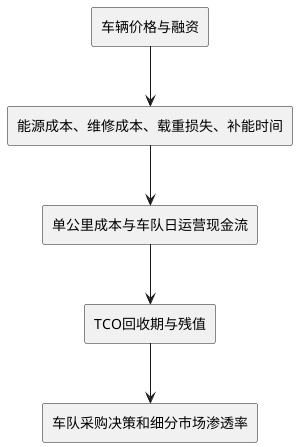
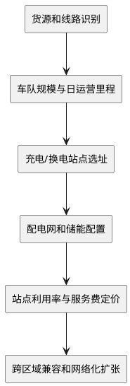
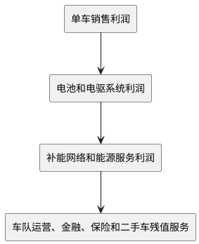

# 新能源汽车与商用车电动化行业深度研究报告

**日期**：2026年11月3日
**研究覆盖**：全球及中国新能源汽车市场、商用车电动化场景、TCO经济性、技术路线、补能基础设施、产业链竞争与2026-2030年情景推演
**数据截至**：2026年11月3日；中国新能源汽车产销采用2026年1-9月数据（中汽协10月12日发布），10月全国数据中汽协尚未发布（预计11月10日前后），10月乘用车零售与新能源批发采用乘联分会10月26日、11月3日口径，10月重卡批发与新能源重卡终端实销采用方得网11月3日初步统计口径；商用车总量及出口采用2026年1-9月总量口径，新能源商用车国内销量采用2026年1-9月数据（中汽协10月12日发布），新能源重卡1-9月采用交强险实销口径，9月为3.31万辆、渗透率50.28%（10月15日发布）；动力电池装车量截至2026年9月（动力电池产业创新联盟10月15日发布），充电基础设施截至2026年9月底（国家能源局10月22日发布），公司业绩截至2026年三季报（全部重点公司已披露）
**研究类型**：行业深度研究，含产业链与核心公司映射，不构成具体投资建议

---

## 一、执行摘要

### 1.1 核心结论

中国新能源汽车行业已经从政策导入期进入市场竞争和全球化扩张阶段，但行业内部出现明显分化：乘用车国内需求进入高渗透率下的存量竞争，商用车则仍处于由政策、TCO改善和场景复制共同推动的结构性放量期。

2025年中国新能源汽车销量达到1649万辆，占汽车新车销量47.9%；2026年1-9月新能源汽车销量达到1247.2万辆（产销1248.3万/1247.2万辆，同比约+11.1%），占汽车新车销量53.6%，其中9月单月产销181.4万/182.3万辆同比+12.2%/+13.6%，新车销量占比61.6%连续第三个月超60%再创单月新高。10月虽无中汽协总量数据，但乘联分会预估新能源乘用车批发180万辆、同比+12%、环比+8%，同时狭义乘用车零售仅160万辆、同比-28.9%，新能源零售渗透率66.9%——即总量仍在增长、内需零售却在加速收缩，两者由出口与商用车共同弥合。1-9月国内新能源乘用车零售775.8万辆同比下降12.8%，而新能源商用车国内销量80.0万辆仍同比增长41.3%，10月新能源重卡终端实销约3.4万辆、同比接近+70%、渗透率连续第二个月超过50%，结构分化在10月进一步加剧而非收敛。([乘联分会10月市场预测（10月26日）](https://news.qq.com/rain/a/20261026A05GSX00)、[乘联分会10月新能源乘用车批发预估（11月3日）](https://m.ithome.com/html/1021661.htm)、[方得网10月重卡数据（11月3日）](https://finance.sina.com.cn/roll/2026-11-03/doc-inixmxcy2242396.shtml)、[工信部《2026年9月汽车工业经济运行情况》](https://www.miit.gov.cn/gxsj/tjfx/zbgy/qc/art/2026/art_8a878aeeb8a34a5b88975c5bbe94f7bf.html))

商用车的关键变化发生在重卡，而不是公交。城市公交已经接近存量替换和更新市场，未来增量有限；新能源重卡在港口、矿区、钢厂、煤炭短倒、建筑运输和固定线路物流中的TCO优势已经被多类运营案例验证，成为商用车电动化的主要增长引擎。2025年中国零排放中重型车辆销量约45.7万辆，同比增长98%，其中新能源重卡及牵引车约23.2万辆，接近2024年的三倍；而2026年1-10月新能源重卡终端实销按10月预计3.4万辆推算约26.0万辆，单一品类十个月即超过2025年全年。([ICCT：中国零排放中重型车辆市场2025年更新](https://theicct.org/publication/zero-emission-medium-and-heavy-duty-vehicle-market-in-china-a-2025-update-may26/)、[方得网10月重卡数据](https://finance.sina.com.cn/roll/2026-11-03/doc-inixmxcy2242396.shtml))

本报告的核心判断是：**商用车电动化将沿“高频短途和封闭场景先行、区域运输扩散、干线运输逐步突破”的顺序推进；2030年前纯电和换电是主线，混动/增程是复杂工况的过渡方案，氢燃料电池主要保留在长续航、低温、载重敏感或补能时间高度刚性的细分场景。**

### 1.2 五项关键判断

1. **乘用车高渗透率与商用车高增长并存，但10月已从"零售微降"转为"零售加速下滑、总量靠出口托底"。** 2026年1-9月新能源乘用车零售775.8万辆、同比下降12.8%，新能源商用车国内销量80.0万辆、同比增长41.3%；9月单月新能源乘用车零售108.4万辆同比下降16.7%、零售渗透率67.0%再创单月新高，新能源商用车国内销量11.0万辆同比增长32.6%、渗透率46.6%。10月狭义乘用车零售预计160万辆、同比-28.9%（降幅较9月进一步扩大），新能源零售107万辆、渗透率66.9%；同期新能源乘用车批发预估180万辆、同比+12%，差额由出口与渠道库存承接（比亚迪10月出口17.02万辆、奇瑞10月海外20.06万辆）。出口已成为内需收缩的唯一对冲项，也构成2027年最大的单一变量：1-9月汽车出口820.5万辆同比+65.8%，其中新能源汽车出口400.6万辆同比增长1.3倍，一旦海外渠道进入去库存，总量增速将直接暴露内需降幅。([乘联分会10月市场预测](https://news.qq.com/rain/a/20261026A05GSX00)、[中国基金报10月车企销量（11月1日）](https://finance.sina.cn/stock/jdts/2026-11-01/detail-inixfzvr0895719.d.html)、[工信部《2026年9月汽车工业经济运行情况》](https://www.miit.gov.cn/gxsj/tjfx/zbgy/qc/art/2026/art_8a878aeeb8a34a5b88975c5bbe94f7bf.html))

2. **新能源重卡已从示范应用进入规模化阶段，且政策设定的2030年渗透率目标在2026年四季度已被单月数据提前触及。** 交通运输部等十一部门提出，到2030年新能源重卡渗透率达到40%、保有量突破160万辆，建设重卡充换电站约3000个、零碳公路运输通道3万公里。而2026年9月单月终端渗透率已达50.28%、10月接近55%，连续两个月站上50%，说明40%的销量渗透率目标已不再构成约束，真正的瓶颈转为保有量、跨省补能网络和干线场景的实际运营强度。([交通运输部《推动新能源重卡规模化应用实施方案》](https://xxgk.mot.gov.cn/jigou/zhghs/202606/t20260612_4207423.html)、[方得网10月重卡数据](https://finance.sina.com.cn/roll/2026-11-03/doc-inixmxcy2242396.shtml))

3. **商用车电动化的第一性原理是TCO，而不是购车价。** IEA测算，在中国部分应用中，电动重卡TCO已经低于柴油重卡，电动重卡能源成本每公里较柴油低50%以上；ICCT对中国多个运营场景的汇总显示，电动卡车通常可实现最高约20%的单位里程TCO节约，多数案例前期投入回收期在4年以内。([IEA重型电动车报告](https://www.iea.org/reports/global-ev-outlook-2025/trends-in-heavy-duty-electric-vehicles)、[ICCT中国公路货运电动化案例汇总](https://theicct.org/publication/electrifying-on-road-freight-in-china-a-meta-analysis-of-use-cases-jul26/))

4. **充电与换电不是二选一，而是按运输组织方式分工。** 充电适合固定线路、停留时间可安排、车辆需要较高通用性的场景；换电适合高出勤率、运行时间刚性、路线和车型相对标准化的车队。2025年中国换电重卡及可换电车辆销量约6.83万辆，同比增长约131%，换电型重卡市场份额约30%。2026年10月宁德时代将重卡换电从"电池产品"推进到"资产+网络+标准"三层：发布天行Ⅱ"电电增程"（底换主驱包租赁＋77kWh随车增程包，发布即量产、首批签约1.3万台），以体积尺寸定义260#（432kWh）/300#（513kWh）两款标准化换电块，并公布骐骥换电2026年底900座、2027年2000座、长期1万座的建站节奏。这意味着换电路线的主要不确定性已从"技术可行性"转向"跨品牌兼容与站点利用率"。([ICCT中国零排放中重型车辆市场2025年更新](https://theicct.org/publication/zero-emission-medium-and-heavy-duty-vehicle-market-in-china-a-2025-update-may26/)、[宁德时代骐骥换电生态发布会（10月20日）](https://www.catl.com/news/10333.html))

5. **产业链机会从单纯卖车转向“车辆-电池-补能-运营”一体化。** 动力电池企业正在进入电池租赁、换电站和车电分离；整车企业正在延伸到金融、保险、售后和能源服务；补能运营商的核心竞争力从设备销售转向站点利用率和车队绑定。行业真正的利润拐点，需要由车队现金流和补能设施利用率确认。

### 1.3 关键数据一览

| 指标 | 最新数据 | 口径与说明 |
|---|---:|---|
| 2025年中国汽车销量 | 3440万辆 | 中汽协口径 |
| 2025年中国新能源汽车销量 | 1649万辆 | 占汽车新车销量47.9% |
| 2025年中国商用车销量 | 429.6万辆 | 占汽车销量约12.5% |
| 2025年新能源商用车销量 | 约95.4万辆 | 中汽协口径，含不同商用车型 |
| 2025年新能源商用车渗透率 | 22.2% | 与商用车总销量口径匹配 |
| 2025年中国零排放中重型车辆销量 | 45.7万辆 | ICCT口径，仅中重型、零排放 |
| 2025年新能源重卡及牵引车销量 | 约23.2万辆 | ICCT口径，约占重卡销量28% |
| 2026年1-9月汽车销量 | 2327.1万辆 | 中汽协，1-9月同比下降约4.5% |
| 2026年1-9月新能源汽车销量 | 1247.2万辆 | 中汽协，同比约+11.1%，占新车销量53.6% |
| 2026年9月新能源汽车新车销量占比 | 61.6% | 单月新高（9月产销181.4万/182.3万辆同比+12.2%/+13.6%） |
| 2026年10月狭义乘用车零售 | 160.0万辆 | 乘联分会10月26日预估，同比-28.9%、环比-1.1% |
| 2026年10月新能源乘用车零售 | 107.0万辆 | 乘联分会预估，零售渗透率66.9% |
| 2026年10月新能源乘用车批发 | 180万辆 | 乘联分会11月3日预估，同比+12%、环比+8% |
| 2026年1-9月新能源商用车国内销量 | 80.0万辆 | 中汽协国内口径，同比+41.3%，占商用车国内销量35.2% |
| 2026年9月新能源商用车国内销量 | 11.0万辆 | 同比+32.6%，当月占商用车国内销量46.6% |
| 2026年1-9月新能源重卡销量 | 约22.64万辆 | 交强险实销口径同比+64%，占重卡终端销量38.10%；9月3.31万辆同比+37%、渗透率50.28% |
| 2026年10月新能源重卡销量 | 约3.4万辆（预计） | 终端实销，同比接近+70%，渗透率接近55%，连续两月超50% |
| 2026年9月底充电基础设施 | 2477.7万个充电枪 | 公共520.7万个，私人1957.0万个，同比+37.2% |
| 2026年1-9月动力电池国内装车量 | 576.3GWh | 同比+16.7%；9月单月87.2GWh，磷酸铁锂74.5GWh占85.4% |
| 2030年新能源重卡政策目标 | 渗透率40%、保有量160万辆以上 | 交通运输部等十一部门（销量渗透率目标已于2026年9-10月单月提前触及） |

### 1.4 当前行业阶段

| 细分市场 | 当前阶段 | 下一阶段的关键验证 |
|---|---|---|
| 新能源乘用车 | 高渗透率下的存量竞争 | 海外销量、单车盈利、品牌集中度 |
| 城市公交 | 高渗透率和存量更新 | 更新周期、财政支付能力、海外出口 |
| 城市物流轻商 | 从经济性验证进入规模复制 | 快充、残值、车队融资与售后网络 |
| 中卡和专用车 | 场景分化中的快速渗透 | 固定路线覆盖、车型标准化 |
| 新能源重卡 | 规模化替换期（2026年9-10月终端渗透率连续>50%） | 保有量、干线补能利用率、跨品牌换电兼容 |
| 氢燃料电池商用车 | 示范应用与路线竞争期 | 氢价、加氢站利用率、耐久性 |

---

## 二、行业定义、边界与数据口径

### 2.1 新能源汽车分类

本报告将新能源汽车定义为纯电动汽车、插电式混合动力汽车、增程式汽车和燃料电池汽车。普通混合动力汽车不纳入中国新能源汽车销量主口径，但在技术路线比较中单独讨论。

### 2.2 商用车分类

本报告重点覆盖道路商用车，包括城市公交、客车、物流轻商、轻卡、中卡、重卡、牵引车、环卫车、工程运输车和其他专用车辆。非道路工程机械、矿卡和港口无人集卡仅在其与道路商用车电动化供应链和技术路线直接相关时纳入讨论。

交通运输部对新能源重卡的定义为：采用新型动力系统，完全或主要依靠新型能源驱动，总质量在12吨及以上的重型载货汽车。([交通运输部实施方案](https://xxgk.mot.gov.cn/jigou/zhghs/202606/t20260612_4207423.html))

### 2.3 统计口径必须分开

#### 2.3.1 新能源汽车总量口径

- 中汽协的产销数据主要反映制造商交付和行业销售。
- 国家统计局的新能源汽车产量和年末保有量反映宏观统计口径。
- 乘联会的零售数据反映乘用车终端注册和零售市场。
- 海关和港口数据反映出口发运，不等于海外终端销售。

2025年中汽协新能源汽车销量为1649万辆，国家统计局新能源汽车产量为1652.4万辆，两者并非矛盾，而是销售与产量的不同口径。国家统计局同时披露，2025年末中国新能源汽车保有量达到4397万辆。([国家统计局2025年统计公报](https://www.cj.gov.cn/p135/tzgg/20260303/396288.html))

#### 2.3.2 商用车口径冲突

2025年新能源商用车约95.4万辆、渗透率22.2%的数据来自中汽协商用车总口径；ICCT测得的45.7万辆是零排放中重型车辆，主要覆盖中卡、重卡、客车和专用车，不包括全部轻型商用车。两组数据不能直接相加或相互替代。([福田汽车2025年年报](http://dataclouds.cninfo.com.cn/shgonggao/hsomarket/2026/20260424/22237e3bd17f48d7b434dade7bd3cf96.PDF)、[ICCT市场更新](https://theicct.org/publication/zero-emission-medium-and-heavy-duty-vehicle-market-in-china-a-2025-update-may26/))

#### 2.3.3 商用车需求质量

商用车不能只看销量，还需要观察：

- 新车上牌后是否持续运营。
- 车辆日均里程和年运营里程是否达到经济性门槛。
- 车辆是否在封闭或固定线路场景运营。
- 补能设施是否具备稳定可用性。
- 车队是否可以获得金融、保险、维修和残值服务。

### 2.4 本报告的判断框架

商用车电动化的基本逻辑链为：



---

## 三、宏观驱动力与政策环境

### 3.1 交通运输减碳的结构性需求

重型货车数量占比不高，但承担大量公路货运周转量，且柴油消耗和氮氧化物排放强度高。交通运输部在新能源重卡实施方案解读中指出，交通运输领域碳排放约占全国总量的10%，重卡约占交通运输碳排放的40%，因此重卡是交通减排的关键抓手。([中国政府网政策解读](http://big5.www.gov.cn/gate/big5/www.gov.cn/zhengce/202606/content_7072744.htm))

对乘用车而言，电动化主要由产品价格、智能化体验和能源成本驱动；对商用车而言，电动化还叠加了污染排放约束、工业园区清洁运输要求、城市路权和车队运营成本压力。

### 3.2 2026年汽车以旧换新政策

2026年“两新”政策继续支持老旧营运货车报废更新，并明确优先支持更新为电动货车；同时继续支持新能源城市公交车及动力电池更新。([国家发展改革委《2026年大规模设备更新和消费品以旧换新政策》](https://www.ndrc.gov.cn/xxgk/zcfb/tz/202512/t20251230_1402851.html))

需要注意的是，面向个人消费者的2026年汽车报废更新和置换更新补贴主要针对乘用车，并不直接覆盖单位车辆、商用车和营运车辆。商用车需求主要依靠老旧营运货车更新、城市公交更新以及地方专项政策驱动。([商务部等八部门汽车以旧换新细则](https://www.ndrc.gov.cn/xwdt/ztzl/tddgmsbgxhxfpyjhx/gzdt/202601/t20260108_1403127.html))

2026年以旧换新对乘用车新能源置换按新车销售价格的8%补贴、上限1.5万元，燃油乘用车按6%补贴；由于2026年新能源购置税已从免征转为减半，补贴与税收两项合计的边际优惠较2025年明显收窄，这也是乘用车零售在9-10月连续大幅同比下滑的政策背景之一。

### 3.3 购置税与车船税优惠退坡

2026年1月1日至2027年12月31日，新能源汽车车辆购置税由免征改为减半征收（实际税率5%），每辆新能源乘用车减税额上限由3万元降至1.5万元。该退坡已在2026年全年生效，构成本轮乘用车需求"高渗透率、负增长"的重要制度背景：政策不再提供增量刺激，行业增长只能来自产品力、出口与商用车。

2026年7月3日，财政部、税务总局、工业和信息化部公告，自2027年1月1日起取消对节能汽车减半征收车船税，并取消对纯电动商用车、插电式（含增程式）混合动力汽车、燃料电池商用车免征车船税，且不区分存量与增量。车船税为年度财产税，乘用车分档税额多在300-660元区间，商用车按客车、货车分别计征，绝对金额有限，但政策信号明确：商用车新能源的税收普惠保护将于2027年退出，行业必须在该时点前完成由补贴驱动向TCO驱动的切换。([财政部等三部门车船税政策调整，新华社7月3日](https://www.news.cn/fortune/20260703/852d7e340f25482da4718d38f87368fa/c.html)、[新能源汽车购置税减免政策公告](https://fgk.chinatax.gov.cn/zcfgk/c102416/c5207352/content.html))

乘用车双积分方面，2026年度、2027年度新能源汽车积分比例要求分别提升至48%和58%，年均上调10个百分点，仍仅覆盖乘用车企业；商用车尚无全国性积分交易机制，其电动化约束主要来自油耗限值、排放法规、清洁运输要求和地方路权，而非积分套利。

### 3.4 新能源重卡规模化应用政策

交通运输部等十一部门2026年发布的实施方案具有三个重要变化：

1. 目标从示范推广升级为全场景规模化应用。
2. 重点从单车补贴扩展到补能网络、电网、金融、保险、维修和标准体系。
3. 目标从港口和矿区等封闭场景扩展到干线公路运输。

到2030年，政策目标包括新能源重卡渗透率40%、保有量超过160万辆、固定线路短倒运输电动化比例超过80%、重卡充换电站约3000个、零碳公路运输通道3万公里、高速公路新能源重卡货运量占比18%。([交通运输部实施方案](https://xxgk.mot.gov.cn/jigou/zhghs/202606/t20260612_4207423.html))

### 3.5 用能政策和补能成本

实施方案提出，2030年前对实行两部制电价的集中式充换电设施用电免收需量或容量电费，并支持零碳公路运输通道分布式新能源参与市场化交易。该政策直接作用于重卡补能站的固定成本和峰值负荷成本，有利于降低站点盈亏平衡门槛。([交通运输部实施方案](https://xxgk.mot.gov.cn/jigou/zhghs/202606/t20260612_4207423.html))

### 3.6 海外政策和贸易环境

全球电动化的增长驱动正在从中国、欧洲和美国三大市场扩展到巴西、东南亚、印度和中东。IEA在2026年中期更新中预计，2026年全球电动汽车销量占汽车总销量的比例约为29%，中国电动汽车销量占比将超过60%，但中国电动汽车出口库存和海外渠道库存需要关注。([IEA 2026年电动车市场更新](https://www.iea.org/reports/electric-car-markets-in-a-time-of-uncertainty))

2026年出口的高增长已经带有明显的"前置"特征：1-9月新能源汽车出口400.6万辆、同比+1.3倍，9月单月汽车出口105.3万辆同比+61.4%、连续四月超百万，10月比亚迪出口17.02万辆、奇瑞出口20.06万辆。出口基数抬高后，2027年面临两类回吐风险：一是海外渠道库存消化导致发运量与终端零售脱钩；二是欧盟、拉美、东南亚本地化生产与关税要求使整车出口逐步转为KD/本地组装，按中国口径统计的出口增速将系统性下移。

商用车海外市场的壁垒与乘用车不同，重点包括车辆认证、售后配件、道路法规、补能标准、当地金融和车队服务。中国商用车出口已经从单一整车出口走向KD组装、技术授权和本地化服务，但新能源商用车仍受海外补能网络和标准不统一制约。

---

## 四、全球与中国市场规模

### 4.1 全球新能源汽车市场

IEA数据显示，2024年全球电动汽车市场继续增长，全球电动汽车保有量在政策情景下到2030年将达到约2.5亿辆。全球电动卡车仍是最慢电气化的道路交通品类，IEA在2025年政策情景中预计2030年全球电动卡车销量占比约13%，保有量占比约3%。([IEA全球电动车展望2025](https://www.iea.org/reports/global-ev-outlook-2025/outlook-for-electric-mobility))

全球重型车辆电动化的区域差异非常明显：

| 区域 | 当前特点 | 主要制约 |
|---|---|---|
| 中国 | 电动重卡和电动公交规模全球领先 | 补能标准、车队融资、干线网络 |
| 欧洲 | 城市公交和中轻型卡车较快，重卡受法规推动 | 购车价高、充电基础设施投资大 |
| 美国 | 校车、港口、短途配送先行 | 政策不确定、车型价格高、充电网络不足 |
| 东南亚 | 两轮车、城市公交、矿区车辆有增长 | 电网、认证和本地化服务不足 |
| 拉美和中东 | 公交、电动物流和矿区是主要入口 | 资金成本、道路条件和补能体系 |

### 4.2 中国新能源汽车市场演进

| 年份 | 汽车销量 | 新能源汽车销量 | 新能源渗透率 | 主要阶段 |
|---|---:|---:|---:|---|
| 2021 | 2627万辆左右 | 352万辆左右 | 13.4% | 政策和供给扩张 |
| 2022 | 2686万辆左右 | 689万辆左右 | 25.6% | 规模化放量 |
| 2023 | 3009万辆左右 | 949万辆左右 | 31.6% | 产品普及 |
| 2024 | 3144万辆左右 | 1287万辆左右 | 40.9% | 电动化加速 |
| 2025 | 3440万辆 | 1649万辆 | 47.9% | 新能源成为主导增量 |
| 2026年1-9月 | 2327.1万辆 | 1247.2万辆 | 53.6% | 单月渗透率61.6%新高，累计超53%，出口驱动明显 |

2025年中国汽车总销量和新能源汽车销量均创历史新高，2026年前9月总量承压但结构性特征强化：1-9月汽车产销2324.6万/2327.1万辆同比下降约4.5%，出口820.5万辆同比增长65.8%，其中新能源汽车出口400.6万辆同比增长1.3倍，9月单月汽车出口105.3万辆同比增长61.4%、连续四月超百万，其中新能源出口57.1万辆同比增长1.6倍。乘用车9月新能源零售渗透率升至67.0%再创单月新高（新能源零售约108.4万辆同比-16.7%、环比+7.8%）；10月预计零售160万辆同比-28.9%，新能源零售107万辆、渗透率66.9%，但新能源批发仍有180万辆、同比+12%——零售与批发的裂口由出口和渠道库存承担。IEA此前预计2026年中国电动汽车销量可能较2025年趋于停滞但渗透率仍可能超过60%，实际情况是"总量低速增长、渗透率持续新高、内需零售深度收缩"三者并存，出口成为唯一增量来源。([工信部《2026年9月汽车工业经济运行情况》](https://www.miit.gov.cn/gxsj/tjfx/zbgy/qc/art/2026/art_8a878aeeb8a34a5b88975c5bbe94f7bf.html)、[乘联分会2026年9月市场分析](https://www.cada.cn/Trends/info_91_10580.html)、[乘联分会10月市场预测](https://news.qq.com/rain/a/20261026A05GSX00)、[乘联分会10月批发预估](https://m.ithome.com/html/1021661.htm))

需要区分两个口径的"渗透率"：中汽协的新车销量占比（累计53.6%、单月61.6%）以批发为分母，包含出口；乘联会的零售渗透率（9月67.0%、10月66.9%）仅反映国内终端。两者同时走高，但前者受出口结构拉动更明显，后者更真实地反映国内需求——乘联分会口径下2026年1-9月乘用车零售累计同比下降约21%，是判断"存量竞争"的核心证据，不能用批发渗透率替代。([乘联分会累计零售口径](https://m.ithome.com/html/1007153.htm))

### 4.3 中国商用车市场

2025年中国商用车产销分别为426.1万辆和429.6万辆，同比分别增长12%和10.9%，重新回到400万辆以上。商用车市场的总量增长来自国内更新、出口和新能源结构变化的共同作用。([中汽协数据，经北京市科委转载](https://kw.beijing.gov.cn/xwdt/kcyx/xwdtcyfz/202601/t20260116_4436069.html))

| 指标 | 2024年 | 2025年 | 变化 |
|---|---:|---:|---:|
| 商用车销量 | 约387万辆 | 429.6万辆 | +10.9% |
| 新能源商用车销量 | 约57.6万辆 | 约95.4万辆 | +65.5% |
| 新能源商用车渗透率 | 约15%-20% | 22.2% | 明显提升 |
| 商用车出口 | 约90万辆 | 106万辆 | +17.2% |
| 新能源商用车出口 | 约4.5万辆 | 8.3万辆 | +86.8% |

上述新能源商用车数据采用中汽协商用车口径；ICCT的中重型零排放车辆口径为45.7万辆，不包含全部轻型商用车。两组数据反映的是不同市场层级。([上海市企业走出去综合服务平台转引行业会议数据](https://segg.sh.gov.cn/zxfw/xwzx/20260424/6b1f267666304158b89e1f3f9434175b.html)、[ICCT市场更新](https://theicct.org/publication/zero-emission-medium-and-heavy-duty-vehicle-market-in-china-a-2025-update-may26/))

### 4.4 2025年中重型车辆结构

| 细分市场 | 2025年零排放渗透率或规模 | 判断 |
|---|---:|---|
| 城市公交 | 累计电动化接近100% | 主要进入更新市场 |
| 客车及大巴 | 约28% | 城市公交高，城际客车低 |
| 中型卡车 | 约172000辆，电动化约22% | 城市配送和区域物流扩散 |
| 重卡及牵引车 | 约232000辆，电动化约38% | 港口、短倒和固定线路先行 |
| 直卡 | 零排放渗透率略高于7% | 受续航和补能约束 |
| 工程及专用车辆 | 零排放渗透率约24% | 公共部门和固定场景推动 |

ICCT数据显示，2025年中国零排放中重型车辆前20个城市占全国销量51%，前5个城市占31%，上海和深圳领先。新能源商用车的早期放量高度集中于港口、矿区、钢厂、城市配送和政策强度较高的城市群。([ICCT市场更新](https://theicct.org/publication/zero-emission-medium-and-heavy-duty-vehicle-market-in-china-a-2025-update-may26/))

### 4.5 2026年市场进度

2026年1-9月，中国商用车产销327.9万/331.1万辆、同比分别增长6.1%/6.2%，其中货车9月31.3万辆同比+0.4%（重卡9.87万辆同比-6.5%、中卡约1.0万辆同比-5.7%、轻卡17.9万辆同比+11.0%）、客车5.5万辆同比-0.8%。1-9月重卡累计92.94万辆同比+13%创近年同期新高。国内市场方面，9月商用车国内销量约23.6万辆，1-9月国内累计约228万辆同比下降约1%，出口1-9月累计约103万辆同比增长约36%，显示"国内平稳、出口拉动"特征延续。

进入10月，商用车批发端明显走弱：重卡批发预计9.2万辆、环比-7%、同比-13%，为年内第五次同比负增长且连续第四个月下降；1-10月重卡累计102.1万辆、同比仍增10%。走弱原因并非单一：公路运价低迷压制车队与散户购车意愿、去年同期以旧换新高基数（2025年10月批发10.62万辆、其中国内超7万辆）、国四货车存量已大幅减少使置换空间收窄、AEBS法规切换提前透支需求并伴随行业去库存、10月制造业PMI降至49.3%（环比-0.8个百分点）压制原材料运输。唯一亮点是出口，10月重卡出口预计同比+20%，由非洲、东南亚、拉美和中亚拉动；天然气重卡10月同比-68%，已连续五个月下滑，油气价差被高气价抹平。([方得网10月重卡数据，11月3日](https://finance.sina.com.cn/roll/2026-11-03/doc-inixmxcy2242396.shtml))

新能源结构分化在10月进一步扩大，而不是收敛：1-9月新能源汽车产销1248.3万/1247.2万辆同比约+11.1%，9月单月181.4万/182.3万辆同比+12.2%/+13.6%，新车销量占比61.6%连续第三个月超60%、累计53.6%。但国内与出口走势继续背离——1-9月新能源乘用车零售775.8万辆同比下降12.8%，1-9月新能源汽车出口400.6万辆同比增长1.3倍；10月狭义乘用车零售预计160万辆、同比-28.9%，新能源零售107万辆、渗透率66.9%，而新能源乘用车批发仍有180万辆、同比+12%。商用车是新能源增量的核心：9月新能源商用车国内销量11.0万辆、同比+32.6%、环比+6.9%，当月渗透率46.6%；1-9月累计80.0万辆同比+41.3%，累计渗透率35.2%，显著高于2025年22.2%的全年水平。9月商用车整体批发36.9万辆同比+0.2%、环比+12.3%呈现"金九"旺季修复，但10月重卡批发转负，说明商用车的"结构性增量"已完全由新能源承担，传统燃油与燃气重卡进入负增长。乘用车9月新能源零售渗透率67.0%再创单月新高、10月66.9%，行业整体呈现"乘用车存量竞争、商用车渗透提升、燃油商用车收缩"的三重结构。([工信部《2026年9月汽车工业经济运行情况》](https://www.miit.gov.cn/gxsj/tjfx/zbgy/qc/art/2026/art_8a878aeeb8a34a5b88975c5bbe94f7bf.html)、[乘联分会2026年9月市场分析](https://www.cada.cn/Trends/info_91_10580.html)、[乘联分会10月市场预测](https://news.qq.com/rain/a/20261026A05GSX00)、[乘联分会10月批发预估](https://m.ithome.com/html/1021661.htm)、[搜狐汽车商用车数据](https://biznews.sohu.com/a/1086736675_120774496))

重卡细分（交强险终端实销口径）：9月新能源重卡销量3.31万辆、同比+37%、环比+23%，当月渗透率50.28%创年内新高；10月终端实销预计3.4万辆、环比微增、同比接近+70%，渗透率接近55%，连续第二个月超过50%。1-9月累计22.64万辆同比+64%，占重卡终端销量38.10%（2025年全年为28.9%）；按10月数据推算，1-10月累计约26.0万辆。企业竞争格局方面，9月中国重汽以5502辆（同比+112%、份额16.6%）跃居榜首，一汽解放5130辆（+29%、15.5%）和徐工汽车5121辆（+43%、15.5%）分列二三，福田汽车2747辆（+29%、8.3%）居第五，陕汽集团2590辆（7.8%）第六。1-9月累计排名：中国重汽3.66万辆（+139%、16.2%）居首，徐工汽车3.59万辆（+62%、15.9%）第二，三一集团3.14万辆（+51%、13.9%）第三。新能源重卡渗透率从1-7月约21%攀升至9月50.28%、10月接近55%，已越过"规模化"门槛；但需注意渗透率的快速抬升同时来自分子（新能源增长）与分母（燃油重卡在运价低迷和高气价下加速萎缩），单月渗透率不宜线性外推，干线长途的规模化替代仍需补能网络闭环验证。([新浪财经新能源重卡9月排名](https://finance.sina.cn/2026-10-15/detail-inivhyai8071831.d.html)、[方得网10月重卡数据](https://finance.sina.com.cn/roll/2026-11-03/doc-inixmxcy2242396.shtml)、[Mysteel：9月新能源重卡渗透率破50%](https://m.mysteel.com/a/26101914/0EAA8D6E2101DE24_abc.html))

### 4.6 2026-2030年市场情景测算

以下为本报告基于已披露数据、政策目标、车辆更新周期和TCO扩散速度的独立测算，不是官方预测。

| 情景 | 2026年新能源汽车销量 | 2030年新能源汽车销量 | 2030年新能源商用车销量 | 2030年商用车新能源渗透率 |
|---|---:|---:|---:|---:|
| 悲观 | 17.4-17.9百万辆 | 23-25百万辆 | 1.6-1.9百万辆 | 35%-42% |
| 基准 | 18.0-18.6百万辆 | 26-28百万辆 | 2.0-2.4百万辆 | 43%-50% |
| 乐观 | 18.6-19.2百万辆 | 29-31百万辆 | 2.5-2.8百万辆 | 52%-58% |

2026年区间较上期整体下移约0.5百万辆，原因是进度算术而非趋势反转：1-9月新能源汽车销量1247.2万辆，按乘联分会10月新能源乘用车批发预估180万辆加新能源商用车约13万辆测算，10月约193万辆，1-10月约1440万辆；基准情景隐含11-12月月均180-210万辆（2025年同期月均约175万辆、且当季为购置税免征最后窗口），对应全年18.0-18.6百万辆、同比+9%-13%。若11-12月零售继续以接近-30%的速度下滑而出口不能补足，则落在悲观区间；若车企为完成年度目标集中冲量、出口维持20万辆/月以上，则可能触及乐观区间上沿。需注意2027年购置税仍维持减半（政策已明确至2027年底），2026年末不存在2025年"免征到期抢装"的效应，Q4超预期的概率低于往年。上期区间（18.5-19.5百万辆）需要Q4同比+15%以上才能实现，已被10月零售数据否定。

基准情景的关键假设为：汽车总销量保持在3400万至3600万辆（1-9月2327.1万辆同比-4.5%，10月乘用车零售同比-28.9%，全年总量大概率落在3450万辆附近）；乘用车新能源渗透率由2026年的高位继续提升，但销量增速明显低于前期（1-9月新能源乘用车零售同比-12.8%、10月预计继续两位数下滑）；商用车总销量保持在430万至480万辆（1-9月331.1万辆同比+6.2%，但10月重卡批发同比-13%，全年贴近区间下沿）；新能源重卡渗透率已达50%以上，2030年40%的政策目标不再是约束，基准情形的约束转为保有量（160万辆）与干线补能（3000座站、3万公里通道）；轻型商用车和客车渗透率高于重卡；商用车出口保持增长（1-9月约103万辆同比约+36%，10月重卡出口同比+20%），但海外新能源商用车补能建设慢于整车出口。

若按平均乘用车电池55-65kWh、普通商用车120-200kWh、重卡350-500kWh估算，2030年中国动力电池装车需求可能达到1.2-1.5TWh。该测算受PHEV占比、商用车车型结构、出口车辆是否在中国装车等因素影响，置信度低于销量预测。([乘联分会10月批发预估](https://m.ithome.com/html/1021661.htm)、[方得网10月重卡数据](https://finance.sina.com.cn/roll/2026-11-03/doc-inixmxcy2242396.shtml))

---

## 五、商用车电动化的场景穿透

### 5.1 城市公交

中国城市公交已经是全球电动化程度最高的商用车市场之一。ICCT数据显示，2025年中国城市公交的电动化累计市场份额接近100%，但城际客车的纯电渗透率只有约10%，2025年约13700辆。([ICCT市场更新](https://theicct.org/publication/zero-emission-medium-and-heavy-duty-vehicle-market-in-china-a-2025-update-may26/))

城市公交的优势在于线路固定、日均里程可预测、夜间集中停放、运营主体集中，缺点是新增需求主要由更新周期决定，且公交财政补贴和地方财政支付能力会影响采购节奏。未来公交电动化的增量来自：

- 老旧车辆和动力电池更新。
- 县域公交和城乡客运电动化。
- 海外城市公交采购。
- 车队运营、维保和电池全生命周期服务。

宇通客车2025年销售客车49518辆，实现营业收入414.26亿元、归母净利润55.54亿元；截至2025年末，公司累计出口新能源客车超过1.1万辆，在60多个国家和地区形成批量销售。公交电动化的产业机会已经从国内单车销售延伸到海外公共交通解决方案。([宇通客车2025年年报](http://static.cninfo.com.cn/finalpage/2026-03-31/1225050742.PDF))

### 5.2 城市物流和轻型商用车

城市物流是轻型商用车最容易实现电动化的场景之一，原因包括日均里程稳定、停靠次数多、低速工况占比高、夜间或午间存在补能时间、车辆运营频率高。

该市场的主要约束不是电池能量密度，而是：

- 车辆购置价和融资成本。
- 充电时间对日运营趟数的影响。
- 低温环境下续航和充电速度。
- 电池衰减对二手车残值的影响。
- 维修网点和事故维修能力。

CATL在2026年推出面向轻型商用车的高倍率快充产品，宣称80%充电时间低于7分钟、最高支持10年或100万公里质保，并计划在中国近190个城市部署4000座充换电一体站。上述为企业披露的产品和建设计划，尚需后续实际交付和站点利用率验证。([CATL商用车产品披露](https://autonews.gasgoo.com/articles/news/catl-targets-fuel-like-turnaround-for-electric-logistics-fleets-with-tianxing-ii-battery-2074431678414893057))

### 5.3 港口、矿区和厂区短倒

港口、矿区、钢厂和厂区短倒是当前新能源重卡最成熟的增量场景。其共同特征是路线固定、车辆集中、装卸节点明确、补能站可以绑定货源和停车场，且企业能够将能源成本和碳排放纳入采购决策。

ICCT对中国港口牵引、散货运输、工程施工和物流配送案例进行汇总后认为，电动卡车在多数案例中已经具备运营可行性，典型TCO节约最高约20%，前期投资回收期多数不超过4年，但载重损失和补能设施仍是关键约束。([ICCT中国公路货运电动化案例汇总](https://theicct.org/publication/electrifying-on-road-freight-in-china-a-meta-analysis-of-use-cases-jul26/))

### 5.4 固定线路短倒

固定线路短倒包括煤炭、矿石、钢材、砂石、建材和农产品运输。该场景的电动化扩散速度取决于“车-货-站”是否同步建设，而非单车技术是否成熟。

交通运输部明确提出，京津冀、汾渭平原等地区固定线路短倒运输电动化比例到2030年超过80%，并推动港口、货运枢纽、矿区、厂区和园区建设中短途补能网络。([交通运输部实施方案](https://xxgk.mot.gov.cn/jigou/zhghs/202606/t20260612_4207423.html))

### 5.5 干线物流

干线物流是新能源重卡中长期最大的潜在市场，也是最难突破的场景。核心矛盾包括：

1. 续航里程与载货量之间存在直接冲突。
2. 高速公路沿线补能网络尚未形成跨区域闭环。
3. 充电或换电等待会影响司机和车辆的周转率。
4. 干线货运价格竞争激烈，车队无法承受长期低利用率。
5. 不同品牌和车型之间的换电接口、通信协议和电池规格仍需要统一。

交通运输部实施方案已将大型物流企业、快递企业和规模化货运车队列为干线电动化的优先主体，说明政策正在从封闭场景推广转向车队级应用，但实际渗透仍取决于补能网络的先行建设。([交通运输部政策解读](https://www.mot.gov.cn/xinwen/jiaotongyaowen/202606/t20260615_4207522.html))

2026年10月的产业进展表明干线补能瓶颈正在从"无网络"转向"网络密度不足"：宁德时代骐骥换电已跑通广东—上海、成都—武汉、沧州—榆林、宁德—厦门、海南环岛五条干线，全网稳定运营里程突破500万公里，并计划2026年底建成900座换电站形成"1.5小时补能圈"、2027年建成2000座覆盖全国高速主干网。同期发布的天行Ⅱ底置长续航版以760kWh实现单次续航600公里以上、800V平台20分钟补能300公里、150万公里质保，产品参数已能覆盖多数省际干线。需要强调的是，上述均为企业规划与产品参数，500万公里运营里程相对于全国公路货运周转量仍属样本级；干线能否成为主流，取决于单站日均服务车次能否稳定接近设计值（骐骥站3.0宣称单站2个车位日均服务近200车次）以及跨品牌换电兼容性能否落地。([宁德时代骐骥换电生态发布会](https://www.catl.com/news/10333.html)、[环球卡车网报道](https://www.eotruck.com/show-6-21648-1.html))

### 5.6 场景电动化优先级

| 场景 | 电动化可行性 | 主路线 | 关键约束 |
|---|---|---|---|
| 城市公交 | 很高 | 纯电、少量氢能 | 更新预算和财政支付 |
| 城市物流轻商 | 高 | 纯电快充 | 购置价、快充和残值 |
| 港口牵引 | 很高 | 换电、超充 | 站点标准化和车队绑定 |
| 矿区和厂区 | 很高 | 换电、纯电 | 封闭场景投资和安全 |
| 固定线路短倒 | 高 | 换电、超充 | 线路两端和中途补能 |
| 区域中短途 | 中高 | 纯电、换电 | 载重和跨区域服务 |
| 长途干线 | 中低至中期改善 | 超充、换电、混动、氢能并存 | 补能网络、时间和载重 |

---

## 六、全生命周期成本与商业模式

### 6.1 商用车TCO模型

本报告采用以下简化模型：

```text
TCO = 购车及融资成本
    + 能源成本
    + 维修保养成本
    + 补能基础设施分摊
    + 保险及管理成本
    - 残值
    - 政策补贴及路权收益
```

商用车TCO与乘用车最大的区别是车辆利用率。对于年行驶里程低、停车时间长的车辆，高购置价难以通过能源成本节约回收；对于年行驶里程高、路线固定、燃油成本占比高的车辆，电动化的经济性会快速改善。

### 6.2 柴油、纯电、换电和氢能比较

| 维度 | 柴油重卡 | 纯电充电重卡 | 纯电换电重卡 | 氢燃料电池重卡 |
|---|---|---|---|---|
| 初始购置价 | 最低 | 较高，IEA称主要市场约为柴油2-3倍 | 车价可下降，但需电池租赁 | 较高 |
| 能源成本 | 受油价影响 | 中国部分场景明显低于柴油 | 可通过低谷电和集中运营降低 | 受氢价和站点利用率影响 |
| 补能时间 | 最短 | 取决于功率和电量 | 通常较短 | 较短但站点少 |
| 载重影响 | 最小 | 大电池增加整车重量 | 可通过电池租赁和标准箱优化 | 储氢系统占用空间和重量 |
| 适用场景 | 全场景 | 固定路线、中短途、区域运输 | 高出勤率、标准化车队 | 长续航、低温、载重和时间敏感场景 |
| 主要风险 | 油价、排放政策 | 电池衰减和补能网络 | 标准化、站点利用率和电池资产 | 氢价、加氢站利用率和系统耐久 |

IEA基于500公里日行驶距离比较中国、欧盟和美国的重卡TCO。其结论是：中国部分应用中的纯电重卡TCO已经低于柴油重卡，电动重卡能源成本每公里比柴油低50%以上；氢燃料电池重卡在2024年中国市场仍约比柴油重卡贵35%。([IEA重型电动车TCO分析](https://www.iea.org/reports/global-ev-outlook-2025/trends-in-heavy-duty-electric-vehicles))

### 6.3 独立TCO敏感性测算

以下为示例性测算，不代表所有车辆的平均水平：

| 参数 | 柴油重卡 | 纯电重卡 |
|---|---:|---:|
| 年行驶里程 | 100000公里 | 100000公里 |
| 能源消耗假设 | 35升/百公里 | 1.5kWh/公里 |
| 能源价格假设 | 7.0元/升 | 0.70元/kWh |
| 年能源成本 | 24.5万元 | 10.5万元 |
| 年能源成本差额 | - | 约14万元 |
| 维修保养差额 | 基准 | 每年节约约2-3万元，需按车队实测 |
| 初始成本溢价 | 基准 | 约30-50万元，因车型和电池模式变化 |
| 简化回收期 | - | 约2.5-4年 |

该测算的敏感项为年行驶里程、电价、柴油价格、实际电耗、载重损失、电池租赁费和残值。若年行驶里程从10万公里降至5万公里，能源节约减半，纯电重卡的回收期可能明显延长；若车辆在低谷电价下集中补能，回收期会缩短。

IEA指出，充电设施利用率从5%提高到30%时，单位充电基础设施成本可以下降约80%，并使基于2024年价格的整体能源成本每公里约降低一半。充电站利用率是决定补能网络能否商业化的关键变量。([IEA重型电动车报告](https://www.iea.org/reports/global-ev-outlook-2025/trends-in-heavy-duty-electric-vehicles))

### 6.4 公开运营案例

ICCT对广东一家饮料企业6台电动牵引车的案例测算显示，6年运营期内，电动牵引车TCO约345万元，比柴油牵引车374万元低7.8%；同时全生命周期温室气体排放约降低50%，氮氧化物排放约降低74%。该案例具有固定企业货源和固定路线特征，不能直接外推到开放式长途货运，但证明了中短途企业自有货源场景的商业可行性。([ICCT广东饮料企业电动牵引车案例](https://theicct.org/publication/electrifying-on-road-freight-a-case-study-of-tractor-trailer-deployment-by-a-beverage-company-in-guangdong-province-jul26/))

CATL披露，采用其重卡换电方案、年行驶10万公里时，单公里成本较柴油重卡低0.62元，较LNG重卡低0.20元。该数据来自企业产品方案测算，报告将其作为商业模式参考，不作为独立验证的行业平均值。([CATL重卡换电方案](https://www.catl.com/en/news/6473.html))

2026年10月CATL对天行Ⅱ"电电增程"给出的测算口径为：按日均运输400公里，单车年补能成本较柴油车节省约13万元；按购置、补能、维保、金融保险、残值全周期计算，3年TCO较电池买断的电动车再省约7万元、较柴油重卡省超46万元。同一发布会披露骐骥换电用户平均保费降至2.4万元、二手车残值较行业高约10%。这些数字包含企业自有的电池租赁定价、金融贴息与残值承诺，属于"方案可实现值"而非行业均值；其可持续性取决于电池租赁费能否长期低于被替代的能源成本，以及残值承诺能否在3年后兑现，应以车队实际现金流复核。([宁德时代天行Ⅱ发布会](https://www.catl.com/news/10333.html))

### 6.5 车电分离和电池租赁

车电分离可以降低一次性购车价，将电池从车辆资产转为能源资产，理论上有三项价值：

- 降低车队初始资本开支。
- 让电池运营商承担部分残值和技术迭代风险。
- 通过换电站和电池租赁提高车辆出勤率。

其主要风险是电池租赁费可能抵消能源成本节约，且电池资产需要统一标准、健康状态监测、保险和二手处置体系。交通运输部实施方案已明确支持电池资产管理、融资租赁和多方联营，但实际商业模式仍需通过站点利用率和车队现金流验证。([交通运输部实施方案](https://xxgk.mot.gov.cn/jigou/zhghs/202606/t20260612_4207423.html))

### 6.6 运营模式判断

| 模式 | 适用场景 | 核心收益 | 主要风险 |
|---|---|---|---|
| 整车销售 | 分散车主、城市物流 | 模式简单 | 车主承担全部残值和电池风险 |
| 车电分离 | 重卡、固定车队 | 降低初始投入 | 电池租赁费和标准化 |
| 换电服务 | 高出勤率和固定线路 | 减少停机时间 | 站点利用率和车型兼容 |
| 综合能源服务 | 港口、园区、矿区 | 光储充换一体化 | 初始投资大、运营复杂 |
| 运输服务联营 | 大型货源方和物流企业 | 车辆、货源和补能协同 | 资本和运营管理能力要求高 |

---

## 七、技术路线与产品演进

### 7.1 磷酸铁锂是商用车主流电池路线

2026年1-9月中国动力电池国内装车量576.3GWh、累计同比+16.7%（1-8月磷酸铁锂占比82.3%）；9月单月装车87.2GWh（环比+10.4%、同比+14.7%），其中三元12.3GWh、磷酸铁锂74.5GWh占85.4%，LFP占比继续抬升。9月我国动力和储能电池合计产量237.8GWh、同比+57.3%，单月产量创历史新高，与87.2GWh的装车量形成明显剪刀差，说明出口、储能与渠道备货吸收了大部分增量，装车量增速（+14.7%）显著低于产量增速。IEA指出，中国电动卡车电池价格低于海外市场，LFP成本优势、安全性和可充分充电特性使其在商用车中具有较强适配性。([动力电池产业创新联盟2026年9月数据（10月15日发布）](https://finance.eastmoney.com/a/202610153896931869.html)、[9月装车量87.2GWh](https://finance.sina.com.cn/tech/roll/2026-10-20/doc-inivwuic7746188.shtml)、[IEA电池报告](https://www.iea.org/reports/global-ev-outlook-2025/electric-vehicle-batteries))

商用车电池的核心指标与乘用车不同，优先级通常为：

1. 循环寿命和全生命周期可用容量。
2. 低温充放电和热管理能力。
3. 快充倍率和运营停机时间。
4. 安全性、维修性和电池健康监测。
5. 单位质量成本和载重影响。

### 7.2 电池容量与续航边界

ICCT数据显示，2025年中国重型电动卡车主流电池容量大约为350-500kWh，续航范围约200-700公里，形成了在续航、载重和成本之间的阶段性平衡。600kWh以上电池仍然较少，说明大电量不是没有需求，而是受重量、成本、补能和底盘布置共同约束。([ICCT市场更新](https://theicct.org/publication/zero-emission-medium-and-heavy-duty-vehicle-market-in-china-a-2025-update-may26/))

### 7.3 充电路线

重卡充电路线正在从普通直流快充向高压平台、兆瓦级充电和光储充一体化演进。交通运输部公开案例显示，山东邹平西服务区配置8个重卡专用车位、960kW储充一体设备和最高支持兆瓦级充电的终端，400-500kWh电池重卡可在约30分钟补电至80%左右。([交通运输部山东重卡充电案例](https://www.mot.gov.cn/xinwen/jiaotongyaowen/202606/t20260616_4207597.html))

充电路线的优势是车辆和站点通用性更强、基础设施可以逐步扩容；缺点是高功率设备对配电网、变压器、土地和需量管理提出更高要求。

### 7.4 换电路线

换电重卡的核心不是简单缩短补能时间，而是重新组织车辆、电池和能源资产：

- 车辆保持较高出勤率。
- 电池作为可租赁和可调度资产。
- 站点可以集中管理电池充电和健康状态。
- 车队可以在固定线路上形成规模化利用率。

CATL披露，截至2025年末，其重卡QIJI Energy Swap已建设超过300座换电站，覆盖26个省份和约78000公里绿色物流线路，并与十多家车企推出30多款换电车型。2026年10月的迭代重点从"数量"转向"标准"：以体积尺寸定义260#（432kWh，适配3.8米轴距）与300#（513kWh，适配4.2米轴距）两款标准化换电块，使换电块可跨车型复用；骐骥换电站3.0在保持5分钟换电、99.99%一次换电成功率的前提下，单日服务频次提升28%、建站成本下降10%。公司同时披露，全国已有超过43万辆电动重卡搭载其电池、行业占比70%以上。上述信息为公司披露，后续需观察多品牌兼容性、非CATL体系车辆的接入意愿和实际站点利用率。([CATL 2025年报披露](https://www.catl.com/en/news/6773.html)、[天行Ⅱ与骐骥换电生态发布会](https://www.catl.com/news/10333.html))

换电标准化的制度基础也在补齐：GB/T 40032.2-2025《电动汽车换电安全要求 第2部分：商用车辆》已被列为产品准入检验项目，为商用车换电提供了安全与准入层面的统一依据；但接口尺寸、通信协议与电池包互换性的行业级统一标准仍在推进中，这是跨品牌换电网络能否成立的关键前提。

### 7.5 混动和增程

混动和增程在以下场景仍有合理性：

- 线路长且补能网络不连续。
- 载重对电池重量高度敏感。
- 车辆需要在低温、山区或高负荷工况下保持稳定运营。
- 车队尚未形成集中式补能条件。

混动和增程不是纯电动化的反方向，而是补能网络和电池能量密度尚未完全满足复杂工况时的过渡技术。其长期竞争力取决于油耗下降幅度、系统成本、排放法规和燃油价格。

### 7.6 氢燃料电池

燃料电池的优势是续航和补能时间，弱点是燃料成本、加氢站投资、系统耐久性和氢源碳排放。IEA测算，2024年中国氢燃料电池重卡TCO仍约比柴油重卡高35%，因此短期难以在普通公路货运中全面替代纯电。([IEA重型电动车报告](https://www.iea.org/reports/global-ev-outlook-2025/trends-in-heavy-duty-electric-vehicles))

亿华通2026年前三季度营收1.14亿元同比+10.48%、归母亏损1.87亿元（同比减亏40.04%）、扣非亏损1.97亿元；第三季度单季营收4041.15万元同比+27.97%、归母亏损8254.55万元，前三季度经营现金流净额-3013.45万元、同比-753.60%。减亏来自营业成本由1.24亿元降至0.83亿元、存货周转加快与联营企业投资损失收窄，而非收入规模化，说明氢能商用车仍处商业化早期、高度依赖政策示范，短期难以对纯电商用车形成替代；其现金流对政策资金的依赖度反而上升。

政策端出现新的边际变化：工信部、财政部、国家发改委已印发《关于开展氢能综合应用试点工作的通知》（工信部联节﹝2026﹞59号），并同意京津冀等5个城市群开展氢能综合应用试点（工信部联节函﹝2026﹞266号）。以武汉10月8日公开征求意见的实施方案为例，试点期目标为累计推广燃料电池汽车2400辆（其中31吨以上重卡870辆、4.5吨及以下轻卡1430辆、环卫车100辆）、建成投运11座固定式加氢站、终端用氢成本不高于25元/千克，市级按每积分12万元奖励车辆、加氢站200万元一次性建设补贴。该方案显示政策已从"整车补贴"转向"车辆+氢价+加氢站+零部件国产化"的组合考核，但2400辆的城市级体量相对于新能源重卡月销3万辆以上，仍属示范性质。([武汉氢能综合应用试点实施方案征求意见，10月8日](https://finance.sina.com.cn/roll/2026-10-08/doc-iniunvxm7817982.shtml)、[亿华通2026年三季报](https://www.guandian.cn/article/20261029/620572.html))

燃料电池更适合：

- 超长距离且高频运行的运输线路。
- 低温环境下对续航稳定性要求高的区域。
- 对载重损失极其敏感的重载场景。
- 具备低成本氢源和高利用率加氢站的产业园区。

### 7.7 技术路线选择矩阵

| 路线 | 2026-2030年定位 | 主要适用场景 | 不适合场景 |
|---|---|---|---|
| 纯电充电 | 主流路线 | 城市物流、区域运输、固定线路 | 补能不确定的超长干线 |
| 纯电换电 | 重卡高频运营主线 | 港口、矿区、短倒、标准化干线 | 车型分散、线路随机的车队 |
| 插混/增程 | 过渡和补充 | 中长途、山区、低温、复杂路线 | 低里程城市配送 |
| 氢燃料电池 | 细分场景补充 | 长续航、重载、低温和高出勤率 | 氢价高、加氢站稀疏的区域 |
| 燃气重卡 | 传统能源过渡 | 气源稳定、油气价差较大的区域 | 碳排放约束强的封闭场景 |

---

## 八、充换电基础设施与能源系统

### 8.1 充电设施总量

截至2026年9月底，中国电动汽车充电基础设施总数达到2477.7万个充电枪、同比增长37.2%，其中公共充电设施520.7万个（同比+16.3%、额定总功率2.66亿千瓦、单枪平均约51.10千瓦）、私人充电设施1957.0万个（同比+44.0%、报装用电容量1.67亿千伏安）；较8月底的2422.3万个（公共516.0万个、私人1906.3万个）单月净增约55.4万个，私人桩占比升至79.0%。全国已建成大功率充电枪超过18万个（截至6月底），县域充电设施覆盖率98.61%，高速公路服务区已建成充电基础设施8.54万个、覆盖超98%服务区。([国家能源局2026年9月充电设施数据（10月22日发布）](https://www.nea.gov.cn/20261022/68db6ff245ac43d3b704434c73e81597/c.html)、[国家能源局2026年上半年充电设施数据](https://www.nea.gov.cn/20260728/18496d46d8dc48b6a27e7df5206cf3fa/c.html))

总量增长的结构值得注意：公共桩同比增速已降至16.3%，私人桩仍达44.0%，说明增量主要来自乘用车家充场景，公共快充的扩张速度已跟不上新能源乘用车保有量增长，这既是"充电焦虑"的量化体现，也意味着重卡所需的兆瓦级公共补能必须独立于乘用车网络另建。

上述总量主要服务乘用车，不能直接等同于重卡补能能力——私人桩占比近八成且以夜间低功率补能为主，重卡需要更高功率（兆瓦级）、更大场地、更强配电和更高的站点吞吐率，因此重卡补能网络需要单独统计。

### 8.2 重卡补能网络

重卡补能网络的建设顺序应为：



交通运输部要求围绕国家高速公路网重点路段建设3万公里零碳公路运输通道，并在新建或改造服务区同步建设或预留重卡充换电设施。([交通运输部实施方案](https://xxgk.mot.gov.cn/jigou/zhghs/202606/t20260612_4207423.html))

与企业侧规划对照，重卡补能网络的进度可以量化：宁德时代骐骥换电计划2026年底900座、2027年2000座、长期1万座，相对2030年政策目标3000座，头部单一运营商在2027年即可覆盖政策目标的三分之二。这一速度若兑现，补能站数量将不再是主要瓶颈；真正的瓶颈转为单站利用率——骐骥站3.0宣称仅需2个标准车位、日均服务近200车次，若实际车流仅为设计值的30%-50%，则单站资产回收周期会显著拉长，这也是判断换电网络能否持续扩张的核心观测点。([宁德时代骐骥换电生态发布会](https://www.catl.com/news/10333.html))

### 8.3 充电与换电站的利用率

充电站投资回收期不只由单枪功率决定，更取决于：

- 日均服务车辆数。
- 单车充电电量。
- 高峰和低谷电价差。
- 站点固定成本。
- 设备利用率和维护率。
- 是否有光伏、储能或绿电直连。

IEA指出，充电设备利用率从5%提高至30%时，基础设施单位成本可大幅下降。对重卡而言，物流线路可预测性高于乘用车，理论上具备更高利用率，但前提是站点必须绑定稳定车队和货源。([IEA重型电动车报告](https://www.iea.org/reports/global-ev-outlook-2025/trends-in-heavy-duty-electric-vehicles))

### 8.4 光储充换一体化

光伏、储能、充电和换电一体化可以削峰填谷、降低需量电费和缓解配电网扩容压力，但并不自动保证经济性。项目必须同时满足：

- 足够的车队流量。
- 合理的土地和并网条件。
- 峰谷价差或绿电交易收益。
- 站点设备高可用率。
- 电池资产和储能资产的安全管理。

### 8.5 基础设施的主要瓶颈

| 瓶颈 | 表现 | 影响 |
|---|---|---|
| 配电容量 | 兆瓦级充电对变压器和线路要求高 | 延长建设周期 |
| 标准不统一 | 电池包、接口和通信协议不完全兼容 | 降低跨品牌利用率 |
| 站点利用率 | 早期车少站多，后期车多站少 | 影响运营商回报 |
| 土地审批 | 高速服务区和物流节点审批复杂 | 限制干线网络铺设 |
| 维修能力 | 高压系统和电池维修人才不足 | 降低车队可用率 |
| 保险定价 | 电池和高压系统风险数据不足 | 提高综合运营成本 |

---

## 九、产业链与竞争格局

### 9.1 整车环节

中国商用车竞争格局可分为三层：

1. 传统商用车龙头，包括一汽解放、东风、福田、中国重汽、陕重汽等。
2. 客车龙头，包括宇通、比亚迪、金龙等。
3. 新能源重卡和专用车新进入者，包括徐工、三一、汉马、开沃及其他场景型企业。

ICCT数据显示，2025年传统重卡OEM前五家集中度约82%，零排放重卡OEM前五家集中度约59%，说明新能源重卡仍处于格局形成阶段，传统品牌的渠道和售后优势尚未完全转化为新能源市场份额。([ICCT市场更新](https://theicct.org/publication/zero-emission-medium-and-heavy-duty-vehicle-market-in-china-a-2025-update-may26/))

### 9.2 核心整车企业

#### 9.2.1 福田汽车

福田汽车2025年总销量65.01万辆，新能源销量10.12万辆同比+87.21%、海外16.45万辆；2026年1-9月新能源销量9.52万辆同比+28.01%（其中9月1.31万辆同比+1.10%），1-9月总销量51.79万辆。2026年前三季度实现营收489.30亿元同比+7.66%、归母净利润11.47亿元同比+3.07%、扣非9.91亿元同比+30.13%；其中三季度单季营收152.62亿元同比+1.22%、归母2.41亿元同比-28.11%、扣非2.14亿元同比+1.63%，呈现"营收微增、扣非持平、归母下滑"的组合，利润端压力主要来自非经常性损益基数与商用车价格竞争，而扣非增速（+30.13%）显著好于归母（+3.07%），说明主业盈利能力仍在改善。上半年营收336.68亿元同比+10.86%、归母9.05亿元同比+16.54%、扣非7.77亿元同比+41.04%、经营现金流31.48亿元同比+66.19%，综合毛利率约10.84%、同比+0.53个百分点。公司覆盖纯电、氢能和混动，产品涵盖轻卡、重卡、客车和专用车。优势在于商用车渠道、车型覆盖、海外布局和新能源全路线储备；风险在于新能源单车利润薄、Q3单季盈利回落与应收账款规模较大，10月产销快报尚未发布。([福田汽车2025年年报](http://dataclouds.cninfo.com.cn/shgonggao/hsomarket/2026/20260424/22237e3bd17f48d7b434dade7bd3cf96.PDF)、[福田2026年三季报（10月30日）](https://m.10jqka.com.cn/20261031/c681321666.shtml)、[福田2026年9月产销快报](https://vip.stock.finance.sina.com.cn/corp/view/vCB_AllBulletinDetail.php?id=12631383&stockid=600166)、[福田2026年半年报](https://www.guandian.cn/article/20260828/593948.html))

#### 9.2.2 宇通客车

宇通的核心优势是客车产品、运营服务和海外新能源公交。2025年客车销量49518辆、营收414.26亿元、归母55.54亿元，海外新能源客车累计出口超1.1万辆；2026年前三季度营收258.16亿元同比-2.09%、归母31.84亿元同比-3.31%（扣非30.99亿元同比+18.45%），销量3.09万辆同比-7.83%（其中大中型客车累计同比约-11.8%、轻型客车累计同比+10.39%）。三季度单季营收90.97亿元同比-11.13%、归母13.16亿元同比-3.00%（扣非13.03亿元同比+22.25%），单季毛利率约26.73%同比+2.75个百分点、前三季度毛利率25.27%同比提升；前三季度经营活动现金流净额80.04亿元、同比+345.64%（为同期净利润32.08亿元的约2.5倍），其中Q3单季20.56亿元、同比+2418.25%，主要来自购买商品支付的现金减少与供应链账期管理。收入下滑而扣非与现金流大幅改善，说明公司是以"放弃低毛利国内订单、保住海外高价订单"的方式换取盈利质量。国内公交需求偏弱背景下，其增长逻辑已从中国公交更新转向海外新能源公交、客车服务和本地化组装。([宇通客车2025年年报](http://static.cninfo.com.cn/finalpage/2026-03-31/1225050742.PDF)、[宇通2026年三季报](https://vip.stock.finance.sina.com.cn/corp/view/vCB_AllBulletinDetail.php?id=12641310&stockid=600066)、[宇通三季报经营质量分析](https://finance.sina.com.cn/roll/2026-10-21/doc-inivynss4847930.shtml)、[宇通2026年9月产销快报](https://data.eastmoney.com/notices/detail/600066/AN202610081830207843%2C%E5%AE%81%E9%80%9A%E5%AE%A2%E8%BD%A6.html))

#### 9.2.3 比亚迪

比亚迪具备电池、电机、电控和整车一体化能力，2025年新能源汽车销量超过460万辆、海外超100万辆；2026年前三季度新能源汽车销量313.16万辆同比-3.94%（其中Q3销量132.31万辆同比+18.75%恢复增长），9月单月销量46.36万辆同比+16.98%创2026年以来单月新高（纯电乘用车27.31万辆、插混18.36万辆），前三季度海外乘用车及皮卡出口约133.78万辆。2026年上半年新能源汽车销量180.85万辆同比-15.72%（其中纯电86.75万辆、插混90.99万辆），营收3448.15亿元同比-7.13%、归母123.25亿元同比-20.54%（扣非123.73亿元同比-9.02%），但二季度营收1945.9亿元、归母82.41亿元环比+101.7%、同比+30%、毛利率18.9%创近一年新高，显示结构修复。出口79.2万辆同比+67.8%占销量44%、境外收入1812.68亿元同比+34%占比52.57%首次超过国内；高端品牌（方程豹/腾势/仰望）合计22.8万辆同比+61%占比12.6%，研发投入289亿元、现金储备1674亿元。商用车方面覆盖电动大巴、轻卡、物流车和部分重卡，并在欧洲、拉美和亚洲建设本地化业务。

三季报验证了盈利修复：前三季度营收5663.04亿元同比+0.01%、归母223.45亿元同比-4.24%、扣非210.04亿元同比+2.51%、毛利率18.52%；单三季度营收2214.88亿元同比+13.59%、归母100.20亿元同比+28.08%、扣非86.30亿元同比+25.25%，净利率回升至4.52%。三季度单季利润增速转正、且前三季度扣非增速（+2.51%）已高于上半年（-9.02%），说明海外高毛利结构与成本下行已开始对冲国内降价。10月销量49.02万辆同比+10.97%、环比+5.74%，其中纯电30.57万辆同比+37.38%、插混17.74万辆同比-17.22%，出口17.02万辆；1-10月累计362.17万辆同比-2.16%，国内销量32万辆同比-10.57%，已连续多月同比下滑。即比亚迪的增长已完全由出口与纯电结构切换驱动，插混在国内市场进入收缩。优势是垂直整合和海外品牌扩张，风险是国内份额流失、海外本地化资本开支与贸易壁垒，以及PHEV占比下降对电池装机结构的连带影响。([比亚迪2025年年报](https://www1.hkexnews.hk/listedco/listconews/sehk/2026/0327/2026032703008.pdf)、[比亚迪2026年三季报（10月29日）](https://finance.sina.com.cn/stock/aiassist/yjbg/2026-10-29/doc-iniwwyav5208792.shtml)、[比亚迪2026年10月产销快报](https://finance.sina.com.cn/roll/2026-11-01/doc-inixfrft2951099.shtml))

#### 9.2.4 中国重汽、陕重汽与重卡传统龙头

中国重汽、陕重汽、福田、解放和东风拥有成熟的重卡销售渠道、车队客户和维修网络。在新能源重卡竞争中，传统品牌的核心优势不是单一电池技术，而是：

- 货源和车队客户关系。
- 复杂工况下的整车可靠性。
- 全国维修、配件和保险网络。
- 油车向新能源车队的替换能力。

这一优势已在份额上兑现：2026年1-9月新能源重卡终端销量中，中国重汽3.66万辆（+139%、份额16.2%）居首、徐工3.59万辆（15.9%）第二、三一3.14万辆（13.9%）第三，传统重卡龙头与工程机械新势力形成对峙，而2025年零排放重卡OEM前五集中度仅约59%。但盈利质量并未同步改善：一汽解放前三季度营收511.85亿元同比+16.34%、归母5.03亿元同比+35.08%，扣非净利润仅1.37亿元，归母与扣非的巨大差额说明利润仍高度依赖非经常性损益，新能源重卡的价格竞争对整车厂利润的侵蚀是真实的。([一汽解放2026年三季报](https://www.autothinker.net/Home/Index/sentimentdetail/type/sentiment/id/7096.html)、[新能源重卡9月排名](https://finance.sina.cn/2026-10-15/detail-inivhyai8071831.d.html))

潍柴动力2025年新能源“三电”业务收入30.4亿元、电池销量同比+162%、自主电机同比+219%，并开发600kWh重卡底置电池和140kWh轻卡快充电池；2026年上半年营收1231.63亿元同比+8.85%、归母77.01亿元同比+36.46%创同期新高、经营现金流113.5亿元同比+66%，发动机41.5万台同比+13.2%、变速箱48.1万台同比+3.9%、车桥56.7万根同比+17.7%，陕重汽销量7.6万辆同比+5.1%、净利润10亿元同比+178%，新能源动力业务营收26亿元同比+113%、动力电池销量4.7GWh同比+103%，新能源重卡销量同比+45%，重卡出口3.1万辆创同期新高，海外收入占比超50%，凯傲集团营收56.9亿欧元同比+3.5%、净利润2.1亿欧元同比+333%，数据中心发电产品销量超1400台已超2025年全年。优势在于动力系统、发动机、车桥、变速箱和陕重汽整车协同。([潍柴动力2025年年报](http://static.cninfo.com.cn/finalpage/2026-03-27/1225037559.PDF)、[潍柴2026年半年报](https://finance.sina.com.cn/jjxw/2026-08-28/doc-inipwhrr9006970.shtml))

三季报延续并强化了这一逻辑：前三季度营收1811.7亿元同比+6.2%、归母106.6亿元同比+20.1%，三季度单季营收580.1亿元、归母29.6亿元、扣非32.2亿元（同比+13.9%、环比+2.8%）创单季历史最好水平。前三季度动力电池销量9.3GWh、同比增超140%，收入48.5亿元；新能源动力系统已成为动力系统板块的新增长引擎。公司同时披露，2026年受油气价格上行影响天然气重卡需求阶段性走弱、赛道渗透率回落，而新能源重卡三季度行业渗透率已接近50%——这一"燃气退、电动进"的切换正是潍柴能在重卡总量下滑（10月批发同比-13%）时仍实现利润增长的结构原因。非重卡业务成为第二曲线：M系列大缸径发动机前三季度销量超1.1万台、同比+40%以上，数据中心柴油发动机销量超2700台、同比近+200%。风险在于AIDC电源业务景气度与重卡周期不同步，以及新能源"三电"业务毛利率低于传统动力总成。([潍柴动力2026年三季报（10月29日）](https://news.qq.com/rain/a/20261030A03SZU00))

### 9.3 动力电池

#### 9.3.1 CATL

CATL 2025年营收4237亿元、归母722亿元，锂电池销量661GWh、全球动力电池份额39.2%，截至2025年末已建设超300座重卡换电站；2026年上半年营收2769.17亿元同比+54.8%、归母432.84亿元同比+42.0%、扣非390.13亿元同比+43.44%、经营现金流602.17亿元同比+2.61%，动力电池系统营收1921.25亿元同比+46.02%、储能532.61亿元同比+87.54%，电池系统产能525GWh、在建764GWh、产能利用率94.86%、产量498GWh，境内营收1897.87亿元同比+61.28%（毛利率21.16%）、境外871.29亿元同比+42.35%（毛利率29.97%），宣布200亿至400亿元回购并注销。国内乘用车装车份额46.7%（同比+5.6个百分点）、海外份额33.7%（同比+3.7个百分点）、全球动力40.2%，储能连续五年全球第一。公司已将商用车电池从单纯产品扩展到换电、能源网络和电池资产服务。([CATL 2025年报披露](https://www.catl.com/en/news/6773.html)、[CATL 2026年半年报](http://money.finance.sina.com.cn/corp/view/vCB_AllBulletinDetail.php?id=12462543&stockid=300750))

三季报显示规模仍在扩张但利润弹性收窄：前三季度营收4421.37亿元同比+56.19%、归母645.30亿元同比+31.60%；三季度单季营收1652.21亿元同比+58.58%、归母212.46亿元同比+14.54%、扣非188.62亿元同比+14.86%，单季利润增速显著低于收入增速，反映电池价格竞争与产品结构变化对单位盈利的压制。商用车侧，公司披露全国已有超过43万辆电动重卡搭载其电池、行业占比70%以上，10月20日发布天行Ⅱ"电电增程"（发布即量产、首批签约1.3万台）并公布骐骥换电2026年底900座、2027年2000座的建站计划。这意味着CATL在重卡领域的护城河正从"电芯份额"扩展到"换电标准＋电池资产＋站点网络"，但也使其资产负债表同时承担电池租赁资产与站点资本开支。([CATL 2026年三季报（10月20日）](https://www.catl.com/uploads/1/file/public/202610/20261020212152_81piw5598e.pdf)、[天行Ⅱ与骐骥换电生态发布会](https://www.catl.com/news/10333.html))

CATL的核心价值在于：

- 全球电池规模和客户覆盖。
- 商用车长寿命、快充产品。
- QIJI重卡换电标准和网络。
- 电池租赁、车电分离和金融生态。

其主要风险是电池价格竞争、重卡换电标准能否成为行业标准、基础设施利用率和电池资产回收周期。

#### 9.3.2 亿纬锂能

亿纬锂能的商用车产品覆盖客车、纯电和混动重卡、专用车、物流车及工程机械。公司2025年推出开源电池3.0、合作项目超50个；2026年上半年营收456.91亿元同比+62.2%、归母33.01亿元同比+105.66%、扣非24.51亿元同比+111.89%，动力电池出货35.76GWh同比+66.47%（营收172.78亿元）、储能44.46GWh同比+54.88%（营收150.94亿元），消费电池64.11亿元、电池材料68.66亿元，综合毛利率14.31%同比-3.02个百分点（动力16.19%、储能12.51%），经营现金流-3.88亿元同比转负，受存货154.22亿元、应收197.06亿元攀升影响，期末总资产1384.6亿元。三季报进一步确认动力业务加速：前三季度营收733.90亿元同比+63.08%、归母52.40亿元同比+86.11%、扣非40.95亿元同比+111.38%，动力电池出货66.17GWh同比+91.30%（较上半年66.47%的增速再提速）、储能67.52GWh同比+39.46%；但经营现金流净额仅16.98亿元、同比-65.37%，与归母52.40亿元形成缺口，营运资本占用是主要矛盾。公司称三季度毛利率环比提升来自成本管控、新工厂稳定生产与客户/出货结构调整，Q3确认股权激励费用约2.7亿元（税前）；四季度产能已确定订满、排产环比增长，存货周转天数约56天，大圆柱已量产工厂均满产。商用车机会来自重卡和工程机械场景化电池，但其客户结构仍以乘用车与储能为主，商用车装车规模未单独披露，需持续验证规模交付、客户集中度和现金流质量。([亿纬锂能2026年三季报及经营情况（10月26日）](https://k.sina.com.cn/article_5952915705_162d248f906703rlza.html?from=finance)、[亿纬2026年半年报](https://www.ithome.com/0/991/815.htm))

#### 9.3.3 中创新航与国轩高科

中创新航构建了覆盖轻商、客车、重卡和工程机械的商用车产品矩阵，重卡产品支持2C超快充、10年200万公里寿命，并与重汽、徐工、三一、陕汽等合作；2026年上半年营收270.84亿元同比+65%、净利润15.23亿元同比+102.2%（预告15.06亿至15.81亿元），储能314Ah二代及392/588/600Ah+大容量电芯及6.25/6.9MWh系统获头部集成商认可。前三季度营收459.49亿元同比+61.01%、净利润23.39亿元同比+95.44%，其中商用车业务近一年同比增长133%，为已单独披露该口径的电池企业中最高，且其商用车客户结构与重卡头部OEM高度重合。([中创新航2026年三季报（10月30日）](https://finance.eastmoney.com/a/202610303916694324.html))

国轩高科推出重卡标准箱和模块化充换电系统，覆盖牵引车、搅拌机和矿卡；2026年上半年营收277.76亿元同比+43.22%、归母13.86亿元同比+278.05%（扣非仅1.07亿元同比+46.71%）、经营现金流4.28亿元同比+31.74%，动力电池系统225.97亿元同比+61.01%占比81.36%、储能36.89亿元同比-19.14%，全球装机28GWh同比+43.3%市占4.6%（国内20.75GWh市占6.19%）、商用车装机7.66GWh同比+87.29%，海外营收94.76亿元同比+48.06%占比34.11%，资产负债率71.73%处于高位。前三季度营收454.37亿元同比+53.98%（已超2025年全年），但归母净利润8.49亿元同比-66.48%、扣非2.52亿元同比+195.54%；三季度单季营收176.62亿元同比+74.62%、归母亏损5.37亿元由盈转亏。收入高增、扣非改善与归母转亏同时出现，说明其利润受非经常性损益（上半年含较大一次性收益）与财务费用的双向扰动，规模扩张尚未转化为稳定股东回报，是四家电池企业中盈利质量最弱的一家。相关技术参数仍需用实际运营数据验证。([国轩高科2026年三季报（10月28日）](https://www.21jingji.com/article/20261029/herald/1258a4aa5ad2a19db52b804b94d43feb.html)、[国轩2026年半年报](http://static.cninfo.com.cn/finalpage/2026-08-25/1225495933.PDF))

### 9.4 电驱、电控和热管理

商用车电驱系统需要兼顾高扭矩、长时间高负荷、宽温域和维修便利性，电驱桥、油冷电机、热管理和低压辅助电源的重要性高于乘用车平均水平。

产业链观察重点包括：

- 高功率永磁同步电机。
- 电驱桥和轮边驱动。
- 高压电控和SiC功率器件。
- 电池热管理和低温预热。
- 低压电源和驻车空调电池。

### 9.5 充换电设备和运营

充换电产业链可分为设备、电源模块、站控系统、储能、运营和电力交易。重卡补能的价值量和技术要求高于普通乘用车充电，但商业模式也更依赖站点利用率。

观察对象包括充电设备、电力电子、换电站、储能和综合能源服务企业。通合科技2025年披露，其业务覆盖充换电设备、新能源重卡热管理电源和充电模块，说明重卡电动化会带动传统充电设备以外的配套电源需求。([通合科技2025年年报摘要](http://static.cninfo.com.cn/finalpage/2026-03-26/1225031227.PDF))

### 9.6 产业链竞争的核心变化

| 过去的竞争要素 | 正在增加的新竞争要素 |
|---|---|
| 单车价格 | TCO和运营现金流 |
| 发动机和变速箱 | 电池、电驱和热管理 |
| 经销商数量 | 车队、货源和能源网络 |
| 车辆销售 | 车辆加电池加服务 |
| 单次交付 | 生命周期运营 |
| 国内渠道 | 海外认证、本地化和售后 |

---

## 十、盈利能力与价值链重构

### 10.1 整车企业

商用车整车企业的盈利能力取决于产品组合和服务收入，而不仅是销量。新能源车单车售价较高，但电池占成本比例大，价格战会快速压缩整车毛利。真正具有长期竞争力的整车企业需要同时控制：

- 电池和电驱采购成本。
- 车型平台和零部件通用化。
- 售后维修成本。
- 车队融资和保险成本。
- 海外本地化服务成本。

### 10.2 电池企业

电池企业的盈利来源正在从电芯销售扩展到：

- 长寿命和快充产品溢价。
- 电池租赁和换电服务。
- 电池健康管理和残值管理。
- 电池回收和梯次利用。
- 与车企、能源企业和金融机构的联合运营。

CATL 2025年经营现金流1322亿元、2026年上半年602.17亿元但仅同比+2.61%（净利润同比+42%而现金流几乎持平，存货1308亿元环比大增），说明规模、客户和现金流能力仍是电池行业最重要的护城河，但其重卡换电网络的资产回报仍需单独观察，不能用电芯业务盈利直接推导换电网络盈利，毛利率承压（动力20.63%同比-1.78个百分点、储能23.96%同比-1.56个百分点）也提示"以价换量"风险。前三季度这一特征进一步显性化：营收同比+56.19%而归母仅+31.60%，三季度单季营收+58.58%、归母+14.54%、扣非+14.86%，收入与利润增速差扩大至44个百分点，单位盈利下行已是行业性事实而非季度扰动。([CATL 2025年年报](https://www.catl.com/en/uploads/1/file/public/202603/20260310105310_46xjbwckvn.pdf)、[CATL 2026年三季报](https://www.catl.com/uploads/1/file/public/202610/20261020212152_81piw5598e.pdf))

### 10.3 充换电运营商

充换电运营的盈利模型为：

```text
服务费收入 + 电价套利 + 绿电收益 + 储能收益 + 数据和车队服务
- 电力成本 - 设备折旧 - 土地及租赁 - 运维 - 融资成本
```

充换电站的最大风险不是设备不能使用，而是车辆数量不足导致利用率低。对于重卡站点，最重要的先行指标是日均换电次数、日均充电电量、峰谷价差和站点覆盖车辆数。

### 10.4 车队运营商

车队运营商将是商用车电动化的核心决策者。车队采购新能源重卡时关注的优先级通常是：

1. 单车每日可运营时间。
2. 每公里能源成本。
3. 载重和货物损耗。
4. 维修和救援响应时间。
5. 电池租赁和残值安排。
6. 保险和融资条件。

因此，行业景气不能只用OEM订单判断，必须同时跟踪大型物流企业、港口、矿山、钢厂和能源企业的真实运营车辆数。

### 10.5 价值链利润迁移

未来五年价值链的利润迁移方向可能是：



但该迁移不是必然发生。若行业采取低价销售、免费换电或以补贴换规模，整车和电池企业可能获得销量而无法获得现金流，补能运营商则可能承担大量低利用率资产。

---

## 十一、2026-2030年情景推演

### 11.1 基准情景

基准情景判断如下：

- 2026年新能源汽车销量约1800万至1860万辆（1-10月约1440万辆，11-12月月均180-210万辆）。
- 2026年新能源商用车销量约115万至135万辆。
- 新能源重卡全年销量继续增长，纯电和换电占主导；2026年9-10月终端渗透率已连续超过50%，1-10月累计约39.7%，全年大概率落在40%附近或略高，40%的2030年政策目标在销量渗透率维度提前实现。
- 城市物流轻商、固定线路短倒和港口矿区维持高景气，10月重卡总量下滑而新能源重卡同比增长近七成，结构性替代已进入"燃油退、电动进"的存量置换阶段。
- 干线电动化开始出现跨区域示范（骐骥五条干线、900座站点规划），但仍不是全行业主流。
- 2030年商用车整体新能源渗透率达到43%-50%；重卡渗透率的约束已从"销量比例"转为"保有量160万辆与3000座补能站"。

### 11.2 乐观情景

乐观情景需要同时满足：

- 动力电池和整车价格继续下降。
- 3000座重卡充换电站建设进度快于规划。
- 高速公路服务区配电网升级顺利。
- 换电标准实现多品牌兼容。
- 大型物流和快递企业批量采用新能源重卡。
- 海外公交、轻商和矿区车辆出口快速增长。

在该情景下，2030年新能源商用车销量可能达到250万至280万辆，新能源重卡渗透率超过政策目标，但需要车队运营现金流和基础设施利用率同时改善。

### 11.3 悲观情景

悲观情景的主要触发因素包括：

- 货运价格持续低迷，车队无法承担高初始投入。
- 电池安全、衰减或残值问题导致保险和融资成本上升。
- 重卡补能站建设滞后，跨区域线路无法形成网络。
- 换电标准碎片化，站点资产利用率低。
- 商用车价格战导致整车和电池企业亏损扩大。
- 海外市场对中国商用车征收关税或提出本地化要求。

在该情景下，新能源商用车销量仍会增长，但更集中于政策和封闭场景，2030年商用车新能源渗透率可能只有35%-42%。

### 11.4 关键触发指标

| 观察变量 | 上修信号 | 下修信号 |
|---|---|---|
| 新能源重卡月销量 | 连续3个月同比增长超过50% | 同比转负或连续低于20% |
| 重卡充换电站 | 站点建设与车辆增长同步 | 站点空置和建设延期 |
| 纯电重卡TCO | 典型车队回收期低于3年 | 回收期超过5年 |
| 换电站利用率 | 日均服务车辆持续提升 | 日均换电量不足盈亏平衡 |
| 电池价格 | 长寿命快充电池继续降本 | 原材料或贸易壁垒推升成本 |
| 二手车残值 | 电池健康可追踪且残值稳定 | 电池衰减导致残值快速下跌 |
| 干线运营 | 形成跨省稳定零碳线路 | 仅停留在封闭场景 |
| 海外出口 | 海外批量运营和本地化服务 | 订单无法转化为终端运营 |

---

## 十二、风险全景

### 12.1 需求和宏观风险

- 商用车总需求受基建、房地产、制造业和物流价格影响；10月制造业PMI回落至49.3%、重卡批发同比-13%，运价低迷已直接压制购车意愿。
- 货运运力过剩会压低车队利润，延缓高价新能源车辆采购。
- 乘用车高渗透率下的价格战可能拖累电池和整车利润；10月狭义乘用车零售同比-28.9%、降幅较9月扩大，"金九银十"季节性基本失效。
- 出口增长可能被海外关税、本地化制造和认证要求打断。2026年出口带有明显前置特征（1-9月新能源出口+1.3倍、10月比亚迪出口17.02万辆、奇瑞20.06万辆），2027年若海外渠道去库存或本地化生产替代整车出口，将出现发运量回吐，中国口径的出口增速可能从+60%级骤降至个位数。
- 政策退坡的叠加效应：购置税已于2026年减半（上限1.5万元），2027年起纯电动商用车等车船税免征取消，若地方以旧换新与公交更新预算同步收缩，2027年商用车需求可能出现"政策空窗"。

### 12.2 TCO失效风险

- 车辆实际年行驶里程低于测算假设。
- 电价优惠和谷电条件无法长期保持。
- 电池租赁、换电服务和保险费用高于预期。
- 电池残值和二手车价格下降。
- 载重损失导致每吨公里成本优势消失。

### 12.3 补能网络风险

- 重卡高功率充电导致配电网扩容周期过长。
- 换电站标准不统一导致跨品牌利用率不足。
- 站点数量增长快于车辆规模，运营商出现资产沉淀。
- 高速服务区土地、并网和消防审批延误。

### 12.4 技术和安全风险

- 大电量电池热失控和高压系统安全事故。
- 快充倍率提升带来的寿命衰减。
- 低温环境电耗增加和补能效率下降。
- 氢燃料电池系统耐久性和氢气安全问题。
- 智能驾驶在重卡复杂工况下的责任和监管风险。

### 12.5 产业链风险

- 电池产能扩张和价格竞争导致供应商利润恶化。
- 车企为抢市场采取低价销售，形成应收账款和现金流压力。
- 上游锂、镍、铜、稀土等原材料价格波动。
- 关键功率器件和高可靠电驱零部件供应不足。

### 12.6 数据和判断风险

- 商用车销量可能混用批发、上牌、交强险和出口口径。
- 新能源重卡“订单、交付、上牌、实际运营”存在时间差。
- 企业披露的续航、质保、TCO和换电经济性可能采用理想化假设。
- 规划目标、设计产能和签约数量不能替代实际运营数据。

---

## 十三、核心结论与产业链映射

### 13.1 六项核心结论

1. **新能源汽车总量仍在扩张，但乘用车已经进入存量竞争，商用车是未来几年更重要的结构性增量；总量扩张已高度依赖出口，内需韧性不足以独立支撑增速。** 2026年1-9月新能源乘用车零售同比-12.8%、10月狭义乘用车零售同比-28.9%，同期新能源出口同比+1.3倍，出口回吐将直接暴露内需降幅。

2. **商用车电动化首先由高频短途和固定线路场景完成，不会按照乘用车的均匀渗透曲线发展。**

3. **新能源重卡是商用车电动化的主要增长引擎，港口、矿区、钢厂、煤炭短倒、建筑运输和固定线路物流的确定性最高；2026年9月终端渗透率突破50%、10月接近55%，其增长机制已从"渗透率提升"转为"存量燃油车置换"。**

4. **充电和换电将长期并存。** 充电更具通用性和扩展性，换电更适合高出勤率和标准化车队，最终格局取决于车辆、站点、标准和电池资产能否形成闭环。

5. **纯电是2030年前主路线，混动/增程负责复杂工况过渡，氢燃料电池保留在少数对续航、载重和补能时间极敏感的场景。**

6. **产业链投资价值的确认条件不是销量单点爆发，而是利润、现金流和资产利用率同步改善。**

### 13.2 产业链观察方向

| 环节 | 观察方向 | 代表性公司或类型 | 核心验证指标 |
|---|---|---|---|
| 新能源整车 | 重卡、轻商、客车和海外电动化 | 福田、宇通、比亚迪、中国重汽、潍柴/陕重汽 | 新能源销量、单车利润、海外运营 |
| 动力电池 | 长寿命、快充、低温和标准箱 | CATL、亿纬锂能、中创新航、国轩高科 | 商用车装车量、质保成本、循环寿命 |
| 电驱系统 | 电驱桥、油冷电机、高压电控 | 潍柴动力、电驱和电控供应商 | 功率密度、可靠性、客户定点 |
| 充电设备 | 兆瓦超充、储充一体和电源模块 | 重卡充电设备、电力电子企业 | 单站投资、利用率、服务费 |
| 换电网络 | 标准化电池、换电站和电池资产 | CATL QIJI及其他换电生态 | 日均换电量、跨品牌兼容、资产周转 |
| 氢能 | 燃料电池系统和氢能重卡 | 亿华通、福田、潍柴及氢能系统企业 | 氢价、耐久、加氢站利用率 |
| 海外服务 | KD组装、售后、金融和本地化 | 宇通、比亚迪、福田、中国重汽 | 海外毛利、运营里程、本地化率 |

以上公司为产业链观察对象，不等于投资推荐。行业报告没有进行个股估值和买卖评级。

---

## 十四、持续跟踪框架

### 14.1 市场量

| 指标 | 当前基准 | 频率 | 关注原因 |
|---|---|---|---|
| 新能源汽车产销 | 2026年1-9月销量1247.2万辆（产销1248.3万/1247.2万辆同比约+11.1%），9月单月181.4万/182.3万辆同比+12.2%/+13.6%，渗透率61.6%单月、53.6%累计；10月全国数据截至2026-11-03尚未发布（中汽协预计11月10日前后），乘联分会预估10月新能源乘用车批发180万辆同比+12%、环比+8% | 月度 | 总市场阶段；国内与出口背离（1-9月新能源出口400.6万辆同比+1.3倍） |
| 新能源乘用车国内销量 | 2026年1-9月新能源乘用车零售775.8万辆，同比下降12.8%（9月零售108.4万辆同比-16.7%）；10月狭义乘用车零售预计160万辆同比-28.9%、新能源零售107万辆、渗透率66.9%，前9月零售累计同比约-21% | 月度 | 乘用车内需和存量竞争；10月降幅较9月扩大，"金九银十"季节性基本失效 |
| 新能源商用车国内销量 | 2026年1-9月80.0万辆，同比增长41.3%（9月11.0万辆同比+32.6%、环比+6.9%），累计渗透率35.2%；10月数据截至2026-11-03尚未发布 | 月度 | 商用车结构性增量；9月出口1.5万辆同比+1.8倍 |
| 新能源重卡销量 | 2026年1-9月约22.64万辆（交强险实销）同比+64%（9月3.31万辆同比+37%、渗透率50.28%）；10月终端实销预计3.4万辆、同比接近+70%、渗透率接近55%，1-10月推算约26.0万辆 | 月度 | 重卡电动化主指标；重卡整体10月批发9.2万辆同比-13%、1-10月102.1万辆同比+10% |
| 商用车新能源渗透率 | 2026年1-9月约35.2%（9月46.6%单月）；新能源重卡9月50.28%、10月接近55% | 月度 | 车型结构变化；已进入存量燃油车置换阶段 |
| 实际运营车辆数 | 尚无统一全国口径；交强险实销可作高频代理（10月新能源重卡3.4万辆，同比+70%） | 季度 | 区分真实需求和政策上牌 |

### 14.2 TCO与运营

| 指标 | 频率 | 触发意义 |
|---|---|---|
| 柴油、电价和氢价 | 周度/月度 | 直接影响路线经济性 |
| 电动重卡单公里能耗 | 车队月度 | 验证产品能效 |
| 年行驶里程和日均出勤 | 月度 | 验证回收期 |
| 电池租赁和换电服务费 | 月度 | 评估车电分离模式 |
| 电池衰减和健康度 | 季度 | 影响残值和保险 |
| 车辆维修停机时间 | 月度 | 验证可靠性 |
| 车队经营现金流 | 季度 | 判断真实采购能力 |

### 14.3 补能基础设施

| 指标 | 当前基准 | 频率 |
|---|---|---|
| 全国充电枪总量 | 2477.7万个，2026年9月底同比+37.2%（较8月底2422.3万个净增55.4万个）；10月数据截至2026-11-03尚未发布 | 月度 |
| 公共充电枪 | 520.7万个（同比+16.3%，额定总功率2.66亿千瓦、单枪平均51.10千瓦）；公共桩增速已低于私人桩 | 月度 |
| 私人充电枪 | 1957.0万个（同比+44.0%，占比79.0%，报装容量1.67亿千伏安） | 月度 |
| 重卡充换电站数量 | 2030年政策目标约3000座；宁德时代骐骥规划2026年底900座、2027年2000座、长期1万座；全国统一口径仍缺失 | 月度/季度 |
| 重卡充电站日均电量 | 尚无统一全国口径 | 月度 |
| 换电站日均换电次数 | 尚无统一全国口径；骐骥站3.0宣称单站2车位、日均服务近200车次、换电5分钟、成功率99.99% | 月度 |
| 大功率充电枪 | 超18万个（截至6月底） | 季度 |
| 高速公路重卡补能覆盖 | 高速服务区已建8.54万个充电设施、覆盖超98%服务区；骐骥已跑通5条干线、运营里程超500万公里，零碳通道3万公里目标待跟踪 | 季度 |

### 14.4 技术路线

- LFP和LMFP在商用车中的装车比例。
- 350-500kWh重卡电池的实际续航和载重影响。
- 2C、4C及兆瓦级快充的实际运营时间。
- 换电接口、通信协议和跨品牌兼容性。
- 燃料电池系统耐久性、氢耗和百公里成本。
- 商用车动力电池安全事故和质保索赔。

### 14.5 核心公司

| 公司 | 核心跟踪指标 |
|---|---|
| CATL | 商用车电池出货、骐骥站点（2026年底900座/2027年2000座）、换电利用率、跨品牌兼容；2026前三季度营收4421.37亿元同比+56.19%、归母645.30亿元同比+31.60%；Q3营收1652.21亿元同比+58.58%、归母212.46亿元同比+14.54%；超43万辆电动重卡搭载其电池、行业占比70%+；天行Ⅱ"电电增程"首批签约1.3万台 |
| 比亚迪 | 商用车销量、海外公交和轻卡、本地化工厂；2026前三季度销量313.16万辆同比-3.94%，营收5663.04亿元同比+0.01%、归母223.45亿元同比-4.24%、扣非210.04亿元同比+2.51%、毛利率18.52%；Q3营收2214.88亿元同比+13.59%、归母100.20亿元同比+28.08%；10月销量49.02万辆同比+10.97%、出口17.02万辆、国内32万辆同比-10.57%；1-10月362.17万辆同比-2.16% |
| 福田汽车 | 新能源销量、重卡渗透、海外新能源交付、扣非利润；2026年1-9月新能源9.52万辆同比+28.01%、总销量51.79万辆；前三季度营收489.30亿元同比+7.66%、归母11.47亿元同比+3.07%、扣非9.91亿元同比+30.13%；Q3单季归母2.41亿元同比-28.11%、扣非2.14亿元同比+1.63% |
| 宇通客车 | 海外新能源客车订单、海外毛利率、更新周期、经营现金流；2026前三季度营收258.16亿元同比-2.09%、归母31.84亿元同比-3.31%、扣非30.99亿元同比+18.45%、销量3.09万辆同比-7.83%；Q3毛利率26.73%同比+2.75pct、单季经营现金流20.56亿元同比+2418%；前三季度经营现金流80.04亿元同比+345.64% |
| 潍柴动力 | 三电业务收入、陕重汽新能源销量、电驱和电池产能；2026前三季度营收1811.7亿元同比+6.2%、归母106.6亿元同比+20.1%；Q3营收580.1亿元、归母29.6亿元、扣非32.2亿元同比+13.9%创单季新高；动力电池9.3GWh同比+140%、收入48.5亿元；M系列大缸径超1.1万台同比+40%、数据中心柴油机超2700台同比近+200% |
| 亿纬锂能 | 开源电池项目、商用车装车量、长寿命和快充产品、现金流；2026前三季度营收733.90亿元同比+63.08%、归母52.40亿元同比+86.11%、扣非40.95亿元同比+111.38%、经营现金流16.98亿元同比-65.37%；动力出货66.17GWh同比+91.30%、储能67.52GWh同比+39.46%；Q4产能已订满 |
| 中创新航、国轩高科 | 商用车电池订单、重卡换电标准箱、海外客户、盈利质量；中创新航前三季度营收459.49亿元同比+61.01%、净利润23.39亿元同比+95.44%、商用车业务近一年+133%；国轩前三季度营收454.37亿元同比+53.98%、归母8.49亿元同比-66.48%、扣非2.52亿元同比+195.54%、Q3归母亏损5.37亿元 |
| 亿华通 | 燃料电池系统出货、重卡项目、氢能场景现金流；2026前三季度营收1.14亿元同比+10.48%、归母亏损1.87亿元（减亏40.04%）、扣非亏损1.97亿元、经营现金流-3013万元同比-753.60%；Q3营收4041万元同比+27.97% |

### 14.6 更新纪律

1. 月度数据刷新只更新销量、渗透率、价格和补能建设，不因单月波动改变长期结论。
2. 连续三个月的商用车销量、重卡TCO和补能利用率趋势，才构成趋势级信号。
3. 企业公告中的规划产能、意向订单和示范项目必须与交付、上牌和运营数据分开。
4. 若出现重大电池安全事故、车队大规模停运、补能标准统一或重卡TCO显著反转，应重新评估技术路线判断。
5. 乘用车和商用车数据必须分别维护，不用乘用车渗透率替代商用车渗透率。

---

## 十五、资料来源与置信度说明

### 15.1 一级来源

1. [国家统计局：中华人民共和国2025年国民经济和社会发展统计公报](https://www.cj.gov.cn/p135/tzgg/20260303/396288.html)
2. [国家能源局：截至2026年9月底全国电动汽车充电设施数据（10月22日发布）](https://www.nea.gov.cn/20261022/68db6ff245ac43d3b704434c73e81597/c.html)
3. [国家能源局：2026年上半年全国电动汽车充电设施数据](https://www.nea.gov.cn/20260728/18496d46d8dc48b6a27e7df5206cf3fa/c.html)
4. [交通运输部：推动新能源重卡规模化应用实施方案](https://xxgk.mot.gov.cn/jigou/zhghs/202606/t20260612_4207423.html)
5. [中国汽车动力电池产业创新联盟：2026年9月动力电池月度信息（10月15日发布）](https://finance.eastmoney.com/a/202610153896931869.html)
6. [乘联分会：2026年9月份全国乘用车市场分析](https://www.cada.cn/Trends/info_91_10580.html)
7. [乘联分会：2026年10月狭义乘用车零售预计160万辆、新能源107万辆（10月26日）](https://news.qq.com/rain/a/20261026A05GSX00)
8. [乘联分会：2026年10月新能源乘用车批发预估180万辆（11月3日）](https://m.ithome.com/html/1021661.htm)
9. [国家发展改革委：2026年大规模设备更新和消费品以旧换新政策](https://www.ndrc.gov.cn/xxgk/zcfb/tz/202512/t20251230_1402851.html)
10. [商务部等八部门：2026年汽车以旧换新补贴实施细则](https://www.ndrc.gov.cn/xwdt/ztzl/tddgmsbgxhxfpyjhx/gzdt/202601/t20260108_1403127.html)
11. [财政部等三部门：新能源汽车车辆购置税减免政策公告](https://fgk.chinatax.gov.cn/zcfgk/c102416/c5207352/content.html)
12. [财政部、税务总局、工信部：2027年起调整车船税优惠政策（新华社，7月3日）](https://www.news.cn/fortune/20260703/852d7e340f25482da4718d38f87368fa/c.html)
13. [工信部等三部门：关于开展氢能综合应用试点工作的通知（工信部联节﹝2026﹞59号）及武汉市实施方案征求意见（10月8日）](https://finance.sina.com.cn/roll/2026-10-08/doc-iniunvxm7817982.shtml)
14. [工业和信息化部：2026年9月汽车工业经济运行情况（10月12日发布）](https://www.miit.gov.cn/gxsj/tjfx/zbgy/qc/art/2026/art_8a878aeeb8a34a5b88975c5bbe94f7bf.html)
15. [方得网：重卡前10月累销破100万辆、10月新能源重卡渗透率再破50%（11月3日）](https://finance.sina.com.cn/roll/2026-11-03/doc-inixmxcy2242396.shtml)
16. [新浪财经：9月新能源重卡排名（10月15日）](https://finance.sina.cn/2026-10-15/detail-inivhyai8071831.d.html)
17. [CATL：2025年年度报告及业绩披露](https://www.catl.com/en/news/6773.html)
18. [CATL：2026年第三季度报告（10月20日）](https://www.catl.com/uploads/1/file/public/202610/20261020212152_81piw5598e.pdf)
19. [CATL：天行Ⅱ重卡新品暨骐骥换电生态发布会（10月20日）](https://www.catl.com/news/10333.html)
20. [BYD：2025年年度报告](https://www1.hkexnews.hk/listedco/listconews/sehk/2026/0327/2026032703008.pdf)
21. [比亚迪：2026年第三季度报告（10月29日）](https://finance.sina.com.cn/stock/aiassist/yjbg/2026-10-29/doc-iniwwyav5208792.shtml)
22. [比亚迪：2026年10月产销快报（11月1日）](https://finance.sina.com.cn/roll/2026-11-01/doc-inixfrft2951099.shtml)
23. [宇通客车：2025年年度报告](http://static.cninfo.com.cn/finalpage/2026-03-31/1225050742.PDF)
24. [宇通客车：2026年第三季度报告](https://vip.stock.finance.sina.com.cn/corp/view/vCB_AllBulletinDetail.php?id=12641310&stockid=600066)
25. [福田汽车：2025年年度报告](http://dataclouds.cninfo.com.cn/shgonggao/hsomarket/2026/20260424/22237e3bd17f48d7b434dade7bd3cf96.PDF)
26. [福田汽车：2026年第三季度报告（10月30日）](https://m.10jqka.com.cn/20261031/c681321666.shtml)
27. [潍柴动力：2025年年度报告](http://static.cninfo.com.cn/finalpage/2026-03-27/1225037559.PDF)
28. [潍柴动力：2026年第三季度报告（10月29日）](https://news.qq.com/rain/a/20261030A03SZU00)
29. [亿纬锂能：2026年前三季度经营情况（10月26日）](https://k.sina.com.cn/article_5952915705_162d248f906703rlza.html?from=finance)
30. [中创新航：2026年前三季度业绩（10月30日）](https://finance.eastmoney.com/a/202610303916694324.html)
31. [国轩高科：2026年第三季度报告（10月28日）](https://www.21jingji.com/article/20261029/herald/1258a4aa5ad2a19db52b804b94d43feb.html)
32. [亿华通：2026年第三季度报告（10月29日）](https://www.guandian.cn/article/20261029/620572.html)
33. [一汽解放：2026年第三季度报告（10月30日）](https://www.autothinker.net/Home/Index/sentimentdetail/type/sentiment/id/7096.html)

### 15.2 二级来源和国际研究

1. [IEA：Global EV Outlook 2025](https://www.iea.org/reports/global-ev-outlook-2025)
2. [IEA：Trends in heavy-duty electric vehicles](https://www.iea.org/reports/global-ev-outlook-2025/trends-in-heavy-duty-electric-vehicles)
3. [IEA：Electric Car Markets in a Time of Uncertainty](https://www.iea.org/reports/electric-car-markets-in-a-time-of-uncertainty)
4. [IEA：Electric vehicle batteries](https://www.iea.org/reports/global-ev-outlook-2025/electric-vehicle-batteries)
5. [ICCT：中国零排放中重型车辆市场2025年更新](https://theicct.org/publication/zero-emission-medium-and-heavy-duty-vehicle-market-in-china-a-2025-update-may26/)
6. [ICCT：中国公路货运电动化案例汇总](https://theicct.org/publication/electrifying-on-road-freight-in-china-a-meta-analysis-of-use-cases-jul26/)
7. [ICCT：广东饮料企业电动牵引车案例](https://theicct.org/publication/electrifying-on-road-freight-a-case-study-of-tractor-trailer-deployment-by-a-beverage-company-in-guangdong-province-jul26/)
8. [BNEF：2025年锂离子电池包价格](https://about.bnef.com/insights/clean-transport/lithium-ion-battery-pack-prices-fall-to-108-per-kilowatt-hour-despite-rising-metal-prices-bloombergnef/)

### 15.3 数据置信度

| 数据类型 | 置信度 | 使用原则 |
|---|---|---|
| 国家统计局、中汽协、交通运输部、国家能源局数据 | 高 | 作为宏观事实和政策目标 |
| ICCT、IEA跨市场数据 | 高至中高 | 注意定义和样本边界 |
| 上市公司年报 | 高 | 仅用于公司自身经营和产品披露，不外推行业平均 |
| 企业TCO、换电网络和产品性能宣称 | 中 | 必须标注企业口径，等待运营数据验证 |
| 行业媒体和券商预测 | 中至低 | 用于线索和观点交叉，不替代官方数据 |
| 本报告2026-2030年情景测算 | 中至低 | 明确为独立测算，随月度数据更新 |

> **最终判断**：新能源汽车已经成为中国汽车产业的主导技术方向，但真正具有持续投资和产业价值的，不是所有新能源销量，而是能够在真实运营中实现TCO优势、保持高利用率并形成补能网络闭环的商用车细分场景。2030年前，新能源重卡、城市物流轻商、固定线路短倒和海外新能源公交的确定性高于开放式长途货运和普遍化氢能重卡。
