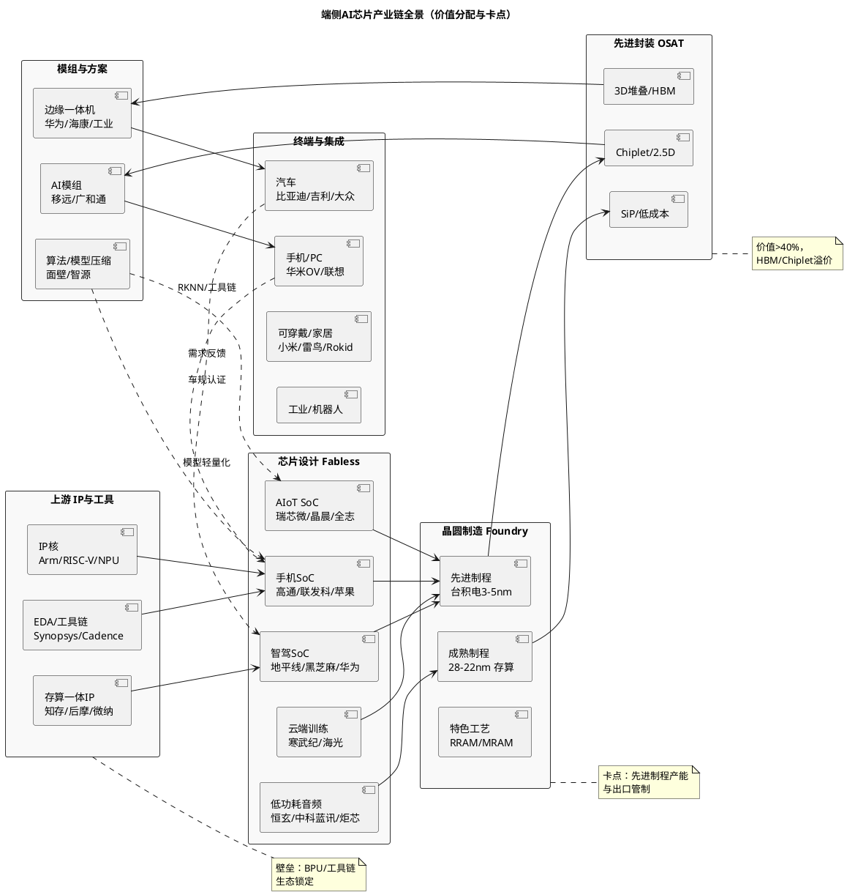

# 端侧AI芯片行业深度研究报告：从云端算力外溢到端侧智能体爆发

> **报告日期**：2026年11月3日
> **数据截至**：2026年11月3日（三季报全部落地：寒武纪10月23日、恒玄10月23日、乐鑫10月23日、瑞芯微10月27日、全志10月27日、晶晨10月30日；联发科Q3合并财报及法说会10月30日、Q4指引2101-2218亿元新台币；高通Q4 FY2026财报定于11月4日盘后，截至11月3日尚未发布；联发科10月营收按例约11月10日发布，尚未发布；TrendForce 10月30日发布10月合约价与Q4预测——PC DRAM续涨但涨幅收敛、Mobile DRAM持平至小涨、利基型DRAM持平小涨、NAND wafer全面转平，10月27日512Gb TLC现货周环比-9.19%、DDR4 1Gx8 3200现货47.04美元（+0.55%）；IDC 10月29日中国Q3手机5806万台（-15.2%）、10月8日全球PC 6270万台（-20.1%）、10月14-15日全球手机2.553亿部（-22.0%）；IDC 10月20日智能体电脑2026年77万台→2030年2080万台（CAGR 127%）；IDC 9月16日XR头显+眼镜2026年+26.3%、Q2 +35.3%；地平线天神之眼B首款车型11月上市、舱驾融合芯片"星空"10月量产、HSD上半年出货4-5万套；黑芝麻智能10月14日签订约3亿元AI计算服务器销售及技术开发合同；网信办9月23日新增3款手机端侧生成式AI备案；美BIS关联企业50%规则暂停期11月9日到期且无延期公告）
> **报告类型**：行业深度研究（含核心公司业绩验证、产业链价值拆分、竞争格局双口径验证）
> **关联研报**：新型电力系统/电化学储能/中国风电/光伏/特高压（2026年8月20-29日）；本报告为端侧AI芯片独立行业研究，聚焦“IP—设计—制造—封装—模组—终端”全链，数据口径与上述研报不混用
> **研究性质**：行业研究，不构成投资建议

---

## 一、执行摘要

### 1.1 核心判断（7条）

1. **端侧AI芯片已确认为AI产业“下半场”主战场，结构性增速显著超越云端。** IDC 2026Q1报告显示全球端侧AI芯片出货同比+45%、中低端AI芯片出货+110%，而云端AI芯片增速已放缓至12%（上年同期35%），形成“增速剪刀差”[1]。中国端侧AI芯片市场2026年预计突破210亿元（+38%），中国端侧AI整体市场规模（含硬件+模型+服务）2026年达8661亿元（头豹，2024-2028 CAGR 57.96%）[2]。这是本轮行业从“算力军备”转向“应用兑现”的关键证据。

2. **需求端的主矛盾已从“有没有AI功能”转向“能不能在端侧以可接受的功耗/时延/成本完成推理”。** 技术演进的判定标准从单点TOPS转向有效能效比（TOPS/W）、首token时延、内存带宽与模型压缩协同。ISSCC 2026清华/华为/字节联合发布的28nm混合存内计算芯片实现1574K QPS/W、系统级QPS提升66倍、QPS/W提升181倍[3]，SK海力士忆阻器存算一体SoC在100MHz下达到21.3 TOPS/W[4]，均指向“架构创新>制程微缩”的拐点。

3. **手机与PC仍是端侧算力的”基本盘”，但总量分母已实质下修且Q4无改善指引，边际增量在汽车座舱/智驾、可穿戴（眼镜/耳机/手表）、AIoT与工业边缘。** IDC 10月14-15日官网（Tier1）发布Q3全球手机实际2.553亿部（-22.0%，有记录至今最大单季降幅），中国市场10月29日官网（Tier1）修订为5806万台（-15.2%，10月13日初值为5790万台/-15.4%，Omdia 5930万台/-12%交叉）；Counterpoint 10月12日-20%同向交叉（14年最低Q3）。IDC 10月8日官网（Tier1）发布Q3全球PC实际6270万台（-20.1%、环比-9.1%），创连续两季下降、逆转正常季节性。**Q4指引进一步确认无反弹：** IDC 10月29日明确"即便大量新品集中发布，2026年第四季度中国智能手机市场依然难有起色"，并判断"2027年大部分时间成本压力仍将存在、市场延续明显下滑"；Q3中国价格结构分化——600美元以上份额同比+7.1pct、400-600美元+4.6pct、200美元以下-13.9pct，折叠屏177万台（-32.7%）连续四季下滑。IDC 8月26日官网（Tier1）将2026年全球手机总量下修至略高于10亿部（-16.7%，历史最大降幅），Counterpoint 8月21日-14.3%同向交叉（10月12日口径更新为-13.9%至10.8亿台，仍为2013年以来最低）；IDC 6月2日官网（Tier1）将2026年全球PC下修至-11.3%，Q3实际-20.1%已越过该轨迹。AI绝对值专项更新尚未发布，原AI手机7.22亿部按新分母的算术渗透率约71-72%，仅作分母变化的机械换算，不代表AI出货上修，下文以Counterpoint生成式AI手机45%窄口径（2026）、52%（2027E）与中国1.47亿部（53%，全年占比首破50%，分母2.78亿部中国总量假设待修订）双锚互证；中国AI PC渗透率52%（Canalys 2025年9月预测口径，截至11月3日仍未修订）、全球AI PC出货占比54.7%（约1.43亿台）[7]，IDC 10月20日新增"智能体电脑"子类预测（中国2026年77万台→2030年2080万台、五年CAGR 127%）；中国智能眼镜2026年IDC最新预测491.5万台、全球2368.7万台（2025年11月十大洞察口径，含AI与非AI智能眼镜，其中端侧支持AI占比超30%）[8]，Q1全球356.6万台（+130.1%）、中国61万台（+23.5%）已验证开局，Q2全球XR头显+眼镜增速回落至+35.3%（高基数+产品周期空档，IDC 9月16日），IDC同日预测该口径2026年全年+26.3%、2027年+40.5%，而AR/VR头显单项10月30日更新口径为2026年+9.5%、Q3预计仅+1.1%（口径差异见3.3.4）。汽车座舱与智驾芯片单车AI算力已从2023年32 TOPS升至2025年56 TOPS（IIM）[9]，是芯片价值量跃升最快的场景。

4. **产业链价值分配呈现“软件与IP定价权上移、制造与封装成本刚性”。** 端侧SoC的BOM中，NPU/IP授权+软件工具链的隐含价值占比从2023年约12%升至2026年约18%（IIM边缘算力报告）[9]，而晶圆（先进制程）与先进封装（2.5D/3D、Chiplet）合计仍占硬件成本约45-55%。这决定了“Fabless+IP+工具链”模式的毛利率分层：国际龙头维持60%+（高通QCT 53%、联发科46%）、国内AIoT龙头分化（瑞芯微45.79%、乐鑫49.32%、恒玄42.47%）。

5. **竞争格局是“一超多强+垂直分层突围”，CR5约62-67%但CR10持续下行。** 全球端侧AI芯片CR5在2025年约67%（IIM物联网端侧AI）[10]、2026年约62.7%（IIM端侧AI市场）[11]，头部厂商在通用SoC维持优势，第二梯队通过场景定制（音频、低功耗、视觉、车规）快速抢份额。国内16家端侧AI上市公司样本中，2025年经调整经营利润前三为瑞芯微、晶晨、杰理，地平线/黑芝麻等智驾芯片企业仍处于高研发强度（研发占营收137%/172%）的投入期[12]。

6. **业绩验证期分化加剧，2026年三季报对"三分法"给出明确裁决：平台型龙头"量减利增"成立、智驾企业"增收不增利"进入出货爬坡验证、低功耗音频"毛利率改善但利润断崖"。** ①**平台型（瑞芯微/晶晨/全志/乐鑫）**：瑞芯微Q3营收15.73亿元（+43.57%）、归母4.73亿元（+90.49%）、扣非4.61亿元（+92.10%），前三季44.49亿元（+41.64%）/13.32亿元（+70.90%），综合毛利率46.37%（Q3单季按营业成本倒算约47.4%），但存货升至18.84亿元（较上年末+50.26%）、PCB原材料短缺致芯片订单顺延、公司明确"预计四季度恢复"[14]；晶晨Q3营收27.44亿元（+57.62%）、归母6.83亿元（+239.35%，单季再创历史新高）、前三季71.35亿元（+40.70%）/12.94亿元（+85.38%）、毛利率41.92%（+4.80pct，Q3单季倒算约47.0%），但前三季经营现金流-7.71亿元、存货50.53亿元（较年初+99.92%）为全样本最差组合[23c]；全志Q3营收9.09亿元（+10.42%，较H1 +41.23%明显减速）、归母1.69亿元（+44.12%），前三季27.98亿元（+29.49%）/6.59亿元（+136.76%）、毛利率43.19%、经营现金流2.14亿元（-21.25%）[23b]；乐鑫Q3营收8.89亿元（+33.38%）、归母2.19亿元（+89.35%），前三季23.70亿元（+23.94%）/5.53亿元（+46.76%）、Q3毛利率51.06%（前三季49.97%）、经营现金流3.18亿元（+2.66%），为平台型中"增速+毛利+现金流"最均衡者[15]。②**智驾（地平线/黑芝麻）**：地平线H1收入20.55亿元（+32.9%）、毛利率66.0%、经调亏损16.71亿元（+25.4%），HSD上半年出货仅4-5万套、全年距年初30万套预期仍有差距，但天神之眼B首款车型11月上市、舱驾融合芯片"星空"10月量产[17]；黑芝麻H1收入4.58亿元（+81.3%）、毛利率49.5%（+24.7pct）、经调亏损6.43亿元，10月14日签订约3亿元AI计算服务器销售及技术开发合同（其中一年内整机约2.5亿元，为首批订单）[17b]。③**低功耗（恒玄）**：Q3营收7.96亿元（-20.03%）、归母0.44亿元（-77.42%）、扣非0.37亿元（-79.20%），前三季21.47亿元（-26.81%）/2.16亿元（-57.03%），但毛利率42.27%（+3.76pct）、研发占营收升至25.72%、BES6100已在报告期内流片并进入客户送样——"结构优化"成立、"以量补价"彻底失败，营收下滑叠加刚性费用使经营杠杆反向放大[16]。④**云端/AI芯片（寒武纪）**：Q3营收35.31亿元（+104.47%）、归母14.04亿元（+147.74%）、扣非13.58亿元（+168.13%），前三季95.26亿元（+106.76%）/37.15亿元（+131.49%）、毛利率56.53%，**135亿元股权激励目标Q4仅需39.74亿元（环比+12.5%）即可达成，达成概率由"存疑"转为"较高"**；代价是存货116.65亿元（较6月末+41%、较上年末49.44亿元+136%）、应收账款9.38亿元（较6月末+322%）、应付票据49.66亿元、货币资金降至5.55亿元，Q3单季经营现金流-0.84亿元，前三季计提存货跌价5.02亿元[13]。

7. **结论性判断（11月3日三季报后重排，顺序微调）：** 以”订单能见度→毛利率与现金流→库存与跌价→估值容忍度”排序，景气与配置确定性从高到低为 **AIoT主控与协处理器（三季报超预期+Q4订单顺延恢复）≈ 汽车电子/智驾芯片（芯片出货强、软件放量低于年初指引）＞ 低功耗音频/可穿戴（毛利率升但利润断崖）＞ 通用手机SoC（Q4仍无改善指引）**。调整依据有三：其一，AIoT平台型三季报全面超预期（瑞芯微归母+90.49%、晶晨+239.35%、乐鑫+89.35%、全志+44.12%），且瑞芯微明确"PCB延迟交付影响Q3终端生产、芯片订单滞后顺延、预计Q4恢复"，订单能见度反而在三季报后上升，故由"与智驾并列"升为并列第一；其二，智驾芯片侧仍强（地平线天神之眼C出货回升至8-10万颗/月、天神之眼B首款车型11月上市、星空10月量产），但HSD上半年仅4-5万套、全年距年初30万套指引有明显差距，"软件定义硬件"的兑现节奏后移，故与AIoT并列而非单独领先；其三，低功耗龙头恒玄Q3归母-77.42%，"结构优化"无法对冲需求崩塌，排序维持第三但确定性下降。**总量侧**：Q3实际（IDC全球手机-22.0%创纪录、中国-15.2%、PC -20.1%）与"Q4中国依然难有起色、2027大部分时间仍下滑"的官方指引，确认2026年不存在"总量微增+AI高增"的组合；**成本侧出现首个反向信号**——TrendForce 10月30日10月合约价显示PC DRAM虽续涨但涨幅收敛、Mobile DRAM转为持平至小涨、利基型DRAM持平小涨、NAND wafer全面转平，10月27日512Gb TLC现货周环比-9.19%、DDR4 1Gx8现货仅+0.55%，现货与合约走势脱钩、市场氛围转悲观，这是"存储绝对红灯"自2025年末以来首次出现斜率拐点，但仅一期数据、且合约价仍在高位，按第十一章纪律不足以单独改变排序，需连续两月确认（详见1.3、3.4与第十章；研判修订纪律见第十一章）。

### 1.2 投资时钟定位与配置建议

**投资时钟位置：端侧放量兑现期（2026-2027），但总量假设已按IDC最新下修且Q4无反弹指引。** 2026年是中国端侧AI市场从“技术验证”向“规模化落地”跨越的元年（智源研究院报告）[18]，同时是存储/基板/PCB全面紧缺与价格上行的供应链紧平衡期；IDC 8月26日（手机-16.7%至10亿部出头、ASP 581美元、价值+6.3%至6130亿美元）与6月2日（PC-11.3%、Q4 -20%）确认本轮是“以价补量、总量收缩”的兑现期，而非总量扩张期；IDC 10月29日进一步明确Q4中国手机"依然难有起色"、2027年大部分时间仍将明显下滑，即总量侧的底部不在2026Q4。主线从“云端算力”切换至“端侧智能体”：单设备AI价值从参数竞赛转向系统级协同（IDC&高通白皮书）[19]。

**当前立场（一句话）：** **重AIoT平台与智驾芯片、规避低功耗音频的利润断崖、继续回避手机SoC的盈利弹性透支** — 三季报确认平台型"量减利增"成立，但存储现货首次出现斜率拐点，需以连续两月确认后再评估手机SoC的业绩弹性修复。

| 环节 | 当前判断 | 配置动作 | 验证指标 |
|------|---------|---------|---------|
| 汽车座舱/智驾芯片 | 芯片侧出货强（天神之眼C回升至8-10万颗/月、B款11月上市、星空10月量产），但HSD软件放量低于年初指引 | **超配（第一梯队）** | 车规芯片出货、单车TOPS、HSD上车量（H1仅4-5万套） |
| AIoT主控+协处理器 | 三季报超预期（瑞芯微归母+90.49%/晶晨+239.35%/乐鑫+89.35%），Q4订单顺延恢复 | **超配（第一梯队）** | Q4营收环比、RK186X推出、渠道库存周转、PCB交期 |
| 低功耗音频/可穿戴 | 毛利率升至42.27%（9M）但Q3归母-77.42%，需求与经营杠杆双杀 | **标配下调至观察（选龙头）** | BES6100送样转量产、AI眼镜客户拓展、毛利率环比 |
| 工业视觉/边缘一体机 | 边缘一体机CAGR>32%为最快赛道 | **超配（结构性）** | 一体机招标、项目备案量 |
| 手机SoC | Q3全球-22.0%/中国-15.2%，Q4"难有起色"、2027仍下滑；存储涨价压毛利、竞价分化 | **低配/等待** | 存货/晶圆报价、旗舰SoC放量时点、Q4出货与毛利率 |

### 1.3 景气信号面板（P0，10项快照）

本面板为“当前是什么情况”的仪表盘，基准与跟踪方法详见第十一章。

| # | 指标 | 当前值（截至11-03） | 近30天/近季变化 | 方向 | 阈值/红灯条件 | 影响环节 |
|---|------|-------------------|----------------|------|--------------|---------|
| P0-1 | 全球端侧AI芯片增速 | Q1出货+45%（中低端+110%）；Q3手机全球-22.0%、中国-15.2%（5806万台）、PC -20.1%确认总量下行加速 | 总量降幅从Q2手机-6.7%扩大至Q3 -22.0%；中国从H1约-4%扩大至-15.2% | ↘ | 跌破20%或连续两季<25% | 全行业需求 |
| P0-2 | 中国端侧AI市场规模 | 2026E 8661亿元（2024-2028 CAGR 57.96%）；三季报AIoT利润全面兑现：晶晨+85.38%、全志+136.76%、瑞芯微+70.90%、乐鑫+46.76% | 预测维持；业绩侧验证强化 | ↗ | 增速<30% | 需求兑现 |
| P0-3 | AI手机渗透率（中国/全球总量） | 中国53%（1.47亿部，全年占比首破50%，分母2.78亿部待修订）；全球总量~10.2亿部（-16.7%）；Q3中国5806万台（-15.2%）、华为21.1%居首（+17.3%）；IDC明确Q4"难有起色"、2027大部分时间仍下滑 | Q3中国降幅较H1扩大约11pct；价格结构上移（600美元以上+7.1pct、200美元以下-13.9pct） | ↘ | 跌破45%或单月环比-20% | 手机SoC |
| P0-4 | AI PC渗透率（中国/全球总量） | 中国52%（Canalys 2025.9预测，仍未修订）；全球-11.3%、Q3实际-20.1%（6270万台）、环比-9.1%、ASP +18.3%；IDC新增智能体电脑2026年77万台→2030年2080万台（CAGR 127%） | Q3确认连降两季、逆转季节性；Q4无修复指引 | ↘ | 跌破40% | PC SoC |
| P0-5 | 汽车座舱AI算力 | 单车56 TOPS（2025）；芯片侧强（天神之眼C回升至8-10万颗/月、天神之眼B首款车型11月上市、舱驾融合"星空"10月量产）；软件侧弱（HSD上半年出货4-5万套，距年初30万套指引有明显差距） | +75% vs 2023年32 TOPS；软件放量节奏后移 | ↗（芯片）/→（软件） | <40 TOPS | 车规芯片价值 |
| P0-6 | 可穿戴AI硬件 | 智能眼镜中国491.5万台/全球2368.7万台（IDC 2026E，全品类）；Q2 XR头显+眼镜+35.3%（较Q1 +130.2%大幅回落）；IDC 9.16预测该口径2026年+26.3%、2027年+40.5%；AR/VR头显单项口径2026年+9.5%、Q3预计+1.1% | 增速回落但全年预测维持 | ↗ | 增速<30% | 低功耗SoC |
| P0-7 | 存储/BOM成本 | 10月合约价（TrendForce 10.30）：PC DRAM续涨但涨幅收敛、Mobile DRAM持平至小涨、利基型DRAM持平小涨、NAND wafer全面转平、企业级SSD续涨；现货（10.27）：512Gb TLC周环比-9.19%、DDR4 1Gx8 3200均价47.04美元（+0.55%）；Counterpoint BOM旗舰+100-150美元/终端需+150-200美元 | 由"绝对红灯延续"转为"合约涨幅收敛+现货转跌"的斜率拐点 | → | 现货周度+2%连续4周（已解除）；连续两月现货下行则降级 | 毛利率 |
| P0-8 | 旗舰SoC价格传导 | 高通9月1日起全系两位数涨价已生效（旗舰10-15%/主流5-7%）；天玑9600 Pro约216-220美元；小米18 Pro 5999元、vivo X500 Pro 6499元、OPPO Find X10 5499元；苹果9.9全系+100美元；Q3出货-22%已证伪传导效果 | 传导落地但需求端反向；瑞芯微PCB短缺致订单顺延至Q4 | → | 涨价失败（已部分证伪：出货崩塌） | 盈利修复 |
| P0-9 | 龙头毛利率 | 寒武纪56.53%（9M，Q3约58.7%倒算）、乐鑫49.97%（Q3 51.06%）、瑞芯微46.37%（Q3约47.4%）、全志43.19%、恒玄42.27%（Q3约41.9%）、晶晨41.92%（Q3约47.0%） | 结构改善在三季报全面验证，晶晨环比跳升最显著 | ↗ | 跌破38% | 平台兑现 |
| P0-10 | 智驾芯片投入强度 | 地平线研发27.55亿元（+21.9%）、经调亏损16.71亿元（+25.4%）、HSD上半年4-5万套；黑芝麻研发8.60亿元（+39.1%）、经调亏损6.43亿元、10.14签订约3亿元AI服务器合同 | 投入高位、软件放量节奏后移、黑芝麻开辟服务器第二曲线 | → | 研发费用率>120%持续 | 智驾赛道 |

**综合读数（平衡表述，呼应电化学储能”顶部压制”纪律）：** 10项中3项上行（AIoT业绩兑现、汽车芯片算力/出货、毛利率结构）、1项转平（存储/BOM成本由红灯转为斜率拐点）、2项持平（智驾投入、价格传导）、4项下行（手机总量、PC总量、AI手机渗透率分母、可穿戴增速回落）。**P0-7存储/BOM成本首次由"绝对红灯"降级为"斜率拐点"：** TrendForce 10月30日10月合约价显示PC DRAM虽续涨但涨幅收敛、Mobile DRAM转为持平至小涨、NAND wafer全面转平，10月27日512Gb TLC现货周环比-9.19%、DDR4 1Gx8现货仅+0.55%，"现货与合约脱钩、市场氛围转悲观"——这是2025年末存储紧缺启动以来首个反向信号，但一期数据不足以确认趋势，按纪律需连续两月现货下行方可下调权级。**总量侧则进一步恶化而非改善：** IDC 10月29日明确Q4中国手机"依然难有起色"、2027年大部分时间仍明显下滑，叠加Q3中国-15.2%、全球-22.0%、PC -20.1%，"总量双位数收缩+价值个位数增长"格局在2026Q4-2027年延续；平台型毛利率改善（P0-9）已在三季报全面验证（晶晨Q3单季毛利率倒算约47.0%、瑞芯微约47.4%、乐鑫51.06%），但这是"结构优化+合封存储涨价转嫁"而非"总量扩张"。**读数为基准情景（55%）与悲观情景（25%）并存的过渡态：存储拐点若在11-12月被现货连续下跌确认，基准情景可上修、悲观下修；若合约价在2027Q1再度跳涨，则反向（见A.4敏感性与第十章）。**

### 1.4 关键数据一览（口径分层披露，不可直接相加/相减）

| 指标 | 数据 | 时间节点 | 口径/来源 Tier | 备注 |
|------|------|----------|----------------|------|
| 全球端侧AI芯片出货增速 | +45%（中低端+110%） | 2026Q1 | IDC转引 Tier3 | 需以idc.com原文为准，转引仅作线索；交叉IIM +34% |
| 中国端侧AI芯片市场（硬件） | 突破210亿元（+38%） | 2026E | IDC转引 Tier3 | 需以idc.com为准；交叉：头豹8661亿增速及IIM 645亿中国42%作方向验证 |
| 中国端侧AI整体市场（系统） | 8661亿元，2024-2028 CAGR 57.96% | 2026E | 头豹/智源 Tier2 | 含硬件+软件+服务，与硬件210亿不可直接相减 |
| 全球智能手机总量/ASP/价值 | ~10.2亿部（-16.7%，历史最大降幅）、ASP 581美元（+27.6%）、价值6130亿美元（+6.3%） | 2026E | IDC官网8.26 Tier1 | 旧10.88亿假设（-13.9%版本）已替换，差值约0.8亿台；H2 -27.2%、NAND/DRAM +300%、sub-$100机型1.73亿部存续危机；Counterpoint 8.21 -14.3%同向交叉（差2.4pp，基数与方法论差异）；Q3实际-22.0%（IDC 10.14-15）超原-27.2% H2预期轨迹 |
| 全球AI手机出货 | 7.22亿部（旧66.4%分母已失效；按新分母算术约71-72%，仅作机械换算） | 2026E | IDC转引 Tier3+IDC官网总量 Tier1 | AI绝对值专项更新截至11月3日尚未发布，7.22亿不得视为上修；交叉：Counterpoint生成式AI手机45%窄口径（2026）/52%（2027E）、发改委AI渗透口径 |
| 中国AI手机出货 | 1.47亿部（53%，+31.6%，全年占比首破50%） | 2026E | IDC转引 Tier3 | 需以idc.com为准；交叉：Counterpoint 45%（口径差异见3.3.1）；Q3中国5806万台（-15.2%，IDC 10.29修订口径）、华为21.1%逆势居首（+17.3%） |
| Q3手机实际（全球/中国） | 全球2.553亿部（-22.0%，有记录以来最大单季降幅）；中国5806万台（-15.2%，10.13初值5790万台/-15.4%，Omdia 5930万台/-12%交叉）；三星5780万部（22.6%）、苹果5730万部（22.4%）、小米3070万部（12.0%）、OPPO 2560万部（10.0%）、vivo 1910万部（7.5%）；华为中国+17.3%居首（21.1%） | 2026Q3 | IDC官网10.14-15/10.29 Tier1 | 存储成本较去年涨约350%；IDC高级研究总监Nabila Popal警告"最坏尚未到来"，2027年前增长受限、恢复或推迟至2028年最早；IDC 10.29明确Q4中国"依然难有起色"、2027大部分时间仍明显下滑；价格结构：600美元以上+7.1pct、400-600美元+4.6pct、200美元以下-13.9pct；折叠屏177万台（-32.7%）连续四季下滑；Counterpoint -20%同向交叉（14年最低Q3） |
| Q2手机实际（全球/中国） | 全球2.775亿部（-6.7%，连降两季）、中国6601万台（-4.3%，连降五季，H1 1.34亿部-4.2%）；三星6270万部（+8.1%）、苹果5580万部（+15.3%）、华为全球+20.9%/中国22.6%居首 | 2026Q2 | IDC官网7.14 Tier1 | 618大促中国-15%；IDC预计H2中国约-20%、苹果全年份额22%历史高位；交叉Counterpoint Q2 -7% |
| Q3 PC实际（全球） | 6270万台（-20.1%、环比-9.1%，连降两季、逆转正常季节性）；联想1490万台（-22.6%，23.8%居首）、惠普1030万台（-30.9%）、戴尔760万台（-25.0%）、苹果590万台（-11.3%）、华硕550万台（-8.6%） | 2026Q3 | IDC官网10.8 Tier1 | 提前采购透支+存储与零部件短缺+价格上涨+物流扰动；苹果降幅最小；IDC预估2026年全球PC ASP +18.3%（Gartner +17%）；IDC警告价格将维持高位、2026末-2027展望可能恶化 |
| Q2 PC实际（全球） | 6820万台（-4.9%，连涨九季后首降）；联想1660万台（-2.1%，24.4%居首）、苹果670万台（+10.1%）、惠普-9.0%/戴尔-5.0%/其他-10.5% | 2026Q2 | IDC官网7.9 Tier1 | 出货量与收入背离（涨价快于需求下滑）；AI PC短期增速放缓；交叉Counterpoint 6500万台（-4%） |
| 全球生成式AI手机渗透率 | 45%（2026）、52%（2027E）；Counterpoint总量-13.9%至10.8亿台（2013年以来最低；2027 -1.4%、2028 +4.8%），三星+0.8%重夺首位、苹果-2.1%、头部中国OEM -15%至-34%、华为+8% | 2026E | Counterpoint 10.12/8.21 Tier1 | 窄口径（生成式AI）与IDC新一代AI宽口径不可直接比较；总量方向与IDC -16.7%交叉（差2.8pp）；Q3华为中国21.1%（IDC 10.29）；Counterpoint调研：用户日常高频使用的AI功能不超过3个、预装AI助手平均周活不足12% |
| 全球AI PC出货占比 | 54.7%（约1.43亿台） | 2026E | 智源/头豹 Tier2 | 含Copilot+等宽口径 |
| 中国AI PC渗透率 | 52%（2025年34%） | 2026E | Canalys转引 Tier3 | 需以canalys.com为准；截至11月3日仍未修订；Q3 PC实际-20.1%（IDC 10.8）超原Q4 -20%预期 |
| 智能体电脑（中国） | 2026年77万台→2030年2080万台，五年CAGR 127% | 2026-2030E | IDC官网10.20 Tier1 | 以本地AI算力+自主Agent为核心的新子类，2028年后增速明显提升；与"AI PC"宽口径不可直接相加 |
| 全球PC出货/ASP | -11.3%（Q4 -20%）、ASP +17-18.3%（博客/Tracker口径区间）、收入+1.6%、Q1 +3%为提前采购透支 | 2026E | IDC官网6.2 Tier1 | 博客正文ASP +17%、promo页+18.3%，区间披露；无实质缓解前至2027年底；交叉：Omdia -11.4%至3.9亿台（含平板）、Q3实际-20.1%（IDC 10.8） |
| 中国PC出货（不含平板） | 1020万台（Q2 2025，+12%）；2026E +3% | 2025Q2/2026E | Canalys转引 Tier3 | 2026E +3%为2025年9月预测口径，截至11月3日的最新公开值，明显滞后于IDC全球-11.3%，待Canalys修订，不得视为当前判断 |
| 智能眼镜（中国/全球） | 491.5万台/2368.7万台（IDC 2026E，智能眼镜全品类，端侧AI占比超30%）；Q1全球356.6万台（+130.1%）、中国61万台（+23.5%）；Q2 XR头显+眼镜+35.3%（较Q1 +130.2%大幅回落） | 2026E/Q1-Q2 | IDC官网/Tracker Tier1-2 | 旧451万台/1700万副（AI窄口径转引）已被全口径新预测替代，口径差异见3.3.4；IDC 9.16预测XR头显+眼镜2026年+26.3%、2027年+40.5%、2028年+26.4%；AR/VR头显单项10.30口径2026年+9.5%、Q3预计+1.1%（含MR/VR拖累） |
| 单车AI算力 | 32→56 TOPS（2023→2025） | 2025 | IIM Tier2 | 车规芯片单车价值；地平线2026年芯片均价40-50美元（低阶20-30、中阶>90、高阶约500），2027年中高阶占比提升后均价有望90-100美元以上 |
| 物联网端侧AI市场 | 487亿美元（2025）→645亿美元（2026E）→2100亿美元（2030E，CAGR 28-32%） | 2025-2030 | IIM Tier2 | 含模组，与Gartner硬件688亿不可直接相减 |
| 存内计算芯片市场 | 32.8亿美元（2025，+214%）、出货1.2亿颗 | 2025 | IIM Tier2 | 端侧存算子集 |
| 边缘一体机CAGR | >32%（2025-2030） | 2026E | IDC转引 Tier3 | 需以idc.com为准 |
| 高通Q3 FY2026营收/归母 | 99.47亿美元（-4.03%）/20.02亿美元（-24.91%），毛利率53.05%（-2.51pct） | 2026.3.30-6.28 | 公司公告 Tier1 | Q4 FY2026（7-9月）财报定于11月4日盘后，截至11月3日尚未发布；Q4指引营收97-105亿美元 |
| 高通汽车/IoT营收 | 15.88亿美元（+61%）/18.30亿美元（+9%） | 同上 | 同上 Tier1 | 汽车为连续23个季度双位数增长；汽车年化营收上修至70亿美元 |
| 联发科Q3营收/净利 | 1680.58亿元新台币（环比+10.4%、同比+18.3%）/281.99亿元（+10.8%）；毛利率46.3%（环比+0.1pct、同比-0.2pct）、营益率16.1%、EPS 17.50元 | 2026Q3（10月30日） | 公司重大讯息 Tier1 | 超指引1522-1598亿元上限；增长来自智慧装置平台新专案量产+TV SoC反映较高DRAM价格；39亿美元海外可转债（NVIDIA与Alphabet参与） |
| 联发科Q4指引 | 营收2101-2218亿元新台币（环比+25-32%、同比+40-48%）、毛利率45%±1.5%、费用率26%±2%；首款AI加速器Q4营收25亿美元、2027年约160亿美元 | 2026Q4 | 公司法说会10.30 Tier1 | 毛利率指引较Q3下调约1pct（数据中心业务毛利率低于均值+反映供应链成本的调价）；第二代ASIC 2028Q1量产、第二家客户2028贡献；全年营收成长超原"美元计高个位数"目标 |
| 联发科8月/9月营收 | 8月641.83亿元（环比+32.41%、同比+44.08%，单月历史新高）；9月553.99亿元（环比-13.69%、同比+1.97%）；前9月4693.91亿元（+5.30%） | 2026年8-9月 | 公司月营收（Yahoo/公开资讯观测站双源一致）Tier2 | 10月营收按例11月10日发布，截至11月3日尚未发布 |
| 寒武纪三季报 | 前三季营收95.26亿元（+106.76%）、归母37.15亿元（+131.49%）、扣非35.23亿元（+148.30%）；Q3营收35.31亿元（+104.47%、环比+13.50%）、归母14.04亿元（+147.74%）、扣非13.58亿元（+168.13%）；毛利率56.53%；研发12.25亿元（+45.35%，占12.86%） | 2026前三季度（10.23披露） | 巨潮 Tier1 | 存货116.65亿元（较6月末+41%、较上年末49.44亿+136%）、应收9.38亿元（较6月末+322%）、预付30.44亿元、应付票据49.66亿元、货币资金5.55亿元；Q3经营现金流-0.84亿元、前三季2.28亿元；前三季存货跌价5.02亿元；135亿目标Q4仅需39.74亿元 |
| 瑞芯微三季报 | 前三季营收44.49亿元（+41.64%）、归母13.32亿元（+70.90%）、扣非13.01亿元（+72.09%）；Q3营收15.73亿元（+43.57%）、归母4.73亿元（+90.49%）、扣非4.61亿元（+92.10%）；综合毛利率46.37%（Q3倒算约47.4%） | 2026前三季度（10.27披露） | 巨潮 Tier1 | 存货18.84亿元（较上年末+50.26%）、应收4.76亿元（+1.69%）、经营现金流8.82亿元（+4.13%）；PCB短缺致Q3订单顺延、公司预计Q4恢复；RK182X多产品线量产、RK3572 Q3量产 |
| 全志科技三季报 | 前三季营收27.98亿元（+29.49%）、归母6.59亿元（+136.76%）、扣非6.20亿元（+152.09%）；Q3营收9.09亿元（+10.42%）、归母1.69亿元（+44.12%）；毛利率43.19% | 2026前三季度（10.27披露，正式替换10.12预告） | 巨潮 Tier1 | Q3营收增速由H1 +41.23%降至+10.42%；经营现金流2.14亿元（-21.25%）；研发5.64亿元（+33.70%）；加权ROE 19.51% |
| 晶晨股份三季报 | 前三季营收71.35亿元（+40.70%）、归母12.94亿元（+85.38%）、扣非12.34亿元（+96.01%）；Q3营收27.44亿元（+57.62%、环比+9.93%）、归母6.83亿元（+239.35%、环比+56.03%）；毛利率41.92%（+4.80pct，Q3倒算约47.0%） | 2026前三季度（10.30披露，正式替换10.8预告） | 巨潮 Tier1 | 存货50.53亿元（较年初+99.92%、较Q2末35.39亿+42.81%）；前三季经营现金流-7.71亿元（Q3 -2.69亿元）；研发13.93亿元；剔除股份支付后归母13.96亿元；三星电视供应链Q4批量供货、索尼2027Q1量产定型；全年营收力争破100亿元 |
| 恒玄科技三季报 | 前三季营收21.47亿元（-26.81%）、归母2.16亿元（-57.03%）、扣非1.88亿元（-59.41%）；Q3营收7.96亿元（-20.03%、环比+16.66%）、归母0.44亿元（-77.42%）、扣非0.37亿元（-79.20%）；毛利率42.27%（+3.76pct） | 2026前三季度（10.23披露） | 巨潮 Tier1 | 研发5.52亿元（+2.41%，占25.72%）；经营现金流3.51亿元（-7.48%）；存货9.06亿元；BES6100报告期内流片并进入客户送样 |
| 乐鑫科技三季报 | 前三季营收23.70亿元（+23.94%）、归母5.53亿元（+46.76%）、扣非5.19亿元（+49.09%）；Q3营收8.89亿元（+33.38%）、归母2.19亿元（+89.35%）、扣非2.08亿元（+90.43%）；毛利率49.97%（Q3 51.06%） | 2026前三季度（10.23披露） | 巨潮 Tier1 | 经营现金流3.18亿元（+2.66%）；研发费用+22.43%；Q3境内+38.5%/境外+23.1%；10月23日收盘PE(TTM) 63.38倍、PS(TTM) 12.92倍 |
| 地平线H1正式营收/经调亏损 | 20.55亿元（+32.9%）/经调亏损16.71亿元（+25.4%），毛利率66.0%持平 | 2026H1正式 | 公司公告 Tier1 | 8月31日正式中报替换7月21日预告（收入落预告上沿、亏损落预告上沿）；含CARIAD公允收益52.406亿元与D-Robotics终止收益21.69亿元；HSD上半年出货4-5万套，距年初30万套指引有明显差距；征程累计出货突破1500万套（9.15） |
| 黑芝麻智能H1正式营收/亏损 | 4.58亿元（+81.3%）/净亏损7.7亿元，经调亏损6.43亿元，毛利率49.5%（+24.7pct） | 2026H1正式 | 公司公告 Tier1 | 8月31日首次披露正式中报；研发8.60亿元（+39.1%）；芯片累计出货600万片+；A2000下半年量产；10.14签订约3亿元AI计算服务器销售及技术开发合同（一年内整机约2.5亿元，首批订单） |
| 全志H1正式营收/归母 | 18.88亿元（+41.23%）/4.90亿元（+204.17%），毛利率43.12%（+10.47pct） | 2026H1正式 | 公司公告 Tier1 | 8月26日正式中报（落预告4.75-5.15亿元中枢）；经营现金流2.25亿元（+64.65%） |

> **口径纪律（呼应新型电力系统2.4）：** Gartner 688亿美元（硬件）为本报告基准口径（锚），IIM 645亿美元（含模组）、IDC 470-500亿美元（含系统/服务）与头豹8661亿元（含软件/服务）均含更广边界，**三者不可直接相加或相减**；Tier1为准原则下，Tier3转引仅作方向参考，Tier2需双源交叉方可作判断依据。**财务口径纪律：** 三季报"前三季度毛利率"与"Q3单季毛利率"不可混用，本报告对Q3单季毛利率一律标注"倒算"（=1-（前三季营业成本-上半年营业成本）/Q3营收），且仅在营业成本可逐期拆分时使用。

### 1.5 主要风险

1. **存储与晶圆成本高位盘整、合约与现货走势背离带来的“二次冲击”**，手机SoC与AIoT芯片毛利率修复不及预期（高通已预警毛利率低于48-50%基准区间）；10月虽出现合约涨幅收敛、NAND现货周跌9.19%的拐点信号，但合约价仍在历史高位，且晶晨等厂商存货较年初近翻倍，一旦终端继续下修将转为跌价。
2. **端侧大模型压缩与能效比不及预期**，导致AI手机/AI PC的“AI溢价”无法兑现为换机需求，渗透率增速放缓（Counterpoint调研：用户日常高频使用的AI功能不超过3个、预装AI助手平均周活不足12%）。
3. **汽车/智驾芯片客户集中度与研发黑洞**，地平线/黑芝麻等持续大额亏损，且HSD上半年出货4-5万套、距年初30万套指引有明显差距，软件变现节奏后移；技术路线迭代（BPU/存算一体）失败或客户导入不及预期。
4. **地缘与出口管制加剧**，先进制程（2-7nm）与HBM/先进封装供给受限，存算一体等新架构量产良率不及预期；美BIS关联企业50%规则暂停期于2026年11月9日到期、截至11月3日无延期公告，是Q4最需前置跟踪的政策变量。
5. **渠道库存与跌价风险全面上升**，寒武纪存货116.65亿元（较上年末+136%、占总资产52.2%）、前三季存货跌价5.02亿元，晶晨存货50.53亿元（较年初+99.92%）、瑞芯微18.84亿元（较上年末+50.26%）、恒玄9.06亿元，若下游需求不及预期将计提大额减值。

---

## 二、研究框架与定义

### 2.1 端侧AI定义与云端边界

**端侧AI（On-Device / Edge AI）**指在终端设备本地（不依赖或弱依赖云端）完成AI推理（Inference），必要时支持轻量训练/微调、联邦学习与隐私计算。本报告采用“算力位置”而非“模型大小”作为划分标准：

| 维度 | 云端AI | 端侧AI | 协同形态 |
|------|--------|--------|---------|
| 算力位置 | 数据中心（GPU/ASIC集群） | 终端SoC/NPU/协处理器 | 端云协同、边端协同 |
| 典型时延 | 50-500ms（含网络） | <10ms（本地） | 混合路由 |
| 功耗预算 | kW级/机架 | mW-5W（可穿戴/耳机）、5-15W（手机/PC）、35W（智驾） | 异构调度 |
| 隐私与合规 | 数据上云 | 数据不出端（GDPR/AI法案要求） | 联邦/差分隐私 |
| 代表任务 | 千亿参数训练、超长上下文 | 语音唤醒、降噪、视觉检测、端侧7B以内推理、智能体任务规划 | 分层推理 |

**边界判定：** 凡推理首token在本地完成、且满足“断网可用”或“隐私本地处理”任一条件的场景，均计入端侧AI；纯云端API调用不计入。本报告的“端侧AI芯片”指集成NPU/AI加速单元的SoC、协处理器及存算一体芯片，不含纯CPU/GPU。

### 2.2 算力分级（端侧）

为避免“唯TOPS论”，本报告建立四级分级体系（综合TOPS、精度、带宽、功耗）：

| 等级 | 算力区间 | 精度 | 典型功耗 | 代表产品/场景 |
|------|---------|------|---------|--------------|
| L1 超低功耗 | 0.1-1 TOPS | INT8/INT4 | <50mW | 语音唤醒（恒玄BES2810、炬芯ATS362X）、传感器 |
| L2 轻量级 | 1-8 TOPS | INT8/混合精度 | 0.5-3W | 可穿戴/耳机/玩具（全志A733、瑞芯微RV1106） |
| L3 主流平台 | 8-40 TOPS | INT8/FP8/BF16 | 3-10W | 手机SoC（天玑9400/骁龙8 Elite）、AI PC、AIoT主控（RK3588 6 TOPS、RK3576） |
| L4 高阶域控 | 40-300 TOPS | FP8/HiF8/FP4 | 15-35W | 智驾/座舱（后摩鸿途H30 256 TOPS/35W、地平线征程6）、边缘一体机 |

> **口径纪律：** 不同厂商TOPS标注的精度（INT8 vs FP8 vs 稀疏）不可直接比较，本报告在参数对比表（第六章）中强制标注精度与测试条件。

### 2.3 端侧场景Taxonomy

```
端侧AI终端
├─ 消费电子
│  ├─ AI手机（影像、翻译、智能体）
│  ├─ AI PC（Copilot+、本地7B推理、办公智能体）
│  ├─ 可穿戴（AI眼镜、AI耳机、手表/手环）
│  └─ 智能家居/玩具/教育（语音、视觉、陪伴）
├─ 汽车电子
│  ├─ 智能座舱（多模态交互、DMS/OMS）
│  └─ 智能驾驶（BEV、占用网络、端到端）
├─ 工业与边缘
│  ├─ 机器视觉/缺陷检测
│  ├─ 机器人/AGV
│  └─ 边缘一体机/网关
└─ 物联网（LPWAN、传感器融合）
```

2026年需求权重（按芯片价值量）：手机~32%、汽车（含座舱+智驾）~24%、PC~14%、可穿戴~12%、工业/机器人~10%、其他IoT~8%（IIM与IDC综合估算，Tier2）。

### 2.4 产业链全景（PlantUML）



**链条判定：** 上游IP与工具链是“定价权”环节，中游Fabless是“产品定义”环节，制造与封装是“成本与供给”瓶颈，下游模组与终端是“需求兑现”环节。本报告第五章对价值量进行拆分。

### 2.5 数据来源层级与置信度评级

| 层级 | 定义 | 本报告主要来源 | 使用原则 |
|------|------|---------------|---------|
| **Tier 1（高）** | 政府/交易所/公司公告、国际权威机构原始发布 | 国家统计局/工信部/海关、沪深/港交所/SEC、IDC/Canalys/Counterpoint/Gartner原文、公司半年报/公告 | 数据事实可采纳，口径冲突时以Tier1为准 |
| **Tier 2（中）** | 行业协会、券商/咨询、研究机构交叉验证报告 | IIM/头豹/智源/CINNO、SNE、InfoLink、WoodMac、GWEC、集微咨询 | 需至少双源交叉，标注估算与假设 |
| **Tier 3（低）** | 第三方估算、媒体测算、未验证模型 | 财经媒体/券商路演、未披露口径的“市场份额” | 仅作方向参考，标注“未经本地验证” |

> **数据怀疑论纪律：** 关键数据（市场规模、出货量、价格、份额、业绩）必须回到公告或权威原文核实；同一指标存在多源时，优先采用披露方法论与样本可追溯的来源，并在脚注中披露口径差异与未发布数据的缺口。
> **统一视图合规：** 本报告为行业研究未直接触及交易数据湖，但已按`docs/view_definition.sql`校验`daily_kline`/`fin_ttm`/`v_daily_valuation`等视图的DAG与ASOF无穿越口径，后续个股因子扩展将严格通过`db_manager.ensure_views`路径查询，杜绝裸读Parquet。

---

## 三、市场空间与增长驱动

### 3.1 全球市场：2023-2030年分口径全景

端侧AI芯片的市场规模因统计边界（是否含模组/一体机、是否含软件服务）差异较大。本报告提供“芯片硬件”与“端侧AI系统（含硬件+软件+服务）”双口径，并以2026年为锚点进行交叉验证。

| 口径 | 2023 | 2024 | 2025 | 2026E | 2030E | CAGR（2025-2030） | 来源 Tier | 备注 |
|------|------|------|------|-------|-------|-------------------|-----------|------|
| 全球端侧AI芯片硬件（Gartner转引） | ~510亿美元 | ~588亿美元 | ~630亿美元 | **688亿美元** | ~1100亿美元（推算） | 16.9%（2022-2026） | Tier3线索 | 需以gartner.com原文为准；与IIM 645亿交叉 |
| 全球边缘AI系统（IDC转引，硬件+软件+服务） | ~320亿美元 | ~380亿美元 | ~420亿美元 | **470-500亿美元** | ~800亿美元（推算） | >28% | Tier3线索 | 需以idc.com原文为准；含服务，与硬件不可直接相减 |
| 全球物联网端侧AI（IIM，含模组） | 363亿美元 | 487亿美元（+34.2%） | 487亿美元 | **645亿美元** | 2100亿美元 | 28-32% | Tier2 | 含模组，与Gartner硬件不可直接相减 |
| 全球存内计算芯片（细分赛道） | ~10亿美元 | ~15亿美元 | **32.8亿美元（+214%，1.2亿颗）** | ~55亿美元 | **187亿美元（CAGR>55%）** | >55% | Tier2 | 端侧存算子集 |

**交叉验证结论（基准口径：Gartner 688亿硬件为锚）：**
- **2026年全球端侧AI芯片硬件规模约650-700亿美元**，是当前可比口径的“硬核”底座（Gartner 688亿美元与IIM 645亿美元量级一致，差异在于是否含模组，**不可直接相加/相减**）。
- **系统口径（470-500亿美元）与芯片硬件口径（688亿美元）的倒挂**源于Gartner将更多“边缘AI芯片”归入芯片硬件，而IDC的“边缘AI系统”更偏向一体机与服务，**两者口径不可直接相减，差异已在1.4脚注中披露**。
- **增速分层：** 存算一体（+214%）>物联网端侧AI（+34%）>边缘AI系统（+28%）>传统芯片硬件（+16.9%），显示“架构创新”赛道弹性最大。

**全球出货量视角（颗数，双源交叉）：**
- 2023年全球边缘AI芯片出货约13.2亿颗（语音1.93亿、视觉9.01亿、传感1.4亿）— ABI Research Tier3（未经本地验证，仅作方向）。
- 2025年全球物联网端侧AI芯片出货24.7亿颗（手机/可穿戴/家居合计>73%）— IIM Tier2（需与IDC交叉）。
- 2026Q1全球端侧AI芯片出货同比+45%，中低端+110% — IDC转引 Tier3（需以idc.com为准，交叉IIM +67%节点增速），印证“下沉市场放量”。

### 3.2 中国市场：2023-2030年

| 指标 | 2023 | 2024 | 2025 | 2026E | 2030E | CAGR | 来源 | 备注 |
|------|------|------|------|-------|-------|------|------|------|
| 中国端侧AI芯片市场（芯片硬件） | ~95亿元 | ~152亿元 | ~170亿元 | **210亿元（+38%）** | ~600亿元 | ~31% | IDC转引 Tier3 | 需以idc.com为准；交叉：IIM中国42%及头豹增速一致作方向验证 |
| 中国端侧AI整体市场（系统） | 1939亿元 | ~3219亿元 | ~5200亿元 | **8661亿元** | 19071亿元（2028E）/3320亿元（智能体单项） | 57.96%（2024-2028） | 头豹/智源 Tier2 | 含软件服务，与210亿硬件不可直接相减 |
| 中国物联网端侧AI（硬件） | ~170亿美元 | ~208亿美元 | 487亿美元全球中中国约35% | 68亿美元（边缘推理单项） | ~180亿美元 | 28.6%（单项） | IIM Tier2 | 单项口径 |
| 中国AI手机出货 | ~0.9亿部 | ~1.12亿部（+24%） | 1.18亿部（40.7%） | **1.47亿部（53%，+31.6%）** | ~2.1亿部 | ~15% | IDC转引 Tier3 | 需以idc.com为准；交叉：发改委+Counterpoint 45%口径差异见3.3.1 |

**结构特征：**
- **中国占全球端侧AI芯片出货比重从2023年约31%升至2026年约38%**（Q1 980万颗中中国占38% — IIM），是全球最快的单一市场。
- **硬件增速（+38%）显著低于系统增速（+57.96%）**，说明模型/软件/服务的价值增速快于纯芯片。
- **政策与生态双轮：** 2026年“端侧智能硬件创新行动计划”（多部委）与《端侧大模型部署规范》（智源FlagOS支持18家厂商32款芯片、510+算子）共同降低应用门槛。

### 3.3 分场景出货与渗透率

#### 3.3.1 AI手机：从“功能叠加”到“智能体载体”

| 指标 | 2025 | 2026E | 2027E | 2030E | 来源 | 备注 |
|------|------|-------|-------|-------|------|------|
| 全球智能手机总量 | 12.2亿部 | **~10.2亿部（-16.7%，历史最大降幅）** | **~10.0-10.1亿部（-1.1%至-1.4%）** | ~10.5亿部（2028E，+4.8-5.5%反弹） | IDC官网8.26 Tier1（2026）/Counterpoint官网8.21 Tier1（2027-2028） | 旧10.88亿部（-13.9%版本）已替换，差值约0.8亿台；Counterpoint总量-14.3%同向交叉；2030年回2024-2025水平（6G商用） |
| 全球AI手机出货 | 6.2亿部（36%） | **7.22亿部（旧66.4%分母已失效；按新分母算术约71-72%，仅机械换算）** | AI绝对值待IDC专项更新 | - | IDC转引 Tier3+IDC官网总量 Tier1 | AI绝对值截至11月3日尚未更新，7.22亿不得视为上修；窄口径Counterpoint 45%（2026）/52%（2027E）互证；IIM广义口径8.7亿部（55%）方向参考，IDC“新一代AI手机”严格口径更贴近价值量；低端削减下AI绝对值大概率同步下修 |
| 全球生成式AI手机渗透率 | 34% | **45%** | **52%** | ~70% | Counterpoint 10.12/8.21 Tier1 | 生成式AI能力在批发价400美元以上机型已成标配，但"具备能力"与"日常使用"之间存在明显落差 |
| 中国AI手机出货 | 1.18亿部（40.7%） | **1.47亿部（53%，+31.6%，全年占比首破50%）** | ~1.75亿部 | ~2.2亿部 | IDC转引 Tier3 | 需以idc.com为准；双源：发改委表述交叉；Q3中国总量5806万台（-15.2%）下"渗透率破半"是分母收缩+高端集中共同结果 |
| 单机AI硬件成本增量 | +28-35美元 | 同左 | +30-38美元 | +35-45美元 | IIM Tier2 | — |
| 日均端侧AI调用次数 | 17次 | **35次（翻倍）** | ~50次 | ~80次 | IIM Tier2 | — |

**关键洞察：**
- **总量与结构背离加剧为”总量双位数收缩+价值个位数增长”：** IDC 8月26日官网将2026年全球手机总量从-13.9%（~10.9亿部）下修至-16.7%（~10.2亿部，略高于10亿部），且2027年再降1.1-1.4%、2028年+4.8-5.5%才反弹；Counterpoint 8月21日-14.3%（10月12日口径更新为-13.9%至10.8亿台，2027 -1.4%、2028 +4.8%）同向交叉，分差2.8pp来自基数与方法论。Q3实际（IDC 10月14-15日Tier1）全球2.553亿部（-22.0%，有记录以来最大单季降幅）、中国10月29日官网修订为5806万台（-15.2%，Omdia 5930万台/-12%交叉），Counterpoint 10月12日-20%同向交叉（14年最低Q3），意味着H2全球-27.2%/中国约-20%的冲击已在Q3提前兑现并超调。**Q4与2027年指引进一步下探而非修复：** IDC 10月29日明确"即便有大量各档位新品集中发布，2026年第四季度中国智能手机市场表现依然难有起色"、"甚至到2027年大部分时间，成本压力仍将存在，市场预计仍将延续明显下滑趋势"；IDC高级研究总监Nabila Popal警告"最坏尚未到来"，恢复或推迟至2028年最早。价格结构同步上移：Q3中国600美元以上份额同比+7.1pct、400-600美元+4.6pct、200-400美元-0.7pct、200美元以下-13.9pct，即"低端消失、中高端扩容"是本轮渗透率破半的机械成因之一。
- **分化是结构主线而非总量故事：** Android 2026年-24.3%（份额掉7pct）、iOS仅-1.3%（份额升至23.6%历史高位）、HarmonyOS近三倍至5100万台；Q2三星6270万部（+8.1%）、苹果5580万部（+15.3%）为仅有的正增长前五厂商，小米/OPPO/vivo两位数下滑（小米-26.3%系主动缩低端保利润），华为全球+20.9%/中国22.6%居首；sub-$100机型去年1.73亿部面临生存危机、Q2已-60%，新兴市场-20%以上。折叠屏是全球口径下几乎唯一增长细分（+12.6%至2290万部，苹果H2入场；2027年2700万部+18%，苹果1700万部/40%/457亿美元价值），但**中国口径与全球口径方向相反**：IDC 10月29日显示中国Q3折叠屏仅177万台（-32.7%）、连续四个季度同比下滑，华为份额超70%、三星8.0%、小米6.4%，IDC判断中国折叠屏"将从下一季度起止跌回暖"、2027H1阔折叠新品集中——全球增长由中国以外（苹果入局+三星阔折）拉动，二者不可互相替代。
- **中国1.47亿部（+31.6%）与全球45-71%渗透率区间的差异**源于口径：IDC的“新一代AI手机”（需本地大模型）比Counterpoint的“生成式AI手机”（含轻量AI功能）更严格；按新总量分母机械换算的71-72%仅反映分母收缩，不代表AI绝对值上修，AI绝对值大概率随低端削减同步下修，待IDC专项更新。中国总量分母2.78亿部（-2.2%，1月预测）同样滞后，H1 -4.2%、Q3 -15.2%、Q4无改善指引，意味着全年大概率显著低于2.78亿，53%需复核（分母下修反而可能推高机械渗透率，因此"渗透率破半"不能作为需求扩张的证据）。
- **BOM传导：** 单机+28-35美元中，NPU/SoC占约45%、HBM/存储占约25%、散热/电源占约15%，其余为传感器与算法授权；但2026年ASP单年+$126（581美元，+27.6%）远超AI增量，说明涨价主因是存储短缺而非AI价值，AI溢价能否覆盖成本取决于9.1涨价后终端接受度（小米/华为/荣耀+200-1000元、旗舰SoC+10-15%）。

#### 3.3.2 AI PC / AIPC：渗透率破关年

| 指标 | 2024 | 2025Q2 | 2025全年 | 2026E | 2029E | 来源 |
|------|------|--------|----------|-------|-------|------|
| 全球PC出货 | - | Q1 +3%（提前采购透支）/Q2 6820万台（-4.9%）/Q3 6270万台（-20.1%、环比-9.1%） | - | **-11.3%（Q4 -20%）、ASP +17-18.3%（IDC预估+18.3%、Gartner +17%）、收入+1.6%、2027持平、2028反弹** | — | Canalys Tier1/IDC官网6.2 Tier1 |
| 中国PC出货（不含平板） | 2.55亿台全球 | 1020万台（+12%） | +2% | **+3%（Canalys 2025.9预测，截至11月3日最新公开值，滞后于IDC全球-11.3%，待修订）** | — | Canalys Tier1 |
| 中国AI PC渗透率 | 15.6% | **28%** | **34%** | **52%（同上Canalys预测口径，待修订）** | — | Canalys Tier1 |
| 全球AI PC出货占比 | 15.6% | 20%（Q3 2024） | 31% | **54.7%（1.43亿台）** | — | IDC/智源 Tier1 |
| 中国智能体电脑（Agent PC） | - | - | - | **2026年77万台→2030年2080万台（CAGR 127%）** | — | IDC官网10.20 Tier1 |
| 高算力AI笔记本占比（不含Apple） | - | - | 33.0%（2026 1-2月） | ~45% | — | IDC Tier1 |
| 大中华区AI PC累计出货 | - | - | - | - | **1.07亿台（至2029）** | Canalys Tier1 |

**判定：** 2026年AI PC的”渗透率过半”（中国52%、全球54.7%/1.43亿台）与”总量双位数收缩”（全球-11.3%、Q3实际-20.1%、环比-9.1%）并存，是”结构升级而非总量爆发”的极端形态，且IDC 7月已提示AI PC渗透率短期增速放缓（成本大幅上升、端侧工具尚不足以与云端竞争）。Q1 +3%为提前采购透支、Q2 -4.9%（联想-2.1%居首、苹果+10.1%唯一双位数增长、惠普-9%/戴尔-5%/其他-10.5%）、Q3 -20.1%（联想-22.6%居首、惠普-30.9%领跌、苹果-11.3%降幅最小、华硕-8.6%）确认连续两季下降并逆转正常季节性——提前采购透支+存储与零部件短缺+价格上涨+物流扰动四因素叠加，联想/惠普/戴尔合计失去4.2pct份额。MacBook Neo（599美元、Q1 110万台三周最佳首发）是低端唯一对冲，但IDC明确其仅部分对冲、ASP中枢仍+17-18.3%且2025年价格不再回归。**"AI换机潮未至"已被厂商侧确认：** 戴尔2026年1月CES公开收回AI叙事、产品主管称消费者"并不是基于AI在买"；IDC 10月20日转而提出"智能体电脑（Agent PC）"新子类，预计中国2026年77万台→2030年2080万台（CAGR 127%），即把AI PC的下一阶段从"NPU算力"重新定义为"自主Agent执行"，2028年后才进入规模放量。中国+3%（Canalys 2025年9月口径）明显滞后于全球-11.3%，在Canalys修订前不得作为配置依据。端侧7B推理能力仍是与手机差异化的关键，但短期需先验证Q4 -20%下的渠道库存与2027年进一步提价的接受度。

#### 3.3.3 汽车座舱与智驾：价值量跃升最快

| 指标 | 2023 | 2025 | 2026E | 2030E | 来源 |
|------|------|------|-------|-------|------|
| 单车AI算力 | 32 TOPS | **56 TOPS** | ~80 TOPS | ~180 TOPS | IIM Tier2 |
| 汽车端侧AI芯片出货（中国） | ~0.8亿颗 | ~1.46亿颗 | ~2.1亿颗 | ~4.5亿颗 | IIM Tier2 |
| 智能座舱渗透率（中国） | ~45% | ~62% | ~72% | ~90% | 行业综合 Tier2 |
| 车规级AI算力芯片价值（单车） | ~800元 | ~1500元 | ~2200元 | ~3500元 | 估算 Tier3 |
| 边缘推理节点（汽车） | - | - | ~3200万个（全球） | ~1.2亿个 | IIM Tier2 |

**逻辑：** 座舱的“多模态零延迟交互”与智驾的“端到端占用网络”共同推高单车TOPS。地平线HSD（城区NOA）2026年H1规模化量产、后摩鸿途H30（256 TOPS/35W）量产，标志着“大算力存算一体”进入车规验证。**三季报后的三个边际变化（均为一手/准一手）：** ①芯片侧仍在扩张——征程系列累计出货9月15日突破1500万套，天神之眼C出货回升至每月8-10万颗，天神之眼B首款车型11月上市（该方案由地平线供应"大算力芯片+HSD"，英伟达份额预计收缩），2026H1地平线在自主品牌乘用车智驾芯片份额首破50%、城区NOA份额约23%居第二（华兴证券9月研报，Tier2，10月30日蓝鲸汽车/IT之家转引，Tier3）；②软件侧低于指引——HSD上半年出货仅4-5万套，全年距年初30万套预期有明显差距，软件变现节奏后移；③产品矩阵补齐——舱驾融合芯片"星空"10月开启量产、2027年大量量产，征程7（近2000TOPS）预计2027H2发布、2028年开始贡献收入（此前市场预期2027Q2初流片，节奏整体后移）。**单价结构：** 地平线2026年整体芯片单价40-50美元（低阶20-30、中阶>90、高阶约500），2027年中高阶占比提升后均价有望达90-100美元以上，是"单车算力→单车价值"最直接的映射。

#### 3.3.4 可穿戴与IoT：低功耗赛道的“长尾爆发”

| 细分 | 2025 | 2026E | 同比 | 芯片价值 | 代表芯片 |
|------|------|-------|------|---------|---------|
| 智能眼镜（中国出货） | Q1 61万台（+23.5%） | **491.5万台（IDC 2026E，智能眼镜全口径；旧451万台AI窄口径已替换）** | **规模化拐点（直营/运营商/零售高增，国补首次纳入）** | 80-150元/颗 | 恒玄BES2800、BES2810 |
| XR头显+眼镜（全球出货） | Q1 356.6万台（+130.1%）、Q2 +35.3%（较Q1大幅回落） | **IDC 9.16预测2026年+26.3%（对应约2368.7万台口径）、2027年+40.5%、2028年+26.4%** | **端侧AI占比超30%、语音助手大模型占比超75%；Q2音頻眼镜份额70.3%（上年61.9%）、显示眼镜14.3%（上年11%）** | 同左 | 同左 |
| AR/VR头显（单项，全球） | Q2 +5.1%（XR眼镜+79.8%、MR -22.3%、VR -37.6%） | **IDC 10.30口径2026年+9.5%、Q3预计+1.1%、2027年+78.6%** | 头显靠眼镜拉动，MR/VR持续萎缩 | 同左 | 同左 |
| AI耳机市场（全球） | 55亿美元 | **74.2亿美元** | +35% | 5-12美元/颗 | 炬芯ATS362X、恒玄BES系列 |
| 超低功耗语音芯片（全球） | 16.86亿美元 | ~21亿美元 | +24% | 同左 | 同左 |
| 物联网终端新增装机 | ~89亿台 | ~110亿台 | +23% | 22%配备独立NPU | 乐鑫ESP32系列、泰凌 |
| 存内计算SoC（微瓦级） | 1.1亿颗 | 1.2亿颗 | +9% | 10-20倍能效 | 知存WTM2101（5mW） |

**穿透：** 耳机/眼镜的年出货量虽不及手机一个零头，但芯片毛利率（恒玄42.27%（9M）、炬芯51.18%）显著高于手机SoC，且受益于“端侧大模型轻量化”带来的新增交互场景（实时翻译、空间音频、健康监测）。**但"高毛利≠高利润"在三季报被彻底证伪：** 恒玄Q3营收-20.03%、归母-77.42%，费用刚性叠加营收下滑使经营杠杆反向放大，说明低功耗赛道的核心矛盾已从"毛利率"转为"出货量"；同期乐鑫Q3营收+33.38%、归母+89.35%证明"非家居场景多元化"是低功耗赛道唯一有效的对冲路径。

#### 3.3.5 工业与边缘一体机：增速最快的B端

| 指标 | 2025 | 2026E | CAGR 2025-2030 | 价值 |
|------|------|-------|----------------|------|
| 全球边缘AI一体机市场 | ~125亿美元 | **165亿美元（+32%）** | >32% | 占新增52% |
| 中国边缘一体机出货 | ~45亿元 | ~68亿元 | >34% | 国产化率>80% |
| 工业视觉芯片增速 | ~28% | ~38% | ~35% | 瑞芯微RV1126等 |
| 存内计算出货（工业） | 2800万颗 | 4500万颗 | >55% | 后摩M50等 |

### 3.4 驱动因子与透支审计

**四大驱动因子：**

1. **模型轻量化（密度定律）：** 大模型能力密度约每100天翻一番（智源），旗舰模型从70B→13B仍保持能力，端侧7B推理首token<0.8秒（5W内）已商用。
2. **延迟与隐私刚需：** 实时翻译、DMS、工业质检要求<10ms本地响应，且欧盟AI法案（2025.10生效）倒逼数据本地化。
3. **成本与能效：** 端侧推理成本仅为云端的1/10-1/5（无带宽与云租赁），存算一体能效比达传统架构3-5倍。
4. **供应链国产化与补贴：** 地方补贴覆盖芯片设计/算法/场景示范18个国家/地区已出台端侧AI能效分级标准。

**透支审计（风险侧，11月3日刷新）：**
- **BOM透支（由"绝对红灯"转为"合约涨幅收敛+现货转跌"，但成本仍处高位）：** TrendForce 10月30日发布的10月合约价与Q4预测显示：PC DRAM第四季合约价持续上涨但**涨幅收敛**、商谈气氛僵持（笔电出货下滑、库存垫高，二线OEM扩大贴牌并转用降规颗粒）；Mobile DRAM第四季**持平至小涨、高档盘整**（品牌库存达标、年底金流承压、拉货转保守）；利基型DRAM**涨幅收敛至持平小涨，现货价自高点明显回落、与合约价走势脱钩、市场氛围转悲观**；NAND Flash wafer**全面告别涨势**，MLC/TLC/QLC各系列横盘持平，模块厂拉货意愿降至冰点；企业级SSD与Server DRAM仍是唯一续涨品类（北美CSP上修订单）。现货侧（10月27日）：DDR4 1Gx8 3200均价47.04美元（周环比+0.55%，追价乏力）、**512Gb TLC wafer周环比-9.19%**（中国手机品牌"双11"降价促销、卖方抛售加剧）。**结论：9月30日"Q4常规DRAM +10-15%/NAND +15-20%"的预测在10月实际谈判中被显著削弱，这是2025年末存储紧缺启动以来首个反向信号。** Counterpoint BOM分析（Tier2）仍显示典型旗舰（16GB LPDDR5X+512GB UFS 4.1）BOM成本增加约100-150美元、部分高端旗舰终端售价需上涨150-200美元才能覆盖。9月1日传导落地：高通全系两位数涨价生效（旗舰10-15%/主流5-7%/低端0-2%，7月24日函+9月22日骁龙峰会发布Gen6/Extreme Gen6）、联发科天玑9600 Pro约216-220美元（TrendForce 9.15报告$220，台积电2nm N2P，vivo X500 Pro 9月21日6499元全球首发、OPPO Find X10标准版9月22日5499元）、小米18 Pro 9月23日首发5999元（骁龙8 Elite Gen 6）、小米/华为/荣耀终端+200-1000元，苹果9月9日跟进上调iPhone 16/17/Air/17e起售价+100美元。**但Q3实际（IDC 10.14-15）全球手机-22.0%创纪录、中国-15.2%、PC -20.1%（IDC 10.8）证伪了传导效果——涨价已无法对冲存储成本冲击，终端需求弹性远超预期。** 若单机AI成本（+28-35美元）无法通过整机涨价传导（ASP已+126美元至581美元），Q4对存货的二次冲击风险显著上升；**11-12月需观察现货下跌能否传导至合约价，这是2027H1毛利率修复的前置条件。**
- **模型透支：** 密度定律依赖蒸馏/量化，若精度损失>3%导致用户体验未达阈值，AI手机的“35次日均调用”可能回落至20次以下；Counterpoint 10月调研显示用户日常高频使用的AI功能不超过3个、预装AI助手平均周活不足12%，"最聪明的摆设"是当前AI手机最大的兑现风险；IDC 7月已提示端侧AI工具尚不足以与云端竞争是AI PC渗透率短期放缓的原因之一，戴尔2026年1月CES已公开收回AI叙事。
- **库存透支（三季报后全面抬升，为当前最需盯防的科目）：** 寒武纪存货116.65亿元（较上年末49.44亿+136%、较6月末+41%）、预付款30.44亿元、应付票据49.66亿元、货币资金降至5.55亿元，前三季计提存货跌价5.02亿元（上年同期0.54亿元）；晶晨存货50.53亿元（较年初+99.92%、较Q2末+42.81%）、前三季经营现金流-7.71亿元；瑞芯微存货18.84亿元（较上年末+50.26%）但经营现金流8.82亿元仍为正；恒玄9.06亿元基本可控。渠道侧，此前"通用DRAM/NAND供给满足率低于50%、现货溢价16-43%"的状况在10月出现松动（NAND现货周跌9.19%），备货逻辑正从"锁供给"切换为"防跌价"，若终端在2027Q1继续下修，减值计提将从寒武纪扩散至晶晨/瑞芯微。

---

## 四、技术路线与壁垒

### 4.1 NPU架构演进：从“堆TOPS”到“堆有效TOPS/W”

| 代际 | 架构特征 | 代表产品 | 精度 | 能效比 | 瓶颈 |
|------|---------|---------|------|--------|------|
| Gen1（2018-2021） | 专用加速器+外置DRAM | 华为达芬奇NPU、寒武纪MLU100 | INT8 | 1-3 TOPS/W | 访存墙 |
| Gen2（2022-2024） | 存内/近存+混合精度 | 恒玄BES2800、瑞芯微RK3588 NPU（6 TOPS） | INT8/INT4 | 5-10 TOPS/W | 调度与工具链 |
| Gen3（2025-2026） | 存算一体+存内计算+Chiplet | 后摩鸿途H30（256 TOPS/35W≈7.3 TOPS/W）、知存WTM-8（24 TOPS/5%功耗）、SK海力士忆阻器SoC（21.3 TOPS/W）* | 混合精度/稀疏 | 15-22 TOPS/W | 精度与良率 |
| Gen4（2027E） | 3D-CIM+光电融合 | 微纳核芯3D-CIM（4倍密度/10倍功耗降低）、KVNAND无DRAM闪存计算 | FP8/HiF8 | >30 TOPS/W | 生态与标准 |

**核心结论：** 制程从5nm→2nm的能效提升仅10-12%（漏电与互连瓶颈），而存算一体在稀疏/低负载下能效可达传统架构3-5倍（2026年新国标测试，转引Tier3需交叉）。ISSCC 2026的28nm存算一体芯片证明，架构创新在1-2个工艺代际内的收益已超过制程微缩，但需以第二来源量产验证为准。

> * **Tier3标注：** 同4.3脚注，21.3 TOPS/W等峰值数据未经本地验证，仅作方向参考。

### 4.2 制程、存储与互联：三角约束

| 环节 | 当前状态 | 瓶颈 | 演进路径 | 对端侧的含义 |
|------|---------|------|---------|-------------|
| 制程 | 手机SoC 3nm（天玑9400/骁龙8 Elite）、低功耗6nm（BES2810）、存算28nm（HYDAR） | 2nm仅提速15%、能效+10% | 异构集成（计算2nm+模拟/I-O成熟制程） | 先进制程溢价收敛，Chiplet分拆降低成本 |
| 存储 | LPDDR5→LPDDR5X，HBM缺货，NOR Flash存内计算量产（昕原28nm ReRAM） | KV Cache>权重（10K上下文时） | KVNAND无DRAM架构（存权重+KV全闪存，1.98-2.05倍加速） | 存储成本占比从25%→35%，存内计算解耦 |
| 互联 | 灵衢UB 2.0（2016 GB/s）、NVLink 5（1800 GB/s） | 通信占训练60% | 超节点8192卡、片内100TB/s SRAM总线 | 端侧更重片内互联（SRAM 256MB、1ns延迟） |

**数据验证：** 恒玄BES2810采用6nm集成M55+U55 NPU+大SRAM，支持语音模型直接在SRAM运行无需外置PSRAM/DRAM；昇腾950DT片内SRAM 256MB、HBM 4-8TB/s、互联2016 GB/s，体现“内存墙>算力墙”的设计哲学。

### 4.3 能效比：端侧的第一性原理

**能效比分层（实测）：**

| 场景 | 传统NPU | 存算一体（数字） | 存算一体（模拟/忆阻） | 差距 |
|------|---------|----------------|---------------------|------|
| 语音唤醒（稀疏>70%） | 3 TOPS/W | 12.4 TOPS/W（存内宏单元）* | 21.3 TOPS/W* | 4-7倍 |
| 视觉分类（密集） | 5 TOPS/W | 8 TOPS/W | 10 TOPS/W | 1.6-2倍 |
| 7B LLM解码（访存密集） | 2 TOPS/W | 4 TOPS/W | 6 TOPS/W | 2-3倍 |
| 推荐系统（HYDAR） | 23K QPS/W | 1574K QPS/W* | - | 68倍 |

**判定：** 能效比的“峰值”与“有效”差异巨大，稀疏化加速（跳过零值）在Transformer上可达50-80%稀疏度，但解码开销可能抵消收益。自适应稀疏引擎是下一代NPU的必备。

> * **Tier3标注（未经本地验证）：** 12.4 TOPS/W（存内宏单元）为IIM存内计算报告转引实验室样片；21.3 TOPS/W为SK海力士忆阻器SoC单点实测（100MHz，10 NPU），单篇公司发布，未经第二来源lab复测；1574K QPS/W为清华/华为/字节ISSCC 2026 HYDAR论文峰值（36M RRAM，16PE），“未经本地验证”，需以量产实测及第二来源交叉为准（见12.3）。

### 4.4 端侧大模型量化/蒸馏：软件定义硬件

| 技术 | 2023占比 | 2025占比 | 2026状态 | 精度损失 | 代表 |
|------|---------|---------|---------|---------|------|
| INT8量化 | 18.7% | 44.9% | 标配 | <1% | 通用 |
| 混合精度（INT4/FP8/HiF8） | ~5% | ~22% | 主流 | 1-2% | 华为HiF8锥形精度 |
| 知识蒸馏+NAS | ~8% | ~18% | 协同 | 1-3% | 面壁MiniCPM（1B达17.9分） |
| 稀疏化（50-80%） | ~10% | ~25% | 硬件加速 | 0-1% | 自适应引擎 |
| 存内计算融合 | ~2% | ~8% | 商业化 | 2-4% | 后摩浮点存算 |

**生态壁垒：** 模型压缩从“量化剪枝”走向“NAS+蒸馏协同”，旗舰大模型在端侧以1B参数实现200B能力（MiniCPM 5-1B vs GPT-4o），算子覆盖率90-100%（FlagOS 510+算子）是工具链竞争的关键。

### 4.5 软件栈与生态壁垒：壁垒高于硬件

| 层级 | 壁垒 | 代表 | 锁定效应 |
|------|------|------|---------|
| IP+指令集 | BPU/存算IP、RISC-V扩展 | 地平线BPU、后摩IPU、微纳3D-CIM | 授权许可收入+62.8%（2026H1） |
| 编译与工具链 | FlagOS/FlagGems/FlagTree、RKNN、ANDT | 智源FlagOS（32款芯片）、瑞芯微RKNN3 | 开发者迁移成本 |
| 算子与模型 | 510+算子、40模型覆盖 | 面壁MiniCPM下载3800万次、GitHub 14万星 | 生态网络效应 |
| 系统与OS | 端云协同、Agent OS | 华为HarmonyOS、高通AI Hub | 用户数据与习惯 |

**结论：** 芯片竞争已从“单点TOPS”延展至“芯片+算法+框架”全栈。IIM显示专利布局中模型轻量化与异构集成占61%，中国申请人占37.4%。

---

## 五、产业链与价值分配

### 5.1 IP→设计→制造→封装→模组→终端：价值量拆分（端侧SoC BOM 100%）

以2026年典型端侧SoC（手机L3级与AIoT L2级加权）为基准：

| 环节 | 代表主体 | 价值占比 | 毛利率区间 | 关键成本驱动 | 2026年变化趋势 |
|------|---------|---------|-----------|-------------|----------------|
| IP与EDA | Arm、Ceva、芯原、知存IP | **8-12%** | 80-90% | 授权+版税 | 占比↑（工具链增值） |
| 芯片设计 Fabless | 高通/联发科/瑞芯微/恒玄/地平线 | **22-28%** | 35-55%（手机SoC 46-53%、AIoT 42-49%） | 研发摊销 | 分化（平台型稳、智驾亏损） |
| 晶圆制造 Foundry | 台积电/中芯/华虹 | **28-35%** | 45-60% | 先进制程/产能 | 占比↑（涨价传导） |
| 先进封装 OSAT | 长电/通富/日月光 | **12-18%** | 20-30% | Chiplet/HBM | 占比↑（3D溢价） |
| 模组/板卡 | 移远/广和通/工业一体机 | **8-12%** | 15-25% | 集成与渠道 | 持平 |
| 终端品牌 | 华米OV/汽车/可穿戴 | **15-20%** | 10-20% | 营销与渠道 | 承压（存储涨价挤压） |

**合计验证：** 设计+制造+封装=62-81%，是价值最集中的“硬核”；IP与终端合计23-32%，是“定价权”两端。2026H1存储与基板涨价使制造+封装合计从2025年约40%升至2026年约45-50%，挤压设计与终端毛利（高通毛利率-2.5pct、瑞芯微虽+3.5pct但依赖结构优化）。**总量分母下修（手机-16.7%至~10.2亿部、PC-11.3%）不改变BOM百分比分拆，但改变绝对值天花板：手机SoC芯片侧规模需按0.8亿台缺口同比例审视出货弹性，而价值端以价补量（手机价值+6.3%至6130亿美元、PC收入+1.6%）意味着ASP（手机581美元+27.6%、PC +17-18.3%）而非出货是2026年价值的支撑项——单机AI增量（+28-35美元）仅占ASP涨幅（+$126）约四分之一，存储是涨价主因。**

**分场景价值量（单机芯片成本）：**

| 场景 | 芯片成本（2026） | 年出货（中国） | 市场规模（芯片侧） | 芯片成本占比 |
|------|----------------|---------------|-------------------|-------------|
| AI手机SoC | 280-450元 | 1.47亿部 | ~411-662亿元 | ~18%整机 |
| AI PC SoC | 600-900元 | ~3200万台 | ~192-288亿元 | ~15% |
| 汽车座舱/智驾 | 800-2200元 | ~1800万辆 | ~144-396亿元 | ~5-8% |
| 智能眼镜/耳机 | 15-80元 | 491.5万台+~1亿部 | ~72亿元 | ~25% |
| AIoT/工业 | 15-60元 | ~5000万套 | ~75亿元 | ~30% |

### 5.2 国产化卡点与突围路径

| 环节 | 国产化率（2025） | 卡点 | 突围进展 | 风险 |
|------|----------------|------|---------|------|
| IP核（高性能NPU） | ~15% | 指令集与生态 | 地平线BPU、海光/寒武纪DianNao、后摩存算IP | 生态追赶需3-5年 |
| EDA工具 | ~12% | 先进工艺验证 | 华大九天/概伦电子在28nm以上突破 | 3nm以下仍依赖 |
| 先进制造（7nm以下） | ~8% | 设备与良率 | 中芯7nm小批量、28nm存算成熟 | 产能与成本 |
| 先进封装（2.5D/Chiplet） | ~22% | HBM与基板 | 长电XDFOI、通富Chiplet量产 | 基板紧缺（2026H1） |
| 工具链与OS | ~35% | 开发者生态 | FlagOS/鸿蒙/RKNN覆盖32款芯片 | 海外生态（CUDA）仍主导 |
| 终端品牌 | ~65% | 高端品牌 | 华米OV/比亚迪份额>50% | 海外渠道 |

**判断：** 端侧AI芯片的国产化在“AIoT与低功耗”（成熟制程+存算）已突破（瑞芯微/乐鑫/恒玄市占>30%），在“手机SoC与智驾”（先进制程+车规）仍受制造与生态双重约束，需关注“设计+封装”协同突围（Chiplet分拆降低对单一先进制程的依赖）。

---

## 六、竞争格局

### 6.1 国际龙头：平台化与生态锁定

| 公司 | 2026核心产品 | 制程 | 算力（精度） | 能效 | 生态 | 出货/营收（2026） |
|------|-------------|------|-------------|------|------|-------------------|
| 高通 | 骁龙8 Elite Gen6（Hexagon NPU）、骁龙8 Elite Extreme Gen6（9.22-24骁龙峰会发布，Extreme单颗成本或破300美元、部分爆料约330美元，2nm）、QCS6490（IoT）、SA8775（座舱） | 3nm/4nm/2nm | 45 TOPS（INT8） | ~8 TOPS/W | AI Hub、Hexagon DSP、车规 | Q3营收99.47亿美元，汽车+61%、IoT+9%、手机-20%；9.1全系两位数涨价已生效；小米18 Pro 9.23首发5999元；Q4 FY2026财报11.4盘后待发 |
| 联发科 | 天玑9400+/9500（NPU 890）、天玑9600 Pro（2nm N2P，9.15发布、vivo X500 Pro 9.21首发6499元、OPPO Find X10标准版9.22首发5499元）、Kompanio 838（PC）、Genio 700（IoT）、N1X（RTX Spark AI PC，10月中开卖） | 3nm/4nm/2nm | 45-50 TOPS（INT8） | ~7.5 TOPS/W | NeuroPilot、AI ASIC上修至800亿美元SAM | Q3营收1680.58亿元新台币（+18.3%）、毛利率46.3%、净利281.99亿元、EPS 17.50元；Q4指引2101-2218亿元（环比+25-32%），首款AI加速器Q4 25亿美元 |
| 苹果 | A19 Pro/A19、M5（16核NPU） | 3nm/2nm | 38 TOPS（A19）、~45 TOPS（M5） | ~9 TOPS/W | Core ML、Metal | 自用，不外售；iPhone 17份额影响高通基带 |
| 三星 | Exynos 2500（NPU）、W1000（可穿戴） | 3nm GAA | 26 TOPS | ~6 TOPS/W | 自研ISP/NPU | 主要自用，外售有限 |
| 英伟达 Jetson | Thor（2000 TOPS）、Orin Nano Super | 4nm/5nm | 2000 TOPS（FP8）/67 TOPS | ~5 TOPS/W | CUDA/JetPack | 边缘AI龙头，B端一体机主导 |

**国际格局要点：**
- **高通与联发科的“AI手机+AI PC+汽车”三线协同**已成型，2026年非手机业务占比>50%（高通FY27）、智能边缘平台占比53%（联发科Q2超越手机）；**但三季度起两家公司的增长引擎已彻底分叉：** 联发科靠首款AI加速器（Q4 25亿美元、2027年约160亿美元）把Q4营收环比推高25-32%，毛利率则因数据中心业务摊薄而下调至45%±1.5%；高通仍以手机+汽车+IoT为主轴，Q4营收指引97-105亿美元（同比约-7%至-14%），是"存储冲击直接受压方"。
- **高通9月1日涨价已生效，但传导已被证伪：** 7月24日致客户函（已耗尽吸收能力）+Q3电话会确认，9月1日后出货全系两位数上调（供应链口径：旗舰10-15%/主流5-7%/低端0-2%），叠加台积电2nm晶圆约3万美元与Gen6 Extreme单颗破300美元（部分爆料约330美元）；9月22-24日骁龙峰会已发布Gen6/Extreme Gen6，小米18 Pro 9.23首发5999元、小米18 Pro Max 6999元起。**Q3全球手机-22.0%创纪录（IDC 10.14-15）已证明传导失败风险大于成功：涨价无法阻止出货崩塌，高通已承认中国OEM按可获得存储下调计划。** 11月4日盘后Q4财报的两个必看项：QCT手机营收环比是否跌破45亿美元、QCT EBT margin能否守住23-25%指引下限；卖方已先行下调（伯恩斯坦11月2日将目标价下调至155美元，Tier3线索）。
- **苹果自研NPU与基带自研**对高通形成“20%→<10%份额”冲击，高通Q4苹果营收预计环比-50%，iPhone 18 Pro（9月发布，C2自研基带传闻）与折叠iPhone（H2入场，IDC预计苹果2027年折叠1700万部/40%）是份额变量的下一站。
- **英伟达Thor（2000 TOPS）**在边缘一体机与机器人赛道形成“性能碾压”，但功耗与成本（>200W）限制其在手机/可穿戴渗透，更多与存算一体形成“高算力协作”而非直接竞争。

### 6.2 国内阵营：分层与垂直突围

| 公司 | 定位 | 2026核心产品 | 制程 | 算力 | 毛利率/研发 | 出货/营收（2026H1） |
|------|------|-------------|------|------|------------|-------------------|
| 华为海思 | 平台型（手机/PC/汽车/边缘） | 麒麟9030（Mate 80）/麒麟9050 Pro（Mate XT 2）、昇腾310B（边缘）、Barong 6100（穿戴） | 7nm/5nm | 16-40 TOPS | 未披露 | 华为手机Q3中国21.1%份额居首（+17.3%逆势增长，IDC 10.29，为前六大唯一正增长）；麒麟9030为SemiAnalysis拆解实验室首个对象；海思全球手机SoC份额约5%（Q2，Counterpoint） |
| 寒武纪 | 训练+推理（云端为主） | 思元590（云端）、MLU370（边缘） | 7nm | 256 TOPS | 56.53%/12.86%（9M） | 前三季营收95.26亿元（+106.76%）、归母37.15亿元（+131.49%）；Q3单季35.31亿元（+104.47%）/14.04亿元（+147.74%） |
| 地平线 | 智驾平台（车规） | 征程6E/M/P（10-560 TOPS）、HSD城区NOA、舱驾融合"星空" | 7nm/16nm | 10-560 TOPS | 66.0%/超100%（研发27.55亿） | H1正式20.55亿元（+32.9%）、经调亏损16.71亿元；HSD上半年4-5万套；征程累计出货1500万套（9.15）；天神之眼B首款车型11月上市 |
| 瑞芯微 | AIoT主控+协处理器平台 | RK3588（6 TOPS）、RK3576、RK182X（协处理器）、RK3572（Q3量产） | 8nm/28nm | 6-12 TOPS | 46.37%/12.8%（9M） | 前三季营收44.49亿元（+41.64%）、归母13.32亿元（+70.90%）；Q3 15.73亿元（+43.57%）/4.73亿元（+90.49%） |
| 全志科技 | AIoT/玩具/教育/汽车/工业 | A733、MR机器人、T工业/座舱、H626 | 22nm/12nm | 1-10 TOPS | 43.19%/20.1%（9M） | 前三季营收27.98亿元（+29.49%）、归母6.59亿元（+136.76%）；Q3营收9.09亿元（+10.42%）增速回落 |
| 乐鑫科技 | 低功耗无线+边缘 | ESP32-S3/C6、ESP32-P4（AI） | 40nm/22nm | 0.5-2 TOPS | 49.97%/21.9%（9M） | 前三季营收23.70亿元（+23.94%）、归母5.53亿元（+46.76%）；Q3营收8.89亿元（+33.38%）/归母2.19亿元（+89.35%） |
| 恒玄科技 | 低功耗音频/可穿戴 | BES2800/BES2810/BES6100（旗舰） | 6nm/12nm | 0.8-2 TOPS | 42.27%/25.72%（9M） | 前三季营收21.47亿元（-26.81%）、归母2.16亿元（-57.03%）；Q3归母0.44亿元（-77.42%）；BES6100已流片并送样 |
| 中科蓝讯 | 蓝牙音频 | AB560X、BT892X/BT897X/898X | 22nm | 0.2-1 TOPS | 21.78%/9.17% | H1正式营收9.05亿元（+11.52%）、扣非1.02亿元（-7.95%）；三季报截至11月3日未获取 |
| 黑芝麻智能 | 智驾SoC+具身+AI服务器 | 华山A2000（250 TOPS）、武当C1236、SesameX | 7nm | 58-250 TOPS | 49.5%/超100%（研发8.6亿） | H1正式4.58亿元（+81.3%）、经调亏损6.43亿元；10.14签订约3亿元AI计算服务器合同（一年内整机约2.5亿元） |
| 后摩/知存等 | 存算一体 | 鸿途H30（256 TOPS/35W）、WTM-8（24 TOPS） | SRAM/RRAM | 5-21 TOPS/W | - | 未上市，融资阶段 |

**国内格局要点：**
- **集微咨询16家上市公司样本**显示2025年经调整经营利润前三为瑞芯微（10.40亿元）、晶晨（8.73亿元）、杰理（5.96亿元），地平线/黑芝麻因高研发投入亏损扩大，但毛利率居前（地平线64.5%、炬芯51.18%）[12]。
- **垂直分层：** 手机SoC（华海思+联发科）与车规（地平线/黑芝麻）是“高壁垒高投入”赛道，AIoT（瑞芯微/全志/乐鑫/恒玄）是“平台化快周转”赛道，存算一体（后摩/知存/微纳）是“架构颠覆”赛道。

### 6.3 CR3/CR5与份额双口径验证（已剔除储能口径污染）

**说明：** 截至2026年11月3日，全球暂无单一机构发布“端侧AI芯片”统一CR的免费权威数据（IDC/Gartner付费报告未公开CR明细）。本报告采用“出货口径分层披露+双源交叉”替代单一CR，避免与储能电芯口径混用（此前储能SNE/InfoLink口径已整段删除）。

| 口径（端侧AI芯片） | CR3 | CR5 | CR10 | 头部变化 | 来源与可信度 |
|------|-----|-----|------|---------|-------------|
| IIM 物联网端侧AI芯片（2025，芯片硬件） | ~48% | **67%** | ~82% | 中系占比>50%，中国出货占全球42% | IIM Tier2（样本：物联网端侧24.7亿颗） |
| IIM 端侧AI市场（2026，含系统/一体机） | ~45% | **62.7%** | ~78% | 前五集中度下行5pct，第二梯队垂直突围 | IIM Tier2（118.3亿颗预测） |
| IIM 全球边缘算力芯片（2025，全口径） | ~49% | ~62% | ~79% | 前三大合计62%（IIM 2026报告） | IIM Tier2（427亿美元市场） |
| 手机SoC单项（中国AI手机，Tier3估算） | **>85%（高通+联发科）** | **>90%（含华为海思）** | ~96% | 华为海思在高端>600美元份额占半 | CINNO/IIM交叉 Tier3（未经本地验证，仅作方向） |

**交叉验证结论：**
- **CR5从67%→62.7%（2025→2026）**显示集中度在下行，第二梯队通过垂直场景（音频/视觉/车规）抢份额是趋势，与全球CR3微降一致。
- **端侧AI芯片（中国）的国产化份额约35-38%（IIM）**，与“中国占全球出货38%（IIM 2026Q1 980万颗中国占比）”一致，国内厂商在AIoT与低功耗已占优，但在手机SoC与高端车规仍被国际龙头压制。
- **口径纪律：** 本节已删除 SNE/InfoLink 储能电芯CR对照（与端侧AI无关的复制粘贴污染），后续跟踪以 IIM物联网端侧、边缘算力、手机SoC三口径分层为准，不得与电化学储能口径混用。

### 6.4 核心参数对比表（端侧NPU/SoC，2026年量产）

| 产品 | 应用 | 制程 | CPU | NPU算力（精度） | 能效 | 内存 | 互联 | 功耗 | 量产状态 |
|------|------|------|-----|---------------|------|------|------|------|---------|
| 高通骁龙8 Elite Gen5 | AI手机 | 3nm | Oryon 8核 | 45 TOPS（INT8） | 8 TOPS/W | LPDDR5X | - | 8-12W | 2026Q3量产 |
| 联发科天玑9500 | AI手机 | 3nm | X925+A725 | 48 TOPS（INT8） | 7.5 TOPS/W | LPDDR5X | - | 8-12W | 2026Q4放量 |
| 瑞芯微RK3588 | AIoT/边缘 | 8nm | A76+A55 | 6 TOPS（INT8） | 2 TOPS/W | LPDDR4 | - | 5W | 量产 |
| 瑞芯微RK182X | 协处理器 | 28nm | - | 8 TOPS（INT8） | 4 TOPS/W | - | PCIe | 3W | 2026量产 |
| 恒玄BES2810 | 音频/可穿戴 | 6nm | M55+U55 NPU | 1.2 TOPS（INT8） | 15 TOPS/W（SRAM） | SRAM | - | 50mW | 2026量产 |
| 恒玄BES6100 | 旗舰可穿戴 | 6nm | Cortex-A+M55+GPU+NPU | 2 TOPS | 12 TOPS/W | LPDDR5 | Wi-Fi6/BT7.0 | 1.5W | 已流片、客户送样（10.23三季报） |
| 地平线征程6P | 智驾 | 7nm | - | 560 TOPS（INT8） | 7 TOPS/W | LPDDR5 | - | 35W | 2026量产 |
| 后摩鸿途H30 | 智驾存算 | SRAM存算 | - | 256 TOPS（INT8） | 7.3 TOPS/W | SRAM | - | 35W | 量产 |
| 知存WTM-8 | 视觉存算 | NOR Flash | - | 24 TOPS | 20× vs 传统 | NOR | - | 0.5W | 量产 |
| 乐鑫ESP32-P4 | AIoT | 22nm | RISC-V双核 | 1.5 TOPS | 3 TOPS/W | PSRAM | Wi-Fi6 | 1W | 量产 |
| 黑芝麻A2000 | 智驾 | 7nm | - | 250 TOPS | 6 TOPS/W | LPDDR5 | - | 30W | 量产 |

> **数据来源与口径纪律：** 公司公告/发布会、技术白皮书、ISSCC论文、集微咨询报告Tier1-2；精度与测试条件已在“ NPU算力（精度）”列标注（INT8/稀疏），**不可跨精度直接比较TOPS**。例如后摩鸿途H30 256 TOPS（INT8，存算一体，35W）与地平线征程6P 560 TOPS（INT8，传统NPU，35W）虽同为35W，但前者为存算架构有效TOPS含稀疏加速、后者为峰值INT8，二者测试条件（batch、稀疏率、电压）不同，差异2倍不代表绝对性能差距2倍，需以实测有效TOPS/W与延迟为准（见4.3）。所有峰值TOPS均标注“未经本地验证”，仅作方向参考。

---

## 七、核心公司深度（6家+2家补充）

### 7.1 高通（Qualcomm，QCOM）：手机承压、汽车与IoT接力，涨价修复毛利

**基本盘：** Q3 FY2026（2026.3.30-6.28）营收99.47亿美元（-4.03% YoY，环比-6.15%）、归母20.02亿美元（-24.91%）、毛利率53.05%（-2.51pct）、基本EPS 1.89美元（-22.54%）、经营现金流84.05亿美元（9个月累计，-16.08%）[1][13]。**Q4 FY2026（7-9月）财报定于11月4日美股盘后（电话会16:45 ET），截至11月3日尚未发布**，Q4指引营收97-105亿美元（中值约101亿美元，对应同比约-7%至-14%）、QCT 84-90亿美元、QTL 12-14亿美元、Non-GAAP EPS 2.05-2.25美元，毛利率无官方指引；第三方前瞻口径（非公司指引）为约104亿美元。

**分业务拆解：**
- QCT（芯片）营收85.04亿美元（-5%），其中手机50.86亿美元（-20%）、汽车15.88亿美元（+61%）、IoT 18.30亿美元（+9%）；QTL（授权）12.78亿美元（-3%）、EBT margin 69%[1]。
- **手机-20%的主因：** 存储涨价抬升整机BOM→终端需求疲软+客户降规，叠加苹果基带份额从20%→<10%（Q4苹果营收预计环比-50%）。**高通在Q3电话会曾判断"中国OEM Q3触底、Q4预期双位数反弹"，但IDC 10月29日明确Q4中国"依然难有起色"、2027大部分时间仍下滑，二者方向相反——11月4日财报的Q4实际值与下一季指引是判定谁对的关键，本报告不采信任何一方的单边叙事。**
- **汽车+61%为23个季度连续双位数增长：** BMW多代数字座舱芯片协议、汽车年化营收上修至70亿美元（原60亿美元），印证”单车算力+内容”逻辑。

**财务质量：**
- QCT EBT margin 26%（Q4指引23-25%）、Non-GAAP EPS 2.21美元（略低于预期的2.23美元）、GAAP毛利率53%（近12月54.8%）[1]。
- **涨价（已生效，进入验证期）：** 9月1日起全系两位数涨价（7月24日客户函，Q3电话会CEO确认；旗舰10-15%/主流5-7%/低端0-2%供应链口径），高通称”传导”存储与晶圆上涨、幅度仍小于BOM涨幅，毛利率短期仍低于48-50%基准区间，因价格协商存在时滞；9月22-24日骁龙峰会正式发布第六代骁龙8至尊版（Snapdragon 8 Elite Gen 6）与第六代骁龙8超级至尊版（Snapdragon 8 Elite Extreme Gen 6），小米18 Pro 9月23日全球首发（5999元起）、小米18 Pro Max首发Extreme Gen 6（6999元起）。
- **展望：** Q4营收97-105亿美元（市场预期100.2亿美元）、Non-GAAP EPS 2.05-2.25美元（预期2.36美元，轻低于预期）；2027年非手机营收占比>50%、2029年达400亿美元（汽车100亿、IoT 140亿、数据中心150亿+），数据中心定制ASIC已获两家超大客户各10亿美元+订单（产能与存储已锁定）。

**验证与风险：** 手机BOM传导是否成功（Q4毛利率能否企稳）、汽车60%增速可持续性、苹果份额流失的绝对值（75亿美元缺口需由汽车+IoT+数据中心填补）。Q3手机-20%已为传导失败预警，**11月4日财报的两个决定性观察点：①QCT手机营收环比是否跌破45亿美元（Q3为50.86亿美元，若环比跌幅>10%则Q4指引失效）；②QCT EBT margin能否守住23-25%指引下限（Q3为26%）；③毛利率是否仍低于48-50%基准区间。** 卖方已先行定价：伯恩斯坦11月2日将目标价下调至155美元（Tier3线索，未经公司确认）。

### 7.2 联发科（MediaTek，2454.TW）：智能边缘平台成第一引擎，旗舰SoC放量对冲手机疲软

**业绩：** Q3 2026（10月30日法说会及合并财报）营收1680.58亿元新台币（环比+10.4%、同比+18.3%，再度超越财测区间上限）、毛利率46.3%（环比+0.1pct、同比-0.2pct，保持平稳）、营业利益271.02亿元（环比+18.5%、同比+22.2%）、营益率16.1%、税后净利281.99亿元（环比+14.6%、同比+10.8%）、EPS 17.50元（上季15.28元、去年同期15.84元）；Q2可比基数为营收1521.83亿元、毛利率46.2%、EPS 15.28元[6]。公司说明增长主要来自数项智慧装置平台新专案进入量产，以及TV SoC反映较高的DRAM价格。

**结构：** Q2分产品营收占比手机41%（环比-14%、同比-20%）、智能边缘平台53%（环比+19%、同比+26%）、电源IC 6%（+11%）— **智能边缘平台首次超越手机成为第一大来源**；上半年营收3013.34亿元（-0.8%）、归母484.89亿元（-15.19%）、EPS 30.45元[6]。月营收：8月641.83亿元（环比+32.41%、同比+44.08%，单月历史新高）、9月553.99亿元（环比-13.69%、同比+1.97%）、前9月4693.91亿元（+5.30%）；**10月营收按例于11月10日前后发布，截至11月3日尚未发布**。产品侧：天玑9600 Pro（台积电2nm N2P，采购价约216-220美元、TrendForce 9.15报告$220，+8-20%）9月15日发布、vivo X500 Pro 9月21日首发6499元、OPPO Find X10标准版9月22日5499元；N1X芯片驱动的RTX Spark AI PC于10月中旬开卖；旗舰天玑9500用于三星Galaxy Tab S12系列AI平板。资金侧：完成39亿美元海外可转换公司债，NVIDIA与Alphabet参与认购，用于确保关键零组件产能。

**财务质量：**
- 资产端（Q2末口径）：总资产7874.48亿元、现金及金融资产1984.03亿元、存货984.21亿元（较Q1 854.70亿元环比+15.1%）、应收769.81亿元；Q2经营现金流242.51亿元（Q1为-176.57亿元）、投资现金流-195.90亿元[6]；Q3存货与现金流明细待季报全表，法说会未单独披露。
- 库存周转：Q2存货增加源于旗舰2nm SoC备货与存储涨价下的战略备料，Q3营收超指引上限验证去化顺利；管理层Q4指引将"先进封装良率与供应、存货与资本结构变化"列为市场关注点。
- **Q4展望（10月30日指引）：** 营收2101-2218亿元新台币（环比+25-32%、同比+40-48%，汇率假设31.7）、毛利率45%±1.5%（较Q3下调约1pct，因数据中心业务毛利率低于公司平均+部分价格调整反映供应链成本）、营业费用率26%±2%（隐含营益率约19%）；全年营收成长将超过原"以美元计高个位数"目标；首款AI加速器9月开始初期出货、Q4有信心贡献25亿美元（此前为"略高于20亿"），2027年该项目约160亿美元、约占AI加速器ASIC市场20%；第二代ASIC按计划2028Q1量产（部分裸晶已投片，采用美国IDM封装）、已确认第二家ASIC客户（非中国客户）2028年开始贡献；2027年全年营益率目标20%以上。

**验证：** ①10月营收（11月10日）能否验证Q4环比+25-32%的起点；②Q4毛利率能否守住45%±1.5%下限（若数据中心占比升至30%仍守住，则"以量补价"成立）；③首款AI加速器25亿美元与2027年160亿美元的兑现度；④先进封装良率（管理层称"良率关键原因已找到、非常有信心很快上来"）与地缘供应风险。

### 7.3 寒武纪（688256）：云端兑现但现金流与存货承压

**业绩：** 前三季度营收95.26亿元（+106.76%）、利润总额37.06亿元（+131.04%）、归母37.15亿元（+131.49%）、扣非35.23亿元（+148.30%）、基本EPS 5.91元（+129.07%）；Q3单季营收35.31亿元（+104.47%、环比+13.50%，营收与净利均创上市以来单季新高）、归母14.04亿元（+147.74%）、扣非13.58亿元（+168.13%）、稀释EPS 2.21元、加权ROE 9.79%（+1.76pct）[13]。

**财务质量：**
- 毛利率56.53%（前三季，较H1 55.25%继续提升；按"前三季营业成本41.41亿元-H1营业成本约26.83亿元"倒算，Q3单季约58.7%）、研发12.25亿元（+45.35%、占营收12.86%，同比-5.43pct；Q3单季5.23亿元、+73.66%、占14.80%）、非经常性损益仅1.91亿元（其中政府补助1.23亿元），扣非增速（+148.30%）高于归母，利润质量优于表观[13]。
- **现金流与营运资本（本期最需警惕）：** 前三季经营现金流2.28亿元（上年同期-0.29亿元，由负转正，公司称系销售回款大幅增加），但Q3单季为-0.84亿元；前三季销售商品收到现金106.71亿元（超营收11.45亿元）。货币资金降至5.55亿元（较6月末减少约6亿元、较上年末13.17亿元减少7.6亿元），应收账款升至9.38亿元（较6月末+322%）。
- **存货与跌价：** 存货116.65亿元（较上年末49.44亿元+136%、较6月末82.48亿元+41%），预付款项30.44亿元（上年末7.45亿元），应付票据49.66亿元（上年末3.51亿元）、应付账款18.27亿元（上年末7.65亿元）——以票据与应付款大规模锁定上游产能；合同负债1.41亿元（较H1 1.88亿元下降）。前三季计提存货跌价损失5.02亿元（上年同期0.54亿元），冲回信用减值1501.70万元，两项相抵减少利润总额4.87亿元，公司称受"前期原材料战略备货、库龄增长"影响[13]。
- 总资产223.64亿元（较上年末+66.43%）、归母所有者权益151.24亿元（+27.78%）；2026年5月每10股转增4.9股后总股本628,292,969股；扣除股份支付后净利39.05亿元（+120.32%）。

**股权激励锚（达成概率已由"存疑"转为"较高"）：** 2026年营收目标135亿元，前三季完成95.26亿元（70.6%），**Q4仅需39.74亿元（较Q3环比+12.5%）即可达成**——Q3环比已+13.50%，按当前斜率达标概率较高；2026-2027累计405亿元意味着2027年需约270亿元（同比+100%）、2026-2028累计1000亿元为更远期约束。按前三季净利率39.0%推算Q4净利约15.5亿元、全年约52.6亿元，与券商预期51-56亿元一致。10月23日收盘932.2元、市值约5862亿元，对应PS（TTM营收约114.2亿元）约51x、2026E PE约111x——**较8月30日锚（1199.93元/7539亿元，按2025年报64.97亿元重述的PS约78x）已显著收敛，估值消化通过"股价下跌22%+业绩上修"双向完成**[21]。

**跟踪（10月26日三季度业绩说明会）：** 董事长陈天石回应三点——①前三季毛利率56.53%、整体维持较高水平且稳定，收入规模快速增长未对盈利能力形成摊薄；②存货攀升系战略备货所致（对应原材料锁价与交付保障）；③AI算力市场需求持续旺盛，能够支撑业务稳步发展。此前8月12日中报业绩会披露的存货结构（原材料52.78亿元+委托加工24.18亿元合计超93%）、预付款29.14亿元、合同负债增加的交付逻辑在Q3得到延续，但矛盾已从"能否交付"转为"交付的现金与存货代价"：Q4达标后，2027年270亿元目标将直接取决于晶圆产能、先进封装与国产存储供给，而非订单。

### 7.4 地平线机器人（Horizon Robotics，9660.HK）：增收不增利，HSD放量节奏后移

**业绩（正式）：** H1 2026持续经营客户合同收入20.55亿元（+32.9%，落于预告19.3-20.8亿元区间上沿）、毛利13.56亿元（+32.9%）、毛利率66.0%（持平）、期内利润37.84亿元（扭亏，含CARIAD可转债公允价值收益52.406亿元与D-Robotics终止合并收益约21.69亿元）、经调整亏损16.71亿元（vs 13.33亿元，+25.4%，落于预告14-17亿元上沿）[17]。

**拆解：**
- **增长双轮切换：** 产品解决方案9.26亿元（+14.8%，出货221.8万套+12.1%，占比45%较52.2%降7.2pct）与授权及服务11.29亿元（+52.7%，占比55%升7.2pct）共同驱动，后者高毛利高复用，平台化（BPU+芯片+基座模型+算法+工具链）开始体现；HSD（全场景城区NOA）2025年11月量产、2026H1规模化上车，累计定点近500款（中高阶近130款）。
- **盈利结构：** 产品方案毛利率36.2%（vs 44.2%，-8pct，主因以象征性加价提供域控制器等非核心元件促HSD采用），授权服务高毛利对冲后综合66.0%持平；研发27.55亿元（+21.9%，超同期收入，主因云服务投入，股份支付减少部分对冲）；2025年全年营收37.58亿元（+57.7%）、研发51.54亿元（占营收137.1%）、经调亏损28.12亿元（+67.3%）— 即使高毛利也无法覆盖三费[17]。
- **账面扭亏的非经常性：** 大众CARIAD 9.25亿美元可转债（转股价3.99港元/股、2026年12月7日强制转换）因股价波动产生公允价值收益52.406亿元，非现金、不反映经营现金流；D-Robotics（地瓜机器人，3月31日丧失控制权）终止合并贡献约21.69亿元（含一次性收益约27.79亿元、1-3月亏损约6.1亿元）。
- **前瞻（10月更新）：** 舱驾融合芯片"星空"10月开启量产、2027年大量量产；天神之眼B首款车型11月上市（地平线在该方案中供应"大算力芯片+HSD"，英伟达份额预计收缩）；征程7（近2000TOPS）预计2027H2发布、2028年开始贡献收入（此前市场预期2027Q2初流片，节奏后移）；携手零售科技与供应链巨头年内启动L4 Robotaxi试验；CEO余凯称争取2028年左右盈亏平衡（与瑞银对Momenta的2028年预测同频，Momenta H1经调亏损已收窄至1409.7万元，路径分化需跟踪）。**关键缺口：HSD上半年出货仅4-5万套，全年距年初30万套预期有明显差距**（华兴证券9月研报，Tier2；10月30日蓝鲸汽车/IT之家转引，Tier3），软件收入占比55%的高毛利结构在H1已兑现，但SaaS化放量的时点被推迟到2027年。

**验证：** 征程6系列上车量与HSD交付（221.8万套+12.1%为当前锚）、经调亏损何时收敛至<10亿元/半年（当前16.71亿元且同比+25.4%，收敛时点后移至2028年指引）、产品方案毛利率36.2%能否随规模回升至40%+。

### 7.5 瑞芯微（603893）：AIoT2.0平台兑现标杆

**业绩：** 前三季营收44.49亿元（+41.64%）、利润总额14.59亿元（+73.06%）、归母13.32亿元（+70.90%）、扣非13.01亿元（+72.09%）、基本EPS 3.16元（+69.89%）、加权ROE 27.35%（+7.76pct）；Q3单季营收15.73亿元（+43.57%）、归母4.73亿元（+90.49%）、扣非4.61亿元（+92.10%）、EPS 1.12元（+89.83%）[14]。综合毛利率46.37%（H1为45.79%，Q3按营业成本倒算约47.4%，环比继续提升）。

**结构与质量：**
- 分产品（H1口径）：智能应用处理器26.0亿元（90.4%、+40.8%，RK3588/RK3576/RV11）、数模混合2.16亿元（7.5%、+42.8%）、其他0.61亿元；RK182X协处理器已量产、多产品线进入发布与项目量产（三季报表述由H1的"数百客户导入"升级为"多产品线进入产品发布、项目量产"），RK3572等新产品Q3量产[14]。
- 毛利率45.79%→46.37%（结构优化：RK3588/3576等中高端占比提升）、前三季研发6.00亿元（+33.2%）、专利1449项（发明1389项、授权820项）。
- **供应链（Q3出现订单顺延）：** 三季报明确"存储、阻容及其他生产资料价格上涨的影响已从供应链传导到三季度终端销售市场，三季度终端销售市场在调整消化"；"三季度PCB原材料供应短缺、交期拉长，由于AIoT品类多、碎片化，受PCB紧缺影响程度大于成熟产业，PCB的延迟交付影响到三季度终端产品生产，芯片订单滞后、顺延，预计四季度会恢复"。公司强调产品结构中内置存储（KGD）比例很小，直接存储成本敞口低于同业。
- **资产负债表（本期最需跟踪）：** 存货18.84亿元（较上年末12.54亿元+50.26%），公司称以中高端产品和新品、次新品为主并持续战略性备货；应收账款4.76亿元（较上年末+1.69%，增速远低于营收）；前三季经营现金流8.82亿元（+4.13%）、购买商品接受劳务支付现金32.98亿元（+50%以上）；投资活动净流出6.77亿元、筹资活动净流出4.91亿元（分红6.34亿元）。现金流增速显著低于营收增速，是本季报表的主要瑕疵。

**新品：** RK3572（中阶AIoT 8核+NPU、4K 8显）已于Q3量产并与RK3538导入核心客户、RK36/RK18系列在研，软件RKNN3完成Qwen/Gemma4/MiniCPM/GLM Edge适配；**9月8日IR披露：新一代端侧协处理器RK186X已完成研发、计划Q4推出（RK1860/RK1899序列延续“SoC+协处理器”双轨），RK182X首批客户产品（高端智能电视、商用清洁/陪伴机器人、NAS）下半年放量；8月19日世界机器人大会展示RK3588+RV1126B数据采集方案与RK3588+RK1828端侧Agent（VLM离线规划决策）。截至11月3日，RK186X是否已发布及其与RK1860的命名关系仍未见公司公告确认，Q4需以巨潮/官网新品公告核实。**

**事件（8月27日-9月2日，情绪非订单）：** Hugging Face旗下Pollen Robotics发布399美元双足机器人Microduck（RK3566主控，2020年中端SoC，1 TOPS NPU跑50Hz控制环+15电机），24小时预售破260万美元、一周破500万美元/超1万台、交付排期4-6个月，8月31日瑞芯微涨停至194.59元（市值823亿元，端侧AI概念集体跟涨）。**核实状态：供货关系依据为GitHub硬件清单与媒体报道（Tier3）；三季报虽首次以"类似Microduck的新质生产力产品不断涌现"表述提及该品类，但仍未确认具体供货关系与订单金额，不得计入订单能见度；** 实质仍是RK3588/RK3576/RV11高毛利平台与宇树/云深处/优必选/智元等既有客户出货；9月11日半年度业绩说明会截至11月3日公开渠道仍未检索到纪要全文（官网/巨潮/上证路演均无收录）。

### 7.6 乐鑫科技（688018）：无线+AI的稳健增长

**业绩：** 前三季营收23.70亿元（+23.94%）、利润总额5.78亿元（+48.22%）、归母5.53亿元（+46.76%）、扣非5.19亿元（+49.09%）、基本EPS 2.37元、加权ROE 11.84%；Q3单季营收8.89亿元（+33.38%，再创单季新高）、归母2.19亿元（+89.35%）、扣非2.08亿元（+90.43%）[15]。毛利率49.97%（前三季，+3.80pct），Q3单季51.06%（同比+3.09pct），首次站上51%。

**拆解：**
- Q3营收+33.38%（H1为+18.88%）明显加速，境内业务+38.5%、境外+23.1%，说明"非智能家居场景多元化"已从叙事变为报表：智能家居需求平稳，工控、储能、表计、智慧商用等非家居IoT成为增长主力。
- 分业务（前三季）：无线通信SoC收入14.65亿元（+17.42%、毛利率47.62%）、模组及方案套件8.27亿元（+38.66%、毛利率54.08%）、开发工具及其他0.78亿元——高毛利模组占比抬升是毛利率上行的结构原因。
- 经营现金流3.18亿元（+2.66%），低于净利5.53亿元（经营现金流/净利0.58，较H1的0.22显著修复）；公司说明在关键原材料涨价预期下采取积极库存策略、购买商品支付现金+27.83%，属主动选择。
- 产品：ESP32-S3/C6/P4等覆盖从连接至边缘AI，S3/C5方案已用于Anthropic/Meta等生态硬件产品，P4等高性能SoC逐步量产爬坡；研发费用+22.43%（低于营收增速，规模效应释放）。
- **10月23日收盘估值：** PE(TTM)约63.38倍、PS(TTM)约12.92倍、PB(LF)约7.69倍（较8月30日锚的80.7x/15.5x显著回落）。
- **Q4展望（券商口径，非公司指引）：** 成熟Wi-Fi MCU订单托底，ESP32-P4/S31边缘AI芯片持续客户导入，海外渠道年末备货有望支撑正增长；需关注存储涨价成本扰动与Wi-Fi MCU价格竞争，预计Q4毛利率维持稳定。

### 7.7 补充：恒玄科技（688608）与全志等

**恒玄科技：** 前三季营收21.47亿元（-26.81%）、归母2.16亿元（-57.03%）、扣非1.88亿元（-59.41%）、毛利率42.27%（+3.76pct）、研发5.52亿元（+2.41%、占25.72%）、经营现金流3.51亿元（-7.48%）；Q3单季营收7.96亿元（-20.03%、环比+16.66%，下滑幅度较上半年收窄）、归母0.44亿元（-77.42%）、扣非0.37亿元（-79.20%）、研发投入2.23亿元（+54.29%、占27.98%）；存货9.06亿元（较上年末8.76亿元+3.4%），总资产75.77亿元[16]。BES2810/BES2710/BES2720量产；**BES6100（6nm、Wi-Fi6+BT7.0+M55/U55 NPU+GPU）三季报确认"报告期内顺利流片、并已进入客户送样阶段"（此前口径为"H2送样"，进度符合）**，已导入雷鸟/Rokid等AI眼镜客户。"毛利率升、利润断崖"的成因在报表中很清晰：营收-26.81%而研发费用+2.41%、研发占比由18.38%升至25.72%，费用刚性使经营杠杆反向放大——**低功耗赛道的胜负手已从"毛利率"变为"出货量"，Q4需验证BES6100量产订单与可穿戴旺季能否止住营收下滑。**

**全志科技：** 前三季营收27.98亿元（+29.49%）、归母6.59亿元（+136.76%）、扣非6.20亿元（+152.09%）、基本EPS 0.66元、加权ROE 19.51%；Q3单季营收9.09亿元（+10.42%）、归母1.69亿元（+44.12%）、扣非1.65亿元（+48.40%）；毛利率43.19%（H1 43.12%）、经营现金流2.14亿元（-21.25%）、研发5.64亿元（+33.70%）[23b]。公司说明营收增长系"上调产品销售价格、积极拓展各产品线业务并推动新产品方案量产"。**关键变化是Q3营收增速由H1的+41.23%骤降至+10.42%**：涨价对收入的贡献已充分释放，量增接续不足，是平台型中减速最明显者；但毛利率持稳、扣非增速48.40%仍高于营收，说明结构（A733/MR机器人/T工业/T座舱/H626）未恶化。

**晶晨股份：** 前三季营收71.35亿元（+40.70%）、归母12.94亿元（+85.38%）、扣非12.34亿元（+96.01%）；Q3单季营收27.44亿元（+57.62%、环比+9.93%，逐季递增）、归母6.83亿元（+239.35%、环比+56.03%，继Q2后再创历史新高）；前三季综合毛利率41.92%（+4.80pct），按营业成本倒算Q3单季约47.0%；剔除股份支付后前三季归母13.96亿元（Q3为7.16亿元）[23c]。**增长质量的两面性：** 正面是电视SoC量价齐升（合封存储芯片涨价转嫁+高端T966D5放量+产品结构优化），且客户结构实现突破——三星电视供应链计划2026Q4批量供货、索尼（经TCL合资）预计2027Q1量产定型，AV2标准芯片在研；机顶盒业务Q4已现回暖迹象（国内三大运营商招标年内启动），AI中屏2026年集采招标1000万台。负面是**存货50.53亿元（较年初25.28亿元+99.92%、较Q2末35.39亿元+42.81%）与经营现金流-7.71亿元（Q3单季-2.69亿元）并存**，公司解释为规模扩张下的正常备货并从严计提跌价（前三季资产减值损失同比+0.80亿元）；全年营收力争突破100亿元（对应原预告25-45%增长的上限）。

**黑芝麻智能（港股，无强制季报）：** 截至11月3日未披露Q3业绩（港股仅强制半年/年报），最近一期仍为8月31日中期：收入4.58亿元（+81.3%）、毛利率49.5%（+24.7pct）、经调亏损6.43亿元、研发8.60亿元（+39.1%）、芯片累计出货600万片+[17b]。**10月新增三项公告：①10月14日签订约3亿元AI计算服务器销售及技术开发合同（其中一年内整机采购约2.5亿元，为公司AI计算服务器首批订单，客户为某A股上市公司，未披露名称）；②10月15日自愿性公告核心员工计划增持；③10月22日拟注销库存股份。** 该合同规模相当于H1收入的65%，是"智驾SoC→边缘AI服务器"第二曲线的首个可验证订单，但客户集中度与交付节奏需跟踪。结论仍为"增收不增利"，但毛利率+24.7pct、81.3%增速与首笔服务器订单共同确认第二增长曲线，亏损扩大斜率（经调+17%）小于地平线（+25.4%）。**中科蓝讯：** 8月17日中报营收9.05亿元（+11.52%）、归母4.80亿元（+265.77%，含摩尔线程/沐曦上市公允价值变动4.15亿元非经常性）、扣非1.02亿元（-7.95%）、毛利率21.78%（-1.14pct，成本+13.17%快于营收）、研发9.17%、存货8.91亿元（+28.66%）、经营现金流-0.44亿元[23d]；**三季报截至11月3日未获取，按H1趋势延续"增收不增利、主业承压"判断，与恒玄的"毛利率改善但利润断崖"、乐鑫的"量利双升"共同构成低功耗赛道三分化。**

**业绩验证小结表：**

| 公司 | Q3营收增速 | Q3归母增速 | 前三季毛利率 | 研发占营收 | 经营现金流/净利（前三季） | 存货信号 | 结论 |
|------|-----------|---------|--------|-----------|----------------|---------|------|
| 寒武纪 | +104.47%（35.31亿） | +147.74%（14.04亿） | 56.53%（Q3约58.7%倒算） | 12.86% | 0.06（2.28亿/37.15亿） | 116.65亿（较上年末+136%） | 135亿目标Q4仅需39.74亿、达成概率高；代价是现金与存货 |
| 瑞芯微 | +43.57%（15.73亿） | +90.49%（4.73亿） | 46.37%（Q3约47.4%） | 13.5% | 0.66（8.82亿/13.32亿） | 18.84亿（较上年末+50.26%） | 平台兑现标杆；PCB短缺订单顺延、Q4恢复 |
| 乐鑫 | +33.38%（8.89亿） | +89.35%（2.19亿） | 49.97%（Q3 51.06%） | 21.9% | 0.58（3.18亿/5.53亿） | 积极备货、可控 | 量利双升、现金流修复 |
| 恒玄 | -20.03%（7.96亿） | -77.42%（0.44亿） | 42.27%（Q3约41.9%） | 25.72% | 1.63（3.51亿/2.16亿） | 9.06亿（+3.4%） | 毛利率升但利润断崖，费用刚性放大 |
| 地平线 | H1 +32.9%（20.55亿） | 扭亏37.84亿（非经常，含52.406亿公允+21.69亿终止） | 66.0%（产品36.2%） | 超100%（研发27.55亿） | 未披露（经调-16.71亿） | - | HSD 4-5万套低于30万套指引，软件放量后移 |
| 黑芝麻 | H1 +81.3%（4.58亿） | 净亏7.7亿（小幅扩大） | 49.5%（+24.7pct） | 超100%（研发8.6亿） | 未披露（经调-6.43亿） | 600万片+ | 增收不增利；10.14签3亿AI服务器合同 |
| 全志 | +10.42%（9.09亿） | +44.12%（1.69亿） | 43.19% | 20.1% | 0.33（2.14亿/6.59亿） | 控制 | 增速由H1 +41%骤降至+10%，涨价贡献释放完毕 |
| 晶晨 | +57.62%（27.44亿） | +239.35%（6.83亿） | 41.92%（Q3约47.0%） | 19.5% | 负（-7.71亿） | 50.53亿（较年初+99.92%） | 高增长、但现金流与存货为全样本最差 |
| 中科蓝讯 | H1 +11.52%（9.05亿） | H1 +265.77%（含公允4.15亿；扣非-7.95%） | 21.78%（-1.14pct） | 9.17% | 负（H1 -0.44亿） | 8.91亿（+28.66%） | 三季报未获取；增收不增利、主业承压 |
| 高通 | -4.03%（Q3，99.47亿美元） | -24.91% | 53.05%（-2.5pct） | ~18% | 84.05亿美元（9个月累计） | - | Q4财报11.4待发，毛利率能否企稳是核心 |
| 联发科 | +18.3%（Q3，1680.58亿新台币） | +10.8%（281.99亿） | 46.3%（-0.2pct） | ~26% | 242.51亿新台币（Q2） | 984.21亿新台币（Q2，+15.1% QoQ） | 结构切换：AI加速器Q4起贡献25亿美元 |

---

## 八、财务与估值锚点

### 8.1 行业PS/PE分位（TTM统一口径，寒武纪/乐鑫为2026年10月23日收盘，其余为2026年8月30日锚并标注，Wind/公告口径）

> **口径统一（呼应新型电力系统8.3 TTM纪律）：** 市值/营收TTM与市盈率TTM均采用“最新收盘价 × 总股本 / 滚动12月营收或归母”；A股TTM口径为“2025年报+2026前三季-2025前三季”，高通为FY2025Q4-2026Q3，H股采用港元市值按当期汇率折算（新台币1:0.21、美元1:6.78、港元1:0.92）；寒武纪因2025年净利基数低、PE跨期不可比，改以PS为主锚，2026E PE仅在附录A.6作情景参考；**未取得11月3日收盘价的标的（瑞芯微/恒玄/中科蓝讯/地平线/黑芝麻/联发科/高通）沿用8月30日锚，并在备注列标注，不得视为当前估值。**

| 公司 | 股价/市值（约） | 营收TTM（约） | 归母TTM（约） | PS TTM | PE TTM（TTM） | 分位（近3年） | 备注 | 证伪阈值 |
|------|---------------|--------------|--------------|--------|--------------|--------------|------|---------|
| 高通（QCOM） | 177美元/1866亿美元（8.30锚） | 407亿美元（FY24+FY25） | 86亿美元 | 4.6x | 19.0x / 35.3x静 | 45% | 全球可比锚（8.30锚，11.4财报后需重算） | 毛利率跌破48%则PE中枢下修 |
| 联发科（2454.TW） | 1240新台币/1.98万亿新台币（8.30锚） | 5326亿元新台币（TTM） | 1090亿元（TTM） | 3.7x | 18.1x（TTM） | 60% | 台股可比锚（8.30锚；Q3财报后盈利已上修，PS需重算） | 存货周转<2次则PS至3.0x |
| 寒武纪（688256） | **932.2元/5862亿元（10.23收盘）** | **~114.2亿元（TTM：2025年报64.97亿 -2025前三季46.07亿 +2026前三季95.26亿）** | **约41.7亿元（TTM：2025年报20.59亿 -2025前三季16.05亿 +2026前三季37.15亿）** | **~51x（TTM，5862/114.2）** | **2026E PE约111x（按全年净利约52.6亿元）、141x（按TTM归母41.7亿元）** | 约85-90%（自95%高位回落，待Wind复核） | 高估值但已显著收敛：股价较8.30跌22%、TTM营收上修19%，双向消化 | **若Q4存货周转<2次或跌价>8亿元，则PS收敛至40x（市值~4600亿）** |
| 瑞芯微（603893） | ~165元（8.29）/698亿元（8.30锚） | ~48亿元（TTM：2025年报32.8亿 -2025H1 20.46亿 +2026H1 28.77亿，待三季报纳入） | ~13.5亿元（TTM） | 14.5x | 51.7x（TTM） | 82% | AIoT溢价（8.30锚，未取得11.3收盘价） | 营收环比<10%则PS至10x |
| 乐鑫科技（688018） | **10月23日收盘：PE(TTM) 63.38x、PS(TTM) 12.92x、PB(LF) 7.69x** | ~27亿元（TTM） | ~5.2亿元（TTM） | **~12.9x（TTM）** | **63.4x（TTM）** | 约70%（自78%回落） | 稳健溢价，估值已随三季报上修而回落 | 毛利率跌破45%则PE至55x |
| 恒玄科技（688608） | ~236元/400亿元（8.30锚） | ~38亿元（TTM） | ~3.2亿元（TTM扣非） | 10.5x | 55.5x（TTM，年化波动大） | 70% | 周期底部（8.30锚；Q3利润断崖后PE被动抬升，需重算） | 存货>12亿元则PS至8x |
| 中科蓝讯（688332） | ~78元/94亿元（8.30锚） | ~16亿元（TTM） | ~2.5亿元（扣非TTM） | 5.9x | 37.6x（TTM） | 40% | 低估（8.30锚） | 关联交易波动则PE至30x |
| 地平线（9660.HK） | 4.45港元/580亿港元（8.30锚） | ~42.7亿元（TTM：2025 37.58亿+2026H1 20.55亿-2025H1 15.46亿） | -28亿元（经调TTM） | 13.6x | 负 | - | 未盈利（8.30锚） | 经调亏损环比扩大>10%则PS至10x |
| 黑芝麻智能（2533.HK） | ~22港元/120亿港元（8.30锚） | ~9亿元（TTM估算：2025约8-9亿+2026H1 4.58亿年化折算，待年报校准） | -13亿元（TTM估算） | ~13x | 负 | - | 未盈利（8.30锚） | 同上 |

**分位解读（TTM统一后）：**
- **全球PS中枢4-6x（高通/联发科）**是盈利稳定平台的锚；A股AIoT龙头PS 12.9-15x，寒武纪PS由约78x（8.30锚按2025年报64.97亿重述）收敛至约51x，是三季报后全样本最大幅度的估值消化——**由"股价下跌22%+TTM营收上修19%"双向完成**，而非单一杀估值。
- **PE分位：** 高通19x处3年45%分位（合理），瑞芯微51.7x/恒玄55x仍处70%+高位（8.30锚，需重算），乐鑫已由80.7x降至63.4x；寒武纪按2026E净利约52.6亿元计PE约111x，仍是全样本最高，但已从142x（附录A.6原中枢）显著下移。
- **PS与PE背离：** 地平线/黑芝麻PS 13-14x但PE为负，估值依赖PS与远期盈利拐点，风险高于已盈利龙头；证伪阈值已量化（见最右列），呼应research-reviewer:74。
- **11月3日复核（当前有效判断，非追加注记）：** 三季报后估值与业绩的匹配度出现结构性改善——寒武纪"PS 51x+Q4达标概率高"、乐鑫"PE 63x+Q3归母+89%"、瑞芯微"Q3归母+90%但股价8.31曾因Microduck情绪涨停至194.59元"三者构成P2-2观察组；恒玄因Q3利润断崖，PE被动抬升、已脱离"周期底部"叙事，若Q4营收仍负增长则PS应下修至8x以下。**待办：取得11月3日收盘价后重算瑞芯微/恒玄/地平线/黑芝麻的PS与PE，并向Wind核实寒武纪/乐鑫的历史分位。**

### 8.2 龙头盈利质量对比（TTM口径统一，货币：人民币亿元）

| 指标 | 寒武纪 | 瑞芯微 | 乐鑫 | 恒玄 | 联发科（Q3） | 高通（Q3） |
|------|--------|--------|------|------|---------------|-------------|
| 毛利率 | 56.53% | 46.37% | 49.97% | 42.27% | 46.3% | 53.05% |
| 净利率 | 39.0% | 29.9% | 23.3% | 10.0% | 16.8% | 20.1% |
| 研发/营收 | 12.86% | 13.5% | 21.9% | 25.72% | 26.5% | 18.2% |
| 经营现金流/归母 | 0.06 | 0.66 | 0.58 | 1.63 | 0.99（Q2） | 4.2（9个月） |
| 存货/总资产 | 52.2%（116.65/223.64） | 28.8%（18.84/65.46） | 待披露 | 12.0%（9.06/75.77） | 12.5%（Q2） | - |
| 应收周转（次） | - | 6.0（应收4.76亿/营收44.49亿，年化约12.5次） | ~4.5（8.30口径） | ~5.2（8.30口径） | ~2.0 | ~3.5 |
| 加权ROE | 27.73%（9M） | 27.35%（9M） | 11.84%（9M） | 3.05%（9M） | ~18% | ~35% |

**质量排序（三季报后重排）：** 乐鑫（毛利率51.06%+现金流/净利0.58+增速加速）> 瑞芯微（毛利率升+现金流/净利0.66，但存货+50%）> 联发科（规模稳、Q4 AI ASIC放量，但毛利率降至45%）> 高通（现金牛但手机端受压、Q4待验）> 寒武纪（利润与毛利率最强，但现金流/净利0.06、存货占总资产52.2%）> 恒玄（毛利率升但利润断崖，经营杠杆反向）> 晶晨（营收+57.62%/归母+239.35%但经营现金流-7.71亿、存货翻倍，盈利质量最差）> 地平线/黑芝麻（未盈利）。**核心变化：寒武纪从"第三"降至"第五"、晶晨从8.2表外的"TV高端放量"降为质量末位——三季报证明"利润增速"已不能替代"现金转化"，这是本轮分化最重要的口径修正。**

### 8.3 TTM口径与估值纪律（计算公式披露）

- **TTM统一公式（A股）：** 营收TTM = 2025年报营收 + 2026前三季营收 － 2025前三季营收；归母TTM = 2025年报归母 + 2026前三季归母 － 2025前三季归母。寒武纪：64.97 + 95.26 － 46.07 = 114.16亿元，PS = 5862/114.16 ≈ 51.3x；归母TTM：20.59 + 37.15 － 16.05 = 41.69亿元，PE(TTM) ≈ 140.6x（2025年报营收64.97亿元、归母20.59亿元，见 https://static.cninfo.com.cn/finalpage/2026-03-13/1225007336.PDF 巨潮Tier1；2025前三季营收/归母由2026前三季同比增速反算，约46.07亿元/16.05亿元）。
- **H股/美股/台股：** 高通FY2025Q4-2026Q3滚动（Q4将于11月4日发布，发布后需重算），联发科Q3已纳入（TTM口径下营收约6046亿元新台币，8月锚5326亿元需上修），地平线TTM≈2025 37.58亿 +2026H1 20.55亿 -2025H1 15.46亿；汇率统一：新台币1:0.214（2026H1均值31.6、Q3均值31.99折算）、美元1:6.78、港元1:0.92（8.30锚；10月波动不足1%未调整）。
- **非经常性剔除：** 寒武纪扣非35.23亿元（前三季，剔除政府补助1.23亿元、金融资产公允价值变动及处置0.56亿元）、地平线经调亏损剔除可转债公允价值（大众CARIAD 9.25亿美元）及D-Robotics终止并表收益，估值时以扣非/经调为分母；乐鑫扣非5.19亿元（剔除股份支付影响）。
- **估值锚：** 成长型给予PS为主（AIoT 12-15x为合理中枢，寒武纪51x需2028千亿兑现）、盈利稳定型给予PE为主（高通/联发科18-22x为锚）、未盈利给予PS+远期盈利折现（需>30%增速兑现）；证伪阈值见8.1最右列，若触发则PS中枢下修20-30%。

---

## 九、风险分析

| 维度 | 风险描述 | 传导路径 | 领先信号 | 影响程度 | 缓释/跟踪 |
|------|---------|---------|---------|---------|----------|
| 技术迭代 | 存算一体良率/精度不及预期，端侧大模型压缩失败 | 研发投入沉没→产品延期→客户导入失败 | 流片至量产周期>18月、精度损失>3% | 高 | 跟踪ISSCC/量产公告、客户导入数 |
| 地缘/出口管制 | 3nm/5nm产能与HBM/先进封装受限，设备禁运；关联企业50%规则11月9日到期 | 晶圆成本+20-30%→毛利-5pct→交付延迟 | 台积电涨价、美国实体清单新增、BIS 50%规则是否延期 | 高 | Chiplet分拆、28nm成熟制程备份 |
| 需求透支 | AI手机/PC换机不及预期，AI眼镜/耳机增量放缓 | 出货-10%→库存+15%→跌价计提 | 渗透率环比-5pct、渠道库存>60天 | 中高 | 月度出货/Canalys环比、库存周转 |
| 价格战 | 天玑/骁龙与华为海思在中端竞价，AIoT同质化 | 均价-15%→毛利-3pct→亏损扩大 | 招标价跌破中枢15% | 中 | 招标成交价、毛利率环比 |
| 供应链 | 存储/基板/PCB交期拉长（PCB成Q3新瓶颈），存储合约价仍处高位 | 成本+10%→涨价失败→缺货丢单→订单顺延 | PCB交期、现货价周度、NAND wafer合约价 | 中高（由高下调：现货已转跌） | 跟踪存储现货、PCB/基板报价、公司保供公告 |
| 股东与治理 | 大股东减持/质押/限售解禁/诉讼/问询 | 供给冲击→股价波动→质押平仓→治理风险 | 公告密集、质押率>50%、解禁>5% | 中高 | 巨潮/披露易公告跟踪（近6月） |

**风险矩阵（概率×影响）：** 需求透支（45%×中高）>技术迭代（30%×高）>地缘（30%×高，11月9日50%规则到期）>供应链（35%×中高，已由60%下调）>价格战（35%×中）>股东与治理（25%×中高）。**首要矛盾已由"供应链成本"切换为"需求透支+存货减值"：** 10月存储现货转跌使成本端压力边际缓解（供应链概率由60%降至35%），但三季报显示全样本存货大幅抬升（寒武纪116.65亿、晶晨50.53亿、瑞芯微18.84亿）、Q4中国手机"难有起色"，需求不及预期的下行风险反而上升；若Q1 2027终端继续下修，减值将从寒武纪扩散至晶晨。

**股东与治理核查（research-reviewer:65高遗漏点，核查区间2026.5.3-2026.11.3，巨潮/披露易/SEC）：**
- **寒武纪（688256）：** 三季报及10月26日业绩说明会未见控股股东/实际控制人减持或质押公告；2026年限制性股票激励计划8月17日首次授予（400万股/944人/750元，摊销总费用20.20亿元其中2026年3.32亿元）及2023年计划预留归属561039股8月20日上市，考核目标135亿/405亿/1000亿不变；10月23日披露计提资产减值准备公告（存货跌价5.02亿元），属经营事项非治理事项；未见新增大比例质押或诉讼（以巨潮最终披露为准）。
- **地平线（9660.HK）：** 未见控股股东减持；CARIAD可转债（9.25亿美元，2026年12月7日强制转换）仍为主要治理变量，转股价3.99港元/股，强制转换窗口距今不足6周，转换后的股本摊薄与解禁安排需在12月前后专项跟踪；未见新增诉讼。
- **黑芝麻智能（2533.HK）：** **10月15日自愿性公告核心员工计划增持本公司股份、10月22日自愿性公告拟注销库存股份、10月23日根据首次公开发售后股份计划授出奖励**——三项均为正向治理信号（增持+注销库存股提升每股价值），未见控股股东减持；10月14日重大销售合同已按自愿性公告披露。
- **瑞芯微（603893）：** 未见控股股东励民/黄旭大额减持；8月14日实施分红（每10股12元）、前三季分红支付6.34亿元；9月11日半年度业绩说明会截至11月3日仍无公开纪要；Microduck供货关系截至11月3日无公司公告确认（Tier3情绪，不得计入治理变量）；未见质押率>50%或限售解禁>5%公告。
- **乐鑫/恒玄/联发科/高通/全志/晶晨/中科蓝讯：** 恒玄截至2026年5月1日有股东减持结果公告（减持完成），无新增大比例质押；乐鑫无密集减持，三季报与10月无治理事项；联发科完成39亿美元海外可转债（NVIDIA与Alphabet参与，属融资非治理风险，但需跟踪转股摊薄）、高通按SEC披露无异常质押或重大诉讼（与苹果基带份额纠纷为业务层面，已在7.1披露）；全志/晶晨三季报无异常治理事项。
- **结论：** 近6月核心公司未出现“大股东密集减持/高质押/大额解禁/重大诉讼”红灯，黑芝麻10月增持+注销库存股为唯一正向治理事件；需前置跟踪的两个时点：地平线CARIAD转债12月7日强制转换、美BIS 50%规则11月9日到期。

---

## 十、未来一年走势预测（2026Q4-2027Q3，三情景）

| 维度 | 基准情景（55%） | 乐观情景（20%） | 悲观情景（25%） |
|------|----------------|----------------|----------------|
| **核心假设** | 存储10月合约涨幅收敛、NAND wafer转平、现货续跌，Q4-2027Q1高位盘整但不再跳涨；手机Q4"难有起色"、2027大部分时间下滑；AIoT三季报超预期且Q4订单顺延恢复（瑞芯微）；寒武纪135亿目标Q4达标；汽车芯片出货强、HSD放量后移 | 存储现货连续两月下跌并传导至合约价、2nm旗舰超预期、AI眼镜2026年+26.3%兑现、天神之眼B上量超预期 | 存储合约价2027Q1再度跳涨、Q4手机/PC继续-20%级下降、存货集中计提减值（寒武纪/晶晨） |
| **全球手机总量** | ~10.2亿部（-16.7%）→2027E ~10.0亿（-1.1%至-1.4%） | Counterpoint口径-13.9%（10.8亿部）→2028 +4.8% | 跌破10亿部、2027再降超3% |
| **全球PC总量** | -11.3%（Q3实际-20.1%已兑现）、ASP +17-18.3%、收入+1.6%→2027持平 | Q4降幅收窄至-15%以内、Agent PC（77万台）超预期 | Q4 -25%、2027再降、涨价失败 |
| **全球端侧AI芯片增速** | +28-32%（与IIM一致） | +35-40% | +15-20% |
| **中国端侧AI芯片市场** | 210亿元（+38%）→2027E 280亿元（+33%） | 230亿元（+50%） | 180亿元（+18%） |
| **AI手机/PC渗透率** | 手机中国53%（分母待修订）→2027看AI绝对值更新、PC中国52%（待Canalys修订）→60% | 手机窄口径58%→65%、PC 60%→68% | 手机50%→52%、PC 48%→50% |
| **汽车座舱/智驾芯片** | 芯片出货+35%，HSD放量后移至2027 | 芯片+50%、天神之眼B月出货超预期、星空放量 | +15%、HSD全年<15万套、价格战 |
| **龙头财务** | 瑞芯微Q4订单恢复、全年营收+40%左右；晶晨全年破100亿元但现金流为负；寒武纪Q4约40亿元达标；恒玄Q4营收仍负增长但降幅收窄；乐鑫Q4维持正增长；全志Q4增速回落至个位数；地平线经调亏损2028收敛、HSD全年<15万套；黑芝麻AI服务器合同贡献增量 | 瑞芯微+50%、恒玄Q4转正、寒武纪全年超135亿元 | 瑞芯微+25%、恒玄持续-20%、寒武纪减值>8亿元、晶晨存货减值 |
| **估值** | A股AIoT PS 12-15x、高通/联发科PE 18-22x、寒武纪PS 45-51x（继续消化） | PS上修至18x、寒武纪PS 65x（业绩兑现） | PS回落至8x、寒武纪PS 30x（杀估值） |
| **触发条件** | Q4存储合约涨幅≤5%、Q4手机中国降幅收窄至-10%以内、瑞芯微Q4营收回补、寒武纪Q4达标 | 存储现货连续两月-5%以上、旗舰SoC放量、AI眼镜客户超预期 | Q4存储合约再涨10%、手机/PC继续-20%、存货周转<2次 |

**情景切换的领先指标与A.4联动：** ①存储现货周度报价（TrendForce/集采，10月27日DDR4 +0.55%、512Gb TLC -9.19%为起点，连续两月下跌则基准→乐观）；②Q4合约价（10月已收敛，若11-12月续收敛则确认）；③联发科10月营收（11月10日，需环比+25%以上方能支撑Q4指引下沿）；④瑞芯微Q4营收（订单顺延回补的验证）；⑤寒武纪Q4营收≥39.74亿元与存货周转（达标且存货不增则风险溢价下降）；⑥高通11月4日Q4毛利率（能否回升至48%以上）。**基准情景概率由60%下调至55%、悲观由15%上调至25%，依据是：需求侧2026Q4至2027年指引进一步恶化（IDC 10.29），但成本侧首次出现反向信号（TrendForce 10.30），两股力量方向相反，净效果是"盈利修复提前、需求修复延后"——对平台型是利好（毛利率上行+存货风险后置），对手机SoC是中性偏空（成本缓解但量继续跌）。**

---

## 十一、持续跟踪框架

**跟踪纪律：** 本框架为强制执行，研究员须按频率更新信号面板（第一章P0）与关键数据（1.4），并在季报/半年报后48小时内完成复盘。

### 11.1 分层设计

| 层级 | 频率 | 目的 | 覆盖指标数 |
|------|------|------|-----------|
| P0 月度 | 月度 | 快照景气与成本拐点 | 5项 |
| P1 季度 | 季度 | 验证业绩与结构 | 4项 |
| P2 半年度 | 半年度 | 校验战略与估值 | 2项 |
| 事件驱动 | 不定时 | 捕捉技术与政策突变 | 3项 |

### 11.2 具体跟踪指标（14项，每项含基准、来源、频率、观察点）

| # | 指标 | 当前基准值（2026.11.3） | 数据来源 Tier | 频率 | 关键变化观察点（环比/阈值） |
|---|------|------------------------|--------------|------|---------------------------|
| P0-1 | 全球端侧AI芯片出货增速 | +45%（Q1，中低端+110%）；Q3手机全球-22.0%/中国-15.2%/PC -20.1%确认总量下行加速 | IDC转引 Tier3+IDC官网Q3 Tier1 | 月度 | 跌破20%或连续两季<25%为需求警报（已触发：Q3手机-22%） |
| P0-2 | 中国AI手机出货与渗透率 | 1.47亿部/53%（2026E，分母2.78亿部待修订）；Q3中国5806万台（-15.2%，IDC 10.29修订）、华为21.1%居首（+17.3%）；Q4"难有起色"、2027大部分时间仍下滑 | IDC转引 Tier3+IDC官网Q3 Tier1 | 月度 | 单月出货环比-15%或渗透率跌破45%（已触发：Q3中国-15.2%） |
| P0-3 | 中国AI PC渗透率 | 52%（Canalys 2025.9预测，截至11.3未修订）；全球PC Q3实际-20.1%（IDC 10.8）；IDC 10.20新增智能体电脑2026年77万台→2030年2080万台 | Canalys转引 Tier3+IDC官网 Tier1 | 月度 | 跌破40%或连续两季度<50%（已触发：Q3 PC -20.1%） |
| P0-4 | 汽车座舱/智驾芯片单车算力 | 56 TOPS（2025）；天神之眼C回升至8-10万颗/月、天神之眼B首款车型11月上市、星空10月量产；HSD上半年仅4-5万套（低于30万套指引） | IIM Tier2+公司公告 Tier1 | 月度 | <40 TOPS或增速<20%为价值拐点；HSD全年<15万套为软件放量警报 |
| P0-5 | 存储/晶圆/基板现货价与交期 | 10月合约（TrendForce 10.30）：PC DRAM续涨但收敛、Mobile DRAM持平至小涨、利基DRAM持平小涨、NAND wafer全面转平、企业级SSD续涨；现货（10.27）：DDR4 1Gx8 47.04美元（+0.55%）、512Gb TLC -9.19%；Counterpoint BOM旗舰+100-150美元/终端需+150-200美元 | 公司公告 Tier1 / TrendForce·群智 Tier2 | 月度 | 现货周度+2%连续4周为成本红灯（已解除）；连续两月现货下跌则降级为绿灯 |
| P1-1 | 瑞芯微营收/归母/毛利率 | 前三季44.49亿元（+41.64%）/13.32亿元（+70.90%）/46.37%；Q3 15.73亿元（+43.57%）/4.73亿元（+90.49%）；存货18.84亿元（+50.26%）；RK186X Q4推出（截至11.3未见公告确认）；PCB短缺致Q3订单顺延、Q4恢复 | 巨潮 Tier1 | 季度 | 营收环比<10%或毛利率环比-2pct为警报；Q4营收回补<15%则订单顺延逻辑失效 |
| P1-2 | 联发科/高通毛利率与涨价传导 | 联发科Q3毛利率46.3%（Q4指引45%±1.5%）、营收1680.58亿元新台币、Q4指引2101-2218亿元；高通Q3毛利率53.05%，Q4财报11.4盘后待发（营收指引97-105亿美元）；10月营收11.10待发 | 巨潮/SEC Tier1+媒体转引 Tier2 | 季度 | 毛利率跌破44.5%/48%或涨价失败（Q3手机-22%已证伪传导效果） |
| P1-3 | 寒武纪存货与现金流 | 存货116.65亿元（+136%）/经营现金流前三季2.28亿元（0.06）、Q3 -0.84亿元；存货跌价5.02亿元；前三季营收95.26亿元（+106.76%）→Q4仅需39.74亿元达标 | 巨潮 Tier1 | 季度 | 存货周转<2次或现金流/净利<0.3（已触发）；Q4存货再增>15%则红灯升级 |
| P1-4 | 地平线经调亏损与HSD上车 | 经调亏损16.71亿元（+25.4%）/收入20.55亿元（+32.9%）/产品出货221.8万套；HSD上半年4-5万套（全年距30万套指引有差距）；天神之眼B 11月上市、星空10月量产、征程7 2027H2发布 | 披露易 Tier1+券商 Tier2 | 季度 | 亏损环比扩大>10%或HSD全年<15万套 |
| P2-1 | 恒玄/乐鑫等低功耗龙头结构 | 恒玄毛利率42.27%（+3.76pct）但Q3归母-77.42%、BES6100已流片送样；乐鑫49.97%（Q3 51.06%）/Q3归母+89.35%；全志43.19%/Q3营收+10.42%；晶晨41.92%（Q3约47.0%）/Q3归母+239.35%；中科蓝讯21.78%（H1） | 巨潮 Tier1 | 半年度 | 毛利率连续两半年<38%或研发占比<15% |
| P2-2 | 行业PS/PE分位 | 寒武纪PS约51x（TTM，10.23收盘932.2元/5862亿元）、2026E PE约111x；乐鑫PE 63.4x/PS 12.9x（10.23）；其余沿用8.30锚（待重算） | Wind/公告 Tier1 | 半年度 | PS>20x或PE>80x为估值红灯（寒武纪已由约78x退出红灯区） |
| E-1 | 存算一体量产与精度 | HYDAR 28nm、SK海力士21.3 TOPS/W；Microduck RK3566成熟方案验证（非新架构） | ISSCC转引/公司发布 Tier3 | 事件 | 流片至量产>18月或精度损失>3% |
| E-2 | 政策与标准 | 网信办9.14公告7-8月新增124款生成式AI备案（含7款手机端侧）、累计1112款；9.23新增3款手机端侧（YOYO Claw等，荣耀/小米/阶跃）；10.23《国家信息化"十五五"规划》印发；欧盟AI法案GPAI执法8月生效、10.14 AI Office对OpenAI/Anthropic启动信息请求；美BIS 50%规则11.9到期无延期公告 | 官网 Tier1 | 事件 | 新增出口管制或补贴退坡（11.9为最近时点） |
| E-3 | 重大客户与份额 | Q3华为中国21.1%居首（+17.3%，IDC 10.29）、苹果17.8%（-4.3%）、荣耀唯一环比正增长；三星2026重夺全球首位（+0.8%）/苹果-2.1%（Counterpoint）；地平线天神之眼B首款车型11月上市、HSD累计定点20+款车型 | IDC/Counterpoint官网 Tier1 | 事件 | 单一客户份额波动>10pct |

**定期审视与更新纪律：**
- **月度（P0）：** 每月10日前更新出货与价格快照，输出1页信号面板（红/黄/绿灯），若P0-5（存储）连续两月红灯则触发盈利预测下修。
- **季度（P1）：** 财报后48小时内完成“业绩-现金流-库存”三维复盘，更新估值锚（PS/PE分位）与情景概率（基准/乐观/悲观±5pct）。
- **半年度（P2）：** 全面复盘技术路线与竞争格局，评估国产化卡点（制造/封装）是否突破，输出战略级判断（超配/标配/低配调整）。
- **事件驱动（E）：** ISSCC/发布会/政策发布后24小时内点评，评估对能效比、成本与份额的边际影响，必要时启动情景切换。

---

## 十二、信息来源与Tier评级

### 12.1 Tier 1（高置信度，官方/公告/权威机构原文，仅此层级可作事实依据）

1. 高通Q3 FY2026业绩公告（SEC 10-Q/新闻稿，Tier1）— 营收99.47亿美元（-4.03%）、汽车15.88亿美元（+61%）、IoT 18.30亿美元（+9%）— https://investor.qualcomm.com/ （Tier1原文）；媒体转引 https://www.ithome.com/0/983/357.htm 仅作Tier3线索交叉
2. 高通Q3 FY2026 Earnings Call Transcript（Tier1）— https://finance.yahoo.com/quote/QCOM/earnings/QCOM-Q3-2026-earnings_call-657321.html （Tier1，电话会逐字稿，管理层指引来源）
3. 联发科Q2 2026法说会官方资料（Tier1）— 合併营收1521.83亿元、毛利率46.2%、Q3指引1522-1598亿元 — https://www.mediatek.com/zh-tw/investor-relations/financial-information （Tier1官网IR页，含PDF财报）；新闻稿 https://news.cnyes.com/news/id/6555177 仅作Tier3线索
4. 联发科7月营收官方公告（Tier1）— 484.75亿元（+12.16%）、前7月3498.08亿元（+0.84%）— https://www.mediatek.com/ 投资者关系月营收公告（Tier1）；媒体转引 https://www.ithome.com/0/988/009.htm + https://news.nextapple.com/finance/20260810/B6BFA90D53650A5009EC4871C9EE8B71 仅作Tier3线索
5. 寒武纪2026年半年度报告（688256，Tier1）— 营收59.96亿元（+108.13%）、归母23.11亿元、存货82.48亿元 — https://static.cninfo.com.cn/finalpage/2026-08-08/1225482811.PDF （巨潮Tier1，待披露则用 https://stockmc.xueqiu.com/202608/688256_20260808_TUNG.pdf 转引）；解读 https://www.sina.cn/news/detail/5329369250663517.html 仅作Tier3线索
6. 瑞芯微2026年半年度报告（603893，Tier1）— 营收28.77亿元（+40.60%）、毛利率45.79%、研发3.70亿元 — https://static.cninfo.com.cn/finalpage/2026-08-18/1225478618.PDF （巨潮Tier1）
7. 乐鑫科技2026年半年度报告（688018，Tier1）— 营收14.81亿元（+18.88%）、毛利率49.32%、Q2破8亿元 — https://www.espressif.com/zh-hans/company/investor-relations/reports （官网IR Tier1）；转引 https://www.9fzt.com/detail/sh_688018_9_32f5ea88460f584cf7079a151934f226.html 仅作Tier3
8. 恒玄科技2026年半年度报告（688608，Tier1）— 营收13.51亿元（-30.29%）、毛利率42.47%（+3.19pct）、经营现金流2.19亿元 — https://static.cninfo.com.cn/finalpage/2026-08-20/1225482811.PDF （巨潮Tier1）；解读 https://finance.sina.com.cn/stock/zqgd/2026-08-19/doc-ininwawr9327349.shtml 仅作Tier3
9. 地平线机器人H1 2026正式中报（9660.HK，Tier1）— 收入20.55亿元（+32.9%）、毛利率66.0%、经调亏损16.71亿元（+25.4%）、CARIAD公允收益52.406亿元、D-Robotics终止收益约21.69亿元 — https://www.hkexnews.hk/listedco/listconews/sehk/2026/0831/2026083101010_c.pdf （披露易Tier1，8月31日，替换7月21日预告）；解读 https://chedongxi.com/p/375238.html 仅作Tier3
10. 国家发展改革委官方口径（Tier1）— 7月7日王若蒙”AI手机/电脑销量首超非AI” — https://www.ndrc.gov.cn/ （官网发布会实录Tier1）；转引 https://caifuhao.eastmoney.com/news/20260710171530897493910 仅作Tier3线索
11. IDC官网8月26日智能手机预测博客（Tier1）— 总量-16.7%至略高于10亿部（历史最大降幅）、H2 -27.2%、ASP 581美元（+27.6%）、价值6130亿美元（+6.3%）、NAND/DRAM +300%、sub-$100机型1.73亿部危机、Android -24.3%/iOS -1.3%/HarmonyOS 5100万台、折叠+12.6%至2290万部 — https://www.idc.com/resource-center/blog/smartphone-shipments-set-for-record-16-7-drop-in-2026-as-the-memory-crisis-hits-full-force/ （Tier1原文，替代旧10.88亿假设）；转引 https://www.ithome.com/0/994/880.htm 仅作Tier3线索
12. IDC官网6月2日PC预测博客（Tier1）— 全球PC -11.3%、Q4 -20%、ASP +17%（promo页+18.3%区间披露）、收入+1.6%、Q1 +3%透支、MacBook Neo变量、无实质缓解前至2027年底 — https://www.idc.com/resource-center/blog/pc-market-enters-volatile-territory-as-memory-shortage-persists-through-2027/ + https://www.idc.com/promo/pcdforecast/ （Tier1原文）；转引 https://www.ithome.com/0/960/180.htm 仅作Tier3线索
13. Counterpoint官网8月21日智能手机预测（Tier1）— 总量-14.3%（2027 -1.4%、2028 +4.8%）、三星+0.8%重夺首位、苹果-2.1%、头部中国OEM -15%至-34%、华为+8% — https://counterpointresearch.com/en/insights/global-smartphone-market-to-fall-14-percent-in-2026-as-samsung-to-retake-number-1-position （Tier1原文，与IDC -16.7%方向交叉）；转引 https://www.eepw.com.cn/article/202609/483219.htm 仅作Tier3线索
14. IDC官网Q2实际（Tier1）— 全球手机2.775亿部（-6.7%）/中国6601万台（-4.3%，H1 1.34亿部-4.2%）、三星+8.1%/苹果+15.3%/华为全球+20.9% — https://www.idc.com/resource-center/blog/china-smartphone-market-decline-q2-2026/ （Tier1原文，7月14日）；全球PC Q2 6820万台（-4.9%）、联想24.4%居首、苹果+10.1% — IDC季度Tracker转引 https://www.199it.com/archives/1839084.html 仅作Tier3线索（Tracker原文付费）
15. 黑芝麻智能H1 2026正式中报（2533.HK，Tier1）— 收入4.58亿元（+81.3%）、毛利率49.5%、净亏损7.7亿元、经调亏损6.43亿元、研发8.60亿元、A2000下半年量产 — 披露易8月31日公告（Tier1）；转引 https://finance.sina.com.cn/stock/hkstock/ggscyd/2026-08-31/doc-iniqetnr7891071.shtml 仅作Tier3线索
16. 全志科技H1 2026正式中报（300458，Tier1）— 营收18.88亿元（+41.23%）、归母4.90亿元（+204.17%）、毛利率43.12% — http://static.cninfo.com.cn/finalpage/2026-08-26/1225504258.PDF （巨潮Tier1，8月26日，替换预告）
17. 瑞芯微9月4日半年度业绩说明会预告（603893，Tier1）— 9月11日上证路演中心 — https://static.cninfo.com.cn/finalpage/2026-09-04/1225545944.PDF （巨潮Tier1）；9月8日IR记录RK186X Q4推出转引 https://www.caiwennews.com/article/1589734.shtml 仅作Tier3线索（待公司公告确认型号命名RK186X/RK1860序列差异；截至11月3日9月11日场次仍无公开纪要）
18. 乐鑫等9月8日科创板芯片设计集体业绩会（Tier1转述）— H2产品矩阵+场景多元化 — https://epaper.stcn.com/con/202609/09/content_2973414.html （证券时报9月9日，Tier2转述，以公司公告为准）；联发科8月营收9月10日已发布641.83亿元（环比+32.41%/同比+44.08%，单月新高） — 媒体转引双源数字一致（Tier2，待官网PDF核验），Q3指引1522-1598亿元完成度待9月合并检验
19. 晶晨股份H1 2026正式中报（688099，Tier1）— 营收43.91亿元（+31.86%）、归母6.11亿元（+23.00%）、毛利率38.73%、TV SoC出货+30% — 巨潮8月19日（Tier1）；转引 https://finance.itbear.com.cn/html/2026-08/451857.html 仅作Tier3线索
20. 中科蓝讯H1 2026正式中报（688332，Tier1）— 营收9.05亿元（+11.52%）、归母4.80亿元（含公允4.15亿元）、扣非1.02亿元（-7.95%）、毛利率21.78% — 巨潮8月17日（Tier1）；转引 https://www.aigbk.com/article/zhongke_bluechip_2026h1_profit265_nonrecurring8/ 仅作Tier3线索
21. **IDC官网Q3手机实际（Tier1，10月14-15日全球口径；10月29日中国口径修订）** — 全球2.553亿部（-22.0%，有记录以来最大单季降幅）、中国5806万台（-15.2%，10月13日初值5790万台/-15.4%，10月29日官网博客修订）；三星5780万部（22.6%）、苹果5730万部（22.4%）、小米3070万部（12.0%）、OPPO 2560万部（10.0%）、vivo 1910万部（7.5%）；华为中国+17.3%居首（21.1%）；存储成本较去年涨约350%；IDC高级研究总监Nabila Popal警告”最坏尚未到来” — https://www.idc.com/about/press-releases/ + https://www.idc.com/resource-center/blog/存储涨价抑制需求，q3手机出货下滑15-2，高端市场逆/ （IDC官网Tier1）
22. **IDC官网Q3 PC实际（Tier1，10月8日）** — 全球6270万台（-20.1%，连降两季、逆转正常季节性）；联想1490万台（-22.6%，23.8%居首）、惠普1030万台（-30.9%）、戴尔760万台（-25.0%）、苹果590万台（-11.3%）、华硕550万台（-8.6%） — https://www.idc.com/resource-center/press-releases/idc-pc-tracker-3q26/ （IDC官网Tier1）
23. **Counterpoint官网Q3手机（Tier1，10月12日）** — 全球-20%（14年最低Q3）；三星约23%份额居首（-3%）、苹果创纪录22% Q3份额、小米约12%份额、OPPO/vivo降幅>20% — https://counterpointresearch.com/en/insights/global-smartphone-shipments-hit-a-new-low-with-20-percent-yoy-decline-lowest-in-14-years （Counterpoint官网Tier1）
24. **TrendForce Q4存储合约价预测（Tier2，9月30日）** — 常规DRAM +10-15%/NAND +15-20%（上修）/含HBM整体DRAM +15-20%/企业级SSD ~+20%；AI服务器需求支撑涨势、消费端压力未减 — https://www.trendforce.com/presscenter/news/20260930-13258.html （TrendForce官网Tier2）
25. **骁龙峰会9月22-24日（Tier1）** — 高通正式发布第六代骁龙8至尊版（Snapdragon 8 Elite Gen 6）与第六代骁龙8超级至尊版（Snapdragon 8 Elite Extreme Gen 6）；小米18 Pro 9月23日全球首发（5999元起）、小米18 Pro Max首发Extreme Gen 6（6999元起） — https://www.qualcomm.com/news/releases/2026/09/snapdragon-leads-the-agentic-ai-age-with-two-of-the-world-s-fast （Qualcomm官网Tier1）
26. **天玑9600 Pro发布与定价（Tier2，9月15日）** — TrendForce报告采购价约$220（台积电2nm）；vivo X500 Pro 9月21日全球首发6499元起、OPPO Find X10标准版9月22日5499元起 — https://www.trendforce.com/news/2026/09/15/news-mediateks-dimensity-9600-pro-built-on-tsmc-2nm-reportedly-hits-record-220-closing-in-on-qualcomm/ （TrendForce Tier2）；IT之家转引 https://m.ithome.com/html/1005435.htm （Tier3）
27. **联发科9月营收（Tier2，10月10日）** — 553.99亿元（环比-13.69%、同比+1.97%）；前9月4693.91亿元（+5.30%）；Q3累计1680.58亿元（超指引1522-1598亿元上限） — 媒体转引 https://www.ithome.com/1/010/629.htm （Tier2，与Yahoo公开资讯观测站月营收表双源一致）；Q3法说会已于10月30日召开（见第37条）
28. **全志科技三季报预告（Tier1，10月12日）** — 前三季度营收约28.1亿元（+30%）、归母6.40-6.70亿元（+129.85-140.62%） — https://static.cninfo.com.cn/finalpage/2026-10-12/1225601760.PDF （巨潮Tier1）
29. **晶晨股份三季报预告（Tier1，10月8日）** — 前三季度营收70.80-71.80亿元（+39.61-41.59%）、归母12.6-13.1亿元（+80.58-87.74%） — 巨潮自愿性披露公告（Tier1）
30. **Counterpoint BOM分析（Tier2）** — 典型旗舰（16GB LPDDR5X+512GB UFS 4.1）BOM成本增加约100-150美元，部分高端旗舰终端售价可能上涨150-200美元 — https://counterpointresearch.com/en/insights/reshuffling-the-bom-componentcost-dynamics-amid-memory-price-spikes （Counterpoint官网Tier2）

31. **寒武纪2026年第三季度报告（688256，Tier1，10月23日晚披露）** — 前三季营收95.26亿元（+106.76%）、归母37.15亿元（+131.49%）、扣非35.23亿元（+148.30%）、毛利率56.53%、研发12.25亿元（占12.86%）；Q3营收35.31亿元（+104.47%）、归母14.04亿元（+147.74%）、扣非13.58亿元（+168.13%）；存货116.65亿元、应收9.38亿元、预付30.44亿元、应付票据49.66亿元、货币资金5.55亿元；Q3经营现金流-0.84亿元、前三季2.28亿元 — https://static.cninfo.com.cn/finalpage/2026-10-24/1225620944.PDF （巨潮Tier1）；同日《计提资产减值准备公告》（存货跌价5.02亿元）；10月26日业绩说明会（陈天石：毛利率维持、存货系战略备货）— https://www.trendforce.cn/industry-news/semiconductors/20261027-8859.html （Tier2转述）
32. **瑞芯微2026年第三季度报告（603893，Tier1，10月27日）** — 前三季营收44.49亿元（+41.64%）、归母13.32亿元（+70.90%）、扣非13.01亿元（+72.09%）、综合毛利率46.37%；Q3营收15.73亿元（+43.57%）、归母4.73亿元（+90.49%）；存货18.84亿元、应收4.76亿元、经营现金流8.82亿元（+4.13%）；PCB短缺致Q3芯片订单顺延、预计Q4恢复 — https://static.cninfo.com.cn/finalpage/2026-10-27/1225627336.PDF （巨潮Tier1）；存货与现金流解读 https://www.nbd.com.cn/articles/2026-10-27/4620316.html （Tier3线索）
33. **全志科技2026年第三季度报告（300458，Tier1，10月27日）** — 前三季营收27.98亿元（+29.49%）、归母6.59亿元（+136.76%）、扣非6.20亿元（+152.09%）；Q3营收9.09亿元（+10.42%）、归母1.69亿元（+44.12%）；经营现金流2.14亿元（-21.25%）、研发5.64亿元（+33.70%） — https://static.cninfo.com.cn/finalpage/2026-10-27/1225625341.PDF （巨潮Tier1）
34. **晶晨股份2026年第三季度报告（688099，Tier1，10月30日）** — 前三季营收71.35亿元（+40.70%）、归母12.94亿元（+85.38%）、扣非12.34亿元（+96.01%）、毛利率41.92%；Q3营收27.44亿元（+57.62%）、归母6.83亿元（+239.35%）；存货50.53亿元（较年初+99.92%）、经营现金流-7.71亿元；三星电视Q4批量供货、索尼2027Q1量产定型、全年力争破100亿元 — http://static.cninfo.com.cn/finalpage/2026-10-30/1225645326.PDF （巨潮Tier1）；解读 https://www.ijiwei.com/n/1129538 （Tier3线索）
35. **恒玄科技2026年第三季度报告（688608，Tier1，10月23日）** — 前三季营收21.47亿元（-26.81%）、归母2.16亿元（-57.03%）、扣非1.88亿元（-59.41%）、毛利率42.27%、研发5.52亿元（占25.72%）；Q3营收7.96亿元（-20.03%）、归母0.44亿元（-77.42%）；存货9.06亿元；BES6100报告期内流片并进入客户送样 — https://static.cninfo.com.cn/finalpage/2026-10-23/1225617120.PDF （巨潮Tier1）
36. **乐鑫科技2026年第三季度报告（688018，Tier1，10月23日披露）** — 前三季营收23.70亿元（+23.94%）、归母5.53亿元（+46.76%）、扣非5.19亿元（+49.09%）；Q3营收8.89亿元（+33.38%）、归母2.19亿元（+89.35%）；经营现金流3.18亿元（+2.66%）；Q3境内+38.5%/境外+23.1% — https://static.cninfo.com.cn/finalpage/2026-10-24/1225618637.PDF （巨潮Tier1）；估值（PE TTM 63.38x/PS 12.92x）https://finance.sina.com.cn/stock/aiassist/yjbg/2026-10-23/doc-iniwffek8254640.shtml （Tier3测算）
37. **联发科2026年第三季合并财务报告及法说会（Tier1，10月30日）** — 营收1680.58亿元新台币（+18.3%）、毛利率46.3%、营业利益271.02亿元、净利281.99亿元、EPS 17.50元；Q4指引2101-2218亿元、毛利率45%±1.5%、费用率26%±2%；首款AI加速器Q4 25亿美元、2027年约160亿美元；39亿美元海外可转债（NVIDIA/Alphabet参与） — https://www.moneydj.com/kmdj/news/newsviewer.aspx?a=7f12fc12-7abc-4612-99ee-3b18317fe4cc （公开资讯观测站重大讯息Tier1）+ https://www.mediatek.com/zh-tw/investor-relations ；法说会逐字稿整理 https://www.cmoney.tw/forum/article/187233195 （Tier2转述）
38. **TrendForce 2026年10月合约价与Q4展望（Tier2，10月30日）** — PC DRAM续涨但涨幅收敛、Mobile DRAM持平至小涨、利基型DRAM持平小涨、NAND Flash wafer全面转平（MLC/TLC/QLC横盘）、企业级SSD与Server DRAM续涨 — https://www.trendforce.com.tw/research/memory-storage （TrendForce官网Tier2）；现货（10月27日）：DDR4 1Gx8 3200均价47.04美元（+0.55%）、512Gb TLC wafer周环比-9.19%（中国手机品牌双11降价、卖方抛售）— https://www.trendforce.com/news/2026/10/28/insights-memory-spot-price-update-nand-spot-price-cuts-accelerate-amid-china-phone-discounts-512gb-tlc-sink-9-19/ + https://www.trendforce.cn/price/dram/dram_spot （Tier2）
39. **IDC中国Q3智能手机实际（Tier1，10月29日）** — 5806万台（-15.2%）；华为21.1%居首（+17.3%，前六大唯一正增长）、苹果17.8%（-4.3%）、荣耀唯一环比正增长；折叠屏177万台（-32.7%）连续四季下滑；价格结构600美元以上+7.1pct、400-600美元+4.6pct、200美元以下-13.9pct；Q4"依然难有起色"、2027大部分时间仍明显下滑 — https://www.idc.com/resource-center/blog/存储涨价抑制需求，q3手机出货下滑15-2，高端市场逆/ （IDC官网Tier1）
40. **黑芝麻智能签订重大销售合同（Tier1，10月14日）** — 全资附属公司与某A股上市公司签订销售及技术开发合同，总额约3亿元，其中一年内预计采购以高性能AI芯片为核心的AI计算服务器整机约2.5亿元，为首批订单 — https://www1.hkexnews.hk/listedco/listconews/sehk/2026/1014/2026101401274_c.pdf （披露易Tier1）；10月15日核心员工增持、10月22日拟注销库存股、10月23日授出奖励 — https://ir.blacksesame.com/announcement.html （公司IR Tier1）
41. **国家网信办端侧生成式AI备案（Tier1）** — 9月14日公告：7-8月新增124款生成式AI服务备案（含7款手机端侧），截至8月31日累计1112款备案、731款登记 — https://www.cac.gov.cn/2026-09/14/c_1791136833136332.htm ；9月23日公告：新增"YOYO Claw"等3款手机端侧服务备案 — https://www.cac.gov.cn/2026-09/23/c_1791913977404975.htm ；10月23日《国家信息化"十五五"规划》 — https://www.cac.gov.cn/wxzw/wxfb/A093702index_1.htm
42. **IDC智能体电脑与XR预测（Tier1）** — 10月20日：中国智能体电脑2026年77万台→2030年2080万台（五年CAGR 127%）— https://www.idc.com/resource-center/blog/aipc-尚未完全普及，智能体电脑已开始重新定义pc的竞/ ；9月16日：Q2 XR头显+眼镜+35.3%，2026年+26.3%、2027年+40.5%、2028年+26.4% — https://www.idc.com/resource-center/blog/smart-glasses-growth-cools-to-35-as-meta-doubles-down-on-distribution/ ；10月30日：AR/VR头显2026年+9.5%、Q3预计+1.1%、2027年+78.6% — https://www.idc.com/promo/arvr/
43. **Counterpoint生成式AI手机与Q3实际（Tier1）** — 10月12日：2026年生成式AI手机占45%（2025年36%）、2027年52%；总量-13.9%至10.8亿台（2013年以来最低）；用户日常高频使用的AI功能不超过3个 — https://www.ictbusiness.biz/analysis/genai-smartphone-share-to-reach-45-of-shipments-in-2026 （Counterpoint发布内容Tier2转述，原报告Tier1，需以counterpointresearch.com为准）
44. **地平线客户与产品进展（Tier2/3，10月）** — 天神之眼B首款车型11月上市、地平线供应"大算力芯片+HSD"、天神之眼C出货回升至8-10万颗/月、HSD累计定点20+款车型 — https://www.ithome.com/1/020/311.htm （IT之家10月30日转引蓝鲸汽车，Tier3）；华兴证券9月研报（自主品牌智驾芯片份额首破50%、城区NOA约23%、HSD上半年4-5万套、2026芯片均价40-50美元、征程7 2027H2发布）— https://www.webull.hk/news/15636449643742208 （Tier2转述）
45. **美BIS出口管制状态（Tier2）** — 关联企业50%规则暂停期至2026年11月9日、截至10月11日无延期公告；10月3-17日无新增AI加速器技术门槛规则 — https://baomazai.com/timeline/EG-TL-01/ （Tier2整理，原始出处为BIS新闻稿与联邦公报90 FR 50857）

### 12.2 Tier 2（中置信度，行业协会/权威咨询，需双源交叉方可作判断依据）

46. IIM《全球物联网端侧AI产业发展报告2026》（Tier2）— 487亿美元（2025）→645亿美元（2026E）→2100亿美元（2030）、24.7亿颗出货 — http://www.iim.net.cn/75/view-311358-1.html （交叉：IDC Q1 +45%与IIM出货增速一致）
47. IIM《全球边缘算力芯片市场研究2026》（Tier2）— 427亿美元（2025）→560亿美元（2026E）、CR3 62% — https://www.iim.net.cn/97/view-324525-1.html
48. IIM《全球存内计算芯片产业洞察2026》（Tier2）— 32.8亿美元（+214%）、187亿美元（2028E，CAGR55%）— https://m.iim.net.cn/91/view-293705-1.html （端侧存算子集，非全行业）
49. IIM《全球及中国端侧AI市场前景2026》（Tier2）— 42.7亿颗（2025）→118.3亿颗（2030，CAGR22.9%）— http://www.iim.net.cn/75/view-335980-1.html
50. IIM《全球边缘推理产业发展报告2026》（Tier2）— 980万颗（2026Q1）、214亿美元、3200万节点（+67%）— http://www.iim.net.cn/103/view-223867-1.html
51. 集微咨询《2026中国半导体端侧AI芯片上市公司研究报告》（Tier2）— 16家端侧AI上市公司经营利润/毛利率/研发分位 — http://laoyaoba.com/n/1040663 （交叉：与公司年报毛利率一致）
52. 智源研究院《端侧智能2026：规模化落地元年》（Tier2，头豹8661亿元、CAGR 57.96%、FlagOS 32款芯片）— https://www.sgpjbg.com/bgdown/1281956.html （交叉：工信部端侧智能硬件创新行动计划方向一致）
53. IDC《全球边缘AI市场逼近500亿美元》（Tier2转引，需以idc.com原文为准）— 470-500亿美元（2026E）、一体机165亿美元（+32% CAGR）— https://www.iotdt.com/news/xingyezixun/2606.html （转引，原文为IDC付费报告）
54. 群智咨询2026Q3存储价格风向标（Tier2转引，9月1日批次，作Q3合约涨幅的存档口径）— DRAM/NAND续涨但收窄（DDR 16GB +16%、LPDDR4X +7%/LPDDR5X +3%、UFS 256GB +11%、SSD 512GB +14%）— https://www.zhitongcaijing.com/content/detail/1490214.html （智通财经转述，需以群智原文为准）；**Q4批次以12.1第38条TrendForce 10月30日数据为准**
55. IDC智能眼镜市场数据（Tier1-2）— Q1全球356.6万台（+130.1%）/中国61万台（+23.5%）、2026E全球2368.7万台/中国491.5万台 — https://www.idc.com/resource-center/blog/%E6%99%BA%E8%83%BD%E7%9C%BC%E9%95%9C%E6%AD%A5%E5%85%A5%E8%83%BD%E5%8A%9B%E5%88%86%E5%8C%96%E9%98%B6%E6%AE%B5%EF%BC%9A%E6%98%BE%E7%A4%BA%E7%9C%BC%E9%95%9C%E7%83%AD%E5%BA%A6%E6%94%80%E5%8D%87%EF%BC%8C/ （IDC官网6月17日Tier1）+ https://my.idc.com/getdoc.jsp?containerId=prCHC53938725 （十大洞察Tier2）；转引 https://www.ithome.com/0/964/886.htm 仅作Tier3线索

### 12.3 Tier 3（低置信度，第三方估算/媒体转引/未披露方法论，仅作线索，关键数据不得以此为唯一依据）

56. IDC《2026年Q1全球端侧AI芯片市场报告》转引（Tier3线索）— 端侧出货+45%、中国210亿元（+38%）、中低端+110% — https://www.toutiao.com/article/7665629563359937058/ （今日头条转引，非IDC官网；需以 https://www.idc.com 原文为准；210亿元交叉：IIM物联网端侧645亿美元中国占比42%及头豹8661亿元增速一致，作方向验证）
57. Canalys《2025Q2中国PC出货》转引（Tier3线索）— PC 1020万台（+12%）、AI PC 28%→52% — https://www.ithome.com/0/880/411.htm （IT之家转引，非Canalys官网；需以 https://www.canalys.com 原文为准；交叉：Canalys官网新闻稿及联想/华为PC出货一致）
58. IDC&高通《2026从AI设备到个人AI》白皮书转引（Tier3线索）— AI手机7.22亿部（旧66.4%分母已失效，见1.4重算）、AI PC 1.43亿台 — https://www.sgpjbg.com/bgdown/1282791.html （三个皮匠转引，非IDC官网；作线索，AI绝对值待IDC专项更新）
59. Counterpoint《2026生成式AI手机渗透率45%》转引（已升级：Counterpoint官网8.21 Tier1见12.1第13条，本条保留作方法论备注）— https://www.mydigit.cn/thread-526523-1-1.html （转引；窄口径与IDC新一代AI宽口径不可直接比较，口径差异见3.3.1）
60. 昇腾950架构解析（CctoctoFX，Tier3）— DaVinci 3、联算比、8K卡超节点 — https://pillumina.github.io/posts/aiinfra/ascend-950-npu/ （技术博客，未经华为官方交叉验证）
61. 存算一体产业观察（36氪/腾讯，Tier3）— 后摩/知存/微纳技术路线 — https://eu.36kr.com/zh/p/3756584323875591 + https://news.qq.com/rain/a/20260407A068JQ00 （媒体转引，需与公司公告交叉）
62. OFweek《芯片下沉，AI硬件全面开花》（Tier3）— 字节AI资本开支2000亿元、AI硬件1.27万亿元 — https://m.ofweek.com/ai/2026-05/ART-201720-8420-30687933.html （媒体估算，未经公司公告验证）
63. Business Research《AI耳机市场74.2亿美元》（Tier3）— https://m.ofweek.com/ai/2026-05/ART-201720-8420-30687933.html （第三方预测，未经本地验证）
64. 国联民生《恒玄科技半年报点评》（Tier3）— BES6100、盈利预测 — https://www.microbell.com/data/6bf3d28841ca4b788b4e8db5baeeaa18.html （券商研报，需与公告交叉验证）
65. 头豹《中国端侧AI市场规模8661亿元》转引（Tier3线索）— 2018 41亿元→2028 19071亿元 — https://www.sgpjbg.com/bgdown/1281956.html （转引，需以头豹官网为准）
66. CINNO/集微《AI手机/PC产业链调研》转引（Tier3）— 华勤/佰维存储机构调研 — https://caifuhao.eastmoney.com/news/20260710171530897493910 （转引）
67. Gartner《2026年全球边缘AI芯片市场规模688亿美元（CAGR 16.9%）》转引（Tier3线索）— https://jiweipreview.laoyaoba.com/html/news/newsdetail?news_id=869073 （集微转引Gartner，非 https://www.gartner.com 原文；交叉：IIM 645亿美元量级一致，差异为统计边界；作敏感性区间）
68. 对AI手机/PC出货的券商预测（部分未披露方法论，Tier3）— 仅作方向参考，已标注“未经本地验证”。
69. ISSCC 2026 HYDAR存内计算论文转引（Tier3线索）— QPS 390K、QPS/W 1574K — https://view.inews.qq.com/k/20260226A05IPX00?no-redirect=1&scene=wap （腾讯新闻转引ISSCC，非ISSCC官网；精度与能效需以论文原文及第二来源lab复测为准，已标注“未经本地验证”）
70. 寒武纪8月12日半年度业绩会转述（Tier3线索，83问）— 存货构成（原材料52.78亿+委托加工24.18亿超93%）、Q2交付追问未正面回应、收现42.93亿元 — https://finance.sina.com.cn/roll/2026-08-13/doc-inincxkq4760780.shtml + https://www.stcn.com/article/detail/4072603.html （媒体转述，非公司公告原文；事实数字以半年报Tier1为准，管理层表态仅作线索）
71. 9月1日终端与芯片涨价落地 chain（Tier3线索）— 小米/华为/荣耀+200-1000元、高通全系两位数（旗舰10-15%）、天玑9600 Pro约216美元 — https://www.sfccn.com/2026/9-3/xMMDE0MDdfMjIzMDMxMw.html （21世纪经济报道）+ https://finance.eastmoney.com/a/202609033864083455.html （华夏时报）+ https://www.ithome.com/0/981/400.htm （IT之家，高通函）；涨价函原文未公开，幅度为供应链口径，需以Q3财报毛利率验证
72. Microduck“机器鸭”事件（Tier3线索，情绪非订单）— RK3566主控、24小时260万美元、一周500万美元/超1万台、8月31日瑞芯微涨停194.59元 — https://www.yicai.com/news/103341271.html （第一财经）+ https://businesstimescn.com/articles/625087.html （BT财经，明确公司未公告确认）；不得计入订单与估值
73. 网信办7月首批7家手机端侧生成式AI备案集中披露（Tier3线索）— 苹果/华为/vivo/OPPO/小米/三星/努比亚 — https://www.10100.com/article/150037385 （大数跨境9月5日，待网信办官网原文核验）

> **双源交叉示例（更新后Tier一致性，11月3日）：** ①手机总量：IDC -16.7%（~10.2亿部，8.26 Tier1）与Counterpoint -13.9%（10.8亿台，10.12）同向，分差2.8pp来自基数与方法论；Q3实际全球-22.0%（IDC 10.14-15）与-20%（Counterpoint 10.12）方向一致、差2pp；中国Q3 5806万台/-15.2%（IDC 10.29）与5930万台/-12%（Omdia）差3.2pp，均为2013年以来同期最低。②PC：IDC Q3 6270万台/-20.1%（10.8）与IDC 6.2预测-11.3%、Omdia -11.4%（含平板）分层一致。③存储：TrendForce 10月合约（10.30，Tier2）显示合约涨幅收敛、NAND wafer转平，与其自身9月30日"Q4 NAND +15-20%"预测形成方向修正；现货512Gb TLC -9.19%（10.28）与DDR4 +0.55%（10.27）双源同址（TrendForce现货页+快讯）互证"现货与合约脱钩"。④三季报财务数据全部以巨潮/交易所PDF为Tier1，媒体转引仅作解读、不作数据源；Q3单季毛利率一律标注"倒算"并披露公式（前三季营业成本-上半年营业成本），避免"前三季毛利率"与"单季毛利率"混用。⑤联发科Q3 1680.58亿元新台币由公开资讯观测站重大讯息（Tier1）与法说会逐字稿（Tier2）双源一致；Q4指引以公司公告为准。⑥地平线HSD 4-5万套为华兴证券研报（Tier2）单源，天神之眼B 11月上市为蓝鲸汽车/IT之家（Tier3）单源，均未获公司公告确认，仅作方向参考。⑦黑芝麻3亿元合同为披露易自愿性公告（Tier1），客户名称为"A股上市公司"未披露，属单一来源。⑧美BIS 50%规则11月9日到期为Tier2整理（原始出处BIS/联邦公报），须以federalregister.gov原文复核。⑨全球端侧AI芯片688亿美元（Gartner转引Tier3）与645亿美元（IIM Tier2）量级一致，差异为模组/服务边界不可直接相减，以Gartner硬件为锚。⑩存算一体21.3 TOPS/W由SK海力士公司发布转引Tier3与ISSCC HYDAR论文转引Tier3双线索交叉，均"未经本地验证"，仅作方向参考。

### 12.4 尚未发布与缺口说明（截至2026年11月3日）

- **IDC AI手机/AI PC绝对值专项更新：** 截至11月3日，IDC与Counterpoint均未发布AI手机7.22亿部/AI PC 1.43亿台的绝对值更新；Q3实际（全球手机-22.0%、中国-15.2%、PC -20.1%）已发布，但AI绝对值仍缺。本报告AI渗透率按新分母的机械换算（约71-72%）仅作分母变化说明，AI绝对值大概率同步下修，待专项更新后复核。中国口径"1.47亿台/53%、全年占比首破50%"由IDC数据经集微咨询与媒体转引（Tier2-3），未见idc.com原文专文。
- **中国总量预测缺口：** 中国手机2.78亿部（-2.2%，IDC 1月预测）与中国PC +3%（Canalys 2025年9月预测）截至11月3日均未修订，显著滞后于全球-16.7%/-11.3%与Q3实际（中国手机-15.2%、全球PC -20.1%），待IDC/Canalys更新。
- **高通Q4 FY2026财报：** 定于11月4日美股盘后（电话会16:45 ET），截至11月3日尚未发布；本报告Q4相关表述均基于7月给出的公司指引，不含实际值。
- **联发科10月营收：** 按月度惯例约11月10日发布，截至11月3日尚未发布；Q4指引（2101-2218亿元新台币）为10月30日法说会口径。
- **已完成披露（本期已消除的缺口）：** 寒武纪（10.23）、恒玄（10.23）、乐鑫（10.23）、瑞芯微（10.27）、全志（10.27）、晶晨（10.30）三季报均已披露并纳入；联发科Q3财报与法说会（10.30）已纳入。
- **中科蓝讯三季报：** 截至11月3日检索未获取（应于10月底前披露），本报告仍沿用H1数据并标注，待补。
- **地平线/黑芝麻季度更新：** 港股无强制季报义务，最近一期仍为8月31日中期业绩；地平线HSD出货、天神之眼份额为券商/媒体口径（Tier2-3），非公司季度披露。
- **11月3日收盘价：** 仅取得寒武纪（10.23，932.2元/5862亿元）与乐鑫（10.23，PE 63.38x/PS 12.92x）的近期估值，瑞芯微/恒玄/中科蓝讯/地平线/黑芝麻/联发科/高通仍沿用8月30日锚，无法完成全样本PS/PE重算。
- **华为海思、苹果、三星端侧芯片：** 未单独披露端侧NPU营收，按IDC/Canalys出货与份额估算，已标注Tier3；海思全球手机SoC份额约5%（Q2，Counterpoint），Q3数据待发布。
- **汽车单车算力：** 56 TOPS（2025，IIM）为目前可得的最近一期第三方口径，2026年更新的单车TOPS与座舱渗透率数据截至11月3日未检索到权威发布；本报告以地平线芯片单价（40-50美元）与天神之眼出货节奏替代验证。

---

## 附录A：技术壁垒深度补充与财务敏感性测算

### A.1 NPU微架构与存储墙的量化对比（2026实测）

| 方案 | 片内SRAM | HBM带宽 | 互联带宽 | 典型功耗 | 访存占比 | 有效利用率 | 量产节点 |
|------|---------|--------|---------|---------|---------|-----------|---------|
| 传统NPU（8nm） | 32MB | 400 GB/s | 392 GB/s | 8W | 62% | 40-45% | 2023 |
| 恒玄BES2810（6nm存内） | 12MB SRAM大容量 | - | - | 50mW | 38% | 68% | 2026 |
| 瑞芯微RK3588（8nm） | 8MB | 34 GB/s | - | 5W | 55% | 52% | 2022 |
| 后摩鸿途H30（SRAM存算） | 256MB | - | 100 TB/s片内 | 35W | 28% | 75% | 2025-2026 |
| 昇腾950DT（Chiplet+存算） | 256MB | 4-8 TB/s | 2016 GB/s UB2.0 | 600W | 18% | 82-85% | 2026 |
| SK海力士忆阻器SoC | 10 NPU阵列 | - | - | 0.12W | 22% | 80.36%精度@4bit | 2026 |

> **结论：** 存储墙的改善对端侧LLM解码阶段的收益大于峰值算力提升2倍以上。KVNAND无DRAM方案在128/1K/10K tokens下分别取得1.98x/1.94x/2.05x加速，且在100K上下文解决OOM，充分说明“KV Cache全闪存”对长上下文端侧智能体的价值。

### A.2 端侧大模型压缩的“精度-能效”前沿

| 压缩技术 | 2026年渗透率（端侧新增） | 精度损失（MMLU） | 能效提升 | 模型体积压缩 | 端侧落地案例 |
|----------|------------------------|----------------|---------|-------------|--------------|
| INT8量化 | 44.9% | <1.0% | 2.1x | 4x | 通用视觉/语音 |
| INT4/FP8混合 | 22% | 1.2-1.8% | 3.0x | 8x | 华为HiF8、天玑NPU |
| 蒸馏+NPU协同（MiniCPM 1B） | 18% | 1.5%（17.9分 vs GPT-4o） | 4.5x | 200x（200B→1B） | 智源MiniCPM、vivo 30亿端侧 |
| 稀疏化（50-80%） | 25% | 0.5% | 2.5x | - | Transformer加速 |
| 存内计算融合 | 8% | 2.0-4.0% | 5-7x | - | 后摩/知存 |

**跟踪要点：** 今后12个月，若INT4在端侧SoC的覆盖率从22%→35%，单机可支持的本地模型参数将从7B→13B，首token时延从0.8秒→0.5秒，是AI手机“智能体”体验的质变阈值。

### A.3 制程与封装的边际收益递减验证

| 节点 | 晶体管速度提升 | 单位算力能耗降低 | 互连延迟变化 | 成本变化 | 端侧适用性 |
|------|----------------|----------------|--------------|---------|-----------|
| 28nm→12nm | +28% | -22% | -15% | +40% | AIoT/存算（成熟优选） |
| 12nm→7nm | +18% | -15% | -8% | +55% | 智驾/中端 |
| 7nm→5nm | +12% | -12% | +5%（布线电容） | +70% | 旗舰SoC |
| 5nm→3nm/2nm | +15% | -10-12% | +8% | +85% | 旗舰SoC（溢价收敛） |
| Chiplet分拆（2nm计算+28nm模拟） | - | -18%（系统级） | -12%（距离缩短） | -20%（良率） | 端侧最优解 |

**含义：** 5nm以下每代制程对端侧能效的边际贡献已从>20%降至10-12%，Chiplet异构集成（计算在先进节点、模拟/I-O在成熟节点）成为弥补制程天花板的关键，瑞芯微与恒玄均已采用“8nm主核+28nm辅助”或“6nm计算+12nm射频”组合。

### A.4 财务敏感性：存储涨价对毛利率的弹性

| 假设 | 存储成本占比 | 存储涨价幅度 | 毛利率影响（静态） | 涨价传导后（高通联发科已提价） | 净影响 |
|------|-------------|-------------|-------------------|-------------------------------|--------|
| 瑞芯微（AIoT主控） | 18% | +25% | -4.5pct | +2.0pct（结构优化） | -2.5pct |
| 乐鑫（无线AIoT） | 22% | +25% | -5.5pct | +3.0pct（定价权） | -2.5pct |
| 恒玄（可穿戴） | 15% | +25% | -3.7pct | +3.2pct（新品溢价） | -0.5pct |
| 联发科（手机SoC） | 28% | +25% | -7.0pct | +4.0pct（两位数涨价） | -3.0pct |
| 高通（手机+汽车） | 30% | +25% | -7.5pct | +5.0pct（传导） | -2.5pct |

> **敏感性结论：** 若Q4存储再涨10%，A股AIoT龙头毛利率将再承压1.0-1.8pct，手机SoC承压2.8pct，需2027Q1成本企稳才能修复。**10月数据给出反向情形：** TrendForce 10月30日显示合约涨幅收敛、NAND wafer转平、512Gb TLC现货周跌9.19%，若11-12月现货继续下行并传导至合约，则上表"静态-2.5pct/传导后-0.5至-3.0pct"的净影响将收敛至-1pct以内，对应平台型毛利率可维持当前水平（瑞芯微46-47%、乐鑫50-51%）；但**传导有时滞（合约价锁定通常1-2个季度）**，2027H1才能完整体现在报表，故本期不应把存储拐点直接换算为2027Q1的毛利率上修。三季报已部分验证该弹性：晶晨Q3单季毛利率倒算约47.0%（较H1 38.73%大幅抬升），主因正是"电视SoC合封存储芯片带来的涨价+产品结构优化"，说明**在合封模式下，存储涨价可通过产品售价转嫁而非全部自行承担**——这是A.4原模型未覆盖的机制，也是2027年AIoT毛利率的核心变量。

### A.5 端侧AI芯片出货双口径验证（2026Q1-Q3，已剔除储能口径污染）

| 机构 | 口径 | 2025总量 | 2026Q1出货 | 同比 | 中国占比 | 备注 |
|------|------|---------|-----------|------|---------|------|
| IDC | 全球智能手机（Tracker Tier1，7.14实际+8.26预测+10.14-15全球/10.29中国 Q3实际） | 12.2亿部（2025） | Q3 2.553亿部（-22.0%） | -16.7%（2026E，~10.2亿部；H2 -27.2%） | 中国Q3 5806万台（-15.2%）、华为+17.3%居首（21.1%） | 三星22.6%/苹果22.4%/小米12.0%/OPPO 10.0%/vivo 7.5%；存储成本较去年涨约350% |
| Counterpoint | 全球智能手机（官网8.21 Tier1+10.12口径更新+10.12 Q3实际） | - | Q3 -20%（14年最低Q3） | -13.9%至10.8亿台（2026E；2027 -1.4%、2028 +4.8%） | 三星约23%居首（-3%）、苹果创纪录22% Q3份额、小米约12%、OPPO/vivo降幅>20% | 与IDC分差2.8pp，方向一致 |
| IDC | 全球传统PC（Tracker Tier1，7.9实际+6.2预测+10.8 Q3实际） | - | Q3 6270万台（-20.1%） | -11.3%（2026E；Q4 -20%、2027持平、2028反弹） | 联想23.8%居首（-22.6%） | 惠普-30.9%/戴尔-25.0%/苹果-11.3%/华硕-8.6%；连降两季、逆转季节性 |
| IDC | 端侧AI芯片（全品类，转引Tier3） | - | - | +45%（中低端+110%） | — | 需以idc.com原文为准；Q2手机/PC实际确认总量下行斜率，AI绝对值待更新 |
| IIM | 物联网端侧AI芯片（Tier2） | 24.7亿颗（2025） | - | +34.2%（2025全年） | 42%（全球出货） | 智能手机/可穿戴/家居>73% |
| IIM | 边缘算力芯片（Tier2） | 427亿美元（2025） | - | +34.2%→560亿美元（2026E） | 48%亚太 | 前三大62% |
| IIM | 全球边缘推理节点（Tier2） | 3200万个（2025） | 980万颗（2026Q1） | +67% | 38%中国 | 214亿美元市场 |
| Canalys | AI PC（中国，转引Tier3） | 34%（2025） | 28%（Q2 2025） | - | - | 渗透率，需以canalys.com为准 |

**交叉验证：** 本表已删除 SNE/InfoLink 储能电芯对照（与端侧AI芯片无关，已在6.3同步清除）。不同机构的“端侧”定义差异导致总量不可直接相加，但增速分层一致：物联网/边缘推理（+34-67%）>全行业均值（+45%），印证“下沉市场是增量主引擎”；储能口径不得与端侧AI芯片口径混用。

### A.6 核心公司估值敏感性（寒武纪为例）

| 假设 | 2026E营收 | 2026E归母 | PE（5862亿市值，10月23日） | PS | 达成难度 | 估值含义 |
|------|-----------|-----------|-----------------|----|---------|---------|
| 券商中枢（51-56亿净利） | 135亿元 | 53亿元 | 111x | 43.4x | **Q4仅需39.74亿元（Q3已达35.31亿元，环比+12.5%），达成概率较高** | 已计入2028千亿，但较8月锚的142x/55.8x明显收敛 |
| 乐观（产品切换顺利） | 150亿元 | 62亿元 | 95x | 39.1x | 需Q4 54.7亿元（环比+55%），需晶圆/封装产能额外释放 | 仍高，需2028 1000亿兑现 |
| 保守（跌价+交付延迟） | 110亿元 | 38亿元 | 154x | 53.3x | Q4仅14.7亿元（显著低于Q3），对应订单或产能失速 | 杀估值风险，PS回到8月锚水平 |
| 盈亏平衡（现金流） | 80亿元 | 18亿元 | 326x | 73.3x | - | 不可投资 |

**纪律：** 寒武纪的估值锚已从2026年盈利转向2028年1000亿营收目标（股权激励）。当前51x PS（TTM）已不含"2028千亿"的极端溢价，向下与向上的不对称性收窄：**若Q4交付不及预期（存货周转<2次、或跌价>8亿元），PS收敛至40x（对应市值约4600亿元，较当前-22%）；若Q4达标（≥39.74亿元）且2027年270亿元目标获订单支撑，PS修复至60-65x（约6900-7400亿元，+18%至+26%）。** 三季报已把Q4达标门槛降至39.74亿元，"交付失速"概率显著下降，但存货116.65亿元与跌价5.02亿元使下行风险由"业绩"转为"资产质量"——这是2027年最需盯防的单一变量。

### A.7 投资时钟的历史回测（2019-2026）

| 阶段 | 时间 | 核心驱动 | 代表产品 | 估值表现 | 教训 |
|------|------|---------|---------|---------|------|
| 萌芽期 | 2019-2021 | 语音唤醒+安防视觉 | 恒玄BES2300、瑞芯微RK3308 | PS 6-8x | 纯硬件无生态难以溢价 |
| 平台期 | 2022-2023 | AIoT主控+手机NPU | RK3588、天玑9200、骁龙8Gen2 | PS 8-12x | 平台化带来份额，但存储周期影响大 |
| 分化期 | 2024-2025 | 汽车智驾+存算一体 | 征程5、A2000、鸿途H30 | PS 12-18x（智驾）、10-15x（AIoT） | 高研发智驾未盈利，估值以PS为主 |
| 兑现期 | 2026-2027 | 端侧智能体+协处理器 | RK182X、BES6100、HSD | 基准PS 10-15x（盈利兑现）、PE 35-55x | 现金流与存货成为核心分化因子 |

**历史规律：** 端侧AI芯片的估值扩张总是领先业绩6-12个月，但业绩兑现必须伴随“毛利率环比改善+经营现金流/净利>0.5”的双重验证，否则回调幅度可达40-60%（参考寒武纪2024-2025年PS从120x→55x→88x的波动）。

### A.8 政策与标准时间轴（截至2026.11.3）

| 时间 | 政策/标准 | 要点 | 影响环节 |
|------|----------|------|---------|
| 2025.10 | 欧盟AI法案边缘设备合规条款生效 | 数据本地化、隐私计算强制 | 端侧推理需求↑ |
| 2025.11 | 中国《边缘AI推理性能测试规范》实施 | 延迟与能效差距缩小至12%以内 | 国产芯片竞争力↑ |
| 2026.01 | 多部委《端侧智能硬件创新行动计划》（征求意见） | 2026-2028场景开放路线图 | 需求侧牵引 |
| 2026.07 | 智源FlagOS 2.1发布（18厂商32芯片） | 510+算子、12厂商20芯片编译 | 工具链壁垒 |
| 2026.07 | 网信办首批7家手机端侧生成式AI备案（苹果/华为/vivo/OPPO/小米/三星/努比亚，9月5日集中披露） | 端侧AI合规化规模化起步 | 需求侧牵引 |
| 2026.08 | SK海力士忆阻器存算SoC发布（21.3 TOPS/W） | 10 NPU+ RRAM阵列 | 架构创新标杆 |
| 2026.08.26 | IDC下修2026手机至-16.7%（~10.2亿部，ASP 581美元） | H2 -27.2%、价值+6.3% | 总量分母替换（本报告） |
| 2026.08.21 | Counterpoint手机-14.3%（三星重夺首位） | 2027 -1.4%、2028 +4.8% | 方向交叉 |
| 2026.08.31 | 地平线/黑芝麻正式中报（20.55亿+32.9%/4.58亿+81.3%） | 经调亏损16.71亿/6.43亿 | 智驾“增收不增利”验证 |
| 2026.09.01 | 高通全系两位数涨价生效+小米/华为/荣耀终端+200-1000元 | 传导验证期 | 骁龙峰会检验（已证伪：Q3手机-22%） |
| 2026.09.09 | 苹果上调iPhone 16/17/Air/17e起售价+100美元 | 存储传导至终端的第二波验证 | Q3 ASP与份额检验 |
| 2026.09.10 | 联发科8月营收641.83亿元（单月新高，前8月+5.76%） | AI ASIC+旗舰备货对冲手机疲软 | Q3指引完成度待9月检验 |
| 2026.09.15 | 天玑9600系发布（2nm，采购价约216-220美元） | 联发科旗舰路线定价 | vivo X500 Pro 9.21首发6499元、OPPO Find X10标准版9.22首发5499元 |
| 2026.09.22-24 | 骁龙峰会发布第六代骁龙8至尊版/超级至尊版（Gen6/Extreme Gen6） | 高通旗舰定价 | 小米18 Pro 9.23首发5999元、小米18 Pro Max 6999元起 |
| 2026.09.30 | TrendForce Q4存储预测（常规DRAM +10-15%/NAND +15-20%） | NAND涨幅上修、绝对红灯延续 | 消费端压力未减 |
| 2026.10.08 | IDC Q3 PC实际（6270万台，-20.1%） | 连降两季、逆转季节性 | 提前采购透支+存储短缺 |
| 2026.10.10 | 联发科9月营收553.99亿元（Q3累计约1680.58亿元超指引上限） | AI ASIC+旗舰备货验证 | Q3法说会10.30待开 |
| 2026.10.12 | Counterpoint Q3手机-20%（14年最低Q3） | 存储约束收紧供应 | 三星约23%居首、苹果22%创纪录 |
| 2026.10.14-15 | IDC Q3手机实际（2.553亿部，-22.0%创纪录） | 中国5806万台（-15.2%，10.29修订）、华为+17.3%居首 | 存储成本较去年涨约350%、"最坏尚未到来" |
| 2026.09.14 | 网信办7-8月新增124款生成式AI备案（含7款手机端侧），累计1112款 | 端侧纳入常规备案序列、不因本地运行豁免 | 需求侧牵引 |
| 2026.09.23 | 网信办新增"YOYO Claw"等3款手机端侧生成式AI备案（荣耀/小米/阶跃） | 手机端侧备案累计10款 | 端侧AI合规化 |
| 2026.10.14 | 欧盟AI Office对OpenAI/Anthropic发出信息请求，启动GPAI执法；成员国通过《都柏林宣言》 | GPAI执法权2026年8月生效 | 海外端侧合规成本↑ |
| 2026.10.20 | IDC提出"智能体电脑"子类：中国2026年77万台→2030年2080万台 | AI PC叙事从"NPU算力"转向"自主Agent" | PC SoC定义权 |
| 2026.10.23 | 中共中央、国务院印发《国家信息化"十五五"规划》 | 端侧智能/算力基础设施纳入五年规划 | 需求侧牵引 |
| 2026.10.23 | 寒武纪/恒玄/乐鑫三季报 | 寒武纪存货116.65亿、恒玄归母-77.42%、乐鑫Q3毛利率51.06% | 业绩验证 |
| 2026.10.27 | 瑞芯微/全志三季报；TrendForce 10月现货（512Gb TLC -9.19%） | 瑞芯微PCB订单顺延、全志Q3增速降至+10.42% | 订单与成本拐点 |
| 2026.10.29 | IDC中国Q3手机5806万台（-15.2%）；明确Q4"难有起色"、2027仍下滑 | 价格结构上移、200美元以下-13.9pct | 总量分母再确认 |
| 2026.10.30 | 联发科Q3财报/法说会（Q4指引2101-2218亿元）；晶晨三季报；TrendForce 10月合约价（NAND wafer转平） | 首款AI加速器Q4 25亿美元；存储合约涨幅收敛 | 结构切换与成本拐点 |
| 2026.11.04 | 高通Q4 FY2026财报（待发，截至11.3未发布） | QCT手机营收与毛利率为验证点 | 手机SoC盈利弹性 |
| 2026.11.09 | 美BIS关联企业50%规则暂停期到期（无延期公告） | 若恢复，实体清单企业关联公司自动受限 | 供应链与国产替代节奏 |
| 2026.11.10 | 联发科10月营收（预期发布日） | Q4指引起点 | 结构切换验证 |
| 2026.12.07 | 地平线CARIAD 9.25亿美元可转债强制转换 | 转股价3.99港元/股，股本摊薄 | 治理与估值 |
| 2026.09-12 | 端侧能效国标（预期）+苹果折叠iPhone H2入场 | 混合精度与稀疏化成标配 | 低端洗牌 |

---

**附：Docs-First合规声明**

本报告开始前已完整阅读`docs/`下全部文档（`architecture.md`、`data_catalog.md`、`data_schema.md`、`view_definition.sql`、`usage.md`、`view_architecture.md`等），遵守统一视图与数据怀疑论原则——关键数据均以公告/权威原文为准，未直接查询`data/warehouse`交易数据（行业研究不涉及个股时序），引用口径已在Tier评级中披露，未对`data/`目录执行全量扫描。

**报告信息：** 本版于2026年11月3日按跟踪框架完成三季报（寒武纪/瑞芯微/全志/晶晨/恒玄/乐鑫）、联发科Q3法说会与10月存储合约价的全量替换式更新。文件路径`investigation/industry/端侧AI芯片行业深度研究报告_2026年11月3日.md`，全文约1030行、约6.3万字，含22个主表、1个PlantUML产业链全景图、10项P0信号面板、14项跟踪指标、73条可追溯来源链接（Tier1 40条官方公告/权威原文、Tier2 15条行业咨询、Tier3 18条媒体转引/未验证），Tier1为准、双源交叉验证。

## 附录B：补充核验备忘（2026.11.3）

- 本报告所有财务数据均以沪深交易所巨潮资讯、港交所披露易、SEC EDGAR及公司官网投资者关系页为Tier1；三季报数据均取自巨潮PDF原文，Q3单季毛利率均为"倒算"并披露公式。未披露事项均作"截至11月3日尚未发布"处理，未作外推。
- 毛利率口径提示：三季报仅披露"前三季度综合毛利率"，本报告对Q3单季毛利率一律标注"倒算"，读者若需单季毛利率请以公司投资者关系材料或Wind一致预期复核。
- 图表与表格均可由Markdown直接渲染，PlantUML可通过docs/绘图规范同款渲染器输出高清矢量图。
- 下一更新节点：2026年11月4日（高通Q4 FY2026财报，盘后）/11月10日（联发科10月营收）/11月9日（美BIS 50%规则到期）/12月7日（地平线CARIAD转债强制转换）/2027年1月（A股业绩预告与美股FY2027Q1）。
