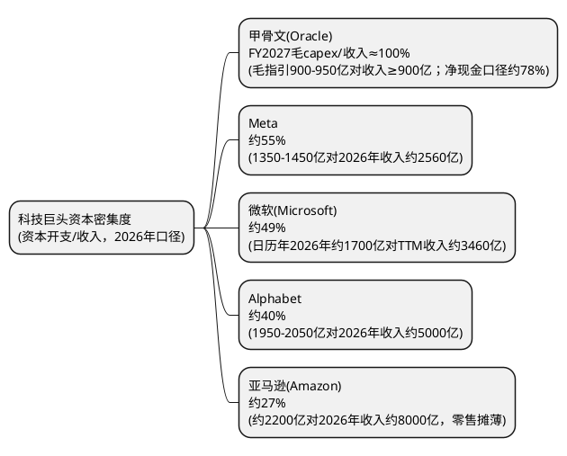

# **验证美国人工智能万亿债务超结构：显性、隐性与影子银行债务层级及宏观地缘逻辑深度研究报告**

> 研究日期：2026年11月3日
> 数据截至：2026年11月3日（公司定期报告类数据截至2026年9月30日季度，Meta于10月21日、Microsoft与Alphabet于10月28日、Amazon于10月29日发布；甲骨文最近一期财报仍为FY2027 Q1即2026年8月31日季度、9月10日发布，FY2027 Q2财报尚未发布，其最新公司口径来自10月28日投资者日；Anthropic招股书更新版（S-1/A-1）于2026年11月2日公开；信用市场数据截至2026年10月30日收盘，美国国债收益率截至11月2日）。本文将公开可核验事实、公司指引与情景推演严格分层；对无法由公司、监管机构或公开申报文件证实的合同金额、行业集中度和宏观政策传导，不将其视为既成事实。

全球金融市场对美国人工智能（AI）产业的狂热投资正伴随着前所未有的资本开支。市场关于美国AI产业背后存在一个由“显性债务、隐性合同债务、影子银行杠杆资金”构成的万亿美元“三层债务超结构”的论断，引起了全球监管机构与宏观经济学家的深度审视。本报告旨在通过交叉对比国际金融稳定理事会（FSB）、国际清算银行（BIS）、美联储以及华尔街核心投行的最新披露数据，对这一债务超结构的真实性、内在运转机理、宏观地缘政治配套逻辑以及终极博弈走向进行系统性的深度验证与重构。

2026年10月下旬出现了本轮研究启动以来最强的一次证据升级：五家超大规模云服务商（Hyperscalers）在同一周内披露9月季度财报并给出2027年资本开支方向；国际清算银行于10月27日发布专题简报，首次以监管机构口径量化了表内外AI债务的规模与传导路径；Anthropic于11月2日公开招股书更新版，使“模型公司合同义务”第一次从媒体转述变为申报文件；Microsoft在财报电话会次日即启动九年来首次美国投资级债券发行。市场此前依赖的多数媒体转述数字因此可被公司文件替换，若干流行判断被直接证伪。

### **三层债务规模的重新标定（2026年11月口径）**

| 层级 | 传言口径 | 2026年11月可核验口径 | 证据性质 | 与传言的差异 |
| :---- | :---- | :---- | :---- | :---- |
| **第一层：显性债务** | 约3300亿美元 | 五家最大hyperscaler 2026年前九个月债券发行毛额2220亿美元（BIS，截至9月）；亚马逊、Alphabet、Meta、甲骨文四家账面债务合计约5140亿美元（不含微软）；微软10月29日新发250亿美元 | 监管机构汇总＋公司财报/发行文件 | 传言该数字实为Anthropic合同承诺被误置；真实表内债务规模远大于此，且2026年发行节奏已是历史峰值 |
| **第二层：隐性合同债务** | 约3000亿美元 | Anthropic招股书披露合同承诺合计8954亿美元（其中2030年底前约4475亿美元）；OpenAI六份已披露算力合同合计约7200亿美元 | 招股书＋公司公告 | 规模为传言的三倍以上；但法律性质是采购承诺而非对手方已确认金融负债，不能与债务同口径相加 |
| **第三层：影子银行** | 约3000亿美元 | 表外载体债券与ABS年内发行750-1000亿美元（BIS引述市场来源）；五大hyperscaler数据中心租赁承诺1.2万亿美元、其中约8200亿美元尚未起租（Moody's）；次级AI基建债存量1840亿美元（Octus，10月16日） | 监管机构＋评级机构＋信用研究 | “3000亿”在公开材料中找不到对应总量；真实风险形态是“未起租租赁＋残值担保”，而非一笔可加总的私募信贷余额 |

三个口径不可横向相加：第二层与供应商侧的剩余履约义务（RPO）互为镜像，同一笔钱会同时出现在模型公司的采购承诺和云厂商的backlog中；第三层的租赁承诺在租约起租后会部分转为第一层的租赁负债。传言“三层各约3000亿美元”的正确之处在于指出了三个不同的风险传导渠道，错误之处在于把三个性质不同、量级已被申报文件改写的东西当成了三个可加总的存量。

## **第一层显性债务验证：科技巨头资产负债表的资产重载与债务扩张**

关于第一层显性债务，市场传言指出其规模约为3300亿美元，表现为微软、亚马逊、谷歌等平台直接在资产负债表上认账的部分，且背后有强劲的表内现金流支持。

### **显性资本开支与债务发行规模的实证对比**

经过对各大超大规模云服务商（Hyperscalers）9月季度财报的逐项穿透，第一层显性债务的规模与信用安全度均需重写。传言中的3300亿美元既不等于科技巨头的表内负债，也不是Anthropic承诺的准确值：Anthropic招股书披露其对谷歌云的最低采购承诺为1145亿美元（2026年4月至2033年7月）、对亚马逊1100亿美元（2026年5月至2036年4月）、对微软449亿美元（2026年11月至2033年5月），三项合计2694亿美元，且均为“无论实际使用量多少均须支付、除对方重大违约外不可撤销”的最低承诺 96 97。传言的3300亿美元是招股书公开前媒体把含SpaceX等对手方在内的承诺粗略加总的口径，应予废弃。

资本开支的绝对规模仍在扩张。BIS在2026年10月27日的专题简报中给出监管机构口径：五家最大美国hyperscaler的2026年资本开支预计超过8000亿美元，约相当于美国GDP的2.5% 98。标普全球评级9月3日的行业报告则把六家（亚马逊、微软、Alphabet、甲骨文、SpaceX、Meta）2025-2030年数据中心与AI相关资本开支合计上修至超过7万亿美元，并预计2027年单年约1.3万亿美元 99。作为对照，2023年该组公司合计资本开支仅约2000亿美元 35；BofA 8月初给出的八大厂商（美系五家加中国三家）2026年逾8600亿美元、2027年约1.2万亿美元路径，与上述两个口径方向一致，分歧仅在斜率 35。高盛9月中旬的6900-7250亿美元（2026年）与1.08万亿美元（2027年）口径偏低，主要因样本与租赁处理不同 69。

更关键的结构性变化在于融资方式，且这一变化在10月最后一周完成了从“部分厂商”到“全体厂商”的扩散。BIS统计五家最大hyperscaler 2026年前九个月债券发行毛额达2220亿美元，其中大部分为长久期，规模已超过同期美国长期国债发行量的10% 98。LPL Research统计Alphabet、亚马逊、Meta、甲骨文四家截至10月13日已发行逾2280亿美元债券，超过其2025年全年发行量的两倍 100；该数字可与公司现金流表交叉验证——仅亚马逊（前三季度长期债务融资1151亿美元）、Alphabet（852亿美元）、Meta（249亿美元）三家合计即2252亿美元 101 102 103。更具标志性的是Microsoft：这家此前完全依靠经营现金流、被市场视为“本轮唯一未进入债市”的AAA级发行人，于10月29日定价250亿美元高级无担保票据，分10档、期限2至40年，订单超1000亿美元、约为发行规模的4倍，5年期定价T+45、10年期T+65、30年期T+95 104。Meta则在10月26-27日把股权融资方案从950亿美元上调至975亿美元（250亿美元普通股＋125亿美元强制可转换优先股，另设600亿美元ATM于2027年一季度启动），英伟达、AMD、博通合计认购至多50亿美元 105 106。至此，“五大厂商均已进入债券市场、其中三家同时动用股权融资”已不是情景假设，而是已完成的事实。

高资本开支已经把自由现金流压到集团层面为负。9月季度五家中四家的经营现金流不足以覆盖资本开支：Meta资本开支349.1亿美元、经营现金流327.9亿美元、自由现金流-21.2亿美元（2012年上市以来首次为负）107；Alphabet资本开支513.6亿美元、经营现金流422.9亿美元、自由现金流-90.7亿美元 108；亚马逊购置物业设备772.6亿美元、经营现金流424.2亿美元、自由现金流覆盖率仅55% 101；甲骨文FY2027 Q1经营现金流231亿美元、资本开支285亿美元、自由现金流-54亿美元 70。Microsoft是唯一仍为正自由现金流的公司（Q1 FY2027经营现金流580亿美元、资本开支含融资租赁452亿美元、自由现金流186亿美元，同比下降27%），但管理层同时确认将“在条件合适时进入债务市场”，并在24小时内完成了上述250亿美元发行 109 104。滚动12个月口径上，亚马逊自由现金流已从一年前的+148亿美元恶化至-424亿美元，Alphabet仍为正197.5亿美元但连续两季为负，Meta前三季度累计+110.5亿美元、四季度按指引将转负 101 108 107。BofA此前测算八家hyperscaler合计自由现金流将从2025年+1800亿美元转为2026年-640亿、2027年-1440亿、2028年-1860亿美元 35；以9月季度实际值外推，2026年的转负幅度存在下行风险。

四季度的资本开支不会放缓，只会更集中。按各公司指引中值倒算：Alphabet全年1950-2050亿美元、前三季度已投1320亿美元，四季度需630-730亿美元；亚马逊全年约2200亿美元、前三季度净现金口径1722亿美元，四季度约478亿美元；Meta全年1350-1450亿美元、前三季度858亿美元，四季度492-592亿美元；Microsoft日历年2026年约1700亿美元、前三季度1181亿美元，四季度约519亿美元 108 101 107 109。四家合计四季度资本开支约2120-2320亿美元，高于三季度的2074亿美元。各公司的资本开支仍包含传统云、网络与其他业务，不能全部视为AI支出，但“经营现金流不再覆盖资本开支”已从2024-2025年的尾部情景，变为2026年在集团层面成立的基准事实，这正是第一层债务扩张的直接动因。

### **表内显性债务的资本密集度与安全边际**

尽管债务规模扩张迅速，但第一层显性债务的违约风险仍然很低 3。这主要得益于这些科技巨头在传统非AI领域（企业级传统云服务、数字广告、电子商务、移动操作生态）的垄断地位与现金流支撑 3。然而，AI投资的极高资本密集度正在把这些公司从轻资产软件企业改造成重资产公用事业型主体 2。

按各公司最新指引测算：甲骨文FY2027毛资本开支指引900-950亿美元、净现金资本开支不超过700亿美元，而其FY2027收入指引为至少900亿美元，毛资本开支与收入之比接近1:1，居五巨头之首 71 70；Meta约55%、微软约49%、Alphabet约40%、亚马逊受零售业务摊薄约27%——重资产化程度全面高于2025年末水平 107 109 108 101。BIS引用的Van Nieuwerburgh更新估算显示，2025-2032年美国数据中心投资将接近9万亿美元、约占GDP的3.2%/年，强度超过铁路、电气化与电信三次建设潮 98；早前流传的“2.9万亿美元、48%可由内部现金流覆盖”口径已被该更新覆盖。

需要特别指出两项2026年出现的会计口径变化，它们直接改变了“折旧扳机”的时点。第一，Microsoft自FY2027起把数据中心与办公楼的预计使用年限从15年延长至25年，同时预计更多未来数据中心租约将从融资租赁转为经营租赁——后者不计入资本开支，公司因此把日历年2026年资本开支指引从约1900亿美元下调至约1750亿美元（10月又因第三方算力交付延迟降至约1700亿美元）104 110 109。延长折旧年限会降低当期折旧费用、抬高账面营业利润，并把成本压力后移；把租赁从融资转为经营，则把负债从表内移向附注。第二，Alphabet披露其服务器与网络设备使用年限为6年、数据中心为7-40年，四季度起第三方算力租用将压制云业务毛利率 108。两项变化共同意味着：账面折旧的上升速度会慢于资本开支的上升速度，真实的资产消耗要到2028-2030年租约与设备更新周期重叠时才会集中体现。

安全边际仍然存在，但缓冲正在被同时消耗。Alphabet 9月末持有2651亿美元现金及有价证券（其中904亿美元为有价证券投资）、长期债务1251亿美元 108；Meta持有824.5亿美元现金及有价证券、债务837亿美元 107；亚马逊持有1142亿美元现金及有价证券、债务账面1803亿美元（含175亿美元定期贷款）101。以净现金计，Meta已接近中性，亚马逊已为净负债。评级机构也已开始调整口径：标普全球自2026年9月起对租赁、担保、购电协议等“类债”承诺做分析性调整，并明确表示“hyperscaler信用质量正在逐步弱化”，但同时维持六家全部投资级 99。这一层级的债务在短期不存在实质性违约风险，但“以净现金抵御周期”的时代已经结束。

| 科技巨头主体 | 2026年资本开支指引/实际（亿美元） | 最新自由现金流状态（2026年9月季度） | 2026年以来主要外部融资动作 | 显性债务的核心偿债来源支撑 |
| :---- | :---- | :---- | :---- | :---- |
| **亚马逊 (Amazon)** | 约2200（现金口径，7月自约2000上调后维持不变）；2027年"显著增加" | Q3经营现金流424.2亿、购置物业设备772.6亿、覆盖率55%；滚动12个月FCF -424亿（一年前+148亿）101 | 前三季度长期债务融资1151亿，Q3单季481亿；长期债务账面1731亿（2025年末656亿）；另据申报文件可凭所购AI硬件抵押借款至多800亿 101 142 | AWS三季度收入460亿（+39.3%）、年化1840亿、经营利润率38.7%；backlog 5780亿、加权剩余寿命6.1年 101 |
| **微软 (Microsoft)** | 日历年约1700（7月自约1900下调，含使用年限与租赁会计变更影响；10月因第三方算力交付延迟再自约1750下调）；FY2027 Q2单季超500 | Q1 FY2027经营现金流580亿、资本开支含融资租赁452亿（其中融资租赁74亿）、FCF 186亿（同比-27%）；公司称FY2027全年维持FCF为正 109 | 10月29日定价250亿美元高级无担保票据（10档、2-40年、订单超1000亿美元、约4倍超额认购），为九年来首次美国投资级发债 104 | 商业RPO 6770亿（+73%）、加权久期2.3年、约30%于未来12个月确认；Azure Q3收入332亿（+48%）109 |
| **Alphabet (Google)** | 1950-2050（自1800-1900上调后维持）；2027年"显著增加"，未给数字 | Q3资本开支513.6亿、经营现金流422.9亿、FCF -90.7亿（含52亿美元欧盟罚款与TPU库存增加）；滚动12个月FCF +197.5亿 108 | 前三季度发债净额852亿（Q3为290亿）；ATM售股净额124亿（余额276亿）；长期债务1251亿 108 | 云收入307亿（+103%）、云backlog 5608亿；现金及有价证券2651亿；未来采购承诺9240亿、未起租租赁及其他义务1520亿 108 |
| **Meta** | 1350-1450（下限自1300上调）；2027年继续"激进投资" | Q3资本开支349.1亿、经营现金流327.9亿、FCF -21.2亿（上市以来首次为负）；前三季度累计+110.5亿 107 | 前三季度长期债务融资249.1亿、债务总额837亿；10月26-27日股权融资方案上调至975亿（250亿普通股+125亿强制可转优先股，另设600亿ATM于2027Q1启动），英伟达/AMD/博通合计认购至多50亿 105 106 | 广告收入630.6亿（+26%）；现金及有价证券824.5亿；未起租租赁3557亿、不可撤销合同4550亿、或有云采购147亿 107 |
| **甲骨文 (Oracle)** | FY2027毛资本开支900-950、净现金口径≤700；FY2026实际557（同比翻倍）；投资者日称FY2027-FY2028为资本开支峰值 | FY2027 Q1经营现金流231亿（含114亿客户预付款）、资本开支285亿、FCF -54亿；FY2026全年FCF -237亿；市场一致预期FY2027约-350亿 70 111 | FY2027 Q1完成200亿美元ATM普通股发行；11月2日申报再发100亿美元股票+100亿美元高级票据；投资者日承诺FY2027-FY2030新增资本市场融资不超过200亿（不含再融资），票据账面1253.4亿 111 112 70 | RPO 6640亿（未来12个月确认约13%）；表外未起租数据中心租赁承诺2880亿；FY2030收入目标≥2250亿；公司指引FCF于FY2028下半财年转正、FY2029≥300亿 111 112 70 |

## **第二层隐性债务验证：云采购合同、“循环融资”与剩余履约义务风险**

第二层债务是由OpenAI、Anthropic等AI模型开发商通过长期算力采购合同构建的“隐性合同债务”。传言给出的规模约3000亿美元，在2026年11月已被两份一手文件直接改写：Anthropic招股书披露其合同承诺合计8954亿美元，OpenAI六份已披露算力合同合计约7200亿美元 96 113。但规模被改写不等于性质被改写——这些是采购承诺（purchase commitments），不是对手方已确认的金融负债，也不进入任何一方的资产负债表负债项，其法律地位、可执行性与会计确认路径与债务完全不同。

### **“循环融资”与供应商融资机制的财务本质**

长期算力采购合同可能形成履约和客户集中度风险，但RPO是供应商未来收入合同，不等同于客户已确认的金融负债；公开资料不足以对单一客户的合同金额、付款义务或可取消条款作精确穿透。
这种“先投资、后采购”的机制，在财务和会计准则上被称为“循环融资”（Round-Tripping）或“供应商融资”（Vendor Financing） 6。这种模式允许芯片提供商或云服务商向AI初创公司注入股权资金，并附带条件要求初创公司必须将这笔资金全额用于购买其芯片或在其云平台上燃烧算力 4。

* **微软与OpenAI的利益绑定**：微软向OpenAI累计注入了超过130亿美元的资金，而其中大部分已通过OpenAI在Azure上的高强度算力消耗，以云算力费用的形式重新流回微软，并被确认为微软的云服务营收 5。这一绑定在最新财报中第一次有了可核验的绝对金额：微软在2026年9月季度确认来自OpenAI商业安排（含收入分成）的收入100亿美元，占当季总收入923亿美元的约11%；FY2026全年该口径收入241亿美元，季末对OpenAI的应收款72亿美元（6月末为60亿美元）114。对应地，微软2026年5月的协议把对OpenAI的收入分成上限定为380亿美元、并将IP许可改为非独家至2032年 115。这意味着OpenAI的经营状况已经直接进入微软的季度收入表，而非仅停留在股权投资损益。  
* **Nvidia与OpenAI的 Stargate 算力回购**：在OpenAI于2026年3月完成的1220亿美元巨额融资中，芯片巨头英伟达直接提供了300亿美元的“算力额度”（而非现金） 4。根据行业分析，OpenAI每接受英伟达100亿美元的投资，就被要求在后续的数据中心和芯片采购中向英伟达支付高达350亿美元的设备采购费 7。这一机制的最新形态出现在2026年8月10日：英伟达与Apollo、BlackRock、Blackstone、Brookfield、高盛、KKR六家机构签署谅解备忘录，建立独立算力融资平台，拟逐步动员逾5000亿美元第三方资本，为其客户（前沿AI实验室、企业与AI云）购置数据中心与英伟达硬件提供表外融资，将GPU算力包装为类似商业地产的"可投资资产类别"；英伟达自身不为债务担保，交易尚待最终协议签署 49。BofA点评认为此举标志着行业正从双边供应商融资转向机构化的平台融资 50——风险并未消失，而是被证券化逻辑进一步扩散至保险资本与私募基金。更具约束力的形态出现在2026年8月17日：NVIDIA与SB Energy签署多份残值担保协议，为俄亥俄州PORTS-Pike园区约4.25GW IT负荷的租约提供信用支持，累计担保上限1050亿美元，租户为OpenAI关联主体，担保自2028年起随数据中心分批投运生效、至租约起租20周年终止，OpenAI则承诺就NVIDIA实际支付的款项予以补偿 116。BIS在10月27日的简报中把这类安排概括为"用少数几家投资级公司的承诺把项目债的评级转换出来"，并指出NVIDIA可能为单个项目提供不超过25%的残值支持、但未说明具体形式 98。  
* **亚马逊、谷歌与Anthropic的千亿合同**：Anthropic在2026年5月的Series H融资中估值达到9650亿美元 9，但其背后承载着沉重的算力合同负债。截至2026年9月30日及其后，公司已签署的采购承诺与租赁协议（含短期承诺及尚未起租的租约）合计承诺支出约8954亿美元，其中约4475亿美元预计在2030年12月31日前发生、约698亿美元在未来12个月内到期，其余主要在2031-2045年间发生 96。按招股书披露的对手方拆分：对谷歌云最低采购承诺1145亿美元（2026年4月至2033年7月；媒体据同一招股书统计的对谷歌算力租赁承诺合计约1213亿美元）、对亚马逊1100亿美元（2026年5月至2036年4月）、对微软449亿美元（2026年11月至2033年5月），三者均属无论实际使用量多少均须支付、除对方重大违约外不可撤销的最低承诺；对SpaceXAI最高1205亿美元（全面交付后约31亿美元/月，但自2027年3月起可提前90天通知终止）、Nscale最高446亿美元、Lambda约413亿美元、AMD首批预计超200亿美元，另有博通设备租赁租金合计1612亿美元（五年期、不可撤销）96 97 117。这是本轮AI周期中第一份把模型公司合同义务写进申报文件的量化披露，其法律可执行性显著高于此前所有媒体转述版本。据其主云提供商亚马逊的二季报披露，双方已在原有多年期承诺基础上将战略合作扩大逾1000亿美元（期限10年，含AWS自研芯片相关义务），亚马逊并同期以50亿美元参与认购Anthropic系列优先股 39。此外，Broadcom于2026年6月联合Apollo与Blackstone设立"AI XPV平台"，首笔即由Apollo牵头350亿美元债务融资（三方称其为史上最大私募信贷交易），用于支持Anthropic超过1吉瓦的博通XPU算力扩容，平台设计目标为到2028年支撑逾20吉瓦算力 51；该交易通过SPV持有芯片使算力承诺游离于Anthropic资产负债表之外，并由Broadcom为高级层票据兜底芯片残值——芯片制造商信用第一次被直接嵌入AI实验室的融资结构 51。该结构在10月进一步放大：10月26日，美国银行、花旗、摩根士丹利与黑石联合宣布，为Anthropic采购博通XPU设立规模630亿美元的特殊目的载体融资，其中420亿美元为第一留置权高级担保（由Broadcom提供相当于该部分的残值支持，两档利率分别为SOFR+150bp与SOFR+187.5bp、2033年9月30日到期），180亿美元为第二留置权（黑石承诺90亿美元并牵头分销），银行计划在2027年一季度把其中至多约210亿美元再融资为投资级债券 118 119。芯片供应商同时是卖方、股东、担保人与债权人，这是本轮AI融资结构中最难穿透的一环。国际清算银行（BIS）在2026年度经济报告中点名此类"循环融资"安排：条款披露普遍不足，且存在同一资产被多次质押的风险 55。

### **隐性合同债务转化为科技巨头表内坏账的路径**

Microsoft在Q1 FY2027（截至2026年9月30日）披露商业RPO达6770亿美元，同比增长73%，加权平均久期2.3年、约30%将在未来12个月内确认为收入（该部分同比增长29%），12个月以后确认的部分同比增长98%；商业订单额当季同比下降12%，主因上年同期存在大额Azure承诺 109。甲骨文FY2027 Q1（截至2026年8月31日）披露RPO 6640亿美元，同比增加2090亿美元、环比增加260亿美元，未来12个月确认约13%，当季新增AI云合同超300亿美元、交付850MW数据中心容量及30万+GPU 70。将四大云平台最新披露合并：微软6770亿、甲骨文6640亿、AWS 5780亿、谷歌云5608亿，客户承诺backlog合计约2.48万亿美元，较7月初的约2.0万亿增长约24% 109 101 108。但必须强调口径风险：RPO是供应商未来收入合同而非对手方已确认的金融负债，四家的定义与久期披露并不一致（微软2.3年、AWS 6.1年、谷歌约55%在24个月内确认、甲骨文仅披露13%在12个月内）；甲骨文表外另有约2880亿美元数据中心租赁承诺（基本未上表，预计FY2027 Q2至FY2029起租、租期15-19年）72，其中750亿美元来自客户预付GPU或客户自备硬件的AI大合同，其确认路径与软件经济完全不同 40。因此不能用2.48万亿美元backlog反推“第二层合同债务”的净额——它与模型公司披露的采购承诺互为镜像，两个方向都会重复计算。

这种模式掩盖了极度脆弱的底层现金流赤字。AI初创模型的训练与推理成本呈现指数级上升，其商业化收入的增长速度远远无法弥补高昂的刚性算力账单 13。

* **OpenAI的财务裂痕**：据《华尔街日报》等媒体获得的投资者材料，OpenAI 2026年二季度收入67亿美元（环比+18%，一季度57亿美元），但含股权激励的经营亏损从一季度的93亿美元扩大至123亿美元，亏损扩张快于收入增长 46。10月8日，CNBC确认公司向投资者披露截至9月末年化收入约500亿美元（而非9月中旬流传的约680-700亿美元），第三季度run rate环比增长77%、企业业务run rate增长107%；差额主要源于是否把云合作方的毛收入计入，Anthropic计入、OpenAI不计入 82。将六份已披露或已被点名的算力合同（甲骨文约3000亿/约5年、微软增量2500亿/期限未披露、AWS两笔合计约1380亿、CoreWeave最高224亿、Cerebras超100亿）按各自期限直线摊平，对应年化算力支出约1170-1360亿美元，相当于其约500亿美元年化收入的2.3-2.7倍 113——收入需再增长约两倍才能仅覆盖算力。一级市场已同步降温：10月的融资轮目标从约300亿美元下调至不超过200亿美元，投后估值1.25万亿美元（较9月讨论的1.4万亿下调1500亿），由阿联酋投资者与Coatue领投 120。公司2026年6月已保密递交IPO申请，但上市时间仍未确定 115。  
* **Anthropic的反超与增速拐点**：Anthropic在2026年二季度收入约115亿美元、并录得9.74亿美元经营利润 46；11月2日公开的招股书更新版显示三季度收入约170亿美元，同比增长约1127%，但环比增速从二季度的144%、一季度的132%骤降至47%，经营利润转为-5.67亿美元，净亏损232.9亿美元（招股书摘要未拆分构成），季末现金及其他流动资产1466亿美元 96 121。增速的急剧放缓与亏损重新扩大，是机构投资者在11月2日把IPO目标估值从约2万亿美元下调至1.5-1.6万亿美元的直接原因 122。发行安排上，公司计划11月9日当周启动路演、最早11月16日开始交易（代码ANT，纳斯达克），并计划在日本发售至多35亿美元股份；截至11月3日尚未公布发行价区间与发行股数 123。可以交叉验证的硬事实是：亚马逊持有的Anthropic股权在9月末账面价值2387亿美元、另持有OpenAI优先股500亿美元 101；Alphabet自2023年9月以来累计投资至少133亿美元、二季度末账面价值1243亿美元 124；Broadcom牵头的630亿美元芯片融资已完成首轮银团分销 118。一级市场对两家实验室的信用供给并未中断，但定价已从“无限加码”转为“按增速重新定价”。

这一闭环的脆弱点不在于某一时点的偿付能力，而在于合同双方权利义务的不对称。模型公司的采购承诺多数为不可撤销的最低支出，但它们本身是高亏损、依赖持续股权融资的主体；云厂商与芯片厂商则同时是股东、供应商、债权人与担保人。一旦股权融资放缓，传导顺序是：模型公司先推迟新增容量而非违约存量合同→云厂商RPO的确认节奏后移、资本开支回报期拉长→项目载体的租金覆盖率下降、残值担保被触发→持有项目债的保险、私募信贷与银行承担损失。2026年10月已经出现这条链条的前两个环节：OpenAI把融资目标从约300亿美元下调至不超过200亿、Anthropic的IPO估值被下调约四分之一，而甲骨文新墨西哥旗舰项目的建筑接近完工却仍因电力许可无法通电 120 122 125。截至目前，尚未出现模型公司违约算力合同或云厂商对RPO计提减值的公开案例；把“数千亿美元RPO变成坏账”当作基准情景仍缺乏证据，但它作为压力情景的触发条件已经具体化为“两家实验室的股权融资同时失败且持续两个季度以上”。

## **第三层影子银行债务验证：私募信贷、数据中心重组与非银中介脆弱性**

第三层风险通过 REITs、SPV、项目债、ABS/CMBS与私募信贷等非银渠道传递。传言的“约3000亿美元影子银行债务”在公开材料中找不到对应总量，但2026年10月出现了三项可独立核验的替代量化，使这一层的规模第一次可以被区间估计而非猜测。第一，国际清算银行10月27日简报（BIS Bulletin No.140）引用市场来源估计：2026年年内由表外载体发行的债券与资产支持证券为750-1000亿美元 98。第二，同一简报引用穆迪的统计：五家最大hyperscaler的数据中心租赁承诺在2026年年中已达1.2万亿美元，其中约8200亿美元为尚未起租的租约；穆迪并指出这些公司的表外承诺总额已超过其报告债务 98。第三，信用研究机构Octus统计，其追踪的次级（sub-investment-grade）AI基建债存量从6月末的1250亿美元升至10月16日的1840亿美元，其数据库覆盖的投资级AI基建债逾7000亿美元；三季度投资级AI基建发行环比下降近50% 126。三者的法律性质完全不同（证券、租赁、债券），不可相加，但共同指向一个结论：这一层的真实规模以万亿美元计，风险载体是“租赁承诺＋残值担保＋项目债”，而不是一笔可以命名的私募信贷余额。

私募信贷仍是其中最难观测的通道。BIS此前的统计显示，AI相关企业的私募信贷贷款余额已从2016年的近零增至2025年的约2000亿美元，占私募信贷总盘的比例由不足2%升至8%，叠加AI企业2025年债券发行2430亿美元（2023年仅790亿美元） 54。FSB于2026年5月警示私募信贷与银行、保险和私募股权的关联、估值不透明及流动性错配；该报告未公布AI相关交易占比从17%升至34%的统计，因此不能将该比例作为监管确认事实。市场侧估算更为激进：摩根士丹利估计到2028年全球数据中心建设所需约1.5万亿美元中私募信贷可供应过半（约8000亿美元机会） 68，Van Nieuwerburgh给出私募信贷8000亿＋公司债2000亿＋证券化1500亿的外部融资分解 56——两者均属机构估计而非监管统计。摩根士丹利另给出一个更具体的价格信号：2026年年初最高评级数据中心债券收益率低于5%，10月已接近7%，而“当借款成本接近8%时，按现有融资条款发行这类债券将变得非常困难”；2026年数据中心ABS与CMBS发行分别约150亿与70亿美元，节奏与去年持平但明显低于需求增速 127。

### **表外重资产外包与影子银行信贷链条**

非银行融资、数据中心项目融资与银行授信的关联构成潜在风险传导渠道。公开监管数据目前可以给出表外载体的发行规模（年内750-1000亿美元）与租赁承诺存量（1.2万亿美元），但仍不能确认其总体杠杆率，也不能确认其已成为系统性风险的“引信” 98。

由于建设超级数据中心需要消耗重资产资本，科技巨头为避免表内杠杆过快上升并保留评级空间，普遍采用基础设施表外化策略 14：把数据中心的设计、征地、电网接入与运营外包给第三方开发商（数据中心REITs或独立基建商），由后者为每个项目设立特设目的载体（SPV），并以与科技巨头签署的租约作为信用担保向金融机构融资 2。BIS对这类租约的描述值得注意：初始期限往往只有数年、附带续约选择权，合计可覆盖15-20年，且残值保护通常设有上限——这与“10-15年刚性长租”的流行说法不同，意味着租约到期时的再出租风险由载体而非租户承担 98。巴塞尔协议III等资本与流动性约束确实限制了银行直接持有此类长期风险，但同时留下两条通道：银行向载体提供建设贷款，以及向持有载体债务的私募信贷基金授信 98。换言之，银行并未退出，而是把风险移到了资本占用更低、披露更少的一层。

### **国际金融稳定理事会（FSB）2026年5月报告的官方验证**

2026年5月6日，国际金融稳定理事会（FSB）发布了针对私募信贷市场的里程碑式预警报告——《私募信贷脆弱性报告》（*Report on Vulnerabilities in Private Credit*），官方数据和结论部分印证了传言的结构性风险叙事 20：

* **监管确认的风险是结构性而非 AI 专属定量结论**：FSB 估计私募信贷资产规模在2024年末约为 $1.5–2.0T，并指出银行授信、保险、私募股权、估值主观性与流动性错配会放大压力；报告未给出 AI/数据中心交易占比。  
* **AI 基建的私募信贷融资规模无法由 FSB 报告独立确认**：原"$800B"应视为非官方情景数字，而非实际已融资额或监管统计。

紧随其后，国际清算银行（BIS）在2026年6月28日发布的年度经济报告中，首次以旗舰报告规格对AI债务链条发出系统性警告：五大hyperscaler仅2025-2026两年的AI相关资本开支就将超过1万亿美元，已明显超出其盈利与自由现金流，迫使部分公司发债补缺；基于竞赛模型的测算显示，竞争压力推高资本开支将令全行业净经济剩余（总回报减投资成本）收缩、在不利情景下转负，"AI回报不及预期可能触发融资突然收紧，使资本开支繁荣演变为旷日持久的投资萧条"，且其对信用市场的冲击烈度可与2008年全球金融危机相提并论 55。BIS特别点名三类脆弱性：循环融资条款披露不足及同一资产重复质押风险、数据中心外包回租合同中嵌入的退出条款、以及资产负债表孱弱的EPC工程承包商在capex退坡时的连锁暴露 55。至此，"影子融资渠道放大AI周期"已由市场猜想升格为两大国际监管机构的正式风险提示，但仍未落地为任何针对AI敞口的量化监管行动。

2026年10月27日的BIS第140号简报把这一判断推进到可操作的层面 98。它给出四条脆弱性：第一，敞口集中于少数大公司，其表外承诺已超过报告债务；第二，互联性高，芯片供应商可能同时向同一客户销售、持股、采购其算力并为其付款担保，客户出问题时四条渠道同时受损；第三，合同保护只覆盖部分损失，残值担保通常设有上限，租约不续期时载体须在同类供给同时上市的时刻处置资产；第四，结构不透明——未起租租约只披露不入账、担保在触发前常按零值计量，导致同一保险机构对同一hyperscaler的实际敞口可能远高于其债券持仓。该简报同时给出一个重要的反面证据：在2026年18个AI融资相关新闻日，10年期美债期限溢价平均仅上升约1.5个基点，且在两个交易日内回吐，投资级利差无显著变化 98。也就是说，截至9月的市场数据并不支持"AI债务已在系统性地推高全市场融资成本"；但简报明确指出，2026年10年期以上hyperscaler债券已占同期限公司债发行的约24%、占美国国债毛发行量的约13%（2024年分别约3%与1.5%），若按当前速度继续，吸收久期的投资者将面对相关性更高的资产存量，届时期限溢价的上行会更持久。

### **影子银行债务的核心脆弱性与流动性危机爆发**

随着美联储维持高利率政策的时间拉长，影子银行系统内由AI债务构建的繁荣正在暴露出三大致命缺陷：

1. **严重的流动性错配与赎回风暴**：为了吸引资金，私募信贷市场近年来推出了大量具有季度赎回条款的半流动性常青基金或零售商业开发公司（BDC） 14。然而，这些基金募集的短期资金被深深锁死在不可交易、无法轻易变现的5-7年期长期数据中心或科技公司贷款中 17。在2026年初，由于市场对AI软件转化率和SaaS（软件即服务）板块前景的担忧，影子银行爆发了凶涌的赎回潮 25。管理资产规模高达310亿美元的 Cliffwater 旗舰信贷基金在2026年第二季度收到的赎回请求比例骤增至17%（第一季度为14%），由于远超其5%的季度赎回上限，被迫启动紧急红线限制，只接受了少于三分之一的赎回请求 23。同时，私募信贷巨头 Blue Owl 因旗下零售非上市BDC基金（OBDC II）实施永久性赎回冻结，引发了黑石、Ares、Apollo、KKR等上市私募资产管理公司股价的集体崩盘 27。赎回压力在三季度略有缓解但绝对水平仍高：Blue Owl旗舰基金OCIC的赎回请求为流通股的16.8%（约31亿美元），低于二季度的18.8%和一季度的21.9%，为连续第二个季度下降；9月30日截止的要约收购最终按比例接受1.016亿股、占投标量的29.8%，支付约9.311亿美元（10月26日最终修订文件），未获满足的请求不结转、须在12月窗口重新提交 128。科技主题基金OTIC本季满足率仅12.8% 128。真正显示资金端质变的是增量资金：OCIC在2026年1月至9月的公开与非公开发行累计募资仅增加5.875亿美元，而2025年同期为49.894亿美元，降幅约88%；同期债务从157.5亿美元升至171.7亿美元、净资产从197.6亿美元降至约180亿美元，净杠杆率由0.73倍升至0.91倍 128。Blue Owl管理层在10月29日电话会上称OCIC赎回请求已连续两季下降、逾90%的股东仍全额持有，并把数字基础设施策略描述为面向投资级租户、15-20年租约、含年度租金递增的结构 129。赎回潮的急性期已经过去，但“新钱基本不进、旧钱排队退出、杠杆同步上升”的组合，意味着这类基金已从扩张模式转为收缩模式。更具标志性的是资金端行为的质变：据英国《金融时报》报道，Blue Owl于2026年8月决定不再为Oracle位于密歇根州、估值100亿美元的Stargate相关数据中心提供融资——作为Oracle最大的数据中心融资伙伴，其退出原因是贷款人因"市场对AI基建巨额开支情绪的转变"及对Oracle债务膨胀的担忧而要求更严格的租赁与债务条款；Blackstone正在磋商接手但尚未签约 57。私募信贷龙头从"抢筹AI资产"转向对单一交易讨价还价，是本层流动性逻辑从扩张转入分层的第一个可核验信号，但尚不构成系统性收缩。9月至10月，AI债务融资渠道进一步多元化且成本显著攀升：SoftBank于9月24日完成111亿美元双币种高收益债券发行（全球史上最大高收益企业债），部分用于追加对OpenAI的投资，3.5年期美元债收益率约8.625%、5.5年期约9.25% 92；10家银行于9月16日为Blackstone与Alphabet合资的Crux AI安排22亿美元芯片贷款（以TPU芯片及客户合同为抵押、含10亿美元循环授信）93；Broadcom于10月2日启动约60亿美元Anthropic芯片融资（含42亿高级担保+18亿次级无担保），较6月AI XPV平台的350亿美元大幅扩容 94；JPMorgan与Goldman Sachs于10月5日为Volta Infrastructure安排约50亿美元杠杆贷款（SOFR+6.50%、收益率超11%），被市场视为AI债务融资的压力测试 95。上述交易共同指向一个结构性转变：AI融资正从传统投资级债券转向高收益债、资产担保贷款、供应商融资与私募信贷等更高成本、更强结构保护的渠道。一级市场在10月给出了比二级利差更硬的证据：五宗数据中心IPO被撤回或推迟；9月底唯一完成定价的弗吉尼亚州11亿美元数据中心建设债（票息8.875%）上市即跌破面值、一个月后跌至约90美分；高收益债窗口在11月3日中期选举前基本关闭，多位信用交易员表示投资者要求先解决许可与监管的不确定性 130。与此同时，投资级窗口仍然开放：Microsoft 250亿美元发行获得约4倍超额认购，说明本轮的收缩是按信用质量分层，而非全市场关门。  
2. **底层资产质量恶化与"展期掩盖"游戏**：由于私募信贷借款人大多缺乏公开评级，这给估值操纵和风险粉饰提供了天然温床 14。在底层企业因高利息支出（面临9%-10%的 resetting 利率）而出现偿债困难时，私募信贷基金经理为了避免在季报中计提违约（从而影响其管理费和年终奖），广泛采用了"实物付息（PIK）"条款 17。PIK贷款在当前的私募信贷组合中占比已高达12% 14。虽然私募信贷的名义违约率仅为1%左右，但如果将这种选择性债务展期和折价债务交换（Selective Defaults & Distressed Exchanges）计入，其实际坏账率已逼近 **5%** 14。期限错配开始显性化：CoreWeave在2026年7月末因投资者抵制而被迫上调一笔26亿美元Anthropic关联贷款的收益率，其6月末总债务约356亿美元（含租赁负债），且公司披露的约5年期新融资对应的底层客户合同平均仅约3年 67 89。进入10月，CoreWeave的信用风险已从恶化进入困境定价：其无抵押债券收益率10月中一度突破16%，2032年到期券跌至约78美分；5年期CDS利差10月中创下约1195bp的纪录，10月29日仍为1118bp，市场隐含的五年内违约概率约63% 88 131。公司债务与租赁负债合计约520亿美元，其中2030年前到期约207亿美元、其后另有149亿美元；截至6月30日的GPU抵押贷款136亿美元优先于无抵押债券受偿，标普对无抵押债评级为B、估算违约回收率10%-30% 131。公司称其1040亿美元backlog与三季度逾250亿美元新增承诺足以覆盖债务，但Bernstein测算，要交付这1040亿美元订单对应的产能，公司仍需再融资约850亿美元，并称其商业模式在债市转向后在经济上已受挑战 130。客户集中度同样构成约束：Microsoft占其2025年收入的67% 131。9月17-22日完成的42亿美元可转换高级票据（2.875%票息、2033年4月到期、转换溢价22.5%）只能覆盖短期缺口，三季度财报定于11月10日发布，是下一个硬性检验点 91 131。Gartner则预测，成本压力与产品缺乏差异化将使超过80%的neocloud在2030年前无法独立经营 131。甲骨文Project Jupiter个案把期限错配从纸面假设变为在建项目的实时压力测试，且10月的进展证明瓶颈在电力而非建筑：项目数据中心建筑已接近完工（现场逾4000名工人），但截至10月19日仍未通电；为其供电的约2.4GW天然气燃料电池微电网尚未开工，因缺少新墨西哥州空气质量许可 125。许可程序在10月再度延期：原定10月19日的公开听证会改至12月7日，环境部原定11月23日的决定期限可能顺延至12月18日；10月26日听证官驳回环保团体以申请在行政上不完整为由退回申请的动议 125 132。技术争议同时升级：环境部按其自身要求重新建模后发现污染物浓度约为申报值的两倍；甲骨文与Yucca Growth Infrastructure于10月14-15日提交11个月内第四次修订，把燃料电池运行上限从2462MW压到1600MW（约65%）并称可减排约35%，但环境部律师在10月23日文件中表示实质性修订发生在如此后期、申请尚未准备好进入正式程序 125 132。配套的Energy Transfer Green Chile天然气管道（约17-18英里、日输气上限约4亿立方英尺）因新墨西哥州土地局两度否决路由许可，监管申报中投运日已从2026年8月15日推迟至2027年2月1日，并需重新走联邦环境审查；新墨西哥州总检察长10月5日向FERC提交意见称该审查不充分，另有12个州要求加快审批 75 125。9月24日媒体报道的force majeure通知（主张租金起付延后约3年）与约180亿美元银团贷款89-91美分的二级报价，此后均无新的可核验披露，仍只能作为媒体线索 74 76。甲骨文则把该项目的本州经济影响测算从此前约47亿美元上调至约130亿美元 125。信用市场同步给出了定价证据：高收益级数据中心债券利差在2025年12月一度较高收益指数阔逾220bp，上半年大幅压缩后自7月底重新走阔 58；投资级hyperscaler债券相对综合指数的利差差距升至约35bp，Meta2036年期票据按BBB级而非其官方AA级的利差交易，亚马逊长债定价接近A级 58 59；高盛观察到23笔数据中心合资项目债中已有17笔成交价低于发行收益率 53；Apollo首席经济学家Slok统计的hyperscaler发债认购倍数则从2月的近5倍腰斩至7月的不足2倍，AI相关新券发行让步平均达12bp（整体投资级市场仅约2.5bp）45。10月的指数级数据更为直接：高收益指数OAS从9月21日的266bp升至10月30日的344bp，CCC及以下分项从7月的不足10%升至13.27%，投资级OAS从10月中旬的85bp升至94bp 133；LPL统计2026年发行的91只hyperscaler债券中已有78只在10月下旬的利差宽于发行时，而非AI投资级债券的利差仍接近数十年低位 100；甲骨文5年期CDS从一年前的约80bp升至292bp（11月2日，一年上升265%），标普全球市场情报部门称该水平更接近高收益BB/B档而非其BBB-评级 112。信用市场的定价已经完成了一件事：把AI发行人从“整体投资级”中单独拆出来定价。  
3. **技术颠覆与资产快速贬值风险**：目前，约有三分之一的私募信贷基金对SaaS软件板块拥有极高的风险敞口 26。随着前沿AI工具的快速普及，传统的SaaS软件企业的竞争壁垒正在被迅速侵蚀，导致其资产和软件估值崩溃（2025年10月至2026年2月期间，软件股整体暴跌了近30%） 24。这些企业多为轻资产模式，一旦无法按期偿还私募信贷，其抵押物（主要是无形软件或品牌）的清算回收率将微乎其微 24。

## **宏观地缘与监管竞次：美国信贷扩张与美元霸权维持的双重闭环**

传言指出，美国宏观棋局的运转依靠“对内放松银行监管使资金流向AI，对外通过地缘冲突维持高油价以支撑美元信用”的两头并进模式，通过信贷扩张来维持生产力。  
该叙事包含可讨论的宏观假设，但现有监管文件并未将杠杆监管调整、国际油价和AI基建融资认定为同一政策闭环，不能作为事实性因果链。

无论因果链是否成立，AI资本开支的宏观权重已经大到足以左右美国经济读数。按BIS的监管口径，五家最大hyperscaler 2026年资本开支将超过8000亿美元、约占美国GDP的2.5% 98；标普全球估算，过去一年美国私营部门GDP增长中约有一半来自高科技与AI相关活动 99。Wolfe Research测算，覆盖设备、软件、研发、数据中心与芯片厂的美国本土AI相关资本开支已从2021年的近零升至2026年二季度约占GDP的2%，并直接贡献了近期名义GDP增长的10%-20%（剔除进口的负向核算效应），其相对于GDP的爬升速度超过1990年代末互联网热潮与2000年代中期地产扩张 60；NBER工作论文的口径更高，估计AI基建开支占GDP之比将从2025年的1.2%升至2026年的约2.4%、2027年的约3.4%，占私人固定投资比重由7%升至近20% 61。美联储研究者在2026年7月的FEDS Notes中给出了官方追踪框架，确认软件与计算机设备是最大的正贡献项，但同时提示进口净出口拖累会在进口激增的季度抵消大部分总投资贡献 62。这意味着AI债务周期的任何急刹车都将直接作用于名义GDP增长本身——宏观权重本身就是系统性风险的放大器。

### **对内政策：银行业监管的“竞次”与信贷弹药的精准输送**

为了应对非银行金融机构在信贷市场的野蛮扩张，并为耗资万亿的AI基建狂潮提供充足的廉价流动性，美国监管机构在2025年底启动了系统性的银行监管松绑 31：

* **废除杠杆贷款指引**：美国货币监理署（OCC）与联邦存款保险公司（FDIC）正式撤销了2013年颁布的限制商业银行向高负债企业发放高风险杠杆贷款的合规指引，允许银行自主评估贷款风险 18。  
* **补充杠杆率规则调整**：美联储2025年最终规则将GSIB的eSLR缓冲改为与Method 1 surcharge挂钩的定制化方法；美联储材料所示合并GSIB一级资本要求下降幅度不足2%（约$13B），不能采用“直接释放$140B资本金”的表述。

这一监管放松行为在华尔街释放了惊人的乘数效应：

* **信贷扩张影响仍待观察**：$2.6T信贷能力和$5T资产负债表容量为分析师或媒体估计，未获监管机构确认，且没有证据表明规则调整形成了针对AI数据中心或私募信贷基金的定向资金输送。
* **合成风险转移（SRTs）的泛滥**：为了合规套利，商业银行通过发行合成风险转移工具（SRTs），将自身对高杠杆AI数据中心的信用风险敞口折价转嫁给私募信贷基金，使风险在非银体系中进一步集中和复杂化 14。
* **银行-非银传导通道的官方量化**：美联储理事会2026年的研究发现，银行对非银贷款机构的贷款中已有至多四分之一流向私募信贷基金（2013年仅约1%），大型寿险公司持有的私募信贷资产已接近1万亿美元；芝加哥联储2026年2月的研究则测算银行业对AI相关行业的直接敞口仅占其资产的0.8%，但经私募信贷基金中介的间接敞口可能大得多——直接敞口的低企恰恰掩盖了传染路径的真实宽度 63。2026年1月，四名美国参议员联名致信监管机构，要求调查该行业对复杂难追踪债务日益加深的依赖 63。

### **对外政策：能源地缘与AI债务供给共同支撑的全球高利差抽水机**

地缘前提需要重新锚定：2026年二季度以后中东冲突并未继续缓和，油价在7月重新上行并在9-10月维持高位——布伦特原油10月中旬约每桶109美元、10月30日约104美元，同比上涨约20%；美国9月CPI能源分项环比上涨、汽油单项上涨9.1%，较8月明显反弹 133 134。因此“地缘溢价正在消退”的判断不能成立。11月2日，因市场预期美伊谈判推进，油价单日大幅回落、10年期美债收益率降至4.91%（8周低点）135 136。油价与美债长端收益率在10月的同向冲高、在11月初的同向回落，说明当前的高利率环境仍与能源地缘高度耦合，AI债务供给是叠加变量而非唯一驱动。

在高利差的结构性来源上，可核验的是三项：一是美国企业债年内发行规模逼近1.7万亿美元（同比+27%，SIFMA统计），其中hyperscaler与数据中心相关的长期限供给被美联储市场部门与卖方研究共同列为推升期限溢价的直接力量之一 100；二是通胀本身——9月CPI同比3.7%（8月3.4%）、核心2.6%、环比0.3%高于预期，10月CPI将于11月10日发布 134；三是货币政策路径——美联储9月加息25个基点至3.75%-4.00%，10月28日以10比2维持不变、两位委员主张再加息，点阵图显示2026年末与2027年末政策利率中位数均为4.00%-4.25%，联邦基金期货在10月底定价12月加息概率约75%-80% 137 138。长端收益率的波动幅度大于政策利率：30年期美债10月5日触及5.66%、11月2日回落至5.28%，10年期10月13日触及5.21%、11月2日回落至4.91%，2年期11月2日为4.59% 139。10月长端的冲高由通胀与油价驱动，10月下旬至11月初的回落则同时来自油价下跌与财政部季度再融资会议前的久期供给预期改善；AI债券发行并非这两个方向的主导变量。

AI相关债券发行并未在三季度“骤降”，而是在结构上收缩：Octus统计三季度投资级AI基建发行环比下降近50%、次级存量从6月末1250亿美元升至10月16日1840亿美元，10月二级市场剧烈波动、一级市场对高收益发行人基本关闭 126。全年维度上发行量仍创纪录——LPL统计Alphabet、亚马逊、Meta、甲骨文四家截至10月13日发行逾2280亿美元，超过2025年全年两倍；BIS统计五家最大hyperscaler前三季度发行2220亿美元，已占同期美国长期国债发行量的10%以上 100 98。因此正确的表述是“发行总量创新高、边际需求向高等级集中”，而非“发行全面收缩”。

换言之，AI信贷循环对外生地缘冲突的依赖并未解除；但即便油价回落，其自身的巨量长久期债务供给叠加财政供给，也构成利率难以持续下行的结构性力量。BIS的量化给出了这一机制的边界：2026年10年期以上hyperscaler债券已占同期限公司债发行的约24%、占美国国债毛发行量的约13%（2024年分别约3%和1.5%），但AI融资新闻日对10年期期限溢价的冲击平均仅约1.5个基点、且在两个交易日内回吐 98——供给压力真实存在，尚不足以单独解释长端利率水平。在此背景下，原有传导机制的后半段只部分成立 17：

1. **美元流动性需求的刚性化**：无论驱动因素是油价还是AI基建的全球采购（能源、土地、电力设备、芯片的跨国结算均以美元计价），非美经济体维持美元流动性储备的需求依旧刚性，美元在离岸市场的信用根基未因地缘降温而削弱 30。  
2. **高利差维持"资本回流"**：居高不下的美债收益率在国际金融市场上构建了一个高效的"抽水机" 17——来自欧洲、亚洲的私人资产与主权财富基金持续回流华尔街，购买由科技巨头、数据中心SPV与REITs发行的高收益债务工具（Blackstone旗下QTS为微软关联数据中心发行的39亿美元债券收益率约7.23%、Meta El Paso项目债票息7.5%，均高于多数BB级高收益债，吸引传统高收益买家跨市场抢购投资级AI纸 65），实现了全球剩余资本向美国AI基础设施革命的无缝输血 30。价格证据在10月更清晰：年初最高评级数据中心债券收益率不足5%，10月已接近7%；Hut 8为单一352MW德州数据中心发行的42.5亿美元、2042年到期6.129%担保票据定价T+165，而亚马逊40年期债券定价T+125——单资产16年期项目债的利差高于最强发行人的40年期债券，说明市场已开始为资产特定性与租户集中度单独定价 100 127。

## **终极博弈推演：技术绝对垄断税 vs 技术扩散下的全球通缩危机**

本研究报告的核心论点与传言的最终定性完全一致：这场AI万亿债务游戏的终点，并不取决于简单的估值泡沫是否破裂，而是一场关乎地缘政治、国家主权信用与技术终极垄断的生死博弈 14。  
这一庞大而脆弱的债务超结构能否最终合拢、实现良性闭环，完全取决于以下两种对立的技术发展与市场演化路径：

### **路径一：美国科技巨头达成AGI的“绝对垄断”**

如果微软、谷歌、亚马逊等美资巨头能够通过 Stargate 等超万亿规模的算力集群，成功跨越通用人工智能（AGI）的技术奇点，并对底层的芯片供应链、大模型算法和企业级Agent生态实施全球性的物理与知识产权垄断 4：

* **全球支付绝对垄断税**：全球所有非美经济体和企业在第四次工业革命中，都将被迫以高昂的租金形式购买美资巨头的AI模型和推理服务 5。  
* **合同债务与影子负债的良性收口**：在这种绝对垄断下，OpenAI、Anthropic等初创公司将能够产生数千亿美元的真实净利润，从而履行其合计逾1.6万亿美元的采购承诺（Anthropic 8954亿美元＋OpenAI约7200亿美元）96 113。而数据中心REITs与项目载体也将获得稳定且具超额回报的租金收入，使表外载体、私募信贷与保险资本持有的项目债得以安全退出，美元信用帝国的霸权秩序将在科技维度的统治下得以长期延续 14。需要说明，这一路径的前提比市场通常假设的更苛刻：模型公司需要的不是正现金流，而是足以覆盖“年化算力支出2-3倍于当前收入”的利润率，同时hyperscaler还需消化2027-2028年新增的折旧与租赁起租。

### **路径二：模型商品化与技术扩散引发的全球通缩债务风暴**

如果大模型技术无法形成不可逾越的竞争壁垒，或者由于开源模型（如Meta大力投入的开源大模型生态 2）和非美经济体本土算力集群的快速崛起，导致前沿AI的性能差被彻底抹平 2：

* **AI服务价格跌成“白菜价”**：AI的推理成本和算力代币（Tokens）价格将呈现崩溃式的雪崩，彻底沦为毫无定价权和垄断溢价的通用商品（Commoditized Utility） 13。  
* **效率幻觉与坏账大面积引爆**：由于96%的实体企业无法通过大模型实现显著的组织效率或营收提升 7，AI变现预期彻底幻灭。AI独角兽无法再在公开或一级市场获取千亿级的续命融资，进而大面积违约其算力采购合同，直接在三大云巨头的资产负债表上砸出数千亿美元的表内坏账 5。  
* **影子银行危机向传统银行系统传染**：AI独角兽和数据中心开发商的接连倒闭，将使表外载体与私募信贷持有的次级AI基建债（2026年10月16日存量约1840亿美元）出现大面积减记 126。但与“数据中心几乎没有实物资产可供回收”的流行假设不同，BIS明确指出数据中心建筑、电力接入与冷却设施相对容易转作他用，真正难以处置的是芯片——其替代用途少、每代更新即贬值，因此容量合同与初始租期通常只有数年 98。回收率的分化将是这一轮危机的核心特征：有长期照付租约、投资级租户的载体可能回收大部分本金，而依赖单一高杠杆租户、以GPU为抵押的载体回收率将极低。这种分化会直接体现在养老金、保险公司与非银金融中介（NBFI）的净值上，并可能引发类似2026年二三季度的赎回—折价—封盘循环 14。  
* **交叉传染链条**：商业银行的敞口来自两侧——既向项目载体提供建设贷款，也向持有这些债务的私募信贷基金授信 98。市场上“2200亿至5000亿美元直接授信与信用额度敞口”的说法未获监管确认，只能作为量级参考 14。BIS的判断为这一链条划了两条边界：一是由于绝大部分债务为长期限，类似2008年那样的短期融资挤兑概率较低；二是损失仍会落在持有债务的保险公司、基金及其银行授信方身上，且结构不透明会延迟损失确认 98。非美生产国为配套美国AI基建而在影子银行借入的杠杆债务依然刚性存在，最终可能汇聚成跨境的信用与主权债务压力，但其触发条件是“AI资本开支连续两年下行＋高收益窗口持续关闭”，而非单一项目违约 17。

## **结论：万亿债务超结构的可信度评估与系统性警示**

综合公开材料，本研究的有效结论需要作两处修正。**其一，“三层各约3000亿美元”的量化框架不成立**：第一层实际是2220亿美元的前三季度债券发行与逾5000亿美元的四家账面债务，第二层是8954亿（Anthropic）＋约7200亿（OpenAI）美元的采购承诺，第三层是750-1000亿美元的表外证券发行，叠加1.2万亿美元租赁承诺与1840亿美元次级债存量——量级、法律性质与可加总性都与传言不同。**其二，“三层债务渠道真实存在且正在互相强化”的判断被监管文件与市场定价共同识别**：FSB与BIS的正式报告确认了私募信贷关联、估值不透明与流动性错配；BIS第140号简报进一步确认了“少数大公司承诺＋表外载体＋供应商担保”这一具体结构，以及2026年10年期以上hyperscaler债券已占同期限公司债发行约24%、美国国债毛发行约13%的供给事实 98。

截至2026年11月3日，三层结构的最新读数呈现”需求侧仍强、资金侧按信用质量分层”的格局。第一层，五家厂商2026年资本开支指引整体未被削减——Alphabet、亚马逊、Meta维持原区间，甲骨文维持FY2027毛指引900-950亿美元，仅微软因会计口径变更与第三方算力交付延迟把日历年2026年口径自约1750亿下调至约1700亿（BIS口径五家合计逾8000亿美元、标普口径六家2025-2030年逾7万亿美元），但9月季度四家自由现金流为负、Microsoft成为最后一家进入债市的AAA发行人，四家四季度合计资本开支约2120-2320亿美元、高于三季度 98 99 104 107 108 109。会计口径同时出现两处缓冲：Microsoft把数据中心使用年限由15年延长至25年并将更多租赁从融资转为经营租赁，Alphabet的服务器折旧年限为6年——折旧压力被部分后移，而非消失 110 108。第二层，四大云平台backlog合计约2.48万亿美元（微软6770亿、甲骨文6640亿、AWS 5780亿、谷歌云5608亿），Anthropic招股书首次把8954亿美元合同承诺写成申报文件，但其三季度收入环比增速从144%骤降至47%、经营利润转负；OpenAI年化收入确认约500亿美元、已披露算力合同的年化支出为其2.3-2.7倍，其新一轮融资目标已从300亿美元下调至不超过200亿美元 96 109 101 108 113 120 121。第三层，Blue Owl OCIC三季度按29.8%的比例满足赎回、年内新募资同比下降约88%、净杠杆升至0.91倍，OTIC满足率12.8%；CoreWeave 5年期CDS约1118bp、隐含五年违约概率约63%，无抵押债收益率逾16%；五宗数据中心IPO被撤回或推迟，甲骨文Project Jupiter建筑完工但未通电、空气许可听证会推迟至12月7日 125 128 130 131 132。  
超大规模企业的资本开支和可见债务可通过公司披露核验；RPO与采购承诺反映未来收入合同而非对手方已确认的债务，单一客户份额仍须以公司文件为准。FSB与BIS的正式报告支持把私募信贷的银行关联、估值和流动性错配列为风险因素，BIS更已明示”AI回报不及预期可能触发融资突然收紧”，但两家机构均不支持从行业总量直接推导AI专属杠杆或必然的金融危机；BIS的事件研究还显示，截至2026年9月，AI融资新闻对美债期限溢价的冲击平均仅约1.5个基点、且两个交易日内消失 98。因此，当前证据支持“资金侧分层”与“高杠杆环节困境定价”，不支持“系统性危机已启动”。

因此，后续跟踪应聚焦四项可验证指标：其一，2027年资本开支指引是否首次下修——四家公司均表示2027年将显著增加或明显增加，但除Alphabet承诺在四季度电话会给出数字外，没有一家给出具体金额 108 109 101 107；其二，RPO与采购承诺的确认节奏与减值，尤其是Anthropic上市后首份季报与OpenAI的审计口径 96 113；其三，CoreWeave 11月10日财报及其再融资窗口、Blue Owl 12月要约的满足率 131 128；其四，Project Jupiter等旗舰项目的许可与通电时点，以及PJM、ERCOT并网规则的落地 125 140 141。

关于2027-2028年“折旧、再融资、电力”三重扳机的时点，本报告的结论是一前一后一分化。折旧压力部分提前：Meta三季度折旧摊销71.5亿美元、同比增长44%，Alphabet 83.7亿美元、同比增长49%，亚马逊209亿美元、同比增长24.7%，均快于各自收入增速 107 108 101；但Microsoft把数据中心使用年限从15年延长至25年，把一部分折旧明确推后，并使“资本开支转折旧”的斜率在2027-2028年低于按原年限测算的水平 110。再融资压力分化：Oracle把自由现金流转正时点定在FY2028下半财年、FY2029自由现金流300亿美元以上，并将FY2027-FY2030新增资本市场融资上限设为200亿美元，其再融资压力较市场此前预期后移 112；CoreWeave则是2027-2030年集中到期（2030年前约207亿美元），且已处困境定价，其压力时点没有后移 131。电力约束被行政程序延后而非缓解：PJM的可靠性后备采购因FERC 9月底否决原方案而重新申报，启动时间从原计划推迟约七个月至2027年3月，且采购规模可能因公用事业公司下调6.5GW大负荷预测而从6.8GW缩至约630MW；ERCOT自8月3日起暂停75MW以上新增负荷通电，审计报告12月10日提交，Batch Zero研究无法按期在2027年4月9日完成 140 141。综合三者，收入确认会晚于资本开支、折旧会晚于通电，因此不支持“2027年上半年见顶”的判断；风险窗口更可能落在2027年下半年至2028年，并由电力与许可的实际进度而非融资成本决定其精确起点。目前的认购倍数分化、高收益利差走阔、AI债券发行向高等级集中、CoreWeave困境定价与旗舰项目通电延迟，均属融资条件实质性收紧的信号——资金侧从“定向收紧”演变为“按信用质量分层”：投资级hyperscaler与有长期照付合同的项目仍可融资，而高杠杆neocloud与无合同容量的投机性园区则面临困境定价或融资冻结；但尚不构成“大型AI债券违约、主要模型公司融资失败或监管直接出手”级别的结构性触发事件。在这些指标出现连续两个季度恶化前，系统性危机只能是压力情景，而非基准判断。

#### **引用的著作**

1. 史上首次，Anthropic要赚钱了 \- 投资界, 访问时间为 六月 4, 2026， [https://news.pedaily.cn/202605/564245.shtml](https://news.pedaily.cn/202605/564245.shtml)  
2. 超大规模云服务商资本支出在2026年达到6000亿美元：AI基础设施 ..., 访问时间为 六月 4, 2026， [https://introl.com/zh/blog/hyperscaler-capex-600b-2026-ai-infrastructure-debt-january-2026](https://introl.com/zh/blog/hyperscaler-capex-600b-2026-ai-infrastructure-debt-january-2026)  
3. AI大厂，穷得只剩利润 \- 投资界, 访问时间为 六月 4, 2026， [https://news.pedaily.cn/202605/564393.shtml](https://news.pedaily.cn/202605/564393.shtml)  
4. OpenAI's $122B “VC Round” Is Vendor Deals, Contingent Capital, and a Guaranteed Return It Arguably Can't Afford | SaaStr, 访问时间为 六月 4, 2026， [https://www.saastr.com/openais-122b-vc-round-is-vendor-deals-contingent-capital-and-a-guaranteed-return-it-arguably-cant-afford/](https://www.saastr.com/openais-122b-vc-round-is-vendor-deals-contingent-capital-and-a-guaranteed-return-it-arguably-cant-afford/)  
5. Is Microsoft’s OpenAI Bet Putting Your AI Contract at Risk?, 访问时间为 六月 4, 2026， [https://www.cxtoday.com/ai-automation-in-cx/is-microsofts-openai-bet-putting-your-ai-contract-at-risk/](https://www.cxtoday.com/ai-automation-in-cx/is-microsofts-openai-bet-putting-your-ai-contract-at-risk/)  
6. In accounting terms, this is a shady business practice known as "round tripping"... | Hacker News, 访问时间为 六月 4, 2026， [https://news.ycombinator.com/item?id=45336055](https://news.ycombinator.com/item?id=45336055)  
7. Inside the circular nature of OpenAI's blockbuster data center deals \- CoStar, 访问时间为 六月 4, 2026， [https://www.costar.com/article/636716666/inside-the-circular-nature-of-openais-blockbuster-data-center-deals](https://www.costar.com/article/636716666/inside-the-circular-nature-of-openais-blockbuster-data-center-deals)  
8. AI CapEx Boom: Roundtrip Roadshow or Virtuous Cycle? \- Purpose Investments, 访问时间为 六月 4, 2026， [https://www.purposeinvest.com/thoughtful/ai-capex-boom-roundtrip-roadshow-or-virtuous-cycle](https://www.purposeinvest.com/thoughtful/ai-capex-boom-roundtrip-roadshow-or-virtuous-cycle)  
9. Anthropic raises $65B in Series H funding at $965B post-money valuation, 访问时间为 六月 4, 2026， [https://www.anthropic.com/news/series-h](https://www.anthropic.com/news/series-h)  
10. Anthropic Files For IPO, Looking to Beat OpenAI to the Punch, 访问时间为 六月 4, 2026， [https://futurumgroup.com/insights/anthropic-files-for-ipo-looking-to-beat-openai-to-the-punch/](https://futurumgroup.com/insights/anthropic-files-for-ipo-looking-to-beat-openai-to-the-punch/)  
11. Anthropic strikes massive cloud pact with Google, highlighting AI industry concentration, 访问时间为 六月 4, 2026， [https://semiwiki.com/forum/threads/anthropic-strikes-massive-cloud-pact-with-google-highlighting-ai-industry-concentration.25058/](https://semiwiki.com/forum/threads/anthropic-strikes-massive-cloud-pact-with-google-highlighting-ai-industry-concentration.25058/)  
12. Anthropic commits to spending $200 billion on Google's cloud and chips, the Information reports : r/wallstreetbets \- Reddit, 访问时间为 六月 4, 2026， [https://www.reddit.com/r/wallstreetbets/comments/1t4s9qh/anthropic\_commits\_to\_spending\_200\_billion\_on/](https://www.reddit.com/r/wallstreetbets/comments/1t4s9qh/anthropic_commits_to_spending_200_billion_on/)  
13. Why OpenAI and Anthropic's Billions in Compute Spending Are Reshaping AI Profitability Models \- Tekedia, 访问时间为 六月 4, 2026， [https://www.tekedia.com/why-openai-and-anthropics-billions-in-compute-spending-are-reshaping-ai-profitability-models/](https://www.tekedia.com/why-openai-and-anthropics-billions-in-compute-spending-are-reshaping-ai-profitability-models/)  
14. FSB Warns Private Credit's Hidden Risks Could Threaten Financial ..., 访问时间为 六月 4, 2026， [https://www.privatemarketsinsights.com/post/fsb-warns-private-credit-s-hidden-risks-could-threaten-financial-stability](https://www.privatemarketsinsights.com/post/fsb-warns-private-credit-s-hidden-risks-could-threaten-financial-stability)  
15. FTI Consulting News Bytes \- 8 May 2026, 访问时间为 六月 4, 2026， [https://fticommunications.com/fti-consulting-news-bytes-8-may-2026/](https://fticommunications.com/fti-consulting-news-bytes-8-may-2026/)  
16. Is AI a bubble? Here are 5 ways to find out | J.P. Morgan Private Bank U.S., 访问时间为 六月 4, 2026， [https://privatebank.jpmorgan.com/nam/en/insights/markets-and-investing/ideas-and-insights/is-ai-a-bubble-here-are-5-ways-to-find-out](https://privatebank.jpmorgan.com/nam/en/insights/markets-and-investing/ideas-and-insights/is-ai-a-bubble-here-are-5-ways-to-find-out)  
17. Stop watching the banks. The real bomb is ticking in the "Shadows" (Private Credit Deep Dive) \- Reddit, 访问时间为 六月 4, 2026， [https://www.reddit.com/r/ValueInvesting/comments/1p2est8/stop\_watching\_the\_banks\_the\_real\_bomb\_is\_ticking/](https://www.reddit.com/r/ValueInvesting/comments/1p2est8/stop_watching_the_banks_the_real_bomb_is_ticking/)  
18. 美国监管机构放松杠杆贷款监管 \- 新华网, 访问时间为 六月 4, 2026， [http://www.news.cn/20251206/18eb7d5dfb7a4a6caf7d0d8e2aa35e8b/c.html](http://www.news.cn/20251206/18eb7d5dfb7a4a6caf7d0d8e2aa35e8b/c.html)  
19. The Rise of Private Credit: 2026 Market Trends and Growth Outlook \- Creative Planning, 访问时间为 六月 4, 2026， [https://creativeplanning.com/insights/high-net-worth/rising-popularity-private-credit/](https://creativeplanning.com/insights/high-net-worth/rising-popularity-private-credit/)  
20. The SAFE Regulatory Radar in May, 访问时间为 六月 4, 2026， [https://safe-frankfurt.de/news-latest/safe-finance-blog/details/the-safe-regulatory-radar-in-may-2026.html](https://safe-frankfurt.de/news-latest/safe-finance-blog/details/the-safe-regulatory-radar-in-may-2026.html)  
21. FSB warns on private credit vulnerabilities \- Financial Stability Board, 访问时间为 六月 4, 2026， [https://www.fsb.org/2026/05/fsb-warns-on-private-credit-vulnerabilities/](https://www.fsb.org/2026/05/fsb-warns-on-private-credit-vulnerabilities/)  
22. Report on Vulnerabilities in Private Credit \- Financial Stability Board, 访问时间为 六月 4, 2026， [https://www.fsb.org/2026/05/report-on-vulnerabilities-in-private-credit/](https://www.fsb.org/2026/05/report-on-vulnerabilities-in-private-credit/)  
23. Private Credit Funds Become AI Lifeline as Europe Pulls Money \- Seoul Economic Daily, 访问时间为 六月 4, 2026， [https://en.sedaily.com/international/2026/06/04/private-credit-funds-become-ai-lifeline-as-europe-pulls](https://en.sedaily.com/international/2026/06/04/private-credit-funds-become-ai-lifeline-as-europe-pulls)  
24. Software Stress & AI Risk in Private Credit \- Prime Buchholz, 访问时间为 六月 4, 2026， [https://primebuchholz.com/2026/02/24/software-stress-ai-risk-in-private-credit/](https://primebuchholz.com/2026/02/24/software-stress-ai-risk-in-private-credit/)  
25. Cliffwater’s flagship private credit fund redemption requests hit 17%, 访问时间为 六月 4, 2026， [https://www.ft.com/content/dfdfee64-d3fb-487a-9019-1926387b0ef1?syn-25a6b1a6=1](https://www.ft.com/content/dfdfee64-d3fb-487a-9019-1926387b0ef1?syn-25a6b1a6=1)  
26. Private credit's software lending meets AI disruption \- Bank for International Settlements, 访问时间为 六月 4, 2026， [https://www.bis.org/publ/qtrpdf/r\_qt2603v.htm](https://www.bis.org/publ/qtrpdf/r_qt2603v.htm)  
27. Financial Carnage in Shadow Banking as Private Credit Freezes Spread \- Investing.com, 访问时间为 六月 4, 2026， [https://www.investing.com/analysis/financial-carnage-in-shadow-banking-as-private-credit-freezes-spread-200675583](https://www.investing.com/analysis/financial-carnage-in-shadow-banking-as-private-credit-freezes-spread-200675583)  
28. Quarterly Private Markets Report: Q1 2026 \- NEPC, 访问时间为 六月 4, 2026， [https://www.nepc.com/quarterly-private-markets-report-q1-2026/](https://www.nepc.com/quarterly-private-markets-report-q1-2026/)  
29. 金融行业| 美国AI投资浪潮中的“影子银行”魅影 \- 新浪财经, 访问时间为 六月 4, 2026， [https://finance.sina.com.cn/stock/stockzmt/2025-12-05/doc-infztcek8497357.shtml](https://finance.sina.com.cn/stock/stockzmt/2025-12-05/doc-infztcek8497357.shtml)  
30. War, AI intensifying financial stability risks: FSB \- Investment Executive, 访问时间为 六月 4, 2026， [https://www.investmentexecutive.com/news/regulation/war-ai-intensifying-financial-stability-risks-fsb/](https://www.investmentexecutive.com/news/regulation/war-ai-intensifying-financial-stability-risks-fsb/)  
31. 美国放松杠杆监管，全球金融体系会否陷入监管竞次漩涡？ \- 新浪新闻, 访问时间为 六月 4, 2026， [https://news.sina.cn/bignews/insight/2025-12-13/detail-inhasfnf6112035.d.html?vt=4](https://news.sina.cn/bignews/insight/2025-12-13/detail-inhasfnf6112035.d.html?vt=4)  
32. 美国银行放松监管利好杰富瑞预测2.6万亿美元贷款能力将释放 \- 新浪财经, 访问时间为 六月 4, 2026， [https://finance.sina.com.cn/stock/bxjj/2025-11-22/doc-infyezvs9443027.shtml](https://finance.sina.com.cn/stock/bxjj/2025-11-22/doc-infyezvs9443027.shtml)  
33. 美国银行业监管放松及其影响 \- 证券时报, 访问时间为 六月 4, 2026， [https://www.stcn.com/article/detail/3611355.html](https://www.stcn.com/article/detail/3611355.html)  
34. The rise and risks of synthetic risk transfers \- Bank for International Settlements, 访问时间为 六月 4, 2026， [https://www.bis.org/publ/qtrpdf/r\_qt2603c.htm](https://www.bis.org/publ/qtrpdf/r_qt2603c.htm)  
35. BofA’s $1.18T cloud forecast puts 3 chip stocks in focus \- TheStreet via Yahoo Finance, 发布于 八月 2-3, 2026， [https://finance.yahoo.com/technology/ai/articles/bofa-1-18t-cloud-forecast-130300715.html](https://finance.yahoo.com/technology/ai/articles/bofa-1-18t-cloud-forecast-130300715.html)  
36. The AI spending boom is hitting a key Wall Street metric \- Yahoo Finance, 发布于 八月 3, 2026， [https://finance.yahoo.com/technology/article/the-ai-spending-boom-is-hitting-a-key-wall-street-metric-chart-of-the-day-181157588.html](https://finance.yahoo.com/technology/article/the-ai-spending-boom-is-hitting-a-key-wall-street-metric-chart-of-the-day-181157588.html)  
37. Amazon Q2 2026业绩公告与财报电话会 \- Amazon IR / CNBC, 发布于 七月 30-31, 2026， [https://ir.aboutamazon.com/news-release/news-release-details/2026/Amazon-com-Announces-Second-Quarter-Results/](https://ir.aboutamazon.com/news-release/news-release-details/2026/Amazon-com-Announces-Second-Quarter-Results/) 及 [https://www.cnbc.com/2026/07/30/amazon-amzn-q2-earnings-report-2026.html](https://www.cnbc.com/2026/07/30/amazon-amzn-q2-earnings-report-2026.html)  
38. Alphabet Q2 2026: Record Revenue, Negative Free Cash Flow \- StockWireX, 发布于 七月 25, 2026（公司财报数据整理）， [https://stockwirex.com/analysis/alphabet-earnings-capex-free-cash-flow-july-2026/](https://stockwirex.com/analysis/alphabet-earnings-capex-free-cash-flow-july-2026/)  
39. Amazon.com Form 10-Q（截至2026年6月30日季度）\- SEC EDGAR, 提交于 七月 30, 2026， [https://www.sec.gov/Archives/edgar/data/1018724/000101872426000026/amzn-20260630.htm](https://www.sec.gov/Archives/edgar/data/1018724/000101872426000026/amzn-20260630.htm)  
40. Oracle Announces Record Q4 and FY 2026 Results \- Oracle Investor Relations, 发布于 六月 10, 2026， [https://investor.oracle.com/investor-news/news-details/2026/Oracle-Announces-Record-Q4-and-FY-2026-Results-Driven-by-Cloud-Infrastructure--Cloud-Applications/default.aspx](https://investor.oracle.com/investor-news/news-details/2026/Oracle-Announces-Record-Q4-and-FY-2026-Results-Driven-by-Cloud-Infrastructure--Cloud-Applications/default.aspx)；资本开支与收入比参照 CCIR Research 整理， 七月 30, 2026， [https://ccir.io/research/microsoft-build-inside-the-cloud-line](https://ccir.io/research/microsoft-build-inside-the-cloud-line)  
41. Hyperscalers face higher capex scrutiny after Alphabet report panned \- CNBC, 发布于 七月 28, 2026， [https://www.cnbc.com/2026/07/28/hyperscalers-face-higher-capex-scrutiny-after-alphabet-report-panned.html](https://www.cnbc.com/2026/07/28/hyperscalers-face-higher-capex-scrutiny-after-alphabet-report-panned.html)  
42. Amazon raising at least $25 billion in bond sale, won't issue more debt in 2026 \- CNBC, 发布于 七月 7, 2026， [https://www.cnbc.com/2026/07/07/amazon-bond-sale-ai-debt.html](https://www.cnbc.com/2026/07/07/amazon-bond-sale-ai-debt.html)  
43. Microsoft Has $678 Billion of Revenue Already Under Contract \- The Motley Fool, 发布于 七月 31, 2026；RPO口径与久期详见 Regards of Wallstreet RPO Tracker, [https://www.regardsofwallstreet.com/data/rpo](https://www.regardsofwallstreet.com/data/rpo)  
44. Hyperscalers Tap External Financing as AI Capex Outruns Cash Flow \- FactSet Insight, 发布于 七月 23, 2026， [https://insight.factset.com/hyperscalers-tap-external-financing-as-ai-capex-outruns-cash-flow](https://insight.factset.com/hyperscalers-tap-external-financing-as-ai-capex-outruns-cash-flow)  
45. Among AI crowd, some investors position for slower hyperscaler spending growth \- Reuters, 发布于 七月 17, 2026， [https://www.reuters.com/business/retail-consumer/among-ai-crowd-some-investors-position-slower-hyperscaler-spending-growth-2026-07-17/](https://www.reuters.com/business/retail-consumer/among-ai-crowd-some-investors-position-slower-hyperscaler-spending-growth-2026-07-17/)  
46. OpenAI falls further behind Anthropic, with disappointing revenue growth and mounting losses \- SiliconANGLE, 发布于 八月 18-19, 2026， [https://siliconangle.com/2026/08/18/openai-falls-further-behind-anthropic-with-disappointing-revenue-growth-and-mounting-losses/](https://siliconangle.com/2026/08/18/openai-falls-further-behind-anthropic-with-disappointing-revenue-growth-and-mounting-losses/)；另见 OpenAI CFO Friar tells investors that enterprise bigger than consumer \- CNBC, 发布于 八月 14, 2026， [https://www.cnbc.com/2026/08/14/openai-cfo-friar-tells-investors-that-enterprise-bigger-than-consumer.html](https://www.cnbc.com/2026/08/14/openai-cfo-friar-tells-investors-that-enterprise-bigger-than-consumer.html)  
47. OpenAI resets spend expectations, targets around $600 billion by 2030 \- CNBC, 发布于 二月 20, 2026， [https://www.cnbc.com/2026/02/20/openai-resets-spend-expectations-targets-around-600-billion-by-2030.html](https://www.cnbc.com/2026/02/20/openai-resets-spend-expectations-targets-around-600-billion-by-2030.html)  
48. OpenAI missed revenue and user targets, faces internal concern over meeting data center spend commitments \- Data Center Dynamics, 发布于 五月 3, 2026， [https://www.datacenterdynamics.com/en/news/openai-missed-revenue-and-user-targets-faces-internal-concern-over-meeting-data-center-spend-commitments-report/](https://www.datacenterdynamics.com/en/news/openai-missed-revenue-and-user-targets-faces-internal-concern-over-meeting-data-center-spend-commitments-report/)  
49. NVIDIA Partners With Apollo, BlackRock, Blackstone, Brookfield, Goldman Sachs and KKR to Mobilize Over $500 Billion of Third-Party Capital \- NVIDIA Newsroom, 发布于 八月 10, 2026， [https://nvidianews.nvidia.com/news/nvidia-partners-with-apollo-blackrock-blackstone-brookfield-goldman-sachs-and-kkr-to-establish-ai-compute-infrastructure-financing-platforms-to-mobilize-over-500-billion-of-third-party-capital](https://nvidianews.nvidia.com/news/nvidia-partners-with-apollo-blackrock-blackstone-brookfield-goldman-sachs-and-kkr-to-establish-ai-compute-infrastructure-financing-platforms-to-mobilize-over-500-billion-of-third-party-capital)  
50. Nvidia, Wall Street asset managers partner on $500B AI push \- CNBC, 发布于 八月 10, 2026， [https://www.cnbc.com/2026/08/10/nvidia-wall-street-asset-managers-500-billion-ai-push.html](https://www.cnbc.com/2026/08/10/nvidia-wall-street-asset-managers-500-billion-ai-push.html)  
51. Broadcom, Apollo, and Blackstone Establish Landmark Strategic Platform（AI XPV Platform）\- Broadcom/Apollo/Blackstone 新闻稿, 发布于 六月 9, 2026， [https://investors.broadcom.com/news-releases/news-release-details/broadcom-apollo-and-blackstone-establish-landmark-strategic](https://investors.broadcom.com/news-releases/news-release-details/broadcom-apollo-and-blackstone-establish-landmark-strategic)；结构细节见 Inside the $35bn deal \- Capacity, 发布于 六月 10, 2026， [https://capacityglobal.com/news/anthropic-blackstone-apollo-35bn-ai-infrastructure-spv/](https://capacityglobal.com/news/anthropic-blackstone-apollo-35bn-ai-infrastructure-spv/)  
52. AI Debt Is Testing Bond-Market Capacity（转引 BNP Paribas 统计）\- Magica Market Report, 发布于 八月 21, 2026， [https://magica.com/news/ai-hyperscaler-debt-higher-yields](https://magica.com/news/ai-hyperscaler-debt-higher-yields)  
53. How AI Debt Is Reshaping Credit Markets \- Goldman Sachs Research (Exchanges), 发布于 八月 5, 2026， [https://www.goldmansachs.com/insights/goldman-sachs-exchanges/how-ai-debt-is-reshaping-the-credit-market](https://www.goldmansachs.com/insights/goldman-sachs-exchanges/how-ai-debt-is-reshaping-the-credit-market)  
54. AI and the global economy: implications for central banks \- BIS Bulletin No. 130, [https://www.bis.org/publ/bisbull130.pdf](https://www.bis.org/publ/bisbull130.pdf)  
55. Annual Economic Report 2026 \- Bank for International Settlements, 发布于 六月 28, 2026， [https://www.bis.org/publ/arpdf/ar2026e1.htm](https://www.bis.org/publ/arpdf/ar2026e1.htm) 及新闻稿 [https://www.bis.org/press/p260628.htm](https://www.bis.org/press/p260628.htm)  
56. The AI Buildout's Hidden Balance Sheet: What to Know About Data Center Finance（Van Nieuwerburgh 分析转述）\- AdvisorAnalyst, 发布于 八月 24, 2026， [https://advisoranalyst.com/2026/08/24/the-ai-buildouts-hidden-balance-sheet-what-advisors-need-to-know-about-data-center-finance.html/](https://advisoranalyst.com/2026/08/24/the-ai-buildouts-hidden-balance-sheet-what-advisors-need-to-know-about-data-center-finance.html/)  
57. Blue Owl opts not to fund Oracle's $10bn Michigan data center（转引 Financial Times 报道）\- Data Center Dynamics, 发布于 八月 19, 2026， [https://www.datacenterdynamics.com/en/news/blue-owl-opts-not-to-fund-oracles-10bn-michigan-data-center/](https://www.datacenterdynamics.com/en/news/blue-owl-opts-not-to-fund-oracles-10bn-michigan-data-center/)  
58. AI Infrastructure Bonds: A Full Picture of Spreads \- Penn Mutual Asset Management, 发布于 八月 6, 2026， [https://www.pennmutualam.com/market-insights-news/blogs/chart-of-the-week/2026-08-06-ai-infrastructure-bonds-a-full-picture-of-spreads](https://www.pennmutualam.com/market-insights-news/blogs/chart-of-the-week/2026-08-06-ai-infrastructure-bonds-a-full-picture-of-spreads)  
59. Meta's $12.5B data-center bond reveals rising capital costs across AI infrastructure（转引 Wall Street Journal）\- MarketScale, 发布于 八月 17, 2026， [https://www.marketscale.com/industries/software-and-technology/metas-125-billion-data-center-bond-signals-rising-capital-costs-across-ai-infrastructure](https://www.marketscale.com/industries/software-and-technology/metas-125-billion-data-center-bond-signals-rising-capital-costs-across-ai-infrastructure)  
60. AI Capital Spending Growth: 2026-2027 Outlook and Risks（Wolfe Research 观点转述）\- IndexBox, 发布于 八月 25, 2026， [https://www.indexbox.io/blog/ai-capital-spending-growth-to-slow-but-remain-strong-through-2027/](https://www.indexbox.io/blog/ai-capital-spending-growth-to-slow-but-remain-strong-through-2027/)  
61. The Macroeconomics of the AI Investment Boom（工作论文）\- NBER Working Paper 35290, 六月 2026， [https://www.nber.org/system/files/working\_papers/w35290/w35290.pdf](https://www.nber.org/system/files/working_papers/w35290/w35290.pdf)  
62. The AI Buildout and the Economy: Publicly Available Data to Assess AI's Impact \- FEDS Notes, Federal Reserve Board, 发布于 七月 17, 2026， [https://www.federalreserve.gov/econres/notes/feds-notes/the-ai-buildout-and-the-economy-publicly-available-data-to-assess-ais-impact-20260717.html](https://www.federalreserve.gov/econres/notes/feds-notes/the-ai-buildout-and-the-economy-publicly-available-data-to-assess-ais-impact-20260717.html)  
63. 美联储理事会与芝加哥联储关于银行对私募信贷及AI行业敞口的研究、四名参议员致监管机构信函之汇总报道 \- Inside Big Tech's Off-the-Books AI Debt, Million Dollar Book Club (Substack), 发布于 八月 19, 2026（研究结论以各联储原文为准）， [https://milliondollarbookclub.substack.com/p/the-3-trillion-nobody-voted-on-inside](https://milliondollarbookclub.substack.com/p/the-3-trillion-nobody-voted-on-inside)  
64. How the AI Debt Boom is Driving Up Borrowing Costs（转引 SIFMA 发行统计与 BMO Capital Markets 观点）\- Archyde, 发布于 八月 24, 2026， [https://www.archyde.com/how-the-ai-debt-boom-is-driving-up-borrowing-costs/](https://www.archyde.com/how-the-ai-debt-boom-is-driving-up-borrowing-costs/)  
65. High-grade AI debt attracts junk bond investors as data centre funding costs rise（转引 Bloomberg）\- Private Equity Wire, 发布于 八月 24, 2026， [https://www.privateequitywire.co.uk/high-grade-ai-debt-attracts-junk-bond-investors-as-data-centre-funding-costs-rise/](https://www.privateequitywire.co.uk/high-grade-ai-debt-attracts-junk-bond-investors-as-data-centre-funding-costs-rise/)  
66. BlackRock raises US$12.5 billion of debt for Meta data centre \- The Business Times (Bloomberg), 发布于 七月 28, 2026， [https://www.businesstimes.com.sg/companies-markets/blackrock-raises-us12-5-billion-debt-meta-data-centre](https://www.businesstimes.com.sg/companies-markets/blackrock-raises-us12-5-billion-debt-meta-data-centre)；票息与Fitch覆盖比见 BlackRock secures long-term financing for Meta's Texas data center, Cryptobriefing, 八月 10, 2026， [https://cryptobriefing.com/blackrock-meta-data-center-financing-2/](https://cryptobriefing.com/blackrock-meta-data-center-financing-2/)  
67. AI Debt Deluge Meets Pushback: Cover Ratio Halves to 2x \- ECMSource, 发布于 八月 5, 2026， [https://ecmsource.com/ai-bond-issuance-570b-investor-pushback-coverage-august-2026/](https://ecmsource.com/ai-bond-issuance-570b-investor-pushback-coverage-august-2026/)  
68. Private Credit AI Datacenter Boom Hidden Concentration Risk（转引 Reuters 关于摩根士丹利估算）\- Angel Investors Network, 发布于 八月 13, 2026， [https://angelinvestorsnetwork.com/alternative-investments/private-credit-ai-datacenter-concentration-risk](https://angelinvestorsnetwork.com/alternative-investments/private-credit-ai-datacenter-concentration-risk)
69. Goldman Sachs Research 日度简报口径（2026年9月16日）：hyperscaler 2026年资本开支约6900-7250亿美元、2027年约1.08万亿美元，全球AI相关投资2026年约1万亿美元（美国约5810亿美元），累计AI基建支出到2031年约7.6万亿美元；2025-2027三年hyperscaler资本开支合计约1.15万亿美元（web搜索转述，未获研报原文，仅作线索）
70. Oracle Announces Q1 Results Driven by Triple Digit Growth in Cloud Infrastructure Revenues \- Oracle Investor Relations, 发布于 九月 10, 2026（统计期截至2026年8月31日）：总收入193亿美元（+30%）、云收入116亿美元（+62%，其中IaaS 74亿美元+121%、SaaS 42亿美元+10%）、RPO 6640亿美元（同比+2090亿美元）、经营现金流231亿美元（+184%）、资本开支285亿美元、FCF约-54亿美元、当季新增AI云合同超300亿美元、交付850MW及30万+GPU、完成200亿美元ATM普通股发行、FY2027收入指引至少900亿美元/non-GAAP EPS 8.10美元、Q2收入指引+30%~+34%， [https://investor.oracle.com/investor-news/news-details/2026/Oracle-Announces-Q1-Results-Driven-by-Triple-Digit-Growth-in-Cloud-Infrastructure-Revenues/default.aspx](https://investor.oracle.com/investor-news/news-details/2026/Oracle-Announces-Q1-Results-Driven-by-Triple-Digit-Growth-in-Cloud-Infrastructure-Revenues/default.aspx)
71. Oracle FY2027毛资本开支指引900-950亿美元、净现金资本开支不超过700亿美元（公司电话会/市场转述口径，未在新闻稿摘录中逐字核实，仅作线索，FY2026实际资本开支557亿美元见旧引文40）
72. Oracle Corporation Form 10-Q（截至2026年8月31日季度）\- SEC EDGAR, 提交于 九月 11, 2026：票据借款账面约1250亿美元（公允价值约1057亿美元）、表外数据中心租赁承诺约2880亿美元（FY2027 Q2至FY2029起租、租期15-19年）、RPO 6640亿美元（未来12个月确认约13%）、经营现金流231.03亿美元、资本开支284.99亿美元、客户预付款114亿美元、ATM净融资约199亿美元、偿还借款42.02亿美元， [https://www.sec.gov/Archives/edgar/data/1341439/000119312526389274/orcl-20260831.htm](https://www.sec.gov/Archives/edgar/data/1341439/000119312526389274/orcl-20260831.htm)
73. OpenAI/Anthropic 2026年9月年化收入run rate第三方口径分歧较大（OpenAI约240-400亿美元、Anthropic约300-470亿美元），均未经公司审计文件证实，仅作线索（web搜索转述）
74. Oracle Project Jupiter force majeure 媒体报道（2026年9月24日，Bloomberg首报、Reuters转述未能独立核实）：甲骨文已就新墨西哥州2.45GW Project Jupiter（开发商Blue Owl系Stack Infrastructure）发出force majeure通知、主张租金起付延后约3年；甲骨文官方称"仍按计划推进"、Blue Owl称"完全一致、财务承诺不变"；以上均为媒体转述当事人表态，未经监管文件或公司公告证实，仅作线索（web搜索转述）
75. Energy Transfer Green Chile天然气管道延期：Transwestern监管申报披露投运日从2026年8月15日推迟至2027年2月1日（约17-18英里、日输气上限约4亿立方英尺，供Project Jupiter Bloom燃气电池用气），主因新墨西哥州土地局两度否决路由许可（web搜索转述监管申报与Bloomberg报道，仅作线索）
76. Project Jupiter约180亿美元银团贷款二级市场约89-91美分报价、处置停滞（媒体转述FT 9月18日报道与Reuters转述，未经借款文件证实，仅作线索）；同期评级背景：标普7月9日下调甲骨文至BBB-（投资级最低档）、穆迪Baa2负面（web搜索转述）
77. Blue Owl OCIC 2026年三季度要约收购：8月26日启动、上限为6月30日流通股的5%（约1.016亿股）、9月30日到期、预计10月30日付款；截至9月25日仍在开放期，实际满足率待10月确认；Q1赎回请求21.9%、Q2为18.8%，均触发5%上限（web搜索转述）
78. 30年期美债收益率：2026年8月中旬触及5.34%（2007年以来高位）后，9月11日报5.378%、9月24日升至约5.44%-5.46%（2004年以来高位）（web搜索转述多家市场报道）
79. AI investment is crowding everything out \- Axios, 发布于 十月 14, 2026， [https://www.axios.com/2026/10/14/ai-investment-stocks-bonds](https://www.axios.com/2026/10/14/ai-investment-stocks-bonds)
80. The debt-fueled AI boom is cracking \- Axios, 发布于 十月 16, 2026， [https://www.axios.com/2026/10/16/wall-street-limit-ai-spending-debt](https://www.axios.com/2026/10/16/wall-street-limit-ai-spending-debt)；另见 AI Data Center Debt Is Showing Up Everywhere \- The Information, [https://www.theinformation.com/newsletters/the-information-finance/ai-data-center-debt-showing-everywhere](https://www.theinformation.com/newsletters/the-information-finance/ai-data-center-debt-showing-everywhere)
81. Hyperscaler Q3 2026 earnings schedule and capex/FCF watch（Meta 10/21、Alphabet 10/28、Microsoft 10/28 confirmed; Amazon 10/29 estimated）\- 综合 Axios/CNBC/公司IR公告, web搜索转述, 十月 2026
82. OpenAI annualized revenue $20 billion less than previously reported \- Axios, 发布于 十月 8, 2026， [https://www.axios.com/2026/10/08/openai-50-billion-arr-anthropic-revenue-accounting](https://www.axios.com/2026/10/08/openai-50-billion-arr-anthropic-revenue-accounting)；另见 Reuters/Investing.com 转述, [https://www.investing.com/news/stock-market-news/openais-annualized-revenue-20-billion-less-than-previously-signaled-ft-reports-4939854](https://www.investing.com/news/stock-market-news/openais-annualized-revenue-20-billion-less-than-previously-signaled-ft-reports-4939854)
83. Anthropic revenue jumps 46% to $16.8bn as AI firm eyes record $2 trillion IPO valuation \- Euronews, 发布于 十月 15, 2026， [https://www.euronews.com/2026/10/15/anthropic-revenue-jumps-46-to-168bn-as-ai-firm-eyes-record-2-trillion-ipo-valuation](https://www.euronews.com/2026/10/15/anthropic-revenue-jumps-46-to-168bn-as-ai-firm-eyes-record-2-trillion-ipo-valuation)
84. Anthropic confidentially submits draft S-1 to the SEC \- Anthropic官网, [https://www.anthropic.com/news/confidential-draft-s1-sec](https://www.anthropic.com/news/confidential-draft-s1-sec)；另见 El País, 十月 16, 2026, [https://cincodias.elpais.com/companias/2026-10-16/anthropic-con-el-rating-de-bono-basura-mas-alto-a-las-puertas-de-la-salida-a-bolsa.html](https://cincodias.elpais.com/companias/2026-10-16/anthropic-con-el-rating-de-bono-basura-mas-alto-a-las-puertas-de-la-salida-a-bolsa.html)
85. Anthropic IPO Prospectus: What Reuters Saw, What's Filed \- CellCog, [https://cellcog.ai/blog/anthropic-ipo-prospectus/](https://cellcog.ai/blog/anthropic-ipo-prospectus/)；另见 StockCram, [https://www.stockcram.com/blog/anthropic-ipo-explained](https://www.stockcram.com/blog/anthropic-ipo-explained)
86. Blue Owl Technology Income Corp. (OTIC) October 2026 Shareholder Update & 3Q26 Tender Offer FAQ \- SEC EDGAR, [https://www.sec.gov/Archives/edgar/data/1869453/000119312526411314/d135805dex991.htm](https://www.sec.gov/Archives/edgar/data/1869453/000119312526411314/d135805dex991.htm) 及 [https://www.sec.gov/Archives/edgar/data/1869453/000119312526411314/d135805dex992.htm](https://www.sec.gov/Archives/edgar/data/1869453/000119312526411314/d135805dex992.htm)
87. Blue Owl Credit Income Corp. (OCIC) October 2026 Shareholder Update \- SEC EDGAR, [https://www.sec.gov/Archives/edgar/data/1812554/000119312526411315/d136475dex991.htm](https://www.sec.gov/Archives/edgar/data/1812554/000119312526411315/d136475dex991.htm)；另见 Reuters/Investing.com private credit roundup, [https://www.investing.com/news/stock-market-news/private-credit-roundup-blue-owl-redemptions-ease-tech-and-refinancing-risks-persist-4932327](https://www.investing.com/news/stock-market-news/private-credit-roundup-blue-owl-redemptions-ease-tech-and-refinancing-risks-persist-4932327)
88. CoreWeave roils the markets, raises warning flag for the AI trade \- Axios, 发布于 十月 15, 2026， [https://www.axios.com/2026/10/15/ai-coreweave-bonds-stocks](https://www.axios.com/2026/10/15/ai-coreweave-bonds-stocks)；另见 Why CoreWeave's woes matter to the market \- Axios, 十月 16, 2026, [https://www.axios.com/2026/10/16/coreweave-ai-borrowing-yields](https://www.axios.com/2026/10/16/coreweave-ai-borrowing-yields)
89. CoreWeave Q2 2026 Form 10-Q（截至2026年6月30日季度）\- SEC EDGAR, 提交于 七月 2026， [https://www.sec.gov/Archives/edgar/data/1769628/000176962826000366/crwv-20260630.htm](https://www.sec.gov/Archives/edgar/data/1769628/000176962826000366/crwv-20260630.htm)；Q2 2026 Earnings Press Release, [https://www.sec.gov/Archives/edgar/data/1769628/000176962826000362/coreweave2q26earningspress.htm](https://www.sec.gov/Archives/edgar/data/1769628/000176962826000362/coreweave2q26earningspress.htm)
90. Project Jupiter Microgrid Cuts Permitted Emissions by 35% \- Oracle官网新闻稿, 发布于 十月 15, 2026， [https://www.oracle.com/news/announcement/project-jupiter-microgrid-cuts-permitted-emissions-by-35-percent-2026-10-15/](https://www.oracle.com/news/announcement/project-jupiter-microgrid-cuts-permitted-emissions-by-35-percent-2026-10-15/)；另见 New Mexico DOJ AG Torrez Files Responses, [https://nmdoj.gov/press-release/attorney-general-raul-torrez-files-responses-backing-emergency-petitions-challenging-project-jupiter-permitting-decisions/](https://nmdoj.gov/press-release/attorney-general-raul-torrez-files-responses-backing-emergency-petitions-challenging-project-jupiter-permitting-decisions/)
91. CoreWeave Prices Upsized $3.7 Billion Convertible Senior Notes Offering \- SEC EDGAR / CoreWeave IR, 发布于 九月 17-22, 2026， [https://www.sec.gov/Archives/edgar/data/1769628/000176962826000432/ex991pricing.htm](https://www.sec.gov/Archives/edgar/data/1769628/000176962826000432/ex991pricing.htm) 及 [https://www.sec.gov/Archives/edgar/data/1769628/000176962826000432/crwv-20260917.htm](https://www.sec.gov/Archives/edgar/data/1769628/000176962826000432/crwv-20260917.htm)
92. SoftBank raises $11.1 billion in world's biggest high-yield corporate bond sale \- Reuters / Investing.com, 发布于 九月 24, 2026， [https://www.investing.com/news/stock-market-news/softbank-issues-111-billion-in-bonds-in-openai-financing-push-4914266](https://www.investing.com/news/stock-market-news/softbank-issues-111-billion-in-bonds-in-openai-financing-push-4914266)
93. Blackstone, Alphabet Secure $22 Billion AI Chip Loan Backed by Major Banks \- Bloomberg / Reuters, 发布于 九月 16, 2026， [https://bloomberg.com/news/articles/2026-09-16/banks-line-up-22-billion-chip-loan-tied-to-blackstone-alphabet](https://bloomberg.com/news/articles/2026-09-16/banks-line-up-22-billion-chip-loan-tied-to-blackstone-alphabet)
94. Broadcom Amassing $60 Billion to Fund Chips for Anthropic \- Bloomberg / MarketBeat, 发布于 十月 2, 2026， [https://bloomberg.com/news/articles/2026-10-02/broadcom-starts-amassing-60-billion-to-fund-chips-for-anthropic](https://bloomberg.com/news/articles/2026-10-02/broadcom-starts-amassing-60-billion-to-fund-chips-for-anthropic)；另见 Reuters/Investing.com, [https://www.investing.com/news/stock-market-news/exclusivebroadcom-to-lendanthropic-up-to-42-billion-to-lease-its-chips-filing-says-4926853](https://www.investing.com/news/stock-market-news/exclusivebroadcom-to-lendanthropic-up-to-42-billion-to-lease-its-chips-filing-says-4926853)
95. JPMorgan Offers 11% Yield on Volta's $5 Billion AI Loan Sale \- Bloomberg / Semafor, 发布于 十月 5, 2026， [https://bloomberg.com/news/articles/2026-10-05/jpmorgan-dangles-11-yield-on-volta-s-5-billion-ai-loan-sale](https://bloomberg.com/news/articles/2026-10-05/jpmorgan-dangles-11-yield-on-volta-s-5-billion-ai-loan-sale)
96. Anthropic, PBC Form S-1/A-1（招股书更新版，披露合同承诺合计约8954亿美元、2030年底前约4475亿美元、未来12个月约698亿美元、三季度收入约170亿美元、季末流动资产1466亿美元）\- SEC EDGAR, 提交于 十一月 2, 2026， [https://www.sec.gov/Archives/edgar/data/2130357/000162828026068676/anthropicpbc-sx1ax1.htm](https://www.sec.gov/Archives/edgar/data/2130357/000162828026068676/anthropicpbc-sx1ax1.htm)
97. Anthropic S-1 update reveals $895.4bn in cloud and data center commitments（对谷歌1213亿、SpaceX 1205亿、亚马逊1100亿、微软449亿；谷歌/亚马逊/微软合同不可撤销、SpaceX可提前90天终止）\- Data Center Dynamics, 发布于 十一月 2, 2026， [https://www.datacenterdynamics.com/en/news/anthropic-s-1-update-reveals-8954bn-in-cloud-and-data-center-commitments/](https://www.datacenterdynamics.com/en/news/anthropic-s-1-update-reveals-8954bn-in-cloud-and-data-center-commitments/)
98. Building AI on credit: structures and spillovers（BIS Bulletin No 140：五家最大hyperscaler 2026年资本开支逾8000亿美元约占GDP 2.5%、前三季度债券发行2220亿美元、表外载体发行750-1000亿美元、穆迪口径数据中心租赁承诺1.2万亿美元其中8200亿未起租、AI新闻日期限溢价+1.5bp、长端占比24%/13%）\- Bank for International Settlements, 发布于 十月 27, 2026， [https://www.bis.org/publications/bulletin-140-building-ai-credit-structures-and-spillovers.pdf](https://www.bis.org/publications/bulletin-140-building-ai-credit-structures-and-spillovers.pdf)
99. Credit Outlook For Hyperscalers: A Temperature Check（六家2025-2030年资本开支逾7万亿美元、2027年约1.3万亿、信用质量逐步弱化、对租赁与购电协议做类债调整、过去一年美国私营部门GDP增长约一半来自高科技/AI）\- S&P Global Ratings, 发布于 九月 3, 2026， [https://www.spglobal.com/ratings/en/regulatory/article/-/view/sourceId/101702073](https://www.spglobal.com/ratings/en/regulatory/article/-/view/sourceId/101702073)
100. Rate and Credit View: Financing the Future: AI's Impact on the Bond Market（四家发行人截至10月13日发行逾2280亿美元、91只hyperscaler债券中78只利差走阔、Hut 8与亚马逊40年期对比、美联储9月会议纪要提及AI投资推升通胀）\- LPL Research, 发布于 十月 28, 2026， [https://www.lpl.com/content/dam/lpl-research/documents/rate-and-credit-view-10-28-26.pdf](https://www.lpl.com/content/dam/lpl-research/documents/rate-and-credit-view-10-28-26.pdf)
101. Amazon.com Announces Third Quarter Results（净销售2019亿、AWS 460亿+39.3%、购置PP&E 772.59亿、经营现金流424.22亿、TTM FCF -423.57亿、长期债务1731亿、9M长债融资1151亿、backlog 5780亿）\- Amazon Investor Relations, 发布于 十月 29, 2026， [https://ir.aboutamazon.com/news-release/news-release-details/2026/Amazon-com-Announces-Third-Quarter-Results/](https://ir.aboutamazon.com/news-release/news-release-details/2026/Amazon-com-Announces-Third-Quarter-Results/)
102. Alphabet Announces Third Quarter 2026 Results（收入1275.77亿、云307亿+103%、capex 513.55亿、经营现金流422.90亿、FCF -90.65亿、TTM FCF 197.47亿、9M发债净额852.22亿）\- Alphabet IR / SEC EDGAR 8-K Ex.99.1, 发布于 十月 28, 2026， [https://www.sec.gov/Archives/edgar/data/1652044/000165204426000080/googexhibit991q32026.htm](https://www.sec.gov/Archives/edgar/data/1652044/000165204426000080/googexhibit991q32026.htm)
103. Meta Reports Third Quarter 2026 Results（收入646.01亿、capex含融资租赁349.1亿、经营现金流327.86亿、FCF -21.20亿、9M长期债务融资249.10亿、现金及有价证券824.5亿）\- Meta Investor Relations, 发布于 十月 21, 2026， [https://investor.atmeta.com/investor-news/press-release-details/2026/Meta-Reports-Third-Quarter-2026-Results/default.aspx](https://investor.atmeta.com/investor-news/press-release-details/2026/Meta-Reports-Third-Quarter-2026-Results/default.aspx)
104. Microsoft announces debt offerings（250亿美元高级无担保票据、10档、2-40年、5年期T+45、10年期T+65、30年期T+95）\- Microsoft Source / SEC 424B2, 发布于 十月 29, 2026， [https://news.microsoft.com/source/2026/10/29/microsoft-announces-debt-offerings-7/](https://news.microsoft.com/source/2026/10/29/microsoft-announces-debt-offerings-7/) 及 Reuters 报道（订单超1000亿美元、九年来首次美国投资级发债） [https://www.investing.com/news/stock-market-news/microsoft-expects-to-raise-25-billion-in-us-bond-sale-source-says-4984856](https://www.investing.com/news/stock-market-news/microsoft-expects-to-raise-25-billion-in-us-bond-sale-source-says-4984856)
105. Meta Announces Launch of Offering of Depositary Shares and Class A Common Stock（350亿美元承销发行：225亿普通股+125亿强制可转优先股，另设600亿ATM）\- Meta Investor Relations, 发布于 十月 26, 2026， [https://investor.atmeta.com/investor-news/press-release-details/2026/Meta-Announces-Launch-of-Offering-of-Depositary-Shares-Representing-Series-A-Mandatory-Convertible-Preferred-Stock-and-Offering-of-Class-A-Common-Stock-in-Connection-with-Forward-Sale-Agreements/default.aspx](https://investor.atmeta.com/investor-news/press-release-details/2026/Meta-Announces-Launch-of-Offering-of-Depositary-Shares-Representing-Series-A-Mandatory-Convertible-Preferred-Stock-and-Offering-of-Class-A-Common-Stock-in-Connection-with-Forward-Sale-Agreements/default.aspx)
106. Meta eyes record $97.5 billion equity raise to fund AI expansion（普通股上调至250亿美元、英伟达30亿与AMD 10亿参与认购）\- Reuters / Euronext, 发布于 十月 27, 2026， [https://live.euronext.com/en/financial-news/meta-eyes-record-975-billion-equity-raise-fund-ai-expansion](https://live.euronext.com/en/financial-news/meta-eyes-record-975-billion-equity-raise-fund-ai-expansion)
107. Meta Q3 2026 Form 10-Q Note 10 与业绩发布（未起租租赁3557.3亿、不可撤销合同4554.5亿、或有云采购147.2亿、残值担保上限414.9亿、两家合资企业最大损失敞口684.0亿）\- SEC EDGAR / Bloomberg, 发布于 十月 22, 2026， [https://www.bloomberg.com/news/articles/2026-10-22/meta-reports-825-billion-in-future-spending-commitments](https://www.bloomberg.com/news/articles/2026-10-22/meta-reports-825-billion-in-future-spending-commitments)；明细见 [https://9to5ai.tech/meta-825-billion-future-commitments-10-q](https://9to5ai.tech/meta-825-billion-future-commitments-10-q)
108. Alphabet Q3 2026 Earnings Call Transcript（服务器与网络设备折旧年限6年、数据中心7-40年、云backlog 5608亿、总RPO 5677亿、未来采购承诺9240亿、未起租租赁及其他义务1520亿、长期债务1251亿、现金及有价证券2651亿、52亿美元欧盟罚款）\- The Motley Fool, 发布于 十月 29, 2026， [https://www.fool.com/earnings/call-transcripts/2026/10/29/alphabet-googl-q3-2026-earnings-call-transcript/](https://www.fool.com/earnings/call-transcripts/2026/10/29/alphabet-googl-q3-2026-earnings-call-transcript/)
109. Microsoft Fiscal Year 2027 First Quarter Earnings Conference Call（收入923亿、capex含融资租赁452亿、经营现金流580亿、FCF 186亿、RPO 6770亿+73%、日历年2026年capex约1700亿、Q2超500亿）\- Microsoft Investor Relations, 发布于 十月 28, 2026， [https://www.microsoft.com/en-us/investor/events/fy-2027/earnings-fy-2027-q1](https://www.microsoft.com/en-us/investor/events/fy-2027/earnings-fy-2027-q1)；另见 [https://news.microsoft.com/source/2026/10/28/microsoft-announces-first-quarter-results-2/](https://news.microsoft.com/source/2026/10/28/microsoft-announces-first-quarter-results-2/)
110. Microsoft holds the line on AI spending plans（自FY2027起数据中心与办公楼使用年限由15年延长至25年、更多数据中心租约由融资租赁转为经营租赁、日历年2026年capex自约1900亿降至约1750亿）\- CFO Dive, 发布于 七月 30, 2026， [https://www.cfodive.com/news/microsoft-holds-line-ai-spending-plans/826648/](https://www.cfodive.com/news/microsoft-holds-line-ai-spending-plans/826648/)
111. Oracle Investor Day 2026: Accelerating Value Creation（FY2030收入≥2250亿、FY2029 FCF≥300亿、FY2028下半财年FCF转正、FY2027-FY2030新增融资上限200亿美元）\- Oracle Investor Relations, 发布于 十月 28, 2026， [https://investor.oracle.com/investor-news/news-details/2026/Oracle-Investor-Day-2026-Accelerating-Value-Creation/default.aspx](https://investor.oracle.com/investor-news/news-details/2026/Oracle-Investor-Day-2026-Accelerating-Value-Creation/default.aspx)
112. Oracle files to sell $20 billion in new stock, bonds to finance AI buildout（11月2日申报100亿美元股票+100亿美元票据；5年期CDS 292bp、一年上升265%；BBB-评级；票据债务1253.4亿美元）\- CNBC, 发布于 十一月 2, 2026， [https://www.cnbc.com/2026/11/02/oracle-files-to-sell-20-billion-in-new-stock-bonds-to-finance-ai-buildout.html](https://www.cnbc.com/2026/11/02/oracle-files-to-sell-20-billion-in-new-stock-bonds-to-finance-ai-buildout.html)
113. OpenAI Compute Commitments: $720B Against $50B Revenue（六份合同明细与年化摊平1170-1360亿美元）\- ZAN Digital（基于公司与媒体披露的独立汇总）, 发布于 十月 26, 2026， [https://zandigital.in/openai-compute-commitments-revenue](https://zandigital.in/openai-compute-commitments-revenue)
114. Microsoft recorded $10 billion in revenue from OpenAI（占当季收入约11%、FY2026全年241亿、季末应收72亿）\- TechCrunch, 发布于 十月 28, 2026， [https://techcrunch.com/2026/10/28/microsoft-recorded-10-billion-in-revenue-from-openai/](https://techcrunch.com/2026/10/28/microsoft-recorded-10-billion-in-revenue-from-openai/)
115. OpenAI's Billion Users, US$852bn Valuation and Stargate（收入分成上限定为380亿美元、IP许可非独家至2032年、2026年6月保密递交IPO、2030年算力支出目标约6000亿美元）\- AI Magazine, 发布于 十月 20, 2026， [https://aimagazine.com/news/openais-billion-users-us-852bn-valuation-and-stargate](https://aimagazine.com/news/openais-billion-users-us-852bn-valuation-and-stargate)
116. NVIDIA Form 8-K: Residual Value Guaranties（4.25GW IT负荷、累计担保上限1050亿美元、2028年起分批生效、20年期、OpenAI为租户并承诺补偿）\- SEC EDGAR, 提交于 八月 17, 2026， [https://www.sec.gov/Archives/edgar/data/1045810/000104581026000069/nvda-20260817.htm](https://www.sec.gov/Archives/edgar/data/1045810/000104581026000069/nvda-20260817.htm)
117. Anthropic's S-1 Puts $52.9 Billion More on Three Named Compute Commitments Than Its October 9 Draft Did（各版本承诺金额对照表：微软449亿、谷歌约1145亿、亚马逊1100亿、SpaceXAI最高1205亿、Nscale 446亿、Lambda 413亿、博通租赁租金1612亿、AMD超200亿）\- SXZ.io, 发布于 十月 26, 2026， [https://sxz.io/anthropic-s1-compute-commitments-rose-52-9-billion-since-october-9-draft/](https://sxz.io/anthropic-s1-compute-commitments-rose-52-9-billion-since-october-9-draft/)
118. Bank of America, Blackstone, Citi and Morgan Stanley Announce Landmark $63 Billion Financing Structure to Enable AI Compute Capacity in Partnership with Broadcom（420亿第一留置权+180亿第二留置权，博通提供残值支持）\- Broadcom Investor Relations, 发布于 十月 26, 2026， [https://investors.broadcom.com/news-releases/news-release-details/bank-america-blackstone-citi-and-morgan-stanley-announce](https://investors.broadcom.com/news-releases/news-release-details/bank-america-blackstone-citi-and-morgan-stanley-announce)
119. Chips with everything: Broadcom backstops US$42bn funding for Anthropic（两档SOFR+150bp/+187.5bp、2033年9月30日到期）\- IFR, 发布于 十月 9, 2026， [https://www.ifre.com/loans/2496132/chips-with-everything-broadcom-backstops-us42bn-funding-for-anthropic](https://www.ifre.com/loans/2496132/chips-with-everything-broadcom-backstops-us42bn-funding-for-anthropic)；再融资计划见 Bloomberg, 十月 27, 2026, [https://finance.yahoo.com/technology/ai/articles/banks-eye-21-billion-bonds-200929570.html](https://finance.yahoo.com/technology/ai/articles/banks-eye-21-billion-bonds-200929570.html)
120. OpenAI pares fundraising goal, now seeking up to $20B in latest round（投后估值1.25万亿美元）\- CNBC / FT, 发布于 十月 31, 2026， [https://www.cnbc.com/2026/10/31/openai-fundraising-20-billion-valuation.html](https://www.cnbc.com/2026/10/31/openai-fundraising-20-billion-valuation.html)；此前300亿美元/1.25万亿口径见 [https://www.cnbc.com/2026/10/22/openai-funding-round-uae-investors.html](https://www.cnbc.com/2026/10/22/openai-funding-round-uae-investors.html)
121. Anthropic Updates IPO Filing As Investors Push For Lower Valuation（Q3收入约170亿美元、环比+47%、经营亏损5.67亿美元、净亏损232.9亿美元、承诺8954亿美元）\- Yahoo Finance / Stocktwits, 发布于 十一月 3, 2026， [https://finance.yahoo.com/technology/ai/articles/anthropic-updates-ipo-filing-investors-034041239.html](https://finance.yahoo.com/technology/ai/articles/anthropic-updates-ipo-filing-investors-034041239.html)
122. Anthropic Investors Push for Cautious Valuation Closer to $1.5 Trillion（目标估值自约2万亿下调至1.5-1.6万亿）\- Wall Street Journal, 发布于 十一月 2, 2026， [https://www.wsj.com/finance/stocks/anthropic-investors-push-for-cautious-valuation-closer-to-1-5-trillion-2f2df9cf](https://www.wsj.com/finance/stocks/anthropic-investors-push-for-cautious-valuation-closer-to-1-5-trillion-2f2df9cf)
123. Everything you need to know ahead of Anthropic's IPO（代码ANT、最早11月13日定价、11月16日当周可能开始交易）\- Yahoo Finance, 发布于 十一月 3, 2026， [https://finance.yahoo.com/technology/ai/article/anthropic-ipo-what-we-know-143321078.html](https://finance.yahoo.com/technology/ai/article/anthropic-ipo-what-we-know-143321078.html)；日本发售35亿美元见 Reuters, 十一月 2, 2026, [https://www.investing.com/news/stock-market-news/anthropic-plans-to-sell-35-billion-of-shares-to-japan-investors-in-ipo-filing-shows-4989963](https://www.investing.com/news/stock-market-news/anthropic-plans-to-sell-35-billion-of-shares-to-japan-investors-in-ipo-filing-shows-4989963)
124. Alphabet, Amazon, SpaceX, Microsoft, Broadcom, and AMD Are Counting on Anthropic's IPO（Alphabet累计投资至少133亿美元、二季度末账面1243亿；亚马逊持股6月末1904亿）\- The Motley Fool via Yahoo Finance, 发布于 十月 29, 2026， [https://finance.yahoo.com/technology/ai/articles/alphabet-amazon-spacex-microsoft-broadcom-121500220.html](https://finance.yahoo.com/technology/ai/articles/alphabet-amazon-spacex-microsoft-broadcom-121500220.html)
125. Oracle touts Project Jupiter benefits during tour as wrangling over power continues（建筑接近完工但未通电、听证会改至12月7日、决定期限或延至12月18日、微电网未开工、州经济影响130亿美元）\- KRWG Public Media, 发布于 十月 19, 2026， [https://www.krwg.org/krwg-news/2026-10-19/oracle-touts-project-jupiter-benefits-during-tour-as-wrangling-over-power-continues](https://www.krwg.org/krwg-news/2026-10-19/oracle-touts-project-jupiter-benefits-during-tour-as-wrangling-over-power-continues)
126. AI Infrastructure Quarterly: Secondary Volatility Snags the Primary Machine; IG Issuance Down 50% QoQ（次级AI基建债存量10月16日1840亿美元、6月末1250亿；投资级AI基建发行逾7000亿）\- Octus Credit Research, 发布于 十月 28, 2026， [https://octus.com/resources/articles/ai-infrastructure-quarterly-secondary-volatility-snags-the-primary-machine-ig-issuance-down-50-qoq/](https://octus.com/resources/articles/ai-infrastructure-quarterly-secondary-volatility-snags-the-primary-machine-ig-issuance-down-50-qoq/)
127. Credit Markets: Financing Squeeze Behind the AI Boom（最高评级数据中心债收益率由年初<5%升至约7%、8%为发行门槛、2026年数据中心ABS约150亿与CMBS约70亿）\- Morgan Stanley Thoughts on the Market, 发布于 十月 16, 2026， [https://www.morganstanley.com/insights/podcasts/thoughts-on-the-market/credit-markets-ai-boom-financing-carolyn-campbell](https://www.morganstanley.com/insights/podcasts/thoughts-on-the-market/credit-markets-ai-boom-financing-carolyn-campbell)
128. Blue Owl Credit Income Corp. Schedule TO-I/A（最终修订：投标3.414亿股占16.8%、接受1.016亿股占29.8%、支付约9.311亿美元、10月26日申报）\- SEC EDGAR, 发布于 十月 26, 2026， [https://www.streetinsider.com/SEC+Filings/Form+SC+TO-IA+Blue+Owl+Credit+Income+Filed+by%3A+Blue+Owl+Credit+Income+Corp./27235020.html](https://www.streetinsider.com/SEC+Filings/Form+SC+TO-IA+Blue+Owl+Credit+Income+Filed+by%3A+Blue+Owl+Credit+Income+Corp./27235020.html)；新募资与杠杆明细见 [https://www.crowdfundedwealth.com/articles/blue-owl-credit-income-corp-ocic-redemptions-2026](https://www.crowdfundedwealth.com/articles/blue-owl-credit-income-corp-ocic-redemptions-2026)
129. Blue Owl (OWL) Q3 2026 Earnings Call Transcript（OCIC赎回请求连续两季下降、逾90%股东仍全额持有、数字基础设施面向投资级租户15-20年租约）\- The Motley Fool, 发布于 十月 29, 2026， [https://www.fool.com/earnings/call-transcripts/2026/10/29/blue-owl-owl-q3-2026-earnings-call-transcript/](https://www.fool.com/earnings/call-transcripts/2026/10/29/blue-owl-owl-q3-2026-earnings-call-transcript/)
130. CoreWeave rout freezes data centre financing（五宗数据中心IPO撤回或推迟、弗吉尼亚11亿美元债8.875%票息后跌至约90美分、Bernstein测算需再融资约850亿美元）\- IFR, 发布于 十月 2026， [https://www.ifre.com/bonds/2502504/coreweave-rout-freezes-data-centre-financing](https://www.ifre.com/bonds/2502504/coreweave-rout-freezes-data-centre-financing)；高收益窗口与中期选举见 CNBC, 十月 21, 2026, [https://www.cnbc.com/2026/10/21/coreweaves-market-confidence-erodes-as-bond-yields-spike-stock-sinks.html](https://www.cnbc.com/2026/10/21/coreweaves-market-confidence-erodes-as-bond-yields-spike-stock-sinks.html)
131. CoreWeave Bonds Resume Slide to 16.1% Yield as Default Odds Reach 63%（CDS 1118bp、2032年券约78美分、债务与租赁约520亿美元、2030年前到期207亿、其后149亿、GPU抵押贷款136亿、标普B级与10-30%回收率、Microsoft占2025年收入67%、Gartner预测逾80% neocloud 2030年前无法独立）\- Tilt（引Bloomberg数据）, 发布于 十一月 1, 2026， [https://tilt.now/news/story/3d5375dd-aa6c-58be-89e9-ad411929169b](https://tilt.now/news/story/3d5375dd-aa6c-58be-89e9-ad411929169b)；9.75% 2031年券利差与11月10日财报见 BondTerminal Weekly, 十月 29, 2026, [https://bondterminal.com/brief/2f2a5556f150](https://bondterminal.com/brief/2f2a5556f150)
132. Project Jupiter air permit hearing set for early December（12月7日听证、11月23日决定期限或延至12月18日、10月26日驳回退回申请动议、环境部称申请尚未准备好）\- Source New Mexico / Albuquerque Journal, 发布于 十月 19-27, 2026， [https://sourcenm.com/2026/10/19/data-center-project-jupiter-air-quality-permit-hearing-set-for-early-december/](https://sourcenm.com/2026/10/19/data-center-project-jupiter-air-quality-permit-hearing-set-for-early-december/) 及 [https://www.abqjournal.com/business/hearing-officer-rejects-bid-to-toss-revised-project-jupiter-air-permit/3150570](https://www.abqjournal.com/business/hearing-officer-rejects-bid-to-toss-revised-project-jupiter-air-permit/3150570)
133. DCM Insider Weekly（10月19日：HY OAS 331bp、CCC 12.97%、10年期5.1%；11月2日：HY OAS 344bp、IG 94bp、CCC 13.27%、布伦特104美元）\- DCM Insider, 发布于 十月 19 日与十一月 2 日, 2026， [https://www.dcminsider.com/dcm-insider-weekly-19th-october-2026/](https://www.dcminsider.com/dcm-insider-weekly-19th-october-2026/) 及 [https://www.dcminsider.com/dcm-insider-weekly-2nd-november-2026/](https://www.dcminsider.com/dcm-insider-weekly-2nd-november-2026/)
134. September 2026 CPI Report: Inflation 3.7%, Core CPI 2.6%（10月14日发布，汽油环比+9.1%，10月CPI定于11月10日）\- YX Insights, 发布于 十月 14, 2026， [https://www.yxinsights.com/p/september-2026-cpi-report](https://www.yxinsights.com/p/september-2026-cpi-report)
135. Treasury yields are mixed as oil prices tumble ahead of the midterms（11月2日10年期4.906%、30年期5.279%、2年期4.594%）\- CNBC, 发布于 十一月 2, 2026， [https://www.cnbc.com/2026/11/02/us-treasury-yields-bonds.html](https://www.cnbc.com/2026/11/02/us-treasury-yields-bonds.html)
136. US 10-Year Treasury Yield Lowest in 8 Weeks（11月2日4.91%、为9月中以来最低）\- Trading Economics, 发布于 十一月 2, 2026， [https://tradingeconomics.com/united-states/government-bond-yield/news/597332](https://tradingeconomics.com/united-states/government-bond-yield/news/597332)
137. Federal Reserve issues FOMC statement（10月28日维持3.75%-4.00%、10比2票、Cook与Hammack主张加息）\- Federal Reserve Board, 发布于 十月 28, 2026， [https://www.federalreserve.gov/newsevents/pressreleases/monetary20261028a.htm](https://www.federalreserve.gov/newsevents/pressreleases/monetary20261028a.htm)
138. Fed interest rate decision October 2026: Fed holds rates steady（9月加息25bp、12月加息概率逾80%、点阵图中位数4.00%-4.25%）\- CNBC / Fidelity, 发布于 十月 28, 2026， [https://www.cnbc.com/2026/10/28/fed-interest-rate-decision-october-2026.html](https://www.cnbc.com/2026/10/28/fed-interest-rate-decision-october-2026.html)
139. Daily Treasury Par Yield Curve Rates（10月5日30年期5.66%、10月13日10年期5.21%、11月2日10年期4.91%/30年期5.28%）\- U.S. Department of the Treasury, 更新于 十一月 2, 2026， [https://home.treasury.gov/resource-center/data-chart-center/interest-rates/daily-treasury-rates.csv/2026/all?_format=csv&field_tdr_date_value=2026&page=&type=daily_treasury_yield_curve](https://home.treasury.gov/resource-center/data-chart-center/interest-rates/daily-treasury-rates.csv/2026/all?_format=csv&field_tdr_date_value=2026&page=&type=daily_treasury_yield_curve)
140. PJM's revised data center backstop procurement plan reduces utility risks（10月29日重新申报、启动推迟至2027年3月1日、采购规模或自6.8GW缩至约630MW、CRA测算2030年缺口约11.5GW）\- Utility Dive, 发布于 十一月 3, 2026， [https://www.utilitydive.com/news/pjm-revised-data-center-backstop-procurement-ferc/873551/](https://www.utilitydive.com/news/pjm-revised-data-center-backstop-procurement-ferc/873551/)；FERC 10月9日部分接受部分驳回令见 [https://www.utilitydive.com/news/ferc-pjm-large-load-interconnection-iras-byonc/832716/](https://www.utilitydive.com/news/ferc-pjm-large-load-interconnection-iras-byonc/832716/)
141. ERCOT Batch Zero Update（8月3日州长令暂停75MW以上新增负荷通电、362个大负荷共191.8GW、12月10日提交审计报告、Batch Zero研究无法按期于2027年4月9日完成）\- ERCOT / PUCT Project No.59142, 发布于 九月 11, 2026， [https://www.ercot.com/files/docs/2026/09/11/14-Batch-Zero-Update.pdf](https://www.ercot.com/files/docs/2026/09/11/14-Batch-Zero-Update.pdf)；州长令见 [https://gov.texas.gov/news/post/governor-abbott-directs-comprehensive-data-center-audit](https://gov.texas.gov/news/post/governor-abbott-directs-comprehensive-data-center-audit)
142. Amazon Q3 2026 SEC Filing Analysis（长期债务面值1809亿、加权剩余期限13.9年、合同义务合计8836亿、其中PP&E采购义务1596亿与未起租租赁1649亿、能源合同约6.9亿兆瓦时、AWS power新增3.9GW）\- SEC API Insights, 发布于 十月 31, 2026， [https://sec-api.io/insights/amazon-amzn-q3-2026-earnings-sec-filing-analysis](https://sec-api.io/insights/amazon-amzn-q3-2026-earnings-sec-filing-analysis)

[image1]: <data:image/png;base64,iVBORw0KGgoAAAANSUhEUgAAAmwAAABPCAYAAABWMpmUAAAOtElEQVR4Xu3dCbAsV1nA8YMBWVUkCQJG8iAKBmUxBnCLKReoGDEVxKWEMgFcQMREtqC4BwqiqCyKCqJJKRRYWGgkUUICFUpcEBRERKJi4gLKTnAL7v23+8t893unZ3reem/y/1Wdmj6nT/f0zLvv9nfP1q1JkiRJkiRJkiRJkiRJkiRJkiRJkiRJkiRJkiRJkiRJkiRJkiRJkiRJkiRJkiRJkiTpkPnvWrCl/60Fxdm1YPDaWrAA73OvWngATqwFxecN6U21cAGu7Ra1cJd6ei2QJEm710lD+udamPxPyf/EkL6hlH2w5D/RdgZFp7VVUHfWkN44pFuudv8/jtlkU2CI/xrSu4f0l0P6t2mbxLEfTvl17jqk19TCBX6wFgz+Y0j/NKQzhvSTQ/r7Nl7HweCzrEtL3GNIJ9dCSZK0O9UbfM1XF7SddQi+wsvSds8rptcXTq85SCPA2qR3bb0yfHLb2UpGveemfCBouXxIv5XS69oYZOWyTcFQbx9lX1YLW7/utn6t9c/TK5uzTV1JknSUcMO+Tadsnae1nXV623dvY4tSdsX0+rzp9fVtDKqWioCJ4GmpHEzOBWw9d2nbt7D9S8nT5Tj3Xb6rFhyAGrD98PR6WSrbhBa/29VCSZK0ezx8ev2aNnZZHj8lgoC8/cCpXoiA7Y5TvhewVZT/UMp/9pBePW2/uY1j6Ajy5uwb0oVtPM9X7dw161PbqkUPOWC7JJX3bBuwfdOQzixlvN9cV3N8d6AewRav31PKSXQ304XK9iel/TVgq999HB/lsX3CjTVGf1LykiRpFzlnev3yIT02ldcbf1Vbjua2M8o/Z9omUKwTDmKM25+V8hBdp3H+Z8SO4qfaGPyQCM7ekvIcSxdpbP/BdExgrNmlnfTHbf5zBeodV8rWfZ5w+7Y6NxMd8vsQcOb8qSUfAVtOFd91/u56EyJ6x0mSpF3mi9t2AduzhvSfKf+OtH1K2s7eOr1y7g+VNBdshBOH9F3TdtT7i7Z54gAth9+Z8hy7pEv08WmbAGfdtYW/rQVtPG6b2bef3vZ/r3X52sKWxwPmbk66ap+T8lV9D0mStAttCtieOaSvTHm6Mq9sY72PlURZnVWaxbnv2VbBDGW/MG335G7FfG2MiVv3Xi8Z0m1TfmnA9oS0zTE/nvJzIiDNfqzt/12G6I4GdT4lbWe9/BdM2zVgW2ddvXX7JEnSLrXpBk7rWg7gaCXDQ4f0d6m8J8798rYaj0XZr0zb2TFD+viQrhvS706JuvFKoluT1/eMh+xQPwf5JQEbqMvYMYLZJV7QxuVRKs7TK//36ZX9vWCZgDbnQ87PBWzvL3la2Piue3XB0ieSpJuZc2tB29llthQ3l8fUwg1uaON4rCU4/9vT9rYYm8RA85uiTd9Hbz8zPvn+N4lj8znYfn7K48S2fLwVXYnVrYf0j6WMY3+6lM0hyKE+kw+WilmwFedhHBzXxBp0+TMwoYM8+xhDxzl+O+1n34vbajxbTADh+yZPetuQfr+N4/WiDDH27qNTPvbl7+DrhvSolN+LvrCNn4vxi5UTKiRpBl1Q0U3FGCK6hersv7mZc1nvxlzVgeu0yER3Uei13Ny77WwJyivns5ho771/oBYMvihtM4Zp03il69vqplkXmt1Nep8/qwveXjekX2/jcT/fVt17c/j3J0ABQS/HvXe1e61N1waCm96abhz7i7WwuH/b2c3KDNb4N2MGJ+ees+TatnU4zpnlsYhHWp1VCyZh0KpKq18N2JllzD4C0yz+3xG4E/Q+pY1P1uC7OzYqSZL6/mF65YaHfOP5lrQ9p3ejqmUfKPnaSgOOyYPIo2wuH4FElev8a1stjcCq+tuuJbbbrRsXxlMOwtVt9e8b+F5Yyb9+Tm6i3Ey/o5QHWklYqHaTet7qolqQMMbuVrWwjTd6uijXDcwnUOPfugYR2RPb+v0HYtPnPVg1+DkS+HemVa/32fIfPXn/L7VxFm2IffyBSBd5eEDaXvLzJEk3a7HkQnTt7BvSxdP2b0yv2W+21dILJAIGfiEzPimXk86djjm/rc4ZWKuKX+qnT3muowZg57VVV2jIN4beTQS5PIJR5PIXpe05c+ffS/icjFc7Gg7Fc0QPpxibdijwsxLpcLiqFhyAPHki+9xa0FE/FzOBWeMvMBElHoFW6+Y83cEhfj7um8okSR38Iv3qTll+3SRuUpvG1sQK/dR9XBsXI+UGQksI8l/boJWEAK4+1DtfFzMLe+KamA3I8gl/OCXKYpuUFzatHtSWfwfauw51K9tuRovlk0rZ0p/xWo98fozXuVNZ7MvI3yltIy+ozKQWSdIa+RcrAcqfpzx41iR15h5+fc30Guf5ndjRUX+ZMzvu+6ftaO2qv+hBwPbIlKiT83lsWsjnmWth26Q3/mYdbobXbkjS0caQgPp/cYlalzxjCMMjprLYl5FnjCz4I+lPh3SfKZ/H5TEmTpLU8UdtDNT4pVkXSGV8SiwB0cOMLpYqQPyCZuxKnUgQLpxeqRutaiGO5xFIFRMOmE0aibqxffqUj7/eQ75h5GUQaFVbinN8Wi08zHhPk+lg0xJL64Van3xuFac7NOr06vYeUZYfoxbHMKZSktTBOLLvTfn4xZkHB1d3buOg7ZB/QbPde+D397XxQeI88uiX2zgWjkHxm5YDYfB7Vm8G+L2S5xjq5UViScx47B3fs7SetJfkNd62+RmvdWsQxlMq5s5Lvo5PxcXT612H9NK8Q5K0vxywMSvw5Gl7XcDGZIB3tv4Cqe+bXiNgynhEUfi5IX1tylM/Bi2DLpPvHtK3TYltWss4P7MYozxSFq15yONs6o1kTqy3le1rYzdp7mKV9hLG6+WZw6g/53NqPZZ4eWHKM2mJ2cOodWseeYYpv3OWTAKSpJu1L22rx/vkX6wEYHUJDCYO3KGUofcLufcXda5Ha9vSYIqbQex/15C+oq26Y6u8En2IAHIT1ix7Y1vVZ8FTHNPGIBG9BT8PJ66j950vxfG9JVR6qJufipC/s3UTNLaVz8sfDJvWxAsHew1Hcx2zQ42FdrfFzM6e3DVZ8X+A8ab8m31kyof875i3+X9EXTDOtLae9f69Y8Hgb95RKkm6UcySY1YmU+7jodY/c2ONFQKXniXBEHK9pQEbrX65tY+ADa9s4zFXtzGAC72bAWvAUZd1oA4EC8weLXPfC+5WCzp4gkBevoLgby7wqe81d0Ou2BeL1K6rF3IdVvJnkdVNuOkvOfccusnjZ51B7ySeOsByNG9oq+Vl9pK6GPXRwESj3NIWGN/GPiYjVF9SC9o4VpVhFnMTnCTpZo9uSSYB1OU9wA0yZnOts+RG+rA21mPxVhILZRJ8Rb6eg8kLTIqoriv5p7ZxTF3IQSVLjbBwbiBI5H0iLfWjafvz0/bhxpMf8kQQrrlODqkTQ6hDlzXpyWmbLujYJvXU76Tm5+R6S47Ztn52cS1Y4Jy2WlYm8L7PSvnbTWV7ybNb/0H2kiR15RauA7Vk8c4l6MY9uxYeAswYPaUWHmaMmcuWBBRzwVB+xFidVRvBTCyzEpiJG+p4xGzuPQmCslgmJerwWCy2WU6GlLfnUOeSWrhB73ujrD7CjLIrS9lu1/tskiTpCKmzY5FvzrRY9rp4qUOqCwXTipoXDQ5fn7bX4Vy5CztfXy9gI2iujyN71fQadei+fua0ncvXic+3jbnvshewnVTKWPbm2iE9eMrTEn2/IZ3axofNM4SAffmPFlqtCTo/c8rzHT932mZsJwvFxvhQumkvaKvnpnJunhLy6CkfLm39QJUnDER3tCRJOoJYIiHkB98vCVR6wRPq2ndg/FjU4dmcLLdSE/t7T7HgSRX3nrZ779m71hqw3b2NT6IIH0zbPTzC6NuHdI+2/LFSdK3/bC1s4zXQ4nfJkC6f8lxPRhkBGxgvFgvFMs6KbtZQPz8th6C7OoJqyueevclEj5xnfF3M5iQQrOfPmGF5pCfCSJKk4mACtjwrctNTG/JSKFl+9mPVC85iu/d+OWBjfB5iHT7W54vV8Ofk98mB3jqcv7fWH+fKLWx0+eYZkMe3sc5npDQXcJ02vX7jVB71H9JWE2YoP3HajnzYV/J8NxGwUf5XbXXO3s/ANgtCS5Kkw2BdwHbCkK4oZdS5vu2/aDCpHp/NzYRdt+RDnC+fl+1LUj4jYKN1rF7HWa0/uzfj0V+1JWnTMaDrONYZzLiGHLAdN5UFnnNbrzNj3yuGdFEqe8FU3kM575HzgYVjc/5X286A7e1pX0XXKrNcJUnSEUaLCt2VNXHzrmWkLNazAosbB4K4+uDvwIKnc0t9xNirnrmAjS69no+0ccxaDWrI17KqN+mBY2Kpjjk87qy37ATHMlYsEBDma2AtsXXX9Ddt/+tmXNvcMZQz3i3nw7El/5q2+t4p743BC3RL03UtSZJ2iblgIMsTAxhLdWYbl3+4KpVXn9XGJ0n01Ba8LIKlfF1z1/i0tpqFWuswHo1gbg7jtOa6SznXXLAZbqgFbTyurq5PGYEaa/+Bbtc89i/PmgX16/NvKWPtOzDBgLF+UR5PEYl8lvN0Zf/1tM0yNeyLhajrRA7WS8yBoCRJOsrqTb66pha08RgS3W5zGGx/IAFbmAvYfiRtZ7kOC9eC7knK96123WjdNbDUCsfNPfkCm7637NVDOqOUfWvrLxp9r1qQ9MbNbcL7suQKEx1o9cyth/taf/mcbT6bJEk6AjbdnBmUHliM+LKUZ4HhCN7ymmxg9uVcgEGwVFuwWIyYcy9JLEdRxeeojyximQz25fXu5lrWMh6tlmfWVue3seXspoYg9x21UJIk7X48u1H72xTs7kU5IJckSbpJOLcW7GHn1QJJkiRJkiRJkiRJkiRJkiRJkiRJkiRJkiRJkiRJkiRJkiRJkiRJkiRJkiRJkiRJkiRJkiRJkiRJkiRJkiRJkiRJkiRJkiRJkiRJkiRJkiRJkiRJkiRJkiRJkiRJkiRJkiRJkiRJkiRJkiRJkiRJkiRJkiRJkiRJkiRJkiTpwP0fnKJcx1L8HY8AAAAASUVORK5CYII=>
