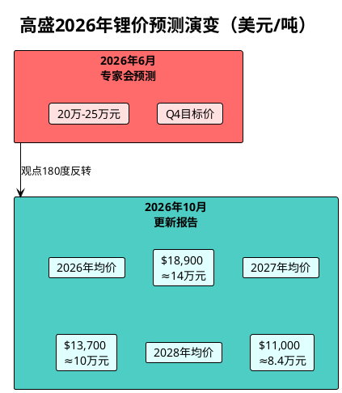
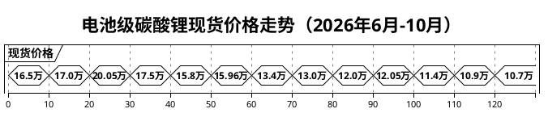
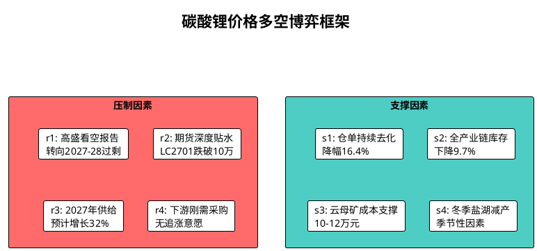

# 高盛看好碳酸锂价格上涨

**日期**: 2026年10月17日
**原报告日期**: 2026年6月13日
**数据来源**: Goldman Sachs Research, SMM上海有色网, Mysteel我的钢铁网, 广期所, 同花顺, 生意社, 长江有色金属网, S&P Global

---

## 核心摘要

2026年6月，高盛专家电话会预测Q4碳酸锂价格将飙升至20万-25万元/吨，本文对此提出强烈质疑。**如今四个月过去，市场不仅证明了原研判的正确性，而且实际走势比预期更为悲观**：

- 高盛自身已于2026年10月6日彻底转向看空，预测2027年碳酸锂均价仅10万元/吨、2028年跌至8.4万元/吨
- 电池级碳酸锂现货从6月的16万元/吨持续暴跌至10月16日的约10万元/吨，**跌破原研报预测的Q4铁顶18万元/吨后仍继续下行逾40%**
- LC2701期货合约10月16日盘中跌破10万元/吨，收于96,320元/吨
- 原研报预测Q3价格区间14-16万、Q4区间16-18万，**实际Q3均价约13.5万、Q4已跌破10万**，远低于预期

**结论：** 高盛从看多到看空的180度转弯，以及碳酸锂价格的持续崩塌，完全验证了原研报的核心判断——"18万元/吨就是铁顶"。当前市场已进入供给过剩主导的下行通道。

---

## 一、 高盛观点的戏剧性反转（2026年6月→10月）

### 1.1 6月：极度看多

2026年6月12日，高盛专家电话会纪要声称"2026年第四季度碳酸锂价格将飙升至20万-25万元/吨"，核心逻辑为"长期缺乏绿地投资导致供给刚性"。

### 1.2 10月：彻底看空

2026年10月6日，高盛全球金属与矿业研究团队发布更新报告《锂业——更新我们的全球供需格局预测，维持对2027年和2028年的谨慎看法》，**完全推翻6月的乐观判断**：

**高盛10月报告核心数据：**

| 年份 | 预测均价（美元/吨） | 约合人民币（万元/吨） | 供需平衡 |
|------|---------------------|----------------------|----------|
| 2026 | 18,915 | ~14.0万 | 缺口40.4万吨LCE（-16%） |
| 2027 | 13,689 | ~10.0万 | 过剩约8% |
| 2028 | 11,000 | ~8.4万 | 过剩约18%（44.4万吨LCE） |
| 2029-30 | 14,000 | ~10.2万 | 中期价格中枢 |

**关键判断转变：**
- 需求端：2026年表观需求增速+41%，但真实需求（EV+ESS）仅+26%，其余为补库；2027年表观需求增速骤降至+1%
- 供给端：2027年全球供给+670kt-LCE（+32%），中国产量从554kt增至806kt，江西锂云母翻倍至211kt
- 高盛原话："需求失速不是车卖不动，而是囤不动"

### 1.3 反转的市场冲击

高盛10月6日报告发布后，碳酸锂期货主力合约10月12日**单日暴跌近万点**（日内下跌9,940元/吨，跌幅8.37%），跌破11万元/吨关口。

---

## 二、 碳酸锂价格走势回顾与验证

### 2.1 2026年6月-10月价格全景

### 2.2 关键价格节点（电池级碳酸锂≥99.5%）

| 日期 | 价格（万元/吨） | 事件 |
|------|----------------|------|
| 2026年5月13日 | 20.05（年内高点） | 近两年价格峰值 |
| 2026年6月上旬 | 16.3-17.0 | 原研报撰写时价格 |
| 2026年9月2日 | ~15.96 | 9月高点 |
| 2026年9月中旬 | 12.9-13.5 | 月中跳水 |
| 2026年9月30日 | 11.85-12.20 | 月末持续走弱 |
| 2026年10月8日 | 12.05-12.35 | 国庆后 |
| 2026年10月12日 | ~11.4 | 高盛报告后暴跌 |
| 2026年10月13日 | 10.885 | 持续下行 |
| 2026年10月16日 | ~10.1 | 逼近10万关口 |

### 2.3 期货盘面（LC2701主力合约）

| 日期 | LC2701持仓（手） | 收盘价（元/吨） | 备注 |
|------|-----------------|----------------|------|
| 10月8日 | 409,678 | — | 国庆假期后 |
| 10月12日 | 429,039 | — | 月内持仓高点 |
| 10月15日 | 418,547 | 100,280 | 日增6,802手 |
| **10月16日** | **425,349** | **96,320** | **跌破10万，跌4.20%** |

10月16日LC2701盘中最低96,240元/吨，收报96,320元/吨，较前日下跌4,220元/吨（-4.20%），持仓量425,349手，成交358,976手。期货价格较现货贴水约5,180元/吨。

### 2.4 现货与期货对比（10月16日晚盘）

| 品种 | 价格区间（元/吨） | 中间价 |
|------|------------------|--------|
| 电池级（≥99.5%） | 99,500-103,500 | 101,500 |
| 优质电池级（≥99.6%） | 101,500-103,500 | 102,500 |
| 工业级（≥99.2%） | 97,500-101,500 | 99,500 |

---

## 三、 库存与仓单数据

### 3.1 广期所注册仓单（2026年10月）

| 日期 | 仓单量（手） | 变化 |
|------|-------------|------|
| 10月8日 | 31,870 | — |
| 10月9日 | 30,680 | -1,190 |
| 10月12日 | 30,677 | -3 |
| 10月15日 | 26,730 | -3,947 |
| **10月16日** | **25,640** | **-1,090** |

10月9日至16日，仓单减少约5,040手，降幅16.4%，交易所显性库存持续去化。

### 3.2 全产业链库存（截至10月15日）

| 环节 | 库存（吨） | 周环比变化 |
|------|-----------|-----------|
| 上游 | 32,115 | +773 |
| 正极材料厂 | 39,609 | -3,343 |
| 贸易商 | 41,950 | -3,275 |
| 电芯厂及其他 | 20,698 | +700 |
| **合计** | **134,372** | **-5,145** |

较10月1日的148,777吨下降约9.7%。库存虽在去化，但远不足以扭转供应宽松预期。

---

## 四、 原研报预测验证

原研报（2026年6月）对2026年Q3/Q4的价格预测与实际走势对比：

| 时间 | 原研报预测 | 实际走势 | 偏差 |
|------|-----------|---------|------|
| Q3（7-9月） | 14万-16万元/吨 | 月初15.96万→月末11.85万，均价约13.5万 | 略低于预测区间下沿 |
| Q4（10-12月） | 16万-18万元/吨 | 10月中旬已跌破10万，远低于预测 | **严重偏离，跌幅超40%** |
| "18万铁顶" | 确实未触及 | 5月摸高20万后持续下行，再未接近18万 | **判断正确** |
| Q4核心驱动 | 补库+冬季减产→价格反弹 | 高盛看空报告+供给释放预期→持续下跌 | **驱动逻辑完全错误** |

**原研报判断验证结论：**
1. "18万元/吨就是铁顶" —— 正确。5月触及20万后价格持续崩塌，Q4不仅未反弹至16-18万，反而跌破10万
2. "供给回补极其敏锐" —— 正确。价格跌破12万后云母矿减产，但非洲和盐湖增量远超预期
3. "储能是价格杀手" —— 正确。高价下储能项目延期，ESS需求增速放缓
4. "高盛的25万是极端多头叙事" —— 极其正确。高盛自己已放弃该判断并转向看空

---

## 五、 当前市场核心矛盾与后市展望

### 5.1 跌跌不休的核心逻辑

1. **供给释放超预期**：2027年全球供给预计+670kt-LCE（+32%），中国江西锂云母、非洲（津巴布韦、马诺诺）、澳洲多项目同步放量
2. **补库需求证伪**：高盛数据显示2026年表观需求+41%中，真实需求仅+26%，其余为补库；2027年表观增速骤降至+1%
3. **远期过剩共识**：期货盘面已交易2027-2028年过剩预期，LC2701较现货深度贴水
4. **资金抢跑**：期货持仓42万手僵持，空头主导定价

### 5.2 成本支撑分析

- 尾部5%供给边际成本已升至$13.1-14.6k/吨（约9.5-10.6万元）
- 80分位成本$11.0k/吨（约8万元）
- 当前价格（约10万元）已接近尾部高成本产能的成本线

### 5.3 短期展望（2026年Q4）

**预判：** Q4碳酸锂价格大概率在 **9.5万-11.5万元/吨** 区间震荡。10万元为关键心理关口，若跌破则下一支撑看至9万元（云母成本线）。冬季盐湖减产和年底刚需补库可能带来阶段性反弹，但在供给释放预期主导下，反弹空间有限。

---

## 六、 结论与操作建议

### 6.1 核心结论

1. **原研报的核心判断已被完全验证**：18万元/吨确实是铁顶，高盛的25万叙事不仅未能实现，价格反而跌破10万
2. **高盛自身的反转是最有力的信号**：从6月"Q4飙升到25万"到10月"2027年跌至10万"，4个月内180度转弯，说明供给弹性远超投行预期
3. **碳酸锂的超级周期已结束**：2020-2021年的暴涨不会在2026年重演，市场已从"供给短缺"叙事全面转向"供给过剩"定价

### 6.2 操作建议

- **现货企业**：顺势去库，避免囤货；利用期货空头对冲库存贬值风险
- **期货操作**：反弹至11万以上可布局空单，目标看至9-9.5万
- **股票端**：锂矿股仍面临盈利下修风险（高盛已下调赣锋、天齐评级至卖出/中性），需等待价格企稳信号
- **关注变量**：江西云母实际减产幅度、津巴布韦出口政策落地情况、11-12月储能排产数据

---

## 数据来源

| 来源 | 内容 | 时间 |
|------|------|------|
| Goldman Sachs Research | 锂业更新报告 | 2026年10月6日 |
| SMM上海有色网 | LC2701期货行情、现货报价 | 2026年10月16日 |
| Mysteel我的钢铁网 | 现货价格、全产业链库存 | 2026年10月15日 |
| 广期所 | 仓单日报 | 2026年10月16日 |
| 同花顺 | 现货报价、持仓数据 | 2026年10月16日 |
| 生意社 | 基准价 | 2026年9月30日 |
| 长江有色金属网 | 持仓分析 | 2026年10月 |
| S&P Global | 国际市场评估 | 2026年10月 |
| 中国金融信息网 | 高盛报告解读 | 2026年10月12日 |
