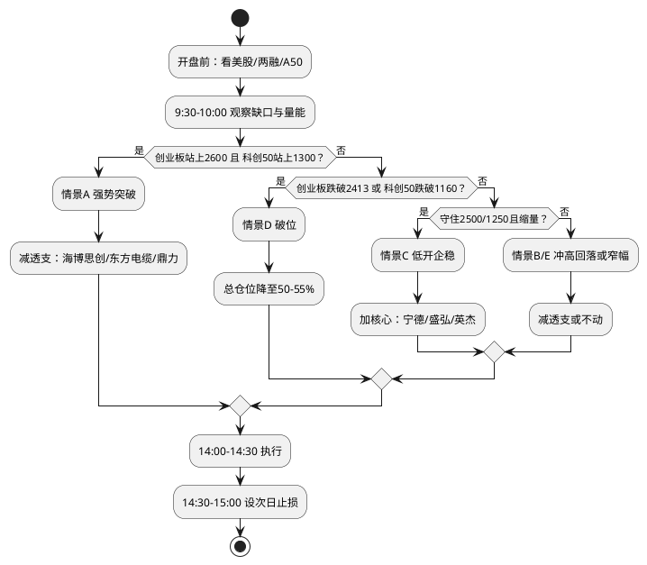

# A股反弹跟踪操作手册（2026年11月6日）

> **日期**：2026年11月6日  
> **数据截至**：2026年11月6日收盘；两融为11月5日T-1口径  
> **适用范围**：本轮政策驱动反弹的每日跟踪、持仓结构与盘中应对  
> **文档性质**：市场策略/操作跟踪文档，不纳入 `investigation/macro/` 的 L0/L1/L2 三层体系  
> **版本说明**：第1—8节保留2026-11-05基准内容；2026-11-06行情、外部冲击、持仓回顾与下周计划见第9节  
> **声明**：本文为研究框架与操作纪律记录，不构成个性化投资建议

---

## 0. 一句话结论

本轮反弹是“政策底 + 资金底 + 极端超跌”的三重共振，性质是高弹性修复，不是已经确认的反转。当前持仓 70%、11 只股票，核心任务不是继续选股，而是**把“反弹已透支”的仓位换成“尚未修复到 MA60”的核心仓位，留出回踩的子弹**；用盘中 if-then 规则执行，不用预测替代应对。

> **11-06 最新结论**：外部 AI 硬件链遭遇“黑色星期四”，本轮反弹从“政策+AI”双轮变成“政策+防御”单轮；10月30日低点最终成立的概率由 55% 下调至 **45%**，二次探底概率升至 **35%**。下周守住创业板 2413 / 科创50 1160 是确认关键。详见第 9 节。

---

## 1. 本轮反弹的事实与性质

### 1.1 两日行情

| 日期 | 上证 | 深成指 | 创业板 | 科创50 | 成交额 | 特征 |
|---|---:|---:|---:|---:|---:|---|
| 10-30 | 3599.02（-1.44%） | 10833.78（-2.73%） | 2413.63（-4.13%） | 1160.84（-5.48%） | 1.69万亿 | 年内收盘新低 |
| 11-02 | 3638.03（+1.08%） | 11010.68（+1.63%） | 2458.70（+1.87%） | 1196.94（+3.11%） | 1.79万亿 | 政策信号日 |
| 11-03 | 3608.10（-0.82%） | 10876.99（-1.21%） | 2391.65（-2.73%） | -3.81% | 1.70万亿 | 回吐 |
| 11-04 | 3686.17（+2.16%） | 11335.69（+4.22%） | 2544.73（+6.40%） | 1265.47（+9.92%） | 2.04万亿 | 大反攻，123家涨停 |
| 11-05 | 3689.91（+0.10%） | 11471.09（+1.19%） | 2566.80（+0.87%） | 1286.68（+1.68%） | 2.12万亿 | 冲高回落，轮动扩散，85家涨停/0跌停 |

从 10-30 收盘到 11-05 收盘：上证 +2.52%、深成指 +5.88%、创业板 +6.35%、科创50 +10.84%。

2026 年峰谷回撤（收盘口径）：

| 指数 | 2026 峰值 | 10-30 谷值 | 回撤 | 当前距高点 |
|---|---:|---:|---:|---:|
| 上证 | 4242.6 | 3599.0 | -15.2% | -13.0% |
| 深成指 | 16372.5 | 10833.8 | -33.8% | -29.9% |
| 创业板 | 4372.0 | 2413.6 | -44.8% | -41.3% |
| 科创50 | 2207.9 | 1160.8 | -47.4% | -41.7% |

全市场广度（本地 K 线，截至 10-30）：个股收益中位数 -22.2%，仅 18.5% 上涨；个股距 2026 年高点回撤中位数 -41.8%，78.1% 的个股回撤超过 30%；仅 11.8% 站上 MA60，8.8% 站上 MA200。

### 1.2 为什么涨：四层驱动

1. **政策层**：11-02 证监会答记者问，明确第三批互换便利、回购增持再贷款常态化、护盘式回购规则优化、首批 18 只主动 ETF 加快建仓、两融风控指标研究优化；11-03 央行开展第三批互换便利 1000 亿元，31 家机构参与；11-04 股票回购增持再贷款利率从 1.25% 降至 1%，银行报送额度申请超 2000 亿元。
2. **资金层**：宽基 ETF 连续 21 个交易日净流入合计 4720 亿元；11-03 单日净流入约 800 亿元，为历史第二高；首批主动 ETF 募集超 350 亿元。但两融 11-03 前 4 个交易日累计减少 1132 亿元，11-04 仅回升 15.84 亿元，杠杆资金只是“止跌”，不是“回流”。
3. **外部层**：11-04 美国中期选举民主党横扫参众两院，道指 +3.03%、标普 +1.58%、纳指 +1.44%；10 年期美债收益率回落至 4.89%（-7bp），布伦特原油跌近 10% 至 100 美元下方，美元走弱，黄金 +3%。但费半 -3.14%、英伟达 -3.17%，AI 基础设施因监管担忧被抛售；美联储 12 月加息概率仍约 81.5%。
4. **技术层**：创业板自 6 月高点 -44.8%、科创50 自 6 月高点 -47.4%；创业板 PE 约 27 倍、近十年 5.5% 分位，科创50 PE 约 86 倍、近十年 3.7% 分位；10 月日均成交额 1.61 万亿元，较 9 月 1.83 万亿元缩量。

### 1.3 反弹的性质

- **政策底大概率已现**：本轮政策是“给钱 + 改规则 + 松杠杆”的组合，且从阶段性安排转为制度化安排，强于 2015 年临时救市、2018 年喊话。
- **市场底尚未确认**：创业板 -44.8%、科创50 -47.4% 的跌幅已达到 2015/2022 级别；历史上深度回撤中的第一波反弹，多数会在 20 日内回踩。
- **当前更像“低点已现、政策跟上”的 2024-02/2024-09/2025-04**，但外部利率环境更差（美联储 12 月加息概率约 81.5%），因此基准情形是“底部区域反复”，不是 V 型反转。

### 1.4 历史 base rate

以 2014-2026 年指数日线计算：

| 样本 | 条件 | 样本数 | 20 日收益中位数 | 20 日胜率 | 20 日内再创新低 |
|---|---|---:|---:|---:|---:|
| 上证 | 120 日高点回撤 ≥10% 时出现单日 ≥2% 反弹 | 53 | +0.8% | 58% | **81%** |
| 创业板 | 120 日高点回撤 ≥10% 时出现单日 ≥4% 反弹 | 47 | +1.6% | 60% | **85%** |
| 创业板 | 回撤 ≥30% 时出现单日 ≥4% 反弹 | 27 | +3.6% | 70% | **89%** |

结论：深度回撤中的第一波反弹，20 日预期收益并不差，但**几乎一定会回踩**；可以交易，不能当作底部确认。

---

## 2. 关键位置与情景

### 2.1 三大指数关键位

| 指数 | 11-05 收盘 | 第一阻力 | 第一支撑 | 中线证伪位 |
|---|---:|---:|---:|---:|
| 上证 | 3689.91 | 3700 | 3650 | 3600 / 3574 |
| 创业板 | 2566.80 | 2600 | 2500 | 2413（10-30 收盘低点）/ 2376（10-27 盘中低点） |
| 科创50 | 1286.68 | 1300 | 1250 | 1160（10-30 低点） |

### 2.2 五种情景（概率为主观判断）

| 情景 | 触发条件 | 概率 | 总仓位动作 | 结构动作 |
|---|---|---:|---|---|
| **A. 强势突破** | 创业板站上 2600、科创50 站上 1300，成交额 >2.2 万亿，上涨家数 >3500，涨停 >80 | 20% | 70% → 62-65% | 减透支：海博思创、东方电缆、鼎力各减 1/3-1/2；核心持有不追 |
| **B. 冲高回落** | 早盘冲高，10:30 前跌破开盘价/昨收；创业板站不上 2600，放量不涨 | 30% | 70% → 58-62% | 海博思创、东方电缆、鼎力各减 1/2；英杰、盛弘各减 1/4 |
| **C. 低开企稳** | 低开 0.5-1%，10:00 前守住创业板 2500 / 科创50 1250，缩量，涨跌家数改善 | 25% | 65% → 68-70% | 加核心：宁德 250-255、盛弘 32-33、英杰 50-52 |
| **D. 破位下跌** | 创业板跌破 2413/2376，科创50 跌破 1160，放量下跌，跌停 >10 家 | 15% | 降至 50-55% | 高 Beta 减半：海博思创、东方电缆、鼎力、英杰；保留平高、南瑞、银行、美的 |
| **E. 窄幅整理** | 创业板 2500-2600、科创50 1250-1300 震荡，成交额 1.8-2.2 万亿 | 10% | 维持 65% | 不动，只挂止损 |

### 2.3 情景触发后的执行原则

- **先减后加**：强势先减透支，弱势企稳再加核心；不在同一天既追高又抄底。
- **总仓位开关**：创业板 2413、科创50 1160 是总仓位开关，不是个股止损开关；破位先降总仓位，再谈个股。
- **不在开盘 30 分钟内做决定**：10:00 和 14:00 是两个决策点；14:30-15:00 只执行，不改变方向。

---

## 3. 持仓结构诊断（70% 仓位，11 只）

### 3.1 真实结构：一个主题 + 两个防御

11 只持仓中：

- **电力设备/新能源产业链 7 只**：宁德时代、盛弘股份、海博思创、英杰电气、东方电缆、平高电气、国电南瑞；
- **防御 3 只**：美的集团、招商银行、北京银行；
- **出口制造 1 只**：浙江鼎力。

对应的真实风险结构大致是：

- 电力设备/新能源主题约 **45-50%**（相关性高，涨跌同步）；
- 防御约 **15-20%**（负 Beta，能缓冲但不进攻）；
- 出口制造约 **5%**（独立行情）。

**这不是“11 只分散股票”，而是一个“电力设备/新能源主题基金 + 两只银行 + 美的 + 鼎力”。** 真正能扛回撤的只有银行和美的。

### 3.2 压力测试

假设 7 只电力设备/新能源股票占组合 45-50%：

- 若回踩中平均下跌 15%，组合约 **-7%**；
- 若平均下跌 20%，组合约 **-9%**；
- 若银行/美的同时下跌 3%，再加约 **-0.6%**。

70% 仓位在反弹第二天、指数阻力位，最大回撤可能达到 **-7% 到 -10%**。这是当前仓位需要管理的核心风险。

### 3.3 建议目标权重（总仓位 65%，留 35% 现金）

| 股票 | 建议权重 | 角色 | 说明 |
|---|---:|---|---|
| 宁德时代 | 10% | 核心 | 修复空间最大，流动性最好 |
| 盛弘股份 | 6% | 进攻 | 未到 MA60，回踩加 |
| 英杰电气 | 5% | 进攻 | Beta 最高，仓位控制 |
| 海博思创 | 3% | 进攻（观察） | 从超配减到观察仓 |
| 东方电缆 | 2% | 进攻（观察） | 超买，先减 |
| 浙江鼎力 | 2% | 动量（观察） | 新高突破，不追 |
| 平高电气 | 6% | 稳健 | 已站上 MA60 |
| 国电南瑞 | 6% | 稳健 | 低 Beta 压舱石 |
| 美的集团 | 9% | 防御 | 负 Beta，防御 |
| 招商银行 | 10% | 防御 | 负 Beta，防御 |
| 北京银行 | 6% | 防御 | 负 Beta，防御 |
| **合计** | **65%** | | **现金 35%；若回踩确认，加回 70%** |

如果实际权重集中在涨得多的三只（海博思创、东方电缆、鼎力），减仓力度要更大，先把三只合计压到 8-9%。

---

## 4. 个股角色与操作表

### 4.1 三张清单

| 股票 | 角色 | 当前状态（11-05） | 动作 |
|---|---|---|---|
| 海博思创 | 高 Beta 进攻 | 5 日 +43.6%，距 MA20 +26.4%，RSI 70 | **减 1/3-1/2** |
| 东方电缆 | 个股独立行情 | 距 MA20 +14.3%，RSI 74 | **减 1/3** |
| 浙江鼎力 | 新高突破 | 5 日 +18.4%，RSI 77，距 MA20 +16.0% | **减 1/3** |
| 美的集团 | 防御 | 距高点 -1.2%，负 Beta | 持有，超配则减 |
| 宁德时代 | 低 Beta 核心 | 距 MA60 -16.9%，修复空间最大 | 持有，回踩加 |
| 盛弘股份 | 高 Beta 未透支 | 距 MA60 -8.3%，RSI 54 | 持有，回踩加 |
| 英杰电气 | 高 Beta 未透支 | 距 MA60 -5.6%，RSI 50 | 持有，回踩加 |
| 平高电气 | 稳健电网 | 已站上 MA60，回撤仅 -13.7% | 持有，不追加 |
| 国电南瑞 | 低 Beta 防御 | 5 日仅 +1.0%，Beta 0.05 | 持有作底仓 |
| 招商银行 | 防御 | 负 Beta，距高点 -2.3% | 持有 |
| 北京银行 | 防御 | 负 Beta，距高点 -1.7% | 持有 |

### 4.2 个股 if-then 表

| 股票 | 涨到 | 动作 | 跌到 | 动作 |
|---|---:|---|---:|---|
| 海博思创 | >200 | 减 1/3-1/2 | <150 | 减半；<128.6 清仓 |
| 东方电缆 | >42 | 减 1/3 | <37.5 | 减半；<35.9 加速 |
| 浙江鼎力 | >63 | 减 1/3 | <55 | 减半；<52 清仓 |
| 英杰电气 | >56.9 | 放量站上才加；否则不追 | 50-52 | 加 1-2%；<48 减半 |
| 盛弘股份 | >37.5 | 放量站上才加 | 32-33 | 加 1-2%；<29.8 减半 |
| 宁德时代 | >272 | 加 1-2% | 250-255 | 加 2-3%；<230 减 1/3 |
| 平高电气 | >22.5 | 不追，可减 1/4 | 20.1-21.0 | 持有/小加；<19.5 减半 |
| 国电南瑞 | >24.9 | 不追，可减 1/4 | 22.5-23.1 | 持有/小加；<21.7 减半 |
| 美的集团 | >92 | 减 1/4 | 85-86 | 持有/防御加；<82 减半 |
| 招商银行 | >45 | 减 1/4 | 41-42 | 持有/防御加；<39.5 减半 |
| 北京银行 | >6.2 | 减 1/4 | 5.5-5.6 | 持有/防御加；<5.3 减半 |

> 以上“加”均指用减仓出来的现金加，不是加杠杆；总仓位不超过 70%。

### 4.3 止损表

| 股票 | 第一减仓线 | 第二止损线 | 说明 |
|---|---:|---:|---|
| 海博思创 | 150 | 128.6 | 跌破 150 减半，跌破前低清仓 |
| 东方电缆 | 37.5 | 35.9 | 37.5 是 MA20/MA60 粘合带 |
| 浙江鼎力 | 55 | 52 | 55 是 MA60，52 是突破失败 |
| 英杰电气 | 48 | 42.9 | 48 是短期支撑，42.9 是前低 |
| 盛弘股份 | 32.0 | 29.8 | 32 是 MA20，29.8 是前低 |
| 宁德时代 | 250 | 220.4 | 250 是 MA20，220.4 是前低 |
| 平高电气 | 20.1 | 19.5 / 16.4 | 20.1 是 MA60，19.5 是密集支撑 |
| 国电南瑞 | 22.5 | 21.7 | 22.5 是 MA20/60 粘合带 |
| 美的集团 | 85 | 82 | 85 是 MA20/60 |
| 招商银行 | 41 | 39.5 | 41 是 MA20 |
| 北京银行 | 5.5 | 5.3 | 5.5 是 MA20/60 |

**执行原则**：第一减仓线到了先减 1/3-1/2，不要一次清；第二止损线到了再清。高 Beta（海博思创、英杰、盛弘、东方电缆）严格执行，低 Beta（南瑞、银行、美的）可给一点缓冲。

---

## 5. 盘中执行流程

### 5.1 开盘前（9:15 前）

| 要看什么 | 具体指标 | 对当天的含义 |
|---|---|---|
| 美股 11-5 收盘 | 纳指、费半（SOXX）、10Y 美债、油价、美元 | 费半继续跌 → 半导体/CPO 承压；10Y 下行 → 成长估值利好 |
| 11-5 两融数据（盘前公布） | 融资余额是否连续第 2 日回升；科创是否转正 | 连续回升 → 反弹质量升级；再降 → 11-04 的 +13 亿只是一日反抽 |
| A50 期货/人民币 | 开盘前涨跌 | 大幅低开 → 先看 2500/1250 是否守住 |
| 隔夜消息 | 美国非农预期、AI 监管、光伏/储能政策 | 非农在周五晚，尾盘不要重仓赌数据 |

### 5.2 四个时间窗口

| 时间 | 看什么 | 强势信号 | 弱势信号 |
|---|---|---|---|
| 9:30-10:00 | 集合竞价缺口、前 30 分钟量能、涨跌家数 | 高开不补缺口，前 30 分钟成交额 >5000 亿 | 高开快速回补，跌破昨收；前 30 分钟 <3500 亿 |
| 10:00-11:30 | 创业板 2600、科创50 1300、上证 3700 能否站上 | 站上且回踩不破，涨停 >80、无跌停 | 冲高回落，涨停 <50、跌停出现 |
| 13:00-14:00 | 下午是否创新高/新低；板块是轮动还是普跌 | 光伏/半导体设备/机器人接力，CPO 止跌 | 只有 CPO 跌、其他也不涨；银行/石油护指数但个股普跌 |
| 14:00-14:30 | 决策窗口：按情景执行减/加 | 放量站稳关键位 | 放量跌破关键位 |
| 14:30-15:00 | 尾盘执行，设好次日止损 | 不在尾盘追高（周五 T+1，隔夜有非农） | 不在尾盘恐慌割（除非破位） |

### 5.3 决策树

### 5.4 执行顺序

1. **先减（开盘后根据情景）**：海博思创、东方电缆、鼎力各减 1/3-1/2；如果美的超配，也减到 9% 以内。目标是把总仓位从 70% 降到 62-65%，留 6-8% 现金。
2. **后等（盘中不追）**：等指数回踩 2500/1250，或个股回踩 MA20。
3. **再加（回踩确认后）**：优先宁德、盛弘、英杰；平高、南瑞只在深跌时补；银行、美的只在防御需要时买。
4. **止损（全程）**：按止损表执行；如果指数跌破 2413/1160，不等个股止损，先把总仓位降到 50-55%。

---

## 6. 每日跟踪模板

| 模块 | 看什么 | 记录格式 | 信号判断 |
|---|---|---|---|
| 1. 指数 | 上证/创业板/科创50 收盘、涨跌幅、关键位 | 数值 + 是否守住 | 守住/跌破 |
| 2. 量能 | 两市成交额、连续天数 | 亿元 | >2.2 万亿强，1.8-2.2 万亿中性，<1.8 万亿弱 |
| 3. 广度 | 涨跌家数、涨停/跌停 | 家数 | 上涨 >3500 强，<2000 弱；涨停 >80 健康，<50 退潮；跌停 >10 警告 |
| 4. 结构 | 领涨/领跌申万行业、主力资金 | 前 3/后 3 | 光伏/半导体设备/机器人接力=健康；只有 CPO 跌=轮动；全成长跌=风险 |
| 5. 资金 | 两融（T-1）、ETF 净流入、北向成交 | 亿元 | 两融连续 2 日回升=确认；ETF 净流入延续=托底 |
| 6. 外部 | 10Y 美债、美联储加息概率、SOXX、油价、美元 | 数值 | 10Y <4.9% 利多；>5.0% 利空；加息概率 >80% 压制 |
| 7. 结论 | 确认/证伪、概率更新、次日动作 | 文字 | 低点成立概率、总仓位、个股动作 |

---

## 7. 观察日历

| 时间 | 事件 | 关注点 |
|---|---|---|
| 11-06 盘前 | 11-05 两融数据 | 融资余额能否连续第 2 日回升；科创能否转正 |
| 11-06 晚间 | 美国 10 月非农 | 强于预期 → 加息概率升 → 压制成长；弱于预期 → 利好 |
| 11-10 | 美国 10 月 CPI | 核心 CPI 是否继续回落，决定 12 月加息路径 |
| 11 月内 | 国网第五/六批招标 | 平高、南瑞的订单份额 |
| 11 月内 | 光伏装机/组件价格 | 光伏设备、储能链的景气验证 |
| 12 月 | 美联储议息会议 | 12 月加息是否落地 |
| 12 月 | 国网 2027 年投资预算 | 电网设备的中期需求锚 |
| 2027-01 | 2026 年业绩预告（如有） | 高估值成长股的业绩验证 |
| 2027-03/04 | 2026 年年报 + 2027Q1 | 本轮反弹的最终基本面裁决 |

---

## 8. 数据与口径

1. **指数与个股价格**：新浪财经指数/个股日线（2014-07 至 2026-11-05）；本地 `daily_kline` 用于全市场广度与个股回撤交叉验证，全市场数据截至 2026-10-30。
2. **两融**：11-04 为 T-1 口径；沪深北合计 23004.45 亿元，融资余额 22718.19 亿元；科创板两融 2889.05 亿元。
3. **ETF 与资金流**：公开报道（财联社、证券时报、上海证券报等）转引的交易所/Choice 数据；不同口径的成交额与净流入不可直接加减。
4. **估值分位**：2026-11-03 公开数据；创业板 PE 约 27 倍、近十年 5.5% 分位；科创50 PE 约 86 倍、近十年 3.7% 分位。
5. **历史 base rate**：基于 2014-2026 年指数日线自算，样本存在重叠和 regime 差异，不能直接外推。
6. **概率**：情景概率为主观判断，不是统计概率；每日根据量能、广度、两融、外部变量更新。
7. **免责声明**：本文为研究框架与操作纪律记录，不构成个性化投资建议；市场有风险，操作需结合自身风险承受能力。

---

## 9. 2026-11-06 更新：外部 AI 冲击，内部防御接力

### 9.1 11-06 行情

| 指数 | 收盘 | 涨跌 | 成交额 | 关键位 |
|---|---:|---:|---:|---|
| 上证 | 3649.18 | **-1.10%** | 7726 亿 | 守住 3600 |
| 深成指 | 11175.78 | -2.57% | 8852 亿 | — |
| 创业板 | 2465.23 | **-3.96%** | 4440 亿 | 守住 2413 |
| 科创50 | 1253.20 | **-2.60%** | 896 亿 | 逼近 1250 |
| 北证50 | 888.48 | -2.37% | — | — |
| 两市合计 | — | — | **1.66 万亿（-4602 亿，-21.8%）** | — |

- 涨跌家数：**758 涨 / 4741 跌 / 80 平**，33 家涨停 / 15 家跌停，上涨占比约 13%。
- 领涨：银行、电力、农业种植、公路铁路、电信服务、公用事业（防御/红利）。
- 领跌：CPO -4.35%、PCB -3.93%、元件、电子化学品、半导体、消费电子（AI 硬件链）。

### 9.2 外部冲击：美股 AI 硬件链“黑色星期四”

11-05 美股收盘：

| 指标 | 收盘/变化 |
|---|---:|
| 纳斯达克 | 24315.00，**-5.52%** |
| 标普500 | 7353.73，-4.36% |
| 道琼斯 | 51523.06，-3.44% |
| 费城半导体 | **-12.25%** |
| 英伟达 | -9.26% |
| AMD | -17.26% |
| 美光 | -17.46% |
| 台积电 | -10.78% |
| 10 年期美债 | 4.837%，-5.7bp |
| VIX | 28.18，+69.66% |
| 黄金 | 4097.9，+0.61% |
| WTI 原油 | 91.08，+3.36% |

**触发点**：民主党横扫国会后，党内高层公开呼吁“全国数据中心暂停令”；微软收紧对新云厂商的项目审核；市场开始重新定价 AI 资本开支的持续性。这是外部 AI 叙事的重创，不是国内政策失败。

**对 A 股的含义**：本轮反弹原本有“国内政策 + 全球 AI”两个支柱，今天全球 AI 支柱被打断，只剩“国内政策 + 防御/内需”一个支柱。

### 9.3 为什么 A 股没有出现“百股跌停”

- 上证低开 -2.11%，最低 -2.16%，收盘只跌 -1.10%；
- 创业板开盘 -4.99% 即为全天最低，收盘 -3.96%；
- 全市场只有 15 家跌停，成交额缩量 21.8%，说明抛压没有失控，持筹心态相对稳定；
- 资金没有离场，而是从 AI 硬件切到了银行、电力、农业、公用事业。

**两融继续回升**：11-05 融资余额 22709.77 亿元，较前一交易日 **+66.22 亿元**，连续第 2 日增加；两融余额合计 23073.34 亿元。杠杆资金没有在外部冲击前撤退，这是国内支柱仍有效的证据。

**周线仍是反弹周**：本周上证 +1.39%、深成指 +3.16%、创业板 +2.14%、科创50 约 +8%；沪深300 终结周线 12 连跌。周五的下跌是反弹周内的回踩，不是周线级别的破位。

### 9.4 持仓与操作回顾

| 股票 | 11-06 收盘 | 11-06 涨跌 | 距 MA20 | 距 MA60 | 距阶段低点 | RSI | 备注 |
|---|---:|---:|---:|---:|---:|---:|---|
| 美的集团 | 89.60 | **+1.68%** | +4.1% | +5.2% | 新高 | 63 | 防御，创新高 |
| 北京银行 | 5.86 | +1.56% | +3.6% | +7.5% | +1.6% | 63 | 防御 |
| 国电南瑞 | 23.86 | +1.40% | +2.9% | +3.9% | +10.1% | 60 | 低 Beta 电网 |
| 招商银行 | 42.88 | +0.80% | +0.6% | +4.6% | +0.8% | 57 | 防御 |
| 平高电气 | 21.76 | +0.74% | +3.6% | +7.9% | +32.4% | 61 | 稳健电网 |
| 海博思创 | 182.50 | -1.16% | +24.0% | +6.7% | +41.9% | 68 | **已清仓** |
| 浙江鼎力 | 60.13 | -2.10% | +12.7% | +9.2% | — | 70 | 高位动量，新高附近 |
| 东方电缆 | 40.06 | -2.29% | +11.1% | +11.7% | +24.4% | 67 | **已减一点，仍超买** |
| 盛弘股份 | 33.47 | -2.62% | +3.5% | -10.6% | +12.4% | 50 | 高 Beta，未到 MA60 |
| 宁德时代 | 254.22 | -3.73% | +0.5% | -19.4% | +15.3% | 44 | 高 Beta 核心 |
| 英杰电气 | 51.39 | **-4.28%** | -0.8% | -9.6% | +19.8% | 46 | 半导体设备，受 AI 冲击最大 |

**操作回顾：**

1. **海博思创清仓**：今天只跌 -1.16%，比创业板 -3.96% 抗跌，但它不是 CPO/AI 硬件，受“数据中心暂停令”的直接冲击小。清仓的逻辑是 5 日 +43.6%、距 MA20 +26.4%、RSI 70 的极端透支，属于风险纪律，不是预测；**过程对，不必因为今天少跌而后悔**。
2. **东方电缆减一点**：今天 -2.29%，仍距 MA20 +11.1%、距 MA60 +11.7%、RSI 67，还是超买区；**反弹到 41-42 可以再减 1/3**，跌破 37.5 把剩余仓位减半。
3. **组合表现**：按 11 只等权估算，今天约 **-0.91%**；按 70% 仓位折算约 **-0.64%**，明显好于创业板 -3.96%。5 只防御/电网收涨，对冲了 6 只成长股的下跌——**“一个主题+两个防御”的结构今天发挥了作用**。实际组合因清仓海博思创、减仓东方电缆，回撤可能更小。

### 9.5 判断更新

| 日期 | 低点成立概率 | 二次探底概率 | V 型反转概率 | 依据 |
|---|---:|---:|---:|---|
| 11-05 | 55% | 30% | 15% | 两日反弹+量能+两融止跌 |
| **11-06** | **45%** | **35%** | **20%** | 外部 AI 冲击，创业板 -3.96%，但守住 2413 |

**下调理由：**

1. 外部 AI 叙事被重创：费半 -12.25%、纳指 -5.52%，“数据中心暂停令”不是一天的事，AI 硬件/CPO/半导体可能持续承压。
2. 创业板收盘 2465，距离 2413 只有 2.1%；科创50 1253，距离 1160 只有 7.4%。下周初是真正的考验。
3. 但国内支柱还在：两融连续第 2 日回升，银行/电力/农业逆势涨，成交额缩量而非放量下跌。

**结构判断**：这轮反弹的领涨主线从“AI 硬件”切换到“电力/银行/农业/光伏储能”。如果下周守住关键位，反弹可以继续，但更可能是“防御/内需领涨的结构性反弹”，不是“AI 硬件领涨的趋势反转”。

### 9.6 下周计划（11-09 起）

| 情景 | 触发 | 动作 | 总仓位 |
|---|---|---|---|
| **A. 回踩守住** | 创业板 2413-2465、科创50 1160-1253 缩量企稳，银行/电力继续强 | 加核心：宁德 250-255、盛弘 32-33；防御仓持有 | 65-70% |
| **B. 跌破证伪** | 创业板跌破 2413/2376、科创50 跌破 1160，放量下跌 | 减高 Beta：英杰、盛弘、宁德；保留美的、银行、南瑞、平高 | 50-55% |
| **C. 反抽阻力** | 创业板反抽 2500-2600、科创50 1300 但量能不足 | 减透支：东方电缆 41-42、鼎力 60-63；不追 | 62-65% |

| 股票 | 下周动作 | 触发/止损 |
|---|---|---|
| **东方电缆** | 反抽 41-42 再减 1/3；不追 | 跌破 37.5 减半，35.9 加速 |
| **海博思创** | 已清仓，不追；若回踩 160-170 且指数守住，可小仓做反弹 | 不追 190 以上 |
| **宁德时代** | 250-255 是加仓区，收盘 254.22 已到；守住可加 1-2% | 跌破 250 观察，230 减 1/3，220.4 清 |
| **盛弘股份** | 32-33 是加仓区，收盘 33.47；守住可加 1-2% | 跌破 32 观察，29.8 减半 |
| **英杰电气** | 收 51.39，已跌破 MA20；半导体设备受 AI 冲击最大，暂不加 | 48 减半，42.9 清 |
| **平高电气** | 防御，持有；不追 22.5 以上 | 20.1 减半，19.5/16.4 止损 |
| **国电南瑞** | 防御，持有；22.5-23.1 可小加 | 21.7 减半 |
| **美的集团** | 防御领涨，持有；不追 92 以上 | 85 减半，82 止损 |
| **招商银行** | 防御，持有；41-42 可加 | 39.5 止损 |
| **北京银行** | 防御，持有；5.5-5.6 可加 | 5.3 止损 |
| **浙江鼎力** | 高位动量，持有可减 1/3；不追 | 55 减半，52 清 |

**仓位建议**：

- 清掉海博思创、略减东方电缆后，总仓位大约 **65-68%**，现金约 **32-35%**。
- 周一不急着加：外部冲击需要 2-3 天消化，等指数回踩 2413/1160 守住，再考虑加宁德/盛弘。
- 如果跌破 2413/1160：不要补仓，先把总仓位降到 50-55%，保留美的、银行、南瑞、平高。
- 如果反抽 2600/1300：不要追，反而借反弹再减东方电缆/鼎力。

### 9.7 周一盘前 checklist

| 时间 | 看什么 | 对当天的含义 |
|---|---|---|
| 周一 9:00 前 | 美股周五收盘、费半、纳指、10Y | 费半继续跌 → AI 硬件/半导体承压；10Y 下行 → 成长估值边际利好 |
| 周一 9:00 前 | 11-06 两融数据（盘前公布） | 融资余额能否连续第 3 日回升；转降 → 杠杆资金又撤 |
| 周一 9:15 前 | A50 期货、人民币 | 大幅低开 → 先看 2413/1160 是否守住 |
| 周一 9:30-10:00 | 创业板 2413/2465、科创50 1160/1253 | 守住 → 健康回踩；跌破 → 情景 B |
| 周一 10:00-11:30 | 银行/电力/农业 vs CPO/半导体 | 防御继续强 → 结构性反弹延续；防御也跌 → 全面风险规避 |

### 9.8 数据与口径（11-06 更新）

1. **11-06 指数、成交额、涨跌家数**：新华财经、智通财经、财联社公开报道；不同口径的成交额（沪深 vs 沪深北）不可直接加减。
2. **个股价格**：新浪财经个股日线（截至 2026-11-06 收盘）；本地 `daily_kline` 全市场数据仍截至 2026-10-30。
3. **两融**：11-05 为 T-1 口径；融资余额 22709.77 亿元（沪深），两融余额 23073.34 亿元（沪深北）。
4. **美股**：2026-11-05 收盘；纳指、标普、道指、费半、10Y、VIX、黄金、WTI 均来自公开报道。
5. **组合收益**：11 只等权估算，未考虑实际权重、交易成本和清仓/减仓时点；实际收益以账户为准。
6. **概率**：情景概率为主观判断，不是统计概率；每日根据量能、广度、两融、外部变量更新。
